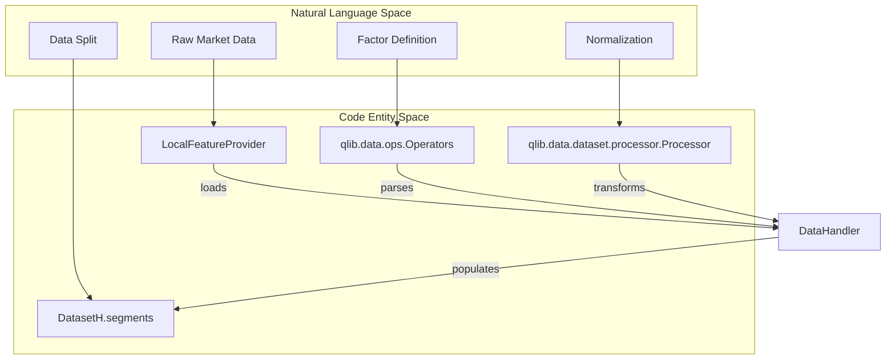
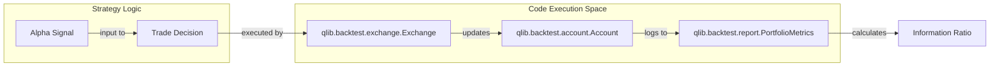

<!-- source: DeepWiki mcp.deepwiki.com · repo microsoft/qlib · page 12 Glossary · fetched 2026-10-26 -->

# Glossary

Relevant source files

The following files were used as context for generating this wiki page:

- [README.md](README.md)
- [docs/start/initialization.rst](docs/start/initialization.rst)
- [docs/start/installation.rst](docs/start/installation.rst)
- [examples/benchmarks/README.md](examples/benchmarks/README.md)
- [examples/benchmarks/TFT/README.md](examples/benchmarks/TFT/README.md)
- [examples/benchmarks/TFT/requirements.txt](examples/benchmarks/TFT/requirements.txt)
- [examples/model_rolling/task_manager_rolling.py](examples/model_rolling/task_manager_rolling.py)
- [examples/online_srv/update_online_pred.py](examples/online_srv/update_online_pred.py)
- [examples/run_all_model.py](examples/run_all_model.py)
- [qlib/__init__.py](qlib/__init__.py)
- [qlib/backtest/decision.py](qlib/backtest/decision.py)
- [qlib/backtest/exchange.py](qlib/backtest/exchange.py)
- [qlib/backtest/high_performance_ds.py](qlib/backtest/high_performance_ds.py)
- [qlib/backtest/report.py](qlib/backtest/report.py)
- [qlib/config.py](qlib/config.py)
- [qlib/contrib/data/handler.py](qlib/contrib/data/handler.py)
- [qlib/data/base.py](qlib/data/base.py)
- [qlib/data/data.py](qlib/data/data.py)
- [qlib/data/dataset/__init__.py](qlib/data/dataset/__init__.py)
- [qlib/data/dataset/handler.py](qlib/data/dataset/handler.py)
- [qlib/data/dataset/loader.py](qlib/data/dataset/loader.py)
- [qlib/data/dataset/processor.py](qlib/data/dataset/processor.py)
- [qlib/data/dataset/utils.py](qlib/data/dataset/utils.py)
- [qlib/data/ops.py](qlib/data/ops.py)
- [qlib/log.py](qlib/log.py)
- [qlib/model/trainer.py](qlib/model/trainer.py)
- [qlib/utils/__init__.py](qlib/utils/__init__.py)
- [qlib/utils/index_data.py](qlib/utils/index_data.py)
- [qlib/utils/time.py](qlib/utils/time.py)
- [qlib/workflow/__init__.py](qlib/workflow/__init__.py)
- [qlib/workflow/exp.py](qlib/workflow/exp.py)
- [qlib/workflow/expm.py](qlib/workflow/expm.py)
- [qlib/workflow/recorder.py](qlib/workflow/recorder.py)
- [qlib/workflow/task/collect.py](qlib/workflow/task/collect.py)
- [qlib/workflow/task/gen.py](qlib/workflow/task/gen.py)
- [qlib/workflow/task/manage.py](qlib/workflow/task/manage.py)
- [qlib/workflow/task/utils.py](qlib/workflow/task/utils.py)
- [qlib/workflow/utils.py](qlib/workflow/utils.py)
- [tests/backtest/test_file_strategy.py](tests/backtest/test_file_strategy.py)
- [tests/misc/test_index_data.py](tests/misc/test_index_data.py)

This glossary defines codebase-specific terms, abbreviations, and domain concepts used throughout the Qlib platform. It serves as a technical reference for onboarding engineers to navigate the relationship between financial domain logic and the underlying Python implementation.

## 1. Core Data Concepts

### Expression Engine
A Domain Specific Language (DSL) used to define financial factors. It allows users to write strings like `(Ref($close, 1) / $close) - 1` which are parsed into computational graphs of `Operator` nodes.
*   **Implementation**: Parsed via `qlib.data.ops.Operators` [qlib/data/data.py:40-40]().
*   **Key Class**: `LocalExpressionProvider` handles the execution of these expressions against binary storage [qlib/config.py:141-141]().

### PIT (Point-in-Time) Data
Data that accounts for the exact timing of information availability (e.g., financial reports). It prevents look-ahead bias by linking data updates to the specific date they were made public, rather than just the fiscal period they describe.
*   **Implementation**: Managed by `LocalPITProvider` [qlib/config.py:140-140]().
*   **Data Flow**: Uses `.index` and `.data` files to store linked revisions of values for specific periods. The system uses `read_period_data` to locate the correct revision based on a `cur_date_int` [qlib/utils/__init__.py:109-173]().

### Provider
The abstraction layer for retrieving different types of data (calendars, instruments, features).
*   **Implementation**: Base classes like `CalendarProvider`, `InstrumentProvider`, and `FeatureProvider` define the interface [qlib/data/data.py:65-204]().
*   **Configuration**: Defaults are set in `_default_config` (e.g., `LocalCalendarProvider`) [qlib/config.py:137-143]().

### Binary Storage (.bin)
Qlib's high-performance data format. It stores feature data as 4-byte floats (`<f`) to enable fast random access and memory mapping.
*   **Key Function**: `read_bin` handles offset calculation and data retrieval from these files using `np.frombuffer` for speed [qlib/utils/__init__.py:54-69]().

**Sources**: [qlib/data/data.py:40-204](), [qlib/config.py:137-143](), [qlib/utils/__init__.py:54-173]()

---

## 2. Dataset & Processing Pipeline

### DataHandler
A component responsible for loading raw data (via a `DataLoader`) and applying a sequence of `Processors`. It maintains the internal `pd.DataFrame` used for model training.
*   **Key Class**: `DataHandler` [qlib/data/dataset/handler.py:67-67]() and `DataHandlerLP` (Learnable Processor).
*   **Data Keys**: Distinguishes between `DK_R` (raw), `DK_I` (infer), and `DK_L` (learn) data states [qlib/data/dataset/handler.py:52-54]().

### Processor
Atomic data transformation units (e.g., normalization, clipping, filling NaNs).
*   **Base Class**: `Processor` [qlib/data/dataset/processor.py:35-35]().
*   **Common Types**: `MinMaxNorm` [qlib/data/dataset/processor.py:196-196](), `Fillna` [qlib/data/dataset/processor.py:179-179](), and `DropnaProcessor` [qlib/data/dataset/processor.py:94-94]().

### DatasetH
A high-level dataset wrapper that encapsulates a `DataHandler` and defines data `segments` (e.g., train, valid, test).
*   **Implementation**: `DatasetH` class [qlib/data/dataset/__init__.py:72-72]().
*   **Role**: Bridges the gap between raw data handling and model-specific requirements by providing a `prepare` method to fetch segmented data [qlib/data/dataset/__init__.py:185-191]().

### Data-to-Code Mapping: Processing Pipeline
The following diagram illustrates how natural language data concepts map to specific code entities.

**Diagram: Data Processing Flow**

**Sources**: [qlib/data/data.py:40-40](), [qlib/data/dataset/handler.py:52-67](), [qlib/data/dataset/processor.py:35-196](), [qlib/data/dataset/__init__.py:72-191]()

---

## 3. Workflow & Task Management

### Recorder (R)
The interface for logging parameters, metrics, and artifacts during an experiment. It is a wrapper around MLflow but tailored for Qlib's multi-step workflows.
*   **Global Instance**: `R` (instance of `QlibRecorder`) [qlib/model/trainer.py:31-31]().
*   **Key Methods**: `R.log_params`, `R.save_objects`, `R.start` are used to track task metadata and model artifacts [qlib/model/trainer.py:37-38]().

### Trainer
An entity that manages the lifecycle of training multiple tasks.
*   **TrainerR**: Simple recorder-based trainer [qlib/model/trainer.py:209-209]().
*   **TrainerRM**: Based on `TaskManager` to help manage tasks lifecycle automatically [qlib/model/trainer.py:11-11]().
*   **DelayTrainer**: A concept where model fitting is deferred to an `end_train` step to allow concurrent execution [qlib/model/trainer.py:8-9]().

### TaskManager
A system (often backed by MongoDB/Redis) that manages a queue of training tasks, tracking their status (Waiting, Running, Done, Failed).
*   **Implementation**: `TaskManager` is imported and used within the trainer module to orchestrate `run_task` [qlib/model/trainer.py:33-33]().

**Sources**: [qlib/model/trainer.py:8-209](), [qlib/workflow/recorder.py]()

---

## 4. Backtesting & Execution

### Exchange
A simulator of a stock exchange. It handles transaction costs, price slippage (impact cost), and trading constraints (limit price, volume).
*   **Implementation**: `Exchange` class [qlib/backtest/exchange.py:28-28]().
*   **Key Parameters**: `open_cost`, `close_cost`, `impact_cost`, and `deal_price` (e.g., `$vwap`, `$close`) [qlib/backtest/exchange.py:44-51]().

### PortfolioMetrics
A container for tracking the performance of a strategy over time, including returns, turnover, and benchmark comparisons.
*   **Implementation**: `PortfolioMetrics` [qlib/backtest/report.py:22-22]().
*   **Metrics**: Maintains `returns`, `costs`, `turnovers`, and `benches` in `OrderedDict` structures [qlib/backtest/report.py:79-87]().

### Code-to-System Mapping: Backtesting
The following diagram bridges the strategy logic to the execution code entities.

**Diagram: Backtest Execution System**

**Sources**: [qlib/backtest/exchange.py:28-51](), [qlib/backtest/report.py:22-87](), [qlib/backtest/decision.py]()

---

## 5. Domain Abbreviations

| Abbreviation | Full Term | Description | Code Pointer |
| :--- | :--- | :--- | :--- |
| **IC** | Information Coefficient | Correlation between predicted scores and actual returns. | [examples/benchmarks/README.md:27-27]() |
| **ICIR** | IC Information Ratio | Mean IC divided by its standard deviation. | [examples/benchmarks/README.md:27-27]() |
| **VWAP** | Volume Weighted Average Price | A common `deal_price` type in the Exchange representing the average price weighted by volume. | [qlib/backtest/exchange.py:67-67]() |
| **CSI300** | China Securities Index 300 | A common benchmark index for the China A-share market. | [qlib/backtest/report.py:17-17]() |
| **RID** | Recorder ID | The unique identifier for an experiment run in the Workflow. | [qlib/model/trainer.py:82-82]() |

**Sources**: [examples/benchmarks/README.md:27-27](), [qlib/backtest/exchange.py:67-67](), [qlib/backtest/report.py:17-17](), [qlib/model/trainer.py:82-82]()