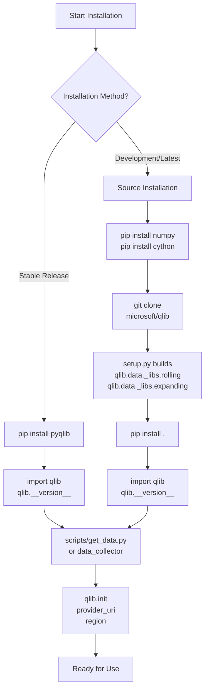
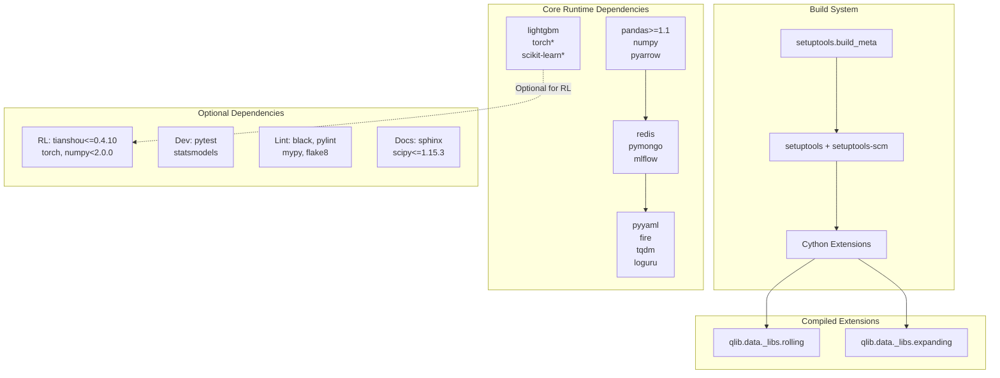
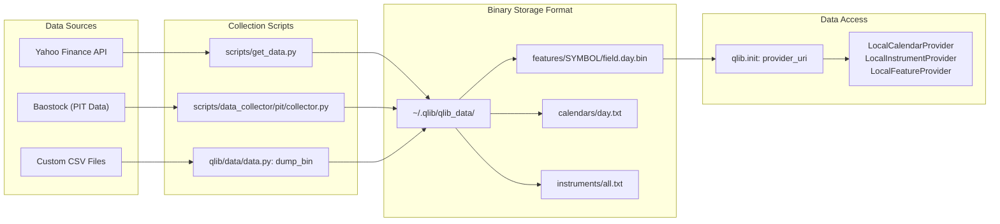

<!-- source: DeepWiki mcp.deepwiki.com · repo microsoft/qlib · page 2 Installation and Setup · fetched 2026-10-26 -->

# Installation and Setup

<details>
<summary>Relevant source files</summary>

The following files were used as context for generating this wiki page:

- [.github/workflows/test_qlib_from_pip.yml](.github/workflows/test_qlib_from_pip.yml)
- [.github/workflows/test_qlib_from_source.yml](.github/workflows/test_qlib_from_source.yml)
- [.github/workflows/test_qlib_from_source_slow.yml](.github/workflows/test_qlib_from_source_slow.yml)
- [Makefile](Makefile)
- [pyproject.toml](pyproject.toml)
- [qlib/__init__.py](qlib/__init__.py)
- [qlib/config.py](qlib/config.py)
- [qlib/data/base.py](qlib/data/base.py)
- [qlib/data/client.py](qlib/data/client.py)
- [qlib/data/data.py](qlib/data/data.py)
- [qlib/data/ops.py](qlib/data/ops.py)
- [qlib/utils/__init__.py](qlib/utils/__init__.py)
- [setup.py](setup.py)
- [tests/test_pit.py](tests/test_pit.py)

</details>


This page covers the complete installation and setup process for Qlib, including system requirements, installation methods, data preparation, and initial configuration. This establishes the foundation for using Qlib's quantitative investment platform.

For detailed instructions on specific installation environments, see [Package Installation](#2.1). For comprehensive details on system configuration parameters, see [System Initialization with qlib.init](#2.2).

## System Requirements

Qlib supports multiple platforms and Python versions with specific requirements for optimal performance.

### Supported Platforms and Python Versions

| Platform | Python 3.8 | Python 3.9 | Python 3.10 | Python 3.11 | Python 3.12 |
|----------|-------------|-------------|--------------|-------------|--------------|
| Linux (Ubuntu 22.04/24.04) | ✓ | ✓ | ✓ | ✓ | ✓ |
| Windows | ✓ | ✓ | ✓ | ✓ | ✓ |
| macOS (14/15) | ✓ | ✓ | ✓ | ✓ | ✓ |

**Environment Recommendations:**
- **Conda/Miniconda**: Recommended for dependency management.
- **Python Version**: Python 3.8+ is required [pyproject.toml:23-23]().
- **Memory**: Minimum 8GB RAM for data processing workloads.
- **Storage**: Sufficient space for financial datasets (typically 1-10GB depending on data range).

Sources: [.github/workflows/test_qlib_from_source.yml:14-25](), [pyproject.toml:6-19](), [pyproject.toml:23-23]()

## Installation Methods

Qlib provides two primary installation approaches: pip installation for standard usage and source installation for development or accessing the latest features.

### Installation Flow Overview



Sources: [setup.py:9-24](), [.github/workflows/test_qlib_from_pip.yml:37-43](), [.github/workflows/test_qlib_from_source.yml:28-60]()

### Pip and Source Installation

- **Pip**: The simplest method for stable releases: `pip install pyqlib` [pyproject.toml:20-20]().
- **Source**: Required for development or specific hardware optimizations (e.g., macOS libomp for LightGBM).
- **Docker**: Pre-configured environments for reproducible research.

For step-by-step commands for all methods, see [Package Installation](#2.1).

## Dependencies and Build System

### Core Dependencies Architecture



Sources: [pyproject.toml:1-3](), [pyproject.toml:27-57](), [pyproject.toml:59-108](), [setup.py:9-24]()

### Compiled Extensions

Qlib includes C++ extensions compiled from Cython for performance-critical operations like rolling and expanding windows. These are defined in `setup.py` [setup.py:9-24]() and can be manually built using the `Makefile` [Makefile:61-69]().

| Extension Module | Source File | Purpose |
|-----------------|-------------|----------|
| `qlib.data._libs.rolling` | `qlib/data/_libs/rolling.pyx` | Fast rolling window calculations [setup.py:12-13]() |
| `qlib.data._libs.expanding` | `qlib/data/_libs/expanding.pyx` | Fast expanding window operations [setup.py:18-19]() |

Sources: [setup.py:11-23](), [Makefile:61-69]()

## Data Preparation

### Data Preparation Pipeline



Sources: [qlib/__init__.py:61-84](), [.github/workflows/test_qlib_from_source.yml:90-94](), [qlib/data/data.py:65-69]()

### Initialization Configuration

The `qlib.init` function is the central entry point for configuring the environment. It sets the data provider URI, market region, and infrastructure backends like Redis or MongoDB [qlib/__init__.py:25-57](). It also handles the mounting of NFS paths if configured [qlib/__init__.py:61-76]().

```python
import qlib
from qlib.constant import REG_CN

qlib.init(
    provider_uri="~/.qlib/qlib_data/cn_data",
    region=REG_CN,
    redis_host="127.0.0.1",
    logging_level="INFO"
)
```

For a comprehensive guide to all `qlib.init` parameters and their impact on system behavior, see [System Initialization with qlib.init](#2.2).

Sources: [qlib/__init__.py:25-57](), [qlib/config.py:135-185](), [qlib/utils/__init__.py:43-50]()

## Installation Verification

After installation, verify the setup by running a benchmark workflow or checking data access.

- **Import Check**: `import qlib; print(qlib.__version__)` [qlib/__init__.py:7-11]().
- **Workflow Test**: Use the `qrun` CLI tool to run a standard benchmark workflow from a YAML configuration file [pyproject.toml:120-120]().
- **Data Check**: Verify data access using providers like `CalendarProvider` [qlib/data/data.py:65-71]().

```bash
# Run a benchmark workflow to verify installation
qrun examples/benchmarks/LightGBM/workflow_config_lightgbm_Alpha158.yaml
```

Sources: [.github/workflows/test_qlib_from_pip.yml:58-61](), [pyproject.toml:120-120](), [qlib/data/data.py:65-90]()

---

