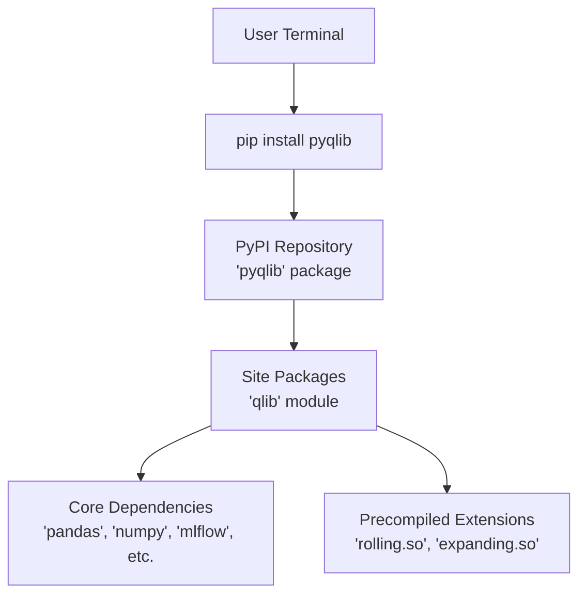
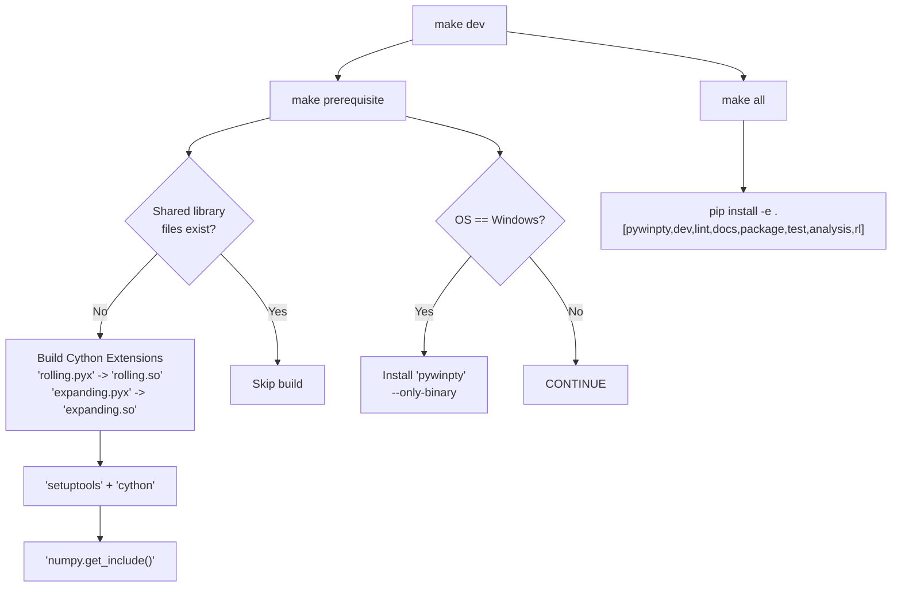
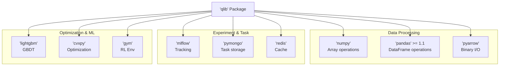
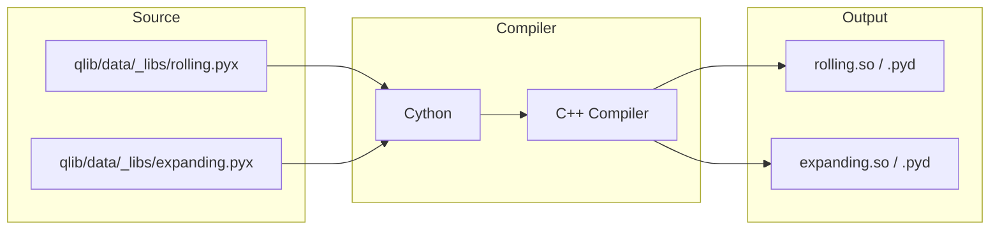

<!-- source: DeepWiki mcp.deepwiki.com · repo microsoft/qlib · page 2.1 Package Installation · fetched 2026-10-26 -->

# Package Installation

<details>
<summary>Relevant source files</summary>

The following files were used as context for generating this wiki page:

- [.dockerignore](.dockerignore)
- [.github/workflows/test_qlib_from_pip.yml](.github/workflows/test_qlib_from_pip.yml)
- [.github/workflows/test_qlib_from_source.yml](.github/workflows/test_qlib_from_source.yml)
- [.github/workflows/test_qlib_from_source_slow.yml](.github/workflows/test_qlib_from_source_slow.yml)
- [.readthedocs.yaml](.readthedocs.yaml)
- [Dockerfile](Dockerfile)
- [Makefile](Makefile)
- [build_docker_image.sh](build_docker_image.sh)
- [docs/Makefile](docs/Makefile)
- [docs/developer/how_to_build_image.rst](docs/developer/how_to_build_image.rst)
- [docs/requirements.txt](docs/requirements.txt)
- [pyproject.toml](pyproject.toml)
- [qlib/data/client.py](qlib/data/client.py)
- [setup.py](setup.py)
- [tests/test_pit.py](tests/test_pit.py)

</details>


This document describes how to install the Qlib package, including installation methods, system requirements, dependency management, and platform-specific considerations. For configuration of the installed package, see [System Initialization with qlib.init](2.2). For building and distributing the package as a maintainer, see [Package Build System](11.1).

## Overview

Qlib can be installed via three primary methods:
1. **From PyPI** - Quick installation of the stable release as package `pyqlib` [pyproject.toml:20-20]().
2. **From Source** - Development installation with editable mode and all optional dependencies [Makefile:85-108]().
3. **Via Docker** - Pre-configured environments for stable or nightly versions [Dockerfile:1-32]().

The package includes Cython-compiled extensions for performance-critical operations and supports multiple optional feature groups for specialized use cases.

Sources: [pyproject.toml:1-120](), [setup.py:1-24](), [Dockerfile:1-32]()

## Installation Methods

### Installation from PyPI

The simplest installation method uses pip to install the published package from PyPI:

```bash
pip install pyqlib
```

This installs the core package with all required dependencies. The package name on PyPI is `pyqlib`, not `qlib` [pyproject.toml:20-20]().

**PyPI Installation Flow**



The PyPI distribution includes precompiled binary wheels for common platforms, so compilation of Cython extensions is usually not required for end-users.

Sources: [.github/workflows/test_qlib_from_pip.yml:41-43](), [pyproject.toml:20-20]()

### Installation from Source

For development or to access the latest features, install from the GitHub repository:

```bash
# Clone the repository
git clone https://github.com/microsoft/qlib.git
cd qlib

# Install with all development dependencies
make dev
```

The `make dev` target performs the following operations:



**Source Installation Build Process**

The build process compiles two Cython extensions located in `qlib/data/_libs/` [setup.py:12-22](). These extensions implement performance-critical operations:
- `rolling.pyx` → `rolling.so` - Rolling window operations [setup.py:12-13]().
- `expanding.pyx` → `expanding.so` - Expanding window operations [setup.py:18-19]().

Sources: [Makefile:61-69](), [Makefile:111-112](), [setup.py:10-23]()

### Docker Installation

Qlib provides a `Dockerfile` for containerized deployment [Dockerfile:1-32]().

**Docker Build Options**
- **Stable Version**: Uses `pip install pyqlib` [Dockerfile:27-28]().
- **Nightly Version**: Uses the current source code via `python setup.py install` [Dockerfile:29-31]().

```bash
# Build stable version
docker build --build-arg IS_STABLE=yes -t qlib_stable -f ./Dockerfile .

# Build nightly version
docker build --build-arg IS_STABLE=no -t qlib_nightly -f ./Dockerfile .
```

The Docker image is based on `continuumio/miniconda3:latest` and creates a `qlib_env` with Python 3.8 [Dockerfile:1-10]().

Sources: [Dockerfile:1-32](), [docs/developer/how_to_build_image.rst:1-82]()

## System Requirements

### Python Version Support

| Python Version | Support Status |
|----------------|----------------|
| 3.8 | ✓ Supported [pyproject.toml:14-14]() |
| 3.9 | ✓ Supported [pyproject.toml:15-15]() |
| 3.10 | ✓ Supported [pyproject.toml:16-16]() |
| 3.11 | ✓ Supported [pyproject.toml:17-17]() |
| 3.12 | ✓ Supported [pyproject.toml:18-18]() |
| 3.7 and earlier | ✗ Not supported [ .github/workflows/test_qlib_from_source.yml:22-25]() |

The minimum Python version is specified as `>=3.8.0` [pyproject.toml:23-23]().

Sources: [pyproject.toml:23-23](), [.github/workflows/test_qlib_from_source.yml:25-25]()

### Operating System Support

Qlib is tested on the following platforms:

| Operating System | CI Testing | Notes |
|-----------------|------------|-------|
| Ubuntu 22.04/24.04 | ✓ | Primary Linux target [.github/workflows/test_qlib_from_source.yml:21-21]() |
| Windows (latest) | ✓ | Requires special `pywinpty` handling [Makefile:71-73]() |
| macOS 14/15 | ✓ | Apple Silicon support with specific threading limits [.github/workflows/test_qlib_from_source.yml:111-126]() |

Sources: [.github/workflows/test_qlib_from_source.yml:18-21]()

## Core Dependencies

The following table lists required dependencies from `pyproject.toml` [pyproject.toml:27-57]():

| Package | Purpose | Version Constraint |
|---------|---------|-------------------|
| `numpy` | Numerical computing | ≥1.24.0 (build) [pyproject.toml:2-2]() |
| `pandas` | Data manipulation | ≥1.1 [pyproject.toml:33-33]() |
| `mlflow` | Experiment tracking | Any [pyproject.toml:37-37]() |
| `filelock` | Concurrent access | ≥3.16.0 [pyproject.toml:38-38]() |
| `redis` | Caching | Any [pyproject.toml:39-39]() |
| `pymongo` | Task management | Any [pyproject.toml:45-45]() |
| `lightgbm` | Default GBDT model | Any [pyproject.toml:47-47]() |

**Core Dependency Architecture**



Sources: [pyproject.toml:27-57]()

## Optional Feature Groups

Qlib provides optional dependency groups [pyproject.toml:59-108]():

| Group | Installation | Purpose |
|-------|--------------|---------|
| `rl` | `pip install -e .[rl]` | Reinforcement Learning (`tianshou`, `torch`) [pyproject.toml:67-71]() |
| `test` | `pip install -e .[test]` | Data collection tests (`yahooquery`, `baostock`) [pyproject.toml:97-100]() |
| `docs` | `pip install -e .[docs]` | Sphinx documentation (`scipy<=1.15.3`) [pyproject.toml:82-91]() |
| `analysis`| `pip install -e .[analysis]`| Plotly and Statsmodels [pyproject.toml:101-104]() |

Sources: [pyproject.toml:59-108](), [Makefile:82-105]()

## Platform-Specific Considerations

### macOS (Apple Silicon)
- **LightGBM**: Must be installed with `--no-binary=:all:` after installing `libomp` via brew [.github/workflows/test_qlib_from_source.yml:95-100]().
- **Threading**: To prevent segmentation faults, export `OMP_NUM_THREADS=1` and `MKL_NUM_THREADS=1` before running scripts [.github/workflows/test_qlib_from_source.yml:118-123]().

### Windows
- **PyWinPTY**: Installed as a binary wheel to avoid local compilation issues [Makefile:58-60, 71-73]().

## Cython Extension Compilation

The `Makefile` target `prerequisite` handles the compilation of performance modules [Makefile:61-69]().



Sources: [setup.py:10-23](), [Makefile:61-69]()

## Installation Verification

After installation, verify the setup by running a benchmark workflow using the `qrun` CLI [pyproject.toml:120-120]():

```bash
# Download sample data
python scripts/get_data.py qlib_data --name qlib_data_simple --target_dir ~/.qlib/qlib_data/cn_data --region cn

# Run a benchmark
qrun examples/benchmarks/LightGBM/workflow_config_lightgbm_Alpha158.yaml
```

Sources: [.github/workflows/test_qlib_from_pip.yml:53-60](), [pyproject.toml:120-120]()

---

