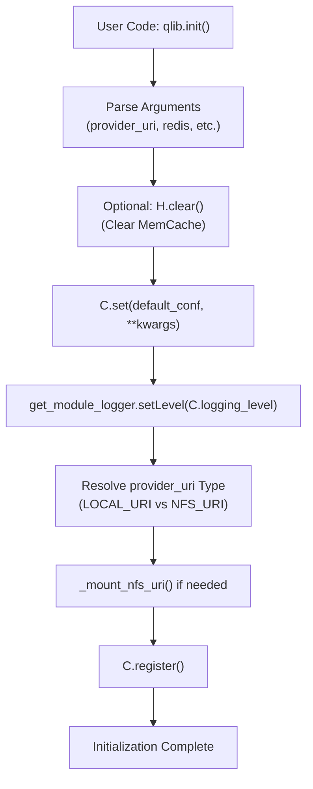
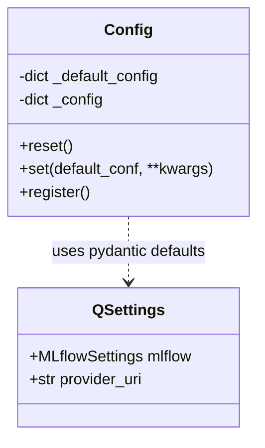
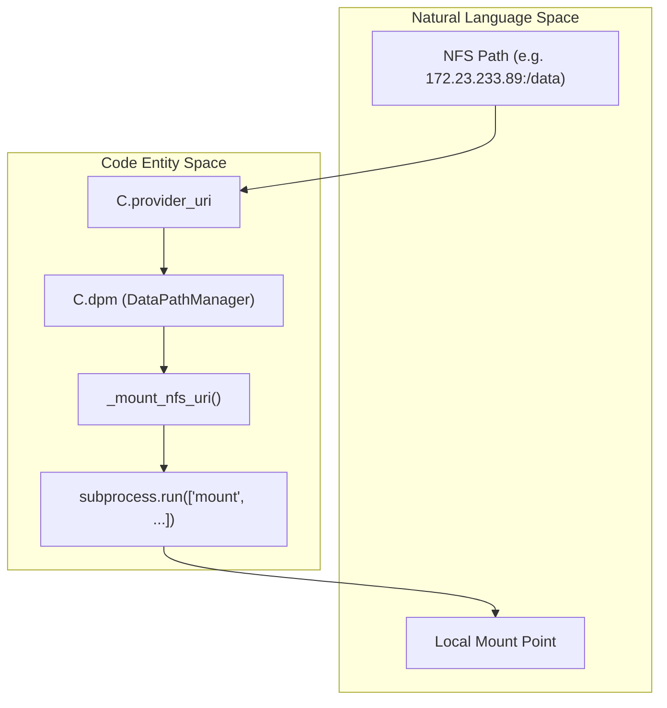
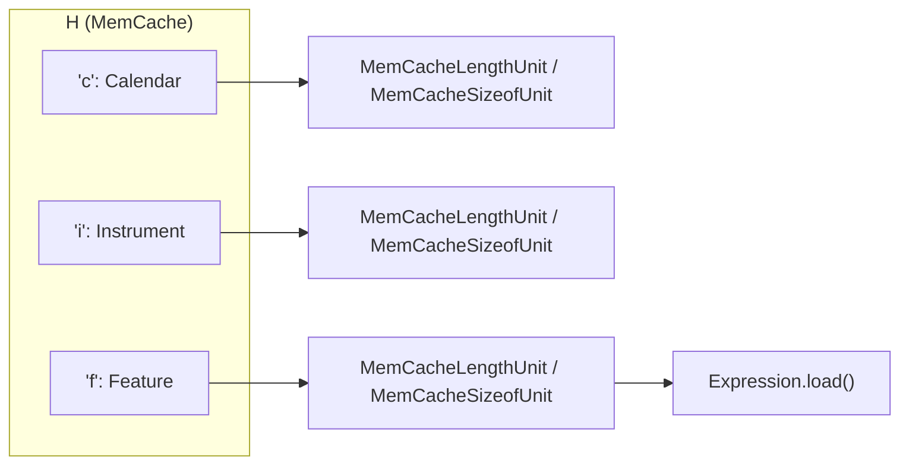

<!-- source: DeepWiki mcp.deepwiki.com · repo microsoft/qlib · page 2.2 System Initialization with qlib.init · fetched 2026-10-26 -->

# System Initialization with qlib.init

<details>
<summary>Relevant source files</summary>

The following files were used as context for generating this wiki page:

- [CHANGES.rst](CHANGES.rst)
- [docs/_static/img/online_serving.png](docs/_static/img/online_serving.png)
- [docs/advanced/alpha.rst](docs/advanced/alpha.rst)
- [docs/advanced/task_management.rst](docs/advanced/task_management.rst)
- [docs/component/data.rst](docs/component/data.rst)
- [docs/component/model.rst](docs/component/model.rst)
- [docs/component/online.rst](docs/component/online.rst)
- [docs/component/report.rst](docs/component/report.rst)
- [docs/component/strategy.rst](docs/component/strategy.rst)
- [docs/conf.py](docs/conf.py)
- [docs/index.rst](docs/index.rst)
- [docs/introduction/quick.rst](docs/introduction/quick.rst)
- [docs/reference/api.rst](docs/reference/api.rst)
- [docs/start/getdata.rst](docs/start/getdata.rst)
- [docs/start/integration.rst](docs/start/integration.rst)
- [qlib/__init__.py](qlib/__init__.py)
- [qlib/config.py](qlib/config.py)
- [qlib/data/base.py](qlib/data/base.py)
- [qlib/data/data.py](qlib/data/data.py)
- [qlib/data/ops.py](qlib/data/ops.py)
- [qlib/utils/__init__.py](qlib/utils/__init__.py)

</details>


## Purpose and Scope

This page provides a comprehensive technical guide to the initialization of the Qlib system via the `qlib.init` function. It details the configuration parameters, the internal data flow of the initialization process, and how Qlib manages global state, data providers, caching, and experiment tracking. This is the primary entry point for any Qlib-based workflow.

---

## Initialization Process Overview

Qlib uses a global configuration singleton to manage system-wide settings. The `qlib.init` function orchestrates the transition from an uninitialized state to a ready state by parsing user arguments, setting up the `Config` object, and registering core components.

### High-Level Initialization Flow

The following diagram illustrates the sequence of operations triggered by `qlib.init`.


Sources: [qlib/__init__.py:25-82](), [qlib/config.py:64-123]()

---

## Core Initialization Components

### The `qlib.init()` Function

The `qlib.init` function is defined in the package root. It accepts a configuration mode and various keyword arguments that override default settings.

**Function Signature**: [qlib/__init__.py:25-41]()

```python
def init(default_conf="client", **kwargs):
    """
    Parameters
    ----------
    default_conf: str
        the default value is client. Accepted values: client/server.
    **kwargs :
        clear_mem_cache: bool
            Default True; Clears the memory cache (H).
        skip_if_reg: bool
            Default False; If True, skips init if Qlib is already registered.
        provider_uri: str or dict
            Path to data.
        ... (other config overrides)
    """
```

### The Global Configuration Singleton (C)

The `Config` class (instantiated as `C`) manages all internal settings. It maintains a `_default_config` dictionary and an active `_config` dictionary.



**Key Configuration Parameters**:

| Parameter | Type | Default | Description |
|-----------|------|---------|-------------|
| `provider_uri` | str/dict | `""` | Location of binary data. Can be a dict for multi-frequency. [qlib/config.py:154]() |
| `logging_level` | int | `logging.INFO` | Global logging threshold. [qlib/config.py:185]() |
| `redis_host` | str | `"127.0.0.1"` | Host for Redis-based caching. [qlib/config.py:180]() |
| `kernels` | int | `NUM_USABLE_CPU` | Number of parallel workers for data processing. [qlib/config.py:162]() |
| `mem_cache_size_limit` | int | `500` | Limit for the `MemCache` object. [qlib/config.py:170]() |

Sources: [qlib/config.py:64-185](), [qlib/__init__.py:42-58]()

---

## Data Path and NFS Management

Qlib distinguishes between local file system paths and Network File System (NFS) URIs.

### URI Resolution and Mounting

If a `provider_uri` follows the pattern `host:/path`, Qlib identifies it as an `NFS_URI` and attempts to mount it to a local `mount_path`.



**Mounting Logic**:
- **Windows**: Uses `mount -o anon provider_uri mount_path`. [qlib/__init__.py:109-114]()
- **Linux/Unix**: Uses `sudo mount.nfs provider_uri mount_path`. [qlib/__init__.py:95]()
- **Validation**: Qlib checks if the path is already mounted by parsing the output of the `mount` command. [qlib/__init__.py:136-153]()

Sources: [qlib/__init__.py:60-76](), [qlib/__init__.py:87-160]()

---

## Caching System Initialization

During initialization, Qlib sets up the `MemCache` (referred to as `H`).

### Memory Cache (H) Structure

The `H` object is an instance of `MemCache` and contains specialized cache units for calendars, instruments, and features.



**Implementation Details**:
- `MemCache` is initialized based on `C.mem_cache_size_limit` and `C.mem_cache_limit_type`. [qlib/config.py:170-171]()
- `Expression.load()` uses `H["f"]` to avoid redundant calculations of the same expression for the same instrument/time range. [qlib/data/base.py:184-203]()
- If `clear_mem_cache=True` is passed to `qlib.init`, `H.clear()` is called. [qlib/__init__.py:54-56]()

Sources: [qlib/data/base.py:184-203](), [qlib/__init__.py:54-56](), [qlib/config.py:170-171]()

---

## Logging Configuration

Qlib uses a structured logging configuration defined in `C.logging_config`.

**Logging Features**:
- **Format**: Includes process ID, thread name, timestamp, and line numbers. [qlib/config.py:191-193]()
- **Filters**: Includes a `LogFilter` to suppress specific warnings, such as "data not found". [qlib/config.py:195-200]()
- **Level**: Controlled by `C.logging_level` (set via `qlib.init`). [qlib/__init__.py:58]()

Sources: [qlib/config.py:188-214](), [qlib/__init__.py:58]()

---

## Experiment Manager and Task Management

Qlib initialization sets up the environment for experiment tracking and distributed task management.

### MLflow Integration
By default, Qlib uses `MLflowSettings` to configure an MLflow-backed experiment manager.
- **Default URI**: `file:./mlruns`. [qlib/config.py:35]()
- **Prefix**: Environment variables starting with `QLIB_` can override these settings via Pydantic. [qlib/config.py:55-58]()

### Redis and MongoDB
- **Redis**: Used for `DiskDatasetCache` and `DiskExpressionCache`. The connection is established using `get_redis_connection()` which pulls host/port from `C`. [qlib/utils/__init__.py:43-50]()
- **MongoDB**: Used for persistent task management. Connection details like `mongo_host` and `mongo_port` are stored in the global config. [qlib/config.py:239-242]()

Sources: [qlib/config.py:34-61](), [qlib/utils/__init__.py:43-50](), [qlib/config.py:239-242]()

---

