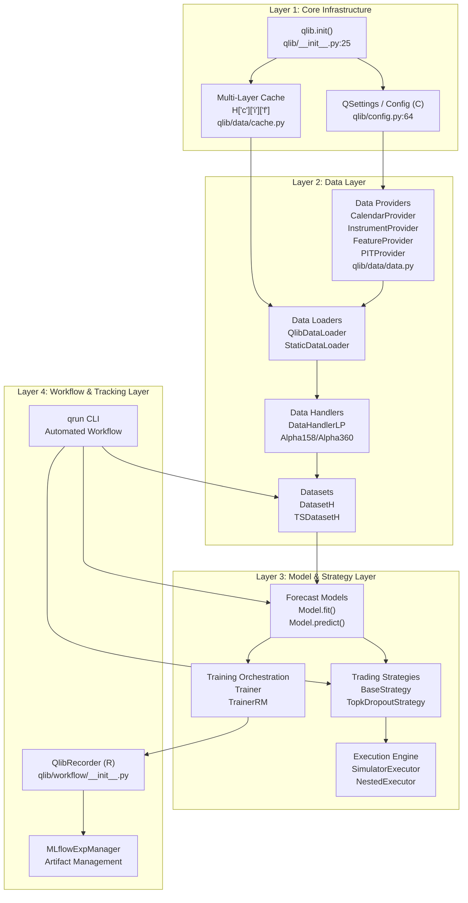
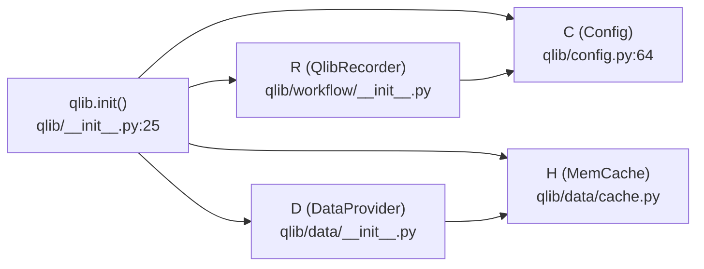
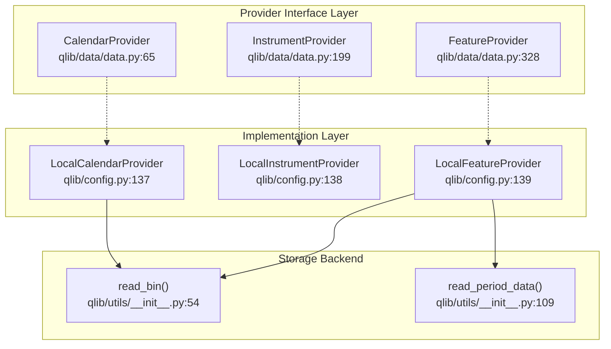
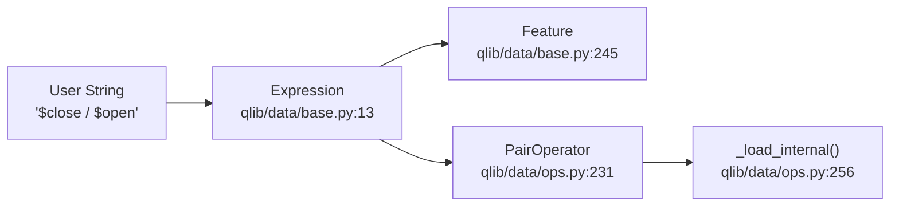
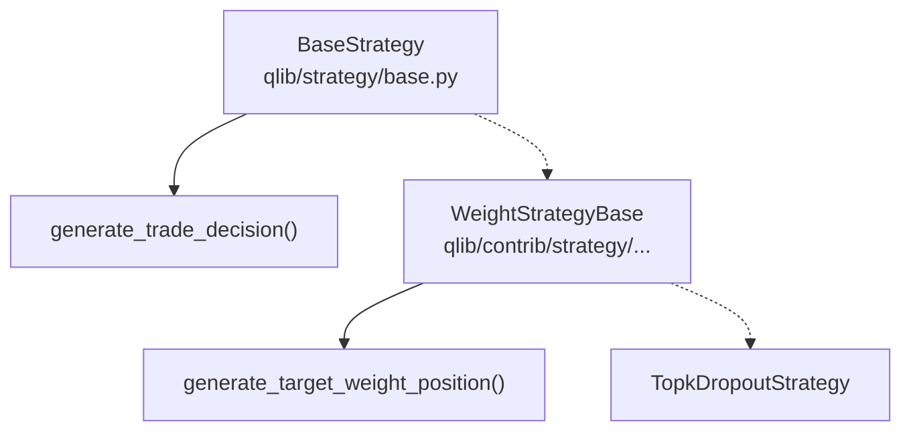

<!-- source: DeepWiki mcp.deepwiki.com · repo microsoft/qlib · page 3 Core System Architecture · fetched 2026-10-26 -->

# Core System Architecture

Relevant source files

The following files were used as context for generating this wiki page:

- [CHANGES.rst](CHANGES.rst)
- [README.md](README.md)
- [docs/_static/img/online_serving.png](docs/_static/img/online_serving.png)
- [docs/advanced/alpha.rst](docs/advanced/alpha.rst)
- [docs/advanced/task_management.rst](docs/advanced/task_management.rst)
- [docs/component/data.rst](docs/component/data.rst)
- [docs/component/model.rst](docs/component/model.rst)
- [docs/component/online.rst](docs/component/online.rst)
- [docs/component/report.rst](docs/component/report.rst)
- [docs/component/strategy.rst](docs/component/strategy.rst)
- [docs/conf.py](docs/conf.py)
- [docs/index.rst](docs/index.rst)
- [docs/introduction/quick.rst](docs/introduction/quick.rst)
- [docs/reference/api.rst](docs/reference/api.rst)
- [docs/start/getdata.rst](docs/start/getdata.rst)
- [docs/start/initialization.rst](docs/start/initialization.rst)
- [docs/start/installation.rst](docs/start/installation.rst)
- [docs/start/integration.rst](docs/start/integration.rst)
- [examples/benchmarks/README.md](examples/benchmarks/README.md)
- [examples/benchmarks/TFT/README.md](examples/benchmarks/TFT/README.md)
- [examples/benchmarks/TFT/requirements.txt](examples/benchmarks/TFT/requirements.txt)
- [examples/run_all_model.py](examples/run_all_model.py)
- [qlib/__init__.py](qlib/__init__.py)
- [qlib/config.py](qlib/config.py)
- [qlib/data/base.py](qlib/data/base.py)
- [qlib/data/data.py](qlib/data/data.py)
- [qlib/data/ops.py](qlib/data/ops.py)
- [qlib/utils/__init__.py](qlib/utils/__init__.py)

## Purpose and Scope

This document describes the overall architecture of Qlib, a quantitative investment platform designed for AI-oriented research and production deployment. It covers the major architectural layers, component interactions, initialization process, and design patterns that enable Qlib's modular and extensible structure.

For detailed information about specific subsystems, see:
- Data management details: [Data Management System](#4)
- Model development: [Model Development](#5)
- Strategy execution and backtesting: [Backtesting and Strategy Execution](#7)
- Workflow automation: [Workflow and Experiment Management](#8)

**Sources:** [README.md:82-140](), [qlib/config.py:39-61](), [docs/component/data.rst:7-30]()

## Architectural Overview

Qlib follows a layered architecture with loosely-coupled components that can be used independently or orchestrated together. The system is organized into four primary layers:

**Diagram: Qlib Four-Layer Architecture**

**Sources:** [README.md:144-157](), [docs/component/data.rst:24-30](), [qlib/data/data.py:65-203](), [qlib/__init__.py:25-86]()

## System Initialization and Configuration

### Initialization Process

The `qlib.init()` function is the entry point that configures and registers all system components. It populates the global configuration object `C` and initializes storage providers.

The initialization process performs the following steps:
1. **Configuration Loading**: Merges default configuration with user parameters using the `Config` class [qlib/config.py:64-106]().
2. **Logging Setup**: Configures Python logging based on `logging_config` [qlib/config.py:188-214]().
3. **Path Resolution**: Resolves and validates `provider_uri` for data access. It handles local paths, NFS mounts, and region-specific shortcuts [qlib/__init__.py:61-79](), [qlib/config.py:53-54]().
4. **Provider Registration**: Registers data providers like `LocalCalendarProvider` and `LocalFeatureProvider` defined in the default config [qlib/config.py:136-143]().
5. **Cache Initialization**: Clears or initializes memory cache `H` [qlib/__init__.py:54-56]().

**Sources:** [qlib/config.py:39-154](), [qlib/__init__.py:25-86](), [docs/start/initialization.rst:10-98]()

### Global Singleton Pattern

Qlib uses global singleton wrappers for core functionality to ensure consistency across the research pipeline.

**Diagram: Global Singleton Components**

- **C**: Configuration object providing system-wide settings like `provider_uri` and `redis_host` [qlib/config.py:64-123]().
- **R**: Recorder for experiment tracking, wrapping MLflow settings [qlib/config.py:34-37](), [qlib/workflow/__init__.py:23]().
- **D**: Data access wrapper for various providers [qlib/data/data.py:65-198]().
- **H**: Memory cache organized by type: `H['c']` (calendar), `H['i']` (instrument), `H['f']` (feature) [qlib/data/cache.py:165-174]().

**Sources:** [qlib/config.py:64-154](), [qlib/data/cache.py:137-180](), [qlib/utils/__init__.py:43-50](), [qlib/__init__.py:42-43]()

## Data Layer Architecture

The Data Layer implements a provider-based architecture with multiple abstraction levels to decouple storage from logic.

**Diagram: Data Provider Architecture**

| Provider Type | Key Interface Method | Purpose |
|--------------|----------------------|---------|
| `CalendarProvider` | `calendar()` | Returns trading calendar for a frequency [qlib/data/data.py:71-109]() |
| `InstrumentProvider` | `instruments()` | Returns stock pool for a market [qlib/data/data.py:206-222]() |
| `FeatureProvider` | `feature()` | Returns raw feature data [qlib/data/data.py:334]() |

**Sources:** [qlib/data/data.py:65-350](), [qlib/utils/__init__.py:54-173](), [docs/component/data.rst:10-30](), [qlib/config.py:135-143]()

### Expression Engine

The expression engine evaluates formulaic alphas using operator overloading. It transforms strings like `Ref($close, 1) / $close` into an executable operator tree.

**Diagram: Expression Evaluation Flow**

Key components:
- `Expression`: Abstract base class for data calculation [qlib/data/base.py:13-24]().
- `Operators`: Implements arithmetic and rolling operations (e.g., `Add`, `Sub`, `Ref`, `Mean`) [qlib/data/ops.py:1-253]().
- `rolling.pyx` & `expanding.pyx`: Cython implementations for high-performance rolling and expanding window operations [qlib/data/ops.py:18-20]().

**Sources:** [qlib/data/base.py:13-142](), [qlib/data/ops.py:1-253](), [docs/component/data.rst:27-28]()

## Model and Training Layer

### Model Interface

All models in Qlib must implement the `Model` base class interface, ensuring compatibility with the automated workflow and `Trainer` infrastructure.

- `fit(dataset)`: Trains the model using a `DatasetH` object [docs/component/strategy.rst:129]().
- `predict(dataset)`: Returns predictions as a pandas DataFrame with `<datetime, instrument>` index, typically containing a `score` column [docs/component/strategy.rst:109-128]().

**Sources:** [docs/component/strategy.rst:104-136](), [examples/benchmarks/README.md:2-11](), [examples/run_all_model.py:134-166]()

## Strategy and Execution Layer

### Strategy Interface

Trading strategies generate trade decisions from model predictions. The base class is `BaseStrategy`.

**Diagram: Strategy Class Hierarchy**

- `generate_trade_decision`: The key interface called by the executor at each trading bar [docs/component/strategy.rst:27-30]().
- `TopkDropoutStrategy`: Implements the `Topk-Drop` algorithm for portfolio rebalancing based on prediction scores [docs/component/strategy.rst:62-80]().
- `EnhancedIndexingStrategy`: Combines active management with benchmark tracking [docs/component/strategy.rst:91-98]().

**Sources:** [docs/component/strategy.rst:19-98](), [qlib/config.py:249-252]()

## Caching Architecture

Qlib implements a multi-level caching system to accelerate data retrieval and feature calculation.

| Cache Level | Implementation | Key Config |
|-------------|----------------|------------|
| **Memory Cache** | `MemCache` / `H` | `mem_cache_size_limit`, `mem_cache_expire` [qlib/config.py:170-174]() |
| **Expression Cache** | `DiskExpressionCache` | `DISK_EXPRESSION_CACHE` [qlib/config.py:131]() |
| **Dataset Cache** | `DiskDatasetCache` | `DISK_DATASET_CACHE` [qlib/config.py:129]() |

The `MemCache` uses an `OrderedDict` with LRU logic to store `Calendar`, `Instrument`, and `Feature` data [qlib/data/cache.py:44-80](). Redis is utilized for distributed lock and cross-process caching [qlib/utils/__init__.py:43-50](), [qlib/config.py:180-183]().

**Sources:** [qlib/data/cache.py:44-180](), [qlib/config.py:127-183](), [docs/component/data.rst:21-22](), [qlib/utils/__init__.py:43-50]()

## System Data Flow

The end-to-end data flow from storage to prediction:

1. **Storage**: Data stored in `.bin` files via `read_bin` [qlib/utils/__init__.py:54]().
2. **Provider**: `FeatureProvider` retrieves raw series [qlib/data/data.py:328]().
3. **Expression**: `Operators` compute complex features [qlib/data/ops.py:1]().
4. **Handler**: `DataHandlerLP` applies learnable processors (normalization, filtering) [docs/component/data.rst:28]().
5. **Dataset**: `DatasetH` prepares model-ready tensors from processed handler data [docs/component/data.rst:29]().
6. **Model**: `Model.predict()` generates signal scores [docs/component/strategy.rst:109]().

**Sources:** [docs/component/data.rst:24-30](), [qlib/data/data.py:65-350](), [qlib/utils/__init__.py:54-109]()

---

