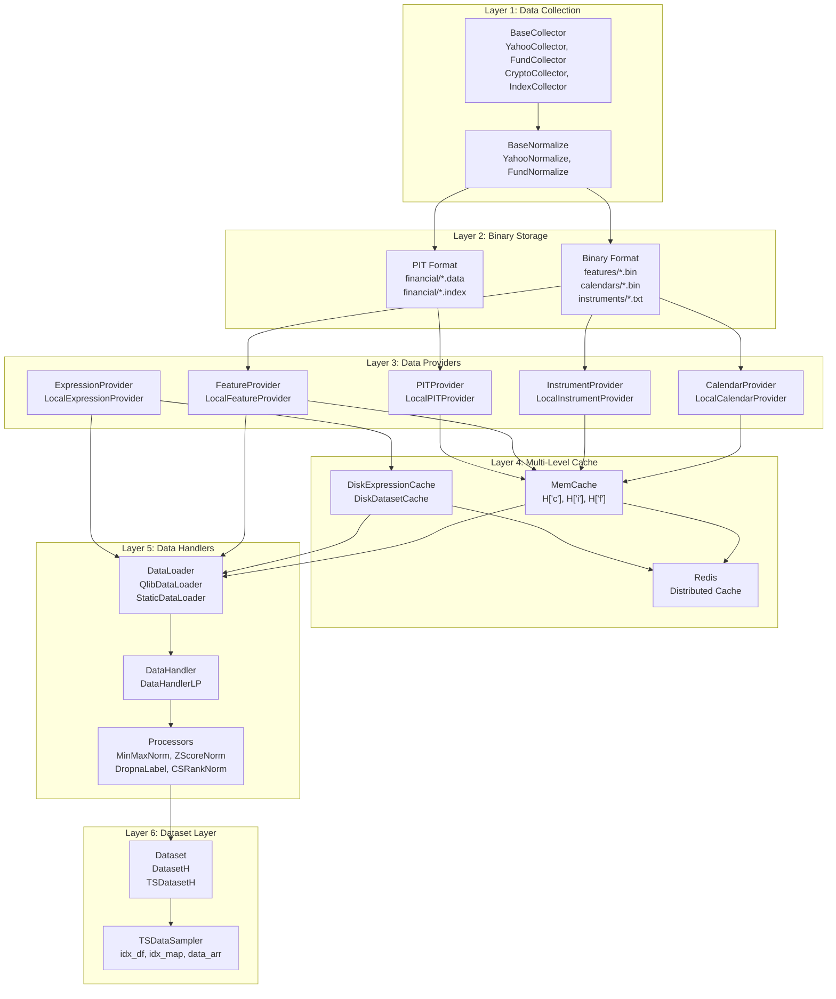
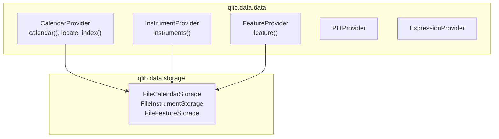
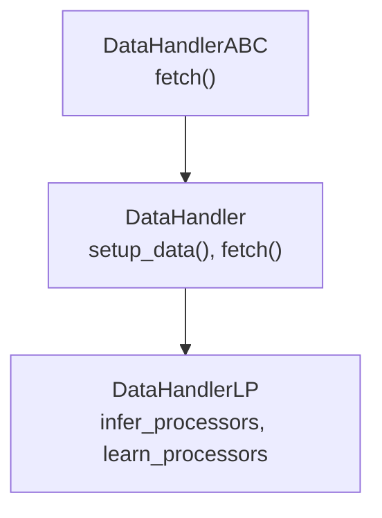

<!-- source: DeepWiki mcp.deepwiki.com · repo microsoft/qlib · page 4 Data Management System · fetched 2026-10-26 -->

# Data Management System

Relevant source files

The following files were used as context for generating this wiki page:

- [CHANGES.rst](CHANGES.rst)
- [docs/_static/img/online_serving.png](docs/_static/img/online_serving.png)
- [docs/advanced/alpha.rst](docs/advanced/alpha.rst)
- [docs/advanced/task_management.rst](docs/advanced/task_management.rst)
- [docs/component/data.rst](docs/component/data.rst)
- [docs/component/model.rst](docs/component/model.rst)
- [docs/component/online.rst](docs/component/online.rst)
- [docs/component/report.rst](docs/component/report.rst)
- [docs/component/strategy.rst](docs/component/strategy.rst)
- [docs/conf.py](docs/conf.py)
- [docs/index.rst](docs/index.rst)
- [docs/introduction/quick.rst](docs/introduction/quick.rst)
- [docs/reference/api.rst](docs/reference/api.rst)
- [docs/start/getdata.rst](docs/start/getdata.rst)
- [docs/start/integration.rst](docs/start/integration.rst)
- [qlib/__init__.py](qlib/__init__.py)
- [qlib/config.py](qlib/config.py)
- [qlib/contrib/online/operator.py](qlib/contrib/online/operator.py)
- [qlib/contrib/rolling/ddgda.py](qlib/contrib/rolling/ddgda.py)
- [qlib/contrib/tuner/tuner.py](qlib/contrib/tuner/tuner.py)
- [qlib/data/base.py](qlib/data/base.py)
- [qlib/data/cache.py](qlib/data/cache.py)
- [qlib/data/data.py](qlib/data/data.py)
- [qlib/data/ops.py](qlib/data/ops.py)
- [qlib/utils/__init__.py](qlib/utils/__init__.py)
- [qlib/utils/mod.py](qlib/utils/mod.py)
- [qlib/utils/objm.py](qlib/utils/objm.py)

## Purpose and Scope

This document describes Qlib's data management architecture, which handles the complete lifecycle of financial data from collection to consumption. The system encompasses data collection pipelines, binary storage formats, multi-tier provider abstractions, sophisticated caching mechanisms, data processing pipelines, and efficient dataset preparation for model training and backtesting.

For information about model training workflows, see [Model Development](#5). For details on backtesting infrastructure, see [Backtesting and Strategy Execution](#7). For system initialization parameters, see [System Initialization with qlib.init](#2.2).

---

## Overview: Data Management Architecture

The Qlib data management system is organized into six distinct layers, each with specific responsibilities:

**Sources:** [qlib/data/data.py:43-443](), [qlib/data/cache.py:1-210](), [docs/component/data.rst:7-30]()

---

## Layer 1: Data Collection and Normalization

The data collection layer provides a unified framework for acquiring financial data from multiple external sources and normalizing it into a consistent format. It supports various frequencies, including daily and 1-minute data [docs/component/data.rst:65-70]().

### Collector and Normalizer Hierarchy

Qlib provides specialized collectors for various asset classes. For details, see [Data Collection and Normalization](#4.1).

**Key Components:**
- **`BaseCollector`**: Abstract base for all collectors, manages concurrency and retry logic.
- **`BaseNormalize`**: Handles calendar alignment and missing data calculation.
- **Implementations**: Yahoo (Stocks), Fund, Crypto, and Index data collectors.

**Sources:** [qlib/data/data.py:43-63](), [docs/component/data.rst:79-108]()

---

## Layer 2: Binary Storage Format

Qlib stores financial data in an efficient binary format optimized for fast sequential reads and memory-mapped access [docs/component/data.rst:34-39](). For details, see [Data Storage and Binary Format](#4.2).

### Binary File Format

The binary format uses 32-bit little-endian floats (`dtype="<f"`) for space efficiency. The `read_bin` function [qlib/utils/__init__.py:54-68]() efficiently reads data by:
1. Reading the reference start index from the first 4 bytes.
2. Calculating byte offset: `4 * (si - ref_start_index) + 4`.
3. Reading `count * 4` bytes into a numpy array.

### Point-in-Time (PIT) Data Format

PIT data handles data revisions using a linked-list structure to avoid look-ahead bias [qlib/utils/__init__.py:109-173](). The record type is defined in `C.pit_record_type` [qlib/utils/__init__.py:135-142](). It uses `read_period_data` [qlib/utils/__init__.py:109-173]() to traverse the linked list and find the correct value for a given `cur_date_int`.

**Sources:** [qlib/utils/__init__.py:54-68](), [qlib/utils/__init__.py:109-173](), [qlib/config.py:124-132]()

---

## Layer 3: Data Provider Layer

The provider layer abstracts data access through a clean interface, supporting both local file storage and potential remote backends. For details, see [Data Providers and Expression Engine](#4.3).

### Provider Architecture

**Key Providers:**
- **`CalendarProvider`** [qlib/data/data.py:65-197](): Manages trading dates and index mapping.
- **`InstrumentProvider`** [qlib/data/data.py:199-305](): Manages instrument universes (e.g., CSI300).
- **`FeatureProvider`** [qlib/data/data.py:307-336](): Accesses raw feature data from binary files.
- **`ExpressionProvider`** [qlib/data/data.py:383-443](): Evaluates the Expression DSL using operators defined in `qlib.data.ops` [qlib/data/ops.py:1-1000]().

**Sources:** [qlib/data/data.py:65-443](), [qlib/data/ops.py:1-1000]()

---

## Layer 4: Multi-Level Caching System

Qlib implements a three-tier caching architecture to minimize data loading overhead. For details, see [Multi-Level Caching System](#4.4).

### Memory Cache (`MemCache`)
The `MemCache` [qlib/data/cache.py:137-180]() uses an `OrderedDict` with LRU eviction. It supports two limit types configured via `C.mem_cache_limit_type` [qlib/data/cache.py:152-159]():
- **`MemCacheLengthUnit`** [qlib/data/cache.py:121-127](): Limits by number of items.
- **`MemCacheSizeofUnit`** [qlib/data/cache.py:129-135](): Limits by memory size using `sys.getsizeof`.

The cache is divided into units for calendars (`H['c']`), instruments (`H['i']`), and features (`H['f']`) [qlib/data/cache.py:165-172]().

### Disk Caching
- **`DiskExpressionCache`** [qlib/config.py:131](): Caches evaluated expressions to avoid re-computation.
- **`DiskDatasetCache`** [qlib/config.py:129](): Caches full processed datasets.

**Sources:** [qlib/data/cache.py:44-210](), [qlib/config.py:129-134](), [qlib/data/base.py:184-203]()

---

## Layer 5: Data Handlers and Processors

The handler layer transforms raw provider data into model-ready features using a pipeline of processors [docs/component/data.rst:27-28](). For details, see [DataHandlers and Processors](#4.5).

### DataHandler Architecture

**Key Classes:**
- **`DataHandler`**: Loads data using a `DataLoader` and maintains an internal DataFrame.
- **`DataHandlerLP`**: Extends handler with "Learnable Processors" for pipelines that require fitting on training data.
- **`Processor`**: Defines `fit()` and `__call__()` for data transformations like normalization or filtering.

**Sources:** [docs/component/data.rst:19-28](), [qlib/data/data.py:22-23]()

---

## Layer 6: DataLoaders and Feature Engineering

DataLoaders load raw data from providers. For details, see [DataLoaders and Feature Engineering](#4.6).

**Key Classes:**
- **`QlibDataLoader`**: Loads data using Qlib's expression engine [qlib/data/ops.py:1-100]().
- **`StaticDataLoader`**: Loads pre-computed data from files.
- **`Alpha158` / `Alpha360`**: Standardized feature sets provided for US and China markets [docs/component/data.rst:40-48]().

**Sources:** [docs/component/data.rst:27-28](), [qlib/data/ops.py:1-250]()

---

## Layer 7: Datasets and Time-Series Sampling

Datasets prepare data for model training and inference, handling segment management (train/valid/test) [docs/component/data.rst:29](). For details, see [Datasets and Time-Series Sampling](#4.7).

**Key Classes:**
- **`DatasetH`**: A dataset wrapping a `DataHandler`.
- **`TSDatasetH`**: Specialized for time-series models, providing sliding window samples for deep learning architectures.
- **`TSDataSampler`**: Efficiently indexes into large data arrays for time-series batching.

**Sources:** [docs/component/data.rst:20-29](), [qlib/data/data.py:25-26]()

---

