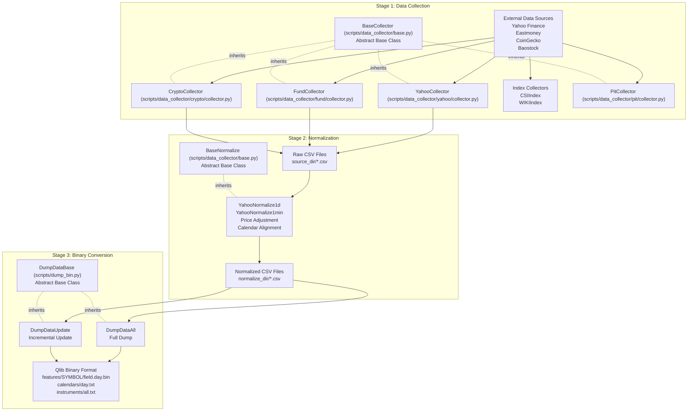
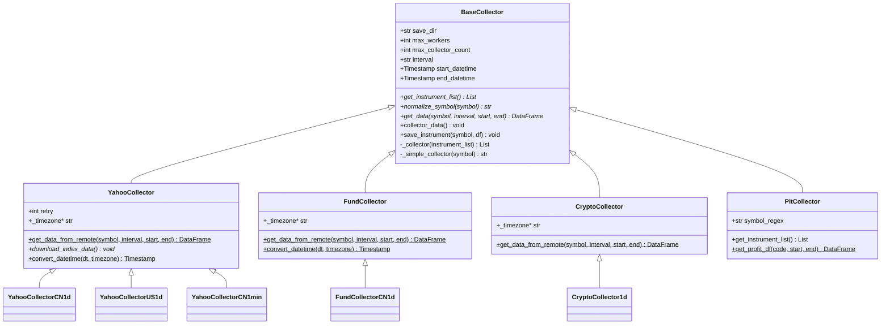
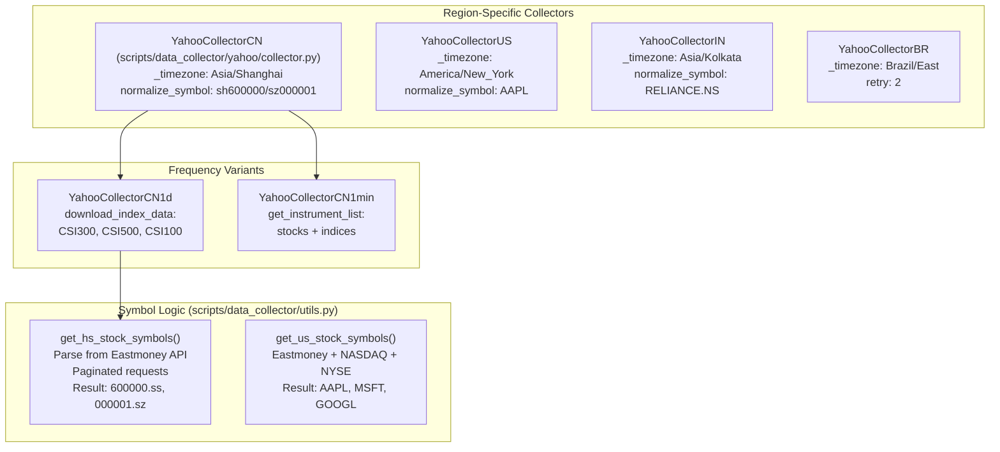
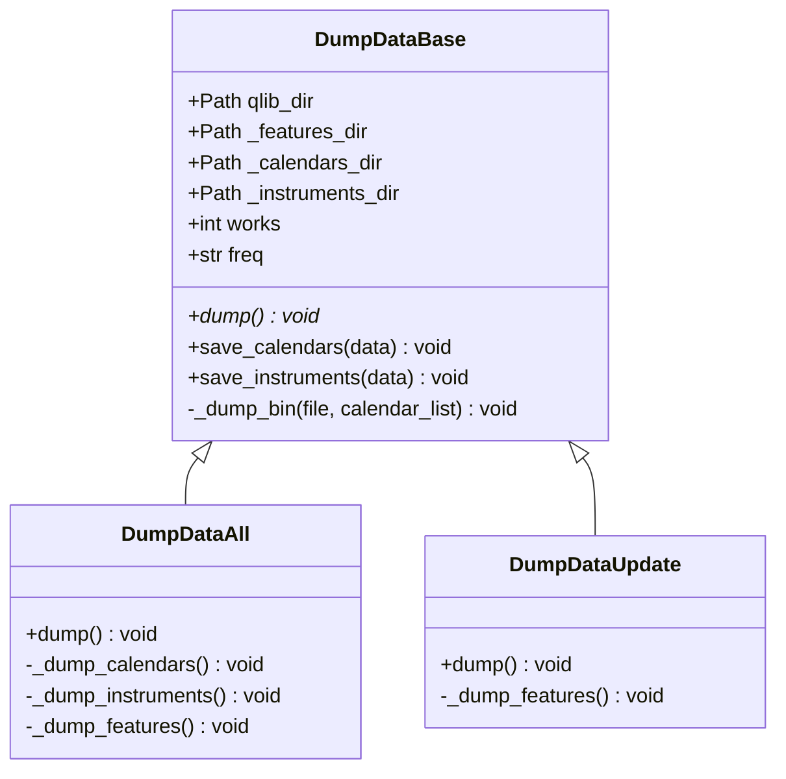

<!-- source: DeepWiki mcp.deepwiki.com · repo microsoft/qlib · page 4.1 Data Collection and Normalization · fetched 2026-10-26 -->

# Data Collection and Normalization

<details>
<summary>Relevant source files</summary>

The following files were used as context for generating this wiki page:

- [docs/component/workflow.rst](docs/component/workflow.rst)
- [scripts/data_collector/base.py](scripts/data_collector/base.py)
- [scripts/data_collector/br_index/README.md](scripts/data_collector/br_index/README.md)
- [scripts/data_collector/br_index/requirements.txt](scripts/data_collector/br_index/requirements.txt)
- [scripts/data_collector/cn_index/README.md](scripts/data_collector/cn_index/README.md)
- [scripts/data_collector/cn_index/collector.py](scripts/data_collector/cn_index/collector.py)
- [scripts/data_collector/cn_index/requirements.txt](scripts/data_collector/cn_index/requirements.txt)
- [scripts/data_collector/contrib/fill_cn_1min_data/README.md](scripts/data_collector/contrib/fill_cn_1min_data/README.md)
- [scripts/data_collector/contrib/fill_cn_1min_data/fill_cn_1min_data.py](scripts/data_collector/contrib/fill_cn_1min_data/fill_cn_1min_data.py)
- [scripts/data_collector/contrib/fill_cn_1min_data/requirements.txt](scripts/data_collector/contrib/fill_cn_1min_data/requirements.txt)
- [scripts/data_collector/contrib/future_trading_date_collector/README.md](scripts/data_collector/contrib/future_trading_date_collector/README.md)
- [scripts/data_collector/contrib/future_trading_date_collector/future_trading_date_collector.py](scripts/data_collector/contrib/future_trading_date_collector/future_trading_date_collector.py)
- [scripts/data_collector/contrib/future_trading_date_collector/requirements.txt](scripts/data_collector/contrib/future_trading_date_collector/requirements.txt)
- [scripts/data_collector/crypto/collector.py](scripts/data_collector/crypto/collector.py)
- [scripts/data_collector/fund/README.md](scripts/data_collector/fund/README.md)
- [scripts/data_collector/fund/collector.py](scripts/data_collector/fund/collector.py)
- [scripts/data_collector/fund/requirements.txt](scripts/data_collector/fund/requirements.txt)
- [scripts/data_collector/index.py](scripts/data_collector/index.py)
- [scripts/data_collector/pit/README.md](scripts/data_collector/pit/README.md)
- [scripts/data_collector/pit/collector.py](scripts/data_collector/pit/collector.py)
- [scripts/data_collector/us_index/README.md](scripts/data_collector/us_index/README.md)
- [scripts/data_collector/us_index/collector.py](scripts/data_collector/us_index/collector.py)
- [scripts/data_collector/us_index/requirements.txt](scripts/data_collector/us_index/requirements.txt)
- [scripts/data_collector/utils.py](scripts/data_collector/utils.py)
- [scripts/data_collector/yahoo/README.md](scripts/data_collector/yahoo/README.md)
- [scripts/data_collector/yahoo/collector.py](scripts/data_collector/yahoo/collector.py)
- [scripts/data_collector/yahoo/requirements.txt](scripts/data_collector/yahoo/requirements.txt)

</details>


## Purpose and Scope

This document describes Qlib's data collection and normalization subsystem, which is responsible for acquiring financial market data from external sources and preparing it for use in the Qlib framework. The system handles downloading raw data from various providers (Yahoo Finance, Eastmoney, CoinGecko, Baostock, etc.), normalizing and cleaning the data, and converting it to Qlib's binary storage format.

The pipeline is designed to be modular, allowing users to implement custom collectors for different regions (CN, US, IN, BR) and asset classes (Stocks, Funds, Crypto, Indices, and Point-in-Time data).

---

## System Architecture

The data collection pipeline consists of three main stages that transform raw data from external APIs into Qlib's optimized binary format:

Title: Data Flow Architecture


**Sources:** [scripts/data_collector/base.py:20-40](), [scripts/dump_bin.py:53-67](), [scripts/data_collector/yahoo/collector.py:48-96](), [scripts/data_collector/pit/collector.py:22-43]()

---

## Collector Hierarchy

### BaseCollector Abstract Class

`BaseCollector` defines the interface and common functionality for all data collectors. It handles concurrent downloads, retry logic, data validation, and file I/O operations.

Title: Collector Class Hierarchy


**Key Attributes:**

| Attribute | Type | Description |
|-----------|------|-------------|
| `save_dir` | Path | Directory where raw CSV files are saved [scripts/data_collector/base.py:67-68]() |
| `max_workers` | int | Number of concurrent download threads (default: 1) [scripts/data_collector/base.py:71]() |
| `max_collector_count` | int | Maximum retry attempts for failed symbols (default: 2) [scripts/data_collector/base.py:72]() |
| `interval` | str | Data frequency: `"1d"`, `"1min"`, `"quarterly"`, or `"annual"` [scripts/data_collector/base.py:74](), [scripts/data_collector/pit/collector.py:28-29]() |
| `check_data_length` | int | Minimum required data points for validation [scripts/data_collector/base.py:75]() |
| `delay` | float | Sleep time between requests to avoid rate limiting [scripts/data_collector/base.py:70]() |

**Key Methods:**

| Method | Purpose |
|--------|---------|
| `get_instrument_list()` | Returns list of symbols to download (abstract) [scripts/data_collector/base.py:102-104]() |
| `normalize_symbol(symbol)` | Converts symbol to standard format (abstract) [scripts/data_collector/base.py:106-109]() |
| `get_data(symbol, interval, start, end)` | Downloads data for one symbol (abstract) [scripts/data_collector/base.py:111-130]() |
| `collector_data()` | Orchestrates parallel download with retry logic [scripts/data_collector/base.py:200-217]() |
| `save_instrument(symbol, df)` | Saves symbol data to CSV file [scripts/data_collector/base.py:152-174]() |

**Sources:** [scripts/data_collector/base.py:20-217](), [scripts/data_collector/pit/collector.py:22-79]()

---

## Data Source Implementations

### Yahoo Finance Collector

The Yahoo Finance collector hierarchy supports multiple regions and frequencies. The implementation uses `yahooquery.Ticker` for data retrieval and handles region-specific symbol formats and timezones.

Title: Yahoo Collector Components


**Implementation Details:**

1.  **Symbol Retrieval:** [scripts/data_collector/utils.py:178-276]()
    The `get_hs_stock_symbols()` function demonstrates the pagination pattern:
    *   Requests stock list from Eastmoney API in pages.
    *   Filters by market type (Shanghai/Shenzhen).
    *   Adds `.ss` suffix for Shanghai (6XXXXX), `.sz` for Shenzhen (0XXXXX/3XXXXX).
    *   Validates minimum symbol count (3900+) [scripts/data_collector/utils.py:54]().

2.  **Data Retrieval:** [scripts/data_collector/yahoo/collector.py:152-192]()
    The `get_data()` method handles different intervals:
    *   **1d data**: Single request for entire date range [scripts/data_collector/yahoo/collector.py:172-176]().
    *   **1min data**: Splits into 7-day chunks due to Yahoo API limitations [scripts/data_collector/yahoo/collector.py:177-187]().
    *   Uses `@deco_retry` decorator for automatic retry on network failures [scripts/data_collector/yahoo/collector.py:155]().

3.  **Index Data Download:** [scripts/data_collector/yahoo/collector.py:223-253]()
    For CN region, downloads benchmark indices (CSI300, CSI500, CSI100) from Eastmoney using `INDEX_BENCH_URL` [scripts/data_collector/yahoo/collector.py:45]().

**Sources:** [scripts/data_collector/yahoo/collector.py:48-365](), [scripts/data_collector/utils.py:167-449]()

---

### Specialized Asset Collectors

#### Fund Collector (Eastmoney)
Uses `INDEX_BENCH_URL` to fetch historical net value data [scripts/data_collector/fund/collector.py:23](). It excludes funds that report in "每万份收益" (income per 10k units) to ensure data consistency [scripts/data_collector/fund/collector.py:118-120](). Net asset value fields like `DWJZ` and `LJJZ` are typically collected [scripts/data_collector/fund/README.md:28]().

#### Crypto Collector (CoinGecko)
Uses `pycoingecko.CoinGeckoAPI` to fetch market charts [scripts/data_collector/crypto/collector.py:135-136](). Symbols are retrieved via `get_cg_crypto_symbols()` which queries the `get_coins_markets` endpoint [scripts/data_collector/crypto/collector.py:25-53](). It retrieves prices, market caps, and total volumes [scripts/data_collector/crypto/collector.py:137-140]().

#### PIT (Point-in-Time) Collector
Specifically designed for financial statement data (quarterly/annual) [scripts/data_collector/pit/collector.py:28-29](). It uses `baostock` to query profit data (`roeAvg`), growth data (`YOYNI`), and performance express reports [scripts/data_collector/pit/collector.py:96-170](). This collector maps publication dates (`date`) to period dates (`period`) to avoid look-ahead bias [scripts/data_collector/pit/collector.py:98-100]().

| Feature | Fund Collector | Crypto Collector | PIT Collector |
|---------|---------------|------------------|---------------|
| Data Source | Eastmoney [scripts/data_collector/fund/collector.py:23]() | CoinGecko API [scripts/data_collector/crypto/collector.py:135]() | Baostock [scripts/data_collector/pit/collector.py:127]() |
| Symbol Format | 6-digit code [scripts/data_collector/fund/collector.py:157]() | Coin ID (e.g., bitcoin) [scripts/data_collector/crypto/collector.py:136]() | exchange+code (e.g. sh600519) [scripts/data_collector/pit/collector.py:93]() |
| Frequency | 1d [scripts/data_collector/fund/collector.py:143]() | 1d [scripts/data_collector/crypto/collector.py:164]() | Quarterly/Annual [scripts/data_collector/pit/collector.py:28-29]() |
| Key Fields | DWJZ, LJJZ [scripts/data_collector/fund/README.md:28]() | price, market_cap [scripts/data_collector/crypto/collector.py:137]() | roeAvg, YOYNI [scripts/data_collector/pit/collector.py:120,170]() |

**Sources:** [scripts/data_collector/fund/collector.py:26-216](), [scripts/data_collector/crypto/collector.py:57-225](), [scripts/data_collector/pit/collector.py:22-170]()

---

## Normalization Pipeline

### BaseNormalize and Normalize Orchestration

The normalization stage processes raw CSV files to ensure data quality, consistency, and compatibility with Qlib's data model.

Title: Normalization Flow
```mermaid
graph TB
    subgraph "Orchestration Layer"
        Normalize["Normalize Class (scripts/data_collector/base.py)<br/>source_dir: raw CSVs<br/>target_dir: normalized CSVs"]
        Executor["ProcessPoolExecutor<br/>_executor(file_path)"]
    end
    
    subgraph "Normalization Implementation"
        BaseNormalize["BaseNormalize<br/>_date_field_name<br/>_symbol_field_name<br/>_calendar_list"]
        YahooNorm["YahooNormalize (scripts/data_collector/yahoo/collector.py)<br/>normalize_yahoo()<br/>calc_change()"]
        Yahoo1d["YahooNormalize1d<br/>adjusted_price()<br/>_manual_adj_data()"]
    end
    
    Normalize --> Executor
    Executor --> BaseNormalize
    BaseNormalize <|-- YahooNorm
    YahooNorm <|-- Yahoo1d
```

**Key Processing Steps:**

1.  **Calendar Alignment:** Reindexes the dataframe to the official trading calendar retrieved via `get_calendar_list` [scripts/data_collector/utils.py:57-105](). Missing days are filled with NaN [scripts/data_collector/yahoo/collector.py:406-415]().
2.  **Price Adjustment:** Calculates the adjustment factor using `adjclose / close` [scripts/data_collector/yahoo/collector.py:461](). This factor is applied to OHLC prices and inversely to volume [scripts/data_collector/yahoo/collector.py:465-473]().
3.  **Manual Adjustment:** Normalizes all prices so that the first valid trading date's close price is 1.0 [scripts/data_collector/yahoo/collector.py:491-507](). This ensures comparability across instruments.
4.  **Anomaly Detection:** Specifically handles Yahoo Finance 100x price jumps by detecting price changes between 89x and 111x and dividing by 100 [scripts/data_collector/yahoo/collector.py:421-437]().

**Sources:** [scripts/data_collector/base.py:219-320](), [scripts/data_collector/yahoo/collector.py:367-698](), [scripts/data_collector/utils.py:57-105]()

---

## Binary Conversion

### DumpDataBase Hierarchy

The dump process converts normalized CSV files to Qlib's efficient binary format with indexed storage.

Title: Binary Dumping System


**Binary File Structure:**
Each feature (e.g., `close`, `open`) is stored as a separate `.bin` file per instrument.
*   **Header (4 bytes):** `date_index` (int32), which is the offset into the calendar file [scripts/dump_bin.py:59]().
*   **Data:** A contiguous array of float32 values corresponding to the trading dates [scripts/dump_bin.py:13]().

**Key Logic:**
*   `DumpDataAll`: Performs a fresh dump of all features, calendars, and instruments [scripts/dump_bin.py:305-354]().
*   `DumpDataUpdate`: Appends new data to existing binary files for incremental updates [scripts/dump_bin.py:392-539]().

**Sources:** [scripts/dump_bin.py:53-543]()

---

## Usage and Workflow Examples

### 1. End-to-End Yahoo Data Collection (CN)

```bash
# 1. Download raw data
python scripts/data_collector/yahoo/collector.py download_data --source_dir ~/.qlib/stock_data/source/cn_data --region CN --start 2020-01-01 --end 2020-12-31 --interval 1d

# 2. Normalize raw data
python scripts/data_collector/yahoo/collector.py normalize_data --source_dir ~/.qlib/stock_data/source/cn_data --normalize_dir ~/.qlib/stock_data/normalize/cn_data --region CN --interval 1d

# 3. Dump to binary format
python scripts/dump_bin.py dump_all --data_path ~/.qlib/stock_data/normalize/cn_data --qlib_dir ~/.qlib/qlib_data/cn_data --freq day --include_fields open,high,low,close,volume,factor
```

**Sources:** [scripts/data_collector/yahoo/README.md:58-124]()

### 2. Fund Data Workflow

```bash
# Download and Normalize Fund data
python scripts/data_collector/fund/collector.py download_data --source_dir ~/.qlib/fund_data/source/cn_data --region CN --interval 1d
python scripts/data_collector/fund/collector.py normalize_data --source_dir ~/.qlib/fund_data/source/cn_data --normalize_dir ~/.qlib/fund_data/source/cn_1d_nor --region CN --interval 1d --date_field_name FSRQ

# Dump Fund data
python scripts/dump_bin.py dump_all --data_path ~/.qlib/fund_data/source/cn_1d_nor --qlib_dir ~/.qlib/qlib_data/cn_fund_data --freq day --date_field_name FSRQ --include_fields DWJZ,LJJZ
```

**Sources:** [scripts/data_collector/fund/README.md:18-30]()

---

## Configuration Reference

| Component | Key Parameters | Purpose |
|-----------|----------------|---------|
| `BaseCollector` | `max_workers`, `delay`, `check_data_length` | Controls download concurrency, rate limiting, and validation [scripts/data_collector/base.py:48-66]() |
| `DumpDataBase` | `qlib_dir`, `freq`, `exclude_fields` | Defines binary output path and frequency [scripts/dump_bin.py:86-108]() |
| `YahooCollector` | `region`, `interval`, `start`, `end` | Sets target market and time range [scripts/data_collector/yahoo/collector.py:53-85]() |
| `PitCollector` | `symbol_regex`, `interval` | Filters symbols and sets PIT frequency (quarterly/annual) [scripts/data_collector/pit/collector.py:36,42]() |

**Sources:** [scripts/data_collector/base.py:32-66](), [scripts/dump_bin.py:68-108](), [scripts/data_collector/yahoo/collector.py:51-96](), [scripts/data_collector/pit/collector.py:31-43]()

---

