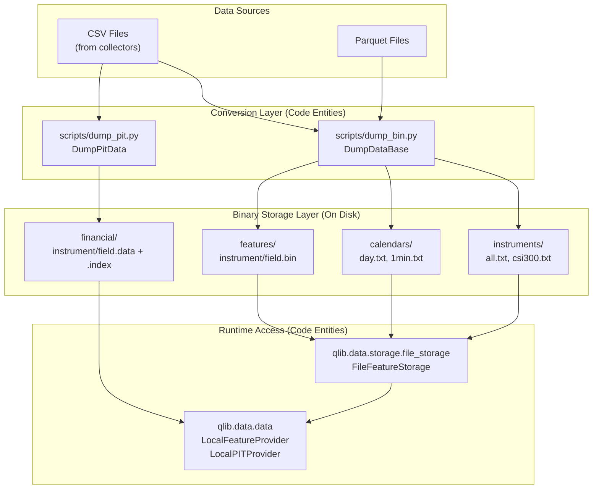
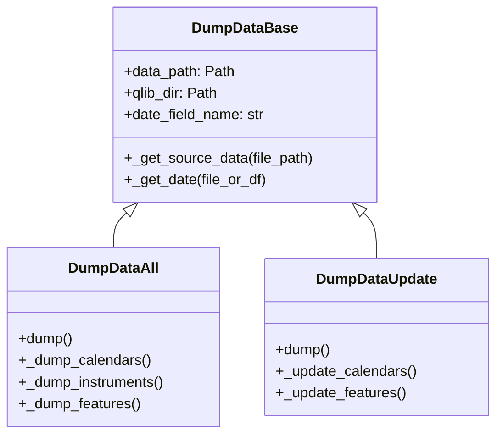

<!-- source: DeepWiki mcp.deepwiki.com · repo microsoft/qlib · page 4.2 Data Storage and Binary Format · fetched 2026-10-26 -->

# Data Storage and Binary Format

<details>
<summary>Relevant source files</summary>

The following files were used as context for generating this wiki page:

- [qlib/data/storage/__init__.py](qlib/data/storage/__init__.py)
- [qlib/data/storage/file_storage.py](qlib/data/storage/file_storage.py)
- [qlib/data/storage/storage.py](qlib/data/storage/storage.py)
- [scripts/check_data_health.py](scripts/check_data_health.py)
- [scripts/check_dump_bin.py](scripts/check_dump_bin.py)
- [scripts/data_collector/baostock_5min/README.md](scripts/data_collector/baostock_5min/README.md)
- [scripts/data_collector/baostock_5min/requirements.txt](scripts/data_collector/baostock_5min/requirements.txt)
- [scripts/data_collector/br_index/collector.py](scripts/data_collector/br_index/collector.py)
- [scripts/data_collector/future_calendar_collector.py](scripts/data_collector/future_calendar_collector.py)
- [scripts/dump_bin.py](scripts/dump_bin.py)
- [scripts/dump_pit.py](scripts/dump_pit.py)
- [tests/storage_tests/test_storage.py](tests/storage_tests/test_storage.py)

</details>


## Purpose and Scope

This document describes Qlib's binary data storage format and the infrastructure for converting raw data into this optimized format. Qlib stores market data (prices, volumes, factors) and financial statement data in a highly efficient binary format that enables fast random access during backtesting and model training.

The system is designed to bypass the overhead of traditional databases (SQL/NoSQL) by using a file-based storage layout that maps directly to memory via NumPy.

---

## Overview: From Raw Data to Binary Storage

The binary storage system serves as Qlib's foundational data layer, optimizing for:
- **Fast random access**: Read specific time ranges without scanning entire files.
- **Compact storage**: Float32 binary encoding reduces disk usage.
- **Memory mapping**: Direct file-to-memory access without parsing.
- **Concurrent reads**: Multiple processes can safely read the same data.

### System Data Flow

The following diagram bridges the natural language concepts of data collection to the specific code entities responsible for storage.

**Data Flow: From Raw Source to Binary Storage**



**Sources:** [scripts/dump_bin.py:53-140](), [scripts/dump_pit.py:24-60](), [qlib/data/storage/file_storage.py:21-64]()

---

## Binary File Format for Features

### File Structure

Each feature (e.g., `$close`, `$volume`) for each instrument is stored as a separate `.bin` file. Qlib uses a simple header-offset mechanism to allow $O(1)$ access to any time point.

**Binary Layout:**
- **Header (Bytes 0-3)**: `ref_start_index` (uint32, little-endian). This is the integer index in the global `calendar` file where this specific instrument's data begins.
- **Data (Bytes 4-N)**: A contiguous array of `float32` values.

### Reading Binary Data

The reading mechanism calculates the file offset based on the `ref_start_index` stored in the first 4 bytes. `FileFeatureStorage` handles the retrieval by mapping indices to file offsets [qlib/data/storage/file_storage.py:440-480]().

**Key characteristics:**
- **dtype**: `<f` (little-endian 32-bit float).
- **Sparse Storage**: If an instrument was listed late, the `ref_start_index` will be large, and the file will remain small [scripts/dump_bin.py:59-61]().

**Sources:** [qlib/data/storage/file_storage.py:440-480](), [scripts/dump_bin.py:59-61]()

---

## Data Directory Structure

Qlib expects a specific hierarchy in the `provider_uri` directory. The structure is managed by `FileStorageMixin` and `DataPathManager`.

```
<qlib_data_dir>/
├── calendars/
│   ├── day.txt              # Daily trading dates (YYYY-MM-DD)
│   ├── day_future.txt       # Future calendar dates [scripts/data_collector/future_calendar_collector.py:35-35]()
│   └── 1min.txt             # Minute timestamps (YYYY-MM-DD HH:MM:SS)
├── instruments/
│   ├── all.txt              # symbol\tstart_date\tend_date
│   └── csi300.txt           # constituents list
├── features/
│   ├── sh600000/            # Normalized symbol directory
│   │   ├── close.day.bin    # Format: <field>.<freq>.bin
│   │   └── volume.day.bin
│   └── ...
└── financial/               # Point-in-Time data
    ├── sh600000/
    │   ├── roewa_q.data     # PIT records [scripts/dump_pit.py:27-27]()
    │   └── roewa_q.index    # PIT offsets [scripts/dump_pit.py:28-28]()
```

### Naming and Normalization
- **Symbols**: Codes are converted to file-system safe names using `code_to_fname` and `fname_to_code` [scripts/dump_bin.py:17-17]().
- **Case Sensitivity**: On Linux, all subdirectories under `features/` must be lowercase to avoid loading failures [scripts/check_data_health.py:79-85]().
- **Frequencies**: Standard formats include `%Y-%m-%d` for daily and `%Y-%m-%d %H:%M:%S` for high-frequency data [scripts/dump_bin.py:60-61]().

**Sources:** [qlib/data/storage/file_storage.py:60-64](), [scripts/dump_bin.py:53-64](), [scripts/check_data_health.py:79-107]()

---

## Converting Data: dump_bin.py

The conversion from CSV/Parquet to Binary is handled by the `DumpDataBase` hierarchy in `scripts/dump_bin.py`.

### Class Hierarchy and Logic

**Code Entity Association: DumpBin Infrastructure**



### The Dump Process
1. **Source Reading**: `read_as_df` supports both `.csv` and `.parquet` formats [scripts/dump_bin.py:20-50]().
2. **Calendar Extraction**: `_get_date` scans source data to build a global `calendars/` file [scripts/dump_bin.py:148-168]().
3. **Instrument Range**: Identifies the `start_datetime` and `end_datetime` for every symbol [scripts/dump_bin.py:54-55]().
4. **Feature Alignment**: Data is aligned to the global calendar. Missing values are filled with `NaN` before being packed into the `.bin` file.
5. **Parallelization**: Uses `ProcessPoolExecutor` or `ThreadPoolExecutor` to process multiple symbols concurrently [scripts/dump_bin.py:10-10]().

**Sources:** [scripts/dump_bin.py:20-140](), [scripts/dump_bin.py:148-168]()

---

## Point-in-Time (PIT) Data Format

### Purpose
PIT data (e.g., Financial Statements) requires handling "amendments." A value for `2020Q1` might be released on `2020-04-10` and then corrected on `2020-05-02`. Qlib ensures that a backtest running on `2020-04-15` only sees the first value.

### PIT Storage Structure
PIT data uses two files per field in the `financial/` directory [scripts/dump_pit.py:25-28]():
- **`.index`**: Stores the index of value for each period (quarter or year) [scripts/dump_pit.py:168-170]().
- **`.data`**: Stores records in a linked-list format to handle revisions.

**Data Types and Size:**
- **Period DType**: Configured via `C.pit_record_type["period"]` [scripts/dump_pit.py:33-33]().
- **Data DType**: A composite of date, period, value, and index [scripts/dump_pit.py:35-41]().

**Sources:** [scripts/dump_pit.py:24-52](), [scripts/dump_pit.py:150-170]()

---

## Data Validation and Health

Qlib provides scripts to ensure binary data integrity after conversion.

### Data Health Checker
`DataHealthChecker` in `scripts/check_data_health.py` validates:
- **Missing Columns**: Ensures required OHLCV columns exist [scripts/check_data_health.py:165-174]().
- **Step Changes**: Detects abnormal price or volume jumps [scripts/check_data_health.py:136-150]().
- **Directory Casing**: Checks for non-lowercase feature directories [scripts/check_data_health.py:79-107]().

### Binary Comparison
`CheckBin` in `scripts/check_dump_bin.py` compares the dumped binary data against the original CSVs using `datacompy` to ensure precision is maintained [scripts/check_dump_bin.py:94-105]().

**Sources:** [scripts/check_data_health.py:13-107](), [scripts/check_dump_bin.py:17-105]()

---

## Command-Line Tools Summary

| Tool | Purpose | Key Parameters |
| :--- | :--- | :--- |
| `dump_bin.py` | Convert OHLCV/Features to `.bin` | `data_path`, `qlib_dir`, `freq`, `include_fields` |
| `dump_pit.py` | Convert financial data to PIT format | `csv_path`, `qlib_dir`, `freq` (quarterly/annual) |
| `check_data_health.py` | Validate dataset completeness | `qlib_dir`, `large_step_threshold_price` |
| `future_calendar_collector.py` | Generate `day_future.txt` | `qlib_dir`, `region` (cn/us) |

**Sources:** [scripts/dump_bin.py:68-81](), [scripts/dump_pit.py:53-68](), [scripts/data_collector/future_calendar_collector.py:94-112]()

---

