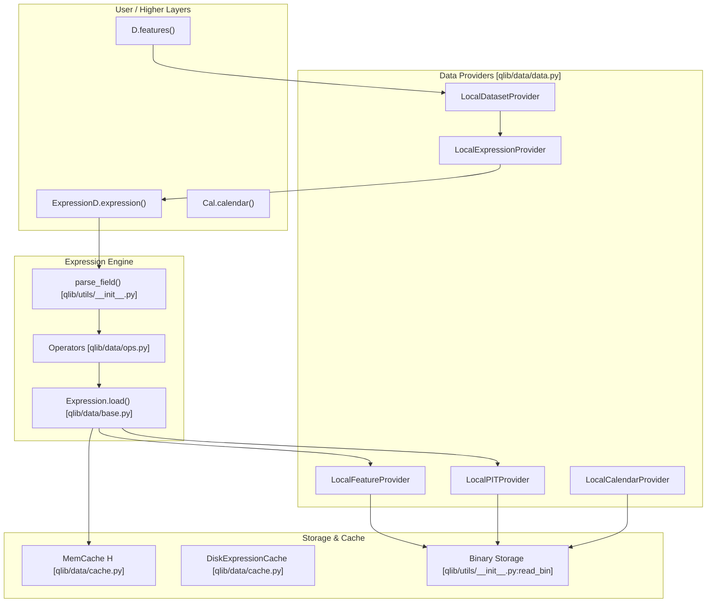
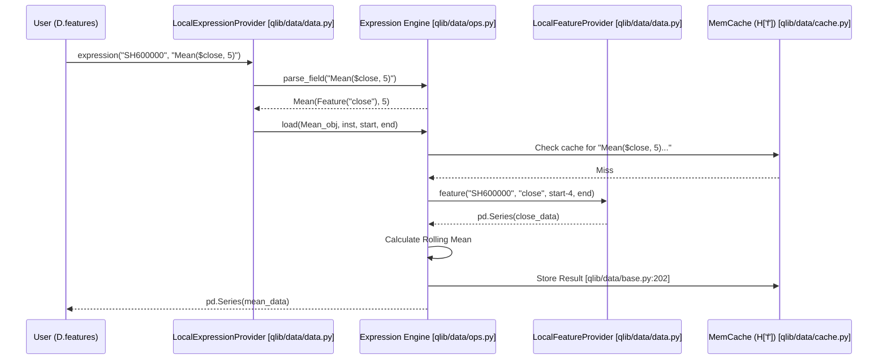

<!-- source: DeepWiki mcp.deepwiki.com · repo microsoft/qlib · page 4.3 Data Providers and Expression Engine · fetched 2026-10-26 -->

# Data Providers and Expression Engine

Relevant source files

The following files were used as context for generating this wiki page:

- [examples/data_demo/README.md](examples/data_demo/README.md)
- [examples/data_demo/data_cache_demo.py](examples/data_demo/data_cache_demo.py)
- [examples/data_demo/data_mem_resuse_demo.py](examples/data_demo/data_mem_resuse_demo.py)
- [examples/orderbook_data/create_dataset.py](examples/orderbook_data/create_dataset.py)
- [examples/workflow_by_code.py](examples/workflow_by_code.py)
- [qlib/__init__.py](qlib/__init__.py)
- [qlib/config.py](qlib/config.py)
- [qlib/contrib/online/operator.py](qlib/contrib/online/operator.py)
- [qlib/contrib/rolling/ddgda.py](qlib/contrib/rolling/ddgda.py)
- [qlib/contrib/torch.py](qlib/contrib/torch.py)
- [qlib/contrib/tuner/tuner.py](qlib/contrib/tuner/tuner.py)
- [qlib/data/__init__.py](qlib/data/__init__.py)
- [qlib/data/base.py](qlib/data/base.py)
- [qlib/data/cache.py](qlib/data/cache.py)
- [qlib/data/data.py](qlib/data/data.py)
- [qlib/data/ops.py](qlib/data/ops.py)
- [qlib/data/pit.py](qlib/data/pit.py)
- [qlib/utils/__init__.py](qlib/utils/__init__.py)
- [qlib/utils/mod.py](qlib/utils/mod.py)
- [qlib/utils/objm.py](qlib/utils/objm.py)

Data Providers and the Expression Engine form the core data retrieval and computation layer in Qlib. While providers handle the low-level access to various data types (calendars, instruments, features, and point-in-time data), the Expression Engine provides a powerful Domain Specific Language (DSL) to perform complex mathematical operations on this data efficiently.

## Overview

The data layer is structured to separate storage concerns from logical data types. Every data request typically flows through a global wrapper, into a provider, and potentially through the expression engine before returning a `pd.Series` or `pd.DataFrame`.

**Sources**: [qlib/data/data.py:1-100](), [qlib/data/ops.py:1-50](), [qlib/data/base.py:13-25](), [qlib/data/cache.py:137-140](), [qlib/utils/__init__.py:54-54]()

---

## Expression Engine and DSL

The Expression Engine allows users to define features using string-based formulas. It converts these strings into a tree of `Expression` objects that can be evaluated recursively.

### Expression Base Class
The `Expression` class defines the interface for all computable features. It handles the two-stage loading process:
1.  **Caching and Error Handling**: Managed in `load()` [qlib/data/base.py:142-203](). It checks the memory cache `H["f"]` before attempting calculation.
2.  **Internal Calculation**: Implemented in `_load_internal()` by subclasses [qlib/data/base.py:205-207]().

### Operators and DSL
Qlib supports a wide range of operators in its DSL, categorized into:
*   **Element-wise**: `Abs`, `Log`, `Sign`, `Mask` [qlib/data/ops.py:37-229]().
*   **Pair-wise**: `Add`, `Sub`, `Mul`, `Div`, `Greater`, `Less` [qlib/data/ops.py:231-350]().
*   **Rolling/Time-series**: `Ref` (offset), `Mean`, `Std`, `Var`, `Max`, `Min` [qlib/data/ops.py:480-600]().
*   **Cross-sectional**: `CSMean`, `CSRank` (ranking within the universe at a specific time) [qlib/data/ops.py:1100-1200]().
*   **Cython Optimized**: High-performance rolling operators like `rolling_slope` and `rolling_rsquare` [qlib/data/ops.py:17-20]().

### DSL Syntax Mapping
The `parse_field` utility converts DSL strings into executable Python code [qlib/utils/__init__.py:277-302]():

| DSL String | Expression Object | Description |
| :--- | :--- | :--- |
| `$close` | `Feature("close")` | Basic feature retrieval [qlib/data/base.py:231]() |
| `$$roewa_q` | `PFeature("roewa_q")` | Point-in-Time feature [qlib/data/base.py:255]() |
| `Ref($close, 1)` | `Ref(Feature("close"), 1)` | Close price of the previous day |
| `Mean($close, 5)` | `Mean(Feature("close"), 5)` | 5-day moving average |

**Sources**: [qlib/data/base.py:13-183](), [qlib/data/ops.py:37-600](), [qlib/utils/__init__.py:277-302]()

---

## Data Providers

Providers are abstract interfaces for accessing different data dimensions. Most production setups use "Local" implementations that read from Qlib's custom binary format.

### CalendarProvider
Manages trading dates. It supports different frequencies (e.g., `day`, `1min`) and can handle "future" calendars for backtesting [qlib/data/data.py:65-109]().
*   **Key Function**: `locate_index()` [qlib/data/data.py:111-152]() maps a `pd.Timestamp` to an integer index used for binary slicing.
*   **Caching**: Uses `H["c"]` to store the calendar list and a timestamp-to-index mapping [qlib/data/data.py:154-176]().

### InstrumentProvider
Manages the universe of assets (e.g., all stocks in CSI300).
*   **Data Structure**: Returns a dictionary where keys are instrument codes and values are lists of `(start_time, end_time)` tuples [qlib/data/data.py:221-230]().
*   **Filtering**: Supports a `filter_pipe` to dynamically sub-select instruments [qlib/data/data.py:206-218]().

### FeatureProvider
The low-level interface for reading raw `.bin` files.
*   **LocalFeatureProvider**: Removes the `$` prefix and calls the storage backend to read binary data using `read_bin` [qlib/data/data.py:726-742]().
*   **Storage Logic**: Uses `read_bin` from `qlib.utils` to perform efficient disk I/O with `np.frombuffer` [qlib/utils/__init__.py:54-68]().

### PITProvider (Point-in-Time)
Specifically designed for data with revisions, such as financial statements.
*   **Logic**: It ensures that for any given "query time," only data available *at that time* is returned, preventing look-ahead bias [qlib/data/data.py:338-381]().
*   **Implementation**: `read_period_data` [qlib/utils/__init__.py:109-173]() traverses a linked list of revisions in the `.data` file until it finds the latest record before the `cur_date_int`.

**Sources**: [qlib/data/data.py:65-828](), [qlib/utils/__init__.py:54-173]()

---

## Data Flow: From String to Series

The following diagram illustrates how a request for a complex expression like `Mean($close, 5)` is resolved into data.

**Sources**: [qlib/data/data.py:383-444](), [qlib/data/base.py:142-203](), [qlib/data/cache.py:137-180](), [qlib/utils/__init__.py:277-277]()

---

## DatasetProvider and Parallelism

`DatasetProvider` is responsible for aggregating multiple features across multiple instruments into a single `pd.DataFrame`.

### Parallel Execution
To handle large universes, Qlib parallelizes the calculation at the instrument level [qlib/data/data.py:550-570]().
*   **Kernel Selection**: The number of processes is determined by `C.kernels` [qlib/config.py:162]().
*   **Worker Function**: `inst_calculator` [qlib/data/data.py:581-635]() is the unit of work executed in parallel. It calculates all requested expressions for a single instrument and returns a local DataFrame.

### Aggregation
Once all `inst_calculator` tasks finish, the results are concatenated into a MultiIndex DataFrame (instrument, datetime) using `pd.concat` [qlib/data/data.py:572-579]().

**Sources**: [qlib/data/data.py:446-635](), [qlib/config.py:127-162]()

---

## Caching System

Performance is heavily dependent on the multi-level cache defined in `qlib/data/cache.py`.

1.  **MemCache (H)**: A singleton `MemCache` object containing three units: `c` (calendar), `i` (instrument), and `f` (feature/expression) [qlib/data/cache.py:137-180]().
2.  **Expression Cache**: Persists calculated expressions to disk to avoid re-computing complex formulas like `Slope($close, 20)` [qlib/data/cache.py:596-610]().
3.  **Cache Units**: Supports `length` based or `sizeof` based eviction policies [qlib/data/cache.py:140-160]().
4.  **Expiry**: Memory caches can have an expiration time defined by `C.mem_cache_expire` [qlib/data/cache.py:182-208]().

**Sources**: [qlib/data/cache.py:137-210](), [qlib/config.py:155-177](), [qlib/data/data.py:20-20]()

---

