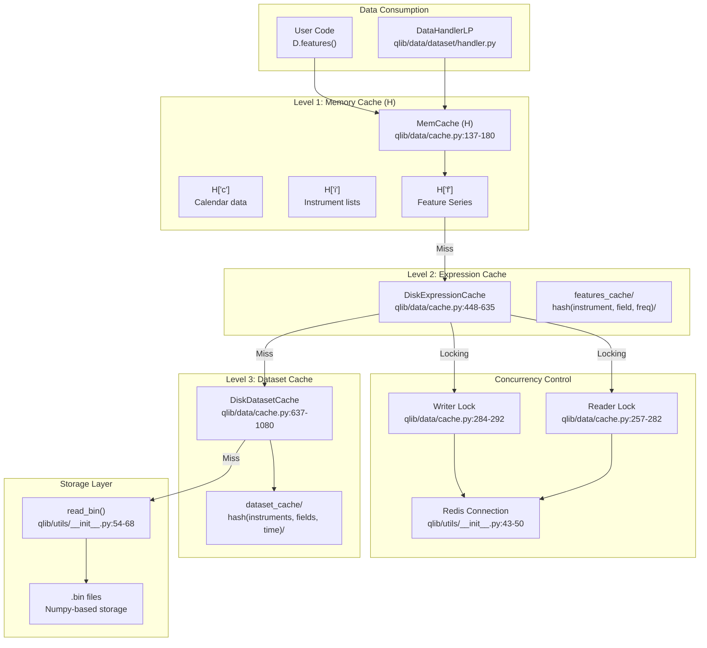
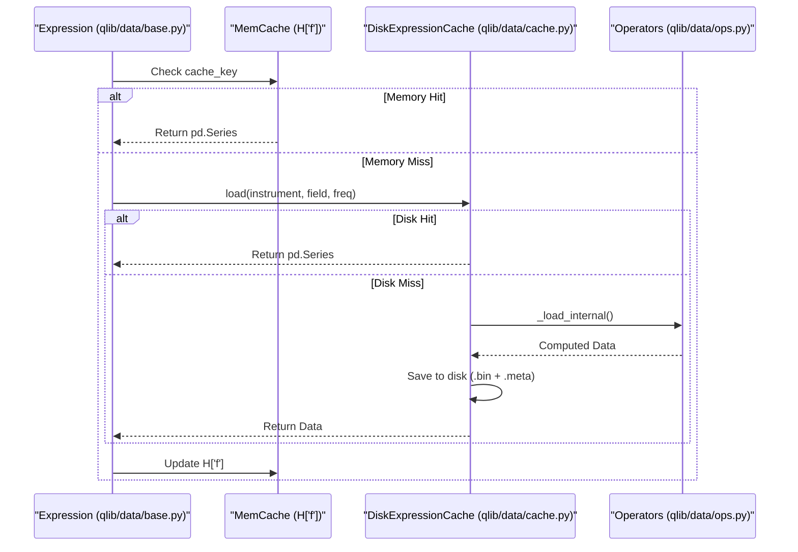

<!-- source: DeepWiki mcp.deepwiki.com · repo microsoft/qlib · page 4.4 Multi-Level Caching System · fetched 2026-10-26 -->

# Multi-Level Caching System

Relevant source files

The following files were used as context for generating this wiki page:

- [examples/data_demo/README.md](examples/data_demo/README.md)
- [examples/data_demo/data_cache_demo.py](examples/data_demo/data_cache_demo.py)
- [examples/data_demo/data_mem_resuse_demo.py](examples/data_demo/data_mem_resuse_demo.py)
- [examples/orderbook_data/create_dataset.py](examples/orderbook_data/create_dataset.py)
- [examples/workflow_by_code.py](examples/workflow_by_code.py)
- [qlib/__init__.py](qlib/__init__.py)
- [qlib/config.py](qlib/config.py)
- [qlib/contrib/online/operator.py](qlib/contrib/online/operator.py)
- [qlib/contrib/rolling/ddgda.py](qlib/contrib/rolling/ddgda.py)
- [qlib/contrib/torch.py](qlib/contrib/torch.py)
- [qlib/contrib/tuner/tuner.py](qlib/contrib/tuner/tuner.py)
- [qlib/data/__init__.py](qlib/data/__init__.py)
- [qlib/data/base.py](qlib/data/base.py)
- [qlib/data/cache.py](qlib/data/cache.py)
- [qlib/data/data.py](qlib/data/data.py)
- [qlib/data/ops.py](qlib/data/ops.py)
- [qlib/data/pit.py](qlib/data/pit.py)
- [qlib/utils/__init__.py](qlib/utils/__init__.py)
- [qlib/utils/mod.py](qlib/utils/mod.py)
- [qlib/utils/objm.py](qlib/utils/objm.py)

## Purpose and Scope

This page documents Qlib's multi-level caching infrastructure, a core performance optimization that makes Qlib significantly faster than traditional database solutions for quantitative financial research. The system consists of three primary layers: in-memory cache (`MemCache`), disk-based expression cache (`DiskExpressionCache`), and disk-based dataset cache (`DiskDatasetCache`). These layers integrate with Redis-based distributed locking to provide high-performance data access in both single-process and multi-process environments.

The caching system is the primary reason Qlib can outperform MySQL, MongoDB, and other general-purpose databases. By storing data in compact binary formats and maintaining intelligent caches, Qlib minimizes redundant I/O and expensive feature re-computation.

## Multi-Level Cache Architecture

Qlib's caching system is structured to provide the fastest possible access path, falling back to slower layers only when necessary.

**Diagram: Multi-Level Cache Architecture**

**Sources:** [qlib/data/cache.py:137-180](), [qlib/data/cache.py:448-635](), [qlib/data/cache.py:637-1080](), [qlib/utils/__init__.py:43-50](), [qlib/utils/__init__.py:54-68]()

## Level 1: Memory Cache (MemCache / H)

The `MemCache` class (instantiated as the global variable `H`) provides the fastest access layer. It uses an LRU (Least Recently Used) eviction strategy based on `collections.OrderedDict` [qlib/data/cache.py:50-80]().

### Cache Implementation Details
- **H["c"]**: Stores trading calendars. Keys are strings like `{freq}_future_{bool}`. It is updated during `CalendarProvider._get_calendar` [qlib/data/data.py:171-176]().
- **H["i"]**: Stores instrument lists and their valid time ranges [qlib/data/cache.py:169]().
- **H["f"]**: Stores feature series. Keys are tuples containing `(expression_str, instrument, start_index, end_index, *args)`. This is checked in the `Expression.load` method [qlib/data/base.py:187-203]().

### MemCacheUnit Types
Qlib supports two ways to limit memory usage, configured via `C.mem_cache_limit_type` [qlib/config.py:171]():
1. **MemCacheLengthUnit**: Limits the number of items (count-based) [qlib/data/cache.py:121-127]().
2. **MemCacheSizeofUnit**: Limits the total memory bytes using `sys.getsizeof()` [qlib/data/cache.py:129-135]().

**Sources:** [qlib/data/cache.py:44-118](), [qlib/data/cache.py:137-180](), [qlib/data/base.py:187-203](), [qlib/config.py:170-172]()

## Level 2: DiskExpressionCache

`DiskExpressionCache` persists computed feature expressions (e.g., `Mean($close, 5)`) to disk. This is critical for expensive operations like rolling slopes or r-squares implemented in Cython [qlib/data/ops.py:17-31]().

### Expression Evaluation Flow
When an expression is loaded, Qlib checks the memory cache first, then the disk expression cache.

**Sources:** [qlib/data/base.py:184-203](), [qlib/data/cache.py:448-635](), [qlib/data/ops.py:17-31]()

## Level 3: DiskDatasetCache

`DiskDatasetCache` stores fully prepared datasets. It is optimized for multi-process environments and handles complex data requests spanning multiple instruments and fields [qlib/data/cache.py:637-640]().

### Cache Key Normalization
To maximize hit rates, Qlib normalizes fields and instruments before hashing:
- **Fields**: Normalized via `normalize_cache_fields` which removes spaces and ensures consistent naming [qlib/utils/__init__.py:350-357]().
- **Instruments**: Normalized via `normalize_cache_instruments` which sorts the instrument list alphabetically [qlib/utils/__init__.py:359-372]().

### Cache Control (`disk_cache` parameter)
Users can control the cache behavior via the `disk_cache` argument in `D.features` or `DatasetProvider.dataset`:
- `0`: Skip cache entirely.
- `1`: Use cache (load if exists, else compute and save).
- `2`: Replace cache (recompute and overwrite existing) [qlib/data/cache.py:390-406]().

**Sources:** [qlib/data/cache.py:637-1080](), [qlib/utils/__init__.py:350-372](), [qlib/config.py:169]()

## Concurrency Control: Redis Integration

Qlib uses Redis to manage locks across different processes, preventing data corruption when multiple workers attempt to write to the same cache file simultaneously.

### Lock Protocol
1. **Reader Lock**: Allows multiple processes to read the same cache file concurrently. It increments a `reader_key` in Redis. The first reader acquires a writer lock to block potential writers [qlib/data/cache.py:257-282]().
2. **Writer Lock**: Provides exclusive access. No other readers or writers can access the cache while a writer lock is held [qlib/data/cache.py:284-292]().

### Lock Implementation
The `CacheUtils` class provides the locking interface, utilizing `redis_lock.Lock` and the global Redis connection defined in `qlib.utils.get_redis_connection()` [qlib/utils/__init__.py:43-50](). Connection parameters like `redis_host` and `redis_port` are managed in the global config [qlib/config.py:180-183]().

**Sources:** [qlib/data/cache.py:240-292](), [qlib/utils/__init__.py:43-50](), [qlib/config.py:178-183]()

## Performance Optimization Summary

Qlib achieves superior performance compared to MySQL or MongoDB through several architectural choices:

| Optimization | Implementation | Performance Impact |
| :--- | :--- | :--- |
| **Direct Binary I/O** | `read_bin` using `np.frombuffer` | Eliminates parsing overhead (JSON/SQL) [qlib/utils/__init__.py:54-68]() |
| **Memory Reuse** | Global `H` (MemCache) | Zero-latency for repeated access in-process [qlib/data/cache.py:137-180]() |
| **Expression Caching** | `DiskExpressionCache` | Avoids re-calculating complex Cython-based features [qlib/data/cache.py:448-635]() |
| **Efficient Metadata** | `.meta` files with timestamps | Fast validation of cache validity via `CacheUtils.visit` [qlib/data/cache.py:222-237]() |
| **Point-in-Time Read** | `read_period_data` | Optimized binary search for PIT revisions [qlib/utils/__init__.py:109-173]() |

**Sources:** [qlib/utils/__init__.py:54-68](), [qlib/data/cache.py:137-180](), [qlib/data/cache.py:448-635](), [qlib/data/cache.py:222-237](), [qlib/utils/__init__.py:109-173]()

---

