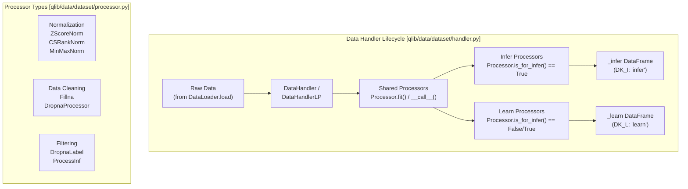
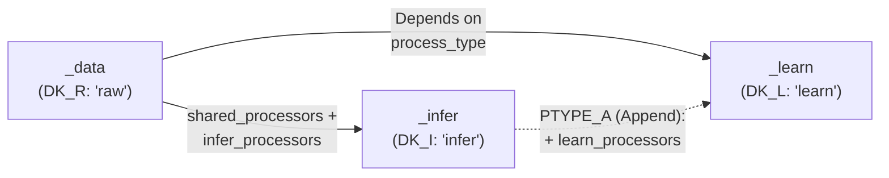

<!-- source: DeepWiki mcp.deepwiki.com · repo microsoft/qlib · page 4.5 DataHandlers and Processors · fetched 2026-10-26 -->

# DataHandlers and Processors

<details>
<summary>Relevant source files</summary>

The following files were used as context for generating this wiki page:

- [qlib/contrib/data/handler.py](qlib/contrib/data/handler.py)
- [qlib/contrib/data/utils/__init__.py](qlib/contrib/data/utils/__init__.py)
- [qlib/contrib/data/utils/sepdf.py](qlib/contrib/data/utils/sepdf.py)
- [qlib/data/dataset/__init__.py](qlib/data/dataset/__init__.py)
- [qlib/data/dataset/handler.py](qlib/data/dataset/handler.py)
- [qlib/data/dataset/loader.py](qlib/data/dataset/loader.py)
- [qlib/data/dataset/processor.py](qlib/data/dataset/processor.py)
- [qlib/data/dataset/utils.py](qlib/data/dataset/utils.py)
- [qlib/utils/pickle_utils.py](qlib/utils/pickle_utils.py)
- [qlib/workflow/utils.py](qlib/workflow/utils.py)
- [tests/data_mid_layer_tests/test_handler.py](tests/data_mid_layer_tests/test_handler.py)
- [tests/misc/test_sepdf.py](tests/misc/test_sepdf.py)

</details>


## Purpose and Scope

This document describes Qlib's data handler and processor system, which is responsible for preprocessing raw data into model-ready formats. Data handlers orchestrate the loading and processing of financial data, while processors apply transformations such as normalization, filtering, and feature engineering. This layer sits between the data loading system (see [4.6]() for DataLoaders) and the dataset abstraction (see [4.7]() for Datasets and Time-Series Sampling).

---

## System Architecture

The data handler and processor system follows a pipeline architecture where raw data flows through configurable transformation stages.

### Data Flow and Code Entity Mapping
The following diagram illustrates how the `DataHandler` classes interact with `Processor` entities to transform data from raw formats to inference/learning states.



**Sources:** [qlib/data/dataset/handler.py:25-40](), [qlib/data/dataset/handler.py:383-435](), [qlib/data/dataset/processor.py:35-50]()

---

## DataHandler Base Class

`DataHandler` is the base implementation that loads data via a `DataLoader` and provides a unified interface for fetching data. It maintains a 2-level index: `datetime` and `instrument`.

### Key Components

| Component | Type | Description |
|-----------|------|-------------|
| `data_loader` | `DataLoader` | Loads raw data from the source [qlib/data/dataset/handler.py:135-139]() |
| `_data` | `pd.DataFrame` | Internal DataFrame with multi-index [qlib/data/dataset/handler.py:103]() |
| `instruments` | str/list | Stock list to retrieve [qlib/data/dataset/handler.py:143]() |
| `start_time` / `end_time` | str | Time range for original data [qlib/data/dataset/handler.py:144-145]() |
| `fetch_orig` | bool | Return original data instead of copy if possible [qlib/data/dataset/handler.py:147]() |

### Core Methods

**`__init__(instruments, start_time, end_time, data_loader, init_data=True)`**
Initializes the handler and sets up the data loader via `init_instance_by_config`. [qlib/data/dataset/handler.py:106-152]()

**`setup_data(enable_cache=False)`**
Responsible for maintaining `self._data`. It uses `lazy_sort_index` to ensure the internal DataFrame is sorted by index for efficient slicing. [qlib/data/dataset/handler.py:173-196]()

**`fetch(selector, level, col_set, data_key)`**
Retrieves data using `fetch_df_by_index` and `fetch_df_by_col`. 
- `col_set=CS_RAW` returns raw data with multi-level column indices to avoid pandas copying [qlib/data/dataset/handler.py:100-101]().
- `col_set=CS_ALL` returns all columns with a single-level index [qlib/data/dataset/handler.py:48]().

[qlib/data/dataset/handler.py:197-243]()

**Sources:** [qlib/data/dataset/handler.py:68-243](), [qlib/data/dataset/utils.py:41-90]()

---

## DataHandlerLP: Learnable Processor Handler

`DataHandlerLP` extends `DataHandler` to support learnable processors. These processors can "fit" parameters (like mean/std) on a training period and apply them during inference.

### Three-State Data Model

`DataHandlerLP` manages three internal data representations:
1.  `_data` (`DK_R`): The raw loaded data [qlib/data/dataset/handler.py:52]().
2.  `_infer` (`DK_I`): Data processed for inference [qlib/data/dataset/handler.py:53]().
3.  `_learn` (`DK_L`): Data processed for training/learning [qlib/data/dataset/handler.py:54]().



**Sources:** [qlib/data/dataset/handler.py:383-435]()

### Process Types

The `process_type` determines the relationship between inference and learning pipelines:

| Process Type | Constant | Description |
|--------------|-----------|-------------|
| `PTYPE_I` | `"independent"` | `_infer` and `_learn` are generated independently from `_data` [qlib/data/dataset/handler.py:426-429](). |
| `PTYPE_A` | `"append"` | `_learn` is generated by applying learn processors to the result of `_infer` [qlib/data/dataset/handler.py:431-435](). |

### Initialization Types (`init_type`)

| Init Type | Constant | Behavior |
|-----------|----------|----------|
| Fit Sequential | `IT_FIT_SEQ` | Fits each processor on the output of the previous processor in the pipeline [qlib/data/dataset/handler.py:634-644](). |
| Fit Independent | `IT_FIT_IND` | Fits all processors on the original `_data` independently [qlib/data/dataset/handler.py:646-654](). |
| Load State | `IT_LS` | Skips fitting; only transforms data using existing processor states (used when loading from disk) [qlib/data/dataset/handler.py:656-663](). |

**Sources:** [qlib/data/dataset/handler.py:426-435](), [qlib/data/dataset/handler.py:629-663]()

---

## Processor Base Class and Interface

All processors inherit from `qlib.data.dataset.processor.Processor`.

### Key Methods

**`fit(df: pd.DataFrame = None)`**
Learns parameters (e.g., `min_val`, `max_val` for `MinMaxNorm`). It typically restricts the fitting data to a specific time range using `fit_start_time` and `fit_end_time` to prevent look-ahead bias [qlib/data/dataset/processor.py:197-205]().

**`__call__(df: pd.DataFrame)`**
Applies the transformation. Note that many processors modify the input DataFrame **inplace** to save memory [qlib/data/dataset/processor.py:53-54]().

**`is_for_infer() -> bool`**
Indicates if the processor should be used during inference. For example, `DropnaLabel` returns `False` because labels are not available during real-time prediction [qlib/data/dataset/processor.py:109-111]().

**Sources:** [qlib/data/dataset/processor.py:35-92]()

---

## Processor Implementations

### Data Cleaning and Filtering

*   **`DropnaProcessor`**: Drops rows with NaN in specific field groups [qlib/data/dataset/processor.py:94-103]().
*   **`ProcessInf`**: Replaces infinity values with the mean of the non-infinite values in the same column, grouped by datetime [qlib/data/dataset/processor.py:161-177]().
*   **`Fillna`**: Fills NaN values with a constant (default 0) [qlib/data/dataset/processor.py:179-194]().

### Normalization

*   **`MinMaxNorm`**: Scales features to a range based on training set min/max [qlib/data/dataset/processor.py:196-226]().
*   **`ZScoreNorm`**: Standardizes features using training set mean and standard deviation [qlib/data/dataset/processor.py:228-260]().
*   **`CSZScoreNorm`**: Performs cross-sectional normalization (standardizing values across instruments at each timestamp) [qlib/data/dataset/processor.py:300-324]().
*   **`CSRankNorm`**: Converts values to their cross-sectional percentile rank [qlib/data/dataset/processor.py:326-360]().

**Sources:** [qlib/data/dataset/processor.py:94-360]()

---

## Configuration and Usage

### Example: Alpha158 Handler Configuration

`Alpha158` is a common handler in Qlib that pre-configures a `QlibDataLoader` with specific technical indicators and standard processors.

```python
# From qlib/contrib/data/handler.py
handler_config = {
    "class": "Alpha158",
    "kwargs": {
        "instruments": "csi300",
        "start_time": "2010-01-01",
        "end_time": "2020-12-31",
        "fit_start_time": "2010-01-01",
        "fit_end_time": "2014-12-31",
        "learn_processors": [
            {"class": "DropnaLabel"},
            {"class": "CSZScoreNorm", "kwargs": {"fields_group": "label"}},
        ],
        "infer_processors": [
            {"class": "ProcessInf"},
            {"class": "ZScoreNorm"},
            {"class": "Fillna"},
        ],
    }
}
```

### Integration with DatasetH

`DatasetH` wraps the `DataHandler` and manages data segmentation (train/valid/test).

```python
# From qlib/data/dataset/__init__.py
dataset = DatasetH(
    handler=handler_config,
    segments={
        "train": ("2010-01-01", "2014-12-31"),
        "test": ("2015-01-01", "2020-12-31"),
    }
)

# prepare() calls handler.fetch() internally
train_data = dataset.prepare("train", data_key="learn") # Uses DK_L
test_data = dataset.prepare("test", data_key="infer")   # Uses DK_I
```

**Sources:** [qlib/contrib/data/handler.py:98-138](), [qlib/data/dataset/__init__.py:72-123](), [qlib/data/dataset/__init__.py:185-214]()

---

## Serialization and Security

Handlers and Processors inherit from `Serializable` [qlib/data/dataset/handler.py:25](). To prevent arbitrary code execution during deserialization, Qlib uses `RestrictedUnpickler`.

**Safe Classes Whitelist:**
- `qlib.data.dataset.handler.DataHandler`
- `qlib.data.dataset.handler.DataHandlerLP`
- `qlib.data.dataset.loader.StaticDataLoader`
- Core Python, `pandas`, and `numpy` types.

**Sources:** [qlib/utils/pickle_utils.py:16-58](), [qlib/utils/serial.py:1-15]()

---

