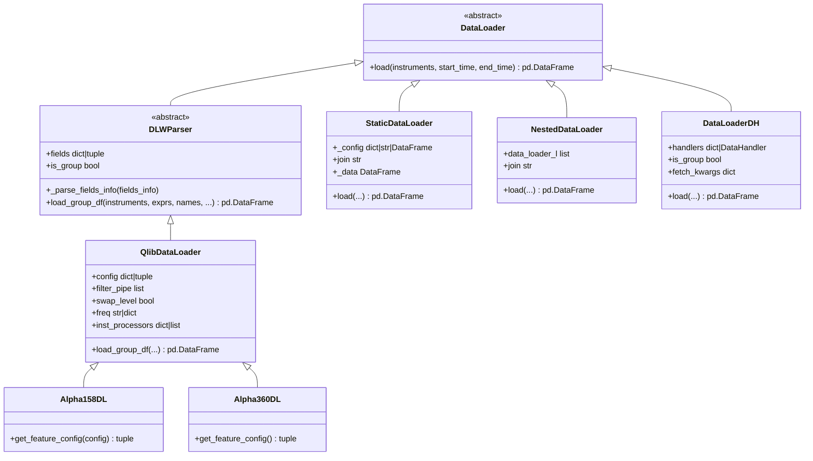
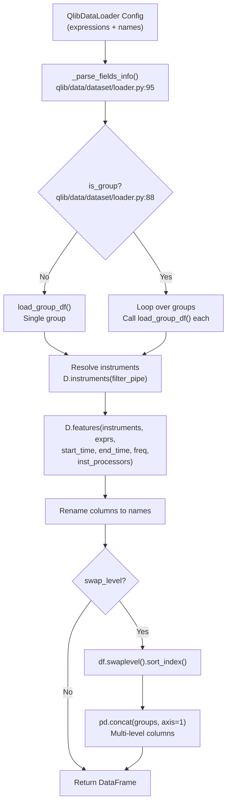
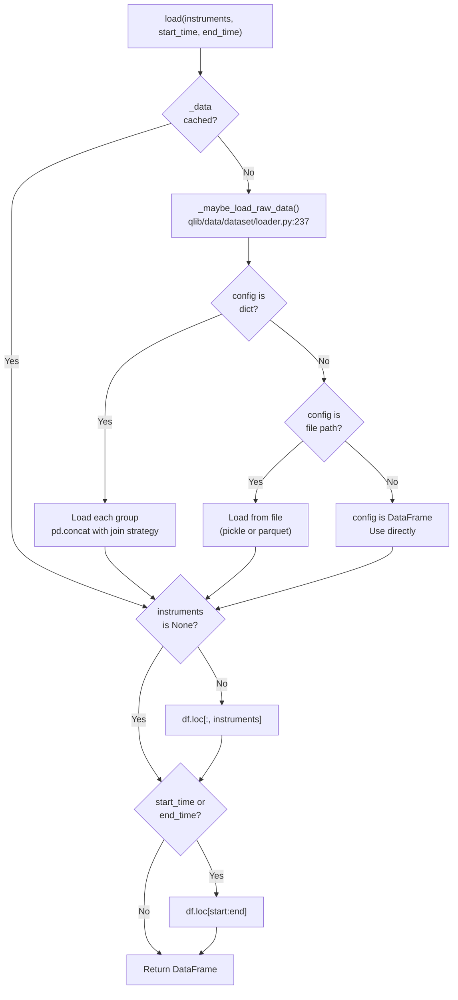
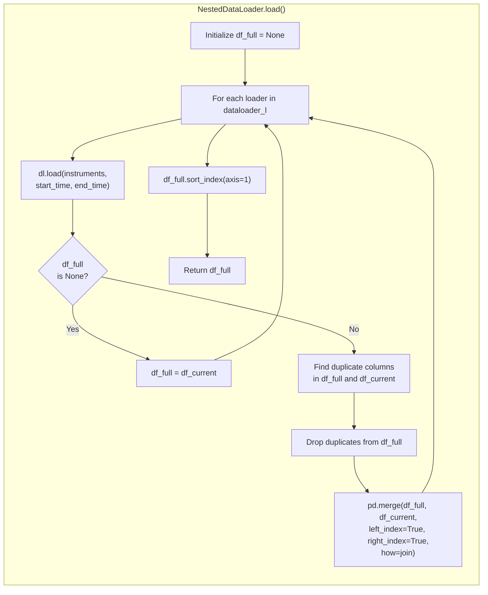
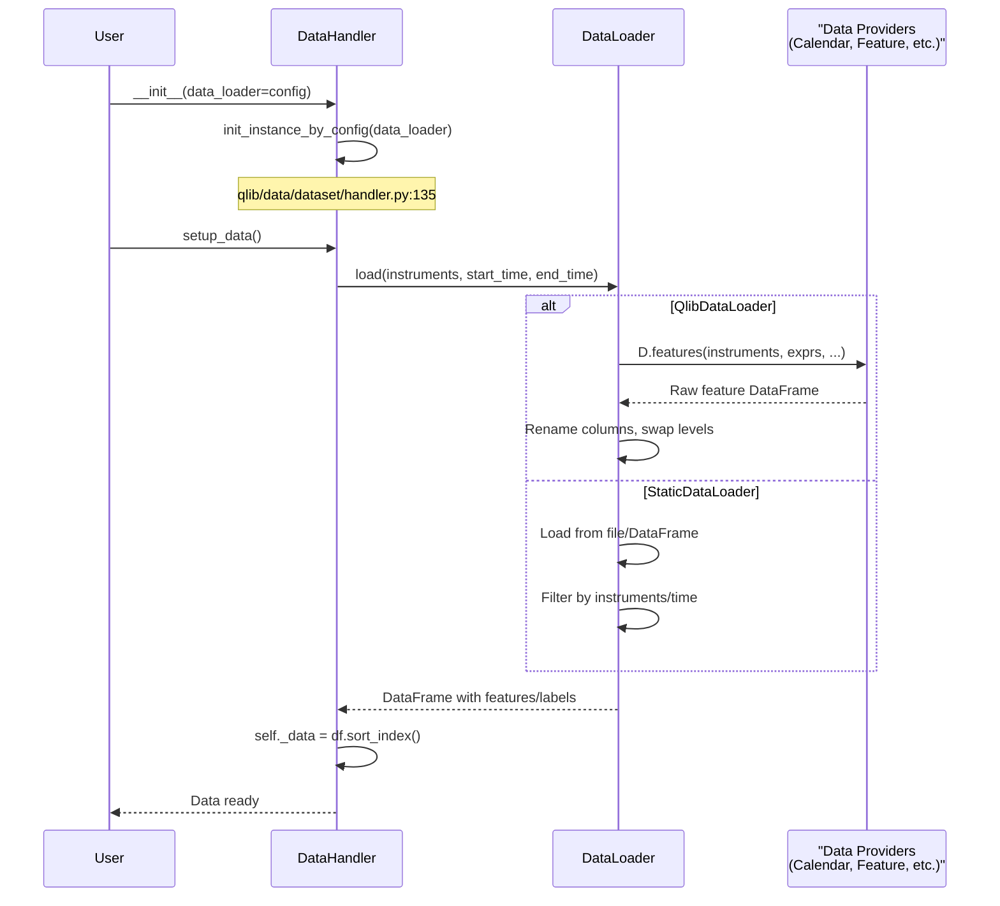

<!-- source: DeepWiki mcp.deepwiki.com · repo microsoft/qlib · page 4.6 DataLoaders and Feature Engineering · fetched 2026-10-26 -->

# DataLoaders and Feature Engineering

<details>
<summary>Relevant source files</summary>

The following files were used as context for generating this wiki page:

- [examples/benchmarks/LightGBM/features_sample.py](examples/benchmarks/LightGBM/features_sample.py)
- [examples/benchmarks/LightGBM/workflow_config_lightgbm_Alpha158_multi_freq.yaml](examples/benchmarks/LightGBM/workflow_config_lightgbm_Alpha158_multi_freq.yaml)
- [qlib/contrib/data/handler.py](qlib/contrib/data/handler.py)
- [qlib/contrib/data/loader.py](qlib/contrib/data/loader.py)
- [qlib/data/dataset/__init__.py](qlib/data/dataset/__init__.py)
- [qlib/data/dataset/handler.py](qlib/data/dataset/handler.py)
- [qlib/data/dataset/loader.py](qlib/data/dataset/loader.py)
- [qlib/data/dataset/processor.py](qlib/data/dataset/processor.py)
- [qlib/data/dataset/utils.py](qlib/data/dataset/utils.py)
- [qlib/data/inst_processor.py](qlib/data/inst_processor.py)
- [qlib/workflow/utils.py](qlib/workflow/utils.py)
- [tests/data_mid_layer_tests/test_dataloader.py](tests/data_mid_layer_tests/test_dataloader.py)

</details>


## Purpose and Scope

DataLoaders are responsible for loading raw feature data from Qlib's data providers and transforming it into structured DataFrames suitable for model training. This page covers:

- The `DataLoader` interface hierarchy and key implementations.
- Expression-based feature engineering with `QlibDataLoader`.
- Pre-computed dataset loading with `StaticDataLoader` and `NestedDataLoader`.
- Predefined feature sets: Alpha158 (technical indicators) and Alpha360 (price sequences).
- Integration patterns with `DataHandler`.

DataLoaders sit between the Data Providers/Expression Engine (see [4.3]()) and DataHandlers/Processors (see [4.5]()) in Qlib's data pipeline. They provide the initial feature extraction layer, while DataHandlers apply processors for normalization and filtering.

**Sources:** [qlib/data/dataset/loader.py:18-60](), [qlib/data/dataset/handler.py:68-152]()

---

## DataLoader Interface and Hierarchy

### Base Class: DataLoader

All data loaders inherit from the abstract `DataLoader` class [qlib/data/dataset/loader.py:18](), which defines a single interface:

```python
def load(self, instruments, start_time=None, end_time=None) -> pd.DataFrame
```

This method returns a DataFrame with:
- **Index**: Multi-index with levels `(datetime, instrument)` or `(instrument, datetime)` [qlib/data/dataset/loader.py:34-37]().
- **Columns**: Single-level or multi-level index describing features and labels [qlib/data/dataset/loader.py:32-33]().

**Sources:** [qlib/data/dataset/loader.py:18-60]()

---

### DataLoader Class Hierarchy

The diagram below maps the hierarchy from the base interface to concrete implementations.



**Key Implementations:**

| Class | Purpose | Config Type | Data Source |
|-------|---------|-------------|-------------|
| `QlibDataLoader` | Expression-based features | Expressions (list/dict) | `D.features()` from providers |
| `StaticDataLoader` | Pre-computed features | File path or DataFrame | Pickle/Parquet/In-memory |
| `NestedDataLoader` | Combine multiple loaders | List of loader configs | Multiple sources |
| `DataLoaderDH` | Load from DataHandler | DataHandler config | Existing DataHandler |
| `Alpha158DL` | Technical indicators | Dict config (optional) | `D.features()` with 158 factors |
| `Alpha360DL` | Price/volume sequences | Dict config (optional) | `D.features()` with 360 fields |

**Sources:** [qlib/data/dataset/loader.py:18-415](), [qlib/contrib/data/loader.py:4-311]()

---

## Expression-Based Loading: QlibDataLoader

`QlibDataLoader` is the primary loader for feature engineering. It translates feature expressions into data queries against Qlib's Data Provider system.

### Configuration Structure

The `config` parameter defines features through expressions [qlib/data/dataset/loader.py:158](). It uses `DLWParser` to handle group-based or flat configurations [qlib/data/dataset/loader.py:69-87]().

```python
# Multiple groups (multi-level columns) as seen in Alpha158/360 handlers
config = {
    "feature": (
        ["$close/$open", "Mean($close, 5)"],
        ["CLOSE_OPEN", "MA5"]
    ),
    "label": (
        ["Ref($close, -2)/Ref($close, -1) - 1"],
        ["LABEL0"]
    )
}
```

**Sources:** [qlib/data/dataset/loader.py:69-109](), [qlib/data/dataset/loader.py:153-228](), [qlib/contrib/data/handler.py:66-77]()

---

### QlibDataLoader Parameters

| Parameter | Type | Default | Description |
|-----------|------|---------|-------------|
| `config` | list/tuple/dict | Required | Feature expressions and names [qlib/data/dataset/loader.py:158]() |
| `filter_pipe` | list | `None` | Instrument filters [qlib/data/dataset/loader.py:159]() |
| `swap_level` | bool | `True` | Reorder index to `(datetime, instrument)` [qlib/data/dataset/loader.py:160]() |
| `freq` | str/dict | `"day"` | Data frequency [qlib/data/dataset/loader.py:161]() |
| `inst_processors` | list/dict | `None` | Per-instrument processors [qlib/data/dataset/loader.py:162]() |

**Sources:** [qlib/data/dataset/loader.py:156-191]()

---

### QlibDataLoader Data Flow

The following diagram illustrates how `QlibDataLoader` resolves expressions into a DataFrame.



**Key Method: `load_group_df()`**

This method handles a single feature group [qlib/data/dataset/loader.py:202]():
1. **Resolve instruments**: Convert string (e.g., `"csi300"`) to instrument list via `D.instruments()` [qlib/data/dataset/loader.py:214]().
2. **Query features**: Call `D.features(instruments, exprs, start_time, end_time, freq, inst_processors)` [qlib/data/dataset/loader.py:215]().
3. **Rename columns**: Apply custom column names [qlib/data/dataset/loader.py:223]().
4. **Swap levels**: If `swap_level=True`, reorder index to `(datetime, instrument)` [qlib/data/dataset/loader.py:225-226]().

**Sources:** [qlib/data/dataset/loader.py:202-227]()

---

## Pre-computed Loading: StaticDataLoader

`StaticDataLoader` loads features from pre-computed files or in-memory DataFrames [qlib/data/dataset/loader.py:230]().

### Configuration and Usage

- **Pickle**: `.pkl` files via `restricted_pickle_load` [qlib/data/dataset/loader.py:246]().
- **Parquet**: `.parquet` files via `pd.read_parquet` [qlib/data/dataset/loader.py:248]().
- **In-memory**: `pd.DataFrame` objects [qlib/data/dataset/loader.py:250]().

**Sources:** [qlib/data/dataset/loader.py:230-289]()

---

### StaticDataLoader Data Loading Flow



**Key Features:**
- **Lazy Loading**: Data is loaded on first `load()` call and cached in `_data` [qlib/data/dataset/loader.py:238]().
- **Filtering**: Supports instrument and time range filtering after loading [qlib/data/dataset/loader.py:270-288]().

**Sources:** [qlib/data/dataset/loader.py:254-289]()

---

## Composite Loading: NestedDataLoader

`NestedDataLoader` combines multiple data loaders into a single interface [qlib/data/dataset/loader.py:291]().

### Loading Workflow



**Key Behaviors:**
- **Sequential Loading**: Each loader in `dataloader_l` is called in order [qlib/data/dataset/loader.py:321]().
- **Duplicate Handling**: If a column exists in multiple loaders, the first loader's version is kept [qlib/data/dataset/loader.py:334-336]().
- **Fallback**: If a loader raises `KeyError` for instruments, it retries with `instruments=None` [qlib/data/dataset/loader.py:323-328]().

**Sources:** [qlib/data/dataset/loader.py:291-348]()

---

## Predefined Feature Sets

### Alpha158: Technical Indicators

**Alpha158** generates 158 technical indicators [qlib/contrib/data/loader.py:61](). It is based on `Alpha158DL` which inherits from `QlibDataLoader`. It includes:
- **K-line features**: KMID, KLEN, KUP, KLOW, etc. [qlib/contrib/data/loader.py:104-126]().
- **Price features**: Normalized prices at various lags [qlib/contrib/data/loader.py:127-133]().
- **Rolling operators**: ROC, MA, STD, BETA, RSV, etc. [qlib/contrib/data/loader.py:138-167]().

**Sources:** [qlib/contrib/data/loader.py:61-311]()

---

### Alpha360: Raw Price Sequences

**Alpha360** provides 360 features representing the raw price and volume history over 60 days [qlib/contrib/data/loader.py:4]().
- **Normalization**: Prices are divided by current close (`Ref($close, i)/$close`) and volumes by current volume (`Ref($volume, i)/($volume+1e-12)`) [qlib/contrib/data/loader.py:24-56]().

**Sources:** [qlib/contrib/data/loader.py:4-59]()

---

## Integration with DataHandler

DataLoaders are instantiated by `DataHandler` during initialization [qlib/data/dataset/handler.py:135-140]().

### DataHandler Loading Workflow



**Sources:** [qlib/data/dataset/handler.py:106-196](), [qlib/data/dataset/loader.py:202-227]()

---

## Performance Considerations

- **Expression Evaluation**: `QlibDataLoader` computes features on-demand. For large-scale experiments, use `StaticDataLoader` with pre-computed `.pkl` or `.parquet` files [qlib/data/dataset/loader.py:230-248]().
- **Memory Management**: Set `DataHandler(fetch_orig=True)` to return the original data instead of a copy where possible [qlib/data/dataset/handler.py:147]().
- **Lazy Sorting**: `DataHandler` uses `lazy_sort_index` to ensure the internal DataFrame is sorted by the multi-index for efficient slicing [qlib/data/dataset/handler.py:194]().
- **Instrument Processors**: Use `inst_processors` in `QlibDataLoader` to apply per-instrument logic (e.g., resampling) during the load phase [qlib/data/dataset/loader.py:162](), [examples/benchmarks/LightGBM/features_sample.py:7-18]().

**Sources:** [qlib/data/dataset/handler.py:106-196](), [qlib/data/dataset/loader.py:162](), [qlib/data/dataset/loader.py:230-248]()

---

