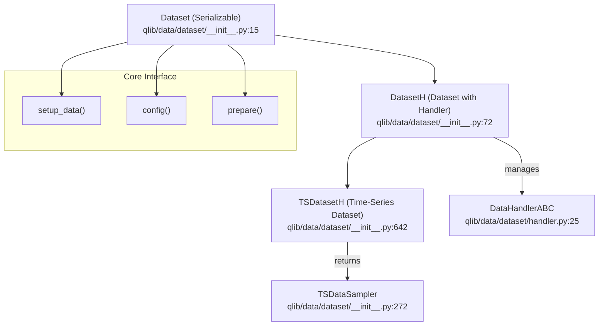
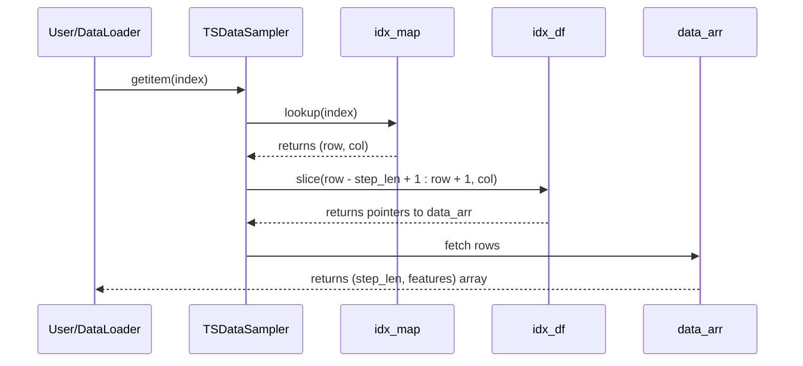

<!-- source: DeepWiki mcp.deepwiki.com · repo microsoft/qlib · page 4.7 Datasets and Time-Series Sampling · fetched 2026-10-26 -->

# Datasets and Time-Series Sampling

<details>
<summary>Relevant source files</summary>

The following files were used as context for generating this wiki page:

- [qlib/backtest/profit_attribution.py](qlib/backtest/profit_attribution.py)
- [qlib/contrib/data/handler.py](qlib/contrib/data/handler.py)
- [qlib/contrib/ops/high_freq.py](qlib/contrib/ops/high_freq.py)
- [qlib/contrib/report/analysis_position/parse_position.py](qlib/contrib/report/analysis_position/parse_position.py)
- [qlib/data/dataset/__init__.py](qlib/data/dataset/__init__.py)
- [qlib/data/dataset/handler.py](qlib/data/dataset/handler.py)
- [qlib/data/dataset/loader.py](qlib/data/dataset/loader.py)
- [qlib/data/dataset/processor.py](qlib/data/dataset/processor.py)
- [qlib/data/dataset/storage.py](qlib/data/dataset/storage.py)
- [qlib/data/dataset/utils.py](qlib/data/dataset/utils.py)
- [qlib/utils/resam.py](qlib/utils/resam.py)
- [qlib/workflow/utils.py](qlib/workflow/utils.py)
- [scripts/data_collector/baostock_5min/collector.py](scripts/data_collector/baostock_5min/collector.py)
- [tests/data_mid_layer_tests/test_dataset.py](tests/data_mid_layer_tests/test_dataset.py)

</details>


## Purpose and Scope

This document describes Qlib's dataset abstraction layer, which sits between DataHandlers and model training code. The dataset system provides three key capabilities:

1.  **Segment Management**: Splitting data into train/valid/test segments with consistent interfaces. [qlib/data/dataset/__init__.py:87-118]()
2.  **Time-Series Sampling**: Efficiently constructing time-series samples from tabular data via `TSDataSampler` for deep learning models. [qlib/data/dataset/__init__.py:272-335]()
3.  **Data Key Routing**: Serving different processed data (raw/inference/learning) through the same interface. [qlib/data/dataset/__init__.py:189-214]()

For information about underlying data loading and processing, see [DataHandlers and Processors (4.5)]() and [DataLoaders and Feature Engineering (4.6)]().

---

## Dataset Class Hierarchy

The dataset hierarchy transitions from abstract data preparation to specific time-series handling.



**Sources:** [qlib/data/dataset/__init__.py:15-72](), [qlib/data/dataset/__init__.py:642-645](), [qlib/data/dataset/handler.py:25-40]()

---

## Dataset Base Class

The `Dataset` class is a `Serializable` base that separates **state** (configuration for data preparation) from **data** (the actual loaded data). [qlib/data/dataset/__init__.py:15-31]()

| Method | Purpose | Implementation Detail |
| :--- | :--- | :--- |
| `__init__(**kwargs)` | Initialize state and setup data | Calls `self.setup_data(**kwargs)`. [qlib/data/dataset/__init__.py:20-33]() |
| `setup_data(**kwargs)` | Load/reload data without changing learned state | Attributes with `_` prefix are transient (not saved on disk). [qlib/data/dataset/__init__.py:41-54]() |
| `config(**kwargs)` | Configure parameters that cannot be learned | Updates non-data attributes. [qlib/data/dataset/__init__.py:35-39]() |
| `prepare(**kwargs)` | Return processed data for models | Returns object (DataFrame, Sampler, etc.). [qlib/data/dataset/__init__.py:56-69]() |

**Sources:** [qlib/data/dataset/__init__.py:15-70]()

---

## DatasetH - Dataset with DataHandler

`DatasetH` extends `Dataset` by integrating a `DataHandler` and introducing **segments** for time-based data splitting. [qlib/data/dataset/__init__.py:72-90]()

### Initialization and Segments
`DatasetH` accepts a `handler` (instance or config) and a `segments` dictionary. [qlib/data/dataset/__init__.py:84-118]()

```python
# Example segment configuration
segments = {
    'train': ("2008-01-01", "2014-12-31"),
    'valid': ("2015-01-01", "2016-12-31"),
    'test': ("2017-01-01", "2020-08-01"),
}
```

### The prepare() Method
The `prepare()` method retrieves data by segment name or direct slice. It routes requests to the underlying handler's `fetch()` method. [qlib/data/dataset/__init__.py:185-247]()


**Key Parameters:**
*   `col_set`: Controls column selection (e.g., `CS_ALL`, `CS_RAW`, or specific feature groups). [qlib/data/dataset/__init__.py:188]()
*   `data_key`: Specifies data stage: `DK_R` (Raw), `DK_I` (Inference), `DK_L` (Learning). [qlib/data/dataset/__init__.py:189]()

**Sources:** [qlib/data/dataset/__init__.py:72-247](), [qlib/data/dataset/handler.py:48-54]()

---

## TSDataSampler - Efficient Time-Series Indexing

`TSDataSampler` is the core class for handling time-series data. It converts tabular data with `(datetime, instrument)` index into windows of length `step_len`. [qlib/data/dataset/__init__.py:272-285]()

### Index Mechanism
To avoid redundant data copying, `TSDataSampler` maintains an internal index mapping. [qlib/data/dataset/__init__.py:290-335]()

| Component | Description | Source |
| :--- | :--- | :--- |
| `data_arr` | Underlying numpy array of all data features. | [qlib/data/dataset/__init__.py:326]() |
| `idx_df` | 2D DataFrame mapping `(datetime, instrument)` to `data_arr` row. | [qlib/data/dataset/__init__.py:327]() |
| `idx_map` | Array mapping sample index to `(row, col)` in `idx_df`. | [qlib/data/dataset/__init__.py:328]() |
| `data_index` | The MultiIndex of all indexable samples. | [qlib/data/dataset/__init__.py:329]() |

### Querying Algorithm
When a user requests `sampler[i]`, the following flow occurs: [qlib/data/dataset/__init__.py:536-636]()



**Key Logic:**
*   **Padding**: If the window extends before the available data, it uses `nan_idx` (last row of `data_arr`, which is all NaN). [qlib/data/dataset/__init__.py:417-429]()
*   **Filling**: Supports `none`, `ffill`, and `ffill+bfill` via `fillna_type`. [qlib/data/dataset/__init__.py:366-373]()
*   **Filtering**: `flt_data` allows excluding specific samples (e.g., missing labels) without removing the data points needed for the history of other samples. [qlib/data/dataset/__init__.py:374-380]()

**Sources:** [qlib/data/dataset/__init__.py:272-636]()

---

## TSDatasetH - Time-Series Dataset Handler

`TSDatasetH` is the high-level interface that produces `TSDataSampler` objects. [qlib/data/dataset/__init__.py:642-666]()

### Automatic Time Extension
To ensure a sample at `start_time` has enough history for a `step_len` window, `TSDatasetH` automatically extends the data fetch range. [qlib/data/dataset/__init__.py:680-686]()

```python
# Internal logic in _extend_slice
# If step_len=30 and start='2020-01-01', 
# it fetches from ~30 trading days prior.
```

### prepare() Workflow
1.  Calculates extended time range for history. [qlib/data/dataset/__init__.py:680-686]()
2.  Fetches feature data from handler. [qlib/data/dataset/__init__.py:688-694]()
3.  Fetches optional `flt_col` for sample filtering. [qlib/data/dataset/__init__.py:696-710]()
4.  Instantiates and returns a `TSDataSampler`. [qlib/data/dataset/__init__.py:712-719]()

**Sources:** [qlib/data/dataset/__init__.py:642-723]()

---

## Data Storage for Handlers

The `DataHandler` supports multiple storage backends to optimize access patterns. [qlib/data/dataset/storage.py:12-17]()

| Class | Description | Use Case |
| :--- | :--- | :--- |
| `NaiveDFStorage` | Wraps a standard `pd.DataFrame`. [qlib/data/dataset/storage.py:54-58]() | General purpose tabular data. |
| `HashingStockStorage` | Hashes data by `instrument` into a dictionary. [qlib/data/dataset/storage.py:88-100]() | High-performance random access for individual stocks. |

**Sources:** [qlib/data/dataset/storage.py:12-178]()

---

## Data Processors Integration

Datasets rely on `DataHandlerLP` to apply `Processor` objects before data is served. [qlib/data/dataset/processor.py:35-49]()

| Processor | Purpose | Inference Usable? |
| :--- | :--- | :--- |
| `DropnaLabel` | Removes rows with missing labels. | No. [qlib/data/dataset/processor.py:105-111]() |
| `ProcessInf` | Replaces infinity with mean. | Yes. [qlib/data/dataset/processor.py:161-176]() |
| `MinMaxNorm` | Normalizes features to [0, 1]. | Yes (uses learned min/max). [qlib/data/dataset/processor.py:196-218]() |
| `ZScoreNorm` | Standardizes features. | Yes (uses learned mean/std). [qlib/data/dataset/processor.py:236-258]() |
| `Fillna` | Fills NaN values with a constant. | Yes. [qlib/data/dataset/processor.py:179-193]() |

**Sources:** [qlib/data/dataset/processor.py:35-258](), [qlib/contrib/data/handler.py:37-45]()

---

