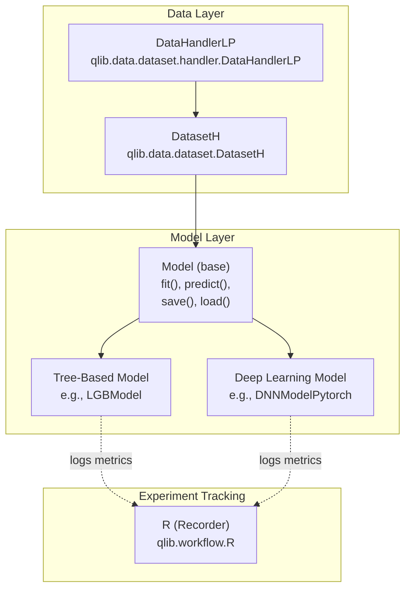
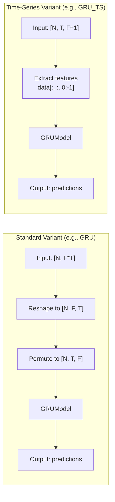

<!-- source: DeepWiki mcp.deepwiki.com · repo microsoft/qlib · page 5 Model Development · fetched 2026-10-26 -->

# Model Development

Relevant source files

The following files were used as context for generating this wiki page:

- [CHANGES.rst](CHANGES.rst)
- [docs/_static/img/online_serving.png](docs/_static/img/online_serving.png)
- [docs/advanced/alpha.rst](docs/advanced/alpha.rst)
- [docs/advanced/task_management.rst](docs/advanced/task_management.rst)
- [docs/component/data.rst](docs/component/data.rst)
- [docs/component/model.rst](docs/component/model.rst)
- [docs/component/online.rst](docs/component/online.rst)
- [docs/component/report.rst](docs/component/report.rst)
- [docs/component/strategy.rst](docs/component/strategy.rst)
- [docs/conf.py](docs/conf.py)
- [docs/index.rst](docs/index.rst)
- [docs/introduction/quick.rst](docs/introduction/quick.rst)
- [docs/reference/api.rst](docs/reference/api.rst)
- [docs/start/getdata.rst](docs/start/getdata.rst)
- [docs/start/integration.rst](docs/start/integration.rst)
- [qlib/contrib/model/catboost_model.py](qlib/contrib/model/catboost_model.py)
- [qlib/contrib/model/gbdt.py](qlib/contrib/model/gbdt.py)
- [qlib/contrib/model/pytorch_alstm.py](qlib/contrib/model/pytorch_alstm.py)
- [qlib/contrib/model/pytorch_alstm_ts.py](qlib/contrib/model/pytorch_alstm_ts.py)
- [qlib/contrib/model/pytorch_gats.py](qlib/contrib/model/pytorch_gats.py)
- [qlib/contrib/model/pytorch_gats_ts.py](qlib/contrib/model/pytorch_gats_ts.py)
- [qlib/contrib/model/pytorch_gru.py](qlib/contrib/model/pytorch_gru.py)
- [qlib/contrib/model/pytorch_gru_ts.py](qlib/contrib/model/pytorch_gru_ts.py)
- [qlib/contrib/model/pytorch_lstm.py](qlib/contrib/model/pytorch_lstm.py)
- [qlib/contrib/model/pytorch_lstm_ts.py](qlib/contrib/model/pytorch_lstm_ts.py)
- [qlib/contrib/model/pytorch_nn.py](qlib/contrib/model/pytorch_nn.py)
- [qlib/contrib/model/pytorch_sfm.py](qlib/contrib/model/pytorch_sfm.py)
- [qlib/contrib/model/pytorch_tabnet.py](qlib/contrib/model/pytorch_tabnet.py)
- [qlib/contrib/model/xgboost.py](qlib/contrib/model/xgboost.py)
- [qlib/model/base.py](qlib/model/base.py)

## Purpose and Scope

This page provides an overview of Qlib's model ecosystem, covering the architecture and organization of predictive models used for stock price forecasting. Qlib supports two major categories of models: tree-based models (e.g., LightGBM, XGBoost, CatBoost) and deep learning models (e.g., LSTM, GRU, GATs, TabNet). All models implement a common base interface that standardizes training, prediction, and serialization operations.

**Related Pages:**
- For detailed information on the base `Model` interface and common patterns, see [Model Interface and Base Classes](#5.1)
- For tree-based model implementations and configurations, see [Model Zoo: LightGBM, XGBoost, CatBoost](#5.2)
- For deep learning model architectures and variants, see [Model Zoo: PyTorch Deep Learning Models](#5.3)
- For evaluation metrics and benchmark results, see [Model Evaluation and Benchmarking](#5.4)

## Model Ecosystem Architecture

Qlib provides a comprehensive model zoo with over 20 implementations spanning multiple learning paradigms. All models inherit from the `Model` base class [qlib/model/base.py:19-20](). The following diagram illustrates the taxonomy and relationships between different model categories:

**Diagram: Model Taxonomy and Implementation Hierarchy**

```mermaid
graph TB
    subgraph "Base Interface"
        ModelBase["Model (base class)<br/>qlib.model.base.Model"]
    end
    
    subgraph "Tree-Based Models"
        LightGBM["LightGBM<br/>qlib.contrib.model.gbdt.LGBModel"]
        XGBoost["XGBoost<br/>qlib.contrib.model.xgboost.XGBModel"]
        CatBoost["CatBoost<br/>qlib.contrib.model.catboost_model.CatBoostModel"]
    end
    
    subgraph "Deep Learning Models - Standard Variants"
        DNNPytorch["DNNModelPytorch<br/>qlib.contrib.model.pytorch_nn.DNNModelPytorch"]
        GRU["GRU<br/>qlib.contrib.model.pytorch_gru.GRU"]
        LSTM["LSTM<br/>qlib.contrib.model.pytorch_lstm.LSTM"]
        ALSTM["ALSTM<br/>qlib.contrib.model.pytorch_alstm.ALSTM"]
        GATs["GATs<br/>qlib.contrib.model.pytorch_gats.GATs"]
        SFM["SFM<br/>qlib.contrib.model.pytorch_sfm.SFM"]
        TabNet["TabnetModel<br/>qlib.contrib.model.pytorch_tabnet.TabnetModel"]
    end
    
    subgraph "Deep Learning Models - Time-Series Variants"
        LSTM_TS["LSTM (TS)<br/>qlib.contrib.model.pytorch_lstm_ts.LSTM"]
        GRU_TS["GRU (TS)<br/>qlib.contrib.model.pytorch_gru_ts.GRU"]
        ALSTM_TS["ALSTM (TS)<br/>qlib.contrib.model.pytorch_alstm_ts.ALSTM"]
        GATs_TS["GATs (TS)<br/>qlib.contrib.model.pytorch_gats_ts.GATs"]
    end
    
    subgraph "Network Architectures"
        Net["Net (MLP)<br/>qlib.contrib.model.pytorch_nn.Net"]
        GRUModel["GRUModel<br/>qlib.contrib.model.pytorch_gru.GRUModel"]
        LSTMModel["LSTMModel<br/>qlib.contrib.model.pytorch_lstm.LSTMModel"]
        ALSTMModel["ALSTMModel<br/>qlib.contrib.model.pytorch_alstm.ALSTMModel"]
        GATModel["GATModel<br/>qlib.contrib.model.pytorch_gats.GATModel"]
        SFM_Model["SFM_Model<br/>qlib.contrib.model.pytorch_sfm.SFM_Model"]
    end
    
    ModelBase --> LightGBM
    ModelBase --> XGBoost
    ModelBase --> CatBoost
    
    ModelBase --> DNNPytorch
    ModelBase --> GRU
    ModelBase --> LSTM
    ModelBase --> ALSTM
    ModelBase --> GATs
    ModelBase --> SFM
    ModelBase --> TabNet
    
    ModelBase --> LSTM_TS
    ModelBase --> GRU_TS
    ModelBase --> ALSTM_TS
    ModelBase --> GATs_TS
    
    DNNPytorch -.uses.-> Net
    GRU -.uses.-> GRUModel
    LSTM -.uses.-> LSTMModel
    ALSTM -.uses.-> ALSTMModel
    GATs -.uses.-> GATModel
    SFM -.uses.-> SFM_Model
```

**Sources:** [qlib/model/base.py:19-20](), [qlib/contrib/model/gbdt.py:16-16](), [qlib/contrib/model/pytorch_nn.py:39-39](), [qlib/contrib/model/pytorch_gru.py:25-25](), [qlib/contrib/model/pytorch_lstm.py:24-24](), [qlib/contrib/model/pytorch_alstm.py:25-25](), [qlib/contrib/model/pytorch_gats.py:26-26](), [qlib/contrib/model/pytorch_sfm.py:180-180](), [qlib/contrib/model/pytorch_tabnet.py:25-25]()

## Model Interface and Integration Points

All models in Qlib implement a common interface that standardizes interaction with the data layer, training infrastructure, and experiment tracking systems.

**Diagram: Model Integration Architecture**

**Sources:** [qlib/model/base.py:19-114](), [qlib/contrib/model/gbdt.py:90-90](), [qlib/contrib/model/pytorch_nn.py:34-34]()

## Model Categories

### Tree-Based Models

Tree-based models are gradient boosting decision tree (GBDT) implementations. They are implemented as wrappers around popular GBDT libraries like LightGBM [qlib/contrib/model/gbdt.py:16-16](), XGBoost [qlib/contrib/model/xgboost.py:16-16](), and CatBoost [qlib/contrib/model/catboost_model.py:17-17]().

**Key Characteristics:**
- **Input Format**: Tabular data (flattened features).
- **Dataset Compatibility**: `DatasetH` with `DataHandlerLP.DK_L` for training [qlib/contrib/model/gbdt.py:37-37](), `DataHandlerLP.DK_I` for inference [qlib/contrib/model/gbdt.py:95-95]().
- **Implementation**: Typically inherits from `ModelFT` (Model with Fine-Tuning support) [qlib/contrib/model/gbdt.py:16-16]().

### Deep Learning Models

Deep learning models are PyTorch-based neural networks. Qlib provides two variants for many architectures:

1. **Standard Variants**: Designed for standard `DatasetH` where features are often flattened (e.g., `pytorch_gru.py` [qlib/contrib/model/pytorch_gru.py:25-25]()).
2. **Time-Series Variants**: Designed for time-series sampling, often using `DailyBatchSampler` [qlib/contrib/model/pytorch_gats_ts.py:26-42]() or specialized data loaders to handle `[N, T, F]` shapes [qlib/contrib/model/pytorch_gru_ts.py:167-178]().

**Standard vs Time-Series Variants:**

**Sources:** [qlib/contrib/model/pytorch_gru.py:334-339](), [qlib/contrib/model/pytorch_gru_ts.py:167-178]()

## Core Model Methods

The `Model` base class defines essential methods that implementations must provide:

### fit() Method
The `fit()` method trains the model on a provided dataset. For deep learning models, this usually involves an epoch loop with early stopping [qlib/contrib/model/pytorch_nn.py:190-336](). For GBDT, it calls the underlying library's train function [qlib/contrib/model/gbdt.py:77-85]().

### predict() Method
The `predict()` method generates predictions for a specified dataset segment. It must ensure inference is done on the correct data key (e.g., `DK_I`) to avoid look-ahead bias [qlib/contrib/model/gbdt.py:95-96](), [qlib/contrib/model/pytorch_nn.py:365-365]().

### save() and load() Methods
These methods handle model serialization. PyTorch models typically save the `state_dict` [qlib/contrib/model/pytorch_nn.py:389-404]().

## Model Configuration and Initialization

Models are initialized with hyperparameters. Deep learning models in Qlib share many common parameters:

| Parameter | Type | Default | Description |
|-----------|------|---------|-------------|
| `lr` | float | 0.001 | Learning rate [qlib/contrib/model/pytorch_nn.py:59]() |
| `batch_size` | int | 2000 | Training batch size [qlib/contrib/model/pytorch_nn.py:61]() |
| `early_stop` | int | 20 | Early stopping rounds [qlib/contrib/model/pytorch_gru.py:50]() |
| `GPU` | int/str | 0 | GPU ID or device string [qlib/contrib/model/pytorch_nn.py:66]() |
| `optimizer` | str | "adam"/"gd" | Optimization algorithm [qlib/contrib/model/pytorch_nn.py:64]() |

**Sources:** [qlib/contrib/model/pytorch_nn.py:57-80](), [qlib/contrib/model/pytorch_gru.py:40-56]()

## Data Preparation Integration

Models interact with `DatasetH` to retrieve data. Deep learning models often use `dataset.prepare` to get dataframes and then convert them to tensors [qlib/contrib/model/pytorch_nn.py:203-214](). Time-series variants may use `DataLoader` with specialized samplers like `DailyBatchSampler` [qlib/contrib/model/pytorch_gats_ts.py:26-42]().

**Sources:** [qlib/contrib/model/pytorch_nn.py:190-214](), [qlib/contrib/model/pytorch_gats_ts.py:196-211]()

---

