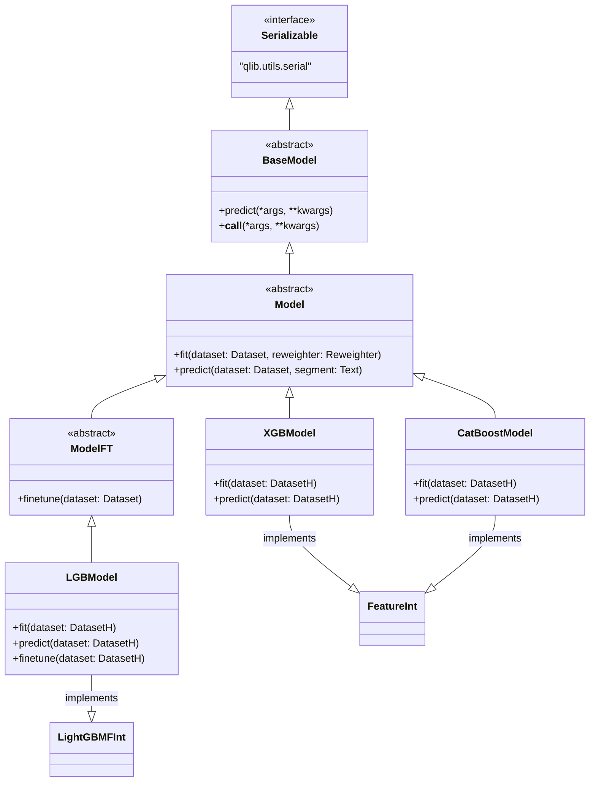
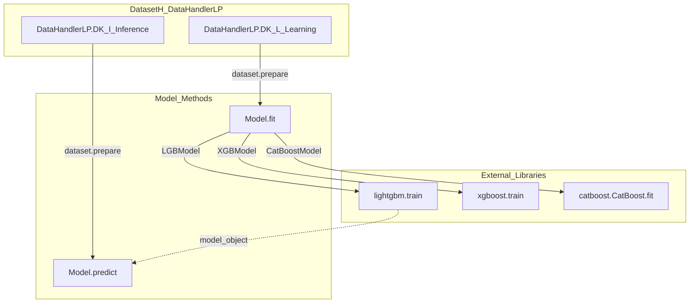

<!-- source: DeepWiki mcp.deepwiki.com · repo microsoft/qlib · page 5.1 Model Interface and Base Classes · fetched 2026-10-26 -->

# Model Interface and Base Classes

<details>
<summary>Relevant source files</summary>

The following files were used as context for generating this wiki page:

- [qlib/contrib/model/catboost_model.py](qlib/contrib/model/catboost_model.py)
- [qlib/contrib/model/gbdt.py](qlib/contrib/model/gbdt.py)
- [qlib/contrib/model/pytorch_utils.py](qlib/contrib/model/pytorch_utils.py)
- [qlib/contrib/model/xgboost.py](qlib/contrib/model/xgboost.py)
- [qlib/model/base.py](qlib/model/base.py)

</details>


## Purpose and Scope

This document describes the model interface and base classes in Qlib that define how prediction models are implemented and integrated into the system. All forecasting models in Qlib must implement the `Model` interface, which provides a standardized contract for training, prediction, and model persistence. This enables loose coupling between models and other system components like datasets, training infrastructure, and backtesting.

The core interface is defined in `qlib/model/base.py`, establishing a common language for both tree-based models (like LightGBM and XGBoost) and deep learning models (like GRU, LSTM, and ALSTM).

---

## Model Base Class Hierarchy

Qlib provides a multi-level base class hierarchy for models, starting from basic serialization and moving to learnable and fine-tunable interfaces.

### Class Relationship Diagram
The following diagram maps the high-level concepts to the specific code entities found in the `qlib/model/base.py` and `qlib/contrib/model/` directories.

Title: Model Class Hierarchy and Inheritance

Sources: [qlib/model/base.py:10-111](), [qlib/contrib/model/gbdt.py:16-16](), [qlib/contrib/model/xgboost.py:15-15](), [qlib/contrib/model/catboost_model.py:17-17]()

---

## Core Model Interface

### Required Methods

All models in Qlib must inherit from `qlib.model.base.Model` and implement the following interface:

| Method | Signature | Purpose |
|--------|-----------|---------|
| `__init__` | `__init__(**kwargs)` | Initialize model with hyperparameters. |
| `fit` | `fit(dataset: Dataset, reweighter: Reweighter)` | Learn model parameters from the provided dataset [qlib/model/base.py:25-60](). |
| `predict` | `predict(dataset: Dataset, segment: Text)` | Generate predictions for a specific data segment [qlib/model/base.py:63-78](). |
| `__call__` | `__call__(*args, **kwargs)` | Syntactic sugar to treat model instances as functions [qlib/model/base.py:17-19](). |

### Method Specifications

#### `fit` Method
The `fit` method is responsible for training. A standard implementation retrieves features and labels using `dataset.prepare`.

**Common Implementation Pattern (GBDT):**
In `LGBModel`, the `fit` method calls `_prepare_data` which utilizes `dataset.prepare` with `data_key=DataHandlerLP.DK_L` to get training and validation data [qlib/contrib/model/gbdt.py:35-37](). It then invokes the underlying library's training function (e.g., `lgb.train`) [qlib/contrib/model/gbdt.py:77-85]().

#### `predict` Method
The `predict` method generates scores. It typically returns a `pd.Series` with an index matching the input dataset.

**Common Implementation Pattern (XGBoost):**
In `XGBModel`, `predict` prepares the test segment using `data_key=DataHandlerLP.DK_I` [qlib/contrib/model/xgboost.py:74-74](), runs the internal booster, and wraps the result in a `pd.Series` indexed by the dataset's index [qlib/contrib/model/xgboost.py:75-75]().

---

## Data Key Semantics and Flow

Models interact with datasets using specific data keys defined in `DataHandlerLP`. These keys distinguish between the learning phase (where processors might need to fit parameters) and the inference phase (where parameters are fixed).

Title: Data Flow between Dataset and Model

Sources: [qlib/model/base.py:39-43](), [qlib/contrib/model/gbdt.py:37-37](), [qlib/contrib/model/xgboost.py:33-37](), [qlib/contrib/model/catboost_model.py:38-42]()

| Data Key | Context | Behavior |
|----------|---------|----------|
| `DK_L` | `fit()` | Used for training/validation. Processors in the DataHandler may calculate statistics (e.g., mean/std) [qlib/contrib/model/gbdt.py:37](). |
| `DK_I` | `predict()` | Used for testing/online serving. Processors use pre-calculated statistics to ensure no data leakage [qlib/contrib/model/gbdt.py:95](). |

---

## Model Finetuning Interface

The `ModelFT` class introduces the `finetune` method, allowing models to update based on new data without a full retraining cycle.

### `finetune` Implementation
For `LGBModel`, `finetune` takes an existing `self.model` and passes it as the `init_model` argument to `lgb.train`, continuing the boosting process for a specified number of rounds [qlib/contrib/model/gbdt.py:118-126]().

**Finetuning Workflow with Recorder:**
```python
# From qlib/model/base.py documentation
with R.start(experiment_name="init models"):
    model.fit(dataset)
    R.save_objects(init_model=model)
    rid = R.get_recorder().id

# Finetune model based on previous trained model
with R.start(experiment_name="finetune model"):
    recorder = R.get_recorder(recorder_id=rid, experiment_name="init models")
    model = recorder.load_object("init_model")
    model.finetune(dataset, num_boost_round=10)
```
Sources: [qlib/model/base.py:85-110](), [qlib/contrib/model/gbdt.py:98-126]()

---

## Specialized Model Features

### Interpretability Interface
Many models implement interpretability interfaces such as `LightGBMFInt` or `FeatureInt`. 
- `XGBModel` implements `get_feature_importance` which wraps the XGBoost `get_score` method [qlib/contrib/model/xgboost.py:77-85]().
- `CatBoostModel` implements `get_feature_importance` using the native CatBoost `get_feature_importance` method [qlib/contrib/model/catboost_model.py:86-96]().

### Deep Learning Utilities
For PyTorch-based models, Qlib provides utilities such as `count_parameters` to calculate the storage size of models or parameter lists in units like KB, MB, or GB [qlib/contrib/model/pytorch_utils.py:7-37]().

---

## Summary of Implementation Patterns

| Feature | Implementation Detail |
|---------|-----------------------|
| **Serialization** | Inherits from `Serializable`. Attributes should not start with `_` to be correctly dumped to disk [qlib/model/base.py:10-32](). |
| **Weighting** | Supports `Reweighter` in `fit()` to adjust sample importance during training [qlib/contrib/model/gbdt.py:50-54](), [qlib/contrib/model/xgboost.py:50-54](). |
| **Logging** | Uses `qlib.workflow.R` to log training metrics (e.g., loss per epoch) for tracking experiments [qlib/contrib/model/gbdt.py:86-90](). |
| **Device Support** | `CatBoostModel` automatically detects GPU availability using `get_gpu_device_count` [qlib/contrib/model/catboost_model.py:70](). |

Sources: [qlib/model/base.py:5-32](), [qlib/contrib/model/gbdt.py:13-90](), [qlib/contrib/model/catboost_model.py:70-70](), [qlib/contrib/model/pytorch_utils.py:7-37]()

---

