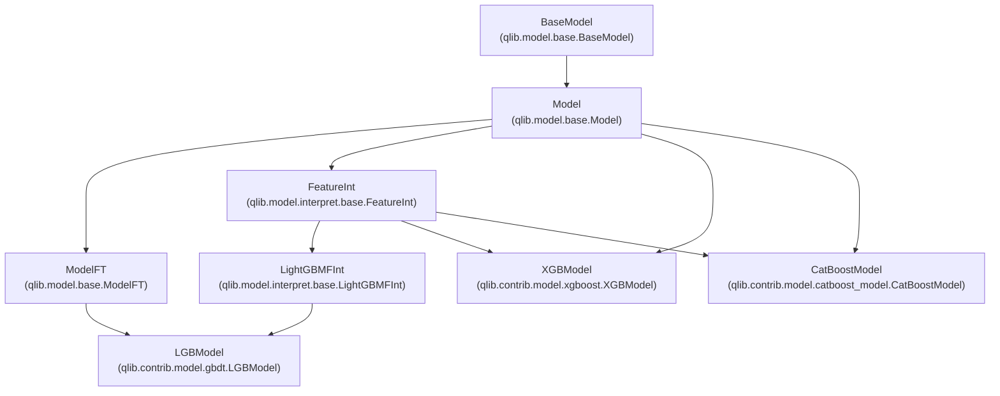
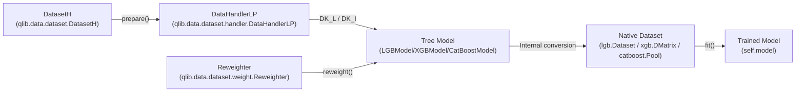
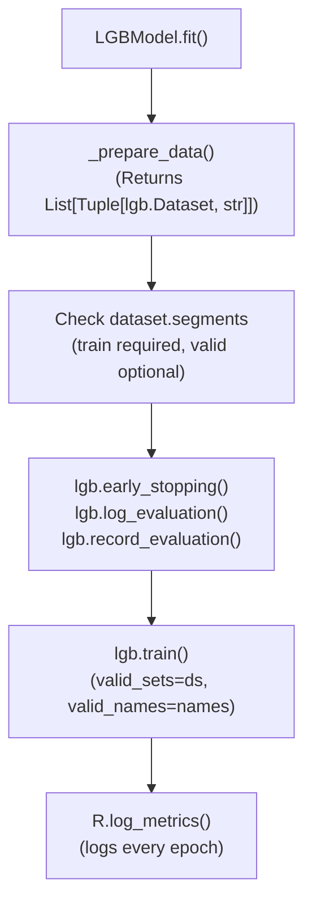

<!-- source: DeepWiki mcp.deepwiki.com · repo microsoft/qlib · page 5.2 Model Zoo: LightGBM, XGBoost, CatBoost · fetched 2026-10-26 -->

# Model Zoo: LightGBM, XGBoost, CatBoost

<details>
<summary>Relevant source files</summary>

The following files were used as context for generating this wiki page:

- [examples/benchmarks/ALSTM/workflow_config_alstm_Alpha360.yaml](examples/benchmarks/ALSTM/workflow_config_alstm_Alpha360.yaml)
- [examples/benchmarks/CatBoost/README.md](examples/benchmarks/CatBoost/README.md)
- [examples/benchmarks/CatBoost/workflow_config_catboost_Alpha158.yaml](examples/benchmarks/CatBoost/workflow_config_catboost_Alpha158.yaml)
- [examples/benchmarks/GATs/workflow_config_gats_Alpha360.yaml](examples/benchmarks/GATs/workflow_config_gats_Alpha360.yaml)
- [examples/benchmarks/GRU/workflow_config_gru_Alpha360.yaml](examples/benchmarks/GRU/workflow_config_gru_Alpha360.yaml)
- [examples/benchmarks/LSTM/workflow_config_lstm_Alpha360.yaml](examples/benchmarks/LSTM/workflow_config_lstm_Alpha360.yaml)
- [examples/benchmarks/LightGBM/README.md](examples/benchmarks/LightGBM/README.md)
- [examples/benchmarks/LightGBM/workflow_config_lightgbm_Alpha158.yaml](examples/benchmarks/LightGBM/workflow_config_lightgbm_Alpha158.yaml)
- [examples/benchmarks/Linear/workflow_config_linear_Alpha158.yaml](examples/benchmarks/Linear/workflow_config_linear_Alpha158.yaml)
- [examples/benchmarks/SFM/workflow_config_sfm_Alpha360.yaml](examples/benchmarks/SFM/workflow_config_sfm_Alpha360.yaml)
- [examples/benchmarks/TFT/workflow_config_tft_Alpha158.yaml](examples/benchmarks/TFT/workflow_config_tft_Alpha158.yaml)
- [examples/benchmarks/XGBoost/README.md](examples/benchmarks/XGBoost/README.md)
- [examples/benchmarks/XGBoost/workflow_config_xgboost_Alpha158.yaml](examples/benchmarks/XGBoost/workflow_config_xgboost_Alpha158.yaml)
- [examples/hyperparameter/LightGBM/Readme.md](examples/hyperparameter/LightGBM/Readme.md)
- [examples/hyperparameter/LightGBM/hyperparameter_158.py](examples/hyperparameter/LightGBM/hyperparameter_158.py)
- [examples/hyperparameter/LightGBM/hyperparameter_360.py](examples/hyperparameter/LightGBM/hyperparameter_360.py)
- [examples/hyperparameter/LightGBM/requirements.txt](examples/hyperparameter/LightGBM/requirements.txt)
- [qlib/contrib/model/catboost_model.py](qlib/contrib/model/catboost_model.py)
- [qlib/contrib/model/gbdt.py](qlib/contrib/model/gbdt.py)
- [qlib/contrib/model/xgboost.py](qlib/contrib/model/xgboost.py)
- [qlib/model/base.py](qlib/model/base.py)

</details>


This document covers Qlib's implementations of tree-based gradient boosting models, including LightGBM, XGBoost, and CatBoost. These models provide state-of-the-art performance for quantitative investment tasks and integrate with Qlib's standardized model interface.

For neural network models, see [Model Zoo: PyTorch Deep Learning Models](). For model evaluation metrics and systematic benchmarking, see [Model Evaluation and Benchmarking]().

## Overview

Qlib's tree-based models inherit from the base `Model` class and implement standardized interfaces for training, prediction, and feature interpretation. All tree-based models integrate with Qlib's data management system through `DatasetH` and support advanced features like sample reweighting and early stopping.

### Tree-based Model Class Hierarchy

The following diagram illustrates the relationship between Qlib's base model interfaces and the concrete tree-based implementations.

**Tree-based Model Class Hierarchy**

Sources: [qlib/model/base.py:10-81](), [qlib/contrib/model/gbdt.py:16](), [qlib/contrib/model/xgboost.py:15](), [qlib/contrib/model/catboost_model.py:17]()

### Data Flow Architecture

The data flow bridges the Qlib `DatasetH` abstractions with the native data structures required by GBDT libraries (e.g., `lgb.Dataset`, `xgb.DMatrix`, or CatBoost `Pool`).

**Tree Model Data Flow**

Sources: [qlib/contrib/model/gbdt.py:28-55](), [qlib/contrib/model/xgboost.py:33-67](), [qlib/contrib/model/catboost_model.py:38-74](), [qlib/model/base.py:25-59]()

## LightGBM Implementation

The `LGBModel` class provides LightGBM integration with support for finetuning and comprehensive validation handling. It implements both `ModelFT` for finetuning capabilities and `LightGBMFInt` for feature interpretation.

### Core Features

| Feature | Implementation | Location |
|---------|---------------|----------|
| Base Training | `fit()` method with early stopping and callbacks | [qlib/contrib/model/gbdt.py:57-85]() |
| Finetuning | `finetune()` method using `init_model` | [qlib/contrib/model/gbdt.py:98-126]() |
| Data Preparation | `_prepare_data()` handles 1D label squeezing | [qlib/contrib/model/gbdt.py:28-55]() |
| Metrics Logging | Integration with `qlib.workflow.R.log_metrics` | [qlib/contrib/model/gbdt.py:86-90]() |

### LightGBM Training Flow

The `fit` method orchestrates the creation of LightGBM datasets and the training loop with standardized callbacks.

**LGBModel Training Pipeline**

Sources: [qlib/contrib/model/gbdt.py:57-90]()

## XGBoost Implementation

The `XGBModel` class provides XGBoost integration. Unlike LightGBM, it explicitly prepares `df_train` and `df_valid` within the `fit` method before converting to `xgb.DMatrix`.

### Key Implementation Details

- **Label Format**: Requires 1D labels; multi-label training is not supported and raises `ValueError`. [qlib/contrib/model/xgboost.py:42-45]()
- **Weighting**: Supports `Reweighter` to apply instance weights to `xgb.DMatrix`. [qlib/contrib/model/xgboost.py:50-57]()
- **Prediction**: Returns a `pd.Series` indexed by the test set index. [qlib/contrib/model/xgboost.py:71-75]()

Sources: [qlib/contrib/model/xgboost.py:15-85]()

## CatBoost Implementation

The `CatBoostModel` class integrates CatBoost with automatic hardware acceleration detection.

### CatBoost-Specific Features

- **GPU Detection**: Uses `catboost.utils.get_gpu_device_count()` to automatically set `task_type` to "GPU" if available. [qlib/contrib/model/catboost_model.py:70]()
- **Data Pooling**: Uses `catboost.Pool` for memory-efficient data handling. [qlib/contrib/model/catboost_model.py:63-64]()
- **Loss Functions**: Specifically supports "RMSE" and "Logloss". [qlib/contrib/model/catboost_model.py:20-24]()

Sources: [qlib/contrib/model/catboost_model.py:17-96]()

## Hyperparameter Optimization

Qlib provides examples for tuning tree-based models using `optuna`. The typical objective function minimizes the validation loss.

| Dataset | Script | Study Name |
|---------|--------|------------|
| Alpha158 | `hyperparameter_158.py` | `LGBM_158` |
| Alpha360 | `hyperparameter_360.py` | `LGBM_360` |

### Common Hyperparameters for Tuning
- `learning_rate`: Step size shrinkage.
- `num_leaves`: Max number of leaves in one tree.
- `lambda_l1` / `lambda_l2`: Regularization terms.
- `feature_fraction`: Subsample ratio of columns.
- `bagging_fraction`: Subsample ratio of data.

Sources: [examples/hyperparameter/LightGBM/hyperparameter_158.py:16-29](), [examples/hyperparameter/LightGBM/hyperparameter_360.py:18-29]()

## Benchmark Performance and Configuration

Tree-based models are typically evaluated on CSI300 or CSI500 markets. A standard configuration involves a `DatasetH` with an `Alpha158` or `Alpha360` handler.

### Standard Workflow Configuration
The following snippet from an Alpha158 configuration shows how LightGBM is integrated into the task pipeline.

```yaml
task:
    model:
        class: LGBModel
        module_path: qlib.contrib.model.gbdt
        kwargs:
            loss: mse
            colsample_bytree: 0.8879
            learning_rate: 0.2
            subsample: 0.8789
            lambda_l1: 205.6999
            lambda_l2: 580.9768
            max_depth: 8
            num_leaves: 210
    dataset:
        class: DatasetH
        module_path: qlib.data.dataset
        kwargs:
            handler:
                class: Alpha158
                module_path: qlib.contrib.data.handler
```
Sources: [examples/benchmarks/LightGBM/workflow_config_lightgbm_Alpha158.yaml:32-52]()

## Feature Importance and Interpretation

All tree-based models in Qlib implement feature importance extraction, returning a `pd.Series` sorted in descending order of importance.

| Model | Native Call | Return |
|-------|-------------|--------|
| `LGBModel` | `self.model.feature_importance()` | via `LightGBMFInt` |
| `XGBModel` | `self.model.get_score()` | [qlib/contrib/model/xgboost.py:85]() |
| `CatBoostModel` | `self.model.get_feature_importance()` | [qlib/contrib/model/catboost_model.py:94-96]() |

Sources: [qlib/contrib/model/gbdt.py:16](), [qlib/contrib/model/xgboost.py:77-85](), [qlib/contrib/model/catboost_model.py:86-96]()

---

