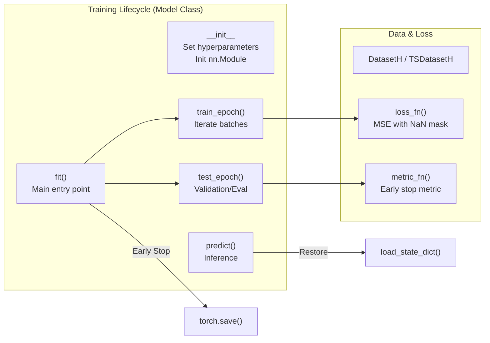

<!-- source: DeepWiki mcp.deepwiki.com · repo microsoft/qlib · page 5.3 Model Zoo: PyTorch Deep Learning Models · fetched 2026-10-26 -->

# Model Zoo: PyTorch Deep Learning Models

Relevant source files

The following files were used as context for generating this wiki page:

- [examples/benchmarks/ADARNN/README.md](examples/benchmarks/ADARNN/README.md)
- [examples/benchmarks/ADARNN/requirements.txt](examples/benchmarks/ADARNN/requirements.txt)
- [examples/benchmarks/ADARNN/workflow_config_adarnn_Alpha360.yaml](examples/benchmarks/ADARNN/workflow_config_adarnn_Alpha360.yaml)
- [examples/benchmarks/DoubleEnsemble/requirements.txt](examples/benchmarks/DoubleEnsemble/requirements.txt)
- [examples/benchmarks/DoubleEnsemble/workflow_config_doubleensemble_Alpha158.yaml](examples/benchmarks/DoubleEnsemble/workflow_config_doubleensemble_Alpha158.yaml)
- [examples/benchmarks/DoubleEnsemble/workflow_config_doubleensemble_Alpha360.yaml](examples/benchmarks/DoubleEnsemble/workflow_config_doubleensemble_Alpha360.yaml)
- [examples/benchmarks/DoubleEnsemble/workflow_config_doubleensemble_early_stop_Alpha158.yaml](examples/benchmarks/DoubleEnsemble/workflow_config_doubleensemble_early_stop_Alpha158.yaml)
- [examples/benchmarks/GeneralPtNN/README.md](examples/benchmarks/GeneralPtNN/README.md)
- [examples/benchmarks/GeneralPtNN/workflow_config_gru.yaml](examples/benchmarks/GeneralPtNN/workflow_config_gru.yaml)
- [examples/benchmarks/GeneralPtNN/workflow_config_gru2mlp.yaml](examples/benchmarks/GeneralPtNN/workflow_config_gru2mlp.yaml)
- [examples/benchmarks/GeneralPtNN/workflow_config_mlp.yaml](examples/benchmarks/GeneralPtNN/workflow_config_mlp.yaml)
- [examples/benchmarks/KRNN/README.md](examples/benchmarks/KRNN/README.md)
- [examples/benchmarks/KRNN/requirements.txt](examples/benchmarks/KRNN/requirements.txt)
- [examples/benchmarks/KRNN/workflow_config_krnn_Alpha360.yaml](examples/benchmarks/KRNN/workflow_config_krnn_Alpha360.yaml)
- [examples/benchmarks/Sandwich/README.md](examples/benchmarks/Sandwich/README.md)
- [examples/benchmarks/Sandwich/requirements.txt](examples/benchmarks/Sandwich/requirements.txt)
- [examples/benchmarks/Sandwich/workflow_config_sandwich_Alpha360.yaml](examples/benchmarks/Sandwich/workflow_config_sandwich_Alpha360.yaml)
- [examples/benchmarks/TCN/requirements.txt](examples/benchmarks/TCN/requirements.txt)
- [examples/benchmarks/TCN/workflow_config_tcn_Alpha158.yaml](examples/benchmarks/TCN/workflow_config_tcn_Alpha158.yaml)
- [examples/benchmarks/TCN/workflow_config_tcn_Alpha360.yaml](examples/benchmarks/TCN/workflow_config_tcn_Alpha360.yaml)
- [examples/benchmarks/TCTS/README.md](examples/benchmarks/TCTS/README.md)
- [examples/benchmarks/TCTS/workflow_config_tcts_Alpha360.yaml](examples/benchmarks/TCTS/workflow_config_tcts_Alpha360.yaml)
- [examples/benchmarks/TRA/workflow_config_tra_Alpha158.yaml](examples/benchmarks/TRA/workflow_config_tra_Alpha158.yaml)
- [examples/benchmarks/TRA/workflow_config_tra_Alpha158_full.yaml](examples/benchmarks/TRA/workflow_config_tra_Alpha158_full.yaml)
- [examples/benchmarks/TRA/workflow_config_tra_Alpha360.yaml](examples/benchmarks/TRA/workflow_config_tra_Alpha360.yaml)
- [examples/benchmarks/TabNet/workflow_config_TabNet_Alpha158.yaml](examples/benchmarks/TabNet/workflow_config_TabNet_Alpha158.yaml)
- [examples/benchmarks/TabNet/workflow_config_TabNet_Alpha360.yaml](examples/benchmarks/TabNet/workflow_config_TabNet_Alpha360.yaml)
- [examples/benchmarks_dynamic/DDG-DA/vis_data.py](examples/benchmarks_dynamic/DDG-DA/vis_data.py)
- [qlib/contrib/data/dataset.py](qlib/contrib/data/dataset.py)
- [qlib/contrib/model/double_ensemble.py](qlib/contrib/model/double_ensemble.py)
- [qlib/contrib/model/pytorch_add.py](qlib/contrib/model/pytorch_add.py)
- [qlib/contrib/model/pytorch_alstm.py](qlib/contrib/model/pytorch_alstm.py)
- [qlib/contrib/model/pytorch_alstm_ts.py](qlib/contrib/model/pytorch_alstm_ts.py)
- [qlib/contrib/model/pytorch_gats.py](qlib/contrib/model/pytorch_gats.py)
- [qlib/contrib/model/pytorch_gats_ts.py](qlib/contrib/model/pytorch_gats_ts.py)
- [qlib/contrib/model/pytorch_general_nn.py](qlib/contrib/model/pytorch_general_nn.py)
- [qlib/contrib/model/pytorch_gru.py](qlib/contrib/model/pytorch_gru.py)
- [qlib/contrib/model/pytorch_gru_ts.py](qlib/contrib/model/pytorch_gru_ts.py)
- [qlib/contrib/model/pytorch_hist.py](qlib/contrib/model/pytorch_hist.py)
- [qlib/contrib/model/pytorch_igmtf.py](qlib/contrib/model/pytorch_igmtf.py)
- [qlib/contrib/model/pytorch_krnn.py](qlib/contrib/model/pytorch_krnn.py)
- [qlib/contrib/model/pytorch_localformer.py](qlib/contrib/model/pytorch_localformer.py)
- [qlib/contrib/model/pytorch_localformer_ts.py](qlib/contrib/model/pytorch_localformer_ts.py)
- [qlib/contrib/model/pytorch_lstm.py](qlib/contrib/model/pytorch_lstm.py)
- [qlib/contrib/model/pytorch_lstm_ts.py](qlib/contrib/model/pytorch_lstm_ts.py)
- [qlib/contrib/model/pytorch_nn.py](qlib/contrib/model/pytorch_nn.py)
- [qlib/contrib/model/pytorch_sandwich.py](qlib/contrib/model/pytorch_sandwich.py)
- [qlib/contrib/model/pytorch_sfm.py](qlib/contrib/model/pytorch_sfm.py)
- [qlib/contrib/model/pytorch_tabnet.py](qlib/contrib/model/pytorch_tabnet.py)
- [qlib/contrib/model/pytorch_tcn.py](qlib/contrib/model/pytorch_tcn.py)
- [qlib/contrib/model/pytorch_tcn_ts.py](qlib/contrib/model/pytorch_tcn_ts.py)
- [qlib/contrib/model/pytorch_tcts.py](qlib/contrib/model/pytorch_tcts.py)
- [qlib/contrib/model/pytorch_tra.py](qlib/contrib/model/pytorch_tra.py)
- [qlib/contrib/model/pytorch_transformer.py](qlib/contrib/model/pytorch_transformer.py)
- [qlib/contrib/model/pytorch_transformer_ts.py](qlib/contrib/model/pytorch_transformer_ts.py)
- [qlib/utils/data.py](qlib/utils/data.py)
- [tests/misc/test_utils.py](tests/misc/test_utils.py)
- [tests/model/test_general_nn.py](tests/model/test_general_nn.py)

This page documents Qlib's PyTorch-based deep learning models for stock prediction. These models implement time-series architectures (LSTM, GRU, attention mechanisms, TabNet) that predict future stock returns from historical features.

For tree-based models (LightGBM, XGBoost, CatBoost), see [Model Zoo: LightGBM, XGBoost, CatBoost](). For the base Model interface and training workflow, see [Model Interface and Base Classes]() and [Trainer Framework]().

## Overview

Qlib provides a diverse set of PyTorch model implementations. Each model implements the standard `Model` interface (`fit`, `predict`, `save`, `load`) and integrates seamlessly with `DatasetH` and the `Trainer` system.

**Key Model Categories:**
- **Fully-Connected Network**: `DNNModelPytorch` with configurable `Net` architecture.
- **Recurrent Networks**: `GRU`, `LSTM` for sequential patterns.
- **Attention-Enhanced RNNs**: `ALSTM` (Attention LSTM) with temporal attention.
- **Graph Neural Networks**: `GATs` (Graph Attention Networks) with stock-stock relationships.
- **Advanced Architectures**: `SFM` (State Frequency Memory), `TabNet` (attention-based tabular), `TRA` (Temporal Routing Adaptor), `TCTS` (Time-series Cross-Temporal Step-wise), `ADARNN`.
- **Time-Series Variants**: `*_ts.py` versions designed for `TSDatasetH` with 3D tensor inputs and lookback windows.

Sources: [qlib/contrib/model/pytorch_nn.py:39-184](), [qlib/contrib/model/pytorch_gru.py:25-130](), [qlib/contrib/model/pytorch_lstm.py:24-126](), [qlib/contrib/model/pytorch_alstm.py:25-128]()

## Model Architecture Hierarchy

The following diagram maps the relationship between Qlib's high-level `Model` interface and the underlying PyTorch `nn.Module` implementations.

```mermaid
graph TB
    subgraph "Base Classes"
        ModelBase["Model<br/>(qlib.model.base.Model)"]
        Module["nn.Module<br/>(torch.nn.Module)"]
    end
    
    subgraph "Standard Input Models (Flattened)"
        DNN["DNNModelPytorch<br/>pytorch_nn.py"]
        GRU["GRU<br/>pytorch_gru.py"]
        LSTM["LSTM<br/>pytorch_lstm.py"]
        ALSTM["ALSTM<br/>pytorch_alstm.py"]
        GATs["GATs<br/>pytorch_gats.py"]
        SFM["SFM<br/>pytorch_sfm.py"]
        TabNet["TabnetModel<br/>pytorch_tabnet.py"]
        TRA["TRAModel<br/>pytorch_tra.py"]
    end
    
    subgraph "Time-Series Input Models (3D)"
        GRU_TS["GRU (TS)<br/>pytorch_gru_ts.py"]
        LSTM_TS["LSTM (TS)<br/>pytorch_lstm_ts.py"]
        ALSTM_TS["ALSTM (TS)<br/>pytorch_alstm_ts.py"]
        GATs_TS["GATs (TS)<br/>pytorch_gats_ts.py"]
    end
    
    subgraph "Neural Network Modules (Internal)"
        NetModule["Net<br/>pytorch_nn.py"]
        GRUModel["GRUModel<br/>pytorch_gru.py"]
        LSTMModel["LSTMModel<br/>pytorch_lstm.py"]
        ALSTMModel["ALSTMModel<br/>pytorch_alstm.py"]
        GATModel["GATModel<br/>pytorch_gats.py"]
        SFMModel["SFM_Model<br/>pytorch_sfm.py"]
        TabNetCore["TabNet<br/>pytorch_tabnet.py"]
        TRAModule["TRA<br/>pytorch_tra.py"]
    end
    
    ModelBase --> DNN
    ModelBase --> GRU
    ModelBase --> LSTM
    ModelBase --> ALSTM
    ModelBase --> GATs
    ModelBase --> SFM
    ModelBase --> TabNet
    ModelBase --> TRA
    
    ModelBase --> GRU_TS
    ModelBase --> LSTM_TS
    ModelBase --> ALSTM_TS
    ModelBase --> GATs_TS
    
    Module --> NetModule
    Module --> GRUModel
    Module --> LSTMModel
    Module --> ALSTMModel
    Module --> GATModel
    Module --> SFMModel
    Module --> TabNetCore
    Module --> TRAModule
    
    DNN -.uses.-> NetModule
    GRU -.uses.-> GRUModel
    LSTM -.uses.-> LSTMModel
    ALSTM -.uses.-> ALSTMModel
    GATs -.uses.-> GATModel
    SFM -.uses.-> SFMModel
    TabNet -.uses.-> TabNetCore
    TRA -.uses.-> TRAModule
    
    GRU_TS -.uses.-> GRUModel
    LSTM_TS -.uses.-> LSTMModel
    ALSTM_TS -.uses.-> ALSTMModel
    GATs_TS -.uses.-> GATModel
```

**Design Pattern**: Each model has two components:
1. **Trainer-compatible wrapper** (e.g., `GRU`): Inherits from `qlib.model.base.Model`. Handles data loading, training loop, early stopping, and model persistence.
2. **PyTorch module** (e.g., `GRUModel`): Inherits from `torch.nn.Module`. Implements the pure neural network architecture and `forward()` pass.

Sources: [qlib/contrib/model/pytorch_gru.py:25-130](), [qlib/contrib/model/pytorch_gru.py:319-340](), [qlib/contrib/model/pytorch_gru_ts.py:26-135](), [qlib/contrib/model/pytorch_tra.py:33-135]()

## Standard vs Time-Series Variants

Qlib provides two input paradigms for deep learning models:

### Standard Models (Flattened Input)
Standard models expect **flattened feature vectors** where time-series data is concatenated into a 1D vector.
- **Input Shape**: `[batch_size, d_feat * time_steps]`
- **Reshaping**: Performed inside the model's `forward` pass (e.g., `x.reshape(len(x), self.d_feat, -1)`).
- **Models**: `GRU`, `LSTM`, `ALSTM`, `GATs`, `SFM`, `DNNModelPytorch`, `TabnetModel`.

Sources: [qlib/contrib/model/pytorch_gru.py:156-178](), [qlib/contrib/model/pytorch_sfm.py:78-80](), [qlib/contrib/model/pytorch_alstm.py:156-178]()

### Time-Series Models (3D Input)
Time-series models expect **3D tensors** where temporal structure is preserved by the dataset (usually `TSDatasetH`).
- **Input Shape**: `[batch_size, time_steps, d_feat + 1]` (features + label).
- **Data Loading**: Uses `torch.utils.data.DataLoader` with `ConcatDataset`.
- **Models**: `GRU` (ts), `LSTM` (ts), `ALSTM` (ts), `GATs` (ts).

Sources: [qlib/contrib/model/pytorch_lstm_ts.py:219-225](), [qlib/contrib/model/pytorch_alstm_ts.py:213-243](), [qlib/contrib/model/pytorch_gru_ts.py:224-228]()

## Common Training Infrastructure

All PyTorch models share a consistent training lifecycle managed within the `fit()` method.

### Common Parameters
All models accept these common parameters in their `__init__`:

| Parameter | Type | Default | Description |
|-----------|------|---------|-------------|
| `d_feat` | int | 6 or 20 | Input feature dimension per time step. |
| `hidden_size` | int | 64 | Hidden layer dimension. |
| `num_layers` | int | 2 | Number of recurrent/hidden layers. |
| `dropout` | float | 0.0 | Dropout rate. |
| `lr` | float | 0.001 | Learning rate. |
| `batch_size` | int | 2000 | Training batch size. |
| `early_stop` | int | 20 | Patience for early stopping. |
| `optimizer` | str | "adam" | Optimizer name ("adam" or "gd"). |
| `GPU` | int | 0 | GPU device ID (-1 for CPU). |

Sources: [qlib/contrib/model/pytorch_gru.py:40-75](), [qlib/contrib/model/pytorch_lstm_ts.py:40-76](), [qlib/contrib/model/pytorch_nn.py:57-80](), [qlib/contrib/model/pytorch_tra.py:62-86]()

## Key Model Architectures

### DNNModelPytorch
A flexible fully-connected network. It supports a configurable `Net` class and learning rate schedulers like `ReduceLROnPlateau`.
- **Implementation**: [qlib/contrib/model/pytorch_nn.py:39-184]()
- **Scheduler**: Implements a `ReduceLROnPlateau` that monitors validation loss. [qlib/contrib/model/pytorch_nn.py:149-177]()

### ALSTM (Attention LSTM)
Adds a temporal attention mechanism to the LSTM output. It computes attention scores for each time step to create a weighted sum of hidden states.
- **Architecture**: Supports `GRU`, `LSTM`, or `RNN` as the base recurrent unit. [qlib/contrib/model/pytorch_alstm.py:113-118]()
- **Time-Series Variant**: `ALSTM` in `pytorch_alstm_ts.py` uses `ConcatDataset` and `DataLoader` for batching. [qlib/contrib/model/pytorch_alstm_ts.py:224-230]()

### GATs (Graph Attention Networks)
Models relationships between stocks using a graph attention mechanism. It processes data in daily batches to compute cross-stock attention weights.
- **Daily Batching**: Uses `get_daily_inter` to group stocks by date. [qlib/contrib/model/pytorch_gats.py:164-174]()
- **Sampler**: `DailyBatchSampler` is used in the time-series variant to ensure stocks from the same day are processed together. [qlib/contrib/model/pytorch_gats_ts.py:26-42]()

### SFM (State Frequency Memory)
Decomposes hidden states into frequency components using Discrete Fourier Transform concepts.
- **SFM Cell**: [qlib/contrib/model/pytorch_sfm.py:25-178]()
- **State Update**: Uses `S_re` (real) and `S_im` (imaginary) components to track frequency state. [qlib/contrib/model/pytorch_sfm.py:122-123]()

### TabNet
An attention-based model specifically designed for tabular data. It uses sequential attention steps to perform feature selection.
- **Pre-training**: Supports self-supervised reconstruction pre-training using a decoder. [qlib/contrib/model/pytorch_tabnet.py:112-150]()
- **Finetuning**: After pre-training, it adds a linear layer for final output prediction. [qlib/contrib/model/pytorch_tabnet.py:165-170]()

### TRA (Temporal Routing Adaptor)
A meta-learning based approach that adaptively selects the best model components (predictors) for different market conditions.
- **Transport Methods**: Supports `none`, `router`, and `oracle` transport methods for component selection. [qlib/contrib/model/pytorch_tra.py:84-85]()
- **Components**: Combines a backbone model (RNN/Transformer) with a set of predictors. [qlib/contrib/model/pytorch_tra.py:137-145]()

## Advanced Training Configurations

### Learning Rate Scheduling
`DNNModelPytorch` implements a default `ReduceLROnPlateau` scheduler that reduces the learning rate when the validation loss plateaus.
- **Implementation**: [qlib/contrib/model/pytorch_nn.py:149-177]()

### Weighting and Reweighting
Time-series models support a `reweighter` parameter in the `fit()` method, allowing users to assign different weights to training samples (e.g., based on volatility or time).
- **Usage**: [qlib/contrib/model/pytorch_alstm_ts.py:221-230](), [qlib/contrib/model/pytorch_gru_ts.py:218-223]()

### Multi-GPU Support
`DNNModelPytorch` supports `torch.nn.DataParallel` for training on multiple GPUs.
- **Implementation**: [qlib/contrib/model/pytorch_nn.py:134-135]()

Sources: [qlib/contrib/model/pytorch_nn.py:149-177](), [qlib/contrib/model/pytorch_alstm_ts.py:221-230](), [qlib/contrib/model/pytorch_nn.py:134-135](), [qlib/contrib/model/pytorch_gru_ts.py:218-223]()

---

