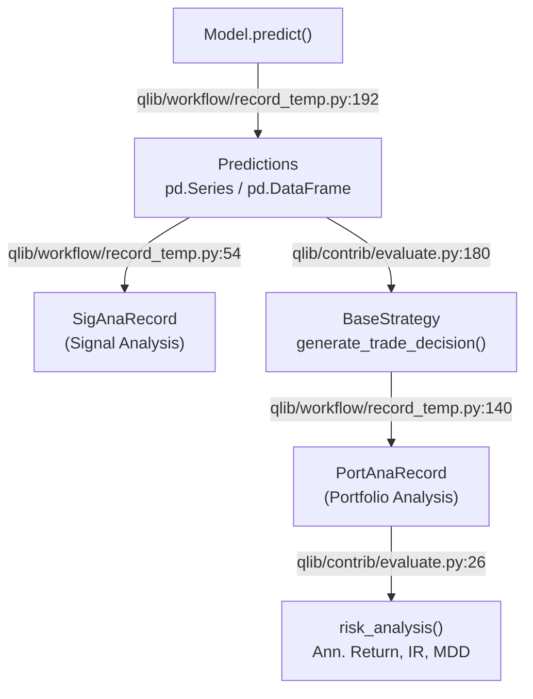

<!-- source: DeepWiki mcp.deepwiki.com · repo microsoft/qlib · page 5.4 Model Evaluation and Benchmarking · fetched 2026-10-26 -->

# Model Evaluation and Benchmarking

<details>
<summary>Relevant source files</summary>

The following files were used as context for generating this wiki page:

- [README.md](README.md)
- [docs/_static/img/analysis/analysis_model_IC.png](docs/_static/img/analysis/analysis_model_IC.png)
- [docs/_static/img/analysis/analysis_model_NDQ.png](docs/_static/img/analysis/analysis_model_NDQ.png)
- [docs/_static/img/analysis/analysis_model_auto_correlation.png](docs/_static/img/analysis/analysis_model_auto_correlation.png)
- [docs/_static/img/analysis/analysis_model_cumulative_return.png](docs/_static/img/analysis/analysis_model_cumulative_return.png)
- [docs/_static/img/analysis/analysis_model_long_short.png](docs/_static/img/analysis/analysis_model_long_short.png)
- [docs/_static/img/analysis/analysis_model_monthly_IC.png](docs/_static/img/analysis/analysis_model_monthly_IC.png)
- [docs/_static/img/analysis/report.png](docs/_static/img/analysis/report.png)
- [docs/_static/img/analysis/risk_analysis_annualized_return.png](docs/_static/img/analysis/risk_analysis_annualized_return.png)
- [docs/_static/img/analysis/risk_analysis_bar.png](docs/_static/img/analysis/risk_analysis_bar.png)
- [docs/_static/img/analysis/risk_analysis_information_ratio.png](docs/_static/img/analysis/risk_analysis_information_ratio.png)
- [docs/_static/img/analysis/risk_analysis_max_drawdown.png](docs/_static/img/analysis/risk_analysis_max_drawdown.png)
- [docs/start/initialization.rst](docs/start/initialization.rst)
- [docs/start/installation.rst](docs/start/installation.rst)
- [examples/benchmarks/README.md](examples/benchmarks/README.md)
- [examples/benchmarks/TFT/README.md](examples/benchmarks/TFT/README.md)
- [examples/benchmarks/TFT/requirements.txt](examples/benchmarks/TFT/requirements.txt)
- [examples/highfreq/workflow_config_High_Freq_Tree_Alpha158.yaml](examples/highfreq/workflow_config_High_Freq_Tree_Alpha158.yaml)
- [examples/nested_decision_execution/workflow.py](examples/nested_decision_execution/workflow.py)
- [examples/run_all_model.py](examples/run_all_model.py)
- [qlib/contrib/eva/alpha.py](qlib/contrib/eva/alpha.py)
- [qlib/contrib/evaluate.py](qlib/contrib/evaluate.py)
- [qlib/contrib/model/highfreq_gdbt_model.py](qlib/contrib/model/highfreq_gdbt_model.py)
- [qlib/contrib/workflow/__init__.py](qlib/contrib/workflow/__init__.py)
- [qlib/contrib/workflow/record_temp.py](qlib/contrib/workflow/record_temp.py)
- [qlib/workflow/record_temp.py](qlib/workflow/record_temp.py)
- [scripts/get_data.py](scripts/get_data.py)
- [tests/rolling_tests/test_update_pred.py](tests/rolling_tests/test_update_pred.py)
- [tests/test_all_pipeline.py](tests/test_all_pipeline.py)
- [tests/test_contrib_workflow.py](tests/test_contrib_workflow.py)

</details>


This document explains Qlib's model evaluation and benchmarking system, focusing on evaluation metrics (IC, ICIR, Rank IC), standardized benchmark results on Alpha158/Alpha360 datasets, and the `run_all_model.py` automation script. The framework enables systematic comparison of different model architectures and configurations.

## Overview

Qlib's evaluation system consists of signal-based metrics for prediction quality and portfolio-based metrics for trading performance. The evaluation pipeline typically flows from model predictions to signal analysis and finally to backtesting results.

**Architecture: Evaluation Pipeline**



Sources:
- [qlib/workflow/record_temp.py:161-209]()
- [qlib/workflow/record_temp.py:28-159]()
- [qlib/contrib/evaluate.py:26-93]()

## Evaluation Metrics

Qlib implements standardized metrics in `qlib.contrib.eva.alpha` and `qlib.contrib.evaluate`.

### Signal-Based Metrics (Information Coefficient)

Signal-based metrics measure the correlation between model predictions (`score`) and actual realized returns (`label`). These are implemented in `calc_ic` and related functions.

| Metric | Description | Implementation |
|--------|-------------|----------------|
| **IC** | Pearson correlation between prediction and return | `df["pred"].corr(df["label"])` [qlib/contrib/eva/alpha.py:178]() |
| **ICIR** | Information Coefficient Information Ratio | `IC.mean() / IC.std()` [qlib/contrib/workflow/record_temp.py:46]() |
| **Rank IC** | Spearman rank correlation (correlation of ranks) | `df["pred"].corr(df["label"], method="spearman")` [qlib/contrib/eva/alpha.py:179]() |
| **Rank ICIR** | Rank IC Information Ratio | `RankIC.mean() / RankIC.std()` [qlib/contrib/workflow/record_temp.py:48]() |

### Portfolio-Based Metrics

Portfolio metrics evaluate the final trading performance. The `risk_analysis` function calculates key statistics from return series [qlib/contrib/evaluate.py:26-93]().

| Metric | Description | Formula / Calculation |
|--------|-------------|-------------------------|
| **Annualized Return** | Yearly return scaled by frequency | `mean * N` (Arithmetic) or Compound (Geometric) [qlib/contrib/evaluate.py:68-78]() |
| **Information Ratio** | Risk-adjusted excess return | `mean / std * np.sqrt(N)` [qlib/contrib/evaluate.py:84]() |
| **Max Drawdown (MDD)** | Largest peak-to-trough decline | `(r.cumsum() - r.cumsum().cummax()).min()` [qlib/contrib/evaluate.py:69]() |

The scaling factor `N` is determined by frequency (e.g., 238 for day frequency in Qlib's default configuration) [qlib/contrib/evaluate.py:50-56]().

Sources:
- [qlib/contrib/eva/alpha.py:160-184]()
- [qlib/contrib/evaluate.py:26-93]()
- [qlib/contrib/workflow/record_temp.py:32-48]()

## Automated Benchmarking with run_all_model.py

The `run_all_model.py` script [examples/run_all_model.py:1-255]() is the primary tool for systematic evaluation. It automates the process of running multiple models across different datasets and aggregating their statistical performance.

### Key Functions and Workflow

1.  **Environment Management**: The script can create isolated virtual environments for different models using `create_env` [examples/run_all_model.py:65-75]().
2.  **Task Execution**: It executes model training and backtesting commands via `execute` [examples/run_all_model.py:79-96]().
3.  **Result Collection**: `get_all_results` [examples/run_all_model.py:134-166]() retrieves metrics from the `QlibRecorder` (R).
4.  **Statistical Aggregation**: `cal_mean_std` [examples/run_all_model.py:53-61]() calculates the mean and standard deviation across multiple runs (seeds) to ensure result stability.

**Data Flow: Result Aggregation**

```mermaid
flowchart LR
    R["qlib.workflow.R"]
    Exp["Experiment"]
    Recs["exp.list_recorders()"]
    Metrics["recorder.list_metrics()"]
    Stats["cal_mean_std()"]
    MD["gen_and_save_md_table()"]

    R -- "get_exp()" --> Exp
    Exp -- "examples/run_all_model.py:142" --> Recs
    Recs -- "examples/run_all_model.py:154" --> Metrics
    Metrics -- "examples/run_all_model.py:158" --> Stats
    Stats -- "examples/run_all_model.py:181" --> MD
```



### Benchmark Table Generation
The script generates a Markdown table comparing models using `gen_and_save_md_table` [examples/run_all_model.py:170-186](). This table includes IC, ICIR, Rank IC, Rank ICIR, Annualized Return, Information Ratio, and Max Drawdown.

Sources:
- [examples/run_all_model.py:53-61]()
- [examples/run_all_model.py:134-166]()
- [examples/run_all_model.py:170-186]()

## High-Frequency Evaluation

For high-frequency scenarios, Qlib provides specialized evaluation logic in `HFLGBModel` and `MultiSegRecord`.

### Precision and Alpha Metrics
In high-frequency prediction, precision is often calculated for the top and bottom quantiles separately. `_cal_signal_metrics` calculates:
- **Positive/Negative Precision**: The percentage of correctly predicted direction in the top/bottom quantiles [qlib/contrib/model/highfreq_gdbt_model.py:39-40]().
- **Average Alpha**: The mean return of the stocks in the top/bottom quantiles [qlib/contrib/model/highfreq_gdbt_model.py:42-43]().

### Multiple Segment Recording
The `MultiSegRecord` class allows for evaluating a model across different data segments (e.g., train, valid, test) simultaneously, logging IC and Rank IC for each [qlib/contrib/workflow/record_temp.py:19-58]().

Sources:
- [qlib/contrib/model/highfreq_gdbt_model.py:25-55]()
- [qlib/contrib/workflow/record_temp.py:19-58]()

## Standard Benchmark Results

Qlib maintains a set of benchmark results for models like LightGBM, GRU, LSTM, and Transformer on standardized datasets [examples/benchmarks/README.md:1-61]().

### Benchmarking Datasets
- **Alpha158**: A dataset with 158 hand-crafted technical features [examples/benchmarks/README.md:25]().
- **Alpha360**: A dataset with 360 raw price-volume features (6 features x 60 days) [examples/benchmarks/README.md:48]().

### Running Systematic Evaluations

To run a systematic benchmark for a set of models, users typically interact with `run_all_model.py` via the command line (using `fire`).

**Execution Example:**
```bash
# Run systematic benchmarks for specified models on Alpha158 dataset
python examples/run_all_model.py run --models "[lightgbm, gru, lstm]" --dataset Alpha158
```

The script will:
1.  Search for `.yaml` configs in the `benchmarks/` directory [examples/run_all_model.py:100-116]().
2.  Execute the training workflow for each configuration.
3.  Log results into the Qlib Experiment Manager.
4.  Summarize all "FINISHED" recorders and generate a comparison table [examples/run_all_model.py:152-185]().

Sources:
- [examples/benchmarks/README.md:23-61]()
- [examples/run_all_model.py:100-131]()
- [examples/run_all_model.py:151-166]()

---

