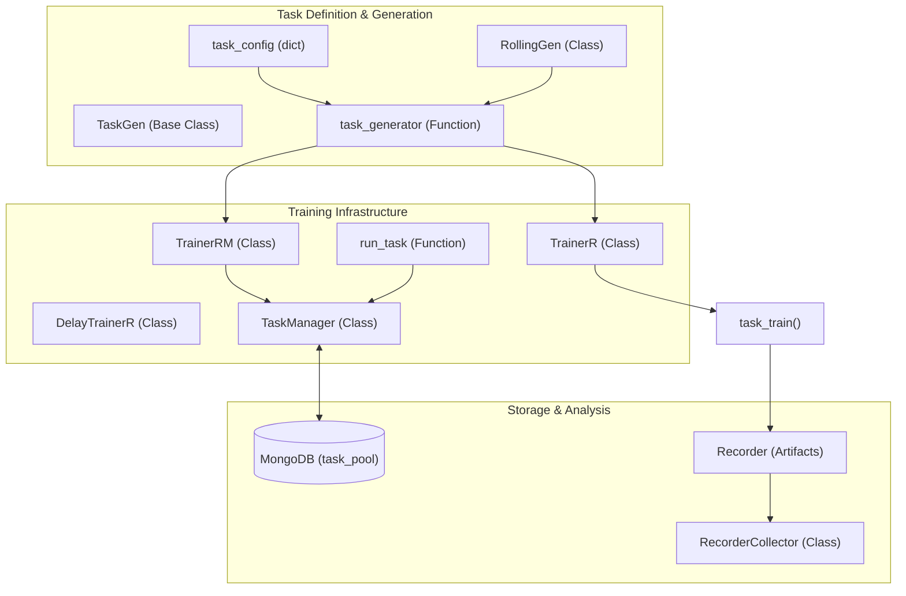
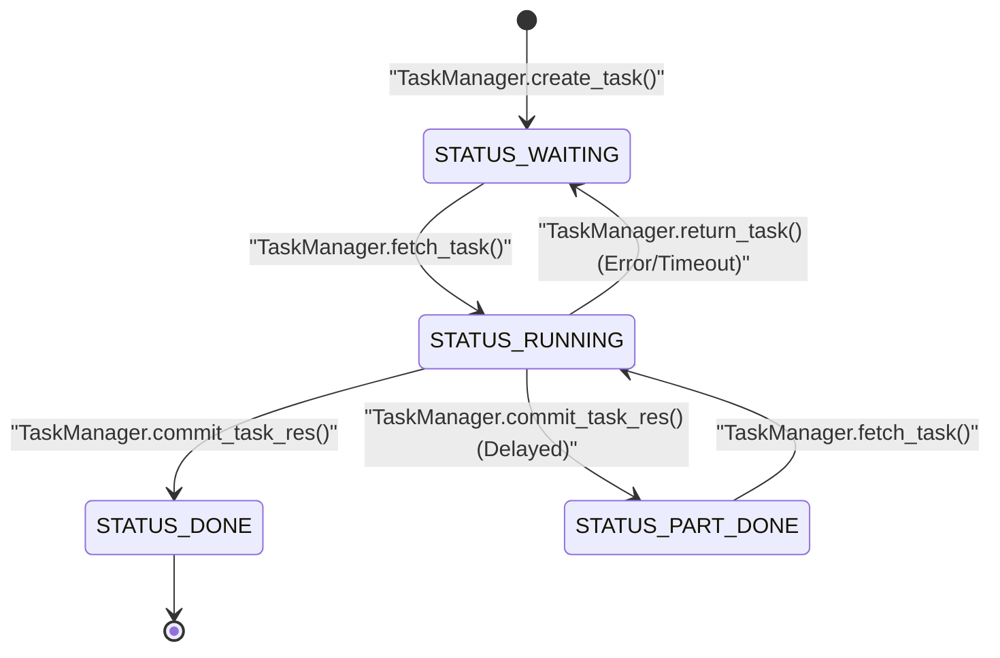

<!-- source: DeepWiki mcp.deepwiki.com · repo microsoft/qlib · page 6 Training and Task Management · fetched 2026-10-26 -->

# Training and Task Management

Relevant source files

The following files were used as context for generating this wiki page:

- [examples/model_rolling/task_manager_rolling.py](examples/model_rolling/task_manager_rolling.py)
- [examples/online_srv/update_online_pred.py](examples/online_srv/update_online_pred.py)
- [qlib/model/trainer.py](qlib/model/trainer.py)
- [qlib/workflow/task/collect.py](qlib/workflow/task/collect.py)
- [qlib/workflow/task/gen.py](qlib/workflow/task/gen.py)
- [qlib/workflow/task/manage.py](qlib/workflow/task/manage.py)
- [qlib/workflow/task/utils.py](qlib/workflow/task/utils.py)

## Purpose and Scope

This page provides an overview of Qlib's training orchestration and task management infrastructure. The system enables task-based training workflows that scale from single model training to distributed execution of hundreds of rolling window experiments across multiple machines. Core capabilities include:

- **Task-based abstraction**: Models are trained via task definitions containing model, dataset, and recording specifications [qlib/model/trainer.py:36-72]().
- **Distributed execution**: MongoDB-backed task queue enables horizontal scaling across machines [qlib/workflow/task/manage.py:5-14]().
- **Rolling window support**: Generate time-series evaluation tasks with expanding or sliding windows [qlib/workflow/task/gen.py:140-180]().
- **Delayed training pattern**: Separate task preparation from expensive model fitting for resource optimization [qlib/model/trainer.py:8-12]().
- **Result collection**: Aggregate predictions and metrics from distributed experiments [qlib/workflow/task/collect.py:136-164]().

**Sub-Pages:**
- [Trainer Framework](#6.1): `TrainerR`, `TrainerRM`, and delayed training variants.
- [TaskManager and Distributed Execution](#6.2): MongoDB-backed task queue and worker pool pattern.
- [Rolling Window Training with RollingGen](#6.3): Generate time-series evaluation tasks.
- [Result Collection with RecorderCollector](#6.4): Aggregate distributed experiment results.

## System Architecture

Qlib's training system consists of four major subsystems that work together to enable scalable model training:

| Subsystem | Purpose | Key Components |
|-----------|---------|----------------|
| **Trainer Framework** | Orchestrates model training execution | `Trainer`, `TrainerR`, `TrainerRM`, `DelayTrainerR`, `DelayTrainerRM` [qlib/model/trainer.py:131-620]() |
| **Task Generation** | Creates task definitions from templates | `TaskGen`, `RollingGen`, `task_generator` [qlib/workflow/task/gen.py:15-350]() |
| **Task Management** | Manages distributed task lifecycle | `TaskManager`, `run_task` [qlib/workflow/task/manage.py:35-549]() |
| **Result Collection** | Aggregates experiment results | `Collector`, `RecorderCollector`, `MergeCollector` [qlib/workflow/task/collect.py:19-259]() |

**Training Workflow Components**

**Sources:** [qlib/model/trainer.py:131-620](), [qlib/workflow/task/gen.py:15-50](), [qlib/workflow/task/manage.py:35-83](), [qlib/workflow/task/collect.py:136-164]()

## Trainer Framework

The trainer framework provides multiple implementations for different training scenarios. All trainers inherit from the base `Trainer` class [qlib/model/trainer.py:131-207]() and implement two-phase training: `train()` for starting tasks and `end_train()` for finalization.

### Trainer Class Hierarchy

| Class | Base | Description |
|-------|------|-------------|
| `TrainerR` | `Trainer` | Linear training where each task results in a `Recorder` [qlib/model/trainer.py:209-212](). |
| `TrainerRM` | `Trainer` | Distributed training using `TaskManager` and MongoDB [qlib/model/trainer.py:341-344](). |
| `DelayTrainerR` | `TrainerR` | Preparation in `train()`, model fitting in `end_train()` [qlib/model/trainer.py:293-296](). |
| `DelayTrainerRM` | `TrainerRM` | Distributed version of delayed training [qlib/model/trainer.py:491-494](). |

For details, see [Trainer Framework](#6.1).

**Sources:** [qlib/model/trainer.py:131-620]()

## TaskManager and Distributed Execution

`TaskManager` uses MongoDB to enable distributed training across multiple processes or machines. It manages the task lifecycle through atomic status updates [qlib/workflow/task/manage.py:5-14]().

### Task Lifecycle in MongoDB

**Sources:** [qlib/workflow/task/manage.py:79-82](), [qlib/workflow/task/manage.py:263-284](), [qlib/workflow/task/manage.py:352-367]()

The `run_task` function acts as a worker loop, fetching tasks with `STATUS_WAITING` and committing them with `STATUS_DONE` after executing a provided `task_func` [qlib/workflow/task/manage.py:483-549]().

For details, see [TaskManager and Distributed Execution](#6.2).

## Rolling Window Training with RollingGen

`RollingGen` is a `TaskGen` implementation that automates the generation of time-series experiments [qlib/workflow/task/gen.py:140-180]().

- **ROLL_EX (Expanding)**: Fixed start date, expanding end date [qlib/workflow/task/gen.py:141]().
- **ROLL_SD (Sliding)**: Fixed segment size, sliding the window forward by a `step` [qlib/workflow/task/gen.py:142]().

It uses a `TimeAdjuster` to align dates with the trading calendar and shift segments accurately [qlib/workflow/task/utils.py:82-111]().

For details, see [Rolling Window Training with RollingGen](#6.3).

**Sources:** [qlib/workflow/task/gen.py:140-301](), [qlib/workflow/task/utils.py:82-111]()

## Result Collection with RecorderCollector

After training multiple tasks (e.g., in a rolling experiment), `RecorderCollector` aggregates the results [qlib/workflow/task/collect.py:136-164]().

- **Collection**: It retrieves artifacts (like `pred.pkl`) from `Recorder` instances within a specific `Experiment` [qlib/workflow/task/collect.py:160-164]().
- **Pipeline**: It applies a `process_list` of processors to the collected data (e.g., grouping by model or averaging results) [qlib/workflow/task/collect.py:24-33]().

For details, see [Result Collection with RecorderCollector](#6.4).

**Sources:** [qlib/workflow/task/collect.py:19-259](), [examples/model_rolling/task_manager_rolling.py:98-104]()

---

