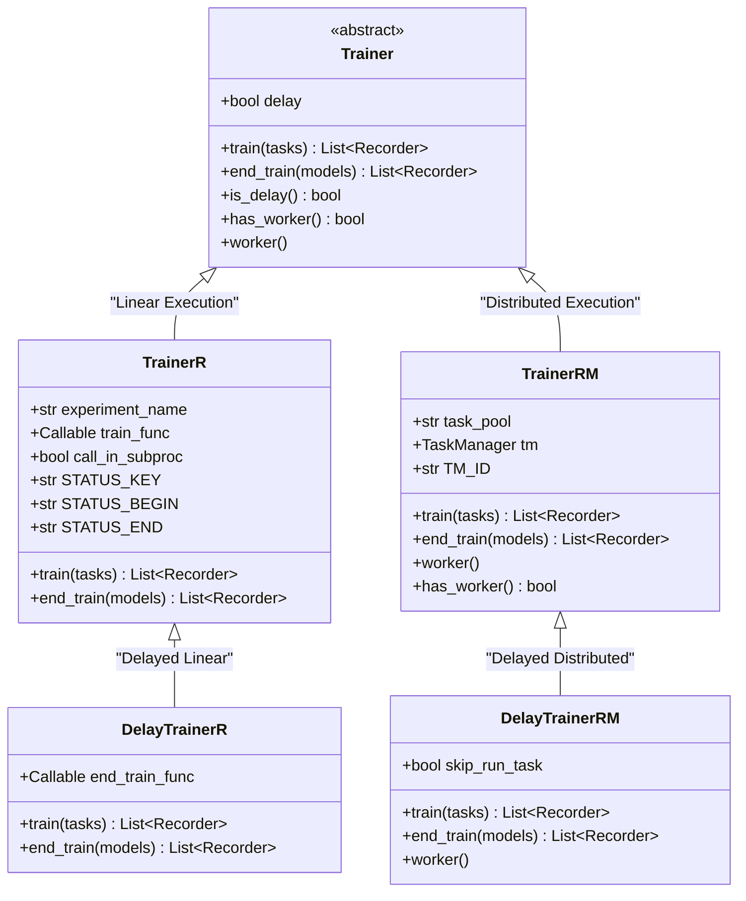
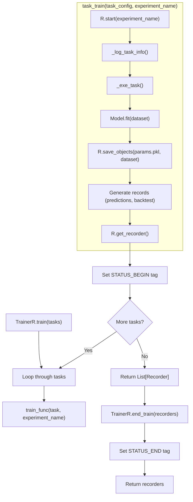
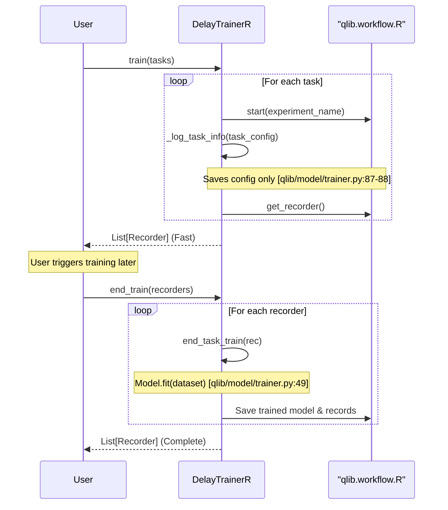
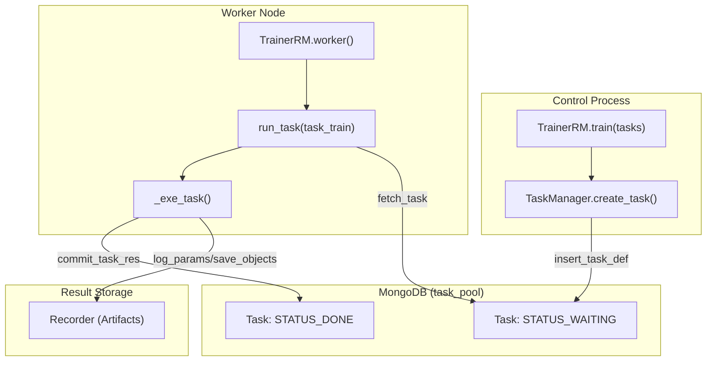

<!-- source: DeepWiki mcp.deepwiki.com · repo microsoft/qlib · page 6.1 Trainer Framework · fetched 2026-10-26 -->

# Trainer Framework

<details>
<summary>Relevant source files</summary>

The following files were used as context for generating this wiki page:

- [examples/model_rolling/task_manager_rolling.py](examples/model_rolling/task_manager_rolling.py)
- [examples/online_srv/update_online_pred.py](examples/online_srv/update_online_pred.py)
- [qlib/model/trainer.py](qlib/model/trainer.py)
- [qlib/workflow/task/collect.py](qlib/workflow/task/collect.py)
- [qlib/workflow/task/gen.py](qlib/workflow/task/gen.py)
- [qlib/workflow/task/manage.py](qlib/workflow/task/manage.py)
- [qlib/workflow/task/utils.py](qlib/workflow/task/utils.py)

</details>


## Purpose and Scope

The Trainer Framework provides a standardized abstraction for training machine learning models from task definitions in Qlib. A **Trainer** orchestrates the complete training workflow: initializing models and datasets from configuration, executing model fitting, saving results to Recorders, and optionally generating predictions and backtest results [qlib/model/trainer.py:4-12]().

This document details the Trainer class hierarchy and execution logic. For MongoDB-backed distributed task management, see [TaskManager and Distributed Execution](#6.2). For rolling window task generation, see [Rolling Window Training with RollingGen](#6.3). For result aggregation across multiple training runs, see [Result Collection with RecorderCollector](#6.4).

Sources: [qlib/model/trainer.py:4-12]()

---

## Core Concepts

### Task-Based Training

A **task** in Qlib is a dictionary that defines a complete training workflow [qlib/model/trainer.py:113-115](). It typically includes model specifications, dataset configurations, and record templates [qlib/model/trainer.py:45-58]():

```python
task = {
    "model": {
        "class": "LGBModel",
        "module_path": "qlib.contrib.model.gbdt",
        "kwargs": {...}
    },
    "dataset": {
        "class": "DatasetH",
        "module_path": "qlib.data.dataset",
        "kwargs": {...}
    },
    "record": [  # Optional: generate predictions, backtest, analysis
        {
            "class": "SignalRecord",
            "module_path": "qlib.workflow.record_temp",
        }
    ]
}
```

Trainers consume these definitions and produce **Recorders** that store trained models, task configuration, and generated artifacts [qlib/model/trainer.py:5-12]().

### Regular vs Delayed Execution

Qlib provides two execution modes to support different infrastructure needs [qlib/model/trainer.py:8-12]():

| Mode | `train()` Behavior | `end_train()` Behavior | Use Case |
|------|-------------------|----------------------|----------|
| **Regular** | Complete model fitting and artifact generation | Cleanup or tagging only | Standard single-pass training |
| **Delayed** | Save task configuration to Recorders only | Actual model fitting and record generation | Online simulation, parallel training across heterogeneous resources |

The delayed mode enables **time-efficient parallel training**: quickly create many Recorders with task configurations, then train them concurrently across multiple workers [qlib/model/trainer.py:8-12]().

Sources: [qlib/model/trainer.py:4-12](), [qlib/model/trainer.py:131-183]()

---

## Trainer Class Hierarchy

The following diagram maps the logical Trainer hierarchy to the implementation classes in the codebase.

### Trainer Hierarchy Entity Mapping


**Naming Convention:**
- **R** suffix: Recorder-based (stores results in `qlib.workflow.recorder.Recorder`) [qlib/model/trainer.py:211]()
- **M** suffix: Task Manager-based (uses `qlib.workflow.task.manage.TaskManager` for MongoDB queueing) [qlib/model/trainer.py:343]()
- **Delay** prefix: Two-phase execution (preparation phase → training phase) [qlib/model/trainer.py:8-12]()

Sources: [qlib/model/trainer.py:131-207](), [qlib/model/trainer.py:209-291](), [qlib/model/trainer.py:293-339](), [qlib/model/trainer.py:341-489](), [qlib/model/trainer.py:491-620]()

---

## TrainerR: Linear Recorder-Based Training

### Overview

`TrainerR` trains tasks sequentially in a single process. Each task produces one Recorder. This is the simplest trainer and suitable for small-scale experiments, debugging, and single-machine training [qlib/model/trainer.py:211-215]().

### Initialization Parameters

| Parameter | Type | Default | Description |
|-----------|------|---------|-------------|
| `experiment_name` | str | None | Experiment name for organizing Recorders [qlib/model/trainer.py:218]() |
| `train_func` | Callable | `task_train` | Function to execute each task [qlib/model/trainer.py:221]() |
| `call_in_subproc` | bool | False | Force memory release by training each task in a subprocess via `call_in_subproc` [qlib/model/trainer.py:222]() |

### Execution Flow



Sources: [qlib/model/trainer.py:209-291](), [qlib/model/trainer.py:108-129](), [qlib/model/trainer.py:36-72]()

---

## DelayTrainerR: Delayed Linear Training

### Overview

`DelayTrainerR` splits training into two phases: `train()` quickly creates Recorders with task configurations using `begin_task_train`, while `end_train()` performs the actual model fitting using `end_task_train` [qlib/model/trainer.py:293-298]().

### Two-Phase Execution Logic



Sources: [qlib/model/trainer.py:293-339](), [qlib/model/trainer.py:74-106]()

---

## TrainerRM: Distributed Task Manager Training

### Overview

`TrainerRM` enables **distributed training across multiple machines** using MongoDB as a task queue [qlib/model/trainer.py:343-348](). It leverages the `TaskManager` to ensure atomic task fetching and horizontal scaling [qlib/workflow/task/manage.py:5-8]().

### Distributed Training Entity Mapping
This diagram shows how `TrainerRM` bridges the configuration space to the distributed execution space.



Sources: [qlib/model/trainer.py:341-489](), [qlib/workflow/task/manage.py:35-100](), [examples/model_rolling/task_manager_rolling.py:48-81]()

---

## DelayTrainerRM: Delayed Distributed Training

### Overview

`DelayTrainerRM` combines delayed execution with distributed management [qlib/model/trainer.py:491-495](). Tasks transition through a lifecycle in MongoDB managed by `STATUS_WAITING`, `STATUS_PART_DONE`, and `STATUS_DONE` [qlib/workflow/task/manage.py:68-82]().

### Task Lifecycle in MongoDB
The task status is updated atomically in the `task_pool` collection [qlib/workflow/task/manage.py:79-82]().

1.  **STATUS_WAITING**: Task is inserted but not yet processed [qlib/workflow/task/manage.py:79]().
2.  **STATUS_RUNNING**: Task is currently being processed by a worker [qlib/workflow/task/manage.py:80]().
3.  **STATUS_PART_DONE**: Phase 1 (config logging) is complete [qlib/workflow/task/manage.py:82]().
4.  **STATUS_DONE**: Phase 2 (fitting and recording) is complete [qlib/workflow/task/manage.py:81]().

Sources: [qlib/model/trainer.py:491-620](), [qlib/workflow/task/manage.py:79-82]()

---

## Task Execution Logic

### _exe_task()
The core function that performs model training [qlib/model/trainer.py:42-72]():
1. **Init**: Initializes `Model` and `Dataset` from config via `init_instance_by_config` [qlib/model/trainer.py:45-46]().
2. **Fit**: Calls `model.fit(dataset)` with `auto_filter_kwargs` to handle optional reweighter [qlib/model/trainer.py:49]().
3. **Save**: Dumps `params.pkl` (model) and the `dataset` configuration to the recorder [qlib/model/trainer.py:50-53]().
4. **Records**: Iterates through the `record` list, initializing each (e.g., `SignalRecord`) and calling `r.generate()` [qlib/model/trainer.py:58-71]().

### task_train()
The standard single-step training wrapper [qlib/model/trainer.py:108-129]():
- Starts a new recorder context using `R.start()`.
- Calls `_log_task_info()` to store parameters and hostname.
- Calls `_exe_task()` to train and save.

Sources: [qlib/model/trainer.py:36-129]()

---

## Trainer Selection Decision Tree

| If you need... | And you have... | Use this Trainer |
|----------------|-----------------|------------------|
| Simple sequential training | Local machine | `TrainerR` [qlib/model/trainer.py:211]() |
| Delayed preparation | Local machine | `DelayTrainerR` [qlib/model/trainer.py:293]() |
| Distributed parallel training | MongoDB + Worker Pool | `TrainerRM` [qlib/model/trainer.py:343]() |
| Distributed delayed training | MongoDB + Heterogeneous Workers | `DelayTrainerRM` [qlib/model/trainer.py:491]() |

Sources: [qlib/model/trainer.py:11-12](), [examples/model_rolling/task_manager_rolling.py:46-52]()

---

