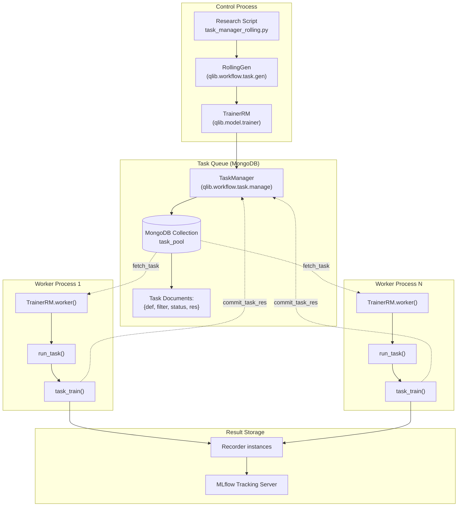
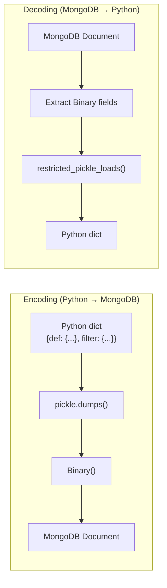
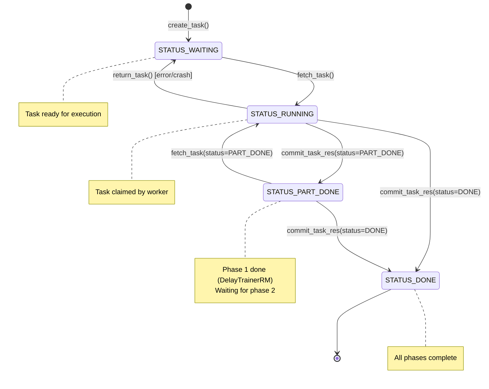
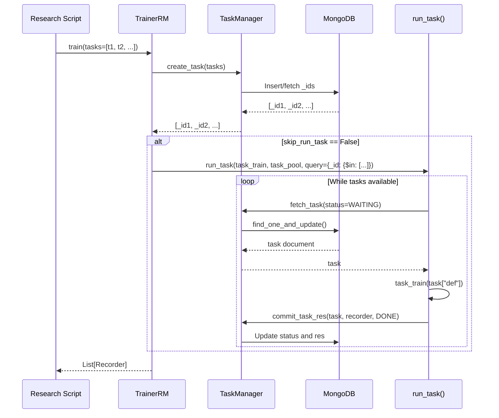

<!-- source: DeepWiki mcp.deepwiki.com · repo microsoft/qlib · page 6.2 TaskManager and Distributed Execution · fetched 2026-10-26 -->

# TaskManager and Distributed Execution

<details>
<summary>Relevant source files</summary>

The following files were used as context for generating this wiki page:

- [examples/model_rolling/task_manager_rolling.py](examples/model_rolling/task_manager_rolling.py)
- [examples/online_srv/update_online_pred.py](examples/online_srv/update_online_pred.py)
- [qlib/model/trainer.py](qlib/model/trainer.py)
- [qlib/workflow/task/collect.py](qlib/workflow/task/collect.py)
- [qlib/workflow/task/gen.py](qlib/workflow/task/gen.py)
- [qlib/workflow/task/manage.py](qlib/workflow/task/manage.py)
- [qlib/workflow/task/utils.py](qlib/workflow/task/utils.py)

</details>


## Purpose and Scope

This document describes Qlib's distributed execution infrastructure built on `TaskManager`, a MongoDB-backed task queue system that enables horizontal scaling of model training across multiple processes and machines. The TaskManager coordinates task lifecycle, handles fault tolerance, and ensures each task executes exactly once. This system is primarily used with `TrainerRM` for distributed model training experiments.

For information about the Trainer framework hierarchy (`TrainerR`, `TrainerRM`, `DelayTrainerR`, `DelayTrainerRM`), see [Trainer Framework (6.1)](). For rolling window task generation, see [Rolling Window Training with RollingGen (6.3)](). For aggregating results from distributed tasks, see [Result Collection with RecorderCollector (6.4)]().

---

## System Architecture

`TaskManager` [qlib/workflow/task/manage.py:35-82]() provides a distributed task execution framework where a control process submits tasks to MongoDB, and multiple independent worker processes fetch and execute them concurrently using `run_task` [qlib/workflow/task/manage.py:484-550]().

### High-Level Component Diagram



**Sources:** [qlib/workflow/task/manage.py:35-482](), [qlib/model/trainer.py:341-620](), [examples/model_rolling/task_manager_rolling.py:10-80]()

---

## MongoDB-Backed Task Storage

### Task Document Structure

Each task in MongoDB is stored as a document with the following structure defined in the `TaskManager` class:

| Field | Type | Description |
|-------|------|-------------|
| `_id` | ObjectId | MongoDB-generated unique identifier |
| `def` | Binary (pickled) | Task definition (model config, dataset config, etc.) |
| `filter` | JSON | Searchable metadata for querying tasks |
| `status` | String | Current task status (waiting, running, done, part_done) |
| `res` | Binary (pickled) | Task result (Recorder instance after execution) |

The `def` and `res` fields are pickle-serialized Python objects wrapped in BSON Binary format [qlib/workflow/task/manage.py:111-116](), while `filter` remains JSON for efficient MongoDB queries.

**Sources:** [qlib/workflow/task/manage.py:39-48](), [qlib/workflow/task/manage.py:111-137]()

### Encoding and Decoding



The `_encode_task()` [qlib/workflow/task/manage.py:111-116]() method serializes fields starting with prefixes in `ENCODE_FIELDS_PREFIX` (currently `["def", "res"]`), while `_decode_task()` [qlib/workflow/task/manage.py:118-137]() deserializes them using `restricted_pickle_loads`. This ensures complex Python objects can be stored safely in MongoDB.

**Sources:** [qlib/workflow/task/manage.py:84-84](), [qlib/workflow/task/manage.py:111-137]()

---

## Task Lifecycle and Status Management

### Status Transition Diagram



### Status Definitions

- **`STATUS_WAITING`** ("waiting"): Task is in the queue, ready to be fetched by any worker [qlib/workflow/task/manage.py:79-79]().
- **`STATUS_RUNNING`** ("running"): Task has been claimed by a worker via `fetch_task()` and is currently executing [qlib/workflow/task/manage.py:80-80]().
- **`STATUS_PART_DONE`** ("part_done"): Used with `DelayTrainerRM` to indicate the first phase (task preparation) is complete, waiting for the second phase (actual training) [qlib/workflow/task/manage.py:82-82]().
- **`STATUS_DONE`** ("done"): Task execution is fully complete, results are committed [qlib/workflow/task/manage.py:81-81]().

**Sources:** [qlib/workflow/task/manage.py:79-82](), [qlib/model/trainer.py:491-620]()

### Two-Phase Execution (DelayTrainerRM)

The `STATUS_PART_DONE` status enables a two-phase training workflow implemented in `DelayTrainerRM` [qlib/model/trainer.py:491-620]():

1. **Phase 1 (begin_task_train)**: Start a recorder and log task config [qlib/model/trainer.py:74-89]().
2. **Phase 2 (end_task_train)**: Load task config, perform real model fitting, and save artifacts [qlib/model/trainer.py:91-106]().

**Sources:** [qlib/model/trainer.py:74-106](), [qlib/model/trainer.py:491-620]()

---

## TaskManager Core Operations

### Key Methods Reference

| Method | Purpose | Returns |
|--------|---------|---------|
| `create_task(task_def_l)` | Insert new tasks or get existing IDs | List[str] of `_id`s [qlib/workflow/task/manage.py:217-262]() |
| `fetch_task(query, status)` | Atomically claim a task (WAITING→RUNNING) | dict or None [qlib/workflow/task/manage.py:264-285]() |
| `safe_fetch_task(query, status)` | Context manager wrapper with error handling | Yields task dict [qlib/workflow/task/manage.py:287-316]() |
| `commit_task_res(task, res, status)` | Save result and update status | None [qlib/workflow/task/manage.py:346-364]() |
| `return_task(task, status)` | Return task to queue (error recovery) | None [qlib/workflow/task/manage.py:318-329]() |
| `wait(query)` | Block until all queried tasks complete | None [qlib/workflow/task/manage.py:447-479]() |

**Sources:** [qlib/workflow/task/manage.py:217-479]()

### Atomic Task Fetching

The `fetch_task()` method uses MongoDB's `find_one_and_update()` to atomically claim a task, preventing race conditions between workers:

```python
# qlib/workflow/task/manage.py:278-283
task = self.task_pool.find_one_and_update(
    query,
    {"$set": {"status": self.STATUS_RUNNING}},
    sort=[("priority", pymongo.DESCENDING)],
)
```

**Sources:** [qlib/workflow/task/manage.py:264-285]()

---

## Distributed Execution with TrainerRM

### TrainerRM.train() Flow



**Sources:** [qlib/model/trainer.py:384-448](), [qlib/workflow/task/manage.py:484-550]()

---

## Worker Pattern for Horizontal Scaling

### Starting Workers

Workers are independent processes that continuously fetch and execute tasks. The `TrainerRM.worker()` method provides a standard entry point [qlib/model/trainer.py:466-485]():

```python
# qlib/model/trainer.py:466-485
def worker(self, train_func=None, experiment_name=None):
    if train_func is None:
        train_func = self.train_func
    if experiment_name is None:
        experiment_name = self.experiment_name
    task_pool = self.task_pool
    if task_pool is None:
        task_pool = experiment_name
    run_task(train_func, task_pool=task_pool, experiment_name=experiment_name)
```

**Sources:** [qlib/model/trainer.py:466-485](), [examples/model_rolling/task_manager_rolling.py:76-80]()

### Fault Tolerance and Error Handling

The `safe_fetch_task()` context manager [qlib/workflow/task/manage.py:287-316]() ensures that if a worker process crashes or encounters an exception, the task is returned to the queue (`STATUS_WAITING`) so another worker can attempt it.

```python
# qlib/workflow/task/manage.py:304-309
except (Exception, KeyboardInterrupt):
    if task is not None:
        self.logger.info("Returning task before raising error")
        self.return_task(task, status=status)
        self.logger.info("Task returned")
    raise
```

**Sources:** [qlib/workflow/task/manage.py:287-316](), [qlib/workflow/task/manage.py:318-329]()

---

## Result Collection with RecorderCollector

After tasks are finished, `RecorderCollector` [qlib/workflow/task/collect.py:136-259]() is used to aggregate results (e.g., predictions) from multiple recorders across experiments.

```python
# examples/model_rolling/task_manager_rolling.py:98-103
collector = RecorderCollector(
    experiment=self.experiment_name,
    process_list=RollingGroup(),
    rec_key_func=rec_key,
    rec_filter_func=my_filter,
)
```

**Sources:** [qlib/workflow/task/collect.py:136-259](), [examples/model_rolling/task_manager_rolling.py:82-105]()

---

## Summary Table: Key Classes and Functions

| Entity | Location | Purpose |
|--------|----------|---------|
| `TaskManager` | [qlib/workflow/task/manage.py:35-482]() | Core task queue manager and MongoDB interface. |
| `TrainerRM` | [qlib/model/trainer.py:341-489]() | Trainer that manages task lifecycle via TaskManager. |
| `run_task()` | [qlib/workflow/task/manage.py:484-550]() | Worker loop that fetches and executes tasks until pool is empty. |
| `task_train()` | [qlib/model/trainer.py:108-129]() | Default task execution function for model training. |
| `RollingGen` | [qlib/workflow/task/gen.py:140-301]() | Generator for time-series rolling window tasks. |
| `RecorderCollector` | [qlib/workflow/task/collect.py:136-259]() | Aggregates results from multiple task recorders. |
| `get_mongodb()` | [qlib/workflow/task/utils.py:22-57]() | Helper to retrieve MongoDB database instance from config. |

**Sources:** [qlib/workflow/task/manage.py](), [qlib/model/trainer.py](), [qlib/workflow/task/gen.py](), [qlib/workflow/task/collect.py](), [qlib/workflow/task/utils.py]()

---

