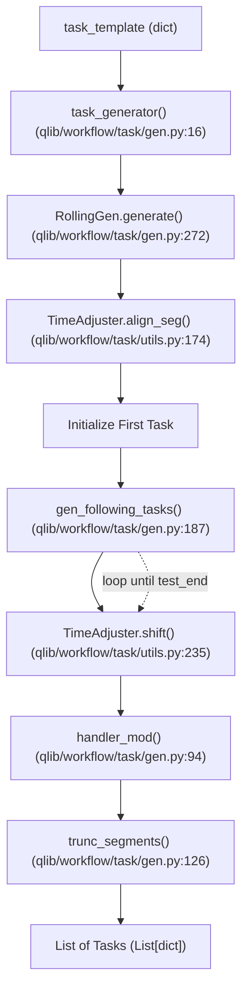

<!-- source: DeepWiki mcp.deepwiki.com · repo microsoft/qlib · page 6.3 Rolling Window Training with RollingGen · fetched 2026-10-26 -->

# Rolling Window Training with RollingGen

<details>
<summary>Relevant source files</summary>

The following files were used as context for generating this wiki page:

- [examples/highfreq/highfreq_handler.py](examples/highfreq/highfreq_handler.py)
- [examples/highfreq/highfreq_ops.py](examples/highfreq/highfreq_ops.py)
- [examples/highfreq/highfreq_processor.py](examples/highfreq/highfreq_processor.py)
- [examples/highfreq/workflow.py](examples/highfreq/workflow.py)
- [examples/model_interpreter/feature.py](examples/model_interpreter/feature.py)
- [examples/model_rolling/task_manager_rolling.py](examples/model_rolling/task_manager_rolling.py)
- [examples/online_srv/update_online_pred.py](examples/online_srv/update_online_pred.py)
- [examples/rolling_process_data/README.md](examples/rolling_process_data/README.md)
- [examples/rolling_process_data/rolling_handler.py](examples/rolling_process_data/rolling_handler.py)
- [examples/rolling_process_data/workflow.py](examples/rolling_process_data/workflow.py)
- [qlib/model/trainer.py](qlib/model/trainer.py)
- [qlib/workflow/task/collect.py](qlib/workflow/task/collect.py)
- [qlib/workflow/task/gen.py](qlib/workflow/task/gen.py)
- [qlib/workflow/task/manage.py](qlib/workflow/task/manage.py)
- [qlib/workflow/task/utils.py](qlib/workflow/task/utils.py)

</details>


## Purpose and Scope

This document explains how to use `RollingGen` to generate rolling window tasks for time-series financial model training in Qlib. Rolling window training is essential for backtesting trading strategies across multiple time periods to evaluate model robustness and avoid overfitting to a single time window.

`RollingGen` automates the generation of multiple training tasks with different time segments, enabling users to:
- Train models on consecutive time windows.
- Evaluate performance across different market conditions.
- Generate tasks for distributed execution via `TaskManager`.

**Related pages:**
- For trainer implementation details, see **6.1 Trainer Framework**.
- For distributed task execution, see **6.2 TaskManager and Distributed Execution**.
- For aggregating rolling results, see **6.4 Result Collection with RecorderCollector**.

---

## System Overview

Rolling window training divides historical data into multiple overlapping or sliding time segments. `RollingGen` generates a list of tasks from a single task template, where each task trains on a different time window.

### Key Components

| Component | File | Purpose |
|-----------|------|---------|
| `RollingGen` | [qlib/workflow/task/gen.py:140-301]() | Main class for generating rolling tasks. |
| `TaskGen` | [qlib/workflow/task/gen.py:53-91]() | Base class for task generators. |
| `TimeAdjuster` | [qlib/workflow/task/utils.py:82-281]() | Helper for date alignment and shifting using Qlib calendars. |
| `task_generator` | [qlib/workflow/task/gen.py:16-50]() | Top-level function to apply multiple generators to task templates. |
| `handler_mod` | [qlib/workflow/task/gen.py:94-125]() | Adjusts handler `end_time` to ensure it covers generated test segments. |
| `trunc_segments` | [qlib/workflow/task/gen.py:126-138]() | Truncates segments to prevent data leakage (look-ahead bias). |

**Sources:** [qlib/workflow/task/gen.py:1-350](), [qlib/workflow/task/utils.py:82-281]()

---

## Rolling Window Types

`RollingGen` supports two rolling strategies, defined by the `rtype` parameter:

### ROLL_EX (Expanding Window)

```mermaid
graph LR
    subgraph "Task_1"
        ["T1_train"] -- "Train: 2008-2014" --> ["T1_test"]
        ["T1_test"] -- "Test: 2015" --> ["END_1"]
    end
    subgraph "Task_2"
        ["T2_train"] -- "Train: 2008-2015" --> ["T2_test"]
        ["T2_test"] -- "Test: 2016" --> ["END_2"]
    end
    subgraph "Task_3"
        ["T3_train"] -- "Train: 2008-2016" --> ["T3_test"]
        ["T3_test"] -- "Test: 2017" --> ["END_3"]
    end
    ["T1_test"] -. "Next Step" .-> ["T2_train"]
    ["T2_test"] -. "Next Step" .-> ["T3_train"]
```

**ROLL_EX Characteristics:**
- Training window **start date is fixed**.
- Training window **expands** to include all previous data as time progresses [qlib/workflow/task/gen.py:210-211]().
- Test window slides forward with a fixed size.
- Defined by constant `RollingGen.ROLL_EX` which maps to `TimeAdjuster.SHIFT_EX` [qlib/workflow/task/gen.py:141]().

### ROLL_SD (Sliding Window)

```mermaid
graph LR
    subgraph "Task_1"
        ["T1_train"] -- "Train: 2008-2014" --> ["T1_test"]
        ["T1_test"] -- "Test: 2015" --> ["END_1"]
    end
    subgraph "Task_2"
        ["T2_train"] -- "Train: 2009-2015" --> ["T2_test"]
        ["T2_test"] -- "Test: 2016" --> ["END_2"]
    end
    subgraph "Task_3"
        ["T3_train"] -- "Train: 2010-2016" --> ["T3_test"]
        ["T3_test"] -- "Test: 2017" --> ["END_3"]
    end
    ["T1_train"] -. "Slide" .-> ["T2_train"]
    ["T2_train"] -. "Slide" .-> ["T3_train"]
```

**ROLL_SD Characteristics:**
- Both training and test windows **slide forward** by the same step [qlib/workflow/task/gen.py:213-215]().
- Training window size remains **constant**.
- Useful for walk-forward analysis where only recent data is relevant.
- Defined by constant `RollingGen.ROLL_SD` which maps to `TimeAdjuster.SHIFT_SD` [qlib/workflow/task/gen.py:142]().

**Sources:** [qlib/workflow/task/gen.py:140-142](), [qlib/workflow/task/gen.py:210-215](), [qlib/workflow/task/utils.py:235-236]()

---

## Task Generation Workflow

### High-Level Process



**Sources:** [qlib/workflow/task/gen.py:16-50](), [qlib/workflow/task/gen.py:187-301]()

### Detailed Task Generation Steps

The `generate()` method in `RollingGen` performs the following logic:

#### 1. Align Segments to Trading Calendar
It uses `TimeAdjuster.align_seg` to ensure the dates in the task template match actual trading days in the Qlib calendar [qlib/workflow/task/gen.py:285]().

#### 2. Initialize First Test Window
The first task's test window starts at the original test start date and spans exactly `step` trading days [qlib/workflow/task/gen.py:288-289]().

#### 3. Truncate Segments (Optional)
If `trunc_days` is provided, `trunc_segments` is called to shrink training/validation windows to avoid using data that overlaps with the test period's label requirements [qlib/workflow/task/gen.py:290-291]().

#### 4. Iterative Shifting
`gen_following_tasks` is called to create subsequent tasks. It uses `TimeAdjuster.shift` to move segments forward by `step` days until the `test_end` date is reached [qlib/workflow/task/gen.py:187-225]().

**Sources:** [qlib/workflow/task/gen.py:187-301](), [qlib/workflow/task/utils.py:174-201]()

---

## TimeAdjuster: Calendar-Aware Date Operations

The `TimeAdjuster` class is the engine behind `RollingGen`, providing date calculations that respect market holidays.

### Core Methods

| Method | Description |
|--------|-------------|
| `align_idx` | Finds the index of a date in the `D.calendar` [qlib/workflow/task/utils.py:119-142](). |
| `shift` | Shifts a date segment by `step` days using either `SHIFT_SD` (slide) or `SHIFT_EX` (expand) [qlib/workflow/task/utils.py:235-266](). |
| `truncate` | Truncates a segment relative to `test_start` to prevent information leakage [qlib/workflow/task/utils.py:203-233](). |
| `cal_interval` | Calculates the number of trading days between two dates [qlib/workflow/task/utils.py:144-155](). |

### Preventing Data Leakage

#### Handler End Time Adjustment
The `handler_mod` function [qlib/workflow/task/gen.py:94-125]() automatically extends the `DataHandler`'s `end_time` if the generated test segment requires data beyond the handler's original range. This is critical for rolling experiments where the test window moves into the future.

#### Segment Truncation
The `trunc_segments` function [qlib/workflow/task/gen.py:126-138]() adjusts training segments based on `trunc_days`. This ensures training data stops at least `trunc_days` before the test start to prevent look-ahead bias from future labels [qlib/workflow/task/gen.py:137]().

**Sources:** [qlib/workflow/task/gen.py:94-138](), [qlib/workflow/task/utils.py:82-281]()

---

## Integration with Task Management

Rolling training is typically paired with `TaskManager` for distributed execution and `RecorderCollector` for result aggregation.

### Code-to-System Mapping

```mermaid
flowchart TB
    subgraph "Natural Language: Task Definition"
        ["Rolling Configuration"]
        ["Model Template"]
    end

    subgraph "Code Entity: Workflow Layer"
        ["RollingGen"] -- "Defined in" --> F1["qlib/workflow/task/gen.py:140"]
        ["task_generator"] -- "Defined in" --> F2["qlib/workflow/task/gen.py:16"]
        ["TaskManager"] -- "Defined in" --> F3["qlib/workflow/task/manage.py:35"]
    end

    subgraph "Code Entity: Model Layer"
        ["TrainerRM"] -- "Defined in" --> F4["qlib/model/trainer.py:246"]
        ["task_train"] -- "Defined in" --> F5["qlib/model/trainer.py:108"]
    end

    ["Rolling Configuration"] --> ["RollingGen"]
    ["Model Template"] --> ["task_generator"]
    ["RollingGen"] --> ["task_generator"]
    ["task_generator"] --> ["TaskManager"]
    ["TaskManager"] --> ["TrainerRM"]
    ["TrainerRM"] --> ["task_train"]
```

### Distributed Execution with TrainerRM
When using `TrainerRM`, tasks generated by `RollingGen` are inserted into a MongoDB pool via `TaskManager.create_task` [qlib/workflow/task/manage.py:217-251](). Multiple workers can then call `run_task(task_train, ...)` to process the rolling windows in parallel [examples/model_rolling/task_manager_rolling.py:76-80]().

**Sources:** [qlib/model/trainer.py:246-285](), [qlib/workflow/task/manage.py:35-110](), [examples/model_rolling/task_manager_rolling.py:44-52](), [qlib/workflow/task/manage.py:217-251]()

---

## Configuration Parameters

### RollingGen Class [qlib/workflow/task/gen.py:140-179]()

| Parameter | Default | Description |
|-----------|---------|-------------|
| `step` | 40 | Number of trading days to shift in each roll [qlib/workflow/task/gen.py:171](). |
| `rtype` | `ROLL_EX` | `ROLL_EX` (Expanding) or `ROLL_SD` (Sliding) [qlib/workflow/task/gen.py:172](). |
| `ds_extra_mod_func` | `handler_mod` | Function to modify the task after generation (e.g., adjusting handler times) [qlib/workflow/task/gen.py:173](). |
| `trunc_days` | `None` | Number of days to truncate to avoid future information leakage [qlib/workflow/task/gen.py:178](). |
| `test_key` | `"test"` | The key in the `segments` dict representing the test period [qlib/workflow/task/gen.py:176](). |
| `task_copy_func` | `copy.deepcopy` | Function used to copy the task template [qlib/workflow/task/gen.py:179](). |

### Result Collection
After training, `RecorderCollector` with `RollingGroup` can be used to aggregate predictions across all rolling windows [examples/model_rolling/task_manager_rolling.py:98-104]().

```python
# Example of collecting rolling results
collector = RecorderCollector(
    experiment=self.experiment_name,
    process_list=RollingGroup(),
    rec_key_func=rec_key, # Logic to extract model and rolling period
    rec_filter_func=my_filter,
)
```

**Sources:** [qlib/workflow/task/collect.py:136-184](), [examples/model_rolling/task_manager_rolling.py:82-104]()

---

