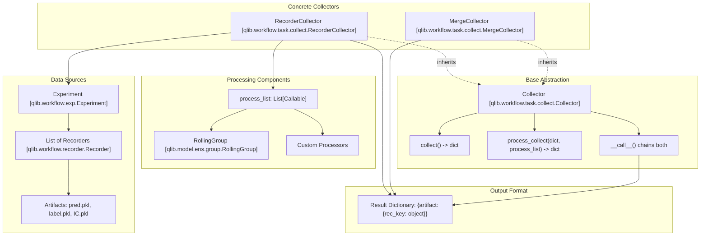
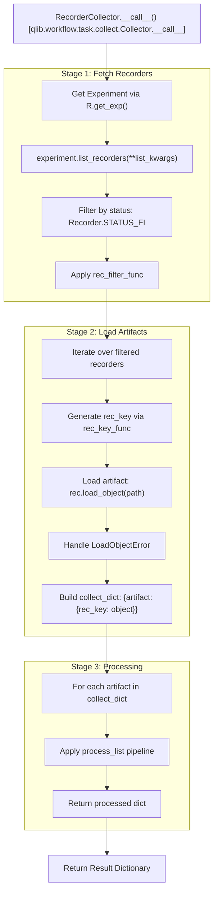
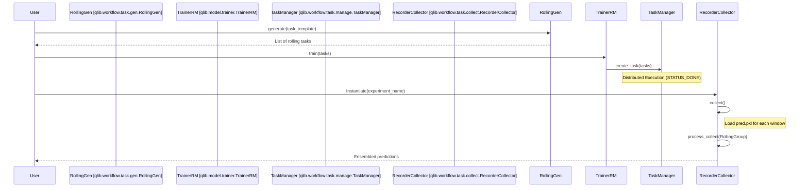

<!-- source: DeepWiki mcp.deepwiki.com · repo microsoft/qlib · page 6.4 Result Collection with RecorderCollector · fetched 2026-10-26 -->

# Result Collection with RecorderCollector

<details>
<summary>Relevant source files</summary>

The following files were used as context for generating this wiki page:

- [examples/model_rolling/task_manager_rolling.py](examples/model_rolling/task_manager_rolling.py)
- [examples/nested_decision_execution/workflow.py](examples/nested_decision_execution/workflow.py)
- [examples/online_srv/update_online_pred.py](examples/online_srv/update_online_pred.py)
- [qlib/contrib/evaluate.py](qlib/contrib/evaluate.py)
- [qlib/contrib/workflow/__init__.py](qlib/contrib/workflow/__init__.py)
- [qlib/contrib/workflow/record_temp.py](qlib/contrib/workflow/record_temp.py)
- [qlib/model/trainer.py](qlib/model/trainer.py)
- [qlib/workflow/record_temp.py](qlib/workflow/record_temp.py)
- [qlib/workflow/task/collect.py](qlib/workflow/task/collect.py)
- [qlib/workflow/task/gen.py](qlib/workflow/task/gen.py)
- [qlib/workflow/task/manage.py](qlib/workflow/task/manage.py)
- [qlib/workflow/task/utils.py](qlib/workflow/task/utils.py)
- [scripts/get_data.py](scripts/get_data.py)
- [tests/rolling_tests/test_update_pred.py](tests/rolling_tests/test_update_pred.py)
- [tests/test_all_pipeline.py](tests/test_all_pipeline.py)
- [tests/test_contrib_workflow.py](tests/test_contrib_workflow.py)

</details>


## Purpose and Scope

This document describes Qlib's result collection system, which aggregates artifacts (predictions, metrics, models) from multiple `Recorder` instances into unified data structures for analysis and ensembling. The primary class is `RecorderCollector`, which queries experiments, filters recorders, loads artifacts, and applies processing pipelines.

For information about creating recorders during training, see [Trainer Framework](6.1). For experiment management and recorder basics, see [Experiment Tracking with QlibRecorder](8.1). For rolling window experiments that generate many recorders, see [Rolling Window Training with RollingGen](6.3).

---

## Collection Architecture

The collection system is organized into three layers: base abstraction, concrete collectors, and processing pipelines.

Title: Result Collection Architecture


**Sources:** [qlib/workflow/task/collect.py:19-88](), [qlib/workflow/task/collect.py:90-133](), [qlib/workflow/task/collect.py:136-259]()

---

## RecorderCollector Class

`RecorderCollector` is the primary implementation for collecting artifacts from recorders within an experiment. It supports filtering, custom key generation, and artifact selection.

### Initialization Parameters

| Parameter | Type | Default | Description |
|-----------|------|---------|-------------|
| `experiment` | `Experiment`, `str`, or `Callable` | Required | Experiment to collect from, or function returning list of experiments [qlib/workflow/task/collect.py:166-169]() |
| `process_list` | `List[Callable]` | `[]` | List of processors to apply to collected results [qlib/workflow/task/collect.py:157]() |
| `rec_key_func` | `Callable` | `lambda rec: rec.info["id"]` | Function to generate key for each recorder [qlib/workflow/task/collect.py:158]() |
| `rec_filter_func` | `Callable` | `None` | Function returning `True` to include a recorder [qlib/workflow/task/collect.py:159]() |
| `artifacts_path` | `dict` | `{"pred": "pred.pkl"}` | Mapping of artifact names to their paths in recorder storage [qlib/workflow/task/collect.py:160]() |
| `artifacts_key` | `str` or `List[str]` | `None` (all artifacts) | Which artifacts to collect [qlib/workflow/task/collect.py:161]() |
| `list_kwargs` | `dict` | `{}` | Arguments passed to `experiment.list_recorders()` [qlib/workflow/task/collect.py:162]() |
| `status` | `Iterable` | `{Recorder.STATUS_FI}` | Only collect recorders with these statuses [qlib/workflow/task/collect.py:163]() |

**Sources:** [qlib/workflow/task/collect.py:136-183]()

---

## Collection Workflow

The collection process follows a multi-stage pipeline from experiment to processed results.

Title: Collection Workflow Execution


**Sources:** [qlib/workflow/task/collect.py:79-88](), [qlib/workflow/task/collect.py:184-249]()

---

## Artifact Specification

Artifacts are files saved by recorders during training. `RecorderCollector` uses the `artifacts_path` dictionary to locate them.

### Common Artifact Paths

Standard recorders like `SignalRecord` generate specific files:
- `pred.pkl`: Model predictions [qlib/workflow/record_temp.py:195]()
- `label.pkl`: Raw labels from dataset [qlib/workflow/record_temp.py:206]()

```python
artifacts_path = {
    "pred": "pred.pkl",
    "label": "label.pkl",
    "IC": "sig_analysis/ic.pkl",
}
```

### Special Artifact Key

The special key `RecorderCollector.ART_KEY_RAW` (value: `"__raw"`) returns the recorder object itself instead of loading an artifact [qlib/workflow/task/collect.py:137]().

```python
collector = RecorderCollector(
    experiment="rolling_exp",
    artifacts_key=["pred", RecorderCollector.ART_KEY_RAW],
)
result = collector.collect()
# result = {
#     "pred": {rec_id1: pred_series, ...},
#     "__raw": {rec_id1: recorder_obj, ...}
# }
```

**Sources:** [qlib/workflow/task/collect.py:137](), [qlib/workflow/task/collect.py:229-232](), [qlib/workflow/record_temp.py:161-210]()

---

## Filtering and Keying Recorders

### Status Filtering

By default, `RecorderCollector` only collects recorders with status `Recorder.STATUS_FI` (finished) [qlib/workflow/task/collect.py:148](). Override with the `status` parameter to collect `STATUS_RUNNING` or `STATUS_PART_DONE` if needed [qlib/workflow/task/manage.py:79-82]().

### Custom Filter Function

The `rec_filter_func` allows filtering based on task configuration stored in artifacts:

```python
def filter_lgb_only(recorder):
    """Only collect LightGBM model results"""
    task_config = recorder.load_object("task")
    return task_config["model"]["class"] == "LGBModel"

collector = RecorderCollector(
    experiment="multi_model_exp",
    rec_filter_func=filter_lgb_only,
)
```

**Sources:** [qlib/workflow/task/collect.py:214-220](), [examples/model_rolling/task_manager_rolling.py:91-96]()

### Custom Key Generation

The `rec_key_func` determines how recorders are indexed. In rolling experiments, it is common to key by model name and test segment [examples/model_rolling/task_manager_rolling.py:85-89]().

```python
def rec_key(recorder):
    task_config = recorder.load_object("task")
    model_key = task_config["model"]["class"]
    rolling_key = task_config["dataset"]["kwargs"]["segments"]["test"]
    return model_key, rolling_key
```

**Sources:** [qlib/workflow/task/collect.py:171-174](), [examples/model_rolling/task_manager_rolling.py:85-89]()

---

## Processing Pipeline

The `process_list` parameter applies transformations to collected artifacts. Each processor receives the artifact dictionary and returns a modified version [qlib/workflow/task/collect.py:53-77]().

### Processor Interface

Processors are callable objects with the following logic:
```python
def processor(artifact_dict, *args, **kwargs):
    # artifact_dict is {rec_key: loaded_object}
    # Return processed result (e.g., concatenated DataFrame)
    ...
```

### Built-in Processor: RollingGroup

`RollingGroup` is used for rolling experiments to ensemble predictions from multiple windows [examples/model_rolling/task_manager_rolling.py:19]().

```python
from qlib.model.ens.group import RollingGroup

collector = RecorderCollector(
    experiment="rolling_exp",
    process_list=[RollingGroup()],
    artifacts_key=["pred"],
)
```

**Sources:** [qlib/workflow/task/collect.py:53-77](), [examples/model_rolling/task_manager_rolling.py:98-104]()

---

## MergeCollector

`MergeCollector` combines results from multiple `Collector` instances, useful when collecting from different experiments or applying different filters [qlib/workflow/task/collect.py:90-102]().

```python
merge_collector = MergeCollector(
    collector_dict={"lgb": collector_lgb, "xgb": collector_xgb},
    merge_func=lambda collector_key, artifact_key: f"{collector_key}_{artifact_key}",
)
```

**Sources:** [qlib/workflow/task/collect.py:90-133]()

---

## Integration with Rolling Experiments

`RecorderCollector` is commonly used after rolling window training to aggregate results across time periods.

Title: Rolling Task Collection Flow


**Sources:** [examples/model_rolling/task_manager_rolling.py:1-117](), [qlib/workflow/task/gen.py:140-180]()

---

## Error Handling

### Missing Artifacts

When a recorder doesn't have a requested artifact, `RecorderCollector` handles it based on the `only_exist` parameter in `collect()` [qlib/workflow/task/collect.py:235-240]():
- `only_exist=True` (default): Skip the recorder and log a warning.
- `only_exist=False`: Raise `LoadObjectError`.

### Duplicate Keys

If `rec_key_func` generates duplicate keys, a warning is logged, and the previous value is overwritten [qlib/workflow/task/collect.py:243-246]().

**Sources:** [qlib/workflow/task/collect.py:235-246]()

---

## Best Practices

1.  **Status Filtering**: Always ensure `status` includes only completed recorders (`STATUS_FI`) to avoid loading corrupted or partial artifacts [qlib/workflow/task/collect.py:163]().
2.  **Unique Keys**: Use `rec_key_func` to include metadata like model name or date segments to prevent key collisions in the result dictionary [examples/model_rolling/task_manager_rolling.py:85-89]().
3.  **Process List**: Use `process_list` for automated ensembling or averaging rather than manual loops after collection [qlib/workflow/task/collect.py:53-77]().

**Sources:** [qlib/workflow/task/collect.py:1-259](), [examples/model_rolling/task_manager_rolling.py:1-117]()

---

