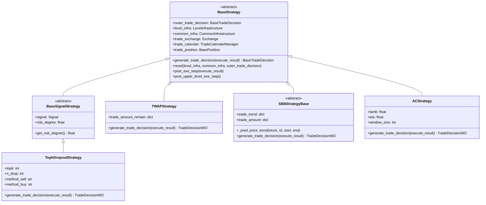
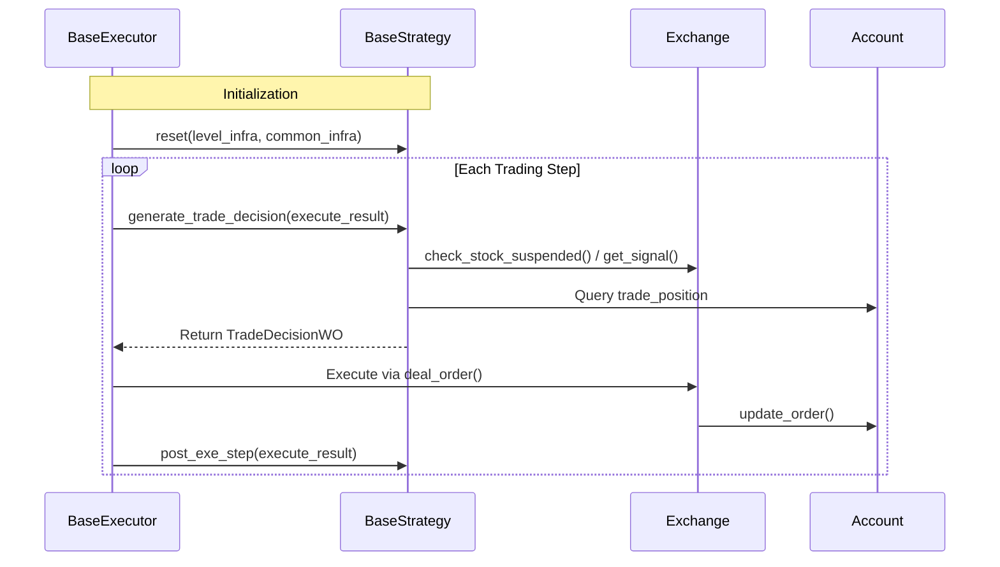
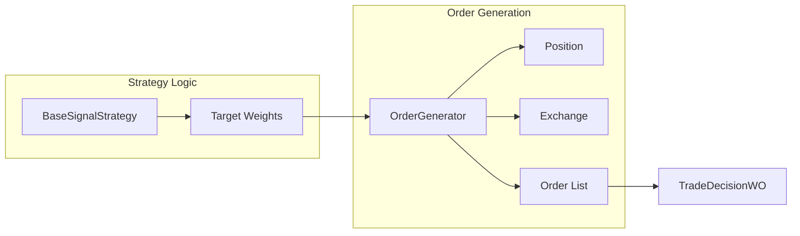

<!-- source: DeepWiki mcp.deepwiki.com · repo microsoft/qlib · page 7.1 Trading Strategies · fetched 2026-10-26 -->

# Trading Strategies

Relevant source files

The following files were used as context for generating this wiki page:

- [examples/benchmarks/TRA/src/model.py](examples/benchmarks/TRA/src/model.py)
- [examples/orderbook_data/README.md](examples/orderbook_data/README.md)
- [qlib/backtest/__init__.py](qlib/backtest/__init__.py)
- [qlib/backtest/account.py](qlib/backtest/account.py)
- [qlib/backtest/backtest.py](qlib/backtest/backtest.py)
- [qlib/backtest/executor.py](qlib/backtest/executor.py)
- [qlib/backtest/position.py](qlib/backtest/position.py)
- [qlib/backtest/utils.py](qlib/backtest/utils.py)
- [qlib/contrib/data/processor.py](qlib/contrib/data/processor.py)
- [qlib/contrib/meta/__init__.py](qlib/contrib/meta/__init__.py)
- [qlib/contrib/meta/data_selection/__init__.py](qlib/contrib/meta/data_selection/__init__.py)
- [qlib/contrib/model/pytorch_adarnn.py](qlib/contrib/model/pytorch_adarnn.py)
- [qlib/contrib/report/analysis_model/__init__.py](qlib/contrib/report/analysis_model/__init__.py)
- [qlib/contrib/report/analysis_position/__init__.py](qlib/contrib/report/analysis_position/__init__.py)
- [qlib/contrib/strategy/__init__.py](qlib/contrib/strategy/__init__.py)
- [qlib/contrib/strategy/cost_control.py](qlib/contrib/strategy/cost_control.py)
- [qlib/contrib/strategy/optimizer/__init__.py](qlib/contrib/strategy/optimizer/__init__.py)
- [qlib/contrib/strategy/optimizer/enhanced_indexing.py](qlib/contrib/strategy/optimizer/enhanced_indexing.py)
- [qlib/contrib/strategy/order_generator.py](qlib/contrib/strategy/order_generator.py)
- [qlib/contrib/strategy/rule_strategy.py](qlib/contrib/strategy/rule_strategy.py)
- [qlib/contrib/strategy/signal_strategy.py](qlib/contrib/strategy/signal_strategy.py)
- [qlib/model/meta/__init__.py](qlib/model/meta/__init__.py)
- [qlib/model/riskmodel/base.py](qlib/model/riskmodel/base.py)
- [qlib/model/riskmodel/poet.py](qlib/model/riskmodel/poet.py)
- [qlib/model/riskmodel/shrink.py](qlib/model/riskmodel/shrink.py)
- [qlib/model/riskmodel/structured.py](qlib/model/riskmodel/structured.py)
- [qlib/strategy/base.py](qlib/strategy/base.py)
- [tests/backtest/test_soft_topk_strategy.py](tests/backtest/test_soft_topk_strategy.py)
- [tests/backtest/test_soft_topk_strategy_cold_start.py](tests/backtest/test_soft_topk_strategy_cold_start.py)
- [tests/test_structured_cov_estimator.py](tests/test_structured_cov_estimator.py)

## Purpose and Scope

This document describes trading strategies in Qlib's backtesting system. Strategies are responsible for generating trade decisions (`BaseTradeDecision` objects containing orders) at each trading step. This page covers the `BaseStrategy` interface and concrete implementations: `TopkDropoutStrategy`, `TWAPStrategy`, `SBBStrategy`, `ACStrategy`, `SoftTopkStrategy`, and signal-based strategies.

For information about how strategies are executed, see [7.2 Executors and Nested Execution](). For portfolio management and position tracking, see [7.4 Account and Position Management]().

---

## Strategy Architecture Overview

The strategy system is built around the `BaseStrategy` abstract base class, which defines the interface that all trading strategies must implement. Strategies consume market data and position information to produce trade decisions, which are then passed to executors for simulated execution.

**Strategy Class Hierarchy**

Sources: [qlib/strategy/base.py:23-238](), [qlib/contrib/strategy/rule_strategy.py:22-537](), [qlib/contrib/strategy/signal_strategy.py:25-136]()

---

## BaseStrategy Interface

The `BaseStrategy` class defines the core interface. It provides access to trading infrastructure and defines the contract for generating trade decisions.

### Key Components

| Component | Type | Description |
|-----------|------|-------------|
| `outer_trade_decision` | `BaseTradeDecision` | Decision from outer strategy in nested execution [qlib/strategy/base.py:28-41]() |
| `level_infra` | `LevelInfrastructure` | Level-specific infrastructure including `trade_calendar` [qlib/strategy/base.py:67-68]() |
| `common_infra` | `CommonInfrastructure` | Shared infrastructure including `trade_account` [qlib/strategy/base.py:72-72]() |
| `trade_exchange` | `Exchange` | Interface for market info and order dealing [qlib/strategy/base.py:75-77]() |
| `trade_position` | `BasePosition` | Current portfolio position [qlib/strategy/base.py:71-72]() |

### Core Methods

**`generate_trade_decision(execute_result: list = None) -> BaseTradeDecision`**
Called at each trading step. It receives `execute_result` from the previous step (containing `(order, trade_val, cost, price)`) and returns a new decision [qlib/strategy/base.py:133-147]().

**`reset(level_infra, common_infra, outer_trade_decision, **kwargs)`**
Resets strategy state, including infrastructure and outer decisions [qlib/strategy/base.py:91-112]().

**Strategy Execution Flow**

Sources: [qlib/strategy/base.py:23-147](), [qlib/backtest/backtest.py:82-92](), [qlib/backtest/executor.py:227-303]()

---

## Signal-Based Strategies

### BaseSignalStrategy
A base class for strategies that rely on prediction signals. It initializes a `Signal` object using `create_signal_from` and manages `risk_degree` [qlib/contrib/strategy/signal_strategy.py:25-72]().

### TopkDropoutStrategy
This strategy maintains a portfolio of `topk` stocks. In each step, it drops `n_drop` stocks with the lowest signals and replaces them with the highest-signal stocks not currently held [qlib/contrib/strategy/signal_strategy.py:75-136]().

- **method_sell**: "bottom" (drop lowest) or "random" [qlib/contrib/strategy/signal_strategy.py:101-101]().
- **method_buy**: "top" (pick highest) or "random" [qlib/contrib/strategy/signal_strategy.py:102-102]().
- **hold_thresh**: Minimum holding days before a stock can be dropped [qlib/contrib/strategy/signal_strategy.py:134-134]().
- **only_tradable**: If True, filters stocks based on `is_stock_tradable` before making decisions [qlib/contrib/strategy/signal_strategy.py:157-159]().

Sources: [qlib/contrib/strategy/signal_strategy.py:25-164]()

---

## Execution Strategies (Rule-Based)

These strategies are typically used as "inner strategies" in `NestedExecutor` to split large parent orders into smaller child orders.

### TWAPStrategy (Time-Weighted Average Price)
Splits orders into equal parts across the trading window [qlib/contrib/strategy/rule_strategy.py:22-28]().
- **Algorithm**: At each step $i$, it targets a cumulative amount $A_{expect} = \frac{A_{total}}{N} \times (i+1)$ [qlib/contrib/strategy/rule_strategy.py:83-83]().
- **Rounding**: Rounds `amount_delta` by the exchange's trade unit [qlib/contrib/strategy/rule_strategy.py:104-106]().
- **Last Step**: Ensures all remaining `trade_amount_remain` is executed in the final step [qlib/contrib/strategy/rule_strategy.py:110-111]().

### SBBStrategy (Select Better Bar)
Selects the better of two adjacent bars to execute trades based on predicted trends [qlib/contrib/strategy/rule_strategy.py:125-128]().
- **Trends**: `TREND_MID` (0), `TREND_SHORT` (1), `TREND_LONG` (2) [qlib/contrib/strategy/rule_strategy.py:130-132]().
- **Logic**: If a "better" price is predicted in the next bar (e.g., lower price for buying), it may delay or accelerate execution [qlib/contrib/strategy/rule_strategy.py:154-155]().

### ACStrategy (Almgren-Chriss)
An implementation of the Almgren-Chriss model that balances market impact costs against volatility risk [qlib/contrib/strategy/rule_strategy.py:383-390]().
- **Volatility**: Calculates historical volatility $\sigma$ using a `window_size` lookback [qlib/contrib/strategy/rule_strategy.py:464-471]().
- **Schedule**: Uses hyperbolic sine functions ($\sinh$) to determine the optimal trade trajectory based on risk aversion `lamb` and market impact `eta` [qlib/contrib/strategy/rule_strategy.py:511-513]().

Sources: [qlib/contrib/strategy/rule_strategy.py:22-537]()

---

## Order Generation and Weight Strategies

Strategies often calculate target weights rather than raw amounts. The `OrderGenerator` bridge translates these weights into executable `Order` lists.

| Class | Description |
|-------|-------------|
| `OrderGenWInteract` | Uses current market prices and tradable status to generate orders [qlib/contrib/strategy/order_generator.py:51-52](). |
| `OrderGenWOInteract` | Generates orders without querying the exchange for current-step prices (uses `calculate_value` from position) [qlib/contrib/strategy/order_generator.py:143-164](). |

**Weight-to-Order Flow**

Sources: [qlib/contrib/strategy/order_generator.py:15-184](), [qlib/contrib/strategy/signal_strategy.py:21-22]()

---

## Strategy Utilities and Infrastructure

Strategies interact with several utility classes to maintain state and perform calculations.

### Position Management
Strategies query `self.trade_position` (a `BasePosition` instance) to get current holdings via `get_stock_amount_dict()` or `get_cash()` [qlib/backtest/position.py:148-157](), [qlib/backtest/position.py:133-146]().

### Risk Modeling
Advanced strategies (like `EnhancedIndexingOptimizer`) use risk models to estimate covariance [qlib/contrib/strategy/signal_strategy.py:22-23]().
- **StructuredCovEstimator**: Estimates covariance using factor models (PCA or Factor Analysis) [qlib/model/riskmodel/structured.py:11-32]().
- **Formula**: $cov(X^T) = F \cdot cov(B^T) \cdot F^T + diag(var(U))$ [qlib/model/riskmodel/structured.py:22-22]().

Sources: [qlib/backtest/position.py:16-187](), [qlib/model/riskmodel/structured.py:11-94]()

---

