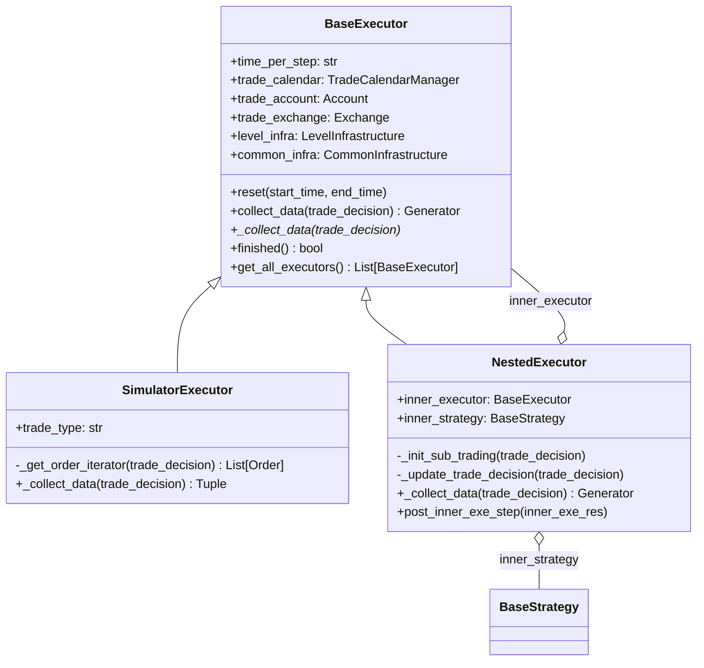
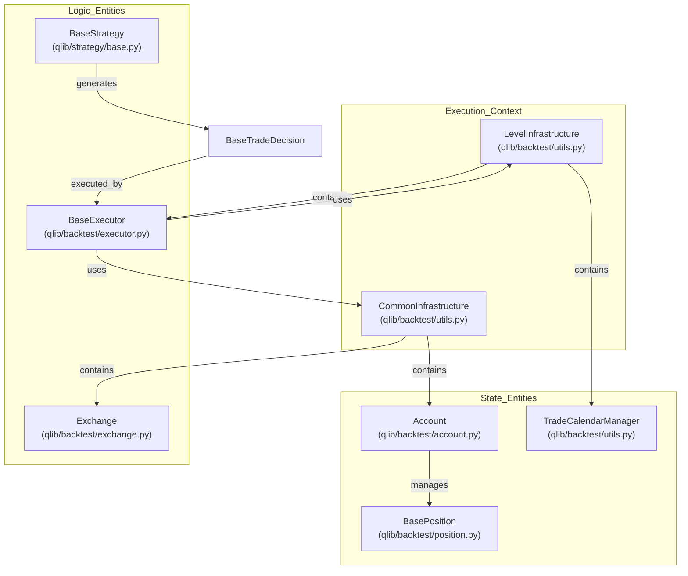
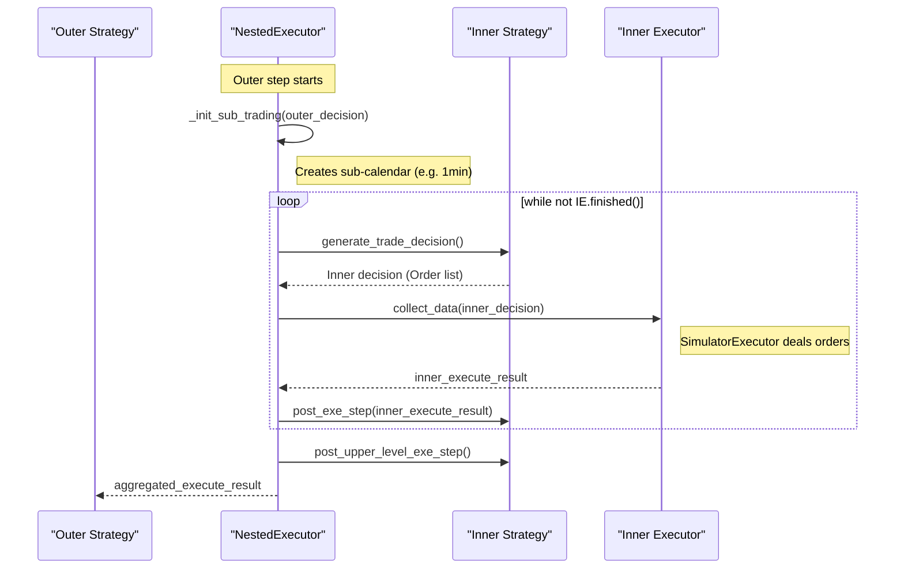

<!-- source: DeepWiki mcp.deepwiki.com · repo microsoft/qlib · page 7.2 Executors and Nested Execution · fetched 2026-10-26 -->

# Executors and Nested Execution

Relevant source files

The following files were used as context for generating this wiki page:

- [examples/nested_decision_execution/workflow.py](examples/nested_decision_execution/workflow.py)
- [qlib/backtest/__init__.py](qlib/backtest/__init__.py)
- [qlib/backtest/account.py](qlib/backtest/account.py)
- [qlib/backtest/backtest.py](qlib/backtest/backtest.py)
- [qlib/backtest/executor.py](qlib/backtest/executor.py)
- [qlib/backtest/position.py](qlib/backtest/position.py)
- [qlib/backtest/utils.py](qlib/backtest/utils.py)
- [qlib/contrib/evaluate.py](qlib/contrib/evaluate.py)
- [qlib/contrib/strategy/rule_strategy.py](qlib/contrib/strategy/rule_strategy.py)
- [qlib/contrib/workflow/__init__.py](qlib/contrib/workflow/__init__.py)
- [qlib/contrib/workflow/record_temp.py](qlib/contrib/workflow/record_temp.py)
- [qlib/strategy/base.py](qlib/strategy/base.py)
- [qlib/workflow/record_temp.py](qlib/workflow/record_temp.py)
- [scripts/get_data.py](scripts/get_data.py)
- [tests/rolling_tests/test_update_pred.py](tests/rolling_tests/test_update_pred.py)
- [tests/test_all_pipeline.py](tests/test_all_pipeline.py)
- [tests/test_contrib_workflow.py](tests/test_contrib_workflow.py)

## Purpose and Scope

This document explains Qlib's executor system, which orchestrates the interaction between trading strategies and market simulation during backtesting. Executors control the execution loop, manage calendars, handle nested multi-frequency trading, and coordinate between strategies and exchanges.

**Related pages:**
- For trading strategies that generate decisions, see [7.1 Trading Strategies]()
- For exchange and market simulation details, see [7.3 Exchange and Market Simulation]()
- For account and position tracking, see [7.4 Account and Position Management]()
- For high-performance data structures used in backtesting, see [7.6 High-Performance Data Structures]()

---

## Executor Class Hierarchy

Qlib provides three executor classes organized in an inheritance hierarchy defined in `qlib/backtest/executor.py`.

### Class Relationship Diagram

**Sources:** [qlib/backtest/executor.py:22-38](), [qlib/backtest/executor.py:310-333](), [qlib/backtest/executor.py:513-545]()

### BaseExecutor
`BaseExecutor` is the abstract base class that defines the executor interface [qlib/backtest/executor.py:22-24](). It manages the `LevelInfrastructure` and `CommonInfrastructure` required for trading [qlib/backtest/executor.py:116-119]().

| Parameter | Type | Description |
|-----------|------|-------------|
| `time_per_step` | str | Trading frequency (e.g., "day", "30min") [qlib/backtest/executor.py:42-43]() |
| `indicator_config` | dict | Config for calculating PA (Price Advantage), POS, and FFR [qlib/backtest/executor.py:49-54]() |
| `generate_portfolio_metrics` | bool | Whether to generate `PortfolioMetrics` [qlib/backtest/executor.py:85-86]() |
| `track_data` | bool | If true, yields `trade_decision` for RL training [qlib/backtest/executor.py:89-92]() |
| `settle_type` | str | Settlement type (e.g., `ST_CASH` for T+1 simulation) [qlib/backtest/executor.py:107-108]() |

**Sources:** [qlib/backtest/executor.py:22-126]()

### SimulatorExecutor
`SimulatorExecutor` is the atomic executor that simulates actual market trading by processing orders through the `Exchange` [qlib/backtest/executor.py:513-515](). It iterates through orders in a `BaseTradeDecision` and calls `Exchange.deal_order` [qlib/backtest/executor.py:587-603]().

**Trade types (`trade_type`):**
- `TT_SERIAL`: Orders executed in sequence; allows selling then buying with proceeds in one step [qlib/backtest/executor.py:534-536]().
- `TT_PARAL`: Orders executed in parallel; does not allow using proceeds from same-step sells [qlib/backtest/executor.py:537-539]().

**Sources:** [qlib/backtest/executor.py:513-629]()

### NestedExecutor
`NestedExecutor` enables multi-frequency trading (e.g., a daily strategy delegating to a 1-minute execution strategy) [qlib/backtest/executor.py:310-315](). It contains an `inner_strategy` and an `inner_executor` [qlib/backtest/executor.py:330-333]().

**Sources:** [qlib/backtest/executor.py:310-499]()

---

## Infrastructure and Calendar Management

### Data Flow and Entity Mapping

This diagram maps natural language concepts to the specific code entities that manage them during a backtest loop.

**Sources:** [qlib/backtest/utils.py:16-19](), [qlib/backtest/executor.py:116-119](), [qlib/backtest/account.py:111-125](), [qlib/strategy/base.py:23-57]()

### TradeCalendarManager
Manages the temporal aspect of the backtest [qlib/backtest/utils.py:23-27]().
- `get_step_time()`: Returns the closed interval `[start_time, end_time]` for the current step [qlib/backtest/utils.py:102-132]().
- `step()`: Advances the `trade_step` [qlib/backtest/utils.py:87-90]().
- `finished()`: Checks if `trade_step >= trade_len` [qlib/backtest/utils.py:78-85]().

**Sources:** [qlib/backtest/utils.py:23-202]()

---

## Nested Execution Logic

The `NestedExecutor` implements a recursive execution pattern where one "step" at the outer level triggers a full trading loop at the inner level.

### Nested Execution Sequence

**Sources:** [qlib/backtest/executor.py:432-483](), [qlib/backtest/backtest.py:82-93]()

### State Sharing and Metrics
In nested execution, the `Account` object is shallow-copied [qlib/backtest/executor.py:144-148]().
- **Shared**: The `BasePosition` object is shared across all levels so that every executor sees the same holdings [qlib/backtest/account.py:73-77]().
- **Separate**: `PortfolioMetrics` and `Indicator` objects are unique to each level, allowing for independent reporting of daily vs. minutely performance [qlib/backtest/account.py:128-130]().

**Sources:** [qlib/backtest/executor.py:140-149](), [qlib/backtest/account.py:71-77](), [qlib/backtest/account.py:111-131]()

---

## Reinforcement Learning Integration

Executors use a generator pattern in `collect_data` to support RL environments [qlib/backtest/executor.py:227-230]().

### RL Environment Mapping

| RL Concept | Qlib Code Entity | Implementation Detail |
|------------|------------------|-----------------------|
| **Environment** | `qlib.rl.simulator.Simulator` | Wraps the executor loop. |
| **Observation** | `StateInterpreter` | Converts environment state to policy input [qlib/strategy/base.py:17](). |
| **Action** | `ActionInterpreter` | Converts policy output to `Order` list [qlib/strategy/base.py:17](). |
| **Step** | `Executor.collect_data` | The `yield` point in the backtest loop [qlib/backtest/executor.py:255-257](). |

**Sources:** [qlib/backtest/executor.py:227-303](), [qlib/strategy/base.py:17-20]()

### Data Collection Loop
The `collect_data_loop` in `qlib/backtest/backtest.py` drives the interaction:
1. `trade_strategy.generate_trade_decision(_execute_result)` [qlib/backtest/backtest.py:88]()
2. `yield from trade_executor.collect_data(_trade_decision)` [qlib/backtest/backtest.py:89]()
3. After the loop, metrics are aggregated from all executors [qlib/backtest/backtest.py:95-107]().

**Sources:** [qlib/backtest/backtest.py:52-110]()

---

## Strategy Execution Example: TWAP

The `TWAPStrategy` (`qlib/contrib/strategy/rule_strategy.py`) is a concrete implementation of an inner strategy used with `NestedExecutor` [qlib/contrib/strategy/rule_strategy.py:22]().

1. **Reset**: It takes an `outer_trade_decision` and stores the `trade_amount_remain` [qlib/contrib/strategy/rule_strategy.py:30-41]().
2. **Step Calculation**: It determines the current `rel_trade_step` relative to the outer decision's range [qlib/contrib/strategy/rule_strategy.py:54-63]().
3. **Order Generation**: It calculates `amount_expect` (linear progression) and compares it to `amount_finished` to generate the current step's `Order` [qlib/contrib/strategy/rule_strategy.py:82-121]().

**Sources:** [qlib/contrib/strategy/rule_strategy.py:22-123]()

---

## Summary of Key Methods

| Class | Method | Role |
|-------|--------|------|
| `BaseExecutor` | `collect_data` | Entry point for execution; yields decisions if `track_data` is True [qlib/backtest/executor.py:227-265](). |
| `NestedExecutor` | `_init_sub_trading` | Resets inner strategy and executor for a new outer step [qlib/backtest/executor.py:389-415](). |
| `SimulatorExecutor` | `_collect_data` | Core logic for dealing orders and updating account state [qlib/backtest/executor.py:570-629](). |
| `Account` | `reset` | Finalizes metrics and reports for a specific frequency [qlib/backtest/account.py:155-174](). |

**Sources:** [qlib/backtest/executor.py:22-629](), [qlib/backtest/account.py:71-174]()

---

