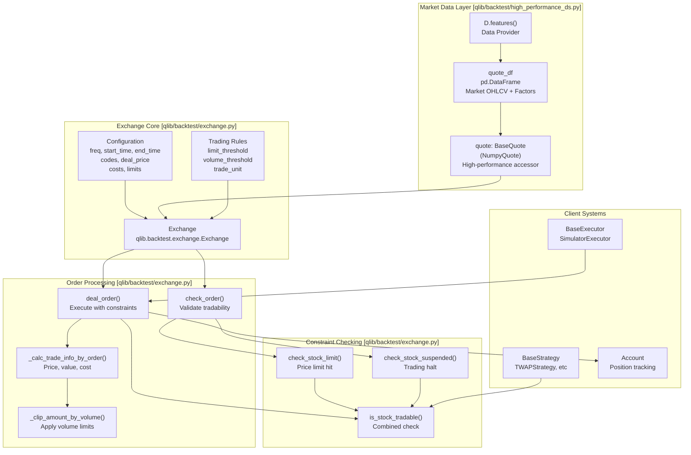
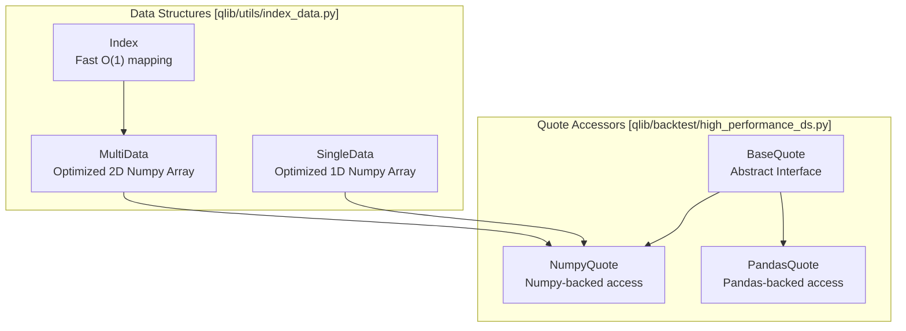
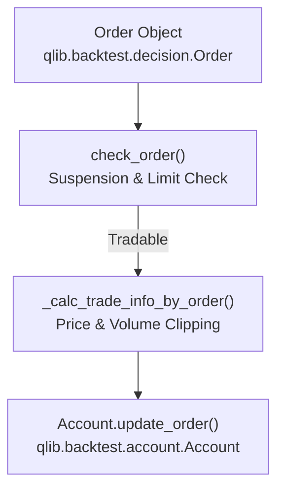

<!-- source: DeepWiki mcp.deepwiki.com · repo microsoft/qlib · page 7.3 Exchange and Market Simulation · fetched 2026-10-26 -->

# Exchange and Market Simulation

<details>
<summary>Relevant source files</summary>

The following files were used as context for generating this wiki page:

- [qlib/backtest/decision.py](qlib/backtest/decision.py)
- [qlib/backtest/exchange.py](qlib/backtest/exchange.py)
- [qlib/backtest/high_performance_ds.py](qlib/backtest/high_performance_ds.py)
- [qlib/backtest/report.py](qlib/backtest/report.py)
- [qlib/utils/index_data.py](qlib/utils/index_data.py)
- [qlib/utils/time.py](qlib/utils/time.py)
- [tests/backtest/test_file_strategy.py](tests/backtest/test_file_strategy.py)
- [tests/misc/test_index_data.py](tests/misc/test_index_data.py)

</details>


## Purpose and Scope

The Exchange and Market Simulation system provides a realistic market environment for backtesting trading strategies in Qlib. This page documents the `Exchange` class and its role in simulating market conditions, trading constraints, transaction costs, and order execution. The Exchange acts as the central market simulator, validating orders against trading constraints (price limits, suspensions, volume caps), applying transaction costs, and determining execution prices.

---

## Exchange Architecture Overview

The `Exchange` class simulates a realistic trading environment by maintaining market data, enforcing trading rules, and processing orders. It operates between strategies/executors and the market data layer.

**Exchange Component Map**



The Exchange serves as the market interface for backtesting, with responsibilities organized into distinct layers:

1.  **Market Data Management**: Loads and maintains OHLCV data, adjustment factors, and trading metadata [qlib/backtest/exchange.py:28-36]().
2.  **Constraint Enforcement**: Validates orders against price limits, suspensions, and volume caps [qlib/backtest/exchange.py:338-420]().
3.  **Order Execution**: Processes orders with realistic costs and execution logic [qlib/backtest/exchange.py:421-463]().
4.  **Data Access Interface**: Provides market information to strategies and executors [qlib/backtest/exchange.py:465-533]().

Sources: [qlib/backtest/exchange.py:28-200](), [qlib/backtest/exchange.py:421-463]()

---

## Exchange Initialization and Configuration

The Exchange is initialized with market parameters, trading costs, and constraint definitions. Configuration determines how orders are priced, validated, and executed throughout the backtest.

**Key Configuration Parameters:**

| Parameter | Type | Default | Description |
| :--- | :--- | :--- | :--- |
| `freq` | str | "day" | Trading frequency (day, 1min, etc.) [qlib/backtest/exchange.py:40]() |
| `deal_price` | str/tuple | None | Price for execution (e.g., "$close", ("$open", "$close")) [qlib/backtest/exchange.py:44]() |
| `limit_threshold` | float/tuple/None | None | Price limit (0.1 = ±10%) or expressions [qlib/backtest/exchange.py:46]() |
| `volume_threshold` | dict/tuple/None | None | Volume capacity limits [qlib/backtest/exchange.py:47]() |
| `open_cost` | float | 0.0015 | Buy commission rate (0.15%) [qlib/backtest/exchange.py:48]() |
| `close_cost` | float | 0.0025 | Sell commission rate (0.25%) [qlib/backtest/exchange.py:49]() |
| `min_cost` | float | 5.0 | Minimum commission per trade [qlib/backtest/exchange.py:50]() |
| `impact_cost` | float | 0.0 | Market impact/slippage rate [qlib/backtest/exchange.py:51]() |
| `trade_unit` | int | 100 (CN) | Lot size for rounding [qlib/backtest/exchange.py:109]() |

**Limit Threshold Types:**

The `limit_threshold` parameter supports three input types defined by `_get_limit_type()` [qlib/backtest/exchange.py:262-293]():

1.  **LT_FLT** (float): Simple percentage-based limits. Stocks with `abs($change) >= limit_threshold` are not tradable [qlib/backtest/exchange.py:381-383]().
2.  **LT_TP_EXP** (tuple of expressions): Custom limit expressions. Format: `(buy_limit_expr, sell_limit_expr)` [qlib/backtest/exchange.py:74-77]().
3.  **LT_NONE** (None): No price limits enforced [qlib/backtest/exchange.py:263]().

**Volume Threshold Configuration:**

The `volume_threshold` enables realistic volume constraints [qlib/backtest/exchange.py:78-106]():

*   **"cum" (cumulative)**: Represents cumulative market volume; dealt amount is subtracted [qlib/backtest/exchange.py:91-93]().
*   **"current" (current)**: Represents real-time value/capacity; used directly [qlib/backtest/exchange.py:94-95]().

Sources: [qlib/backtest/exchange.py:38-200](), [qlib/backtest/exchange.py:262-293](), [qlib/backtest/exchange.py:295-336]()

---

## Market Data Management

The Exchange maintains market data in a two-layer structure: a pandas DataFrame (`quote_df`) for initial loading and a high-performance accessor (`quote`) for fast queries.

**Data Entity Space Mapping**



**Quote System Architecture:**

1.  **PandasQuote** ([qlib/backtest/high_performance_ds.py:103-126]()): Stores data as `Dict[stock_id, pd.DataFrame]`.
2.  **NumpyQuote** (default) ([qlib/backtest/high_performance_ds.py:128-205]()): Uses `MultiData` from `qlib.utils.index_data` for 10-100x faster queries. It includes an LRU cache for queries [qlib/backtest/high_performance_ds.py:155]().

**Adjusted vs. Normal Price Mode:**

The Exchange automatically determines the price mode based on factor data availability:

```python
# Determined during initialization in exchange.py
if (self.trade_unit is not None) and (self.quote_df["$factor"].isna() & ~self.quote_df["$close"].isna()).any():
    self.trade_w_adj_price = True  # Use adjusted prices
else:
    self.trade_w_adj_price = False # Use normal prices
```

Sources: [qlib/backtest/exchange.py:201-257](), [qlib/backtest/high_performance_ds.py:23-205](), [qlib/utils/index_data.py:346-655]()

---

## Trading Constraints and Limitations

The Exchange enforces realistic trading constraints including suspensions, price limits, and volume caps.

**Suspension Check** (`check_stock_suspended`):
*   Returns `True` if stock is not tradable due to trading halt [qlib/backtest/exchange.py:341]().
*   Determined by missing or all-NaN `$close` values in the time range [qlib/backtest/exchange.py:352-355]().

**Price Limit Check** (`check_stock_limit`):
*   Direction-aware: checks `limit_buy` for buying, `limit_sell` for selling [qlib/backtest/exchange.py:388-392]().
*   Uses `method='all'` to require all bars in range to be limited [qlib/backtest/exchange.py:393]().

**Volume Capacity Limiting:**
The `_clip_amount_by_volume()` method enforces realistic volume constraints by checking configured `volume_threshold` [qlib/backtest/exchange.py:786-827]().

**Trade Unit Rounding:**
For lot-sized markets, `round_amount_by_trade_unit` ensures order amounts are multiples of `trade_unit` [qlib/backtest/exchange.py:761-784](). It is disabled if `trade_w_adj_price` is True [qlib/backtest/exchange.py:768]().

Sources: [qlib/backtest/exchange.py:338-420](), [qlib/backtest/exchange.py:786-862](), [qlib/backtest/exchange.py:761-784]()

---

## Transaction Cost Model

The Exchange applies a multi-component cost model to simulate real-world trading expenses.

**Cost Structure:**

1.  **Commission**:
    *   `open_cost`: Applied to BUY orders [qlib/backtest/exchange.py:48]().
    *   `close_cost`: Applied to SELL orders [qlib/backtest/exchange.py:49]().
    *   `min_cost`: Minimum commission threshold per trade [qlib/backtest/exchange.py:50]().
2.  **Market Impact** (Slippage):
    *   `impact_cost`: Modeled as a percentage of trade value [qlib/backtest/exchange.py:51]().

**Cost Calculation in `_calc_trade_info_by_order()`:**
The method at [qlib/backtest/exchange.py:864-1020]() implements the trade calculation:
*   It determines the execution price [qlib/backtest/exchange.py:887-909]().
*   It clips the amount by volume and cash/position limits [qlib/backtest/exchange.py:915-1013]().
*   It calculates final commission and impact costs [qlib/backtest/exchange.py:1015-1018]().

Sources: [qlib/backtest/exchange.py:421-463](), [qlib/backtest/exchange.py:864-1020]()

---

## Order Execution Flow

The `deal_order` method processes an `Order` object through the simulation pipeline [qlib/backtest/exchange.py:421]().



**Order Object Updates:**
The Exchange modifies the `Order` object during execution:
*   `order.deal_amount`: Actual amount traded [qlib/backtest/decision.py:71]().
*   `order.factor`: Adjustment factor used for the trade [qlib/backtest/decision.py:72]().

**Capacity Clipping Logic:**
*   **SELL orders**: Clipped by `current_position.get_stock_amount(order.stock_id)` [qlib/backtest/exchange.py:996]().
*   **BUY orders**: Clipped by `available_cash` considering execution price and transaction costs [qlib/backtest/exchange.py:1000-1013]().

Sources: [qlib/backtest/exchange.py:421-463](), [qlib/backtest/exchange.py:864-1020](), [qlib/backtest/decision.py:37-88]()

---

## Position Value Calculation and Utilities

The Exchange provides utility methods for converting between weights and amounts, and for rebalancing portfolios.

**Weight-Based Position Allocation:**
`generate_amount_position_from_weight_position()` converts target weights to stock amounts while respecting tradability and cash constraints [qlib/backtest/exchange.py:534-587]().

**Order Generation for Rebalancing:**
`generate_order_for_target_amount_position()` creates a list of orders to transition from a current position to a target position [qlib/backtest/exchange.py:611-677](). It returns SELL orders first, then BUY orders to enable "sell-to-buy" rebalancing [qlib/backtest/exchange.py:677]().

**Position Value Calculation:**
`calculate_amount_position_value()` computes the total value of a dictionary of stock amounts [qlib/backtest/exchange.py:679-710]().

Sources: [qlib/backtest/exchange.py:534-587](), [qlib/backtest/exchange.py:679-710](), [qlib/backtest/exchange.py:611-677](), [qlib/backtest/exchange.py:589-609]()

---

