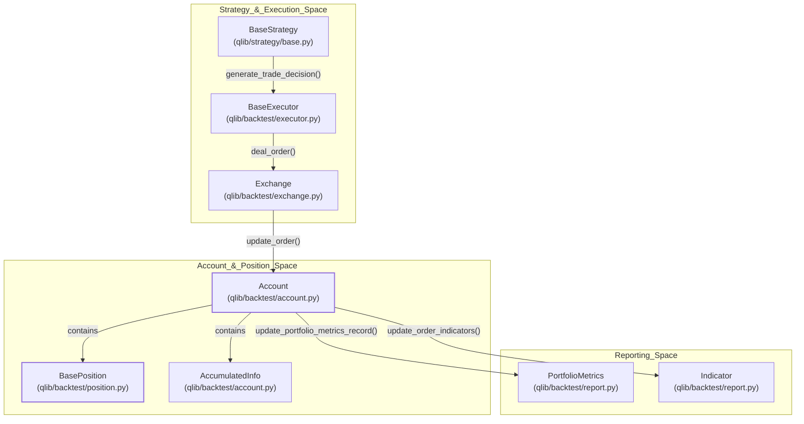
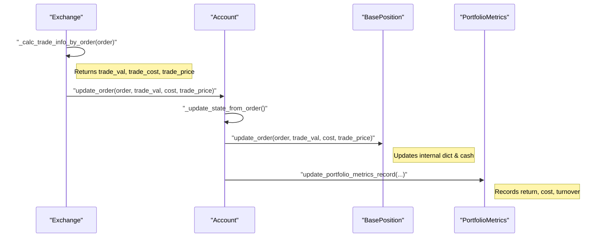

<!-- source: DeepWiki mcp.deepwiki.com · repo microsoft/qlib · page 7.4 Account and Position Management · fetched 2026-10-26 -->

# Account and Position Management

Relevant source files

The following files were used as context for generating this wiki page:

- [qlib/backtest/__init__.py](qlib/backtest/__init__.py)
- [qlib/backtest/account.py](qlib/backtest/account.py)
- [qlib/backtest/backtest.py](qlib/backtest/backtest.py)
- [qlib/backtest/decision.py](qlib/backtest/decision.py)
- [qlib/backtest/exchange.py](qlib/backtest/exchange.py)
- [qlib/backtest/executor.py](qlib/backtest/executor.py)
- [qlib/backtest/high_performance_ds.py](qlib/backtest/high_performance_ds.py)
- [qlib/backtest/position.py](qlib/backtest/position.py)
- [qlib/backtest/report.py](qlib/backtest/report.py)
- [qlib/backtest/utils.py](qlib/backtest/utils.py)
- [qlib/contrib/strategy/rule_strategy.py](qlib/contrib/strategy/rule_strategy.py)
- [qlib/strategy/base.py](qlib/strategy/base.py)
- [qlib/utils/index_data.py](qlib/utils/index_data.py)
- [qlib/utils/time.py](qlib/utils/time.py)
- [tests/backtest/test_file_strategy.py](tests/backtest/test_file_strategy.py)
- [tests/misc/test_index_data.py](tests/misc/test_index_data.py)

## Purpose and Scope

This document covers the account and position management system in Qlib's backtesting framework. This system is responsible for:

- **Position state tracking**: Maintaining holdings of stocks/instruments over time via `BasePosition` and its subclasses [qlib/backtest/position.py:16-21]().
- **Account state tracking**: Managing cash, portfolio value, and transaction history through the `Account` class [qlib/backtest/account.py:71-77]().
- **Portfolio metrics calculation**: Computing returns, costs, turnover, and other performance indicators via `PortfolioMetrics` [qlib/backtest/report.py:22-40]().
- **Order execution indicators**: Measuring fulfill rates (FFR), price advantage (PA), and execution quality via the `Indicator` class [qlib/backtest/report.py:249-255]().

For information about order execution and market simulation, see [Exchange and Market Simulation](#7.3). For trading strategy implementations, see [Trading Strategies](#7.1). For executor orchestration patterns, see [Executors and Nested Execution](#7.2).

---

## System Architecture

### Core Components

The account and position management system consists of several primary layers:

| Component | File Location | Purpose |
|-----------|---------------|---------|
| `BasePosition` / `Position` | [qlib/backtest/position.py:16-25]() | Abstract interface and implementation for tracking stock holdings and cash. |
| `Account` | [qlib/backtest/account.py:71-77]() | Wraps `Position` with cash management, portfolio value calculation, and metric reporting. |
| `PortfolioMetrics` | [qlib/backtest/report.py:22-40]() | Records portfolio performance over time (returns, costs, turnover, benchmark). |
| `Indicator` | [qlib/backtest/report.py:249-255]() | Tracks order-level execution quality (FFR, PA, POS). |
| `AccumulatedInfo` | [qlib/backtest/account.py:35-40]() | Shared container for cumulative return, cost, and turnover across levels. |

**Sources**: [qlib/backtest/account.py:35-155](), [qlib/backtest/report.py:22-277]()

### Component Relationships

The following diagram illustrates how the management layer bridges the Strategy and the Exchange.

**Diagram 1: Natural Language to Code Entity Space (Management Flow)**

**Key Design Patterns**:

1. **Shared Position State**: In nested execution, the `Account` is shallow-copied, but the `current_position` is shared by reference across levels [qlib/backtest/account.py:73-77]().
2. **Accumulated Info**: Cumulative metrics like `rtn`, `cost`, and `to` (turnover) are stored in `AccumulatedInfo` to be shared across multiple execution layers [qlib/backtest/account.py:41-48]().
3. **Bar-End Updates**: The system distinguishes between order-triggered updates and bar-end settlement (earning calculation) [qlib/backtest/account.py:19-32]().

**Sources**: [qlib/backtest/account.py:19-130](), [qlib/backtest/executor.py:144-149]()

---

## Position State Management

### Position Classes

The position tracking system has a hierarchy defined in `qlib/backtest/position.py`:

- **`BasePosition`**: The abstract base defining the interface for `update_order`, `get_cash`, and `calculate_value` [qlib/backtest/position.py:16-25]().
- **`Position`**: The standard implementation maintaining a `position` dictionary of `{stock_id: amount}` and tracking available cash.
- **`InfPosition`**: A specialized version for scenarios where capital constraints are ignored (infinite cash) [qlib/backtest/position.py:29-39]().

### Order Update Flow

When the `Exchange` executes an order, it calls `Account.update_order` or `Position.update_order` directly [qlib/backtest/exchange.py:453-462]().

**Diagram 2: Order Execution and State Update (Code Entity Space)**

**Key Logic**:
- **Thresholding**: Trades with `trade_val <= 1e-5` are ignored to prevent numerical noise [qlib/backtest/exchange.py:453-454]().
- **Directional Profit**: Selling a stock updates profit based on the difference between the trade price and the held price [qlib/backtest/account.py:192-195]().
- **Cost Handling**: Costs are added to `AccumulatedInfo` and subtracted from the current position's cash [qlib/backtest/account.py:186-188]().

**Sources**: [qlib/backtest/exchange.py:421-463](), [qlib/backtest/account.py:183-200]()

---

## Account State Management

### Account Lifecycle

The `Account` class is the central manager for backtesting state.

| Method | Purpose |
|--------|---------|
| `init_vars` | Initializes `current_position`, `AccumulatedInfo`, and `hist_positions` [qlib/backtest/account.py:111-125](). |
| `reset` | Resets frequency and reporting. Used when switching execution levels [qlib/backtest/account.py:155-175](). |
| `update_state` | Called at bar-end to record history and update metrics [qlib/backtest/account.py:202-230](). |
| `get_portfolio_metrics` | Returns a tuple of `(DataFrame, dict)` containing the full report [qlib/backtest/account.py:246-255](). |

### Settlement Mechanisms

Qlib supports settlement mechanisms via `BasePosition.settle_start` and `settle_commit` [qlib/backtest/position.py:201-222]().
- **`ST_CASH`**: Delayed cash settlement. Cash from sales cannot be used in the same trading step [qlib/backtest/position.py:210-212]().
- **`ST_NO`**: Default. No settlement delay [qlib/backtest/position.py:199]().

**Sources**: [qlib/backtest/account.py:111-175](), [qlib/backtest/position.py:198-215]()

---

## Portfolio Metrics and Indicators

### PortfolioMetrics Class

Located in `qlib/backtest/report.py`, this class tracks daily/step-wise portfolio stats.

- **Metrics Tracked**: `accounts` (total value), `returns`, `total_turnovers`, `total_costs`, `cashes`, and `benches` [qlib/backtest/report.py:78-88]().
- **Benchmark Calculation**: Automatically fetches benchmark data (e.g., CSI300) using `get_higher_eq_freq_feature` [qlib/backtest/report.py:96-121]().

### Indicator Class

The `Indicator` class tracks execution quality.
- **FFR (Fulfill Rate)**: `deal_amount / target_amount` [qlib/backtest/report.py:330-337]().
- **PA (Price Advantage)**: Measures execution price vs baseline (TWAP/VWAP) [qlib/backtest/report.py:524-537]().
- **POS (Positive Rate)**: Percentage of orders with PA > 0 [qlib/backtest/report.py:554-570]().

**Sources**: [qlib/backtest/report.py:78-121](), [qlib/backtest/report.py:524-570]()

---

## High-Performance Data Structures

Qlib uses custom data structures in `qlib/utils/index_data.py` to optimize backtesting speed, avoiding the overhead of heavy Pandas objects during the inner loops.

- **`Index`**: A read-only indexing class for rows/columns [qlib/utils/index_data.py:87-121]().
- **`SingleData`**: A numpy-backed replacement for `pd.Series` [qlib/utils/index_data.py:18-19]().
- **`MultiData`**: A numpy-backed replacement for `pd.DataFrame` [qlib/utils/index_data.py:21-21]().
- **`NumpyQuote`**: Uses `MultiData` to provide fast market data lookups during execution [qlib/backtest/high_performance_ds.py:128-151]().

**Sources**: [qlib/utils/index_data.py:87-121](), [qlib/backtest/high_performance_ds.py:128-151]()

---

## Data Flow: Bar-End Updates

At the end of each trading bar, the `Executor` triggers a settlement and metrics update flow:

1. **`Account.update_state`**: Captures the current `BasePosition` into `hist_positions` [qlib/backtest/account.py:202-210]().
2. **Value Calculation**: Calls `current_position.calculate_value()` to get the latest AUM [qlib/backtest/account.py:214-215]().
3. **Metric Recording**: Updates `PortfolioMetrics` with the step's return and turnover [qlib/backtest/account.py:221-230]().
4. **Indicator Finalization**: `Indicator.cal_trade_indicators` aggregates PA and FFR for the step [qlib/backtest/report.py:608-642]().

**Sources**: [qlib/backtest/account.py:202-230](), [qlib/backtest/report.py:608-642]()

---

