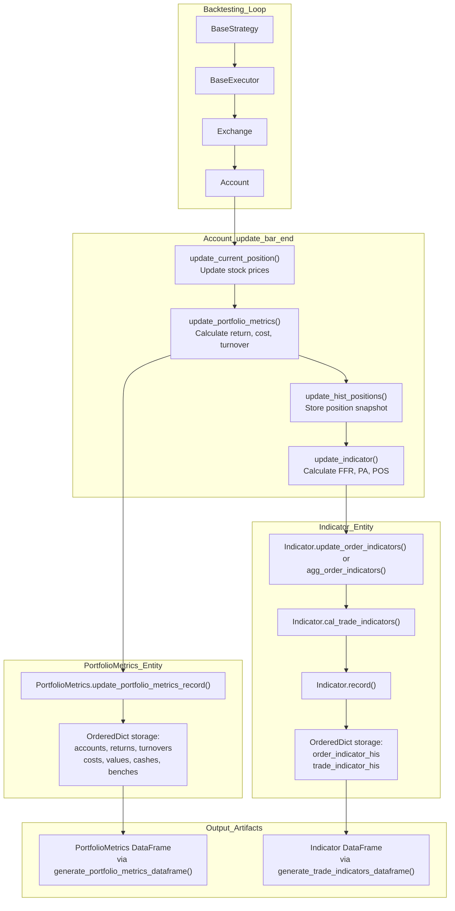
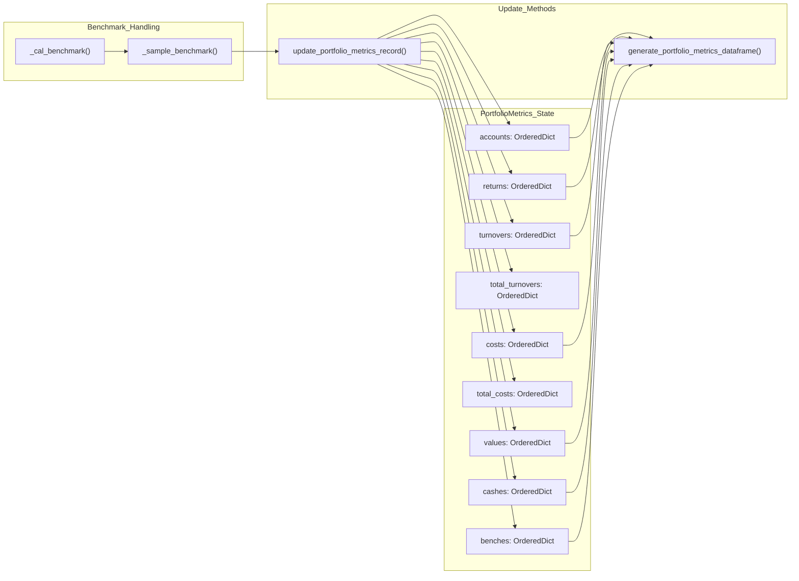
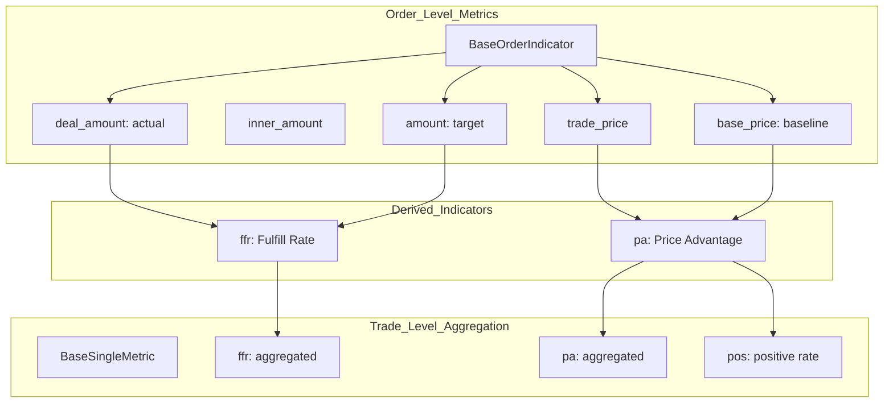

<!-- source: DeepWiki mcp.deepwiki.com · repo microsoft/qlib · page 7.5 Performance Metrics and Reporting · fetched 2026-10-26 -->

# Performance Metrics and Reporting

Relevant source files

The following files were used as context for generating this wiki page:

- [examples/nested_decision_execution/workflow.py](examples/nested_decision_execution/workflow.py)
- [qlib/backtest/decision.py](qlib/backtest/decision.py)
- [qlib/backtest/exchange.py](qlib/backtest/exchange.py)
- [qlib/backtest/high_performance_ds.py](qlib/backtest/high_performance_ds.py)
- [qlib/backtest/report.py](qlib/backtest/report.py)
- [qlib/contrib/evaluate.py](qlib/contrib/evaluate.py)
- [qlib/contrib/report/analysis_model/analysis_model_performance.py](qlib/contrib/report/analysis_model/analysis_model_performance.py)
- [qlib/contrib/report/analysis_position/cumulative_return.py](qlib/contrib/report/analysis_position/cumulative_return.py)
- [qlib/contrib/report/analysis_position/rank_label.py](qlib/contrib/report/analysis_position/rank_label.py)
- [qlib/contrib/report/analysis_position/report.py](qlib/contrib/report/analysis_position/report.py)
- [qlib/contrib/report/analysis_position/risk_analysis.py](qlib/contrib/report/analysis_position/risk_analysis.py)
- [qlib/contrib/report/analysis_position/score_ic.py](qlib/contrib/report/analysis_position/score_ic.py)
- [qlib/contrib/report/data/ana.py](qlib/contrib/report/data/ana.py)
- [qlib/contrib/report/data/base.py](qlib/contrib/report/data/base.py)
- [qlib/contrib/report/graph.py](qlib/contrib/report/graph.py)
- [qlib/contrib/report/utils.py](qlib/contrib/report/utils.py)
- [qlib/contrib/workflow/__init__.py](qlib/contrib/workflow/__init__.py)
- [qlib/contrib/workflow/record_temp.py](qlib/contrib/workflow/record_temp.py)
- [qlib/data/filter.py](qlib/data/filter.py)
- [qlib/utils/index_data.py](qlib/utils/index_data.py)
- [qlib/utils/paral.py](qlib/utils/paral.py)
- [qlib/utils/time.py](qlib/utils/time.py)
- [qlib/workflow/record_temp.py](qlib/workflow/record_temp.py)
- [scripts/get_data.py](scripts/get_data.py)
- [tests/backtest/test_file_strategy.py](tests/backtest/test_file_strategy.py)
- [tests/misc/test_get_multi_proc.py](tests/misc/test_get_multi_proc.py)
- [tests/misc/test_index_data.py](tests/misc/test_index_data.py)
- [tests/rolling_tests/test_update_pred.py](tests/rolling_tests/test_update_pred.py)
- [tests/test_all_pipeline.py](tests/test_all_pipeline.py)
- [tests/test_contrib_workflow.py](tests/test_contrib_workflow.py)

## Purpose and Scope

This page documents Qlib's core performance measurement system, which tracks trading strategy performance during backtesting. The system consists of two primary components:

1.  **PortfolioMetrics**: Tracks overall portfolio performance including returns, costs, turnover, and account value at each trading bar [qlib/backtest/report.py:22-40]().
2.  **Indicator**: Measures order execution quality including fulfillment rate (FFR), price advantage (PA), and positive rate (POS) [qlib/backtest/report.py:249-276]().

Both classes are automatically updated by the `Account` class during backtesting and integrate with benchmark data for calculating excess returns [qlib/backtest/account.py:225-336]().

---

## System Architecture

The performance metrics system is embedded in the backtesting execution flow. Metrics are collected automatically at the end of each trading bar by the `Account.update_bar_end()` method [qlib/backtest/account.py:225-248]().

### Metric Collection Flow in Backtesting

Title: Backtest Metric Generation Pipeline

**Sources:** [qlib/backtest/account.py:225-336](), [qlib/backtest/report.py:22-247](), [qlib/backtest/report.py:249-651]()

---

## Portfolio Metrics

Portfolio metrics track the overall state and performance of the trading account at each trading bar. These metrics are managed by the `PortfolioMetrics` class [qlib/backtest/report.py:22-40]().

### PortfolioMetrics Class Structure

Title: PortfolioMetrics Internal State and Data Flow

**Sources:** [qlib/backtest/report.py:78-95](), [qlib/backtest/report.py:153-166]()

### Portfolio Metric Definitions

| Metric | Description | Source |
| :--- | :--- | :--- |
| `account` | Total value of assets (cash + securities) in user account based on close price [qlib/backtest/report.py:34](). | [qlib/backtest/report.py:79]() |
| `return` | The return of the portfolio generated by strategy **without transaction fee** [qlib/backtest/report.py:32](). | [qlib/backtest/report.py:80]() |
| `cost` | The transaction fee and slippage [qlib/backtest/report.py:33](). | [qlib/backtest/report.py:84]() |
| `turnover` | Turnover rate per step [qlib/backtest/report.py:30](). | [qlib/backtest/report.py:82]() |
| `cash` | The amount of cash in user's account [qlib/backtest/report.py:35](). | [qlib/backtest/report.py:86]() |
| `bench` | The return of the benchmark [qlib/backtest/report.py:36](). | [qlib/backtest/report.py:87]() |
| `value` | The total value of securities/instruments (cash is excluded) [qlib/backtest/report.py:37](). | [qlib/backtest/report.py:85]() |

**Sources:** [qlib/backtest/report.py:22-40](), [qlib/backtest/report.py:78-87]()

---

## Trade Indicators

Trade indicators measure execution quality. Qlib implements high-performance data structures like `NumpyOrderIndicator` to store these efficiently [qlib/backtest/high_performance_ds.py:19]().

### Indicator Architecture

Title: Indicator Calculation Logic

**Sources:** [qlib/backtest/report.py:249-276](), [qlib/backtest/high_performance_ds.py:19-20]()

### Key Indicator Definitions

1.  **FFR (Fulfill Rate)**: The ratio of executed amount to target amount [qlib/backtest/report.py:265]().
2.  **PA (Price Advantage)**: Measures execution price relative to a baseline (e.g., TWAP/VWAP). Calculated as `sign * (trade_price / base_price - 1)` [qlib/backtest/report.py:532]().
3.  **POS (Positive Rate)**: The percentage of trades where the Price Advantage is positive [qlib/backtest/report.py:633]().

**Sources:** [qlib/backtest/report.py:249-276](), [qlib/contrib/evaluate.py:96-125]()

---

## Benchmark Integration

`PortfolioMetrics` supports multiple benchmark types, handled via `_cal_benchmark` [qlib/backtest/report.py:97-122]().

### Benchmark Types

*   **Instrument Code**: A string like `"SH000300"`. Qlib fetches `$close` to calculate daily change [qlib/backtest/report.py:112-115]().
*   **List/Dict**: A collection of codes. The benchmark is the daily average change of the pool [qlib/backtest/report.py:112-121]().
*   **pd.Series**: User-provided series where values represent the change from $T-1$ to $T$ [qlib/backtest/report.py:104-105]().

**Sources:** [qlib/backtest/report.py:48-73](), [qlib/backtest/report.py:97-122]()

---

## Performance Analysis Reports

Qlib provides statistical tools to analyze the collected metrics, primarily located in `qlib/contrib/evaluate.py`.

### Risk Analysis

The `risk_analysis` function calculates annualized returns, information ratio, and maximum drawdown [qlib/contrib/evaluate.py:26-94](). Qlib cumulates returns by summation by default to avoid skewed curves [qlib/contrib/evaluate.py:29-32]().

| Metric | Calculation Mode: "sum" [qlib/contrib/evaluate.py:65-69]() | Calculation Mode: "product" [qlib/contrib/evaluate.py:70-80]() |
| :--- | :--- | :--- |
| **Mean** | `r.mean()` | `cumulative_curve.iloc[-1] ** (1 / len(r)) - 1` |
| **Annualized Return** | `mean * N` | `(1 + cumulative_return) ** (N / len(r)) - 1` |
| **Max Drawdown** | `(r.cumsum() - r.cumsum().cummax()).min()` | `(cumulative_curve / cumulative_curve.cummax() - 1).min()` |

**Sources:** [qlib/contrib/evaluate.py:26-94]()

### Indicator Analysis

The `indicator_analysis` function aggregates trade indicators (PA, POS, FFR) using different weighting methods [qlib/contrib/evaluate.py:96-143]().

*   **mean**: Simple average based on order count [qlib/contrib/evaluate.py:127]().
*   **amount_weighted**: Weighted by the absolute `deal_amount` [qlib/contrib/evaluate.py:128]().
*   **value_weighted**: Weighted by the absolute trade `value` [qlib/contrib/evaluate.py:129]().

**Sources:** [qlib/contrib/evaluate.py:126-143]()

---

## High-Performance Data Structures

To handle large-scale backtesting metrics and market data, Qlib uses specialized structures in `qlib/utils/index_data.py` and `qlib/backtest/high_performance_ds.py`.

| Class | Purpose | Key Method |
| :--- | :--- | :--- |
| `NumpyQuote` | Fast retrieval of price/volume data using Numpy and MultiData [qlib/backtest/high_performance_ds.py:128-151](). | `get_data` [qlib/backtest/high_performance_ds.py:156-182]() |
| `IndexData` | Lightweight alternative to Pandas for simple indexing [qlib/utils/index_data.py:4-10](). | `loc` [qlib/utils/index_data.py:265]() |
| `SingleData` | 1D Numpy array with index [qlib/utils/index_data.py:202-210](). | `sum` [qlib/utils/index_data.py:254]() |
| `MultiData` | 2D Numpy array with row and column indices [qlib/utils/index_data.py:321-329](). | `sort_index` [qlib/utils/index_data.py:347-353]() |

**Sources:** [qlib/backtest/high_performance_ds.py:128-182](), [qlib/utils/index_data.py:4-10](), [qlib/utils/index_data.py:202-353]()

---

