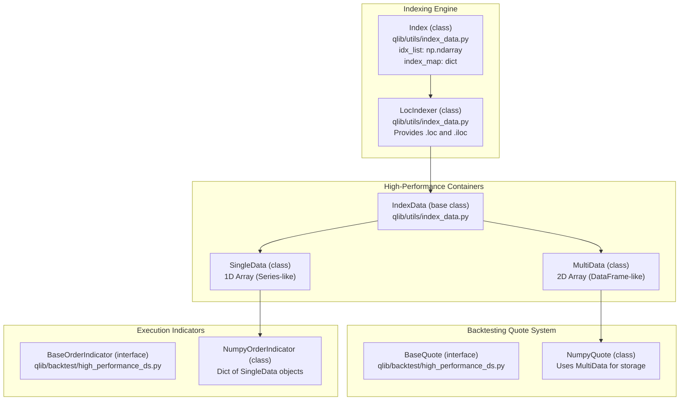
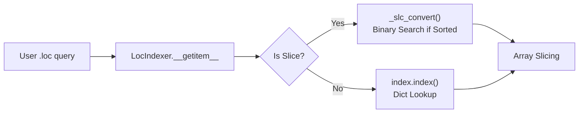
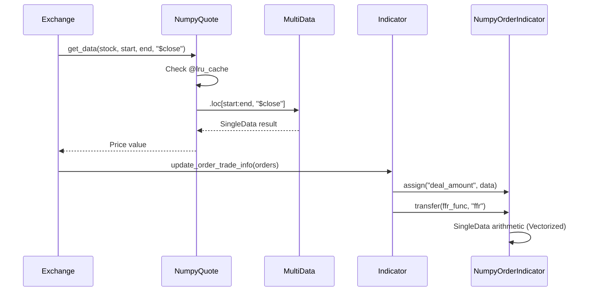

<!-- source: DeepWiki mcp.deepwiki.com · repo microsoft/qlib · page 7.6 High-Performance Data Structures · fetched 2026-10-26 -->

# High-Performance Data Structures

<details>
<summary>Relevant source files</summary>

The following files were used as context for generating this wiki page:

- [qlib/backtest/decision.py](qlib/backtest/decision.py)
- [qlib/backtest/exchange.py](qlib/backtest/exchange.py)
- [qlib/backtest/high_performance_ds.py](qlib/backtest/high_performance_ds.py)
- [qlib/backtest/profit_attribution.py](qlib/backtest/profit_attribution.py)
- [qlib/backtest/report.py](qlib/backtest/report.py)
- [qlib/contrib/ops/high_freq.py](qlib/contrib/ops/high_freq.py)
- [qlib/contrib/report/analysis_position/parse_position.py](qlib/contrib/report/analysis_position/parse_position.py)
- [qlib/data/dataset/storage.py](qlib/data/dataset/storage.py)
- [qlib/utils/index_data.py](qlib/utils/index_data.py)
- [qlib/utils/resam.py](qlib/utils/resam.py)
- [qlib/utils/time.py](qlib/utils/time.py)
- [scripts/data_collector/baostock_5min/collector.py](scripts/data_collector/baostock_5min/collector.py)
- [tests/backtest/test_file_strategy.py](tests/backtest/test_file_strategy.py)
- [tests/misc/test_index_data.py](tests/misc/test_index_data.py)

</details>


## Purpose and Scope

This document describes the high-performance data structures used in Qlib's backtesting system to enable fast simulation of trading strategies. These data structures are designed as numpy-based alternatives to pandas DataFrames and Series, sacrificing some of pandas' rich functionality for significant performance gains during backtesting.

For information about the backtesting architecture that uses these structures, see [Executors and Nested Execution](#7.2). For details on performance metrics calculation, see [Performance Metrics and Reporting](#7.5).

The primary data structures covered here include:
- **Index-based containers** (`IndexData`, `SingleData`, `MultiData`) for general-purpose tabular data.
- **Quote data structures** (`BaseQuote`, `NumpyQuote`) for efficient market data access.
- **Indicator data structures** (`BaseOrderIndicator`, `BaseSingleMetric`) for metrics tracking during order execution.

## Design Philosophy

The fundamental trade-off made by these data structures is providing essential functionality through a numpy-backed engine that is significantly faster than pandas for repetitive backtesting lookups.

Key design principles:
1. **Read-only optimization**: Data structures are designed for shared, read-only access with copy-on-write semantics.
2. **Numpy backing**: All data is stored as `np.ndarray` with `np.float64` dtype [qlib/utils/index_data.py:346-350]().
3. **Minimal indexing overhead**: A custom `Index` class provides O(1) lookup without pandas' complex overhead [qlib/utils/index_data.py:87-98]().
4. **API familiarity**: Maintains pandas-like `.loc`, `.iloc`, and `.index` interfaces where possible [qlib/utils/index_data.py:206-210]().

Sources: [qlib/utils/index_data.py:1-11](), [qlib/utils/index_data.py:346-350]()

## Architecture Overview

The following diagram bridges the high-level data concepts to the specific code entities implemented in Qlib.

**Data Structure Entity Mapping**

Sources: [qlib/utils/index_data.py:87-100](), [qlib/utils/index_data.py:206-210](), [qlib/backtest/high_performance_ds.py:23-25](), [qlib/backtest/high_performance_ds.py:128-130]()

## Index and Indexing System

### Index Class

The `Index` class provides fast, read-only indexing. It maintains an internal mapping to allow O(1) value-to-integer lookups [qlib/utils/index_data.py:119-120]().

**Implementation Details:**
- **idx_list**: An `np.ndarray` storing the actual index values [qlib/utils/index_data.py:101-101]().
- **index_map**: A Python dictionary mapping index values to their integer positions [qlib/utils/index_data.py:119-119]().
- **Type Conversion**: The `_convert_type` method ensures that queries using `pd.Timestamp` or `np.datetime64` with different precisions are normalized to the internal index type [qlib/utils/index_data.py:125-146]().

Sources: [qlib/utils/index_data.py:87-146]()

### LocIndexer Class

`LocIndexer` enables the `.loc` syntax. It converts label-based slices or individual keys into integer-based offsets for the underlying numpy array [qlib/utils/index_data.py:206-215]().

**Indexing conversion flow:**

Sources: [qlib/utils/index_data.py:206-251]()

## Core Data Containers

### IndexData Base Class

`IndexData` handles broadcasting and arithmetic operations. It ensures that all operations align indices correctly before performing numpy-level calculations [qlib/utils/index_data.py:346-355]().

**Key Features:**
- **Broadcasting**: Scalars are automatically broadcast to match the index length [qlib/utils/index_data.py:356-360]().
- **Arithmetic**: Supports standard operators (`+`, `-`, `*`, `/`) via `BinaryOps` [qlib/utils/index_data.py:441-450]().
- **Aggregation**: Implements `sum`, `mean`, `count`, and `all` using `np.nansum` and `np.nanmean` to handle missing data [qlib/utils/index_data.py:465-485]().

Sources: [qlib/utils/index_data.py:346-528]()

### SingleData and MultiData

- **SingleData**: A 1D container analogous to `pd.Series`. It supports reindexing and conversion to standard Python dictionaries [qlib/utils/index_data.py:529-619]().
- **MultiData**: A 2D container analogous to `pd.DataFrame`. It is primarily used to store multi-field market data for a single instrument [qlib/utils/index_data.py:621-655]().

Sources: [qlib/utils/index_data.py:529-655]()

## Quote Data Structures for Market Data

Market data access is the most frequent operation in backtesting. Qlib uses the `BaseQuote` interface to abstract this access [qlib/backtest/high_performance_ds.py:23-25]().

### NumpyQuote Implementation

`NumpyQuote` is the high-performance implementation used by the `Exchange` class [qlib/backtest/exchange.py:53-53](). It stores market data as a dictionary of `MultiData` objects, keyed by stock ID [qlib/backtest/high_performance_ds.py:140-143]().

**Performance Optimizations:**
1. **LRU Cache**: The `get_data` method is decorated with `@lru_cache(maxsize=512)` to speed up repeated queries for the same stock/time/field [qlib/backtest/high_performance_ds.py:155-156]().
2. **Single-Value Fast Path**: If a query is for a single time point (common in high-frequency or daily bar-end processing), it skips slicing logic and performs a direct lookup [qlib/backtest/high_performance_ds.py:163-174]().

Sources: [qlib/backtest/high_performance_ds.py:128-182](), [qlib/backtest/exchange.py:53-55]()

## Indicator Data Structures for Metrics Tracking

During backtesting, the `Indicator` class tracks metrics like fulfillment rate (FFR) and price advantage (PA) [qlib/backtest/report.py:249-260]().

### BaseOrderIndicator and NumpyOrderIndicator

`BaseOrderIndicator` provides an interface for assigning and transferring metrics [qlib/backtest/high_performance_ds.py:557-565](). 

- **assign()**: Maps raw order data to internal metrics [qlib/backtest/high_performance_ds.py:575-582]().
- **transfer()**: Allows computing new metrics from existing ones (e.g., `ffr = deal_amount / amount`) [qlib/backtest/high_performance_ds.py:584-602]().
- **NumpyOrderIndicator**: Uses `SingleData` internally. It includes an optimized `sum_all_indicators` static method that uses `qlib.utils.index_data.sum_by_index` to aggregate metrics across multiple execution steps or nested executors [qlib/backtest/high_performance_ds.py:604-659]().

Sources: [qlib/backtest/high_performance_ds.py:557-659](), [qlib/backtest/report.py:339-350]()

## Performance Data Flow

The following diagram illustrates how these high-performance structures interact during a backtesting step.

**Backtesting Execution Data Flow**

Sources: [qlib/backtest/exchange.py:195-200](), [qlib/backtest/high_performance_ds.py:155-175](), [qlib/backtest/report.py:339-350]()

## Usage Examples

### Initializing High-Performance Quotes
The `Exchange` class initializes the quote system using the provided `quote_df` and a specific `quote_cls` [qlib/backtest/exchange.py:53-55]().

```python
# Internal initialization in Exchange
self.quote = quote_cls(self.quote_df, freq) 
```
Sources: [qlib/backtest/exchange.py:195-199]()

### Aggregating Indicators
In a `NestedExecutor` setup, multiple indicators from inner executors are aggregated into a single high-level indicator using the optimized sum method [qlib/backtest/high_performance_ds.py:633-659]().

```python
# Example of optimized aggregation
NumpyOrderIndicator.sum_all_indicators(
    target_indicator, 
    list_of_indicators, 
    ["deal_amount", "trade_cost"]
)
```
Sources: [qlib/backtest/high_performance_ds.py:633-645]()

---

