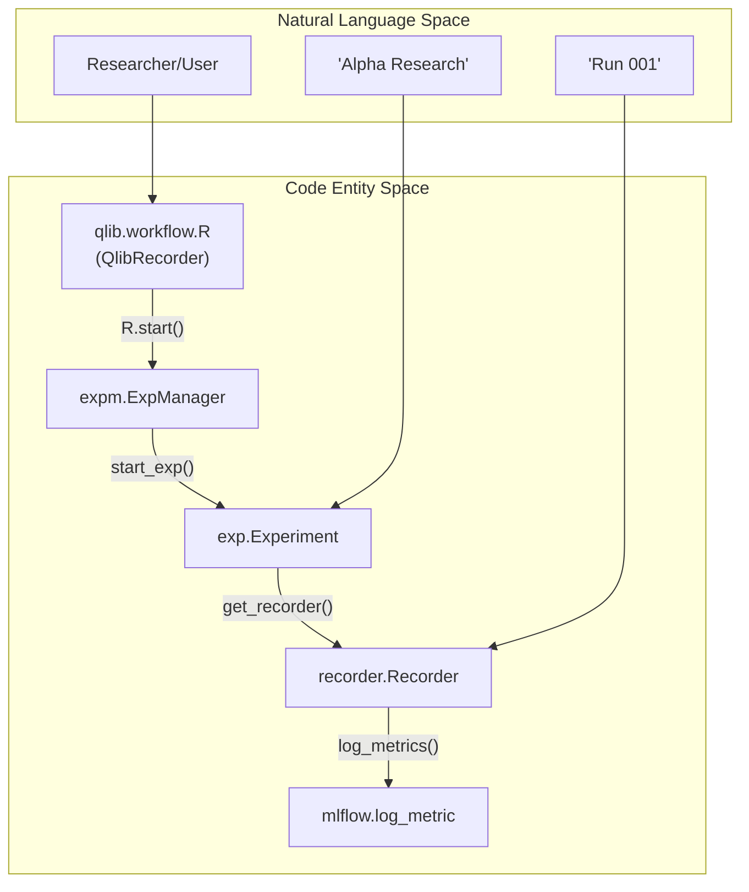
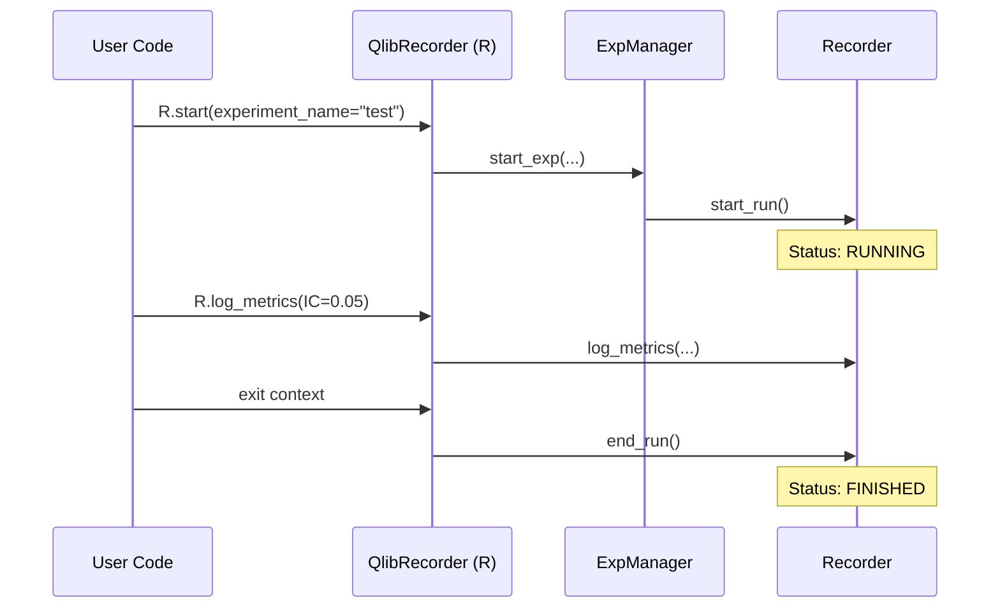
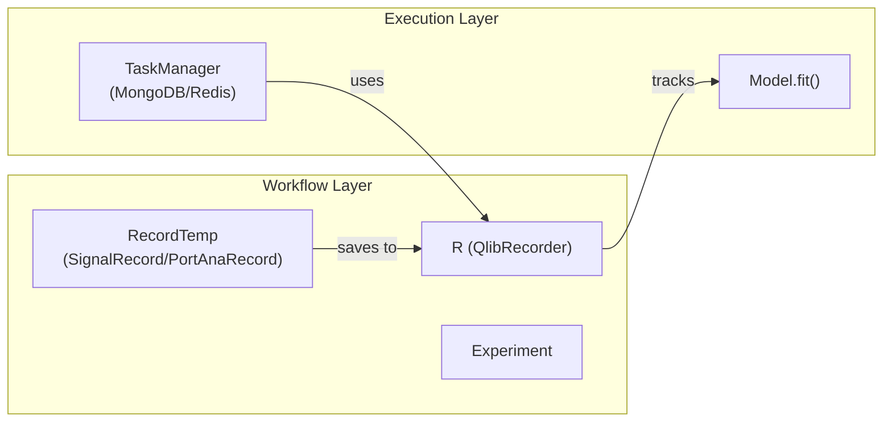

<!-- source: DeepWiki mcp.deepwiki.com · repo microsoft/qlib · page 8 Workflow and Experiment Management · fetched 2026-10-26 -->

# Workflow and Experiment Management

Relevant source files

The following files were used as context for generating this wiki page:

- [examples/nested_decision_execution/workflow.py](examples/nested_decision_execution/workflow.py)
- [qlib/contrib/evaluate.py](qlib/contrib/evaluate.py)
- [qlib/contrib/workflow/__init__.py](qlib/contrib/workflow/__init__.py)
- [qlib/contrib/workflow/record_temp.py](qlib/contrib/workflow/record_temp.py)
- [qlib/log.py](qlib/log.py)
- [qlib/workflow/__init__.py](qlib/workflow/__init__.py)
- [qlib/workflow/exp.py](qlib/workflow/exp.py)
- [qlib/workflow/expm.py](qlib/workflow/expm.py)
- [qlib/workflow/record_temp.py](qlib/workflow/record_temp.py)
- [qlib/workflow/recorder.py](qlib/workflow/recorder.py)
- [scripts/get_data.py](scripts/get_data.py)
- [tests/rolling_tests/test_update_pred.py](tests/rolling_tests/test_update_pred.py)
- [tests/test_all_pipeline.py](tests/test_all_pipeline.py)
- [tests/test_contrib_workflow.py](tests/test_contrib_workflow.py)

This document describes Qlib's experiment tracking and workflow management system, which provides a unified interface for managing machine learning experiments, recording artifacts, and organizing results. The system is built on MLflow but provides additional abstractions and convenience features tailored for quantitative finance workflows, such as automatic code diff logging and object-level serialization.

For information about automated workflow execution, see [Automated Workflows with qrun](#8.2). For model training infrastructure, see [Training and Task Management](#6). For production deployment, see [Online Serving and Production Deployment](#9).

## System Architecture

Qlib's experiment management system follows a three-level hierarchy designed to organize experiments logically and provide intuitive APIs. It abstracts the underlying storage (typically MLflow) into a more object-oriented structure.

### Component Hierarchy

| Level | Code Entity | Description |
|:---|:---|:---|
| **Global Interface** | `QlibRecorder` (aliased as `R`) | The primary entry point for users. A singleton that manages the active experiment and recorder context [qlib/workflow/__init__.py:26-32](). |
| **Management Layer** | `ExpManager` | Manages the lifecycle of multiple experiments, handling URI resolution and backend communication [qlib/workflow/expm.py:22-32](). |
| **Experiment Layer** | `Experiment` | A collection of related runs (recorders). Used to group different attempts at the same problem [qlib/workflow/exp.py:15-25](). |
| **Recorder Layer** | `Recorder` | The entity that logs actual data: metrics, parameters, and artifacts (models, predictions) [qlib/workflow/recorder.py:28-41](). |

**Sources:** [qlib/workflow/__init__.py:26-32](), [qlib/workflow/expm.py:22-32](), [qlib/workflow/exp.py:15-25](), [qlib/workflow/recorder.py:28-41]()

### Code-to-System Mapping

The following diagram bridges the high-level management concepts to the specific classes and methods used in the codebase.

**Sources:** [qlib/workflow/__init__.py:38-47](), [qlib/workflow/expm.py:46-56](), [qlib/workflow/exp.py:114-159](), [qlib/workflow/recorder.py:133-142]()

## Global Recorder Interface (R)

The `QlibRecorder` object, typically accessed as the global singleton `R` [qlib/workflow/__init__.py:26-32](), provides the main entry point for experiment management. It wraps an `ExpManager` [qlib/workflow/expm.py:22-32]() to provide a simplified, context-aware API.

### Lifecycle Management

Experiments are typically managed using Python's `with` statement via `R.start()` to ensure that runs are properly closed even if errors occur [qlib/workflow/__init__.py:38-96]().

**Sources:** [qlib/workflow/__init__.py:38-96](), [qlib/workflow/expm.py:46-92](), [qlib/workflow/recorder.py:105-119]()

## Core Components

For deep technical details on these components, refer to the child pages.

### Experiment Tracking with QlibRecorder
This module manages the hierarchy of experiments and runs. It provides a superior interface to raw MLflow by allowing users to work with `Recorder` objects directly rather than passing around `run_id` strings [qlib/workflow/__init__.py:4-15](). It also handles the "Active URI" which allows overriding the global `qlib.init` tracking URI for specific experiments [qlib/workflow/expm.py:31-32]().
For details, see [Experiment Tracking with QlibRecorder](#8.1).

### Automated Workflows with qrun
Qlib provides automated pipelines that can be triggered via code or CLI. The `qrun` tool automates the entire pipeline from data loading to backtesting based on a YAML configuration. A common pattern is seen in `test_all_pipeline.py` where a model is trained, IC is calculated, and backtest is executed within a single experiment context [tests/test_all_pipeline.py:19-60]().
For details, see [Automated Workflows with qrun](#8.2).

### Recorder Methods and Artifact Management
The `Recorder` class provides specialized methods for quantitative finance, such as `save_objects` and `load_object` which handle Python pickling and storage automatically [qlib/workflow/recorder.py:74-103](). It also allows saving complex results like IC and Rank IC through `RecordTemp` subclasses such as `SignalRecord` [qlib/workflow/record_temp.py:161-190]().
For details, see [Recorder Methods and Artifact Management](#8.3).

## Status and State Management

Recorders follow a specific state machine to track the progress of an experiment run [qlib/workflow/recorder.py:37-40]().

| Constant | Value | Description |
|:---|:---|:---|
| `Recorder.STATUS_S` | `"SCHEDULED"` | Initial state, task is queued but not running. |
| `Recorder.STATUS_R` | `"RUNNING"` | The experiment is currently executing. |
| `Recorder.STATUS_FI` | `"FINISHED"` | Successfully completed. |
| `Recorder.STATUS_FA` | `"FAILED"` | Terminated with an exception. |

**Sources:** [qlib/workflow/recorder.py:37-40](), [qlib/workflow/__init__.py:93-95]()

## Integration with Other Systems

Qlib's workflow management interacts closely with the `TaskManager` for distributed execution and `RecordTemp` for result analysis.

**Sources:** [qlib/workflow/record_temp.py:49-58](), [qlib/workflow/expm.py:152-176](), [tests/test_all_pipeline.py:38-60]()

---

