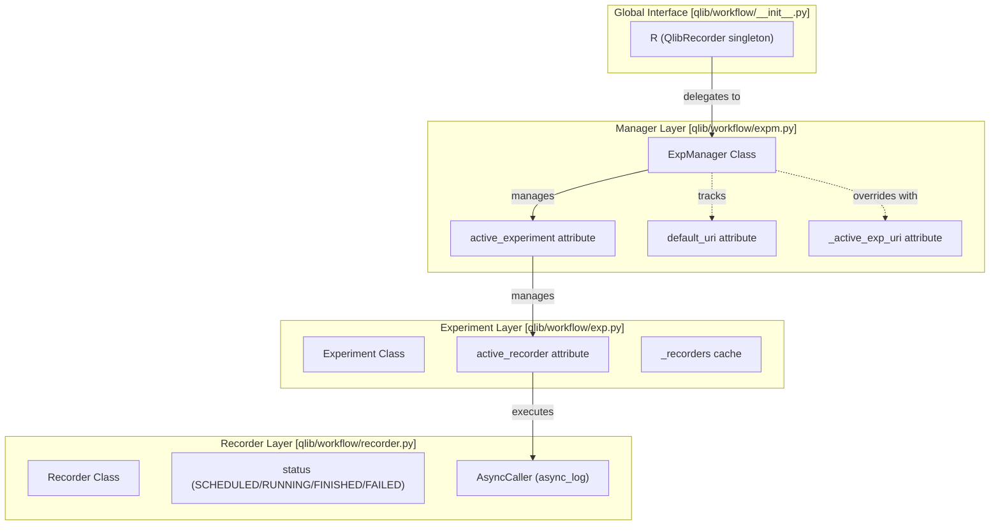
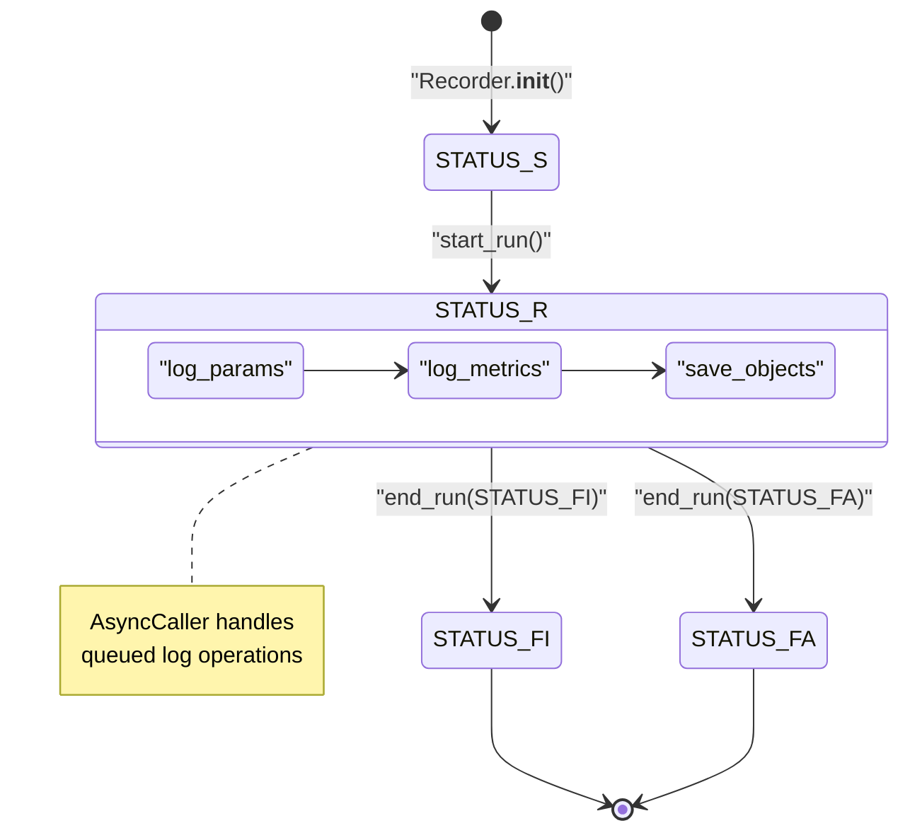

<!-- source: DeepWiki mcp.deepwiki.com · repo microsoft/qlib · page 8.1 Experiment Tracking with QlibRecorder · fetched 2026-10-26 -->

# Experiment Tracking with QlibRecorder

<details>
<summary>Relevant source files</summary>

The following files were used as context for generating this wiki page:

- [.github/workflows/stale.yml](.github/workflows/stale.yml)
- [docs/component/recorder.rst](docs/component/recorder.rst)
- [qlib/log.py](qlib/log.py)
- [qlib/workflow/__init__.py](qlib/workflow/__init__.py)
- [qlib/workflow/exp.py](qlib/workflow/exp.py)
- [qlib/workflow/expm.py](qlib/workflow/expm.py)
- [qlib/workflow/recorder.py](qlib/workflow/recorder.py)
- [tests/dependency_tests/README.md](tests/dependency_tests/README.md)
- [tests/dependency_tests/test_mlflow.py](tests/dependency_tests/test_mlflow.py)

</details>


## Purpose and Scope

This document covers Qlib's experiment tracking system, centered around the `QlibRecorder` class (accessed globally as `R`). This system provides a unified interface for logging experiments, including parameters, metrics, artifacts, and Python objects. It manages the lifecycle of experiments and recorders, enabling reproducible research workflows.

For automated workflow execution including experiment tracking, see [Automated Workflows with qrun](#8.2). For details on specific artifact management methods, see [Recorder Methods and Artifact Management](#8.3).

## Why Qlib Wraps MLflow

Qlib uses MLflow as its backend tracking system but provides its own wrapper layer rather than using MLflow directly. The design motivations are documented in [qlib/workflow/__init__.py:3-15]():

**Better Interface Design**
- `Recorder` object with intuitive methods (`log`, `start`) instead of passing `run_id` to every MLflow call [qlib/workflow/__init__.py:6-7]().
- More object-oriented API that encapsulates experiment state.

**Richer Features**
- Automatic logging of uncommitted code diffs (`git diff`, `git status`) at run start [qlib/workflow/__init__.py:9]().
- `log_object` and `load_object` for direct Python object serialization instead of just file artifacts [qlib/workflow/__init__.py:10]().
- MLflow parameter length limit is extended from 500 to 1000 to accommodate complex Qlib configurations [qlib/workflow/recorder.py:24-25]().

**Backend Flexibility**
- Abstraction allows potential future support for non-MLflow backends [qlib/workflow/__init__.py:11]().
- Unified interface regardless of underlying storage (file system, remote server, Azure Blob, etc.).

**Trade-offs**
The wrapper adds design complexity: users must create an experiment before getting a recorder, whereas MLflow allows working directly with run IDs [qlib/workflow/__init__.py:13-15](). However, this structure provides better organization for complex research workflows.

Sources: [qlib/workflow/__init__.py:1-15](), [qlib/workflow/recorder.py:24-25]()

## System Architecture

### Component Hierarchy

The experiment tracking system consists of four layers, each managing lifecycle and state for the layer below.

**Code Entity Mapping**
The following diagram maps the logical tracking hierarchy to the specific classes and state variables found in the codebase.

Title: Qlib Tracking System Entity Map


**Layer Responsibilities**

| Layer | Class | Purpose | Lifecycle Management |
|-------|-------|---------|---------------------|
| Global Interface | `QlibRecorder` | Single entry point, delegates to manager | Initialized by `qlib.init()` [qlib/workflow/__init__.py:26-32]() |
| Manager | `ExpManager` | Manages experiments, URI configuration | Maintains `active_experiment` [qlib/workflow/expm.py:22-41]() |
| Experiment | `Experiment` | Groups related recorders, manages recorder lifecycle | Maintains `active_recorder` [qlib/workflow/exp.py:15-26]() |
| Recorder | `Recorder` | Logs params/metrics/artifacts to backend | Manages run status and time [qlib/workflow/recorder.py:28-49]() |

Sources: [qlib/workflow/__init__.py:26-32](), [qlib/workflow/expm.py:22-41](), [qlib/workflow/exp.py:15-26](), [qlib/workflow/recorder.py:28-49]()

### State Management and Active Objects

Title: Recorder Lifecycle State Transitions


**Key Constraints**
- **Single Active Experiment**: `ExpManager.active_experiment` can only hold one experiment at a time [qlib/workflow/expm.py:40]().
- **Single Active Recorder**: Each `Experiment.active_recorder` can only hold one recorder at a time [qlib/workflow/exp.py:24]().
- **Implicit Context**: Methods like `R.log_params()` operate on the active recorder, creating one if none exists.

Sources: [qlib/workflow/expm.py:40](), [qlib/workflow/exp.py:24](), [qlib/workflow/recorder.py:37-40]()

## Core Components

### QlibRecorder (R)

The global `R` object provides the primary user interface. It is initialized as a singleton that wraps an `ExpManager` [qlib/workflow/__init__.py:26-32]().

**Key Methods by Category**

| Category | Methods | Description |
|----------|---------|-------------|
| **Lifecycle** | `start()`, `start_exp()`, `end_exp()` | Begin/end experiments with context manager or manual control [qlib/workflow/__init__.py:38-163]() |
| **Logging** | `log_params()`, `log_metrics()`, `set_tags()` | Record scalar values and metadata [qlib/workflow/__init__.py:542-611]() |
| **Artifacts** | `save_objects()`, `load_object()`, `log_artifact()` | Save/load Python objects or files [qlib/workflow/__init__.py:613-653]() |
| **Discovery** | `get_exp()`, `get_recorder()`, `list_experiments()`, `list_recorders()` | Retrieve existing experiments/recorders [qlib/workflow/__init__.py:401-525]() |
| **Search** | `search_records()` | Query experiments with filtering strings [qlib/workflow/__init__.py:165-213]() |

Sources: [qlib/workflow/__init__.py:26-653]()

### ExpManager and MLflowExpManager

`ExpManager` is the abstract base class; `MLflowExpManager` is the implementation using MLflow.

**URI Management Strategy**
The manager maintains two URI concepts to allow flexibility in storage location:
- **`default_uri`**: Set during initialization, usually from `qlib.init()` [qlib/workflow/expm.py:37]().
- **`_active_exp_uri`**: A temporary override set during `start_exp` [qlib/workflow/expm.py:82]().
- **`uri` property**: Dynamically resolves the current URI by checking `_active_exp_uri` first, then falling back to `default_uri` [qlib/workflow/expm.py:192-194]().

**Experiment Creation with File Locking**
When creating experiments with file-based storage, Qlib implements a `FileLock` mechanism [qlib/workflow/expm.py:6]() to prevent race conditions when multiple processes attempt to create the same experiment directory simultaneously [qlib/workflow/expm.py:236-238]().

Sources: [qlib/workflow/expm.py:36-194](), [qlib/workflow/expm.py:236-238]()

### Experiment and MLflowExperiment

An `Experiment` groups related recorders (runs) under a common name. Each experiment has a unique ID generated by the backend.

**Recorder Discovery Logic**
The `get_recorder` method handles complex retrieval logic [qlib/workflow/exp.py:114-176]():
1. If no ID/name is provided, it returns the `active_recorder` [qlib/workflow/exp.py:162-163]().
2. If `create=True`, it calls `_get_or_create_rec` [qlib/workflow/exp.py:166]().
3. If `start=True` and a new recorder is created, it automatically starts the run [qlib/workflow/exp.py:172-175]().

Sources: [qlib/workflow/exp.py:15-176]()

### Recorder and MLflowRecorder

A `Recorder` represents a single run. `MLflowRecorder` implements the interface by wrapping `mlflow` client calls.

**Asynchronous Logging**
To prevent tracking from becoming a performance bottleneck, Qlib uses an `AsyncCaller` [qlib/workflow/recorder.py:18]().
- Logging methods like `log_params` and `log_metrics` are decorated with `@AsyncCaller.async_dec` [qlib/workflow/recorder.py:420, 436]().
- This queues the MLflow API calls in a separate thread.
- `end_run()` calls `self.async_log.wait()` to ensure all queued logs are flushed before closing the run [qlib/workflow/recorder.py:390-394]().

**Automatic Code Diff Logging**
When a run starts, Qlib attempts to log the current state of the code repository:
- It checks for git availability and retrieves the `git diff` and `git status` [qlib/workflow/recorder.py:362-378]().
- This metadata is saved as artifacts to ensure the exact code version used for a result is known.

Sources: [qlib/workflow/recorder.py:347-436](), [qlib/workflow/recorder.py:362-378]()

## Usage Patterns

### Basic Workflow with Context Manager

The recommended pattern uses `R.start()` as a context manager, which automatically handles `start_exp` and `end_exp` with error handling [qlib/workflow/__init__.py:38-95]().

```python
from qlib.workflow import R

# Context manager automatically ends experiment and handles status
with R.start(experiment_name='test_exp', recorder_name='run_1'):
    # Log parameters
    R.log_params(lr=0.01, model='LGBM')
    
    # ... training code ...
    
    # Log metrics
    R.log_metrics(loss=0.05, step=1)
    
    # Save objects (pickles the object automatically)
    R.save_objects(model=trained_model)
```

If an exception occurs within the `with` block, `R.start` catches it, sets the recorder status to `STATUS_FA` (FAILED), and re-raises the exception [qlib/workflow/__init__.py:92-94](). Otherwise, it sets the status to `STATUS_FI` (FINISHED) [qlib/workflow/__init__.py:95]().

Sources: [qlib/workflow/__init__.py:38-95]()

### Manual Lifecycle Management

For more control, use `start_exp()` and `end_exp()` manually:

```python
R.start_exp(experiment_name='test_exp', recorder_name='run_1')
# ... operations ...
R.end_exp(recorder_status=Recorder.STATUS_FI)
```

Manual management requires the user to ensure `end_exp` is called, otherwise the recorder may remain in a `RUNNING` state in the backend.

Sources: [qlib/workflow/__init__.py:97-163]()

### Python Object Management

Qlib extends MLflow's artifact system with `save_objects` and `load_object` [qlib/workflow/recorder.py:74-103]().
- `save_objects`: Takes keyword arguments where values are Python objects. It serializes them (usually via pickle) and uploads them as artifacts [qlib/workflow/recorder.py:74-88]().
- `load_object`: Downloads the artifact and de-serializes it back into a Python object [qlib/workflow/recorder.py:90-103]().

Sources: [qlib/workflow/recorder.py:74-103]()

## Advanced Configuration

### MLflow Integration

Qlib is compatible with standard MLflow tools. If using `MLflowExpManager`, you can view results using the MLflow UI:

```bash
mlflow ui --backend-store-uri file:///path/to/your/mlruns
```

Qlib also handles specific MLflow entities like `AzureBlobArtifactRepository` for cloud-based artifact storage [qlib/workflow/recorder.py:21]().

Sources: [qlib/workflow/recorder.py:21](), [docs/component/recorder.rst:38-40]()

### Record Templates

Qlib provides `RecordTemp` classes to standardize result generation for common financial tasks [docs/component/recorder.rst:94-111]():
- `SignalRecord`: Generates model prediction results.
- `SigAnaRecord`: Calculates financial metrics like IC, ICIR, and Rank IC.
- `PortAnaRecord`: Handles backtest result generation and risk analysis.

Sources: [docs/component/recorder.rst:94-111]()

---

