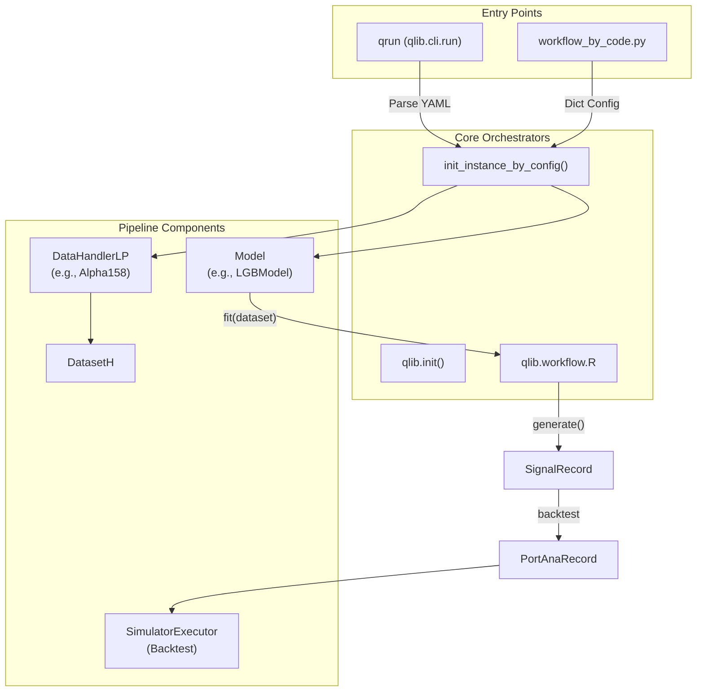
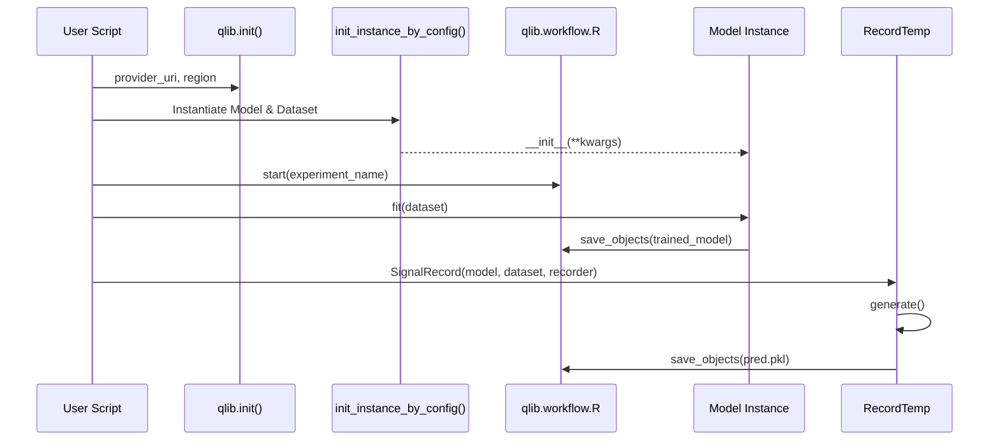

<!-- source: DeepWiki mcp.deepwiki.com · repo microsoft/qlib · page 8.2 Automated Workflows with qrun · fetched 2026-10-26 -->

# Automated Workflows with qrun

Relevant source files

The following files were used as context for generating this wiki page:

- [CHANGES.rst](CHANGES.rst)
- [docs/_static/img/online_serving.png](docs/_static/img/online_serving.png)
- [docs/advanced/alpha.rst](docs/advanced/alpha.rst)
- [docs/advanced/task_management.rst](docs/advanced/task_management.rst)
- [docs/component/data.rst](docs/component/data.rst)
- [docs/component/model.rst](docs/component/model.rst)
- [docs/component/online.rst](docs/component/online.rst)
- [docs/component/report.rst](docs/component/report.rst)
- [docs/component/rl/framework.rst](docs/component/rl/framework.rst)
- [docs/component/strategy.rst](docs/component/strategy.rst)
- [docs/conf.py](docs/conf.py)
- [docs/index.rst](docs/index.rst)
- [docs/introduction/quick.rst](docs/introduction/quick.rst)
- [docs/reference/api.rst](docs/reference/api.rst)
- [docs/start/getdata.rst](docs/start/getdata.rst)
- [docs/start/integration.rst](docs/start/integration.rst)
- [examples/benchmarks/TRA/Reports.ipynb](examples/benchmarks/TRA/Reports.ipynb)
- [examples/data_demo/README.md](examples/data_demo/README.md)
- [examples/data_demo/data_cache_demo.py](examples/data_demo/data_cache_demo.py)
- [examples/data_demo/data_mem_resuse_demo.py](examples/data_demo/data_mem_resuse_demo.py)
- [examples/orderbook_data/create_dataset.py](examples/orderbook_data/create_dataset.py)
- [examples/rl/simple_example.ipynb](examples/rl/simple_example.ipynb)
- [examples/tutorial/detailed_workflow.ipynb](examples/tutorial/detailed_workflow.ipynb)
- [examples/workflow_by_code.ipynb](examples/workflow_by_code.ipynb)
- [examples/workflow_by_code.py](examples/workflow_by_code.py)
- [qlib/cli/run.py](qlib/cli/run.py)
- [qlib/contrib/model/__init__.py](qlib/contrib/model/__init__.py)
- [qlib/contrib/torch.py](qlib/contrib/torch.py)
- [qlib/data/__init__.py](qlib/data/__init__.py)
- [qlib/data/pit.py](qlib/data/pit.py)
- [scripts/data_collector/crypto/README.md](scripts/data_collector/crypto/README.md)
- [scripts/data_collector/crypto/requirement.txt](scripts/data_collector/crypto/requirement.txt)
- [scripts/data_collector/pit/requirements.txt](scripts/data_collector/pit/requirements.txt)

## Purpose and Scope

The `qrun` tool is a built-in command-line utility in Qlib designed to orchestrate the entire quantitative research pipeline [docs/introduction/quick.rst:53-56](). It allows users to define complex workflows—including data processing, model training, backtesting, and performance analysis—within a single declarative YAML configuration file [examples/workflow_by_code.py:4-9](). By utilizing `qrun`, researchers can ensure reproducibility and decouple the experimental logic from the underlying implementation details.

**Sources:** [qlib/cli/run.py:1-20](), [docs/introduction/quick.rst:53-63](), [examples/workflow_by_code.py:4-9]()

## Workflow Architecture and Data Flow

The workflow orchestrated by `qrun` transitions through several distinct stages, moving data from the binary storage layer into trained models and finally into simulated trading results.

### Code Entity Mapping
The following diagram illustrates how the `qrun` entry point interacts with the modular components of Qlib to execute a task.

**Sources:** [qlib/cli/run.py:1-20](), [examples/workflow_by_code.py:25-45](), [docs/component/data.rst:24-30](), [docs/start/integration.rst:112-128]()

## Workflow Configuration (YAML)

A typical workflow configuration is divided into two primary sections: the `task` (data and model) and the `port_analysis_config` (backtesting and strategy) [docs/start/integration.rst:112-128]().

### 1. Task Section
This section defines the data source and the forecasting model.
- **Model**: Specifies the class, module path, and hyperparameters (e.g., `learning_rate`, `max_depth` for GBDT) [docs/start/integration.rst:116-128]().
- **Dataset**: Configures the `DataHandler` (like `Alpha158` or `Alpha360`), data segments (train, valid, test), and feature/label expressions [examples/workflow_by_code.ipynb:146-162]().

### 2. Backtest Section
This section defines how the model's signals are converted into trades.
- **Strategy**: Implements the decision logic, such as `TopkDropoutStrategy` [docs/component/strategy.rst:62-65]().
- **Executor**: Defines the simulation environment, frequency (e.g., `day`), and transaction costs [examples/workflow_by_code.py:29-36]().

**Sources:** [docs/start/integration.rst:112-128](), [examples/workflow_by_code.py:28-60](), [examples/workflow_by_code.ipynb:122-162]()

## Record Templates (RecordTemp)

The `RecordTemp` hierarchy in `qlib.workflow.record_temp` standardizes how experiment artifacts are saved to the `Recorder` [qlib/workflow/record_temp.py:28-32]().

### Key Implementation Classes

| Class | Purpose | Logic |
|-------|---------|-------|
| `SignalRecord` | Signal Generation | Calls `model.predict(dataset)` and saves `pred.pkl` [qlib/workflow/record_temp.py:161-170](). |
| `SigAnaRecord` | IC/RIC Analysis | Calculates IC and Rank IC between predictions and labels [qlib/workflow/record_temp.py:172-185](). |
| `PortAnaRecord`| Backtesting | Runs the `backtest_func` with the provided `executor` and `strategy` [qlib/workflow/record_temp.py:187-209](). |

**Sources:** [qlib/workflow/record_temp.py:28-209](), [examples/workflow_by_code.py:14-15]()

## Programmatic Alternative: workflow_by_code.py

While `qrun` is the standard for YAML-based execution, Qlib supports a procedural interface for dynamic workflows [examples/workflow_by_code.py:4-9](). This is useful for parameter sweeps or complex conditional logic that cannot be captured in static YAML.

### Workflow by Code Entity Space
The following diagram shows the sequence of function calls and class interactions in a programmatic workflow.

**Sources:** [examples/workflow_by_code.py:21-86](), [examples/workflow_by_code.ipynb:164-173]()

## Analysis and Reporting

Once a workflow is completed, Qlib provides tools to analyze the generated artifacts [docs/component/report.rst:10-21]().

- **IC Analysis**: Visualized via `analysis_position.score_ic_graph`, showing Pearson and Spearman correlations [docs/component/report.rst:89-114]().
- **Portfolio Analysis**: Visualized via `analysis_position.report_graph`, showing cumulative returns (with/without cost), turnover, and maximum drawdown [docs/component/report.rst:46-86]().
- **Risk Metrics**: Includes Information Ratio (IR), Annualized Return, and Volatility [docs/component/report.rst:148-185]().

**Sources:** [docs/component/report.rst:10-21](), [docs/component/report.rst:148-185](), [docs/introduction/quick.rst:64-79]()

---

