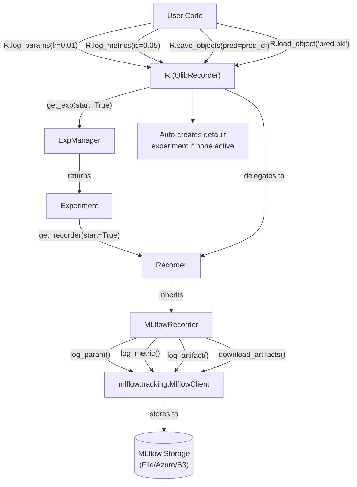
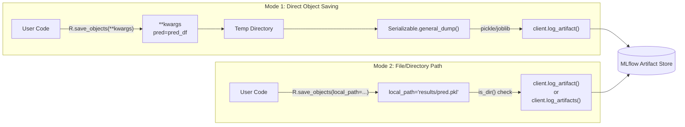
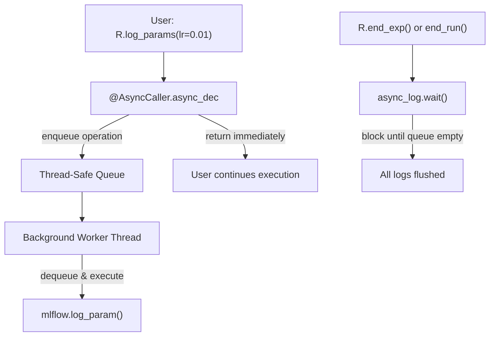

<!-- source: DeepWiki mcp.deepwiki.com · repo microsoft/qlib · page 8.3 Recorder Methods and Artifact Management · fetched 2026-10-26 -->

# Recorder Methods and Artifact Management

<details>
<summary>Relevant source files</summary>

The following files were used as context for generating this wiki page:

- [examples/nested_decision_execution/workflow.py](examples/nested_decision_execution/workflow.py)
- [qlib/contrib/evaluate.py](qlib/contrib/evaluate.py)
- [qlib/contrib/workflow/__init__.py](qlib/contrib/workflow/__init__.py)
- [qlib/contrib/workflow/record_temp.py](qlib/contrib/workflow/record_temp.py)
- [qlib/log.py](qlib/log.py)
- [qlib/workflow/__init__.py](qlib/workflow/__init__.py)
- [qlib/workflow/exp.py](qlib/workflow/exp.py)
- [qlib/workflow/expm.py](qlib/workflow/expm.py)
- [qlib/workflow/record_temp.py](qlib/workflow/record_temp.py)
- [qlib/workflow/recorder.py](qlib/workflow/recorder.py)
- [scripts/get_data.py](scripts/get_data.py)
- [tests/rolling_tests/test_update_pred.py](tests/rolling_tests/test_update_pred.py)
- [tests/test_all_pipeline.py](tests/test_all_pipeline.py)
- [tests/test_contrib_workflow.py](tests/test_contrib_workflow.py)

</details>


This page documents the detailed methods available on Recorder objects for logging parameters, metrics, and artifacts during experiments. These methods form the core interface for tracking experiment data in Qlib.

For high-level experiment management concepts, see **8.1 Experiment Tracking with QlibRecorder**. For automated workflow orchestration, see **8.2 Automated Workflows with qrun**.

**Scope**: This page covers the practical API for logging experiment data, artifact storage patterns, serialization mechanisms, and performance optimizations like asynchronous logging.

---

## Overview of Recorder Logging Methods

The `Recorder` class [qlib/workflow/recorder.py:28-40]() provides methods for logging three types of experiment data:

| Method Category | Purpose | Mutability | Step Support |
|----------------|---------|------------|--------------|
| **Parameters** | Model hyperparameters, config values | Immutable | No |
| **Metrics** | Quantitative results (IC, accuracy, loss) | Can log multiple values | Yes (step parameter) |
| **Artifacts** | Files, models, predictions, plots | Versioned by run | N/A |
| **Tags** | Metadata labels | Mutable (can delete) | No |

All methods can be called either through the global `R` object [qlib/workflow/__init__.py:26-32]() or through a specific recorder instance obtained via `R.get_recorder()` [qlib/workflow/recorder.py:114-177]().

**Diagram: QlibRecorder Method Delegation Flow**


Sources: [qlib/workflow/__init__.py:542-653](), [qlib/workflow/recorder.py:122-245](), [qlib/workflow/expm.py:152-216]()

---

## Parameter Logging: log_params

Parameters are immutable key-value pairs representing experiment configuration. They are logged once at the start of a run.

### Basic Usage
```python
# Method 1: Through global R
with R.start(experiment_name='test'):
    R.log_params(
        learning_rate=0.01,
        model_type='LSTM',
        hidden_size=64
    )

# Method 2: Through specific recorder
recorder = R.get_recorder(recorder_id='some_id', experiment_name='test')
recorder.log_params(batch_size=128, epochs=100)
```

### Implementation Details
**Asynchronous Logging**: Parameters are logged asynchronously via `AsyncCaller` [qlib/utils/paral.py]() for performance. The decorator `@AsyncCaller.async_dec(ac_attr="async_log")` [qlib/workflow/recorder.py:445]() queues log operations.

**Length Limits**: MLflow originally limited parameter values to 500 characters, but Qlib extends this to 1000 to support complex YAML configurations [qlib/workflow/recorder.py:24-25]().

Sources: [qlib/workflow/__init__.py:542-565](), [qlib/workflow/recorder.py:445-449](), [qlib/workflow/recorder.py:24-25]()

---

## Metric Logging: log_metrics

Metrics are quantitative results that can be logged multiple times with step tracking (e.g., training loss per epoch).

### Basic Usage
```python
with R.start(experiment_name='training'):
    for epoch in range(100):
        R.log_metrics(step=epoch, train_loss=0.5, val_loss=0.6)
```

### Step Parameter
The `step` parameter [qlib/workflow/recorder.py:133]() enables time-series metric tracking. If `step` is provided, MLflow stores these as separate points for visualization. Like parameters, metrics are logged asynchronously [qlib/workflow/recorder.py:450]().

Sources: [qlib/workflow/__init__.py:567-590](), [qlib/workflow/recorder.py:450-453]()

---

## Artifact Management: save_objects and load_object

Artifacts are files stored alongside runs. Qlib provides two APIs: high-level Python object handling (`save_objects`/`load_object`) and low-level file operations (`log_artifact`/`download_artifact`).

### save_objects: Two-Mode Operation


Sources: [qlib/workflow/__init__.py:481-534](), [qlib/workflow/recorder.py:397-411]()

### Mode 1: Direct Object Saving
Save Python objects directly without writing to disk first. Qlib handles the serialization into `.pkl` files [qlib/workflow/recorder.py:413-432]().
```python
R.save_objects(trained_model=model, artifact_path='models')
```

### Mode 2: File/Directory Path
Save existing files or directories by providing a `local_path` [qlib/workflow/recorder.py:74-88]().
```python
R.save_objects(local_path='results/pred.pkl', artifact_path='outputs')
```

### load_object: Retrieving Artifacts
Retrieves a saved object from the artifact store. For Azure Blob storage, downloaded artifacts are automatically cleaned up to save disk space [qlib/workflow/recorder.py:433-444]().
```python
model = recorder.load_object('models/trained_model.pkl')
```

Sources: [qlib/workflow/recorder.py:397-444](), [qlib/workflow/__init__.py:481-534]()

---

## Template-Based Recording: RecordTemp

Qlib provides a `RecordTemp` [qlib/workflow/record_temp.py:28]() class to standardize how specific results (like IC or Backtest) are generated and saved.

### Common Record Templates

| Class | Purpose | Key Artifacts |
|-------|---------|---------------|
| `SignalRecord` | Generates model predictions | `pred.pkl`, `label.pkl` |
| `SigAnaRecord` | Calculates IC and Rank IC | `ic.pkl`, `ric.pkl` |
| `PortAnaRecord` | Portfolio backtest results | `port_analysis.pkl` |
| `MultiSegRecord` | IC for multiple segments | `results-{seg}.pkl` |
| `SignalMseRecord` | MSE/RMSE calculation | `mse.pkl`, `rmse.pkl` |

### SignalRecord Workflow
The `SignalRecord.generate()` [qlib/workflow/record_temp.py:190-207]() method calls `model.predict()` and saves the results as `pred.pkl`. It also attempts to extract labels from the dataset via `generate_label()` [qlib/workflow/record_temp.py:172-188]().

```python
sr = SignalRecord(model, dataset, recorder)
sr.generate() # Saves pred.pkl and label.pkl
```

### Contrib Extensions
The `qlib.contrib.workflow.record_temp` module extends basic templates with more specific metrics:
* `MultiSegRecord.generate()`: Iterates through segments (train/valid/test) to compute IC and Rank IC [qlib/contrib/workflow/record_temp.py:32-57]().
* `SignalMseRecord.generate()`: Automatically loads `pred.pkl` and `label.pkl` to compute Mean Squared Error [qlib/contrib/workflow/record_temp.py:72-83]().

Sources: [qlib/workflow/record_temp.py:28-211](), [qlib/contrib/workflow/record_temp.py:19-87]()

---

## Asynchronous Logging Implementation

To optimize performance, especially in distributed training, Qlib implements asynchronous logging via `AsyncCaller` [qlib/utils/paral.py]().

**Diagram: AsyncCaller Mechanism**


Sources: [qlib/workflow/recorder.py:348-350](), [qlib/workflow/recorder.py:390-394]()

### Lifecycle and Cleanup
The `async_log` instance is created when a run starts [qlib/workflow/recorder.py:350](). When `end_run()` is called, the system blocks until the queue is empty [qlib/workflow/recorder.py:390-394](), ensuring all data is persisted.

Sources: [qlib/workflow/recorder.py:335-396]()

---

## Summary Table: Method Comparison

| Method | Input Type | Output Type | Async | Primary Use Case |
|--------|-----------|------------|-------|------------------|
| `log_params` | `**kwargs` | None | Yes | Hyperparameters [qlib/workflow/recorder.py:445]() |
| `log_metrics` | `**kwargs` | None | Yes | IC, Loss, Accuracy [qlib/workflow/recorder.py:450]() |
| `save_objects` | `**kwargs` | None | No | Model/Pred saving [qlib/workflow/recorder.py:397]() |
| `load_object` | `str` | Object | No | Model retrieval [qlib/workflow/recorder.py:433]() |
| `set_tags` | `**kwargs` | None | Yes | Run metadata [qlib/workflow/recorder.py:457]() |

Sources: [qlib/workflow/recorder.py:397-493](), [qlib/workflow/__init__.py:542-653]()

---

