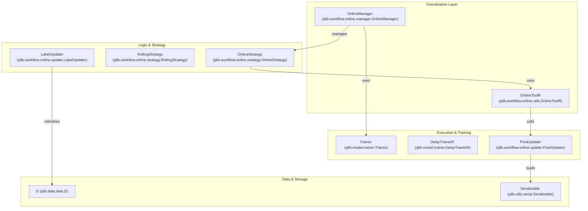
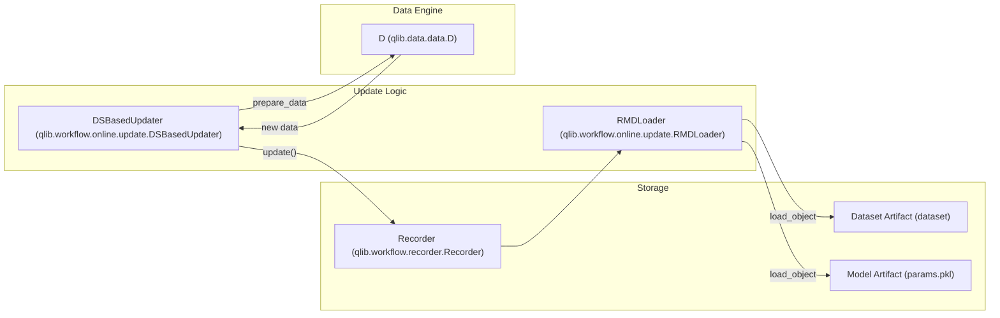

<!-- source: DeepWiki mcp.deepwiki.com · repo microsoft/qlib · page 9 Online Serving and Production Deployment · fetched 2026-10-26 -->

# Online Serving and Production Deployment

<details>
<summary>Relevant source files</summary>

The following files were used as context for generating this wiki page:

- [examples/online_srv/online_management_simulate.py](examples/online_srv/online_management_simulate.py)
- [examples/online_srv/rolling_online_management.py](examples/online_srv/rolling_online_management.py)
- [qlib/model/ens/ensemble.py](qlib/model/ens/ensemble.py)
- [qlib/model/ens/group.py](qlib/model/ens/group.py)
- [qlib/utils/serial.py](qlib/utils/serial.py)
- [qlib/workflow/online/manager.py](qlib/workflow/online/manager.py)
- [qlib/workflow/online/strategy.py](qlib/workflow/online/strategy.py)
- [qlib/workflow/online/update.py](qlib/workflow/online/update.py)
- [qlib/workflow/online/utils.py](qlib/workflow/online/utils.py)

</details>


This document describes Qlib's online serving infrastructure for deploying trained models in production environments. Online serving enables automated model management, periodic retraining, real-time prediction updates, and systematic handling of new market data as it becomes available.

**Scope**: This page covers the high-level coordination of production deployment. For the initial model training workflow, see [Workflow and Experiment Management](#8). For distributed task execution and rolling model training, see [Training and Task Management](#6).

---

## Purpose and Architecture

Online serving in Qlib addresses the challenge of keeping quantitative models current in production environments where market data continuously updates. The system automates the lifecycle of "online" models—those currently decisive for trading signals—which may change as time progresses [qlib/workflow/online/manager.py:4-9]().

The architecture bridges the gap between historical training and live execution through four primary trainer/mode combinations:
1.  **Online + Trainer**: Real-time routine where models are trained task-by-task [qlib/workflow/online/manager.py:21-22]().
2.  **Online + DelayTrainer**: Parallelizes training at the end of a routine to avoid bottlenecks [qlib/workflow/online/manager.py:24-27]().
3.  **Simulation + Trainer**: Historical backtesting of the online update logic [qlib/workflow/online/manager.py:29-30]().
4.  **Simulation + DelayTrainer**: Multitasking simulation for models without temporal dependence [qlib/workflow/online/manager.py:32-35]().

**Diagram: Online Serving Architecture and Code Entities**


Sources: [qlib/workflow/online/manager.py:101-144](), [qlib/workflow/online/strategy.py:19-35](), [qlib/workflow/online/utils.py:87-101](), [qlib/utils/serial.py:11-33]()

---

## OnlineManager and Online Strategies

The `OnlineManager` ([qlib/workflow/online/manager.py:101]()) is the central coordinator. It manages a set of `OnlineStrategy` instances and runs them dynamically over time. It maintains a `history` dictionary that records which models were online for each strategy at specific timestamps [qlib/workflow/online/manager.py:136-138]().

### OnlineManager Lifecycle
- **First Train**: Initializes the system by training the first set of tasks provided by strategies [qlib/workflow/online/manager.py:156-160]().
- **Routine**: The periodic execution (e.g., daily) that updates predictions, prepares new tasks, and switches online models [qlib/workflow/online/manager.py:202-205]().
- **Simulation**: A method to verify online strategies against historical data using `STATUS_SIMULATING` [qlib/workflow/online/manager.py:107-108](), [qlib/workflow/online/manager.py:246-248]().

### Online Strategy Interface
The `OnlineStrategy` ([qlib/workflow/online/strategy.py:19]()) defines how tasks are generated and how models are selected for "online" status. A common implementation is `RollingStrategy`, which uses `RollingGen` to create rolling window tasks and promotes models to online status via `OnlineToolR` [qlib/workflow/online/strategy.py:92-121]().

For details, see [OnlineManager and Online Strategies](#9.1).

Sources: [qlib/workflow/online/manager.py:101-205](), [qlib/workflow/online/strategy.py:19-121]()

---

## Prediction Updates and Label Refreshing

Production deployment requires keeping artifacts like `pred.pkl` and ground-truth labels up to date as new market bars arrive.

### Prediction Updating
`OnlineToolR` ([qlib/workflow/online/utils.py:87]()) provides `update_online_pred`, which iterates through all models tagged with `ONLINE_TAG` and uses a `PredUpdater` to generate predictions for new time segments [qlib/workflow/online/utils.py:159-178](). This ensures that the trading signals are always based on the most recent available features.

### Record Updaters
The `RecordUpdater` hierarchy ([qlib/workflow/online/update.py:66]()) handles the actual data processing:
- **RMDLoader**: Loads the `Dataset` and `Model` artifacts from a `Recorder` [qlib/workflow/online/update.py:21-63]().
- **DSBasedUpdater**: A base for updaters that rely on Qlib Datasets and multi-level index DataFrames [qlib/workflow/online/update.py:82-102]().
- **PredUpdater**: Specifically handles updating the `pred.pkl` artifact [qlib/workflow/online/update.py:221]().
- **LabelUpdater**: Refreshes labels in the recorder once the future market data required for the label calculation becomes available [qlib/workflow/online/update.py:242]().

**Diagram: Data Flow in RecordUpdater**


Sources: [qlib/workflow/online/update.py:21-250](), [qlib/workflow/online/utils.py:159-178](), [qlib/workflow/online/update.py:62-63]()

For details, see [Prediction Updates and Label Refreshing](#9.2).

---

## Online Tooling and Ensembling

`OnlineToolR` manages the metadata tags that designate models as `online` or `offline` using the `ONLINE_KEY` ("online_status") [qlib/workflow/online/utils.py:24-27](), [qlib/workflow/online/utils.py:113](). This allows the system to distinguish between models currently serving live traffic and those being evaluated.

When multiple models are online (e.g., in a rolling window or multi-strategy setup), Qlib provides ensembling utilities:
- **RollingEnsemble**: Concatenates rolling DataFrames, ensuring the latest predictions are used if overlaps exist [qlib/model/ens/ensemble.py:65-88]().
- **AverageEnsemble**: Standardizes and averages predictions from multiple models to create a robust signal [qlib/model/ens/ensemble.py:91-132]().
- **RollingGroup**: Groups rolling results by model class and test segments before reduction using `RollingEnsemble` [qlib/model/ens/group.py:92-115]().

Sources: [qlib/workflow/online/utils.py:19-157](), [qlib/model/ens/ensemble.py:65-132](), [qlib/model/ens/group.py:92-115]()

---

## Deployment Example

A typical production script using `OnlineManager` involves initializing the manager with a `RollingStrategy` and a `TrainerRM` (for MongoDB-backed task management), then calling `first_run()` followed by periodic `routine()` calls [examples/online_srv/rolling_online_management.py:25-108]().

```python
# High-level flow in production
om = OnlineManager(strategies, trainer=DelayTrainerRM())
om.first_train() # Initial training [qlib/workflow/online/manager.py:156]
om.to_pickle("manager.pkl") # Persist state [qlib/utils/serial.py:115]

# Periodic task (e.g., via Cron)
om = OnlineManager.load("manager.pkl") # [qlib/utils/serial.py:136]
om.routine() # Update preds, train new rolling models [qlib/workflow/online/manager.py:202]
om.to_pickle("manager.pkl")
```
Sources: [examples/online_srv/rolling_online_management.py:88-108](), [qlib/workflow/online/manager.py:101-144](), [qlib/utils/serial.py:115-154]()

---

