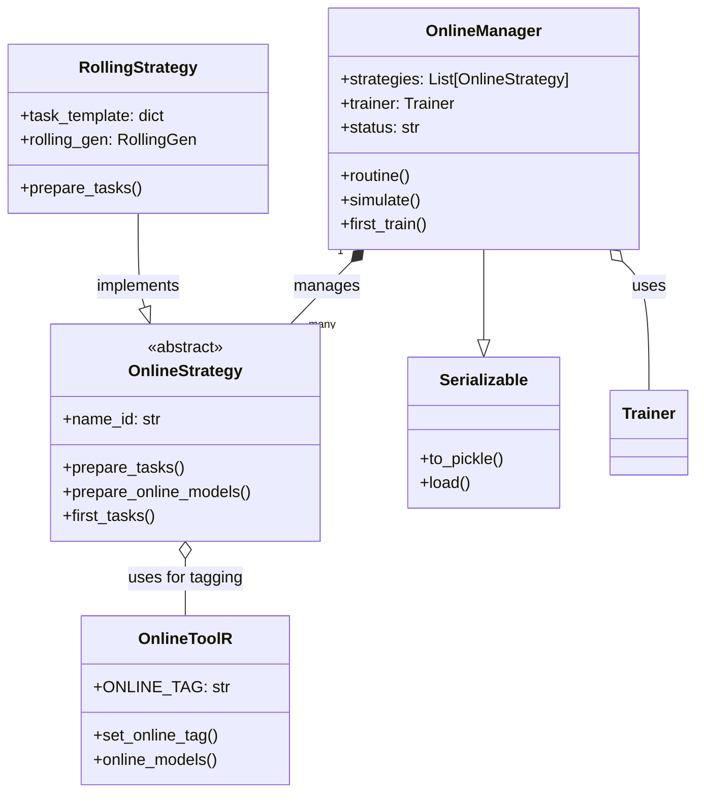
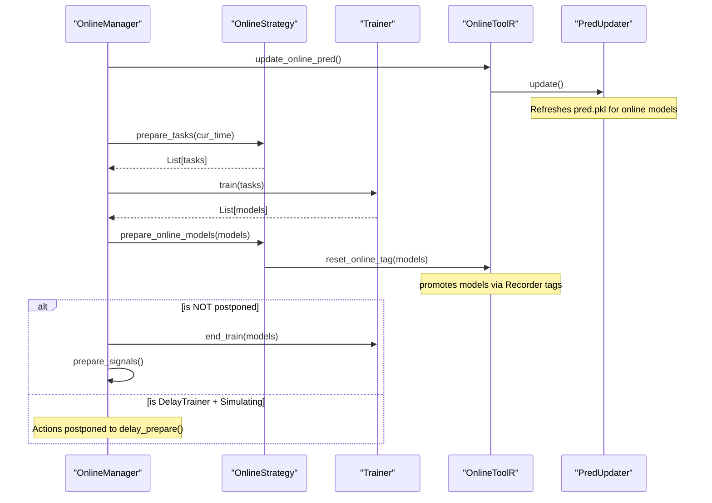

<!-- source: DeepWiki mcp.deepwiki.com · repo microsoft/qlib · page 9.1 OnlineManager and Online Strategies · fetched 2026-10-26 -->

# OnlineManager and Online Strategies

Relevant source files

The following files were used as context for generating this wiki page:

- [examples/online_srv/online_management_simulate.py](examples/online_srv/online_management_simulate.py)
- [examples/online_srv/rolling_online_management.py](examples/online_srv/rolling_online_management.py)
- [qlib/contrib/online/manager.py](qlib/contrib/online/manager.py)
- [qlib/contrib/online/utils.py](qlib/contrib/online/utils.py)
- [qlib/contrib/tuner/config.py](qlib/contrib/tuner/config.py)
- [qlib/contrib/tuner/launcher.py](qlib/contrib/tuner/launcher.py)
- [qlib/contrib/tuner/pipeline.py](qlib/contrib/tuner/pipeline.py)
- [qlib/contrib/tuner/space.py](qlib/contrib/tuner/space.py)
- [qlib/model/ens/ensemble.py](qlib/model/ens/ensemble.py)
- [qlib/model/ens/group.py](qlib/model/ens/group.py)
- [qlib/utils/serial.py](qlib/utils/serial.py)
- [qlib/workflow/online/manager.py](qlib/workflow/online/manager.py)
- [qlib/workflow/online/strategy.py](qlib/workflow/online/strategy.py)
- [qlib/workflow/online/update.py](qlib/workflow/online/update.py)
- [qlib/workflow/online/utils.py](qlib/workflow/online/utils.py)

The **OnlineManager** is a high-level module designed to manage a set of `OnlineStrategy` instances and execute them dynamically over time. In a production environment, "online" models are those currently serving predictions. As time progresses and market dynamics shift, these models must be updated, retrained, or replaced. OnlineManager provides the infrastructure to automate this lifecycle, including task generation, model training, prediction updates, and signal preparation.

### OnlineManager Lifecycle and Status

The `OnlineManager` operates in two primary statuses:
1.  **STATUS_ONLINE**: Used for real-time daily routines where models are updated as new data arrives [qlib/workflow/online/manager.py:108-108]().
2.  **STATUS_SIMULATING**: Used to verify online strategies against historical data, simulating how the manager would have behaved in the past [qlib/workflow/online/manager.py:107-107]().

The core of the manager is the `routine` method, which typically performs the following sequence:
-   **Update Predictions**: Refresh predictions for current online models using `update_online_pred` [qlib/workflow/online/manager.py:228-230]().
-   **Prepare Tasks**: Query strategies for new training tasks based on the current time via `prepare_tasks` [qlib/workflow/online/manager.py:233-234]().
-   **Train Models**: Use a `Trainer` to train the generated tasks [qlib/workflow/online/manager.py:237-237]().
-   **Prepare Online Models**: Select which of the newly trained models should be promoted to "online" status via `prepare_online_models` [qlib/workflow/online/manager.py:240-241]().
-   **Signal Preparation**: Generate trading signals from the online models [qlib/workflow/online/manager.py:252-253]().

#### OnlineManager Class Diagram
This diagram maps the `OnlineManager` and its associated strategy components to their code entities.

Sources: [qlib/workflow/online/manager.py:101-144](), [qlib/workflow/online/strategy.py:19-122](), [qlib/workflow/online/utils.py:87-100](), [qlib/utils/serial.py:11-12]()

---

### Online Strategy Interface

An `OnlineStrategy` defines the logic for how tasks are generated and how models transition to production. It acts as the bridge between the high-level `OnlineManager` and the specific task generation logic like `RollingGen`.

| Method | Description |
| :--- | :--- |
| `first_tasks` | Generates the initial set of tasks for the very first training session [qlib/workflow/online/strategy.py:72-76](). |
| `prepare_tasks` | Logic to check if new tasks are needed at a specific time (e.g., a new rolling window) [qlib/workflow/online/strategy.py:37-44](). |
| `prepare_online_models` | Promotes trained models to "online" status. Default behavior promotes all newly trained models [qlib/workflow/online/strategy.py:46-70](). |
| `get_collector` | Returns a `Collector` to aggregate predictions or signals across different model versions [qlib/workflow/online/strategy.py:78-89](). |

The `RollingStrategy` is a concrete implementation that uses a `RollingGen` to generate tasks based on a rolling window template [qlib/workflow/online/strategy.py:92-122](). It assumes that the models can be distinguished based on the model class and rolling test segments [qlib/workflow/online/strategy.py:127-128]().

Sources: [qlib/workflow/online/strategy.py:19-153]()

---

### Trainer and Mode Combinations

The `OnlineManager` supports four combinations of execution modes and trainer types to handle different synchronization and performance requirements.

| Combination | Purpose | Data Flow / Behavior |
| :--- | :--- | :--- |
| **Online + Trainer** | Real-time routine | Trains tasks strategy-by-strategy immediately. `routine` blocks until training finishes [qlib/workflow/online/manager.py:21-22](). |
| **Online + DelayTrainer** | Parallel online training | Prepares all tasks across all strategies first, then triggers a parallel training session at the end of the routine to avoid blocking [qlib/workflow/online/manager.py:24-27](). |
| **Simulation + Trainer** | Historical verification | Simulates historical dates one by one, training and promoting models as it progresses [qlib/workflow/online/manager.py:29-30](). |
| **Simulation + DelayTrainer** | Fast backtesting | If models have no temporal dependence, all historical tasks are collected and trained in one batch at the end of simulation [qlib/workflow/online/manager.py:32-35](). |

#### Routine Execution Flow
This diagram illustrates the internal logic of the `OnlineManager.routine` method and how it interacts with the `Trainer` and `OnlineStrategy`.

Sources: [qlib/workflow/online/manager.py:145-155](), [qlib/workflow/online/manager.py:219-261](), [qlib/workflow/online/utils.py:159-179]()

---

### Model Promotion and OnlineTool

Model promotion is managed by `OnlineToolR`, which interacts with the `Recorder` system. It uses tags to identify which model versions are active.

- **Tagging**: Models are marked with `online_status` as either `online` or `offline` [qlib/workflow/online/utils.py:24-26]().
- **Promotion**: When `prepare_online_models` is called, `OnlineToolR.reset_online_tag` typically sets previous models in the experiment to `offline` and the new models to `online` [qlib/workflow/online/utils.py:129-145]().
- **Prediction Updates**: The `PredUpdater` (a subclass of `DSBasedUpdater`) is used to extend the `pred.pkl` file of an online model as new data becomes available. It loads the model and dataset via `RMDLoader` and calls `model.predict` on the new data segment [qlib/workflow/online/update.py:112-156](), [qlib/workflow/online/utils.py:159-179]().

### Ensemble and Result Collection

Because rolling strategies result in multiple models covering different time segments, `OnlineManager` uses `MergeCollector` to aggregate results [qlib/workflow/online/manager.py:98-98]().
- **RollingGroup**: Groups results by model class and rolling test segments. It assumes the rolling key is at the end of the key tuple [qlib/model/ens/group.py:92-115]().
- **RollingEnsemble**: Concatenates multiple dataframes (e.g., predictions from different time windows) into a single continuous time series, handling overlaps by keeping the latest prediction [qlib/model/ens/ensemble.py:65-88]().
- **AverageEnsemble**: Can be used to average and standardize a dict of dataframes into a single ensemble result [qlib/model/ens/ensemble.py:91-132]().

Sources: [qlib/workflow/online/manager.py:263-279](), [qlib/workflow/online/strategy.py:123-153](), [qlib/model/ens/ensemble.py:65-132](), [qlib/model/ens/group.py:92-115]()

---

