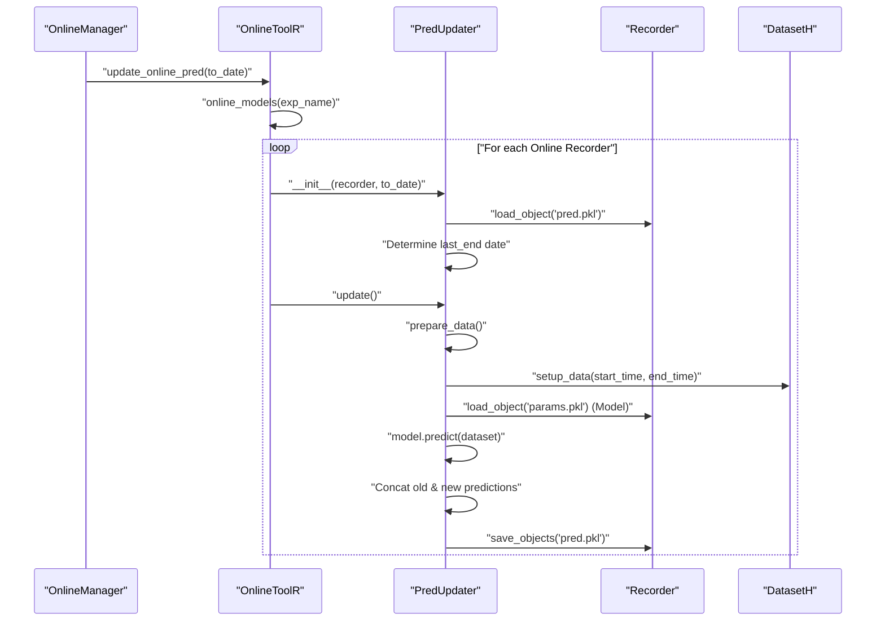
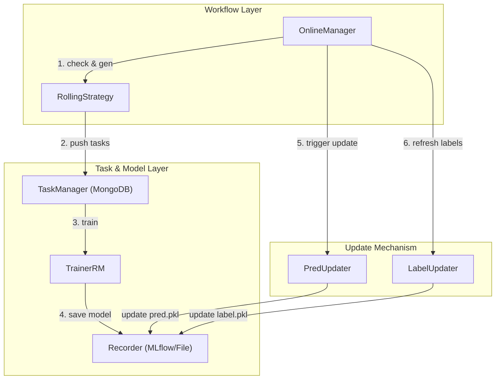

<!-- source: DeepWiki mcp.deepwiki.com · repo microsoft/qlib · page 9.2 Prediction Updates and Label Refreshing · fetched 2026-10-26 -->

# Prediction Updates and Label Refreshing

Relevant source files

The following files were used as context for generating this wiki page:

- [examples/model_rolling/task_manager_rolling.py](examples/model_rolling/task_manager_rolling.py)
- [examples/online_srv/online_management_simulate.py](examples/online_srv/online_management_simulate.py)
- [examples/online_srv/rolling_online_management.py](examples/online_srv/rolling_online_management.py)
- [examples/online_srv/update_online_pred.py](examples/online_srv/update_online_pred.py)
- [qlib/model/ens/ensemble.py](qlib/model/ens/ensemble.py)
- [qlib/model/ens/group.py](qlib/model/ens/group.py)
- [qlib/model/trainer.py](qlib/model/trainer.py)
- [qlib/utils/serial.py](qlib/utils/serial.py)
- [qlib/workflow/online/manager.py](qlib/workflow/online/manager.py)
- [qlib/workflow/online/strategy.py](qlib/workflow/online/strategy.py)
- [qlib/workflow/online/update.py](qlib/workflow/online/update.py)
- [qlib/workflow/online/utils.py](qlib/workflow/online/utils.py)
- [qlib/workflow/task/collect.py](qlib/workflow/task/collect.py)
- [qlib/workflow/task/gen.py](qlib/workflow/task/gen.py)
- [qlib/workflow/task/manage.py](qlib/workflow/task/manage.py)
- [qlib/workflow/task/utils.py](qlib/workflow/task/utils.py)

In a production trading environment, market data arrives continuously, requiring existing predictions to be updated and historical labels to be refreshed as ground truth becomes available. This page documents the automated workflow for maintaining up-to-date model outputs and the mechanisms for periodic label updates within the Qlib online serving framework.

## Overview of Prediction Updates

The `OnlineManager` manages the lifecycle of online models, ensuring that as time progresses, the "online" models (those currently used for decision-making) produce predictions for the most recent data points [qlib/workflow/online/manager.py:101-105]().

The core logic for updating these predictions resides in the `update_online_pred` workflow. This process is typically triggered during a `routine` call in `OnlineManager` [qlib/workflow/online/manager.py:223-225](). It iterates through all models tagged as "online" and uses a `PredUpdater` to generate and append new predictions [qlib/workflow/online/utils.py:168-176]().

### Key Components

| Component | Role | File Reference |
| :--- | :--- | :--- |
| `OnlineToolR` | Manages "online" tags on recorders and triggers batch prediction updates. | [qlib/workflow/online/utils.py:87-91]() |
| `PredUpdater` | Handles the specific logic of loading a model, fetching new data, and saving updated `pred.pkl`. | [qlib/workflow/online/update.py:228-230]() |
| `RMDLoader` | A helper class to load the Recorder, Model, and Dataset for inference. | [qlib/workflow/online/update.py:21-26]() |
| `DSBasedUpdater` | Base class for updaters that rely on Qlib Datasets to fetch incremental data. | [qlib/workflow/online/update.py:82-102]() |

**Sources:** [qlib/workflow/online/manager.py:223-225](), [qlib/workflow/online/utils.py:159-172](), [qlib/workflow/online/update.py:21-112]()

## Data Flow for Prediction Updates

The following diagram illustrates how the `OnlineManager` coordinates with the `OnlineToolR` and `PredUpdater` to refresh predictions using the latest market data.

**Prediction Update Sequence**

**Sources:** [qlib/workflow/online/utils.py:159-178](), [qlib/workflow/online/update.py:180-226](), [qlib/workflow/online/update.py:246-265]()

## Label Refreshing with LabelUpdater

In quantitative finance, "labels" (e.g., future 5-day returns) cannot be known at the moment a prediction is made. As market time moves forward, the actual returns for previous predictions become available. The `LabelUpdater` is designed to refresh these labels in the `Recorder` so that model performance can be monitored in real-time.

### Implementation Details
The `LabelUpdater` inherits from `DSBasedUpdater` [qlib/workflow/online/update.py:268-270](). Unlike the `PredUpdater`, which uses `model.predict()`, the `LabelUpdater` extracts labels directly from the `DatasetH` object after it has been initialized with the latest market data.

1.  **Start Date Determination**: It identifies the last date in the existing `label.pkl` that contains non-null values [qlib/workflow/online/update.py:173-176]().
2.  **Data Fetching**: It re-runs the data handler pipeline up to the current date [qlib/workflow/online/update.py:280-282]().
3.  **Label Extraction**: It calls `dataset.prepare("test", col_set="label")` to get the ground truth [qlib/workflow/online/update.py:284-285]().
4.  **Persistence**: The updated labels are merged with historical labels and saved back to the `Recorder` [qlib/workflow/online/update.py:217-226]().

**Sources:** [qlib/workflow/online/update.py:173-179](), [qlib/workflow/online/update.py:268-288]()

## Integration with TaskManager

For production systems using rolling windows, the `OnlineManager` integrates with `TaskManager` to handle complex updates. When a `RollingStrategy` determines that the current online model is stale (based on the `RollingGen` configuration), it triggers the creation of new tasks.

### Rolling Production Workflow
1.  **Prepare Tasks**: `OnlineStrategy.prepare_tasks` generates new task configurations [qlib/workflow/online/strategy.py:37-44]().
2.  **Training**: The `Trainer` (e.g., `TrainerRM` for MongoDB-backed tasks) executes these tasks [qlib/workflow/online/manager.py:207-210]().
3.  **Model Switch**: Once training is complete, `prepare_online_models` updates the `online` tags in the experiment metadata [qlib/workflow/online/strategy.py:46-70]().
4.  **Signal Aggregation**: `OnlineManager.get_signals` uses a `MergeCollector` to combine predictions from different rolling periods into a single continuous time-series [qlib/workflow/online/manager.py:260-278]().

**Code Entity Mapping**

**Sources:** [qlib/workflow/online/manager.py:101-143](), [qlib/workflow/online/strategy.py:92-120](), [qlib/workflow/online/update.py:228-270](), [qlib/workflow/online/utils.py:87-101]()

## Key Classes and Methods

### `PredUpdater`
Located in `qlib/workflow/online/update.py`, its primary method is `update()`.
-   It loads the existing prediction dataframe [qlib/workflow/online/update.py:172]().
-   It uses `RMDLoader` to retrieve the model and dataset [qlib/workflow/online/update.py:156]().
-   It calculates the required `hist_ref` (historical data padding) to ensure time-series models (like `TSDatasetH`) have enough context for the first new prediction point [qlib/workflow/online/update.py:192-200]().

### `OnlineToolR`
Located in `qlib/workflow/online/utils.py`, it provides the interface for managing serving models.
-   `online_models()`: Returns a list of `Recorder` objects currently marked for online use [qlib/workflow/online/utils.py:146-157]().
-   `update_online_pred()`: The batch processor that instantiates updaters for every active model [qlib/workflow/online/utils.py:159-179]().

### `RollingEnsemble`
When collecting results from multiple rolling models, this class ensures that predictions are stitched together correctly, handling overlapping dates by keeping the "latest" prediction (the one from the most recent model) [qlib/model/ens/ensemble.py:65-89]().

**Sources:** [qlib/workflow/online/update.py:150-226](), [qlib/workflow/online/utils.py:159-179](), [qlib/model/ens/ensemble.py:80-88]()

---

