# Page: Introduction to Qlib

# Introduction to Qlib

<details>
<summary>Relevant source files</summary>

The following files were used as context for generating this wiki page:

- [README.md](README.md)
- [docs/_static/img/framework.png](docs/_static/img/framework.png)
- [docs/component/highfreq.rst](docs/component/highfreq.rst)
- [docs/introduction/introduction.rst](docs/introduction/introduction.rst)
- [docs/start/initialization.rst](docs/start/initialization.rst)
- [docs/start/installation.rst](docs/start/installation.rst)
- [examples/benchmarks/README.md](examples/benchmarks/README.md)
- [examples/benchmarks/TFT/README.md](examples/benchmarks/TFT/README.md)
- [examples/benchmarks/TFT/requirements.txt](examples/benchmarks/TFT/requirements.txt)
- [examples/run_all_model.py](examples/run_all_model.py)

</details>


## Purpose and Scope

Qlib is an AI-oriented quantitative investment platform designed to realize the potential of machine learning technologies in quantitative trading. This page provides a high-level overview of Qlib's architecture, key concepts, and design philosophy.

**What Qlib Provides:**
- A complete machine learning pipeline for quantitative investment: data collection → feature engineering → model training → backtesting → production deployment [docs/introduction/introduction.rst:46-60]().
- Support for diverse ML paradigms: supervised learning, reinforcement learning, and market dynamics modeling [docs/introduction/introduction.rst:39-44]().
- Modular, loosely-coupled components that can be used independently or as a complete system [docs/introduction/introduction.rst:23-27]().
- High-performance data infrastructure with multi-level caching [docs/start/initialization.rst:53-65]().
- Production-ready experiment tracking and distributed training capabilities [docs/start/initialization.rst:66-91]().

Sources: [README.md:82-87](), [docs/introduction/introduction.rst:1-65]()

---

## Core Concepts

Qlib organizes quantitative investment research around four fundamental workflows:

| Workflow Stage | Description | Key Components |
|----------------|-------------|----------------|
| **Data Management** | Collection, storage, and efficient access to financial data | `DataProvider`, `ExpressionProvider`, `Cache` [docs/introduction/introduction.rst:33-37]() |
| **Alpha Seeking** | Building forecasting models to predict future returns | `Model`, `Dataset`, `Trainer` [examples/benchmarks/README.md:1-11]() |
| **Portfolio Construction** | Converting predictions into trading decisions | `BaseStrategy`, `BaseExecutor` [docs/component/highfreq.rst:24-29]() |
| **Evaluation & Production** | Backtesting, analysis, and online deployment | `Exchange`, `Recorder`, `OnlineManager` [docs/introduction/introduction.rst:62-65]() |

### Key Terminology

- **Alpha**: A signal or pattern that predicts future stock returns. In Qlib, models output alpha scores for each stock each day [examples/benchmarks/README.md:1-6]().
- **Expression**: A domain-specific language for defining features (e.g., price operators). Calculated via the expression engine using multiple `kernels` for speed [docs/start/initialization.rst:96-98]().
- **Recorder**: Experiment tracking mechanism that logs parameters, metrics, and artifacts (backed by `MLflowExpManager`) [docs/start/initialization.rst:66-79]().
- **Task**: A unit of work in distributed training, managed by `mongo` settings for high performance and clustered processing [docs/start/initialization.rst:80-91]().

Sources: [README.md:82-87](), [docs/introduction/introduction.rst:49-60](), [examples/benchmarks/README.md:1-11](), [docs/start/initialization.rst:40-98]()

---

## System Architecture Overview

### High-Level Layer Architecture

Qlib is organized into four conceptual layers as defined in the framework documentation [docs/introduction/introduction.rst:15-65]():

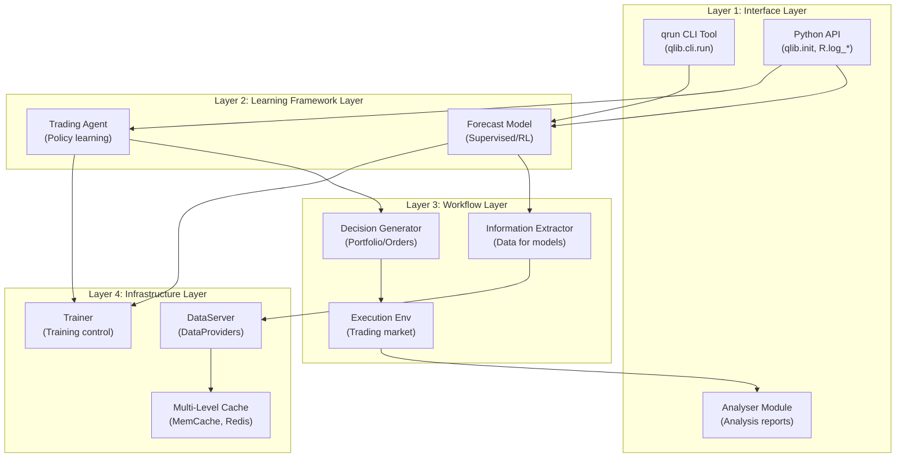

**Layer Responsibilities:**

1. **Interface Layer**: Present user-friendly interfaces and detailed analysis reports of forecasting signals and execution results [docs/introduction/introduction.rst:62-65]().
2. **Learning Framework Layer**: Trainable models (Forecast Model) and Trading Agents based on reinforcement or supervised learning [docs/introduction/introduction.rst:39-44]().
3. **Workflow Layer**: Covers the whole workflow from extraction to decision generation and execution in a nested environment [docs/introduction/introduction.rst:46-60]().
4. **Infrastructure Layer**: Provides underlying support for Quant research, including high-performance data management (`DataServer`) and flexible training interfaces (`Trainer`) [docs/introduction/introduction.rst:33-37]().

Sources: [docs/introduction/introduction.rst:1-71](), [docs/component/highfreq.rst:24-29]()

---

## Component-to-Code Mapping

This diagram maps conceptual components to actual Python classes and modules:

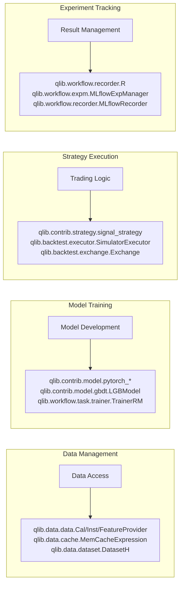

### Key Class Hierarchy

| Abstract Base | Concrete Implementations | Purpose |
|--------------|--------------------------|---------|
| `Model` | `LGBModel`, `GRU`, `LSTM`, `ALSTM`, `TabNet`, `TCN` | Forecasting stock returns [examples/benchmarks/README.md:27-46]() |
| `BaseStrategy` | `TopkDropoutStrategy`, `TWAPStrategy` | Converting predictions to trades [docs/introduction/introduction.rst:51-53]() |
| `BaseExecutor` | `SimulatorExecutor`, `NestedExecutor` | Simulating order execution [docs/component/highfreq.rst:24-29]() |
| `DataHandler` | `DataHandlerLP`, `Alpha158`, `Alpha360` | Feature engineering pipelines [examples/benchmarks/README.md:25-48]() |
| `Trainer` | `TrainerR`, `TrainerRM`, `DelayTrainerRM` | Model training orchestration [docs/introduction/introduction.rst:35-37]() |

Sources: [docs/introduction/introduction.rst:33-65](), [examples/benchmarks/README.md:23-73]()

---

## Typical Research Workflow

### End-to-End Pipeline

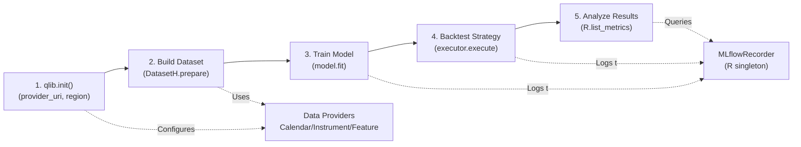

### Code Example Flow

```python
# 1. Initialize system [docs/start/initialization.rst:24-33]
import qlib
from qlib.constant import REG_CN
qlib.init(provider_uri="~/.qlib/qlib_data/cn_data", region=REG_CN)

# 2. Prepare dataset [examples/benchmarks/README.md:25]
from qlib.contrib.data.handler import Alpha158
# dataset = DatasetH(handler=Alpha158(instruments="csi300"))

# 3. Train model [examples/benchmarks/README.md:45]
from qlib.contrib.model.gbdt import LGBModel
model = LGBModel()
# model.fit(dataset)

# 4. Backtest [docs/component/highfreq.rst:24-29]
# strategy = TopkDropoutStrategy(model=model, topk=50)
# executor = SimulatorExecutor()
# portfolio = executor.execute(strategy=strategy)

# 5. Analyze [examples/run_all_model.py:151-165]
from qlib.workflow import R
# recorder = R.get_recorder(recorder_id=id, experiment_name=name)
# metrics = recorder.list_metrics()
```

**Automated Alternative**: Use the `qrun` tool with a YAML configuration to automate the entire pipeline [docs/introduction/introduction.rst:62-65]().

Sources: [docs/start/initialization.rst:24-33](), [docs/introduction/introduction.rst:46-65](), [examples/run_all_model.py:151-165]()

---

## Design Philosophy

### Modularity and Loose Coupling

Qlib components are designed as loose-coupled modules where each component can be used stand-alone [docs/introduction/introduction.rst:23-27]().

- **Data layer**: High-performance infrastructure for raw data management [docs/introduction/introduction.rst:33-35]().
- **Model layer**: Flexible interfaces for supervised and reinforcement learning [docs/introduction/introduction.rst:39-44]().
- **Execution layer**: Nested decision framework supporting multiple levels of strategy and executor [docs/component/highfreq.rst:20-29]().

### Performance-First Data Architecture

The data layer achieves significant speedup over traditional databases through a multi-level caching system and binary storage format.

1. **Binary format**: Optimized storage for fast retrieval (converted from CSV via `get_data.py`) [docs/start/initialization.rst:15-19]().
2. **Expression caching**: Domain-specific language for feature definition with multi-process kernel support [docs/start/initialization.rst:96-98]().
3. **Redis integration**: The lock and cache mechanism relies on Redis for high performance [docs/start/initialization.rst:53-65]().

Sources: [docs/start/initialization.rst:15-98](), [docs/introduction/introduction.rst:33-37]()

---

## Nested Decision Execution Framework

Qlib supports joint backtesting of daily trading (e.g., portfolio management) and intraday trading (e.g., order execution) [docs/component/highfreq.rst:11-20]().

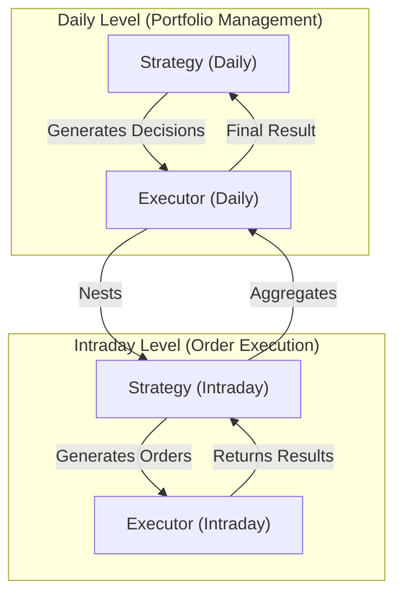

This framework allows users to explore the effects of combining different levels of trading strategies and breaks down optimization barriers between levels [docs/component/highfreq.rst:24-29]().

Sources: [docs/component/highfreq.rst:1-30]()

---

## Model Zoo and Benchmarks

Qlib includes 20+ pre-implemented models across multiple paradigms, evaluated on standard datasets like `Alpha158` and `Alpha360` [examples/benchmarks/README.md:1-11]().

### Key Model Paradigms
- **GBDT Variants**: LightGBM, XGBoost, CatBoost [examples/benchmarks/README.md:41-45]().
- **Deep Learning**: GRU, LSTM, ALSTM, TCN, Transformer, Localformer, TFT [examples/benchmarks/README.md:29-43]().
- **Specialized Architectures**: TabNet, SFM, GATs, TRA, DoubleEnsemble [examples/benchmarks/README.md:35-46]().

**Performance Metrics**: Evaluated using IC (Information Coefficient), ICIR, Rank IC, Annualized Return, and Information Ratio [examples/benchmarks/README.md:27-28](). Systematic evaluation is supported via `run_all_model.py` [examples/run_all_model.py:134-165]().

Sources: [examples/benchmarks/README.md:1-73](), [examples/run_all_model.py:134-165]()

---

## Next Steps

1. **Installation**: Follow the guide in [Installation and Setup](#2) using `pip install pyqlib` or from source [docs/start/installation.rst:16-33]().
2. **Initialization**: Initialize Qlib with your data provider URI and region [docs/start/initialization.rst:24-33]().
3. **Run Benchmarks**: Try existing models using the `examples/benchmarks` directory [examples/benchmarks/README.md:1-11]().
4. **Custom Development**: Extend `Model`, `BaseStrategy`, or `DataHandler` for custom research [docs/introduction/introduction.rst:67-68]().

Sources: [docs/start/installation.rst:1-47](), [docs/start/initialization.rst:1-98]()

---

# Page: Installation and Setup

# Installation and Setup

<details>
<summary>Relevant source files</summary>

The following files were used as context for generating this wiki page:

- [.github/workflows/test_qlib_from_pip.yml](.github/workflows/test_qlib_from_pip.yml)
- [.github/workflows/test_qlib_from_source.yml](.github/workflows/test_qlib_from_source.yml)
- [.github/workflows/test_qlib_from_source_slow.yml](.github/workflows/test_qlib_from_source_slow.yml)
- [Makefile](Makefile)
- [pyproject.toml](pyproject.toml)
- [qlib/__init__.py](qlib/__init__.py)
- [qlib/config.py](qlib/config.py)
- [qlib/data/base.py](qlib/data/base.py)
- [qlib/data/client.py](qlib/data/client.py)
- [qlib/data/data.py](qlib/data/data.py)
- [qlib/data/ops.py](qlib/data/ops.py)
- [qlib/utils/__init__.py](qlib/utils/__init__.py)
- [setup.py](setup.py)
- [tests/test_pit.py](tests/test_pit.py)

</details>


This page covers the complete installation and setup process for Qlib, including system requirements, installation methods, data preparation, and initial configuration. This establishes the foundation for using Qlib's quantitative investment platform.

For detailed instructions on specific installation environments, see [Package Installation](#2.1). For comprehensive details on system configuration parameters, see [System Initialization with qlib.init](#2.2).

## System Requirements

Qlib supports multiple platforms and Python versions with specific requirements for optimal performance.

### Supported Platforms and Python Versions

| Platform | Python 3.8 | Python 3.9 | Python 3.10 | Python 3.11 | Python 3.12 |
|----------|-------------|-------------|--------------|-------------|--------------|
| Linux (Ubuntu 22.04/24.04) | ✓ | ✓ | ✓ | ✓ | ✓ |
| Windows | ✓ | ✓ | ✓ | ✓ | ✓ |
| macOS (14/15) | ✓ | ✓ | ✓ | ✓ | ✓ |

**Environment Recommendations:**
- **Conda/Miniconda**: Recommended for dependency management.
- **Python Version**: Python 3.8+ is required [pyproject.toml:23-23]().
- **Memory**: Minimum 8GB RAM for data processing workloads.
- **Storage**: Sufficient space for financial datasets (typically 1-10GB depending on data range).

Sources: [.github/workflows/test_qlib_from_source.yml:14-25](), [pyproject.toml:6-19](), [pyproject.toml:23-23]()

## Installation Methods

Qlib provides two primary installation approaches: pip installation for standard usage and source installation for development or accessing the latest features.

### Installation Flow Overview

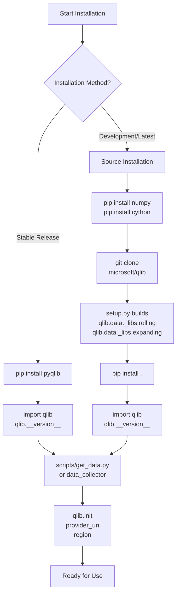

Sources: [setup.py:9-24](), [.github/workflows/test_qlib_from_pip.yml:37-43](), [.github/workflows/test_qlib_from_source.yml:28-60]()

### Pip and Source Installation

- **Pip**: The simplest method for stable releases: `pip install pyqlib` [pyproject.toml:20-20]().
- **Source**: Required for development or specific hardware optimizations (e.g., macOS libomp for LightGBM).
- **Docker**: Pre-configured environments for reproducible research.

For step-by-step commands for all methods, see [Package Installation](#2.1).

## Dependencies and Build System

### Core Dependencies Architecture

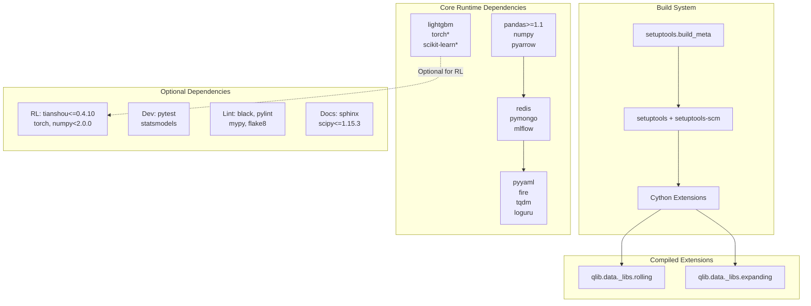

Sources: [pyproject.toml:1-3](), [pyproject.toml:27-57](), [pyproject.toml:59-108](), [setup.py:9-24]()

### Compiled Extensions

Qlib includes C++ extensions compiled from Cython for performance-critical operations like rolling and expanding windows. These are defined in `setup.py` [setup.py:9-24]() and can be manually built using the `Makefile` [Makefile:61-69]().

| Extension Module | Source File | Purpose |
|-----------------|-------------|----------|
| `qlib.data._libs.rolling` | `qlib/data/_libs/rolling.pyx` | Fast rolling window calculations [setup.py:12-13]() |
| `qlib.data._libs.expanding` | `qlib/data/_libs/expanding.pyx` | Fast expanding window operations [setup.py:18-19]() |

Sources: [setup.py:11-23](), [Makefile:61-69]()

## Data Preparation

### Data Preparation Pipeline

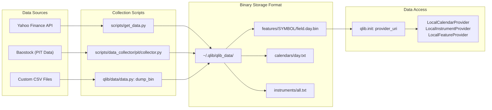

Sources: [qlib/__init__.py:61-84](), [.github/workflows/test_qlib_from_source.yml:90-94](), [qlib/data/data.py:65-69]()

### Initialization Configuration

The `qlib.init` function is the central entry point for configuring the environment. It sets the data provider URI, market region, and infrastructure backends like Redis or MongoDB [qlib/__init__.py:25-57](). It also handles the mounting of NFS paths if configured [qlib/__init__.py:61-76]().

```python
import qlib
from qlib.constant import REG_CN

qlib.init(
    provider_uri="~/.qlib/qlib_data/cn_data",
    region=REG_CN,
    redis_host="127.0.0.1",
    logging_level="INFO"
)
```

For a comprehensive guide to all `qlib.init` parameters and their impact on system behavior, see [System Initialization with qlib.init](#2.2).

Sources: [qlib/__init__.py:25-57](), [qlib/config.py:135-185](), [qlib/utils/__init__.py:43-50]()

## Installation Verification

After installation, verify the setup by running a benchmark workflow or checking data access.

- **Import Check**: `import qlib; print(qlib.__version__)` [qlib/__init__.py:7-11]().
- **Workflow Test**: Use the `qrun` CLI tool to run a standard benchmark workflow from a YAML configuration file [pyproject.toml:120-120]().
- **Data Check**: Verify data access using providers like `CalendarProvider` [qlib/data/data.py:65-71]().

```bash
# Run a benchmark workflow to verify installation
qrun examples/benchmarks/LightGBM/workflow_config_lightgbm_Alpha158.yaml
```

Sources: [.github/workflows/test_qlib_from_pip.yml:58-61](), [pyproject.toml:120-120](), [qlib/data/data.py:65-90]()

---

# Page: Package Installation

# Package Installation

<details>
<summary>Relevant source files</summary>

The following files were used as context for generating this wiki page:

- [.dockerignore](.dockerignore)
- [.github/workflows/test_qlib_from_pip.yml](.github/workflows/test_qlib_from_pip.yml)
- [.github/workflows/test_qlib_from_source.yml](.github/workflows/test_qlib_from_source.yml)
- [.github/workflows/test_qlib_from_source_slow.yml](.github/workflows/test_qlib_from_source_slow.yml)
- [.readthedocs.yaml](.readthedocs.yaml)
- [Dockerfile](Dockerfile)
- [Makefile](Makefile)
- [build_docker_image.sh](build_docker_image.sh)
- [docs/Makefile](docs/Makefile)
- [docs/developer/how_to_build_image.rst](docs/developer/how_to_build_image.rst)
- [docs/requirements.txt](docs/requirements.txt)
- [pyproject.toml](pyproject.toml)
- [qlib/data/client.py](qlib/data/client.py)
- [setup.py](setup.py)
- [tests/test_pit.py](tests/test_pit.py)

</details>


This document describes how to install the Qlib package, including installation methods, system requirements, dependency management, and platform-specific considerations. For configuration of the installed package, see [System Initialization with qlib.init](2.2). For building and distributing the package as a maintainer, see [Package Build System](11.1).

## Overview

Qlib can be installed via three primary methods:
1. **From PyPI** - Quick installation of the stable release as package `pyqlib` [pyproject.toml:20-20]().
2. **From Source** - Development installation with editable mode and all optional dependencies [Makefile:85-108]().
3. **Via Docker** - Pre-configured environments for stable or nightly versions [Dockerfile:1-32]().

The package includes Cython-compiled extensions for performance-critical operations and supports multiple optional feature groups for specialized use cases.

Sources: [pyproject.toml:1-120](), [setup.py:1-24](), [Dockerfile:1-32]()

## Installation Methods

### Installation from PyPI

The simplest installation method uses pip to install the published package from PyPI:

```bash
pip install pyqlib
```

This installs the core package with all required dependencies. The package name on PyPI is `pyqlib`, not `qlib` [pyproject.toml:20-20]().

**PyPI Installation Flow**

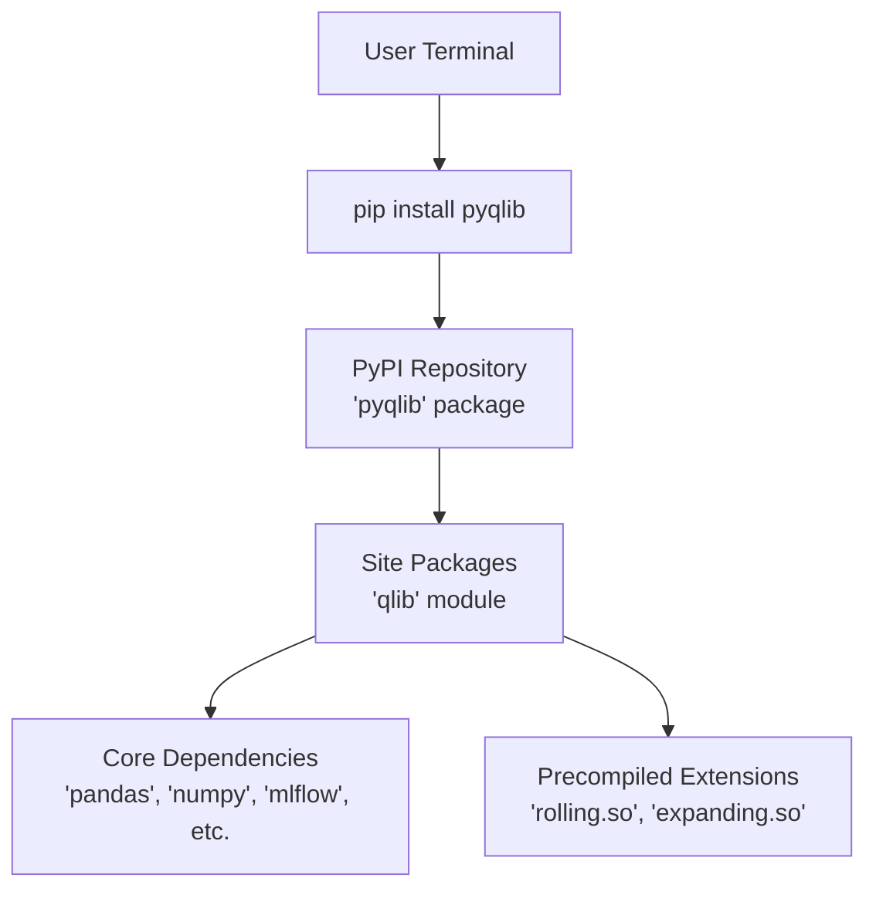

The PyPI distribution includes precompiled binary wheels for common platforms, so compilation of Cython extensions is usually not required for end-users.

Sources: [.github/workflows/test_qlib_from_pip.yml:41-43](), [pyproject.toml:20-20]()

### Installation from Source

For development or to access the latest features, install from the GitHub repository:

```bash
# Clone the repository
git clone https://github.com/microsoft/qlib.git
cd qlib

# Install with all development dependencies
make dev
```

The `make dev` target performs the following operations:

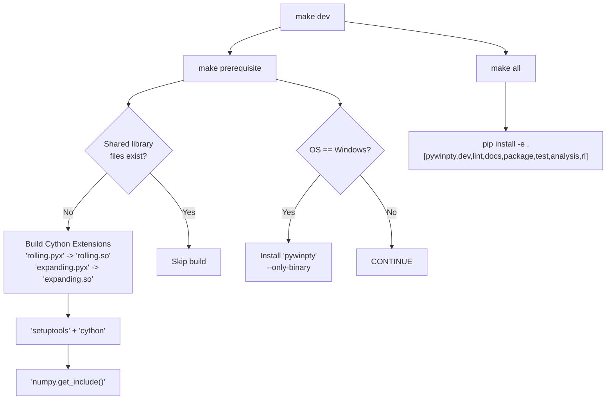

**Source Installation Build Process**

The build process compiles two Cython extensions located in `qlib/data/_libs/` [setup.py:12-22](). These extensions implement performance-critical operations:
- `rolling.pyx` → `rolling.so` - Rolling window operations [setup.py:12-13]().
- `expanding.pyx` → `expanding.so` - Expanding window operations [setup.py:18-19]().

Sources: [Makefile:61-69](), [Makefile:111-112](), [setup.py:10-23]()

### Docker Installation

Qlib provides a `Dockerfile` for containerized deployment [Dockerfile:1-32]().

**Docker Build Options**
- **Stable Version**: Uses `pip install pyqlib` [Dockerfile:27-28]().
- **Nightly Version**: Uses the current source code via `python setup.py install` [Dockerfile:29-31]().

```bash
# Build stable version
docker build --build-arg IS_STABLE=yes -t qlib_stable -f ./Dockerfile .

# Build nightly version
docker build --build-arg IS_STABLE=no -t qlib_nightly -f ./Dockerfile .
```

The Docker image is based on `continuumio/miniconda3:latest` and creates a `qlib_env` with Python 3.8 [Dockerfile:1-10]().

Sources: [Dockerfile:1-32](), [docs/developer/how_to_build_image.rst:1-82]()

## System Requirements

### Python Version Support

| Python Version | Support Status |
|----------------|----------------|
| 3.8 | ✓ Supported [pyproject.toml:14-14]() |
| 3.9 | ✓ Supported [pyproject.toml:15-15]() |
| 3.10 | ✓ Supported [pyproject.toml:16-16]() |
| 3.11 | ✓ Supported [pyproject.toml:17-17]() |
| 3.12 | ✓ Supported [pyproject.toml:18-18]() |
| 3.7 and earlier | ✗ Not supported [ .github/workflows/test_qlib_from_source.yml:22-25]() |

The minimum Python version is specified as `>=3.8.0` [pyproject.toml:23-23]().

Sources: [pyproject.toml:23-23](), [.github/workflows/test_qlib_from_source.yml:25-25]()

### Operating System Support

Qlib is tested on the following platforms:

| Operating System | CI Testing | Notes |
|-----------------|------------|-------|
| Ubuntu 22.04/24.04 | ✓ | Primary Linux target [.github/workflows/test_qlib_from_source.yml:21-21]() |
| Windows (latest) | ✓ | Requires special `pywinpty` handling [Makefile:71-73]() |
| macOS 14/15 | ✓ | Apple Silicon support with specific threading limits [.github/workflows/test_qlib_from_source.yml:111-126]() |

Sources: [.github/workflows/test_qlib_from_source.yml:18-21]()

## Core Dependencies

The following table lists required dependencies from `pyproject.toml` [pyproject.toml:27-57]():

| Package | Purpose | Version Constraint |
|---------|---------|-------------------|
| `numpy` | Numerical computing | ≥1.24.0 (build) [pyproject.toml:2-2]() |
| `pandas` | Data manipulation | ≥1.1 [pyproject.toml:33-33]() |
| `mlflow` | Experiment tracking | Any [pyproject.toml:37-37]() |
| `filelock` | Concurrent access | ≥3.16.0 [pyproject.toml:38-38]() |
| `redis` | Caching | Any [pyproject.toml:39-39]() |
| `pymongo` | Task management | Any [pyproject.toml:45-45]() |
| `lightgbm` | Default GBDT model | Any [pyproject.toml:47-47]() |

**Core Dependency Architecture**

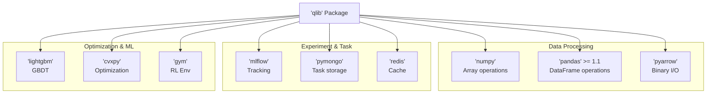

Sources: [pyproject.toml:27-57]()

## Optional Feature Groups

Qlib provides optional dependency groups [pyproject.toml:59-108]():

| Group | Installation | Purpose |
|-------|--------------|---------|
| `rl` | `pip install -e .[rl]` | Reinforcement Learning (`tianshou`, `torch`) [pyproject.toml:67-71]() |
| `test` | `pip install -e .[test]` | Data collection tests (`yahooquery`, `baostock`) [pyproject.toml:97-100]() |
| `docs` | `pip install -e .[docs]` | Sphinx documentation (`scipy<=1.15.3`) [pyproject.toml:82-91]() |
| `analysis`| `pip install -e .[analysis]`| Plotly and Statsmodels [pyproject.toml:101-104]() |

Sources: [pyproject.toml:59-108](), [Makefile:82-105]()

## Platform-Specific Considerations

### macOS (Apple Silicon)
- **LightGBM**: Must be installed with `--no-binary=:all:` after installing `libomp` via brew [.github/workflows/test_qlib_from_source.yml:95-100]().
- **Threading**: To prevent segmentation faults, export `OMP_NUM_THREADS=1` and `MKL_NUM_THREADS=1` before running scripts [.github/workflows/test_qlib_from_source.yml:118-123]().

### Windows
- **PyWinPTY**: Installed as a binary wheel to avoid local compilation issues [Makefile:58-60, 71-73]().

## Cython Extension Compilation

The `Makefile` target `prerequisite` handles the compilation of performance modules [Makefile:61-69]().

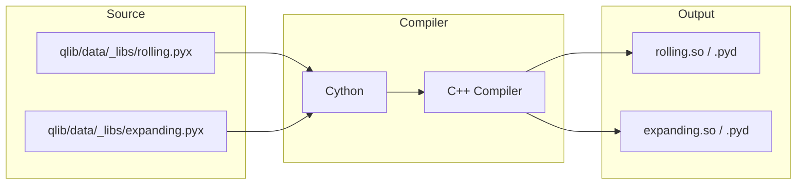

Sources: [setup.py:10-23](), [Makefile:61-69]()

## Installation Verification

After installation, verify the setup by running a benchmark workflow using the `qrun` CLI [pyproject.toml:120-120]():

```bash
# Download sample data
python scripts/get_data.py qlib_data --name qlib_data_simple --target_dir ~/.qlib/qlib_data/cn_data --region cn

# Run a benchmark
qrun examples/benchmarks/LightGBM/workflow_config_lightgbm_Alpha158.yaml
```

Sources: [.github/workflows/test_qlib_from_pip.yml:53-60](), [pyproject.toml:120-120]()

---

# Page: System Initialization with qlib.init

# System Initialization with qlib.init

<details>
<summary>Relevant source files</summary>

The following files were used as context for generating this wiki page:

- [CHANGES.rst](CHANGES.rst)
- [docs/_static/img/online_serving.png](docs/_static/img/online_serving.png)
- [docs/advanced/alpha.rst](docs/advanced/alpha.rst)
- [docs/advanced/task_management.rst](docs/advanced/task_management.rst)
- [docs/component/data.rst](docs/component/data.rst)
- [docs/component/model.rst](docs/component/model.rst)
- [docs/component/online.rst](docs/component/online.rst)
- [docs/component/report.rst](docs/component/report.rst)
- [docs/component/strategy.rst](docs/component/strategy.rst)
- [docs/conf.py](docs/conf.py)
- [docs/index.rst](docs/index.rst)
- [docs/introduction/quick.rst](docs/introduction/quick.rst)
- [docs/reference/api.rst](docs/reference/api.rst)
- [docs/start/getdata.rst](docs/start/getdata.rst)
- [docs/start/integration.rst](docs/start/integration.rst)
- [qlib/__init__.py](qlib/__init__.py)
- [qlib/config.py](qlib/config.py)
- [qlib/data/base.py](qlib/data/base.py)
- [qlib/data/data.py](qlib/data/data.py)
- [qlib/data/ops.py](qlib/data/ops.py)
- [qlib/utils/__init__.py](qlib/utils/__init__.py)

</details>


## Purpose and Scope

This page provides a comprehensive technical guide to the initialization of the Qlib system via the `qlib.init` function. It details the configuration parameters, the internal data flow of the initialization process, and how Qlib manages global state, data providers, caching, and experiment tracking. This is the primary entry point for any Qlib-based workflow.

---

## Initialization Process Overview

Qlib uses a global configuration singleton to manage system-wide settings. The `qlib.init` function orchestrates the transition from an uninitialized state to a ready state by parsing user arguments, setting up the `Config` object, and registering core components.

### High-Level Initialization Flow

The following diagram illustrates the sequence of operations triggered by `qlib.init`.

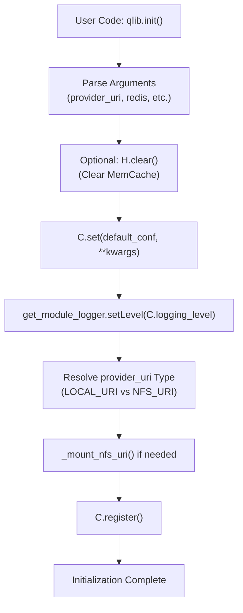
Sources: [qlib/__init__.py:25-82](), [qlib/config.py:64-123]()

---

## Core Initialization Components

### The `qlib.init()` Function

The `qlib.init` function is defined in the package root. It accepts a configuration mode and various keyword arguments that override default settings.

**Function Signature**: [qlib/__init__.py:25-41]()

```python
def init(default_conf="client", **kwargs):
    """
    Parameters
    ----------
    default_conf: str
        the default value is client. Accepted values: client/server.
    **kwargs :
        clear_mem_cache: bool
            Default True; Clears the memory cache (H).
        skip_if_reg: bool
            Default False; If True, skips init if Qlib is already registered.
        provider_uri: str or dict
            Path to data.
        ... (other config overrides)
    """
```

### The Global Configuration Singleton (C)

The `Config` class (instantiated as `C`) manages all internal settings. It maintains a `_default_config` dictionary and an active `_config` dictionary.

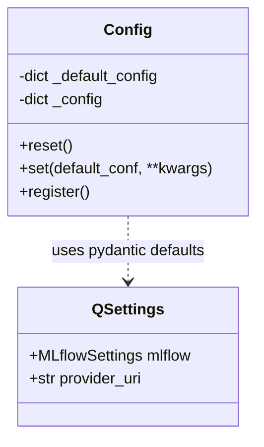

**Key Configuration Parameters**:

| Parameter | Type | Default | Description |
|-----------|------|---------|-------------|
| `provider_uri` | str/dict | `""` | Location of binary data. Can be a dict for multi-frequency. [qlib/config.py:154]() |
| `logging_level` | int | `logging.INFO` | Global logging threshold. [qlib/config.py:185]() |
| `redis_host` | str | `"127.0.0.1"` | Host for Redis-based caching. [qlib/config.py:180]() |
| `kernels` | int | `NUM_USABLE_CPU` | Number of parallel workers for data processing. [qlib/config.py:162]() |
| `mem_cache_size_limit` | int | `500` | Limit for the `MemCache` object. [qlib/config.py:170]() |

Sources: [qlib/config.py:64-185](), [qlib/__init__.py:42-58]()

---

## Data Path and NFS Management

Qlib distinguishes between local file system paths and Network File System (NFS) URIs.

### URI Resolution and Mounting

If a `provider_uri` follows the pattern `host:/path`, Qlib identifies it as an `NFS_URI` and attempts to mount it to a local `mount_path`.

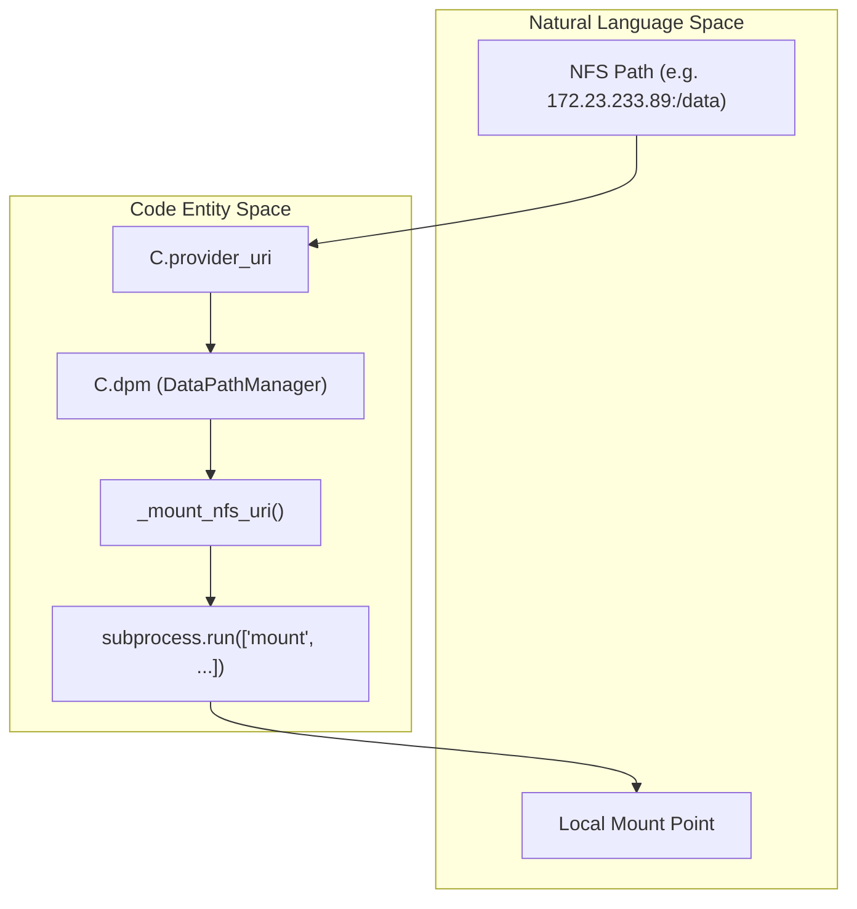

**Mounting Logic**:
- **Windows**: Uses `mount -o anon provider_uri mount_path`. [qlib/__init__.py:109-114]()
- **Linux/Unix**: Uses `sudo mount.nfs provider_uri mount_path`. [qlib/__init__.py:95]()
- **Validation**: Qlib checks if the path is already mounted by parsing the output of the `mount` command. [qlib/__init__.py:136-153]()

Sources: [qlib/__init__.py:60-76](), [qlib/__init__.py:87-160]()

---

## Caching System Initialization

During initialization, Qlib sets up the `MemCache` (referred to as `H`).

### Memory Cache (H) Structure

The `H` object is an instance of `MemCache` and contains specialized cache units for calendars, instruments, and features.

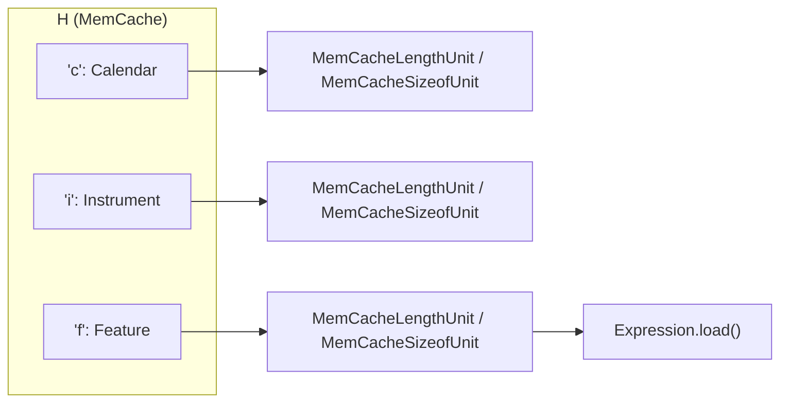

**Implementation Details**:
- `MemCache` is initialized based on `C.mem_cache_size_limit` and `C.mem_cache_limit_type`. [qlib/config.py:170-171]()
- `Expression.load()` uses `H["f"]` to avoid redundant calculations of the same expression for the same instrument/time range. [qlib/data/base.py:184-203]()
- If `clear_mem_cache=True` is passed to `qlib.init`, `H.clear()` is called. [qlib/__init__.py:54-56]()

Sources: [qlib/data/base.py:184-203](), [qlib/__init__.py:54-56](), [qlib/config.py:170-171]()

---

## Logging Configuration

Qlib uses a structured logging configuration defined in `C.logging_config`.

**Logging Features**:
- **Format**: Includes process ID, thread name, timestamp, and line numbers. [qlib/config.py:191-193]()
- **Filters**: Includes a `LogFilter` to suppress specific warnings, such as "data not found". [qlib/config.py:195-200]()
- **Level**: Controlled by `C.logging_level` (set via `qlib.init`). [qlib/__init__.py:58]()

Sources: [qlib/config.py:188-214](), [qlib/__init__.py:58]()

---

## Experiment Manager and Task Management

Qlib initialization sets up the environment for experiment tracking and distributed task management.

### MLflow Integration
By default, Qlib uses `MLflowSettings` to configure an MLflow-backed experiment manager.
- **Default URI**: `file:./mlruns`. [qlib/config.py:35]()
- **Prefix**: Environment variables starting with `QLIB_` can override these settings via Pydantic. [qlib/config.py:55-58]()

### Redis and MongoDB
- **Redis**: Used for `DiskDatasetCache` and `DiskExpressionCache`. The connection is established using `get_redis_connection()` which pulls host/port from `C`. [qlib/utils/__init__.py:43-50]()
- **MongoDB**: Used for persistent task management. Connection details like `mongo_host` and `mongo_port` are stored in the global config. [qlib/config.py:239-242]()

Sources: [qlib/config.py:34-61](), [qlib/utils/__init__.py:43-50](), [qlib/config.py:239-242]()

---

# Page: Core System Architecture

# Core System Architecture

<details>
<summary>Relevant source files</summary>

The following files were used as context for generating this wiki page:

- [CHANGES.rst](CHANGES.rst)
- [README.md](README.md)
- [docs/_static/img/online_serving.png](docs/_static/img/online_serving.png)
- [docs/advanced/alpha.rst](docs/advanced/alpha.rst)
- [docs/advanced/task_management.rst](docs/advanced/task_management.rst)
- [docs/component/data.rst](docs/component/data.rst)
- [docs/component/model.rst](docs/component/model.rst)
- [docs/component/online.rst](docs/component/online.rst)
- [docs/component/report.rst](docs/component/report.rst)
- [docs/component/strategy.rst](docs/component/strategy.rst)
- [docs/conf.py](docs/conf.py)
- [docs/index.rst](docs/index.rst)
- [docs/introduction/quick.rst](docs/introduction/quick.rst)
- [docs/reference/api.rst](docs/reference/api.rst)
- [docs/start/getdata.rst](docs/start/getdata.rst)
- [docs/start/initialization.rst](docs/start/initialization.rst)
- [docs/start/installation.rst](docs/start/installation.rst)
- [docs/start/integration.rst](docs/start/integration.rst)
- [examples/benchmarks/README.md](examples/benchmarks/README.md)
- [examples/benchmarks/TFT/README.md](examples/benchmarks/TFT/README.md)
- [examples/benchmarks/TFT/requirements.txt](examples/benchmarks/TFT/requirements.txt)
- [examples/run_all_model.py](examples/run_all_model.py)
- [qlib/__init__.py](qlib/__init__.py)
- [qlib/config.py](qlib/config.py)
- [qlib/data/base.py](qlib/data/base.py)
- [qlib/data/data.py](qlib/data/data.py)
- [qlib/data/ops.py](qlib/data/ops.py)
- [qlib/utils/__init__.py](qlib/utils/__init__.py)

</details>


## Purpose and Scope

This document describes the overall architecture of Qlib, a quantitative investment platform designed for AI-oriented research and production deployment. It covers the major architectural layers, component interactions, initialization process, and design patterns that enable Qlib's modular and extensible structure.

For detailed information about specific subsystems, see:
- Data management details: [Data Management System](#4)
- Model development: [Model Development](#5)
- Strategy execution and backtesting: [Backtesting and Strategy Execution](#7)
- Workflow automation: [Workflow and Experiment Management](#8)

**Sources:** [README.md:82-140](), [qlib/config.py:39-61](), [docs/component/data.rst:7-30]()

## Architectural Overview

Qlib follows a layered architecture with loosely-coupled components that can be used independently or orchestrated together. The system is organized into four primary layers:

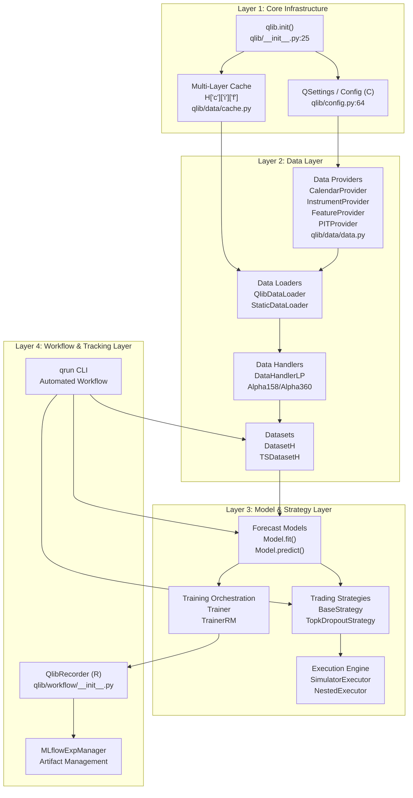

**Diagram: Qlib Four-Layer Architecture**

**Sources:** [README.md:144-157](), [docs/component/data.rst:24-30](), [qlib/data/data.py:65-203](), [qlib/__init__.py:25-86]()

## System Initialization and Configuration

### Initialization Process

The `qlib.init()` function is the entry point that configures and registers all system components. It populates the global configuration object `C` and initializes storage providers.

The initialization process performs the following steps:
1. **Configuration Loading**: Merges default configuration with user parameters using the `Config` class [qlib/config.py:64-106]().
2. **Logging Setup**: Configures Python logging based on `logging_config` [qlib/config.py:188-214]().
3. **Path Resolution**: Resolves and validates `provider_uri` for data access. It handles local paths, NFS mounts, and region-specific shortcuts [qlib/__init__.py:61-79](), [qlib/config.py:53-54]().
4. **Provider Registration**: Registers data providers like `LocalCalendarProvider` and `LocalFeatureProvider` defined in the default config [qlib/config.py:136-143]().
5. **Cache Initialization**: Clears or initializes memory cache `H` [qlib/__init__.py:54-56]().

**Sources:** [qlib/config.py:39-154](), [qlib/__init__.py:25-86](), [docs/start/initialization.rst:10-98]()

### Global Singleton Pattern

Qlib uses global singleton wrappers for core functionality to ensure consistency across the research pipeline.

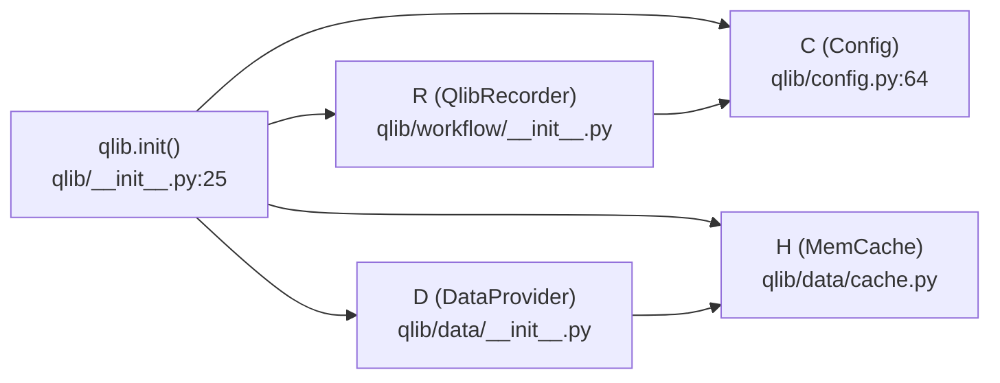

**Diagram: Global Singleton Components**

- **C**: Configuration object providing system-wide settings like `provider_uri` and `redis_host` [qlib/config.py:64-123]().
- **R**: Recorder for experiment tracking, wrapping MLflow settings [qlib/config.py:34-37](), [qlib/workflow/__init__.py:23]().
- **D**: Data access wrapper for various providers [qlib/data/data.py:65-198]().
- **H**: Memory cache organized by type: `H['c']` (calendar), `H['i']` (instrument), `H['f']` (feature) [qlib/data/cache.py:165-174]().

**Sources:** [qlib/config.py:64-154](), [qlib/data/cache.py:137-180](), [qlib/utils/__init__.py:43-50](), [qlib/__init__.py:42-43]()

## Data Layer Architecture

The Data Layer implements a provider-based architecture with multiple abstraction levels to decouple storage from logic.

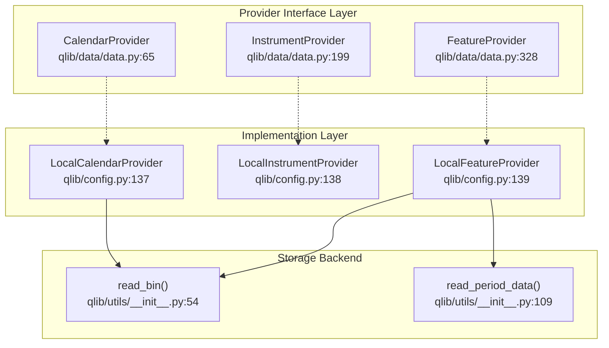

**Diagram: Data Provider Architecture**

| Provider Type | Key Interface Method | Purpose |
|--------------|----------------------|---------|
| `CalendarProvider` | `calendar()` | Returns trading calendar for a frequency [qlib/data/data.py:71-109]() |
| `InstrumentProvider` | `instruments()` | Returns stock pool for a market [qlib/data/data.py:206-222]() |
| `FeatureProvider` | `feature()` | Returns raw feature data [qlib/data/data.py:334]() |

**Sources:** [qlib/data/data.py:65-350](), [qlib/utils/__init__.py:54-173](), [docs/component/data.rst:10-30](), [qlib/config.py:135-143]()

### Expression Engine

The expression engine evaluates formulaic alphas using operator overloading. It transforms strings like `Ref($close, 1) / $close` into an executable operator tree.

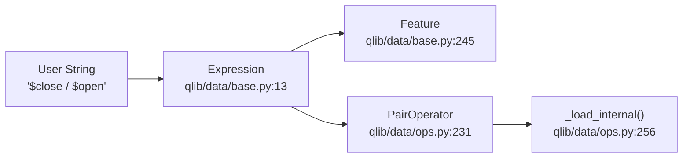

**Diagram: Expression Evaluation Flow**

Key components:
- `Expression`: Abstract base class for data calculation [qlib/data/base.py:13-24]().
- `Operators`: Implements arithmetic and rolling operations (e.g., `Add`, `Sub`, `Ref`, `Mean`) [qlib/data/ops.py:1-253]().
- `rolling.pyx` & `expanding.pyx`: Cython implementations for high-performance rolling and expanding window operations [qlib/data/ops.py:18-20]().

**Sources:** [qlib/data/base.py:13-142](), [qlib/data/ops.py:1-253](), [docs/component/data.rst:27-28]()

## Model and Training Layer

### Model Interface

All models in Qlib must implement the `Model` base class interface, ensuring compatibility with the automated workflow and `Trainer` infrastructure.

- `fit(dataset)`: Trains the model using a `DatasetH` object [docs/component/strategy.rst:129]().
- `predict(dataset)`: Returns predictions as a pandas DataFrame with `<datetime, instrument>` index, typically containing a `score` column [docs/component/strategy.rst:109-128]().

**Sources:** [docs/component/strategy.rst:104-136](), [examples/benchmarks/README.md:2-11](), [examples/run_all_model.py:134-166]()

## Strategy and Execution Layer

### Strategy Interface

Trading strategies generate trade decisions from model predictions. The base class is `BaseStrategy`.

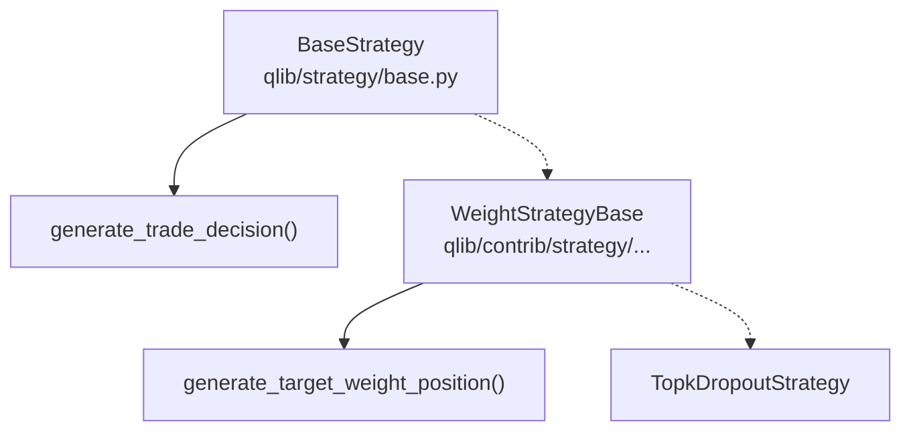

**Diagram: Strategy Class Hierarchy**

- `generate_trade_decision`: The key interface called by the executor at each trading bar [docs/component/strategy.rst:27-30]().
- `TopkDropoutStrategy`: Implements the `Topk-Drop` algorithm for portfolio rebalancing based on prediction scores [docs/component/strategy.rst:62-80]().
- `EnhancedIndexingStrategy`: Combines active management with benchmark tracking [docs/component/strategy.rst:91-98]().

**Sources:** [docs/component/strategy.rst:19-98](), [qlib/config.py:249-252]()

## Caching Architecture

Qlib implements a multi-level caching system to accelerate data retrieval and feature calculation.

| Cache Level | Implementation | Key Config |
|-------------|----------------|------------|
| **Memory Cache** | `MemCache` / `H` | `mem_cache_size_limit`, `mem_cache_expire` [qlib/config.py:170-174]() |
| **Expression Cache** | `DiskExpressionCache` | `DISK_EXPRESSION_CACHE` [qlib/config.py:131]() |
| **Dataset Cache** | `DiskDatasetCache` | `DISK_DATASET_CACHE` [qlib/config.py:129]() |

The `MemCache` uses an `OrderedDict` with LRU logic to store `Calendar`, `Instrument`, and `Feature` data [qlib/data/cache.py:44-80](). Redis is utilized for distributed lock and cross-process caching [qlib/utils/__init__.py:43-50](), [qlib/config.py:180-183]().

**Sources:** [qlib/data/cache.py:44-180](), [qlib/config.py:127-183](), [docs/component/data.rst:21-22](), [qlib/utils/__init__.py:43-50]()

## System Data Flow

The end-to-end data flow from storage to prediction:

1. **Storage**: Data stored in `.bin` files via `read_bin` [qlib/utils/__init__.py:54]().
2. **Provider**: `FeatureProvider` retrieves raw series [qlib/data/data.py:328]().
3. **Expression**: `Operators` compute complex features [qlib/data/ops.py:1]().
4. **Handler**: `DataHandlerLP` applies learnable processors (normalization, filtering) [docs/component/data.rst:28]().
5. **Dataset**: `DatasetH` prepares model-ready tensors from processed handler data [docs/component/data.rst:29]().
6. **Model**: `Model.predict()` generates signal scores [docs/component/strategy.rst:109]().

**Sources:** [docs/component/data.rst:24-30](), [qlib/data/data.py:65-350](), [qlib/utils/__init__.py:54-109]()

---

# Page: Data Management System

# Data Management System

<details>
<summary>Relevant source files</summary>

The following files were used as context for generating this wiki page:

- [CHANGES.rst](CHANGES.rst)
- [docs/_static/img/online_serving.png](docs/_static/img/online_serving.png)
- [docs/advanced/alpha.rst](docs/advanced/alpha.rst)
- [docs/advanced/task_management.rst](docs/advanced/task_management.rst)
- [docs/component/data.rst](docs/component/data.rst)
- [docs/component/model.rst](docs/component/model.rst)
- [docs/component/online.rst](docs/component/online.rst)
- [docs/component/report.rst](docs/component/report.rst)
- [docs/component/strategy.rst](docs/component/strategy.rst)
- [docs/conf.py](docs/conf.py)
- [docs/index.rst](docs/index.rst)
- [docs/introduction/quick.rst](docs/introduction/quick.rst)
- [docs/reference/api.rst](docs/reference/api.rst)
- [docs/start/getdata.rst](docs/start/getdata.rst)
- [docs/start/integration.rst](docs/start/integration.rst)
- [qlib/__init__.py](qlib/__init__.py)
- [qlib/config.py](qlib/config.py)
- [qlib/contrib/online/operator.py](qlib/contrib/online/operator.py)
- [qlib/contrib/rolling/ddgda.py](qlib/contrib/rolling/ddgda.py)
- [qlib/contrib/tuner/tuner.py](qlib/contrib/tuner/tuner.py)
- [qlib/data/base.py](qlib/data/base.py)
- [qlib/data/cache.py](qlib/data/cache.py)
- [qlib/data/data.py](qlib/data/data.py)
- [qlib/data/ops.py](qlib/data/ops.py)
- [qlib/utils/__init__.py](qlib/utils/__init__.py)
- [qlib/utils/mod.py](qlib/utils/mod.py)
- [qlib/utils/objm.py](qlib/utils/objm.py)

</details>


## Purpose and Scope

This document describes Qlib's data management architecture, which handles the complete lifecycle of financial data from collection to consumption. The system encompasses data collection pipelines, binary storage formats, multi-tier provider abstractions, sophisticated caching mechanisms, data processing pipelines, and efficient dataset preparation for model training and backtesting.

For information about model training workflows, see [Model Development](#5). For details on backtesting infrastructure, see [Backtesting and Strategy Execution](#7). For system initialization parameters, see [System Initialization with qlib.init](#2.2).

---

## Overview: Data Management Architecture

The Qlib data management system is organized into six distinct layers, each with specific responsibilities:

```mermaid
graph TB
    subgraph "Layer 1: Data Collection"
        Collectors["BaseCollector<br/>YahooCollector, FundCollector<br/>CryptoCollector, IndexCollector"]
        Normalizers["BaseNormalize<br/>YahooNormalize, FundNormalize"]
    end
    
    subgraph "Layer 2: Binary Storage"
        BinFormat["Binary Format<br/>features/*.bin<br/>calendars/*.bin<br/>instruments/*.txt"]
        PITFormat["PIT Format<br/>financial/*.data<br/>financial/*.index"]
    end
    
    subgraph "Layer 3: Data Providers"
        CalProv["CalendarProvider<br/>LocalCalendarProvider"]
        InstProv["InstrumentProvider<br/>LocalInstrumentProvider"]
        FeatProv["FeatureProvider<br/>LocalFeatureProvider"]
        PITProv["PITProvider<br/>LocalPITProvider"]
        ExprProv["ExpressionProvider<br/>LocalExpressionProvider"]
    end
    
    subgraph "Layer 4: Multi-Level Cache"
        MemCache["MemCache<br/>H['c'], H['i'], H['f']"]
        DiskCache["DiskExpressionCache<br/>DiskDatasetCache"]
        Redis["Redis<br/>Distributed Cache"]
    end
    
    subgraph "Layer 5: Data Handlers"
        Loader["DataLoader<br/>QlibDataLoader<br/>StaticDataLoader"]
        Handler["DataHandler<br/>DataHandlerLP"]
        Processors["Processors<br/>MinMaxNorm, ZScoreNorm<br/>DropnaLabel, CSRankNorm"]
    end
    
    subgraph "Layer 6: Dataset Layer"
        Dataset["Dataset<br/>DatasetH<br/>TSDatasetH"]
        Sampler["TSDataSampler<br/>idx_df, idx_map, data_arr"]
    end
    
    Collectors --> Normalizers
    Normalizers --> BinFormat
    Normalizers --> PITFormat
    
    BinFormat --> FeatProv
    BinFormat --> CalProv
    BinFormat --> InstProv
    PITFormat --> PITProv
    
    CalProv --> MemCache
    InstProv --> MemCache
    FeatProv --> MemCache
    PITProv --> MemCache
    ExprProv --> DiskCache
    
    MemCache --> Redis
    DiskCache --> Redis
    
    FeatProv --> Loader
    ExprProv --> Loader
    MemCache --> Loader
    DiskCache --> Loader
    
    Loader --> Handler
    Handler --> Processors
    Processors --> Dataset
    Dataset --> Sampler
```

**Sources:** [qlib/data/data.py:43-443](), [qlib/data/cache.py:1-210](), [docs/component/data.rst:7-30]()

---

## Layer 1: Data Collection and Normalization

The data collection layer provides a unified framework for acquiring financial data from multiple external sources and normalizing it into a consistent format. It supports various frequencies, including daily and 1-minute data [docs/component/data.rst:65-70]().

### Collector and Normalizer Hierarchy

Qlib provides specialized collectors for various asset classes. For details, see [Data Collection and Normalization](#4.1).

**Key Components:**
- **`BaseCollector`**: Abstract base for all collectors, manages concurrency and retry logic.
- **`BaseNormalize`**: Handles calendar alignment and missing data calculation.
- **Implementations**: Yahoo (Stocks), Fund, Crypto, and Index data collectors.

**Sources:** [qlib/data/data.py:43-63](), [docs/component/data.rst:79-108]()

---

## Layer 2: Binary Storage Format

Qlib stores financial data in an efficient binary format optimized for fast sequential reads and memory-mapped access [docs/component/data.rst:34-39](). For details, see [Data Storage and Binary Format](#4.2).

### Binary File Format

The binary format uses 32-bit little-endian floats (`dtype="<f"`) for space efficiency. The `read_bin` function [qlib/utils/__init__.py:54-68]() efficiently reads data by:
1. Reading the reference start index from the first 4 bytes.
2. Calculating byte offset: `4 * (si - ref_start_index) + 4`.
3. Reading `count * 4` bytes into a numpy array.

### Point-in-Time (PIT) Data Format

PIT data handles data revisions using a linked-list structure to avoid look-ahead bias [qlib/utils/__init__.py:109-173](). The record type is defined in `C.pit_record_type` [qlib/utils/__init__.py:135-142](). It uses `read_period_data` [qlib/utils/__init__.py:109-173]() to traverse the linked list and find the correct value for a given `cur_date_int`.

**Sources:** [qlib/utils/__init__.py:54-68](), [qlib/utils/__init__.py:109-173](), [qlib/config.py:124-132]()

---

## Layer 3: Data Provider Layer

The provider layer abstracts data access through a clean interface, supporting both local file storage and potential remote backends. For details, see [Data Providers and Expression Engine](#4.3).

### Provider Architecture

```mermaid
graph TB
    subgraph "qlib.data.data"
        CalendarProvider["CalendarProvider<br/>calendar(), locate_index()"]
        InstrumentProvider["InstrumentProvider<br/>instruments()"]
        FeatureProvider["FeatureProvider<br/>feature()"]
        PITProvider["PITProvider"]
        ExpressionProvider["ExpressionProvider"]
    end
    
    subgraph "qlib.data.storage"
        FileStorage["FileCalendarStorage<br/>FileInstrumentStorage<br/>FileFeatureStorage"]
    end
    
    CalendarProvider --> FileStorage
    InstrumentProvider --> FileStorage
    FeatureProvider --> FileStorage
```

**Key Providers:**
- **`CalendarProvider`** [qlib/data/data.py:65-197](): Manages trading dates and index mapping.
- **`InstrumentProvider`** [qlib/data/data.py:199-305](): Manages instrument universes (e.g., CSI300).
- **`FeatureProvider`** [qlib/data/data.py:307-336](): Accesses raw feature data from binary files.
- **`ExpressionProvider`** [qlib/data/data.py:383-443](): Evaluates the Expression DSL using operators defined in `qlib.data.ops` [qlib/data/ops.py:1-1000]().

**Sources:** [qlib/data/data.py:65-443](), [qlib/data/ops.py:1-1000]()

---

## Layer 4: Multi-Level Caching System

Qlib implements a three-tier caching architecture to minimize data loading overhead. For details, see [Multi-Level Caching System](#4.4).

### Memory Cache (`MemCache`)
The `MemCache` [qlib/data/cache.py:137-180]() uses an `OrderedDict` with LRU eviction. It supports two limit types configured via `C.mem_cache_limit_type` [qlib/data/cache.py:152-159]():
- **`MemCacheLengthUnit`** [qlib/data/cache.py:121-127](): Limits by number of items.
- **`MemCacheSizeofUnit`** [qlib/data/cache.py:129-135](): Limits by memory size using `sys.getsizeof`.

The cache is divided into units for calendars (`H['c']`), instruments (`H['i']`), and features (`H['f']`) [qlib/data/cache.py:165-172]().

### Disk Caching
- **`DiskExpressionCache`** [qlib/config.py:131](): Caches evaluated expressions to avoid re-computation.
- **`DiskDatasetCache`** [qlib/config.py:129](): Caches full processed datasets.

**Sources:** [qlib/data/cache.py:44-210](), [qlib/config.py:129-134](), [qlib/data/base.py:184-203]()

---

## Layer 5: Data Handlers and Processors

The handler layer transforms raw provider data into model-ready features using a pipeline of processors [docs/component/data.rst:27-28](). For details, see [DataHandlers and Processors](#4.5).

### DataHandler Architecture

```mermaid
graph TB
    DataHandlerABC["DataHandlerABC<br/>fetch()"]
    DataHandler["DataHandler<br/>setup_data(), fetch()"]
    DataHandlerLP["DataHandlerLP<br/>infer_processors, learn_processors"]
    
    DataHandlerABC --> DataHandler
    DataHandler --> DataHandlerLP
```

**Key Classes:**
- **`DataHandler`**: Loads data using a `DataLoader` and maintains an internal DataFrame.
- **`DataHandlerLP`**: Extends handler with "Learnable Processors" for pipelines that require fitting on training data.
- **`Processor`**: Defines `fit()` and `__call__()` for data transformations like normalization or filtering.

**Sources:** [docs/component/data.rst:19-28](), [qlib/data/data.py:22-23]()

---

## Layer 6: DataLoaders and Feature Engineering

DataLoaders load raw data from providers. For details, see [DataLoaders and Feature Engineering](#4.6).

**Key Classes:**
- **`QlibDataLoader`**: Loads data using Qlib's expression engine [qlib/data/ops.py:1-100]().
- **`StaticDataLoader`**: Loads pre-computed data from files.
- **`Alpha158` / `Alpha360`**: Standardized feature sets provided for US and China markets [docs/component/data.rst:40-48]().

**Sources:** [docs/component/data.rst:27-28](), [qlib/data/ops.py:1-250]()

---

## Layer 7: Datasets and Time-Series Sampling

Datasets prepare data for model training and inference, handling segment management (train/valid/test) [docs/component/data.rst:29](). For details, see [Datasets and Time-Series Sampling](#4.7).

**Key Classes:**
- **`DatasetH`**: A dataset wrapping a `DataHandler`.
- **`TSDatasetH`**: Specialized for time-series models, providing sliding window samples for deep learning architectures.
- **`TSDataSampler`**: Efficiently indexes into large data arrays for time-series batching.

**Sources:** [docs/component/data.rst:20-29](), [qlib/data/data.py:25-26]()

---

# Page: Data Collection and Normalization

# Data Collection and Normalization

<details>
<summary>Relevant source files</summary>

The following files were used as context for generating this wiki page:

- [docs/component/workflow.rst](docs/component/workflow.rst)
- [scripts/data_collector/base.py](scripts/data_collector/base.py)
- [scripts/data_collector/br_index/README.md](scripts/data_collector/br_index/README.md)
- [scripts/data_collector/br_index/requirements.txt](scripts/data_collector/br_index/requirements.txt)
- [scripts/data_collector/cn_index/README.md](scripts/data_collector/cn_index/README.md)
- [scripts/data_collector/cn_index/collector.py](scripts/data_collector/cn_index/collector.py)
- [scripts/data_collector/cn_index/requirements.txt](scripts/data_collector/cn_index/requirements.txt)
- [scripts/data_collector/contrib/fill_cn_1min_data/README.md](scripts/data_collector/contrib/fill_cn_1min_data/README.md)
- [scripts/data_collector/contrib/fill_cn_1min_data/fill_cn_1min_data.py](scripts/data_collector/contrib/fill_cn_1min_data/fill_cn_1min_data.py)
- [scripts/data_collector/contrib/fill_cn_1min_data/requirements.txt](scripts/data_collector/contrib/fill_cn_1min_data/requirements.txt)
- [scripts/data_collector/contrib/future_trading_date_collector/README.md](scripts/data_collector/contrib/future_trading_date_collector/README.md)
- [scripts/data_collector/contrib/future_trading_date_collector/future_trading_date_collector.py](scripts/data_collector/contrib/future_trading_date_collector/future_trading_date_collector.py)
- [scripts/data_collector/contrib/future_trading_date_collector/requirements.txt](scripts/data_collector/contrib/future_trading_date_collector/requirements.txt)
- [scripts/data_collector/crypto/collector.py](scripts/data_collector/crypto/collector.py)
- [scripts/data_collector/fund/README.md](scripts/data_collector/fund/README.md)
- [scripts/data_collector/fund/collector.py](scripts/data_collector/fund/collector.py)
- [scripts/data_collector/fund/requirements.txt](scripts/data_collector/fund/requirements.txt)
- [scripts/data_collector/index.py](scripts/data_collector/index.py)
- [scripts/data_collector/pit/README.md](scripts/data_collector/pit/README.md)
- [scripts/data_collector/pit/collector.py](scripts/data_collector/pit/collector.py)
- [scripts/data_collector/us_index/README.md](scripts/data_collector/us_index/README.md)
- [scripts/data_collector/us_index/collector.py](scripts/data_collector/us_index/collector.py)
- [scripts/data_collector/us_index/requirements.txt](scripts/data_collector/us_index/requirements.txt)
- [scripts/data_collector/utils.py](scripts/data_collector/utils.py)
- [scripts/data_collector/yahoo/README.md](scripts/data_collector/yahoo/README.md)
- [scripts/data_collector/yahoo/collector.py](scripts/data_collector/yahoo/collector.py)
- [scripts/data_collector/yahoo/requirements.txt](scripts/data_collector/yahoo/requirements.txt)

</details>


## Purpose and Scope

This document describes Qlib's data collection and normalization subsystem, which is responsible for acquiring financial market data from external sources and preparing it for use in the Qlib framework. The system handles downloading raw data from various providers (Yahoo Finance, Eastmoney, CoinGecko, Baostock, etc.), normalizing and cleaning the data, and converting it to Qlib's binary storage format.

The pipeline is designed to be modular, allowing users to implement custom collectors for different regions (CN, US, IN, BR) and asset classes (Stocks, Funds, Crypto, Indices, and Point-in-Time data).

---

## System Architecture

The data collection pipeline consists of three main stages that transform raw data from external APIs into Qlib's optimized binary format:

Title: Data Flow Architecture
```mermaid
graph TB
    subgraph "Stage 1: Data Collection"
        Sources["External Data Sources<br/>Yahoo Finance<br/>Eastmoney<br/>CoinGecko<br/>Baostock"]
        BaseCollector["BaseCollector (scripts/data_collector/base.py)<br/>Abstract Base Class"]
        YahooCollector["YahooCollector (scripts/data_collector/yahoo/collector.py)"]
        FundCollector["FundCollector (scripts/data_collector/fund/collector.py)"]
        CryptoCollector["CryptoCollector (scripts/data_collector/crypto/collector.py)"]
        IndexCollector["Index Collectors<br/>CSIIndex<br/>WIKIIndex"]
        PitCollector["PitCollector (scripts/data_collector/pit/collector.py)"]
        
        Sources --> YahooCollector
        Sources --> FundCollector
        Sources --> CryptoCollector
        Sources --> IndexCollector
        Sources --> PitCollector
        BaseCollector -.inherits.- YahooCollector
        BaseCollector -.inherits.- FundCollector
        BaseCollector -.inherits.- CryptoCollector
        BaseCollector -.inherits.- PitCollector
    end
    
    subgraph "Stage 2: Normalization"
        RawCSV["Raw CSV Files<br/>source_dir/*.csv"]
        BaseNormalize["BaseNormalize (scripts/data_collector/base.py)<br/>Abstract Base Class"]
        YahooNormalize["YahooNormalize1d<br/>YahooNormalize1min<br/>Price Adjustment<br/>Calendar Alignment"]
        NormalizedCSV["Normalized CSV Files<br/>normalize_dir/*.csv"]
        
        YahooCollector --> RawCSV
        FundCollector --> RawCSV
        CryptoCollector --> RawCSV
        
        RawCSV --> YahooNormalize
        BaseNormalize -.inherits.- YahooNormalize
        YahooNormalize --> NormalizedCSV
    end
    
    subgraph "Stage 3: Binary Conversion"
        DumpDataBase["DumpDataBase (scripts/dump_bin.py)<br/>Abstract Base Class"]
        DumpDataAll["DumpDataAll<br/>Full Dump"]
        DumpDataUpdate["DumpDataUpdate<br/>Incremental Update"]
        BinaryData["Qlib Binary Format<br/>features/SYMBOL/field.day.bin<br/>calendars/day.txt<br/>instruments/all.txt"]
        
        NormalizedCSV --> DumpDataAll
        NormalizedCSV --> DumpDataUpdate
        DumpDataBase -.inherits.- DumpDataAll
        DumpDataBase -.inherits.- DumpDataUpdate
        DumpDataAll --> BinaryData
        DumpDataUpdate --> BinaryData
    end
```

**Sources:** [scripts/data_collector/base.py:20-40](), [scripts/dump_bin.py:53-67](), [scripts/data_collector/yahoo/collector.py:48-96](), [scripts/data_collector/pit/collector.py:22-43]()

---

## Collector Hierarchy

### BaseCollector Abstract Class

`BaseCollector` defines the interface and common functionality for all data collectors. It handles concurrent downloads, retry logic, data validation, and file I/O operations.

Title: Collector Class Hierarchy
```mermaid
classDiagram
    class BaseCollector {
        +str save_dir
        +int max_workers
        +int max_collector_count
        +str interval
        +Timestamp start_datetime
        +Timestamp end_datetime
        +get_instrument_list()* List
        +normalize_symbol(symbol)* str
        +get_data(symbol, interval, start, end)* DataFrame
        +collector_data() void
        +save_instrument(symbol, df) void
        -_collector(instrument_list) List
        -_simple_collector(symbol) str
    }
    
    class YahooCollector {
        +int retry
        +_timezone* str
        +get_data_from_remote(symbol, interval, start, end)$ DataFrame
        +download_index_data()* void
        +convert_datetime(dt, timezone)$ Timestamp
    }
    
    class FundCollector {
        +_timezone* str
        +get_data_from_remote(symbol, interval, start, end)$ DataFrame
        +convert_datetime(dt, timezone)$ Timestamp
    }
    
    class CryptoCollector {
        +_timezone* str
        +get_data_from_remote(symbol, interval, start, end)$ DataFrame
    }

    class PitCollector {
        +str symbol_regex
        +get_instrument_list() List
        +get_profit_df(code, start, end)$ DataFrame
    }
    
    BaseCollector <|-- YahooCollector
    BaseCollector <|-- FundCollector
    BaseCollector <|-- CryptoCollector
    BaseCollector <|-- PitCollector
    
    YahooCollector <|-- YahooCollectorCN1d
    YahooCollector <|-- YahooCollectorUS1d
    YahooCollector <|-- YahooCollectorCN1min
    
    FundCollector <|-- FundCollectorCN1d
    CryptoCollector <|-- CryptoCollector1d
```

**Key Attributes:**

| Attribute | Type | Description |
|-----------|------|-------------|
| `save_dir` | Path | Directory where raw CSV files are saved [scripts/data_collector/base.py:67-68]() |
| `max_workers` | int | Number of concurrent download threads (default: 1) [scripts/data_collector/base.py:71]() |
| `max_collector_count` | int | Maximum retry attempts for failed symbols (default: 2) [scripts/data_collector/base.py:72]() |
| `interval` | str | Data frequency: `"1d"`, `"1min"`, `"quarterly"`, or `"annual"` [scripts/data_collector/base.py:74](), [scripts/data_collector/pit/collector.py:28-29]() |
| `check_data_length` | int | Minimum required data points for validation [scripts/data_collector/base.py:75]() |
| `delay` | float | Sleep time between requests to avoid rate limiting [scripts/data_collector/base.py:70]() |

**Key Methods:**

| Method | Purpose |
|--------|---------|
| `get_instrument_list()` | Returns list of symbols to download (abstract) [scripts/data_collector/base.py:102-104]() |
| `normalize_symbol(symbol)` | Converts symbol to standard format (abstract) [scripts/data_collector/base.py:106-109]() |
| `get_data(symbol, interval, start, end)` | Downloads data for one symbol (abstract) [scripts/data_collector/base.py:111-130]() |
| `collector_data()` | Orchestrates parallel download with retry logic [scripts/data_collector/base.py:200-217]() |
| `save_instrument(symbol, df)` | Saves symbol data to CSV file [scripts/data_collector/base.py:152-174]() |

**Sources:** [scripts/data_collector/base.py:20-217](), [scripts/data_collector/pit/collector.py:22-79]()

---

## Data Source Implementations

### Yahoo Finance Collector

The Yahoo Finance collector hierarchy supports multiple regions and frequencies. The implementation uses `yahooquery.Ticker` for data retrieval and handles region-specific symbol formats and timezones.

Title: Yahoo Collector Components
```mermaid
graph TB
    subgraph "Region-Specific Collectors"
        YahooCN["YahooCollectorCN (scripts/data_collector/yahoo/collector.py)<br/>_timezone: Asia/Shanghai<br/>normalize_symbol: sh600000/sz000001"]
        YahooUS["YahooCollectorUS<br/>_timezone: America/New_York<br/>normalize_symbol: AAPL"]
        YahooIN["YahooCollectorIN<br/>_timezone: Asia/Kolkata<br/>normalize_symbol: RELIANCE.NS"]
        YahooBR["YahooCollectorBR<br/>_timezone: Brazil/East<br/>retry: 2"]
    end
    
    subgraph "Frequency Variants"
        CN1d["YahooCollectorCN1d<br/>download_index_data:<br/>CSI300, CSI500, CSI100"]
        CN1min["YahooCollectorCN1min<br/>get_instrument_list:<br/>stocks + indices"]
    end
    
    YahooCN --> CN1d
    YahooCN --> CN1min
    
    subgraph "Symbol Logic (scripts/data_collector/utils.py)"
        HSSYM["get_hs_stock_symbols()<br/>Parse from Eastmoney API<br/>Paginated requests<br/>Result: 600000.ss, 000001.sz"]
        USSYM["get_us_stock_symbols()<br/>Eastmoney + NASDAQ + NYSE<br/>Result: AAPL, MSFT, GOOGL"]
    end
    
    CN1d --> HSSYM
```

**Implementation Details:**

1.  **Symbol Retrieval:** [scripts/data_collector/utils.py:178-276]()
    The `get_hs_stock_symbols()` function demonstrates the pagination pattern:
    *   Requests stock list from Eastmoney API in pages.
    *   Filters by market type (Shanghai/Shenzhen).
    *   Adds `.ss` suffix for Shanghai (6XXXXX), `.sz` for Shenzhen (0XXXXX/3XXXXX).
    *   Validates minimum symbol count (3900+) [scripts/data_collector/utils.py:54]().

2.  **Data Retrieval:** [scripts/data_collector/yahoo/collector.py:152-192]()
    The `get_data()` method handles different intervals:
    *   **1d data**: Single request for entire date range [scripts/data_collector/yahoo/collector.py:172-176]().
    *   **1min data**: Splits into 7-day chunks due to Yahoo API limitations [scripts/data_collector/yahoo/collector.py:177-187]().
    *   Uses `@deco_retry` decorator for automatic retry on network failures [scripts/data_collector/yahoo/collector.py:155]().

3.  **Index Data Download:** [scripts/data_collector/yahoo/collector.py:223-253]()
    For CN region, downloads benchmark indices (CSI300, CSI500, CSI100) from Eastmoney using `INDEX_BENCH_URL` [scripts/data_collector/yahoo/collector.py:45]().

**Sources:** [scripts/data_collector/yahoo/collector.py:48-365](), [scripts/data_collector/utils.py:167-449]()

---

### Specialized Asset Collectors

#### Fund Collector (Eastmoney)
Uses `INDEX_BENCH_URL` to fetch historical net value data [scripts/data_collector/fund/collector.py:23](). It excludes funds that report in "每万份收益" (income per 10k units) to ensure data consistency [scripts/data_collector/fund/collector.py:118-120](). Net asset value fields like `DWJZ` and `LJJZ` are typically collected [scripts/data_collector/fund/README.md:28]().

#### Crypto Collector (CoinGecko)
Uses `pycoingecko.CoinGeckoAPI` to fetch market charts [scripts/data_collector/crypto/collector.py:135-136](). Symbols are retrieved via `get_cg_crypto_symbols()` which queries the `get_coins_markets` endpoint [scripts/data_collector/crypto/collector.py:25-53](). It retrieves prices, market caps, and total volumes [scripts/data_collector/crypto/collector.py:137-140]().

#### PIT (Point-in-Time) Collector
Specifically designed for financial statement data (quarterly/annual) [scripts/data_collector/pit/collector.py:28-29](). It uses `baostock` to query profit data (`roeAvg`), growth data (`YOYNI`), and performance express reports [scripts/data_collector/pit/collector.py:96-170](). This collector maps publication dates (`date`) to period dates (`period`) to avoid look-ahead bias [scripts/data_collector/pit/collector.py:98-100]().

| Feature | Fund Collector | Crypto Collector | PIT Collector |
|---------|---------------|------------------|---------------|
| Data Source | Eastmoney [scripts/data_collector/fund/collector.py:23]() | CoinGecko API [scripts/data_collector/crypto/collector.py:135]() | Baostock [scripts/data_collector/pit/collector.py:127]() |
| Symbol Format | 6-digit code [scripts/data_collector/fund/collector.py:157]() | Coin ID (e.g., bitcoin) [scripts/data_collector/crypto/collector.py:136]() | exchange+code (e.g. sh600519) [scripts/data_collector/pit/collector.py:93]() |
| Frequency | 1d [scripts/data_collector/fund/collector.py:143]() | 1d [scripts/data_collector/crypto/collector.py:164]() | Quarterly/Annual [scripts/data_collector/pit/collector.py:28-29]() |
| Key Fields | DWJZ, LJJZ [scripts/data_collector/fund/README.md:28]() | price, market_cap [scripts/data_collector/crypto/collector.py:137]() | roeAvg, YOYNI [scripts/data_collector/pit/collector.py:120,170]() |

**Sources:** [scripts/data_collector/fund/collector.py:26-216](), [scripts/data_collector/crypto/collector.py:57-225](), [scripts/data_collector/pit/collector.py:22-170]()

---

## Normalization Pipeline

### BaseNormalize and Normalize Orchestration

The normalization stage processes raw CSV files to ensure data quality, consistency, and compatibility with Qlib's data model.

Title: Normalization Flow
```mermaid
graph TB
    subgraph "Orchestration Layer"
        Normalize["Normalize Class (scripts/data_collector/base.py)<br/>source_dir: raw CSVs<br/>target_dir: normalized CSVs"]
        Executor["ProcessPoolExecutor<br/>_executor(file_path)"]
    end
    
    subgraph "Normalization Implementation"
        BaseNormalize["BaseNormalize<br/>_date_field_name<br/>_symbol_field_name<br/>_calendar_list"]
        YahooNorm["YahooNormalize (scripts/data_collector/yahoo/collector.py)<br/>normalize_yahoo()<br/>calc_change()"]
        Yahoo1d["YahooNormalize1d<br/>adjusted_price()<br/>_manual_adj_data()"]
    end
    
    Normalize --> Executor
    Executor --> BaseNormalize
    BaseNormalize <|-- YahooNorm
    YahooNorm <|-- Yahoo1d
```

**Key Processing Steps:**

1.  **Calendar Alignment:** Reindexes the dataframe to the official trading calendar retrieved via `get_calendar_list` [scripts/data_collector/utils.py:57-105](). Missing days are filled with NaN [scripts/data_collector/yahoo/collector.py:406-415]().
2.  **Price Adjustment:** Calculates the adjustment factor using `adjclose / close` [scripts/data_collector/yahoo/collector.py:461](). This factor is applied to OHLC prices and inversely to volume [scripts/data_collector/yahoo/collector.py:465-473]().
3.  **Manual Adjustment:** Normalizes all prices so that the first valid trading date's close price is 1.0 [scripts/data_collector/yahoo/collector.py:491-507](). This ensures comparability across instruments.
4.  **Anomaly Detection:** Specifically handles Yahoo Finance 100x price jumps by detecting price changes between 89x and 111x and dividing by 100 [scripts/data_collector/yahoo/collector.py:421-437]().

**Sources:** [scripts/data_collector/base.py:219-320](), [scripts/data_collector/yahoo/collector.py:367-698](), [scripts/data_collector/utils.py:57-105]()

---

## Binary Conversion

### DumpDataBase Hierarchy

The dump process converts normalized CSV files to Qlib's efficient binary format with indexed storage.

Title: Binary Dumping System
```mermaid
classDiagram
    class DumpDataBase {
        +Path qlib_dir
        +Path _features_dir
        +Path _calendars_dir
        +Path _instruments_dir
        +int works
        +str freq
        +dump()* void
        +save_calendars(data) void
        +save_instruments(data) void
        -_dump_bin(file, calendar_list) void
    }
    
    class DumpDataAll {
        +dump() void
        -_dump_calendars() void
        -_dump_instruments() void
        -_dump_features() void
    }
    
    class DumpDataUpdate {
        +dump() void
        -_dump_features() void
    }
    
    DumpDataBase <|-- DumpDataAll
    DumpDataBase <|-- DumpDataUpdate
```

**Binary File Structure:**
Each feature (e.g., `close`, `open`) is stored as a separate `.bin` file per instrument.
*   **Header (4 bytes):** `date_index` (int32), which is the offset into the calendar file [scripts/dump_bin.py:59]().
*   **Data:** A contiguous array of float32 values corresponding to the trading dates [scripts/dump_bin.py:13]().

**Key Logic:**
*   `DumpDataAll`: Performs a fresh dump of all features, calendars, and instruments [scripts/dump_bin.py:305-354]().
*   `DumpDataUpdate`: Appends new data to existing binary files for incremental updates [scripts/dump_bin.py:392-539]().

**Sources:** [scripts/dump_bin.py:53-543]()

---

## Usage and Workflow Examples

### 1. End-to-End Yahoo Data Collection (CN)

```bash
# 1. Download raw data
python scripts/data_collector/yahoo/collector.py download_data --source_dir ~/.qlib/stock_data/source/cn_data --region CN --start 2020-01-01 --end 2020-12-31 --interval 1d

# 2. Normalize raw data
python scripts/data_collector/yahoo/collector.py normalize_data --source_dir ~/.qlib/stock_data/source/cn_data --normalize_dir ~/.qlib/stock_data/normalize/cn_data --region CN --interval 1d

# 3. Dump to binary format
python scripts/dump_bin.py dump_all --data_path ~/.qlib/stock_data/normalize/cn_data --qlib_dir ~/.qlib/qlib_data/cn_data --freq day --include_fields open,high,low,close,volume,factor
```

**Sources:** [scripts/data_collector/yahoo/README.md:58-124]()

### 2. Fund Data Workflow

```bash
# Download and Normalize Fund data
python scripts/data_collector/fund/collector.py download_data --source_dir ~/.qlib/fund_data/source/cn_data --region CN --interval 1d
python scripts/data_collector/fund/collector.py normalize_data --source_dir ~/.qlib/fund_data/source/cn_data --normalize_dir ~/.qlib/fund_data/source/cn_1d_nor --region CN --interval 1d --date_field_name FSRQ

# Dump Fund data
python scripts/dump_bin.py dump_all --data_path ~/.qlib/fund_data/source/cn_1d_nor --qlib_dir ~/.qlib/qlib_data/cn_fund_data --freq day --date_field_name FSRQ --include_fields DWJZ,LJJZ
```

**Sources:** [scripts/data_collector/fund/README.md:18-30]()

---

## Configuration Reference

| Component | Key Parameters | Purpose |
|-----------|----------------|---------|
| `BaseCollector` | `max_workers`, `delay`, `check_data_length` | Controls download concurrency, rate limiting, and validation [scripts/data_collector/base.py:48-66]() |
| `DumpDataBase` | `qlib_dir`, `freq`, `exclude_fields` | Defines binary output path and frequency [scripts/dump_bin.py:86-108]() |
| `YahooCollector` | `region`, `interval`, `start`, `end` | Sets target market and time range [scripts/data_collector/yahoo/collector.py:53-85]() |
| `PitCollector` | `symbol_regex`, `interval` | Filters symbols and sets PIT frequency (quarterly/annual) [scripts/data_collector/pit/collector.py:36,42]() |

**Sources:** [scripts/data_collector/base.py:32-66](), [scripts/dump_bin.py:68-108](), [scripts/data_collector/yahoo/collector.py:51-96](), [scripts/data_collector/pit/collector.py:31-43]()

---

# Page: Data Storage and Binary Format

# Data Storage and Binary Format

<details>
<summary>Relevant source files</summary>

The following files were used as context for generating this wiki page:

- [qlib/data/storage/__init__.py](qlib/data/storage/__init__.py)
- [qlib/data/storage/file_storage.py](qlib/data/storage/file_storage.py)
- [qlib/data/storage/storage.py](qlib/data/storage/storage.py)
- [scripts/check_data_health.py](scripts/check_data_health.py)
- [scripts/check_dump_bin.py](scripts/check_dump_bin.py)
- [scripts/data_collector/baostock_5min/README.md](scripts/data_collector/baostock_5min/README.md)
- [scripts/data_collector/baostock_5min/requirements.txt](scripts/data_collector/baostock_5min/requirements.txt)
- [scripts/data_collector/br_index/collector.py](scripts/data_collector/br_index/collector.py)
- [scripts/data_collector/future_calendar_collector.py](scripts/data_collector/future_calendar_collector.py)
- [scripts/dump_bin.py](scripts/dump_bin.py)
- [scripts/dump_pit.py](scripts/dump_pit.py)
- [tests/storage_tests/test_storage.py](tests/storage_tests/test_storage.py)

</details>


## Purpose and Scope

This document describes Qlib's binary data storage format and the infrastructure for converting raw data into this optimized format. Qlib stores market data (prices, volumes, factors) and financial statement data in a highly efficient binary format that enables fast random access during backtesting and model training.

The system is designed to bypass the overhead of traditional databases (SQL/NoSQL) by using a file-based storage layout that maps directly to memory via NumPy.

---

## Overview: From Raw Data to Binary Storage

The binary storage system serves as Qlib's foundational data layer, optimizing for:
- **Fast random access**: Read specific time ranges without scanning entire files.
- **Compact storage**: Float32 binary encoding reduces disk usage.
- **Memory mapping**: Direct file-to-memory access without parsing.
- **Concurrent reads**: Multiple processes can safely read the same data.

### System Data Flow

The following diagram bridges the natural language concepts of data collection to the specific code entities responsible for storage.

**Data Flow: From Raw Source to Binary Storage**

```mermaid
graph TB
    subgraph "Data Sources"
        CSV["CSV Files<br/>(from collectors)"]
        Parquet["Parquet Files"]
    end
    
    subgraph "Conversion Layer (Code Entities)"
        DumpBin["scripts/dump_bin.py<br/>DumpDataBase"]
        DumpPit["scripts/dump_pit.py<br/>DumpPitData"]
    end
    
    subgraph "Binary Storage Layer (On Disk)"
        Features["features/<br/>instrument/field.bin"]
        Calendars["calendars/<br/>day.txt, 1min.txt"]
        Instruments["instruments/<br/>all.txt, csi300.txt"]
        Financial["financial/<br/>instrument/field.data + .index"]
    end
    
    subgraph "Runtime Access (Code Entities)"
        FileStorage["qlib.data.storage.file_storage<br/>FileFeatureStorage"]
        Providers["qlib.data.data<br/>LocalFeatureProvider<br/>LocalPITProvider"]
    end
    
    CSV --> DumpBin
    Parquet --> DumpBin
    CSV --> DumpPit
    
    DumpBin --> Features
    DumpBin --> Calendars
    DumpBin --> Instruments
    DumpPit --> Financial
    
    Features --> FileStorage
    Calendars --> FileStorage
    Instruments --> FileStorage
    Financial --> Providers
    
    FileStorage --> Providers
```

**Sources:** [scripts/dump_bin.py:53-140](), [scripts/dump_pit.py:24-60](), [qlib/data/storage/file_storage.py:21-64]()

---

## Binary File Format for Features

### File Structure

Each feature (e.g., `$close`, `$volume`) for each instrument is stored as a separate `.bin` file. Qlib uses a simple header-offset mechanism to allow $O(1)$ access to any time point.

**Binary Layout:**
- **Header (Bytes 0-3)**: `ref_start_index` (uint32, little-endian). This is the integer index in the global `calendar` file where this specific instrument's data begins.
- **Data (Bytes 4-N)**: A contiguous array of `float32` values.

### Reading Binary Data

The reading mechanism calculates the file offset based on the `ref_start_index` stored in the first 4 bytes. `FileFeatureStorage` handles the retrieval by mapping indices to file offsets [qlib/data/storage/file_storage.py:440-480]().

**Key characteristics:**
- **dtype**: `<f` (little-endian 32-bit float).
- **Sparse Storage**: If an instrument was listed late, the `ref_start_index` will be large, and the file will remain small [scripts/dump_bin.py:59-61]().

**Sources:** [qlib/data/storage/file_storage.py:440-480](), [scripts/dump_bin.py:59-61]()

---

## Data Directory Structure

Qlib expects a specific hierarchy in the `provider_uri` directory. The structure is managed by `FileStorageMixin` and `DataPathManager`.

```
<qlib_data_dir>/
├── calendars/
│   ├── day.txt              # Daily trading dates (YYYY-MM-DD)
│   ├── day_future.txt       # Future calendar dates [scripts/data_collector/future_calendar_collector.py:35-35]()
│   └── 1min.txt             # Minute timestamps (YYYY-MM-DD HH:MM:SS)
├── instruments/
│   ├── all.txt              # symbol\tstart_date\tend_date
│   └── csi300.txt           # constituents list
├── features/
│   ├── sh600000/            # Normalized symbol directory
│   │   ├── close.day.bin    # Format: <field>.<freq>.bin
│   │   └── volume.day.bin
│   └── ...
└── financial/               # Point-in-Time data
    ├── sh600000/
    │   ├── roewa_q.data     # PIT records [scripts/dump_pit.py:27-27]()
    │   └── roewa_q.index    # PIT offsets [scripts/dump_pit.py:28-28]()
```

### Naming and Normalization
- **Symbols**: Codes are converted to file-system safe names using `code_to_fname` and `fname_to_code` [scripts/dump_bin.py:17-17]().
- **Case Sensitivity**: On Linux, all subdirectories under `features/` must be lowercase to avoid loading failures [scripts/check_data_health.py:79-85]().
- **Frequencies**: Standard formats include `%Y-%m-%d` for daily and `%Y-%m-%d %H:%M:%S` for high-frequency data [scripts/dump_bin.py:60-61]().

**Sources:** [qlib/data/storage/file_storage.py:60-64](), [scripts/dump_bin.py:53-64](), [scripts/check_data_health.py:79-107]()

---

## Converting Data: dump_bin.py

The conversion from CSV/Parquet to Binary is handled by the `DumpDataBase` hierarchy in `scripts/dump_bin.py`.

### Class Hierarchy and Logic

**Code Entity Association: DumpBin Infrastructure**

```mermaid
classDiagram
    class DumpDataBase {
        +data_path: Path
        +qlib_dir: Path
        +date_field_name: str
        +_get_source_data(file_path)
        +_get_date(file_or_df)
    }
    class DumpDataAll {
        +dump()
        +_dump_calendars()
        +_dump_instruments()
        +_dump_features()
    }
    class DumpDataUpdate {
        +dump()
        +_update_calendars()
        +_update_features()
    }
    DumpDataBase <|-- DumpDataAll
    DumpDataBase <|-- DumpDataUpdate
```

### The Dump Process
1. **Source Reading**: `read_as_df` supports both `.csv` and `.parquet` formats [scripts/dump_bin.py:20-50]().
2. **Calendar Extraction**: `_get_date` scans source data to build a global `calendars/` file [scripts/dump_bin.py:148-168]().
3. **Instrument Range**: Identifies the `start_datetime` and `end_datetime` for every symbol [scripts/dump_bin.py:54-55]().
4. **Feature Alignment**: Data is aligned to the global calendar. Missing values are filled with `NaN` before being packed into the `.bin` file.
5. **Parallelization**: Uses `ProcessPoolExecutor` or `ThreadPoolExecutor` to process multiple symbols concurrently [scripts/dump_bin.py:10-10]().

**Sources:** [scripts/dump_bin.py:20-140](), [scripts/dump_bin.py:148-168]()

---

## Point-in-Time (PIT) Data Format

### Purpose
PIT data (e.g., Financial Statements) requires handling "amendments." A value for `2020Q1` might be released on `2020-04-10` and then corrected on `2020-05-02`. Qlib ensures that a backtest running on `2020-04-15` only sees the first value.

### PIT Storage Structure
PIT data uses two files per field in the `financial/` directory [scripts/dump_pit.py:25-28]():
- **`.index`**: Stores the index of value for each period (quarter or year) [scripts/dump_pit.py:168-170]().
- **`.data`**: Stores records in a linked-list format to handle revisions.

**Data Types and Size:**
- **Period DType**: Configured via `C.pit_record_type["period"]` [scripts/dump_pit.py:33-33]().
- **Data DType**: A composite of date, period, value, and index [scripts/dump_pit.py:35-41]().

**Sources:** [scripts/dump_pit.py:24-52](), [scripts/dump_pit.py:150-170]()

---

## Data Validation and Health

Qlib provides scripts to ensure binary data integrity after conversion.

### Data Health Checker
`DataHealthChecker` in `scripts/check_data_health.py` validates:
- **Missing Columns**: Ensures required OHLCV columns exist [scripts/check_data_health.py:165-174]().
- **Step Changes**: Detects abnormal price or volume jumps [scripts/check_data_health.py:136-150]().
- **Directory Casing**: Checks for non-lowercase feature directories [scripts/check_data_health.py:79-107]().

### Binary Comparison
`CheckBin` in `scripts/check_dump_bin.py` compares the dumped binary data against the original CSVs using `datacompy` to ensure precision is maintained [scripts/check_dump_bin.py:94-105]().

**Sources:** [scripts/check_data_health.py:13-107](), [scripts/check_dump_bin.py:17-105]()

---

## Command-Line Tools Summary

| Tool | Purpose | Key Parameters |
| :--- | :--- | :--- |
| `dump_bin.py` | Convert OHLCV/Features to `.bin` | `data_path`, `qlib_dir`, `freq`, `include_fields` |
| `dump_pit.py` | Convert financial data to PIT format | `csv_path`, `qlib_dir`, `freq` (quarterly/annual) |
| `check_data_health.py` | Validate dataset completeness | `qlib_dir`, `large_step_threshold_price` |
| `future_calendar_collector.py` | Generate `day_future.txt` | `qlib_dir`, `region` (cn/us) |

**Sources:** [scripts/dump_bin.py:68-81](), [scripts/dump_pit.py:53-68](), [scripts/data_collector/future_calendar_collector.py:94-112]()

---

# Page: Data Providers and Expression Engine

# Data Providers and Expression Engine

<details>
<summary>Relevant source files</summary>

The following files were used as context for generating this wiki page:

- [examples/data_demo/README.md](examples/data_demo/README.md)
- [examples/data_demo/data_cache_demo.py](examples/data_demo/data_cache_demo.py)
- [examples/data_demo/data_mem_resuse_demo.py](examples/data_demo/data_mem_resuse_demo.py)
- [examples/orderbook_data/create_dataset.py](examples/orderbook_data/create_dataset.py)
- [examples/workflow_by_code.py](examples/workflow_by_code.py)
- [qlib/__init__.py](qlib/__init__.py)
- [qlib/config.py](qlib/config.py)
- [qlib/contrib/online/operator.py](qlib/contrib/online/operator.py)
- [qlib/contrib/rolling/ddgda.py](qlib/contrib/rolling/ddgda.py)
- [qlib/contrib/torch.py](qlib/contrib/torch.py)
- [qlib/contrib/tuner/tuner.py](qlib/contrib/tuner/tuner.py)
- [qlib/data/__init__.py](qlib/data/__init__.py)
- [qlib/data/base.py](qlib/data/base.py)
- [qlib/data/cache.py](qlib/data/cache.py)
- [qlib/data/data.py](qlib/data/data.py)
- [qlib/data/ops.py](qlib/data/ops.py)
- [qlib/data/pit.py](qlib/data/pit.py)
- [qlib/utils/__init__.py](qlib/utils/__init__.py)
- [qlib/utils/mod.py](qlib/utils/mod.py)
- [qlib/utils/objm.py](qlib/utils/objm.py)

</details>


Data Providers and the Expression Engine form the core data retrieval and computation layer in Qlib. While providers handle the low-level access to various data types (calendars, instruments, features, and point-in-time data), the Expression Engine provides a powerful Domain Specific Language (DSL) to perform complex mathematical operations on this data efficiently.

## Overview

The data layer is structured to separate storage concerns from logical data types. Every data request typically flows through a global wrapper, into a provider, and potentially through the expression engine before returning a `pd.Series` or `pd.DataFrame`.

```mermaid
graph TD
    subgraph "User / Higher Layers"
        D["D.features()"]
        ExprD["ExpressionD.expression()"]
        Cal["Cal.calendar()"]
    end

    subgraph "Expression Engine"
        Parser["parse_field() [qlib/utils/__init__.py]"]
        Ops["Operators [qlib/data/ops.py]"]
        BaseExpr["Expression.load() [qlib/data/base.py]"]
    end

    subgraph "Data Providers [qlib/data/data.py]"
        LDP["LocalDatasetProvider"]
        LEP["LocalExpressionProvider"]
        LFP["LocalFeatureProvider"]
        LPIT["LocalPITProvider"]
        LCP["LocalCalendarProvider"]
    end

    subgraph "Storage & Cache"
        H["MemCache H [qlib/data/cache.py]"]
        DiskCache["DiskExpressionCache [qlib/data/cache.py]"]
        Storage["Binary Storage [qlib/utils/__init__.py:read_bin]"]
    end

    D --> LDP
    LDP --> LEP
    LEP --> ExprD
    ExprD --> Parser
    Parser --> Ops
    Ops --> BaseExpr
    BaseExpr --> H
    BaseExpr --> LFP
    BaseExpr --> LPIT
    LFP --> Storage
    LPIT --> Storage
    LCP --> Storage
```

**Sources**: [qlib/data/data.py:1-100](), [qlib/data/ops.py:1-50](), [qlib/data/base.py:13-25](), [qlib/data/cache.py:137-140](), [qlib/utils/__init__.py:54-54]()

---

## Expression Engine and DSL

The Expression Engine allows users to define features using string-based formulas. It converts these strings into a tree of `Expression` objects that can be evaluated recursively.

### Expression Base Class
The `Expression` class defines the interface for all computable features. It handles the two-stage loading process:
1.  **Caching and Error Handling**: Managed in `load()` [qlib/data/base.py:142-203](). It checks the memory cache `H["f"]` before attempting calculation.
2.  **Internal Calculation**: Implemented in `_load_internal()` by subclasses [qlib/data/base.py:205-207]().

### Operators and DSL
Qlib supports a wide range of operators in its DSL, categorized into:
*   **Element-wise**: `Abs`, `Log`, `Sign`, `Mask` [qlib/data/ops.py:37-229]().
*   **Pair-wise**: `Add`, `Sub`, `Mul`, `Div`, `Greater`, `Less` [qlib/data/ops.py:231-350]().
*   **Rolling/Time-series**: `Ref` (offset), `Mean`, `Std`, `Var`, `Max`, `Min` [qlib/data/ops.py:480-600]().
*   **Cross-sectional**: `CSMean`, `CSRank` (ranking within the universe at a specific time) [qlib/data/ops.py:1100-1200]().
*   **Cython Optimized**: High-performance rolling operators like `rolling_slope` and `rolling_rsquare` [qlib/data/ops.py:17-20]().

### DSL Syntax Mapping
The `parse_field` utility converts DSL strings into executable Python code [qlib/utils/__init__.py:277-302]():

| DSL String | Expression Object | Description |
| :--- | :--- | :--- |
| `$close` | `Feature("close")` | Basic feature retrieval [qlib/data/base.py:231]() |
| `$$roewa_q` | `PFeature("roewa_q")` | Point-in-Time feature [qlib/data/base.py:255]() |
| `Ref($close, 1)` | `Ref(Feature("close"), 1)` | Close price of the previous day |
| `Mean($close, 5)` | `Mean(Feature("close"), 5)` | 5-day moving average |

**Sources**: [qlib/data/base.py:13-183](), [qlib/data/ops.py:37-600](), [qlib/utils/__init__.py:277-302]()

---

## Data Providers

Providers are abstract interfaces for accessing different data dimensions. Most production setups use "Local" implementations that read from Qlib's custom binary format.

### CalendarProvider
Manages trading dates. It supports different frequencies (e.g., `day`, `1min`) and can handle "future" calendars for backtesting [qlib/data/data.py:65-109]().
*   **Key Function**: `locate_index()` [qlib/data/data.py:111-152]() maps a `pd.Timestamp` to an integer index used for binary slicing.
*   **Caching**: Uses `H["c"]` to store the calendar list and a timestamp-to-index mapping [qlib/data/data.py:154-176]().

### InstrumentProvider
Manages the universe of assets (e.g., all stocks in CSI300).
*   **Data Structure**: Returns a dictionary where keys are instrument codes and values are lists of `(start_time, end_time)` tuples [qlib/data/data.py:221-230]().
*   **Filtering**: Supports a `filter_pipe` to dynamically sub-select instruments [qlib/data/data.py:206-218]().

### FeatureProvider
The low-level interface for reading raw `.bin` files.
*   **LocalFeatureProvider**: Removes the `$` prefix and calls the storage backend to read binary data using `read_bin` [qlib/data/data.py:726-742]().
*   **Storage Logic**: Uses `read_bin` from `qlib.utils` to perform efficient disk I/O with `np.frombuffer` [qlib/utils/__init__.py:54-68]().

### PITProvider (Point-in-Time)
Specifically designed for data with revisions, such as financial statements.
*   **Logic**: It ensures that for any given "query time," only data available *at that time* is returned, preventing look-ahead bias [qlib/data/data.py:338-381]().
*   **Implementation**: `read_period_data` [qlib/utils/__init__.py:109-173]() traverses a linked list of revisions in the `.data` file until it finds the latest record before the `cur_date_int`.

**Sources**: [qlib/data/data.py:65-828](), [qlib/utils/__init__.py:54-173]()

---

## Data Flow: From String to Series

The following diagram illustrates how a request for a complex expression like `Mean($close, 5)` is resolved into data.

```mermaid
sequenceDiagram
    participant U as User (D.features)
    participant EP as LocalExpressionProvider [qlib/data/data.py]
    participant ENG as Expression Engine [qlib/data/ops.py]
    participant FP as LocalFeatureProvider [qlib/data/data.py]
    participant H as MemCache (H['f']) [qlib/data/cache.py]

    U->>EP: expression("SH600000", "Mean($close, 5)")
    EP->>ENG: parse_field("Mean($close, 5)")
    ENG-->>EP: Mean(Feature("close"), 5)
    EP->>ENG: load(Mean_obj, inst, start, end)
    ENG->>H: Check cache for "Mean($close, 5)..."
    H-->>ENG: Miss
    ENG->>FP: feature("SH600000", "close", start-4, end)
    FP-->>ENG: pd.Series(close_data)
    ENG->>ENG: Calculate Rolling Mean
    ENG->>H: Store Result [qlib/data/base.py:202]
    ENG-->>U: pd.Series(mean_data)
```

**Sources**: [qlib/data/data.py:383-444](), [qlib/data/base.py:142-203](), [qlib/data/cache.py:137-180](), [qlib/utils/__init__.py:277-277]()

---

## DatasetProvider and Parallelism

`DatasetProvider` is responsible for aggregating multiple features across multiple instruments into a single `pd.DataFrame`.

### Parallel Execution
To handle large universes, Qlib parallelizes the calculation at the instrument level [qlib/data/data.py:550-570]().
*   **Kernel Selection**: The number of processes is determined by `C.kernels` [qlib/config.py:162]().
*   **Worker Function**: `inst_calculator` [qlib/data/data.py:581-635]() is the unit of work executed in parallel. It calculates all requested expressions for a single instrument and returns a local DataFrame.

### Aggregation
Once all `inst_calculator` tasks finish, the results are concatenated into a MultiIndex DataFrame (instrument, datetime) using `pd.concat` [qlib/data/data.py:572-579]().

**Sources**: [qlib/data/data.py:446-635](), [qlib/config.py:127-162]()

---

## Caching System

Performance is heavily dependent on the multi-level cache defined in `qlib/data/cache.py`.

1.  **MemCache (H)**: A singleton `MemCache` object containing three units: `c` (calendar), `i` (instrument), and `f` (feature/expression) [qlib/data/cache.py:137-180]().
2.  **Expression Cache**: Persists calculated expressions to disk to avoid re-computing complex formulas like `Slope($close, 20)` [qlib/data/cache.py:596-610]().
3.  **Cache Units**: Supports `length` based or `sizeof` based eviction policies [qlib/data/cache.py:140-160]().
4.  **Expiry**: Memory caches can have an expiration time defined by `C.mem_cache_expire` [qlib/data/cache.py:182-208]().

**Sources**: [qlib/data/cache.py:137-210](), [qlib/config.py:155-177](), [qlib/data/data.py:20-20]()

---

# Page: Multi-Level Caching System

# Multi-Level Caching System

<details>
<summary>Relevant source files</summary>

The following files were used as context for generating this wiki page:

- [examples/data_demo/README.md](examples/data_demo/README.md)
- [examples/data_demo/data_cache_demo.py](examples/data_demo/data_cache_demo.py)
- [examples/data_demo/data_mem_resuse_demo.py](examples/data_demo/data_mem_resuse_demo.py)
- [examples/orderbook_data/create_dataset.py](examples/orderbook_data/create_dataset.py)
- [examples/workflow_by_code.py](examples/workflow_by_code.py)
- [qlib/__init__.py](qlib/__init__.py)
- [qlib/config.py](qlib/config.py)
- [qlib/contrib/online/operator.py](qlib/contrib/online/operator.py)
- [qlib/contrib/rolling/ddgda.py](qlib/contrib/rolling/ddgda.py)
- [qlib/contrib/torch.py](qlib/contrib/torch.py)
- [qlib/contrib/tuner/tuner.py](qlib/contrib/tuner/tuner.py)
- [qlib/data/__init__.py](qlib/data/__init__.py)
- [qlib/data/base.py](qlib/data/base.py)
- [qlib/data/cache.py](qlib/data/cache.py)
- [qlib/data/data.py](qlib/data/data.py)
- [qlib/data/ops.py](qlib/data/ops.py)
- [qlib/data/pit.py](qlib/data/pit.py)
- [qlib/utils/__init__.py](qlib/utils/__init__.py)
- [qlib/utils/mod.py](qlib/utils/mod.py)
- [qlib/utils/objm.py](qlib/utils/objm.py)

</details>


## Purpose and Scope

This page documents Qlib's multi-level caching infrastructure, a core performance optimization that makes Qlib significantly faster than traditional database solutions for quantitative financial research. The system consists of three primary layers: in-memory cache (`MemCache`), disk-based expression cache (`DiskExpressionCache`), and disk-based dataset cache (`DiskDatasetCache`). These layers integrate with Redis-based distributed locking to provide high-performance data access in both single-process and multi-process environments.

The caching system is the primary reason Qlib can outperform MySQL, MongoDB, and other general-purpose databases. By storing data in compact binary formats and maintaining intelligent caches, Qlib minimizes redundant I/O and expensive feature re-computation.

## Multi-Level Cache Architecture

Qlib's caching system is structured to provide the fastest possible access path, falling back to slower layers only when necessary.

**Diagram: Multi-Level Cache Architecture**
```mermaid
graph TB
    subgraph "Data Consumption"
        UserCode["User Code<br/>D.features()"]
        DataHandler["DataHandlerLP<br/>qlib/data/dataset/handler.py"]
    end
    
    subgraph "Level 1: Memory Cache (H)"
        MemCache["MemCache (H)<br/>qlib/data/cache.py:137-180"]
        HCalendar["H['c']<br/>Calendar data"]
        HInstrument["H['i']<br/>Instrument lists"]
        HFeature["H['f']<br/>Feature Series"]
    end
    
    subgraph "Level 2: Expression Cache"
        ExprCache["DiskExpressionCache<br/>qlib/data/cache.py:448-635"]
        ExprDir["features_cache/<br/>hash(instrument, field, freq)/"]
    end
    
    subgraph "Level 3: Dataset Cache"
        DatasetCache["DiskDatasetCache<br/>qlib/data/cache.py:637-1080"]
        DSDir["dataset_cache/<br/>hash(instruments, fields, time)/"]
    end
    
    subgraph "Concurrency Control"
        Redis["Redis Connection<br/>qlib/utils/__init__.py:43-50"]
        RLock["Reader Lock<br/>qlib/data/cache.py:257-282"]
        WLock["Writer Lock<br/>qlib/data/cache.py:284-292"]
    end
    
    subgraph "Storage Layer"
        ReadBin["read_bin()<br/>qlib/utils/__init__.py:54-68"]
        BinaryFiles[".bin files<br/>Numpy-based storage"]
    end
    
    UserCode --> MemCache
    DataHandler --> MemCache
    MemCache --> HFeature
    
    HFeature -->|Miss| ExprCache
    ExprCache -->|Locking| RLock
    ExprCache -->|Locking| WLock
    RLock --> Redis
    WLock --> Redis
    
    ExprCache -->|Miss| DatasetCache
    DatasetCache --> DSDir
    
    DatasetCache -->|Miss| ReadBin
    ReadBin --> BinaryFiles
```

**Sources:** [qlib/data/cache.py:137-180](), [qlib/data/cache.py:448-635](), [qlib/data/cache.py:637-1080](), [qlib/utils/__init__.py:43-50](), [qlib/utils/__init__.py:54-68]()

## Level 1: Memory Cache (MemCache / H)

The `MemCache` class (instantiated as the global variable `H`) provides the fastest access layer. It uses an LRU (Least Recently Used) eviction strategy based on `collections.OrderedDict` [qlib/data/cache.py:50-80]().

### Cache Implementation Details
- **H["c"]**: Stores trading calendars. Keys are strings like `{freq}_future_{bool}`. It is updated during `CalendarProvider._get_calendar` [qlib/data/data.py:171-176]().
- **H["i"]**: Stores instrument lists and their valid time ranges [qlib/data/cache.py:169]().
- **H["f"]**: Stores feature series. Keys are tuples containing `(expression_str, instrument, start_index, end_index, *args)`. This is checked in the `Expression.load` method [qlib/data/base.py:187-203]().

### MemCacheUnit Types
Qlib supports two ways to limit memory usage, configured via `C.mem_cache_limit_type` [qlib/config.py:171]():
1. **MemCacheLengthUnit**: Limits the number of items (count-based) [qlib/data/cache.py:121-127]().
2. **MemCacheSizeofUnit**: Limits the total memory bytes using `sys.getsizeof()` [qlib/data/cache.py:129-135]().

**Sources:** [qlib/data/cache.py:44-118](), [qlib/data/cache.py:137-180](), [qlib/data/base.py:187-203](), [qlib/config.py:170-172]()

## Level 2: DiskExpressionCache

`DiskExpressionCache` persists computed feature expressions (e.g., `Mean($close, 5)`) to disk. This is critical for expensive operations like rolling slopes or r-squares implemented in Cython [qlib/data/ops.py:17-31]().

### Expression Evaluation Flow
When an expression is loaded, Qlib checks the memory cache first, then the disk expression cache.

```mermaid
sequenceDiagram
    participant E as "Expression (qlib/data/base.py)"
    participant H as "MemCache (H['f'])"
    participant DEC as "DiskExpressionCache (qlib/data/cache.py)"
    participant Ops as "Operators (qlib/data/ops.py)"
    
    E->>H: Check cache_key
    alt Memory Hit
        H-->>E: Return pd.Series
    else Memory Miss
        E->>DEC: load(instrument, field, freq)
        alt Disk Hit
            DEC-->>E: Return pd.Series
        else Disk Miss
            DEC->>Ops: _load_internal()
            Ops-->>DEC: Computed Data
            DEC->>DEC: Save to disk (.bin + .meta)
            DEC-->>E: Return Data
        end
        E->>H: Update H['f']
    end
```

**Sources:** [qlib/data/base.py:184-203](), [qlib/data/cache.py:448-635](), [qlib/data/ops.py:17-31]()

## Level 3: DiskDatasetCache

`DiskDatasetCache` stores fully prepared datasets. It is optimized for multi-process environments and handles complex data requests spanning multiple instruments and fields [qlib/data/cache.py:637-640]().

### Cache Key Normalization
To maximize hit rates, Qlib normalizes fields and instruments before hashing:
- **Fields**: Normalized via `normalize_cache_fields` which removes spaces and ensures consistent naming [qlib/utils/__init__.py:350-357]().
- **Instruments**: Normalized via `normalize_cache_instruments` which sorts the instrument list alphabetically [qlib/utils/__init__.py:359-372]().

### Cache Control (`disk_cache` parameter)
Users can control the cache behavior via the `disk_cache` argument in `D.features` or `DatasetProvider.dataset`:
- `0`: Skip cache entirely.
- `1`: Use cache (load if exists, else compute and save).
- `2`: Replace cache (recompute and overwrite existing) [qlib/data/cache.py:390-406]().

**Sources:** [qlib/data/cache.py:637-1080](), [qlib/utils/__init__.py:350-372](), [qlib/config.py:169]()

## Concurrency Control: Redis Integration

Qlib uses Redis to manage locks across different processes, preventing data corruption when multiple workers attempt to write to the same cache file simultaneously.

### Lock Protocol
1. **Reader Lock**: Allows multiple processes to read the same cache file concurrently. It increments a `reader_key` in Redis. The first reader acquires a writer lock to block potential writers [qlib/data/cache.py:257-282]().
2. **Writer Lock**: Provides exclusive access. No other readers or writers can access the cache while a writer lock is held [qlib/data/cache.py:284-292]().

### Lock Implementation
The `CacheUtils` class provides the locking interface, utilizing `redis_lock.Lock` and the global Redis connection defined in `qlib.utils.get_redis_connection()` [qlib/utils/__init__.py:43-50](). Connection parameters like `redis_host` and `redis_port` are managed in the global config [qlib/config.py:180-183]().

**Sources:** [qlib/data/cache.py:240-292](), [qlib/utils/__init__.py:43-50](), [qlib/config.py:178-183]()

## Performance Optimization Summary

Qlib achieves superior performance compared to MySQL or MongoDB through several architectural choices:

| Optimization | Implementation | Performance Impact |
| :--- | :--- | :--- |
| **Direct Binary I/O** | `read_bin` using `np.frombuffer` | Eliminates parsing overhead (JSON/SQL) [qlib/utils/__init__.py:54-68]() |
| **Memory Reuse** | Global `H` (MemCache) | Zero-latency for repeated access in-process [qlib/data/cache.py:137-180]() |
| **Expression Caching** | `DiskExpressionCache` | Avoids re-calculating complex Cython-based features [qlib/data/cache.py:448-635]() |
| **Efficient Metadata** | `.meta` files with timestamps | Fast validation of cache validity via `CacheUtils.visit` [qlib/data/cache.py:222-237]() |
| **Point-in-Time Read** | `read_period_data` | Optimized binary search for PIT revisions [qlib/utils/__init__.py:109-173]() |

**Sources:** [qlib/utils/__init__.py:54-68](), [qlib/data/cache.py:137-180](), [qlib/data/cache.py:448-635](), [qlib/data/cache.py:222-237](), [qlib/utils/__init__.py:109-173]()

---

# Page: DataHandlers and Processors

# DataHandlers and Processors

<details>
<summary>Relevant source files</summary>

The following files were used as context for generating this wiki page:

- [qlib/contrib/data/handler.py](qlib/contrib/data/handler.py)
- [qlib/contrib/data/utils/__init__.py](qlib/contrib/data/utils/__init__.py)
- [qlib/contrib/data/utils/sepdf.py](qlib/contrib/data/utils/sepdf.py)
- [qlib/data/dataset/__init__.py](qlib/data/dataset/__init__.py)
- [qlib/data/dataset/handler.py](qlib/data/dataset/handler.py)
- [qlib/data/dataset/loader.py](qlib/data/dataset/loader.py)
- [qlib/data/dataset/processor.py](qlib/data/dataset/processor.py)
- [qlib/data/dataset/utils.py](qlib/data/dataset/utils.py)
- [qlib/utils/pickle_utils.py](qlib/utils/pickle_utils.py)
- [qlib/workflow/utils.py](qlib/workflow/utils.py)
- [tests/data_mid_layer_tests/test_handler.py](tests/data_mid_layer_tests/test_handler.py)
- [tests/misc/test_sepdf.py](tests/misc/test_sepdf.py)

</details>


## Purpose and Scope

This document describes Qlib's data handler and processor system, which is responsible for preprocessing raw data into model-ready formats. Data handlers orchestrate the loading and processing of financial data, while processors apply transformations such as normalization, filtering, and feature engineering. This layer sits between the data loading system (see [4.6]() for DataLoaders) and the dataset abstraction (see [4.7]() for Datasets and Time-Series Sampling).

---

## System Architecture

The data handler and processor system follows a pipeline architecture where raw data flows through configurable transformation stages.

### Data Flow and Code Entity Mapping
The following diagram illustrates how the `DataHandler` classes interact with `Processor` entities to transform data from raw formats to inference/learning states.

```mermaid
graph TB
    subgraph "Data Handler Lifecycle [qlib/data/dataset/handler.py]"
        RAW["Raw Data<br/>(from DataLoader.load)"]
        HANDLER["DataHandler /<br/>DataHandlerLP"]
        SHARED["Shared Processors<br/>Processor.fit() / __call__()"]
        INFER["Infer Processors<br/>Processor.is_for_infer() == True"]
        LEARN["Learn Processors<br/>Processor.is_for_infer() == False/True"]
        
        RAW --> HANDLER
        HANDLER --> SHARED
        
        SHARED --> INFER
        SHARED --> LEARN
        
        INFER --> INFER_DATA["_infer DataFrame<br/>(DK_I: 'infer')"]
        LEARN --> LEARN_DATA["_learn DataFrame<br/>(DK_L: 'learn')"]
    end
    
    subgraph "Processor Types [qlib/data/dataset/processor.py]"
        NORM["Normalization<br/>ZScoreNorm<br/>CSRankNorm<br/>MinMaxNorm"]
        FILL["Data Cleaning<br/>Fillna<br/>DropnaProcessor"]
        FILTER["Filtering<br/>DropnaLabel<br/>ProcessInf"]
    end
```

**Sources:** [qlib/data/dataset/handler.py:25-40](), [qlib/data/dataset/handler.py:383-435](), [qlib/data/dataset/processor.py:35-50]()

---

## DataHandler Base Class

`DataHandler` is the base implementation that loads data via a `DataLoader` and provides a unified interface for fetching data. It maintains a 2-level index: `datetime` and `instrument`.

### Key Components

| Component | Type | Description |
|-----------|------|-------------|
| `data_loader` | `DataLoader` | Loads raw data from the source [qlib/data/dataset/handler.py:135-139]() |
| `_data` | `pd.DataFrame` | Internal DataFrame with multi-index [qlib/data/dataset/handler.py:103]() |
| `instruments` | str/list | Stock list to retrieve [qlib/data/dataset/handler.py:143]() |
| `start_time` / `end_time` | str | Time range for original data [qlib/data/dataset/handler.py:144-145]() |
| `fetch_orig` | bool | Return original data instead of copy if possible [qlib/data/dataset/handler.py:147]() |

### Core Methods

**`__init__(instruments, start_time, end_time, data_loader, init_data=True)`**
Initializes the handler and sets up the data loader via `init_instance_by_config`. [qlib/data/dataset/handler.py:106-152]()

**`setup_data(enable_cache=False)`**
Responsible for maintaining `self._data`. It uses `lazy_sort_index` to ensure the internal DataFrame is sorted by index for efficient slicing. [qlib/data/dataset/handler.py:173-196]()

**`fetch(selector, level, col_set, data_key)`**
Retrieves data using `fetch_df_by_index` and `fetch_df_by_col`. 
- `col_set=CS_RAW` returns raw data with multi-level column indices to avoid pandas copying [qlib/data/dataset/handler.py:100-101]().
- `col_set=CS_ALL` returns all columns with a single-level index [qlib/data/dataset/handler.py:48]().

[qlib/data/dataset/handler.py:197-243]()

**Sources:** [qlib/data/dataset/handler.py:68-243](), [qlib/data/dataset/utils.py:41-90]()

---

## DataHandlerLP: Learnable Processor Handler

`DataHandlerLP` extends `DataHandler` to support learnable processors. These processors can "fit" parameters (like mean/std) on a training period and apply them during inference.

### Three-State Data Model

`DataHandlerLP` manages three internal data representations:
1.  `_data` (`DK_R`): The raw loaded data [qlib/data/dataset/handler.py:52]().
2.  `_infer` (`DK_I`): Data processed for inference [qlib/data/dataset/handler.py:53]().
3.  `_learn` (`DK_L`): Data processed for training/learning [qlib/data/dataset/handler.py:54]().

```mermaid
graph LR
    RAW["_data<br/>(DK_R: 'raw')"]
    INFER["_infer<br/>(DK_I: 'infer')"]
    LEARN["_learn<br/>(DK_L: 'learn')"]
    
    RAW -->|"shared_processors +<br/>infer_processors"| INFER
    RAW -->|"Depends on<br/>process_type"| LEARN
    
    INFER -.->|"PTYPE_A (Append):<br/>+ learn_processors"| LEARN
```

**Sources:** [qlib/data/dataset/handler.py:383-435]()

### Process Types

The `process_type` determines the relationship between inference and learning pipelines:

| Process Type | Constant | Description |
|--------------|-----------|-------------|
| `PTYPE_I` | `"independent"` | `_infer` and `_learn` are generated independently from `_data` [qlib/data/dataset/handler.py:426-429](). |
| `PTYPE_A` | `"append"` | `_learn` is generated by applying learn processors to the result of `_infer` [qlib/data/dataset/handler.py:431-435](). |

### Initialization Types (`init_type`)

| Init Type | Constant | Behavior |
|-----------|----------|----------|
| Fit Sequential | `IT_FIT_SEQ` | Fits each processor on the output of the previous processor in the pipeline [qlib/data/dataset/handler.py:634-644](). |
| Fit Independent | `IT_FIT_IND` | Fits all processors on the original `_data` independently [qlib/data/dataset/handler.py:646-654](). |
| Load State | `IT_LS` | Skips fitting; only transforms data using existing processor states (used when loading from disk) [qlib/data/dataset/handler.py:656-663](). |

**Sources:** [qlib/data/dataset/handler.py:426-435](), [qlib/data/dataset/handler.py:629-663]()

---

## Processor Base Class and Interface

All processors inherit from `qlib.data.dataset.processor.Processor`.

### Key Methods

**`fit(df: pd.DataFrame = None)`**
Learns parameters (e.g., `min_val`, `max_val` for `MinMaxNorm`). It typically restricts the fitting data to a specific time range using `fit_start_time` and `fit_end_time` to prevent look-ahead bias [qlib/data/dataset/processor.py:197-205]().

**`__call__(df: pd.DataFrame)`**
Applies the transformation. Note that many processors modify the input DataFrame **inplace** to save memory [qlib/data/dataset/processor.py:53-54]().

**`is_for_infer() -> bool`**
Indicates if the processor should be used during inference. For example, `DropnaLabel` returns `False` because labels are not available during real-time prediction [qlib/data/dataset/processor.py:109-111]().

**Sources:** [qlib/data/dataset/processor.py:35-92]()

---

## Processor Implementations

### Data Cleaning and Filtering

*   **`DropnaProcessor`**: Drops rows with NaN in specific field groups [qlib/data/dataset/processor.py:94-103]().
*   **`ProcessInf`**: Replaces infinity values with the mean of the non-infinite values in the same column, grouped by datetime [qlib/data/dataset/processor.py:161-177]().
*   **`Fillna`**: Fills NaN values with a constant (default 0) [qlib/data/dataset/processor.py:179-194]().

### Normalization

*   **`MinMaxNorm`**: Scales features to a range based on training set min/max [qlib/data/dataset/processor.py:196-226]().
*   **`ZScoreNorm`**: Standardizes features using training set mean and standard deviation [qlib/data/dataset/processor.py:228-260]().
*   **`CSZScoreNorm`**: Performs cross-sectional normalization (standardizing values across instruments at each timestamp) [qlib/data/dataset/processor.py:300-324]().
*   **`CSRankNorm`**: Converts values to their cross-sectional percentile rank [qlib/data/dataset/processor.py:326-360]().

**Sources:** [qlib/data/dataset/processor.py:94-360]()

---

## Configuration and Usage

### Example: Alpha158 Handler Configuration

`Alpha158` is a common handler in Qlib that pre-configures a `QlibDataLoader` with specific technical indicators and standard processors.

```python
# From qlib/contrib/data/handler.py
handler_config = {
    "class": "Alpha158",
    "kwargs": {
        "instruments": "csi300",
        "start_time": "2010-01-01",
        "end_time": "2020-12-31",
        "fit_start_time": "2010-01-01",
        "fit_end_time": "2014-12-31",
        "learn_processors": [
            {"class": "DropnaLabel"},
            {"class": "CSZScoreNorm", "kwargs": {"fields_group": "label"}},
        ],
        "infer_processors": [
            {"class": "ProcessInf"},
            {"class": "ZScoreNorm"},
            {"class": "Fillna"},
        ],
    }
}
```

### Integration with DatasetH

`DatasetH` wraps the `DataHandler` and manages data segmentation (train/valid/test).

```python
# From qlib/data/dataset/__init__.py
dataset = DatasetH(
    handler=handler_config,
    segments={
        "train": ("2010-01-01", "2014-12-31"),
        "test": ("2015-01-01", "2020-12-31"),
    }
)

# prepare() calls handler.fetch() internally
train_data = dataset.prepare("train", data_key="learn") # Uses DK_L
test_data = dataset.prepare("test", data_key="infer")   # Uses DK_I
```

**Sources:** [qlib/contrib/data/handler.py:98-138](), [qlib/data/dataset/__init__.py:72-123](), [qlib/data/dataset/__init__.py:185-214]()

---

## Serialization and Security

Handlers and Processors inherit from `Serializable` [qlib/data/dataset/handler.py:25](). To prevent arbitrary code execution during deserialization, Qlib uses `RestrictedUnpickler`.

**Safe Classes Whitelist:**
- `qlib.data.dataset.handler.DataHandler`
- `qlib.data.dataset.handler.DataHandlerLP`
- `qlib.data.dataset.loader.StaticDataLoader`
- Core Python, `pandas`, and `numpy` types.

**Sources:** [qlib/utils/pickle_utils.py:16-58](), [qlib/utils/serial.py:1-15]()

---

# Page: DataLoaders and Feature Engineering

# DataLoaders and Feature Engineering

<details>
<summary>Relevant source files</summary>

The following files were used as context for generating this wiki page:

- [examples/benchmarks/LightGBM/features_sample.py](examples/benchmarks/LightGBM/features_sample.py)
- [examples/benchmarks/LightGBM/workflow_config_lightgbm_Alpha158_multi_freq.yaml](examples/benchmarks/LightGBM/workflow_config_lightgbm_Alpha158_multi_freq.yaml)
- [qlib/contrib/data/handler.py](qlib/contrib/data/handler.py)
- [qlib/contrib/data/loader.py](qlib/contrib/data/loader.py)
- [qlib/data/dataset/__init__.py](qlib/data/dataset/__init__.py)
- [qlib/data/dataset/handler.py](qlib/data/dataset/handler.py)
- [qlib/data/dataset/loader.py](qlib/data/dataset/loader.py)
- [qlib/data/dataset/processor.py](qlib/data/dataset/processor.py)
- [qlib/data/dataset/utils.py](qlib/data/dataset/utils.py)
- [qlib/data/inst_processor.py](qlib/data/inst_processor.py)
- [qlib/workflow/utils.py](qlib/workflow/utils.py)
- [tests/data_mid_layer_tests/test_dataloader.py](tests/data_mid_layer_tests/test_dataloader.py)

</details>


## Purpose and Scope

DataLoaders are responsible for loading raw feature data from Qlib's data providers and transforming it into structured DataFrames suitable for model training. This page covers:

- The `DataLoader` interface hierarchy and key implementations.
- Expression-based feature engineering with `QlibDataLoader`.
- Pre-computed dataset loading with `StaticDataLoader` and `NestedDataLoader`.
- Predefined feature sets: Alpha158 (technical indicators) and Alpha360 (price sequences).
- Integration patterns with `DataHandler`.

DataLoaders sit between the Data Providers/Expression Engine (see [4.3]()) and DataHandlers/Processors (see [4.5]()) in Qlib's data pipeline. They provide the initial feature extraction layer, while DataHandlers apply processors for normalization and filtering.

**Sources:** [qlib/data/dataset/loader.py:18-60](), [qlib/data/dataset/handler.py:68-152]()

---

## DataLoader Interface and Hierarchy

### Base Class: DataLoader

All data loaders inherit from the abstract `DataLoader` class [qlib/data/dataset/loader.py:18](), which defines a single interface:

```python
def load(self, instruments, start_time=None, end_time=None) -> pd.DataFrame
```

This method returns a DataFrame with:
- **Index**: Multi-index with levels `(datetime, instrument)` or `(instrument, datetime)` [qlib/data/dataset/loader.py:34-37]().
- **Columns**: Single-level or multi-level index describing features and labels [qlib/data/dataset/loader.py:32-33]().

**Sources:** [qlib/data/dataset/loader.py:18-60]()

---

### DataLoader Class Hierarchy

The diagram below maps the hierarchy from the base interface to concrete implementations.

```mermaid
classDiagram
    class DataLoader {
        <<abstract>>
        +load(instruments, start_time, end_time) pd.DataFrame
    }
    
    class DLWParser {
        <<abstract>>
        +fields dict|tuple
        +is_group bool
        +_parse_fields_info(fields_info)
        +load_group_df(instruments, exprs, names, ...) pd.DataFrame
    }
    
    class QlibDataLoader {
        +config dict|tuple
        +filter_pipe list
        +swap_level bool
        +freq str|dict
        +inst_processors dict|list
        +load_group_df(...) pd.DataFrame
    }
    
    class StaticDataLoader {
        +_config dict|str|DataFrame
        +join str
        +_data DataFrame
        +load(...) pd.DataFrame
    }
    
    class NestedDataLoader {
        +data_loader_l list
        +join str
        +load(...) pd.DataFrame
    }
    
    class DataLoaderDH {
        +handlers dict|DataHandler
        +is_group bool
        +fetch_kwargs dict
        +load(...) pd.DataFrame
    }
    
    DataLoader <|-- DLWParser
    DataLoader <|-- StaticDataLoader
    DataLoader <|-- NestedDataLoader
    DataLoader <|-- DataLoaderDH
    DLWParser <|-- QlibDataLoader
    
    class Alpha158DL {
        +get_feature_config(config) tuple
    }
    
    class Alpha360DL {
        +get_feature_config() tuple
    }
    
    QlibDataLoader <|-- Alpha158DL
    QlibDataLoader <|-- Alpha360DL
```

**Key Implementations:**

| Class | Purpose | Config Type | Data Source |
|-------|---------|-------------|-------------|
| `QlibDataLoader` | Expression-based features | Expressions (list/dict) | `D.features()` from providers |
| `StaticDataLoader` | Pre-computed features | File path or DataFrame | Pickle/Parquet/In-memory |
| `NestedDataLoader` | Combine multiple loaders | List of loader configs | Multiple sources |
| `DataLoaderDH` | Load from DataHandler | DataHandler config | Existing DataHandler |
| `Alpha158DL` | Technical indicators | Dict config (optional) | `D.features()` with 158 factors |
| `Alpha360DL` | Price/volume sequences | Dict config (optional) | `D.features()` with 360 fields |

**Sources:** [qlib/data/dataset/loader.py:18-415](), [qlib/contrib/data/loader.py:4-311]()

---

## Expression-Based Loading: QlibDataLoader

`QlibDataLoader` is the primary loader for feature engineering. It translates feature expressions into data queries against Qlib's Data Provider system.

### Configuration Structure

The `config` parameter defines features through expressions [qlib/data/dataset/loader.py:158](). It uses `DLWParser` to handle group-based or flat configurations [qlib/data/dataset/loader.py:69-87]().

```python
# Multiple groups (multi-level columns) as seen in Alpha158/360 handlers
config = {
    "feature": (
        ["$close/$open", "Mean($close, 5)"],
        ["CLOSE_OPEN", "MA5"]
    ),
    "label": (
        ["Ref($close, -2)/Ref($close, -1) - 1"],
        ["LABEL0"]
    )
}
```

**Sources:** [qlib/data/dataset/loader.py:69-109](), [qlib/data/dataset/loader.py:153-228](), [qlib/contrib/data/handler.py:66-77]()

---

### QlibDataLoader Parameters

| Parameter | Type | Default | Description |
|-----------|------|---------|-------------|
| `config` | list/tuple/dict | Required | Feature expressions and names [qlib/data/dataset/loader.py:158]() |
| `filter_pipe` | list | `None` | Instrument filters [qlib/data/dataset/loader.py:159]() |
| `swap_level` | bool | `True` | Reorder index to `(datetime, instrument)` [qlib/data/dataset/loader.py:160]() |
| `freq` | str/dict | `"day"` | Data frequency [qlib/data/dataset/loader.py:161]() |
| `inst_processors` | list/dict | `None` | Per-instrument processors [qlib/data/dataset/loader.py:162]() |

**Sources:** [qlib/data/dataset/loader.py:156-191]()

---

### QlibDataLoader Data Flow

The following diagram illustrates how `QlibDataLoader` resolves expressions into a DataFrame.

```mermaid
flowchart TD
    Config["QlibDataLoader Config<br/>(expressions + names)"]
    ParseFields["_parse_fields_info()<br/>qlib/data/dataset/loader.py:95"]
    IsGroup{"is_group?<br/>qlib/data/dataset/loader.py:88"}
    
    LoadSingle["load_group_df()<br/>Single group"]
    LoadMultiple["Loop over groups<br/>Call load_group_df() each"]
    
    ResolveInst["Resolve instruments<br/>D.instruments(filter_pipe)"]
    CallFeatures["D.features(instruments, exprs,<br/>start_time, end_time, freq,<br/>inst_processors)"]
    RenameColumns["Rename columns to names"]
    SwapLevel{"swap_level?"}
    SwapIndex["df.swaplevel().sort_index()"]
    
    ConcatGroups["pd.concat(groups, axis=1)<br/>Multi-level columns"]
    Return["Return DataFrame"]
    
    Config --> ParseFields
    ParseFields --> IsGroup
    IsGroup -->|No| LoadSingle
    IsGroup -->|Yes| LoadMultiple
    
    LoadSingle --> ResolveInst
    LoadMultiple --> ResolveInst
    
    ResolveInst --> CallFeatures
    CallFeatures --> RenameColumns
    RenameColumns --> SwapLevel
    SwapLevel -->|Yes| SwapIndex
    SwapLevel -->|No| Return
    SwapIndex --> ConcatGroups
    ConcatGroups --> Return
```

**Key Method: `load_group_df()`**

This method handles a single feature group [qlib/data/dataset/loader.py:202]():
1. **Resolve instruments**: Convert string (e.g., `"csi300"`) to instrument list via `D.instruments()` [qlib/data/dataset/loader.py:214]().
2. **Query features**: Call `D.features(instruments, exprs, start_time, end_time, freq, inst_processors)` [qlib/data/dataset/loader.py:215]().
3. **Rename columns**: Apply custom column names [qlib/data/dataset/loader.py:223]().
4. **Swap levels**: If `swap_level=True`, reorder index to `(datetime, instrument)` [qlib/data/dataset/loader.py:225-226]().

**Sources:** [qlib/data/dataset/loader.py:202-227]()

---

## Pre-computed Loading: StaticDataLoader

`StaticDataLoader` loads features from pre-computed files or in-memory DataFrames [qlib/data/dataset/loader.py:230]().

### Configuration and Usage

- **Pickle**: `.pkl` files via `restricted_pickle_load` [qlib/data/dataset/loader.py:246]().
- **Parquet**: `.parquet` files via `pd.read_parquet` [qlib/data/dataset/loader.py:248]().
- **In-memory**: `pd.DataFrame` objects [qlib/data/dataset/loader.py:250]().

**Sources:** [qlib/data/dataset/loader.py:230-289]()

---

### StaticDataLoader Data Loading Flow

```mermaid
flowchart TD
    Load["load(instruments, start_time, end_time)"]
    CheckCache{"_data<br/>cached?"}
    LoadRaw["_maybe_load_raw_data()<br/>qlib/data/dataset/loader.py:237"]
    
    IsDict{"config is<br/>dict?"}
    LoadGroups["Load each group<br/>pd.concat with join strategy"]
    IsFile{"config is<br/>file path?"}
    LoadFile["Load from file<br/>(pickle or parquet)"]
    IsDF["config is DataFrame<br/>Use directly"]
    
    FilterInst{"instruments<br/>is None?"}
    ApplyInstFilter["df.loc[:, instruments]"]
    FilterTime{"start_time or<br/>end_time?"}
    ApplyTimeFilter["df.loc[start:end]"]
    
    Return["Return DataFrame"]
    
    Load --> CheckCache
    CheckCache -->|No| LoadRaw
    CheckCache -->|Yes| FilterInst
    
    LoadRaw --> IsDict
    IsDict -->|Yes| LoadGroups
    IsDict -->|No| IsFile
    IsFile -->|Yes| LoadFile
    IsFile -->|No| IsDF
    
    LoadGroups --> FilterInst
    LoadFile --> FilterInst
    IsDF --> FilterInst
    
    FilterInst -->|No| ApplyInstFilter
    FilterInst -->|Yes| FilterTime
    ApplyInstFilter --> FilterTime
    
    FilterTime -->|Yes| ApplyTimeFilter
    FilterTime -->|No| Return
    ApplyTimeFilter --> Return
```

**Key Features:**
- **Lazy Loading**: Data is loaded on first `load()` call and cached in `_data` [qlib/data/dataset/loader.py:238]().
- **Filtering**: Supports instrument and time range filtering after loading [qlib/data/dataset/loader.py:270-288]().

**Sources:** [qlib/data/dataset/loader.py:254-289]()

---

## Composite Loading: NestedDataLoader

`NestedDataLoader` combines multiple data loaders into a single interface [qlib/data/dataset/loader.py:291]().

### Loading Workflow

```mermaid
flowchart LR
    subgraph "NestedDataLoader.load()"
        Start["Initialize df_full = None"]
        Loop["For each loader in dataloader_l"]
        LoadCurrent["dl.load(instruments,<br/>start_time, end_time)"]
        
        IsFirst{"df_full<br/>is None?"}
        Assign["df_full = df_current"]
        
        FindDuplicates["Find duplicate columns<br/>in df_full and df_current"]
        DropDuplicates["Drop duplicates from df_full"]
        Merge["pd.merge(df_full, df_current,<br/>left_index=True, right_index=True,<br/>how=join)"]
        
        SortColumns["df_full.sort_index(axis=1)"]
        Return["Return df_full"]
    end
    
    Start --> Loop
    Loop --> LoadCurrent
    LoadCurrent --> IsFirst
    IsFirst -->|Yes| Assign
    IsFirst -->|No| FindDuplicates
    Assign --> Loop
    FindDuplicates --> DropDuplicates
    DropDuplicates --> Merge
    Merge --> Loop
    Loop --> SortColumns
    SortColumns --> Return
```

**Key Behaviors:**
- **Sequential Loading**: Each loader in `dataloader_l` is called in order [qlib/data/dataset/loader.py:321]().
- **Duplicate Handling**: If a column exists in multiple loaders, the first loader's version is kept [qlib/data/dataset/loader.py:334-336]().
- **Fallback**: If a loader raises `KeyError` for instruments, it retries with `instruments=None` [qlib/data/dataset/loader.py:323-328]().

**Sources:** [qlib/data/dataset/loader.py:291-348]()

---

## Predefined Feature Sets

### Alpha158: Technical Indicators

**Alpha158** generates 158 technical indicators [qlib/contrib/data/loader.py:61](). It is based on `Alpha158DL` which inherits from `QlibDataLoader`. It includes:
- **K-line features**: KMID, KLEN, KUP, KLOW, etc. [qlib/contrib/data/loader.py:104-126]().
- **Price features**: Normalized prices at various lags [qlib/contrib/data/loader.py:127-133]().
- **Rolling operators**: ROC, MA, STD, BETA, RSV, etc. [qlib/contrib/data/loader.py:138-167]().

**Sources:** [qlib/contrib/data/loader.py:61-311]()

---

### Alpha360: Raw Price Sequences

**Alpha360** provides 360 features representing the raw price and volume history over 60 days [qlib/contrib/data/loader.py:4]().
- **Normalization**: Prices are divided by current close (`Ref($close, i)/$close`) and volumes by current volume (`Ref($volume, i)/($volume+1e-12)`) [qlib/contrib/data/loader.py:24-56]().

**Sources:** [qlib/contrib/data/loader.py:4-59]()

---

## Integration with DataHandler

DataLoaders are instantiated by `DataHandler` during initialization [qlib/data/dataset/handler.py:135-140]().

### DataHandler Loading Workflow

```mermaid
sequenceDiagram
    participant User
    participant DataHandler
    participant DataLoader
    participant Provider as "Data Providers<br/>(Calendar, Feature, etc.)"
    
    User->>DataHandler: __init__(data_loader=config)
    DataHandler->>DataHandler: init_instance_by_config(data_loader)
    Note over DataHandler: qlib/data/dataset/handler.py:135
    
    User->>DataHandler: setup_data()
    DataHandler->>DataLoader: load(instruments, start_time, end_time)
    
    alt QlibDataLoader
        DataLoader->>Provider: D.features(instruments, exprs, ...)
        Provider-->>DataLoader: Raw feature DataFrame
        DataLoader->>DataLoader: Rename columns, swap levels
    else StaticDataLoader
        DataLoader->>DataLoader: Load from file/DataFrame
        DataLoader->>DataLoader: Filter by instruments/time
    end
    
    DataLoader-->>DataHandler: DataFrame with features/labels
    DataHandler->>DataHandler: self._data = df.sort_index()
    DataHandler-->>User: Data ready
```

**Sources:** [qlib/data/dataset/handler.py:106-196](), [qlib/data/dataset/loader.py:202-227]()

---

## Performance Considerations

- **Expression Evaluation**: `QlibDataLoader` computes features on-demand. For large-scale experiments, use `StaticDataLoader` with pre-computed `.pkl` or `.parquet` files [qlib/data/dataset/loader.py:230-248]().
- **Memory Management**: Set `DataHandler(fetch_orig=True)` to return the original data instead of a copy where possible [qlib/data/dataset/handler.py:147]().
- **Lazy Sorting**: `DataHandler` uses `lazy_sort_index` to ensure the internal DataFrame is sorted by the multi-index for efficient slicing [qlib/data/dataset/handler.py:194]().
- **Instrument Processors**: Use `inst_processors` in `QlibDataLoader` to apply per-instrument logic (e.g., resampling) during the load phase [qlib/data/dataset/loader.py:162](), [examples/benchmarks/LightGBM/features_sample.py:7-18]().

**Sources:** [qlib/data/dataset/handler.py:106-196](), [qlib/data/dataset/loader.py:162](), [qlib/data/dataset/loader.py:230-248]()

---

# Page: Datasets and Time-Series Sampling

# Datasets and Time-Series Sampling

<details>
<summary>Relevant source files</summary>

The following files were used as context for generating this wiki page:

- [qlib/backtest/profit_attribution.py](qlib/backtest/profit_attribution.py)
- [qlib/contrib/data/handler.py](qlib/contrib/data/handler.py)
- [qlib/contrib/ops/high_freq.py](qlib/contrib/ops/high_freq.py)
- [qlib/contrib/report/analysis_position/parse_position.py](qlib/contrib/report/analysis_position/parse_position.py)
- [qlib/data/dataset/__init__.py](qlib/data/dataset/__init__.py)
- [qlib/data/dataset/handler.py](qlib/data/dataset/handler.py)
- [qlib/data/dataset/loader.py](qlib/data/dataset/loader.py)
- [qlib/data/dataset/processor.py](qlib/data/dataset/processor.py)
- [qlib/data/dataset/storage.py](qlib/data/dataset/storage.py)
- [qlib/data/dataset/utils.py](qlib/data/dataset/utils.py)
- [qlib/utils/resam.py](qlib/utils/resam.py)
- [qlib/workflow/utils.py](qlib/workflow/utils.py)
- [scripts/data_collector/baostock_5min/collector.py](scripts/data_collector/baostock_5min/collector.py)
- [tests/data_mid_layer_tests/test_dataset.py](tests/data_mid_layer_tests/test_dataset.py)

</details>


## Purpose and Scope

This document describes Qlib's dataset abstraction layer, which sits between DataHandlers and model training code. The dataset system provides three key capabilities:

1.  **Segment Management**: Splitting data into train/valid/test segments with consistent interfaces. [qlib/data/dataset/__init__.py:87-118]()
2.  **Time-Series Sampling**: Efficiently constructing time-series samples from tabular data via `TSDataSampler` for deep learning models. [qlib/data/dataset/__init__.py:272-335]()
3.  **Data Key Routing**: Serving different processed data (raw/inference/learning) through the same interface. [qlib/data/dataset/__init__.py:189-214]()

For information about underlying data loading and processing, see [DataHandlers and Processors (4.5)]() and [DataLoaders and Feature Engineering (4.6)]().

---

## Dataset Class Hierarchy

The dataset hierarchy transitions from abstract data preparation to specific time-series handling.

```mermaid
graph TB
    Dataset["Dataset (Serializable)<br/>qlib/data/dataset/__init__.py:15"]
    DatasetH["DatasetH (Dataset with Handler)<br/>qlib/data/dataset/__init__.py:72"]
    TSDatasetH["TSDatasetH (Time-Series Dataset)<br/>qlib/data/dataset/__init__.py:642"]
    
    Dataset --> DatasetH
    DatasetH --> TSDatasetH
    
    Handler["DataHandlerABC<br/>qlib/data/dataset/handler.py:25"]
    TSDataSampler["TSDataSampler<br/>qlib/data/dataset/__init__.py:272"]
    
    DatasetH -- "manages" --> Handler
    TSDatasetH -- "returns" --> TSDataSampler
    
    subgraph "Core Interface"
        setup["setup_data()"]
        config["config()"]
        prepare["prepare()"]
    end
    
    Dataset --> setup
    Dataset --> config
    Dataset --> prepare
```

**Sources:** [qlib/data/dataset/__init__.py:15-72](), [qlib/data/dataset/__init__.py:642-645](), [qlib/data/dataset/handler.py:25-40]()

---

## Dataset Base Class

The `Dataset` class is a `Serializable` base that separates **state** (configuration for data preparation) from **data** (the actual loaded data). [qlib/data/dataset/__init__.py:15-31]()

| Method | Purpose | Implementation Detail |
| :--- | :--- | :--- |
| `__init__(**kwargs)` | Initialize state and setup data | Calls `self.setup_data(**kwargs)`. [qlib/data/dataset/__init__.py:20-33]() |
| `setup_data(**kwargs)` | Load/reload data without changing learned state | Attributes with `_` prefix are transient (not saved on disk). [qlib/data/dataset/__init__.py:41-54]() |
| `config(**kwargs)` | Configure parameters that cannot be learned | Updates non-data attributes. [qlib/data/dataset/__init__.py:35-39]() |
| `prepare(**kwargs)` | Return processed data for models | Returns object (DataFrame, Sampler, etc.). [qlib/data/dataset/__init__.py:56-69]() |

**Sources:** [qlib/data/dataset/__init__.py:15-70]()

---

## DatasetH - Dataset with DataHandler

`DatasetH` extends `Dataset` by integrating a `DataHandler` and introducing **segments** for time-based data splitting. [qlib/data/dataset/__init__.py:72-90]()

### Initialization and Segments
`DatasetH` accepts a `handler` (instance or config) and a `segments` dictionary. [qlib/data/dataset/__init__.py:84-118]()

```python
# Example segment configuration
segments = {
    'train': ("2008-01-01", "2014-12-31"),
    'valid': ("2015-01-01", "2016-12-31"),
    'test': ("2017-01-01", "2020-08-01"),
}
```

### The prepare() Method
The `prepare()` method retrieves data by segment name or direct slice. It routes requests to the underlying handler's `fetch()` method. [qlib/data/dataset/__init__.py:185-247]()

```mermaid
graph LR
    User["User Code"] -- "prepare('train')" --> DH["DatasetH"]
    DH -- "lookup segment" --> Seg["('2008-01-01', '2014-12-31')"]
    Seg -- "fetch(slc, col_set, data_key)" --> Handler["DataHandler.fetch()"]
    Handler -- "return" --> DF["pd.DataFrame"]
```

**Key Parameters:**
*   `col_set`: Controls column selection (e.g., `CS_ALL`, `CS_RAW`, or specific feature groups). [qlib/data/dataset/__init__.py:188]()
*   `data_key`: Specifies data stage: `DK_R` (Raw), `DK_I` (Inference), `DK_L` (Learning). [qlib/data/dataset/__init__.py:189]()

**Sources:** [qlib/data/dataset/__init__.py:72-247](), [qlib/data/dataset/handler.py:48-54]()

---

## TSDataSampler - Efficient Time-Series Indexing

`TSDataSampler` is the core class for handling time-series data. It converts tabular data with `(datetime, instrument)` index into windows of length `step_len`. [qlib/data/dataset/__init__.py:272-285]()

### Index Mechanism
To avoid redundant data copying, `TSDataSampler` maintains an internal index mapping. [qlib/data/dataset/__init__.py:290-335]()

| Component | Description | Source |
| :--- | :--- | :--- |
| `data_arr` | Underlying numpy array of all data features. | [qlib/data/dataset/__init__.py:326]() |
| `idx_df` | 2D DataFrame mapping `(datetime, instrument)` to `data_arr` row. | [qlib/data/dataset/__init__.py:327]() |
| `idx_map` | Array mapping sample index to `(row, col)` in `idx_df`. | [qlib/data/dataset/__init__.py:328]() |
| `data_index` | The MultiIndex of all indexable samples. | [qlib/data/dataset/__init__.py:329]() |

### Querying Algorithm
When a user requests `sampler[i]`, the following flow occurs: [qlib/data/dataset/__init__.py:536-636]()

```mermaid
sequenceDiagram
    participant U as User/DataLoader
    participant S as TSDataSampler
    participant M as idx_map
    participant D as idx_df
    participant A as data_arr
    
    U->>S: getitem(index)
    S->>M: lookup(index)
    M-->>S: returns (row, col)
    S->>D: slice(row - step_len + 1 : row + 1, col)
    D-->>S: returns pointers to data_arr
    S->>A: fetch rows
    A-->>U: returns (step_len, features) array
```

**Key Logic:**
*   **Padding**: If the window extends before the available data, it uses `nan_idx` (last row of `data_arr`, which is all NaN). [qlib/data/dataset/__init__.py:417-429]()
*   **Filling**: Supports `none`, `ffill`, and `ffill+bfill` via `fillna_type`. [qlib/data/dataset/__init__.py:366-373]()
*   **Filtering**: `flt_data` allows excluding specific samples (e.g., missing labels) without removing the data points needed for the history of other samples. [qlib/data/dataset/__init__.py:374-380]()

**Sources:** [qlib/data/dataset/__init__.py:272-636]()

---

## TSDatasetH - Time-Series Dataset Handler

`TSDatasetH` is the high-level interface that produces `TSDataSampler` objects. [qlib/data/dataset/__init__.py:642-666]()

### Automatic Time Extension
To ensure a sample at `start_time` has enough history for a `step_len` window, `TSDatasetH` automatically extends the data fetch range. [qlib/data/dataset/__init__.py:680-686]()

```python
# Internal logic in _extend_slice
# If step_len=30 and start='2020-01-01', 
# it fetches from ~30 trading days prior.
```

### prepare() Workflow
1.  Calculates extended time range for history. [qlib/data/dataset/__init__.py:680-686]()
2.  Fetches feature data from handler. [qlib/data/dataset/__init__.py:688-694]()
3.  Fetches optional `flt_col` for sample filtering. [qlib/data/dataset/__init__.py:696-710]()
4.  Instantiates and returns a `TSDataSampler`. [qlib/data/dataset/__init__.py:712-719]()

**Sources:** [qlib/data/dataset/__init__.py:642-723]()

---

## Data Storage for Handlers

The `DataHandler` supports multiple storage backends to optimize access patterns. [qlib/data/dataset/storage.py:12-17]()

| Class | Description | Use Case |
| :--- | :--- | :--- |
| `NaiveDFStorage` | Wraps a standard `pd.DataFrame`. [qlib/data/dataset/storage.py:54-58]() | General purpose tabular data. |
| `HashingStockStorage` | Hashes data by `instrument` into a dictionary. [qlib/data/dataset/storage.py:88-100]() | High-performance random access for individual stocks. |

**Sources:** [qlib/data/dataset/storage.py:12-178]()

---

## Data Processors Integration

Datasets rely on `DataHandlerLP` to apply `Processor` objects before data is served. [qlib/data/dataset/processor.py:35-49]()

| Processor | Purpose | Inference Usable? |
| :--- | :--- | :--- |
| `DropnaLabel` | Removes rows with missing labels. | No. [qlib/data/dataset/processor.py:105-111]() |
| `ProcessInf` | Replaces infinity with mean. | Yes. [qlib/data/dataset/processor.py:161-176]() |
| `MinMaxNorm` | Normalizes features to [0, 1]. | Yes (uses learned min/max). [qlib/data/dataset/processor.py:196-218]() |
| `ZScoreNorm` | Standardizes features. | Yes (uses learned mean/std). [qlib/data/dataset/processor.py:236-258]() |
| `Fillna` | Fills NaN values with a constant. | Yes. [qlib/data/dataset/processor.py:179-193]() |

**Sources:** [qlib/data/dataset/processor.py:35-258](), [qlib/contrib/data/handler.py:37-45]()

---

# Page: Model Development

# Model Development

<details>
<summary>Relevant source files</summary>

The following files were used as context for generating this wiki page:

- [CHANGES.rst](CHANGES.rst)
- [docs/_static/img/online_serving.png](docs/_static/img/online_serving.png)
- [docs/advanced/alpha.rst](docs/advanced/alpha.rst)
- [docs/advanced/task_management.rst](docs/advanced/task_management.rst)
- [docs/component/data.rst](docs/component/data.rst)
- [docs/component/model.rst](docs/component/model.rst)
- [docs/component/online.rst](docs/component/online.rst)
- [docs/component/report.rst](docs/component/report.rst)
- [docs/component/strategy.rst](docs/component/strategy.rst)
- [docs/conf.py](docs/conf.py)
- [docs/index.rst](docs/index.rst)
- [docs/introduction/quick.rst](docs/introduction/quick.rst)
- [docs/reference/api.rst](docs/reference/api.rst)
- [docs/start/getdata.rst](docs/start/getdata.rst)
- [docs/start/integration.rst](docs/start/integration.rst)
- [qlib/contrib/model/catboost_model.py](qlib/contrib/model/catboost_model.py)
- [qlib/contrib/model/gbdt.py](qlib/contrib/model/gbdt.py)
- [qlib/contrib/model/pytorch_alstm.py](qlib/contrib/model/pytorch_alstm.py)
- [qlib/contrib/model/pytorch_alstm_ts.py](qlib/contrib/model/pytorch_alstm_ts.py)
- [qlib/contrib/model/pytorch_gats.py](qlib/contrib/model/pytorch_gats.py)
- [qlib/contrib/model/pytorch_gats_ts.py](qlib/contrib/model/pytorch_gats_ts.py)
- [qlib/contrib/model/pytorch_gru.py](qlib/contrib/model/pytorch_gru.py)
- [qlib/contrib/model/pytorch_gru_ts.py](qlib/contrib/model/pytorch_gru_ts.py)
- [qlib/contrib/model/pytorch_lstm.py](qlib/contrib/model/pytorch_lstm.py)
- [qlib/contrib/model/pytorch_lstm_ts.py](qlib/contrib/model/pytorch_lstm_ts.py)
- [qlib/contrib/model/pytorch_nn.py](qlib/contrib/model/pytorch_nn.py)
- [qlib/contrib/model/pytorch_sfm.py](qlib/contrib/model/pytorch_sfm.py)
- [qlib/contrib/model/pytorch_tabnet.py](qlib/contrib/model/pytorch_tabnet.py)
- [qlib/contrib/model/xgboost.py](qlib/contrib/model/xgboost.py)
- [qlib/model/base.py](qlib/model/base.py)

</details>


## Purpose and Scope

This page provides an overview of Qlib's model ecosystem, covering the architecture and organization of predictive models used for stock price forecasting. Qlib supports two major categories of models: tree-based models (e.g., LightGBM, XGBoost, CatBoost) and deep learning models (e.g., LSTM, GRU, GATs, TabNet). All models implement a common base interface that standardizes training, prediction, and serialization operations.

**Related Pages:**
- For detailed information on the base `Model` interface and common patterns, see [Model Interface and Base Classes](#5.1)
- For tree-based model implementations and configurations, see [Model Zoo: LightGBM, XGBoost, CatBoost](#5.2)
- For deep learning model architectures and variants, see [Model Zoo: PyTorch Deep Learning Models](#5.3)
- For evaluation metrics and benchmark results, see [Model Evaluation and Benchmarking](#5.4)

## Model Ecosystem Architecture

Qlib provides a comprehensive model zoo with over 20 implementations spanning multiple learning paradigms. All models inherit from the `Model` base class [qlib/model/base.py:19-20](). The following diagram illustrates the taxonomy and relationships between different model categories:

**Diagram: Model Taxonomy and Implementation Hierarchy**

```mermaid
graph TB
    subgraph "Base Interface"
        ModelBase["Model (base class)<br/>qlib.model.base.Model"]
    end
    
    subgraph "Tree-Based Models"
        LightGBM["LightGBM<br/>qlib.contrib.model.gbdt.LGBModel"]
        XGBoost["XGBoost<br/>qlib.contrib.model.xgboost.XGBModel"]
        CatBoost["CatBoost<br/>qlib.contrib.model.catboost_model.CatBoostModel"]
    end
    
    subgraph "Deep Learning Models - Standard Variants"
        DNNPytorch["DNNModelPytorch<br/>qlib.contrib.model.pytorch_nn.DNNModelPytorch"]
        GRU["GRU<br/>qlib.contrib.model.pytorch_gru.GRU"]
        LSTM["LSTM<br/>qlib.contrib.model.pytorch_lstm.LSTM"]
        ALSTM["ALSTM<br/>qlib.contrib.model.pytorch_alstm.ALSTM"]
        GATs["GATs<br/>qlib.contrib.model.pytorch_gats.GATs"]
        SFM["SFM<br/>qlib.contrib.model.pytorch_sfm.SFM"]
        TabNet["TabnetModel<br/>qlib.contrib.model.pytorch_tabnet.TabnetModel"]
    end
    
    subgraph "Deep Learning Models - Time-Series Variants"
        LSTM_TS["LSTM (TS)<br/>qlib.contrib.model.pytorch_lstm_ts.LSTM"]
        GRU_TS["GRU (TS)<br/>qlib.contrib.model.pytorch_gru_ts.GRU"]
        ALSTM_TS["ALSTM (TS)<br/>qlib.contrib.model.pytorch_alstm_ts.ALSTM"]
        GATs_TS["GATs (TS)<br/>qlib.contrib.model.pytorch_gats_ts.GATs"]
    end
    
    subgraph "Network Architectures"
        Net["Net (MLP)<br/>qlib.contrib.model.pytorch_nn.Net"]
        GRUModel["GRUModel<br/>qlib.contrib.model.pytorch_gru.GRUModel"]
        LSTMModel["LSTMModel<br/>qlib.contrib.model.pytorch_lstm.LSTMModel"]
        ALSTMModel["ALSTMModel<br/>qlib.contrib.model.pytorch_alstm.ALSTMModel"]
        GATModel["GATModel<br/>qlib.contrib.model.pytorch_gats.GATModel"]
        SFM_Model["SFM_Model<br/>qlib.contrib.model.pytorch_sfm.SFM_Model"]
    end
    
    ModelBase --> LightGBM
    ModelBase --> XGBoost
    ModelBase --> CatBoost
    
    ModelBase --> DNNPytorch
    ModelBase --> GRU
    ModelBase --> LSTM
    ModelBase --> ALSTM
    ModelBase --> GATs
    ModelBase --> SFM
    ModelBase --> TabNet
    
    ModelBase --> LSTM_TS
    ModelBase --> GRU_TS
    ModelBase --> ALSTM_TS
    ModelBase --> GATs_TS
    
    DNNPytorch -.uses.-> Net
    GRU -.uses.-> GRUModel
    LSTM -.uses.-> LSTMModel
    ALSTM -.uses.-> ALSTMModel
    GATs -.uses.-> GATModel
    SFM -.uses.-> SFM_Model
```

**Sources:** [qlib/model/base.py:19-20](), [qlib/contrib/model/gbdt.py:16-16](), [qlib/contrib/model/pytorch_nn.py:39-39](), [qlib/contrib/model/pytorch_gru.py:25-25](), [qlib/contrib/model/pytorch_lstm.py:24-24](), [qlib/contrib/model/pytorch_alstm.py:25-25](), [qlib/contrib/model/pytorch_gats.py:26-26](), [qlib/contrib/model/pytorch_sfm.py:180-180](), [qlib/contrib/model/pytorch_tabnet.py:25-25]()

## Model Interface and Integration Points

All models in Qlib implement a common interface that standardizes interaction with the data layer, training infrastructure, and experiment tracking systems.

**Diagram: Model Integration Architecture**

```mermaid
graph TB
    subgraph "Data Layer"
        DatasetH["DatasetH<br/>qlib.data.dataset.DatasetH"]
        DataHandlerLP["DataHandlerLP<br/>qlib.data.dataset.handler.DataHandlerLP"]
    end
    
    subgraph "Model Layer"
        Model["Model (base)<br/>fit(), predict(),<br/>save(), load()"]
        TreeModel["Tree-Based Model<br/>e.g., LGBModel"]
        DLModel["Deep Learning Model<br/>e.g., DNNModelPytorch"]
    end
    
    subgraph "Experiment Tracking"
        R["R (Recorder)<br/>qlib.workflow.R"]
    end
    
    DatasetH --> Model
    DataHandlerLP --> DatasetH
    
    Model --> TreeModel
    Model --> DLModel
    
    TreeModel -.logs metrics.-> R
    DLModel -.logs metrics.-> R
```

**Sources:** [qlib/model/base.py:19-114](), [qlib/contrib/model/gbdt.py:90-90](), [qlib/contrib/model/pytorch_nn.py:34-34]()

## Model Categories

### Tree-Based Models

Tree-based models are gradient boosting decision tree (GBDT) implementations. They are implemented as wrappers around popular GBDT libraries like LightGBM [qlib/contrib/model/gbdt.py:16-16](), XGBoost [qlib/contrib/model/xgboost.py:16-16](), and CatBoost [qlib/contrib/model/catboost_model.py:17-17]().

**Key Characteristics:**
- **Input Format**: Tabular data (flattened features).
- **Dataset Compatibility**: `DatasetH` with `DataHandlerLP.DK_L` for training [qlib/contrib/model/gbdt.py:37-37](), `DataHandlerLP.DK_I` for inference [qlib/contrib/model/gbdt.py:95-95]().
- **Implementation**: Typically inherits from `ModelFT` (Model with Fine-Tuning support) [qlib/contrib/model/gbdt.py:16-16]().

### Deep Learning Models

Deep learning models are PyTorch-based neural networks. Qlib provides two variants for many architectures:

1. **Standard Variants**: Designed for standard `DatasetH` where features are often flattened (e.g., `pytorch_gru.py` [qlib/contrib/model/pytorch_gru.py:25-25]()).
2. **Time-Series Variants**: Designed for time-series sampling, often using `DailyBatchSampler` [qlib/contrib/model/pytorch_gats_ts.py:26-42]() or specialized data loaders to handle `[N, T, F]` shapes [qlib/contrib/model/pytorch_gru_ts.py:167-178]().

**Standard vs Time-Series Variants:**

```mermaid
graph LR
    subgraph "Standard Variant (e.g., GRU)"
        Input1["Input: [N, F*T]"]
        Reshape1["Reshape to [N, F, T]"]
        Permute1["Permute to [N, T, F]"]
        RNN1["GRUModel"]
        Output1["Output: predictions"]
    end
    
    subgraph "Time-Series Variant (e.g., GRU_TS)"
        Input2["Input: [N, T, F+1]"]
        Extract2["Extract features<br/>data[:, :, 0:-1]"]
        RNN2["GRUModel"]
        Output2["Output: predictions"]
    end
    
    Input1 --> Reshape1 --> Permute1 --> RNN1 --> Output1
    Input2 --> Extract2 --> RNN2 --> Output2
```

**Sources:** [qlib/contrib/model/pytorch_gru.py:334-339](), [qlib/contrib/model/pytorch_gru_ts.py:167-178]()

## Core Model Methods

The `Model` base class defines essential methods that implementations must provide:

### fit() Method
The `fit()` method trains the model on a provided dataset. For deep learning models, this usually involves an epoch loop with early stopping [qlib/contrib/model/pytorch_nn.py:190-336](). For GBDT, it calls the underlying library's train function [qlib/contrib/model/gbdt.py:77-85]().

### predict() Method
The `predict()` method generates predictions for a specified dataset segment. It must ensure inference is done on the correct data key (e.g., `DK_I`) to avoid look-ahead bias [qlib/contrib/model/gbdt.py:95-96](), [qlib/contrib/model/pytorch_nn.py:365-365]().

### save() and load() Methods
These methods handle model serialization. PyTorch models typically save the `state_dict` [qlib/contrib/model/pytorch_nn.py:389-404]().

## Model Configuration and Initialization

Models are initialized with hyperparameters. Deep learning models in Qlib share many common parameters:

| Parameter | Type | Default | Description |
|-----------|------|---------|-------------|
| `lr` | float | 0.001 | Learning rate [qlib/contrib/model/pytorch_nn.py:59]() |
| `batch_size` | int | 2000 | Training batch size [qlib/contrib/model/pytorch_nn.py:61]() |
| `early_stop` | int | 20 | Early stopping rounds [qlib/contrib/model/pytorch_gru.py:50]() |
| `GPU` | int/str | 0 | GPU ID or device string [qlib/contrib/model/pytorch_nn.py:66]() |
| `optimizer` | str | "adam"/"gd" | Optimization algorithm [qlib/contrib/model/pytorch_nn.py:64]() |

**Sources:** [qlib/contrib/model/pytorch_nn.py:57-80](), [qlib/contrib/model/pytorch_gru.py:40-56]()

## Data Preparation Integration

Models interact with `DatasetH` to retrieve data. Deep learning models often use `dataset.prepare` to get dataframes and then convert them to tensors [qlib/contrib/model/pytorch_nn.py:203-214](). Time-series variants may use `DataLoader` with specialized samplers like `DailyBatchSampler` [qlib/contrib/model/pytorch_gats_ts.py:26-42]().

**Sources:** [qlib/contrib/model/pytorch_nn.py:190-214](), [qlib/contrib/model/pytorch_gats_ts.py:196-211]()

---

# Page: Model Interface and Base Classes

# Model Interface and Base Classes

<details>
<summary>Relevant source files</summary>

The following files were used as context for generating this wiki page:

- [qlib/contrib/model/catboost_model.py](qlib/contrib/model/catboost_model.py)
- [qlib/contrib/model/gbdt.py](qlib/contrib/model/gbdt.py)
- [qlib/contrib/model/pytorch_utils.py](qlib/contrib/model/pytorch_utils.py)
- [qlib/contrib/model/xgboost.py](qlib/contrib/model/xgboost.py)
- [qlib/model/base.py](qlib/model/base.py)

</details>


## Purpose and Scope

This document describes the model interface and base classes in Qlib that define how prediction models are implemented and integrated into the system. All forecasting models in Qlib must implement the `Model` interface, which provides a standardized contract for training, prediction, and model persistence. This enables loose coupling between models and other system components like datasets, training infrastructure, and backtesting.

The core interface is defined in `qlib/model/base.py`, establishing a common language for both tree-based models (like LightGBM and XGBoost) and deep learning models (like GRU, LSTM, and ALSTM).

---

## Model Base Class Hierarchy

Qlib provides a multi-level base class hierarchy for models, starting from basic serialization and moving to learnable and fine-tunable interfaces.

### Class Relationship Diagram
The following diagram maps the high-level concepts to the specific code entities found in the `qlib/model/base.py` and `qlib/contrib/model/` directories.

Title: Model Class Hierarchy and Inheritance
```mermaid
classDiagram
    class Serializable {
        <<interface>>
        "qlib.utils.serial"
    }
    class BaseModel {
        <<abstract>>
        +predict(*args, **kwargs)
        +__call__(*args, **kwargs)
    }
    class Model {
        <<abstract>>
        +fit(dataset: Dataset, reweighter: Reweighter)
        +predict(dataset: Dataset, segment: Text)
    }
    class ModelFT {
        <<abstract>>
        +finetune(dataset: Dataset)
    }
    class LGBModel {
        +fit(dataset: DatasetH)
        +predict(dataset: DatasetH)
        +finetune(dataset: DatasetH)
    }
    class XGBModel {
        +fit(dataset: DatasetH)
        +predict(dataset: DatasetH)
    }
    class CatBoostModel {
        +fit(dataset: DatasetH)
        +predict(dataset: DatasetH)
    }

    Serializable <|-- BaseModel
    BaseModel <|-- Model
    Model <|-- ModelFT
    Model <|-- XGBModel
    Model <|-- CatBoostModel
    ModelFT <|-- LGBModel
    LGBModel --|> LightGBMFInt : implements
    XGBModel --|> FeatureInt : implements
    CatBoostModel --|> FeatureInt : implements
```
Sources: [qlib/model/base.py:10-111](), [qlib/contrib/model/gbdt.py:16-16](), [qlib/contrib/model/xgboost.py:15-15](), [qlib/contrib/model/catboost_model.py:17-17]()

---

## Core Model Interface

### Required Methods

All models in Qlib must inherit from `qlib.model.base.Model` and implement the following interface:

| Method | Signature | Purpose |
|--------|-----------|---------|
| `__init__` | `__init__(**kwargs)` | Initialize model with hyperparameters. |
| `fit` | `fit(dataset: Dataset, reweighter: Reweighter)` | Learn model parameters from the provided dataset [qlib/model/base.py:25-60](). |
| `predict` | `predict(dataset: Dataset, segment: Text)` | Generate predictions for a specific data segment [qlib/model/base.py:63-78](). |
| `__call__` | `__call__(*args, **kwargs)` | Syntactic sugar to treat model instances as functions [qlib/model/base.py:17-19](). |

### Method Specifications

#### `fit` Method
The `fit` method is responsible for training. A standard implementation retrieves features and labels using `dataset.prepare`.

**Common Implementation Pattern (GBDT):**
In `LGBModel`, the `fit` method calls `_prepare_data` which utilizes `dataset.prepare` with `data_key=DataHandlerLP.DK_L` to get training and validation data [qlib/contrib/model/gbdt.py:35-37](). It then invokes the underlying library's training function (e.g., `lgb.train`) [qlib/contrib/model/gbdt.py:77-85]().

#### `predict` Method
The `predict` method generates scores. It typically returns a `pd.Series` with an index matching the input dataset.

**Common Implementation Pattern (XGBoost):**
In `XGBModel`, `predict` prepares the test segment using `data_key=DataHandlerLP.DK_I` [qlib/contrib/model/xgboost.py:74-74](), runs the internal booster, and wraps the result in a `pd.Series` indexed by the dataset's index [qlib/contrib/model/xgboost.py:75-75]().

---

## Data Key Semantics and Flow

Models interact with datasets using specific data keys defined in `DataHandlerLP`. These keys distinguish between the learning phase (where processors might need to fit parameters) and the inference phase (where parameters are fixed).

Title: Data Flow between Dataset and Model
```mermaid
graph TD
    subgraph "DatasetH_DataHandlerLP"
        DK_L["DataHandlerLP.DK_L_Learning"]
        DK_I["DataHandlerLP.DK_I_Inference"]
    end

    subgraph "Model_Methods"
        FIT["Model.fit"]
        PRED["Model.predict"]
    end

    subgraph "External_Libraries"
        LGB["lightgbm.train"]
        XGB["xgboost.train"]
        CAT["catboost.CatBoost.fit"]
    end

    DK_L -->|"dataset.prepare"| FIT
    DK_I -->|"dataset.prepare"| PRED
    
    FIT -->|"LGBModel"| LGB
    FIT -->|"XGBModel"| XGB
    FIT -->|"CatBoostModel"| CAT
    
    LGB -.->|"model_object"| PRED
```
Sources: [qlib/model/base.py:39-43](), [qlib/contrib/model/gbdt.py:37-37](), [qlib/contrib/model/xgboost.py:33-37](), [qlib/contrib/model/catboost_model.py:38-42]()

| Data Key | Context | Behavior |
|----------|---------|----------|
| `DK_L` | `fit()` | Used for training/validation. Processors in the DataHandler may calculate statistics (e.g., mean/std) [qlib/contrib/model/gbdt.py:37](). |
| `DK_I` | `predict()` | Used for testing/online serving. Processors use pre-calculated statistics to ensure no data leakage [qlib/contrib/model/gbdt.py:95](). |

---

## Model Finetuning Interface

The `ModelFT` class introduces the `finetune` method, allowing models to update based on new data without a full retraining cycle.

### `finetune` Implementation
For `LGBModel`, `finetune` takes an existing `self.model` and passes it as the `init_model` argument to `lgb.train`, continuing the boosting process for a specified number of rounds [qlib/contrib/model/gbdt.py:118-126]().

**Finetuning Workflow with Recorder:**
```python
# From qlib/model/base.py documentation
with R.start(experiment_name="init models"):
    model.fit(dataset)
    R.save_objects(init_model=model)
    rid = R.get_recorder().id

# Finetune model based on previous trained model
with R.start(experiment_name="finetune model"):
    recorder = R.get_recorder(recorder_id=rid, experiment_name="init models")
    model = recorder.load_object("init_model")
    model.finetune(dataset, num_boost_round=10)
```
Sources: [qlib/model/base.py:85-110](), [qlib/contrib/model/gbdt.py:98-126]()

---

## Specialized Model Features

### Interpretability Interface
Many models implement interpretability interfaces such as `LightGBMFInt` or `FeatureInt`. 
- `XGBModel` implements `get_feature_importance` which wraps the XGBoost `get_score` method [qlib/contrib/model/xgboost.py:77-85]().
- `CatBoostModel` implements `get_feature_importance` using the native CatBoost `get_feature_importance` method [qlib/contrib/model/catboost_model.py:86-96]().

### Deep Learning Utilities
For PyTorch-based models, Qlib provides utilities such as `count_parameters` to calculate the storage size of models or parameter lists in units like KB, MB, or GB [qlib/contrib/model/pytorch_utils.py:7-37]().

---

## Summary of Implementation Patterns

| Feature | Implementation Detail |
|---------|-----------------------|
| **Serialization** | Inherits from `Serializable`. Attributes should not start with `_` to be correctly dumped to disk [qlib/model/base.py:10-32](). |
| **Weighting** | Supports `Reweighter` in `fit()` to adjust sample importance during training [qlib/contrib/model/gbdt.py:50-54](), [qlib/contrib/model/xgboost.py:50-54](). |
| **Logging** | Uses `qlib.workflow.R` to log training metrics (e.g., loss per epoch) for tracking experiments [qlib/contrib/model/gbdt.py:86-90](). |
| **Device Support** | `CatBoostModel` automatically detects GPU availability using `get_gpu_device_count` [qlib/contrib/model/catboost_model.py:70](). |

Sources: [qlib/model/base.py:5-32](), [qlib/contrib/model/gbdt.py:13-90](), [qlib/contrib/model/catboost_model.py:70-70](), [qlib/contrib/model/pytorch_utils.py:7-37]()

---

# Page: Model Zoo: LightGBM, XGBoost, CatBoost

# Model Zoo: LightGBM, XGBoost, CatBoost

<details>
<summary>Relevant source files</summary>

The following files were used as context for generating this wiki page:

- [examples/benchmarks/ALSTM/workflow_config_alstm_Alpha360.yaml](examples/benchmarks/ALSTM/workflow_config_alstm_Alpha360.yaml)
- [examples/benchmarks/CatBoost/README.md](examples/benchmarks/CatBoost/README.md)
- [examples/benchmarks/CatBoost/workflow_config_catboost_Alpha158.yaml](examples/benchmarks/CatBoost/workflow_config_catboost_Alpha158.yaml)
- [examples/benchmarks/GATs/workflow_config_gats_Alpha360.yaml](examples/benchmarks/GATs/workflow_config_gats_Alpha360.yaml)
- [examples/benchmarks/GRU/workflow_config_gru_Alpha360.yaml](examples/benchmarks/GRU/workflow_config_gru_Alpha360.yaml)
- [examples/benchmarks/LSTM/workflow_config_lstm_Alpha360.yaml](examples/benchmarks/LSTM/workflow_config_lstm_Alpha360.yaml)
- [examples/benchmarks/LightGBM/README.md](examples/benchmarks/LightGBM/README.md)
- [examples/benchmarks/LightGBM/workflow_config_lightgbm_Alpha158.yaml](examples/benchmarks/LightGBM/workflow_config_lightgbm_Alpha158.yaml)
- [examples/benchmarks/Linear/workflow_config_linear_Alpha158.yaml](examples/benchmarks/Linear/workflow_config_linear_Alpha158.yaml)
- [examples/benchmarks/SFM/workflow_config_sfm_Alpha360.yaml](examples/benchmarks/SFM/workflow_config_sfm_Alpha360.yaml)
- [examples/benchmarks/TFT/workflow_config_tft_Alpha158.yaml](examples/benchmarks/TFT/workflow_config_tft_Alpha158.yaml)
- [examples/benchmarks/XGBoost/README.md](examples/benchmarks/XGBoost/README.md)
- [examples/benchmarks/XGBoost/workflow_config_xgboost_Alpha158.yaml](examples/benchmarks/XGBoost/workflow_config_xgboost_Alpha158.yaml)
- [examples/hyperparameter/LightGBM/Readme.md](examples/hyperparameter/LightGBM/Readme.md)
- [examples/hyperparameter/LightGBM/hyperparameter_158.py](examples/hyperparameter/LightGBM/hyperparameter_158.py)
- [examples/hyperparameter/LightGBM/hyperparameter_360.py](examples/hyperparameter/LightGBM/hyperparameter_360.py)
- [examples/hyperparameter/LightGBM/requirements.txt](examples/hyperparameter/LightGBM/requirements.txt)
- [qlib/contrib/model/catboost_model.py](qlib/contrib/model/catboost_model.py)
- [qlib/contrib/model/gbdt.py](qlib/contrib/model/gbdt.py)
- [qlib/contrib/model/xgboost.py](qlib/contrib/model/xgboost.py)
- [qlib/model/base.py](qlib/model/base.py)

</details>


This document covers Qlib's implementations of tree-based gradient boosting models, including LightGBM, XGBoost, and CatBoost. These models provide state-of-the-art performance for quantitative investment tasks and integrate with Qlib's standardized model interface.

For neural network models, see [Model Zoo: PyTorch Deep Learning Models](). For model evaluation metrics and systematic benchmarking, see [Model Evaluation and Benchmarking]().

## Overview

Qlib's tree-based models inherit from the base `Model` class and implement standardized interfaces for training, prediction, and feature interpretation. All tree-based models integrate with Qlib's data management system through `DatasetH` and support advanced features like sample reweighting and early stopping.

### Tree-based Model Class Hierarchy

The following diagram illustrates the relationship between Qlib's base model interfaces and the concrete tree-based implementations.

**Tree-based Model Class Hierarchy**
```mermaid
graph TB
    BaseModel["BaseModel<br/>(qlib.model.base.BaseModel)"]
    Model["Model<br/>(qlib.model.base.Model)"]
    ModelFT["ModelFT<br/>(qlib.model.base.ModelFT)"]
    FeatureInt["FeatureInt<br/>(qlib.model.interpret.base.FeatureInt)"]
    LightGBMFInt["LightGBMFInt<br/>(qlib.model.interpret.base.LightGBMFInt)"]
    
    LGBModel["LGBModel<br/>(qlib.contrib.model.gbdt.LGBModel)"]
    XGBModel["XGBModel<br/>(qlib.contrib.model.xgboost.XGBModel)"]
    CatBoostModel["CatBoostModel<br/>(qlib.contrib.model.catboost_model.CatBoostModel)"]
    
    BaseModel --> Model
    Model --> ModelFT
    Model --> FeatureInt
    FeatureInt --> LightGBMFInt
    
    ModelFT --> LGBModel
    LightGBMFInt --> LGBModel
    Model --> XGBModel
    FeatureInt --> XGBModel
    Model --> CatBoostModel
    FeatureInt --> CatBoostModel
```
Sources: [qlib/model/base.py:10-81](), [qlib/contrib/model/gbdt.py:16](), [qlib/contrib/model/xgboost.py:15](), [qlib/contrib/model/catboost_model.py:17]()

### Data Flow Architecture

The data flow bridges the Qlib `DatasetH` abstractions with the native data structures required by GBDT libraries (e.g., `lgb.Dataset`, `xgb.DMatrix`, or CatBoost `Pool`).

**Tree Model Data Flow**
```mermaid
graph LR
    DatasetH["DatasetH<br/>(qlib.data.dataset.DatasetH)"]
    DataHandlerLP["DataHandlerLP<br/>(qlib.data.dataset.handler.DataHandlerLP)"]
    Reweighter["Reweighter<br/>(qlib.data.dataset.weight.Reweighter)"]
    
    TreeModel["Tree Model<br/>(LGBModel/XGBModel/CatBoostModel)"]
    NativeDataset["Native Dataset<br/>(lgb.Dataset / xgb.DMatrix / catboost.Pool)"]
    TrainedModel["Trained Model<br/>(self.model)"]
    
    DatasetH -- "prepare()" --> DataHandlerLP
    DataHandlerLP -- "DK_L / DK_I" --> TreeModel
    Reweighter -- "reweight()" --> TreeModel
    TreeModel -- "Internal conversion" --> NativeDataset
    NativeDataset -- "fit()" --> TrainedModel
```
Sources: [qlib/contrib/model/gbdt.py:28-55](), [qlib/contrib/model/xgboost.py:33-67](), [qlib/contrib/model/catboost_model.py:38-74](), [qlib/model/base.py:25-59]()

## LightGBM Implementation

The `LGBModel` class provides LightGBM integration with support for finetuning and comprehensive validation handling. It implements both `ModelFT` for finetuning capabilities and `LightGBMFInt` for feature interpretation.

### Core Features

| Feature | Implementation | Location |
|---------|---------------|----------|
| Base Training | `fit()` method with early stopping and callbacks | [qlib/contrib/model/gbdt.py:57-85]() |
| Finetuning | `finetune()` method using `init_model` | [qlib/contrib/model/gbdt.py:98-126]() |
| Data Preparation | `_prepare_data()` handles 1D label squeezing | [qlib/contrib/model/gbdt.py:28-55]() |
| Metrics Logging | Integration with `qlib.workflow.R.log_metrics` | [qlib/contrib/model/gbdt.py:86-90]() |

### LightGBM Training Flow

The `fit` method orchestrates the creation of LightGBM datasets and the training loop with standardized callbacks.

**LGBModel Training Pipeline**
```mermaid
graph TD
    fit_start["LGBModel.fit()"]
    prepare_data["_prepare_data()<br/>(Returns List[Tuple[lgb.Dataset, str]])"]
    check_segments["Check dataset.segments<br/>(train required, valid optional)"]
    create_callbacks["lgb.early_stopping()<br/>lgb.log_evaluation()<br/>lgb.record_evaluation()"]
    train_model["lgb.train()<br/>(valid_sets=ds, valid_names=names)"]
    log_metrics["R.log_metrics()<br/>(logs every epoch)"]
    
    fit_start --> prepare_data
    prepare_data --> check_segments
    check_segments --> create_callbacks
    create_callbacks --> train_model
    train_model --> log_metrics
```
Sources: [qlib/contrib/model/gbdt.py:57-90]()

## XGBoost Implementation

The `XGBModel` class provides XGBoost integration. Unlike LightGBM, it explicitly prepares `df_train` and `df_valid` within the `fit` method before converting to `xgb.DMatrix`.

### Key Implementation Details

- **Label Format**: Requires 1D labels; multi-label training is not supported and raises `ValueError`. [qlib/contrib/model/xgboost.py:42-45]()
- **Weighting**: Supports `Reweighter` to apply instance weights to `xgb.DMatrix`. [qlib/contrib/model/xgboost.py:50-57]()
- **Prediction**: Returns a `pd.Series` indexed by the test set index. [qlib/contrib/model/xgboost.py:71-75]()

Sources: [qlib/contrib/model/xgboost.py:15-85]()

## CatBoost Implementation

The `CatBoostModel` class integrates CatBoost with automatic hardware acceleration detection.

### CatBoost-Specific Features

- **GPU Detection**: Uses `catboost.utils.get_gpu_device_count()` to automatically set `task_type` to "GPU" if available. [qlib/contrib/model/catboost_model.py:70]()
- **Data Pooling**: Uses `catboost.Pool` for memory-efficient data handling. [qlib/contrib/model/catboost_model.py:63-64]()
- **Loss Functions**: Specifically supports "RMSE" and "Logloss". [qlib/contrib/model/catboost_model.py:20-24]()

Sources: [qlib/contrib/model/catboost_model.py:17-96]()

## Hyperparameter Optimization

Qlib provides examples for tuning tree-based models using `optuna`. The typical objective function minimizes the validation loss.

| Dataset | Script | Study Name |
|---------|--------|------------|
| Alpha158 | `hyperparameter_158.py` | `LGBM_158` |
| Alpha360 | `hyperparameter_360.py` | `LGBM_360` |

### Common Hyperparameters for Tuning
- `learning_rate`: Step size shrinkage.
- `num_leaves`: Max number of leaves in one tree.
- `lambda_l1` / `lambda_l2`: Regularization terms.
- `feature_fraction`: Subsample ratio of columns.
- `bagging_fraction`: Subsample ratio of data.

Sources: [examples/hyperparameter/LightGBM/hyperparameter_158.py:16-29](), [examples/hyperparameter/LightGBM/hyperparameter_360.py:18-29]()

## Benchmark Performance and Configuration

Tree-based models are typically evaluated on CSI300 or CSI500 markets. A standard configuration involves a `DatasetH` with an `Alpha158` or `Alpha360` handler.

### Standard Workflow Configuration
The following snippet from an Alpha158 configuration shows how LightGBM is integrated into the task pipeline.

```yaml
task:
    model:
        class: LGBModel
        module_path: qlib.contrib.model.gbdt
        kwargs:
            loss: mse
            colsample_bytree: 0.8879
            learning_rate: 0.2
            subsample: 0.8789
            lambda_l1: 205.6999
            lambda_l2: 580.9768
            max_depth: 8
            num_leaves: 210
    dataset:
        class: DatasetH
        module_path: qlib.data.dataset
        kwargs:
            handler:
                class: Alpha158
                module_path: qlib.contrib.data.handler
```
Sources: [examples/benchmarks/LightGBM/workflow_config_lightgbm_Alpha158.yaml:32-52]()

## Feature Importance and Interpretation

All tree-based models in Qlib implement feature importance extraction, returning a `pd.Series` sorted in descending order of importance.

| Model | Native Call | Return |
|-------|-------------|--------|
| `LGBModel` | `self.model.feature_importance()` | via `LightGBMFInt` |
| `XGBModel` | `self.model.get_score()` | [qlib/contrib/model/xgboost.py:85]() |
| `CatBoostModel` | `self.model.get_feature_importance()` | [qlib/contrib/model/catboost_model.py:94-96]() |

Sources: [qlib/contrib/model/gbdt.py:16](), [qlib/contrib/model/xgboost.py:77-85](), [qlib/contrib/model/catboost_model.py:86-96]()

---

# Page: Model Zoo: PyTorch Deep Learning Models

# Model Zoo: PyTorch Deep Learning Models

<details>
<summary>Relevant source files</summary>

The following files were used as context for generating this wiki page:

- [examples/benchmarks/ADARNN/README.md](examples/benchmarks/ADARNN/README.md)
- [examples/benchmarks/ADARNN/requirements.txt](examples/benchmarks/ADARNN/requirements.txt)
- [examples/benchmarks/ADARNN/workflow_config_adarnn_Alpha360.yaml](examples/benchmarks/ADARNN/workflow_config_adarnn_Alpha360.yaml)
- [examples/benchmarks/DoubleEnsemble/requirements.txt](examples/benchmarks/DoubleEnsemble/requirements.txt)
- [examples/benchmarks/DoubleEnsemble/workflow_config_doubleensemble_Alpha158.yaml](examples/benchmarks/DoubleEnsemble/workflow_config_doubleensemble_Alpha158.yaml)
- [examples/benchmarks/DoubleEnsemble/workflow_config_doubleensemble_Alpha360.yaml](examples/benchmarks/DoubleEnsemble/workflow_config_doubleensemble_Alpha360.yaml)
- [examples/benchmarks/DoubleEnsemble/workflow_config_doubleensemble_early_stop_Alpha158.yaml](examples/benchmarks/DoubleEnsemble/workflow_config_doubleensemble_early_stop_Alpha158.yaml)
- [examples/benchmarks/GeneralPtNN/README.md](examples/benchmarks/GeneralPtNN/README.md)
- [examples/benchmarks/GeneralPtNN/workflow_config_gru.yaml](examples/benchmarks/GeneralPtNN/workflow_config_gru.yaml)
- [examples/benchmarks/GeneralPtNN/workflow_config_gru2mlp.yaml](examples/benchmarks/GeneralPtNN/workflow_config_gru2mlp.yaml)
- [examples/benchmarks/GeneralPtNN/workflow_config_mlp.yaml](examples/benchmarks/GeneralPtNN/workflow_config_mlp.yaml)
- [examples/benchmarks/KRNN/README.md](examples/benchmarks/KRNN/README.md)
- [examples/benchmarks/KRNN/requirements.txt](examples/benchmarks/KRNN/requirements.txt)
- [examples/benchmarks/KRNN/workflow_config_krnn_Alpha360.yaml](examples/benchmarks/KRNN/workflow_config_krnn_Alpha360.yaml)
- [examples/benchmarks/Sandwich/README.md](examples/benchmarks/Sandwich/README.md)
- [examples/benchmarks/Sandwich/requirements.txt](examples/benchmarks/Sandwich/requirements.txt)
- [examples/benchmarks/Sandwich/workflow_config_sandwich_Alpha360.yaml](examples/benchmarks/Sandwich/workflow_config_sandwich_Alpha360.yaml)
- [examples/benchmarks/TCN/requirements.txt](examples/benchmarks/TCN/requirements.txt)
- [examples/benchmarks/TCN/workflow_config_tcn_Alpha158.yaml](examples/benchmarks/TCN/workflow_config_tcn_Alpha158.yaml)
- [examples/benchmarks/TCN/workflow_config_tcn_Alpha360.yaml](examples/benchmarks/TCN/workflow_config_tcn_Alpha360.yaml)
- [examples/benchmarks/TCTS/README.md](examples/benchmarks/TCTS/README.md)
- [examples/benchmarks/TCTS/workflow_config_tcts_Alpha360.yaml](examples/benchmarks/TCTS/workflow_config_tcts_Alpha360.yaml)
- [examples/benchmarks/TRA/workflow_config_tra_Alpha158.yaml](examples/benchmarks/TRA/workflow_config_tra_Alpha158.yaml)
- [examples/benchmarks/TRA/workflow_config_tra_Alpha158_full.yaml](examples/benchmarks/TRA/workflow_config_tra_Alpha158_full.yaml)
- [examples/benchmarks/TRA/workflow_config_tra_Alpha360.yaml](examples/benchmarks/TRA/workflow_config_tra_Alpha360.yaml)
- [examples/benchmarks/TabNet/workflow_config_TabNet_Alpha158.yaml](examples/benchmarks/TabNet/workflow_config_TabNet_Alpha158.yaml)
- [examples/benchmarks/TabNet/workflow_config_TabNet_Alpha360.yaml](examples/benchmarks/TabNet/workflow_config_TabNet_Alpha360.yaml)
- [examples/benchmarks_dynamic/DDG-DA/vis_data.py](examples/benchmarks_dynamic/DDG-DA/vis_data.py)
- [qlib/contrib/data/dataset.py](qlib/contrib/data/dataset.py)
- [qlib/contrib/model/double_ensemble.py](qlib/contrib/model/double_ensemble.py)
- [qlib/contrib/model/pytorch_add.py](qlib/contrib/model/pytorch_add.py)
- [qlib/contrib/model/pytorch_alstm.py](qlib/contrib/model/pytorch_alstm.py)
- [qlib/contrib/model/pytorch_alstm_ts.py](qlib/contrib/model/pytorch_alstm_ts.py)
- [qlib/contrib/model/pytorch_gats.py](qlib/contrib/model/pytorch_gats.py)
- [qlib/contrib/model/pytorch_gats_ts.py](qlib/contrib/model/pytorch_gats_ts.py)
- [qlib/contrib/model/pytorch_general_nn.py](qlib/contrib/model/pytorch_general_nn.py)
- [qlib/contrib/model/pytorch_gru.py](qlib/contrib/model/pytorch_gru.py)
- [qlib/contrib/model/pytorch_gru_ts.py](qlib/contrib/model/pytorch_gru_ts.py)
- [qlib/contrib/model/pytorch_hist.py](qlib/contrib/model/pytorch_hist.py)
- [qlib/contrib/model/pytorch_igmtf.py](qlib/contrib/model/pytorch_igmtf.py)
- [qlib/contrib/model/pytorch_krnn.py](qlib/contrib/model/pytorch_krnn.py)
- [qlib/contrib/model/pytorch_localformer.py](qlib/contrib/model/pytorch_localformer.py)
- [qlib/contrib/model/pytorch_localformer_ts.py](qlib/contrib/model/pytorch_localformer_ts.py)
- [qlib/contrib/model/pytorch_lstm.py](qlib/contrib/model/pytorch_lstm.py)
- [qlib/contrib/model/pytorch_lstm_ts.py](qlib/contrib/model/pytorch_lstm_ts.py)
- [qlib/contrib/model/pytorch_nn.py](qlib/contrib/model/pytorch_nn.py)
- [qlib/contrib/model/pytorch_sandwich.py](qlib/contrib/model/pytorch_sandwich.py)
- [qlib/contrib/model/pytorch_sfm.py](qlib/contrib/model/pytorch_sfm.py)
- [qlib/contrib/model/pytorch_tabnet.py](qlib/contrib/model/pytorch_tabnet.py)
- [qlib/contrib/model/pytorch_tcn.py](qlib/contrib/model/pytorch_tcn.py)
- [qlib/contrib/model/pytorch_tcn_ts.py](qlib/contrib/model/pytorch_tcn_ts.py)
- [qlib/contrib/model/pytorch_tcts.py](qlib/contrib/model/pytorch_tcts.py)
- [qlib/contrib/model/pytorch_tra.py](qlib/contrib/model/pytorch_tra.py)
- [qlib/contrib/model/pytorch_transformer.py](qlib/contrib/model/pytorch_transformer.py)
- [qlib/contrib/model/pytorch_transformer_ts.py](qlib/contrib/model/pytorch_transformer_ts.py)
- [qlib/utils/data.py](qlib/utils/data.py)
- [tests/misc/test_utils.py](tests/misc/test_utils.py)
- [tests/model/test_general_nn.py](tests/model/test_general_nn.py)

</details>


This page documents Qlib's PyTorch-based deep learning models for stock prediction. These models implement time-series architectures (LSTM, GRU, attention mechanisms, TabNet) that predict future stock returns from historical features.

For tree-based models (LightGBM, XGBoost, CatBoost), see [Model Zoo: LightGBM, XGBoost, CatBoost](). For the base Model interface and training workflow, see [Model Interface and Base Classes]() and [Trainer Framework]().

## Overview

Qlib provides a diverse set of PyTorch model implementations. Each model implements the standard `Model` interface (`fit`, `predict`, `save`, `load`) and integrates seamlessly with `DatasetH` and the `Trainer` system.

**Key Model Categories:**
- **Fully-Connected Network**: `DNNModelPytorch` with configurable `Net` architecture.
- **Recurrent Networks**: `GRU`, `LSTM` for sequential patterns.
- **Attention-Enhanced RNNs**: `ALSTM` (Attention LSTM) with temporal attention.
- **Graph Neural Networks**: `GATs` (Graph Attention Networks) with stock-stock relationships.
- **Advanced Architectures**: `SFM` (State Frequency Memory), `TabNet` (attention-based tabular), `TRA` (Temporal Routing Adaptor), `TCTS` (Time-series Cross-Temporal Step-wise), `ADARNN`.
- **Time-Series Variants**: `*_ts.py` versions designed for `TSDatasetH` with 3D tensor inputs and lookback windows.

Sources: [qlib/contrib/model/pytorch_nn.py:39-184](), [qlib/contrib/model/pytorch_gru.py:25-130](), [qlib/contrib/model/pytorch_lstm.py:24-126](), [qlib/contrib/model/pytorch_alstm.py:25-128]()

## Model Architecture Hierarchy

The following diagram maps the relationship between Qlib's high-level `Model` interface and the underlying PyTorch `nn.Module` implementations.

```mermaid
graph TB
    subgraph "Base Classes"
        ModelBase["Model<br/>(qlib.model.base.Model)"]
        Module["nn.Module<br/>(torch.nn.Module)"]
    end
    
    subgraph "Standard Input Models (Flattened)"
        DNN["DNNModelPytorch<br/>pytorch_nn.py"]
        GRU["GRU<br/>pytorch_gru.py"]
        LSTM["LSTM<br/>pytorch_lstm.py"]
        ALSTM["ALSTM<br/>pytorch_alstm.py"]
        GATs["GATs<br/>pytorch_gats.py"]
        SFM["SFM<br/>pytorch_sfm.py"]
        TabNet["TabnetModel<br/>pytorch_tabnet.py"]
        TRA["TRAModel<br/>pytorch_tra.py"]
    end
    
    subgraph "Time-Series Input Models (3D)"
        GRU_TS["GRU (TS)<br/>pytorch_gru_ts.py"]
        LSTM_TS["LSTM (TS)<br/>pytorch_lstm_ts.py"]
        ALSTM_TS["ALSTM (TS)<br/>pytorch_alstm_ts.py"]
        GATs_TS["GATs (TS)<br/>pytorch_gats_ts.py"]
    end
    
    subgraph "Neural Network Modules (Internal)"
        NetModule["Net<br/>pytorch_nn.py"]
        GRUModel["GRUModel<br/>pytorch_gru.py"]
        LSTMModel["LSTMModel<br/>pytorch_lstm.py"]
        ALSTMModel["ALSTMModel<br/>pytorch_alstm.py"]
        GATModel["GATModel<br/>pytorch_gats.py"]
        SFMModel["SFM_Model<br/>pytorch_sfm.py"]
        TabNetCore["TabNet<br/>pytorch_tabnet.py"]
        TRAModule["TRA<br/>pytorch_tra.py"]
    end
    
    ModelBase --> DNN
    ModelBase --> GRU
    ModelBase --> LSTM
    ModelBase --> ALSTM
    ModelBase --> GATs
    ModelBase --> SFM
    ModelBase --> TabNet
    ModelBase --> TRA
    
    ModelBase --> GRU_TS
    ModelBase --> LSTM_TS
    ModelBase --> ALSTM_TS
    ModelBase --> GATs_TS
    
    Module --> NetModule
    Module --> GRUModel
    Module --> LSTMModel
    Module --> ALSTMModel
    Module --> GATModel
    Module --> SFMModel
    Module --> TabNetCore
    Module --> TRAModule
    
    DNN -.uses.-> NetModule
    GRU -.uses.-> GRUModel
    LSTM -.uses.-> LSTMModel
    ALSTM -.uses.-> ALSTMModel
    GATs -.uses.-> GATModel
    SFM -.uses.-> SFMModel
    TabNet -.uses.-> TabNetCore
    TRA -.uses.-> TRAModule
    
    GRU_TS -.uses.-> GRUModel
    LSTM_TS -.uses.-> LSTMModel
    ALSTM_TS -.uses.-> ALSTMModel
    GATs_TS -.uses.-> GATModel
```

**Design Pattern**: Each model has two components:
1. **Trainer-compatible wrapper** (e.g., `GRU`): Inherits from `qlib.model.base.Model`. Handles data loading, training loop, early stopping, and model persistence.
2. **PyTorch module** (e.g., `GRUModel`): Inherits from `torch.nn.Module`. Implements the pure neural network architecture and `forward()` pass.

Sources: [qlib/contrib/model/pytorch_gru.py:25-130](), [qlib/contrib/model/pytorch_gru.py:319-340](), [qlib/contrib/model/pytorch_gru_ts.py:26-135](), [qlib/contrib/model/pytorch_tra.py:33-135]()

## Standard vs Time-Series Variants

Qlib provides two input paradigms for deep learning models:

### Standard Models (Flattened Input)
Standard models expect **flattened feature vectors** where time-series data is concatenated into a 1D vector.
- **Input Shape**: `[batch_size, d_feat * time_steps]`
- **Reshaping**: Performed inside the model's `forward` pass (e.g., `x.reshape(len(x), self.d_feat, -1)`).
- **Models**: `GRU`, `LSTM`, `ALSTM`, `GATs`, `SFM`, `DNNModelPytorch`, `TabnetModel`.

Sources: [qlib/contrib/model/pytorch_gru.py:156-178](), [qlib/contrib/model/pytorch_sfm.py:78-80](), [qlib/contrib/model/pytorch_alstm.py:156-178]()

### Time-Series Models (3D Input)
Time-series models expect **3D tensors** where temporal structure is preserved by the dataset (usually `TSDatasetH`).
- **Input Shape**: `[batch_size, time_steps, d_feat + 1]` (features + label).
- **Data Loading**: Uses `torch.utils.data.DataLoader` with `ConcatDataset`.
- **Models**: `GRU` (ts), `LSTM` (ts), `ALSTM` (ts), `GATs` (ts).

Sources: [qlib/contrib/model/pytorch_lstm_ts.py:219-225](), [qlib/contrib/model/pytorch_alstm_ts.py:213-243](), [qlib/contrib/model/pytorch_gru_ts.py:224-228]()

## Common Training Infrastructure

All PyTorch models share a consistent training lifecycle managed within the `fit()` method.

```mermaid
graph LR
    subgraph "Training Lifecycle (Model Class)"
        Init["__init__<br/>Set hyperparameters<br/>Init nn.Module"]
        Fit["fit()<br/>Main entry point"]
        TrainEpoch["train_epoch()<br/>Iterate batches"]
        TestEpoch["test_epoch()<br/>Validation/Eval"]
        Predict["predict()<br/>Inference"]
    end
    
    subgraph "Data & Loss"
        Dataset["DatasetH / TSDatasetH"]
        LossFn["loss_fn()<br/>MSE with NaN mask"]
        MetricFn["metric_fn()<br/>Early stop metric"]
    end
    
    Fit --> TrainEpoch
    Fit --> TestEpoch
    TrainEpoch --> LossFn
    TestEpoch --> MetricFn
    Fit --"Early Stop"--> Save["torch.save()"]
    Predict --"Restore"--> Load["load_state_dict()"]
```

### Common Parameters
All models accept these common parameters in their `__init__`:

| Parameter | Type | Default | Description |
|-----------|------|---------|-------------|
| `d_feat` | int | 6 or 20 | Input feature dimension per time step. |
| `hidden_size` | int | 64 | Hidden layer dimension. |
| `num_layers` | int | 2 | Number of recurrent/hidden layers. |
| `dropout` | float | 0.0 | Dropout rate. |
| `lr` | float | 0.001 | Learning rate. |
| `batch_size` | int | 2000 | Training batch size. |
| `early_stop` | int | 20 | Patience for early stopping. |
| `optimizer` | str | "adam" | Optimizer name ("adam" or "gd"). |
| `GPU` | int | 0 | GPU device ID (-1 for CPU). |

Sources: [qlib/contrib/model/pytorch_gru.py:40-75](), [qlib/contrib/model/pytorch_lstm_ts.py:40-76](), [qlib/contrib/model/pytorch_nn.py:57-80](), [qlib/contrib/model/pytorch_tra.py:62-86]()

## Key Model Architectures

### DNNModelPytorch
A flexible fully-connected network. It supports a configurable `Net` class and learning rate schedulers like `ReduceLROnPlateau`.
- **Implementation**: [qlib/contrib/model/pytorch_nn.py:39-184]()
- **Scheduler**: Implements a `ReduceLROnPlateau` that monitors validation loss. [qlib/contrib/model/pytorch_nn.py:149-177]()

### ALSTM (Attention LSTM)
Adds a temporal attention mechanism to the LSTM output. It computes attention scores for each time step to create a weighted sum of hidden states.
- **Architecture**: Supports `GRU`, `LSTM`, or `RNN` as the base recurrent unit. [qlib/contrib/model/pytorch_alstm.py:113-118]()
- **Time-Series Variant**: `ALSTM` in `pytorch_alstm_ts.py` uses `ConcatDataset` and `DataLoader` for batching. [qlib/contrib/model/pytorch_alstm_ts.py:224-230]()

### GATs (Graph Attention Networks)
Models relationships between stocks using a graph attention mechanism. It processes data in daily batches to compute cross-stock attention weights.
- **Daily Batching**: Uses `get_daily_inter` to group stocks by date. [qlib/contrib/model/pytorch_gats.py:164-174]()
- **Sampler**: `DailyBatchSampler` is used in the time-series variant to ensure stocks from the same day are processed together. [qlib/contrib/model/pytorch_gats_ts.py:26-42]()

### SFM (State Frequency Memory)
Decomposes hidden states into frequency components using Discrete Fourier Transform concepts.
- **SFM Cell**: [qlib/contrib/model/pytorch_sfm.py:25-178]()
- **State Update**: Uses `S_re` (real) and `S_im` (imaginary) components to track frequency state. [qlib/contrib/model/pytorch_sfm.py:122-123]()

### TabNet
An attention-based model specifically designed for tabular data. It uses sequential attention steps to perform feature selection.
- **Pre-training**: Supports self-supervised reconstruction pre-training using a decoder. [qlib/contrib/model/pytorch_tabnet.py:112-150]()
- **Finetuning**: After pre-training, it adds a linear layer for final output prediction. [qlib/contrib/model/pytorch_tabnet.py:165-170]()

### TRA (Temporal Routing Adaptor)
A meta-learning based approach that adaptively selects the best model components (predictors) for different market conditions.
- **Transport Methods**: Supports `none`, `router`, and `oracle` transport methods for component selection. [qlib/contrib/model/pytorch_tra.py:84-85]()
- **Components**: Combines a backbone model (RNN/Transformer) with a set of predictors. [qlib/contrib/model/pytorch_tra.py:137-145]()

## Advanced Training Configurations

### Learning Rate Scheduling
`DNNModelPytorch` implements a default `ReduceLROnPlateau` scheduler that reduces the learning rate when the validation loss plateaus.
- **Implementation**: [qlib/contrib/model/pytorch_nn.py:149-177]()

### Weighting and Reweighting
Time-series models support a `reweighter` parameter in the `fit()` method, allowing users to assign different weights to training samples (e.g., based on volatility or time).
- **Usage**: [qlib/contrib/model/pytorch_alstm_ts.py:221-230](), [qlib/contrib/model/pytorch_gru_ts.py:218-223]()

### Multi-GPU Support
`DNNModelPytorch` supports `torch.nn.DataParallel` for training on multiple GPUs.
- **Implementation**: [qlib/contrib/model/pytorch_nn.py:134-135]()

Sources: [qlib/contrib/model/pytorch_nn.py:149-177](), [qlib/contrib/model/pytorch_alstm_ts.py:221-230](), [qlib/contrib/model/pytorch_nn.py:134-135](), [qlib/contrib/model/pytorch_gru_ts.py:218-223]()

---

# Page: Model Evaluation and Benchmarking

# Model Evaluation and Benchmarking

<details>
<summary>Relevant source files</summary>

The following files were used as context for generating this wiki page:

- [README.md](README.md)
- [docs/_static/img/analysis/analysis_model_IC.png](docs/_static/img/analysis/analysis_model_IC.png)
- [docs/_static/img/analysis/analysis_model_NDQ.png](docs/_static/img/analysis/analysis_model_NDQ.png)
- [docs/_static/img/analysis/analysis_model_auto_correlation.png](docs/_static/img/analysis/analysis_model_auto_correlation.png)
- [docs/_static/img/analysis/analysis_model_cumulative_return.png](docs/_static/img/analysis/analysis_model_cumulative_return.png)
- [docs/_static/img/analysis/analysis_model_long_short.png](docs/_static/img/analysis/analysis_model_long_short.png)
- [docs/_static/img/analysis/analysis_model_monthly_IC.png](docs/_static/img/analysis/analysis_model_monthly_IC.png)
- [docs/_static/img/analysis/report.png](docs/_static/img/analysis/report.png)
- [docs/_static/img/analysis/risk_analysis_annualized_return.png](docs/_static/img/analysis/risk_analysis_annualized_return.png)
- [docs/_static/img/analysis/risk_analysis_bar.png](docs/_static/img/analysis/risk_analysis_bar.png)
- [docs/_static/img/analysis/risk_analysis_information_ratio.png](docs/_static/img/analysis/risk_analysis_information_ratio.png)
- [docs/_static/img/analysis/risk_analysis_max_drawdown.png](docs/_static/img/analysis/risk_analysis_max_drawdown.png)
- [docs/start/initialization.rst](docs/start/initialization.rst)
- [docs/start/installation.rst](docs/start/installation.rst)
- [examples/benchmarks/README.md](examples/benchmarks/README.md)
- [examples/benchmarks/TFT/README.md](examples/benchmarks/TFT/README.md)
- [examples/benchmarks/TFT/requirements.txt](examples/benchmarks/TFT/requirements.txt)
- [examples/highfreq/workflow_config_High_Freq_Tree_Alpha158.yaml](examples/highfreq/workflow_config_High_Freq_Tree_Alpha158.yaml)
- [examples/nested_decision_execution/workflow.py](examples/nested_decision_execution/workflow.py)
- [examples/run_all_model.py](examples/run_all_model.py)
- [qlib/contrib/eva/alpha.py](qlib/contrib/eva/alpha.py)
- [qlib/contrib/evaluate.py](qlib/contrib/evaluate.py)
- [qlib/contrib/model/highfreq_gdbt_model.py](qlib/contrib/model/highfreq_gdbt_model.py)
- [qlib/contrib/workflow/__init__.py](qlib/contrib/workflow/__init__.py)
- [qlib/contrib/workflow/record_temp.py](qlib/contrib/workflow/record_temp.py)
- [qlib/workflow/record_temp.py](qlib/workflow/record_temp.py)
- [scripts/get_data.py](scripts/get_data.py)
- [tests/rolling_tests/test_update_pred.py](tests/rolling_tests/test_update_pred.py)
- [tests/test_all_pipeline.py](tests/test_all_pipeline.py)
- [tests/test_contrib_workflow.py](tests/test_contrib_workflow.py)

</details>


This document explains Qlib's model evaluation and benchmarking system, focusing on evaluation metrics (IC, ICIR, Rank IC), standardized benchmark results on Alpha158/Alpha360 datasets, and the `run_all_model.py` automation script. The framework enables systematic comparison of different model architectures and configurations.

## Overview

Qlib's evaluation system consists of signal-based metrics for prediction quality and portfolio-based metrics for trading performance. The evaluation pipeline typically flows from model predictions to signal analysis and finally to backtesting results.

**Architecture: Evaluation Pipeline**

```mermaid
flowchart TB
    Model["Model.predict()"]
    Predictions["Predictions<br/>pd.Series / pd.DataFrame"]
    SigEval["SigAnaRecord<br/>(Signal Analysis)"]
    Strategy["BaseStrategy<br/>generate_trade_decision()"]
    Backtest["PortAnaRecord<br/>(Portfolio Analysis)"]
    PortEval["risk_analysis()<br/>Ann. Return, IR, MDD"]
    
    Model -- "qlib/workflow/record_temp.py:192" --> Predictions
    Predictions -- "qlib/workflow/record_temp.py:54" --> SigEval
    Predictions -- "qlib/contrib/evaluate.py:180" --> Strategy
    Strategy -- "qlib/workflow/record_temp.py:140" --> Backtest
    Backtest -- "qlib/contrib/evaluate.py:26" --> PortEval
```

Sources:
- [qlib/workflow/record_temp.py:161-209]()
- [qlib/workflow/record_temp.py:28-159]()
- [qlib/contrib/evaluate.py:26-93]()

## Evaluation Metrics

Qlib implements standardized metrics in `qlib.contrib.eva.alpha` and `qlib.contrib.evaluate`.

### Signal-Based Metrics (Information Coefficient)

Signal-based metrics measure the correlation between model predictions (`score`) and actual realized returns (`label`). These are implemented in `calc_ic` and related functions.

| Metric | Description | Implementation |
|--------|-------------|----------------|
| **IC** | Pearson correlation between prediction and return | `df["pred"].corr(df["label"])` [qlib/contrib/eva/alpha.py:178]() |
| **ICIR** | Information Coefficient Information Ratio | `IC.mean() / IC.std()` [qlib/contrib/workflow/record_temp.py:46]() |
| **Rank IC** | Spearman rank correlation (correlation of ranks) | `df["pred"].corr(df["label"], method="spearman")` [qlib/contrib/eva/alpha.py:179]() |
| **Rank ICIR** | Rank IC Information Ratio | `RankIC.mean() / RankIC.std()` [qlib/contrib/workflow/record_temp.py:48]() |

### Portfolio-Based Metrics

Portfolio metrics evaluate the final trading performance. The `risk_analysis` function calculates key statistics from return series [qlib/contrib/evaluate.py:26-93]().

| Metric | Description | Formula / Calculation |
|--------|-------------|-------------------------|
| **Annualized Return** | Yearly return scaled by frequency | `mean * N` (Arithmetic) or Compound (Geometric) [qlib/contrib/evaluate.py:68-78]() |
| **Information Ratio** | Risk-adjusted excess return | `mean / std * np.sqrt(N)` [qlib/contrib/evaluate.py:84]() |
| **Max Drawdown (MDD)** | Largest peak-to-trough decline | `(r.cumsum() - r.cumsum().cummax()).min()` [qlib/contrib/evaluate.py:69]() |

The scaling factor `N` is determined by frequency (e.g., 238 for day frequency in Qlib's default configuration) [qlib/contrib/evaluate.py:50-56]().

Sources:
- [qlib/contrib/eva/alpha.py:160-184]()
- [qlib/contrib/evaluate.py:26-93]()
- [qlib/contrib/workflow/record_temp.py:32-48]()

## Automated Benchmarking with run_all_model.py

The `run_all_model.py` script [examples/run_all_model.py:1-255]() is the primary tool for systematic evaluation. It automates the process of running multiple models across different datasets and aggregating their statistical performance.

### Key Functions and Workflow

1.  **Environment Management**: The script can create isolated virtual environments for different models using `create_env` [examples/run_all_model.py:65-75]().
2.  **Task Execution**: It executes model training and backtesting commands via `execute` [examples/run_all_model.py:79-96]().
3.  **Result Collection**: `get_all_results` [examples/run_all_model.py:134-166]() retrieves metrics from the `QlibRecorder` (R).
4.  **Statistical Aggregation**: `cal_mean_std` [examples/run_all_model.py:53-61]() calculates the mean and standard deviation across multiple runs (seeds) to ensure result stability.

**Data Flow: Result Aggregation**

```mermaid
flowchart LR
    R["qlib.workflow.R"]
    Exp["Experiment"]
    Recs["exp.list_recorders()"]
    Metrics["recorder.list_metrics()"]
    Stats["cal_mean_std()"]
    MD["gen_and_save_md_table()"]

    R -- "get_exp()" --> Exp
    Exp -- "examples/run_all_model.py:142" --> Recs
    Recs -- "examples/run_all_model.py:154" --> Metrics
    Metrics -- "examples/run_all_model.py:158" --> Stats
    Stats -- "examples/run_all_model.py:181" --> MD
```

### Benchmark Table Generation
The script generates a Markdown table comparing models using `gen_and_save_md_table` [examples/run_all_model.py:170-186](). This table includes IC, ICIR, Rank IC, Rank ICIR, Annualized Return, Information Ratio, and Max Drawdown.

Sources:
- [examples/run_all_model.py:53-61]()
- [examples/run_all_model.py:134-166]()
- [examples/run_all_model.py:170-186]()

## High-Frequency Evaluation

For high-frequency scenarios, Qlib provides specialized evaluation logic in `HFLGBModel` and `MultiSegRecord`.

### Precision and Alpha Metrics
In high-frequency prediction, precision is often calculated for the top and bottom quantiles separately. `_cal_signal_metrics` calculates:
- **Positive/Negative Precision**: The percentage of correctly predicted direction in the top/bottom quantiles [qlib/contrib/model/highfreq_gdbt_model.py:39-40]().
- **Average Alpha**: The mean return of the stocks in the top/bottom quantiles [qlib/contrib/model/highfreq_gdbt_model.py:42-43]().

### Multiple Segment Recording
The `MultiSegRecord` class allows for evaluating a model across different data segments (e.g., train, valid, test) simultaneously, logging IC and Rank IC for each [qlib/contrib/workflow/record_temp.py:19-58]().

Sources:
- [qlib/contrib/model/highfreq_gdbt_model.py:25-55]()
- [qlib/contrib/workflow/record_temp.py:19-58]()

## Standard Benchmark Results

Qlib maintains a set of benchmark results for models like LightGBM, GRU, LSTM, and Transformer on standardized datasets [examples/benchmarks/README.md:1-61]().

### Benchmarking Datasets
- **Alpha158**: A dataset with 158 hand-crafted technical features [examples/benchmarks/README.md:25]().
- **Alpha360**: A dataset with 360 raw price-volume features (6 features x 60 days) [examples/benchmarks/README.md:48]().

### Running Systematic Evaluations

To run a systematic benchmark for a set of models, users typically interact with `run_all_model.py` via the command line (using `fire`).

**Execution Example:**
```bash
# Run systematic benchmarks for specified models on Alpha158 dataset
python examples/run_all_model.py run --models "[lightgbm, gru, lstm]" --dataset Alpha158
```

The script will:
1.  Search for `.yaml` configs in the `benchmarks/` directory [examples/run_all_model.py:100-116]().
2.  Execute the training workflow for each configuration.
3.  Log results into the Qlib Experiment Manager.
4.  Summarize all "FINISHED" recorders and generate a comparison table [examples/run_all_model.py:152-185]().

Sources:
- [examples/benchmarks/README.md:23-61]()
- [examples/run_all_model.py:100-131]()
- [examples/run_all_model.py:151-166]()

---

# Page: Training and Task Management

# Training and Task Management

<details>
<summary>Relevant source files</summary>

The following files were used as context for generating this wiki page:

- [examples/model_rolling/task_manager_rolling.py](examples/model_rolling/task_manager_rolling.py)
- [examples/online_srv/update_online_pred.py](examples/online_srv/update_online_pred.py)
- [qlib/model/trainer.py](qlib/model/trainer.py)
- [qlib/workflow/task/collect.py](qlib/workflow/task/collect.py)
- [qlib/workflow/task/gen.py](qlib/workflow/task/gen.py)
- [qlib/workflow/task/manage.py](qlib/workflow/task/manage.py)
- [qlib/workflow/task/utils.py](qlib/workflow/task/utils.py)

</details>


## Purpose and Scope

This page provides an overview of Qlib's training orchestration and task management infrastructure. The system enables task-based training workflows that scale from single model training to distributed execution of hundreds of rolling window experiments across multiple machines. Core capabilities include:

- **Task-based abstraction**: Models are trained via task definitions containing model, dataset, and recording specifications [qlib/model/trainer.py:36-72]().
- **Distributed execution**: MongoDB-backed task queue enables horizontal scaling across machines [qlib/workflow/task/manage.py:5-14]().
- **Rolling window support**: Generate time-series evaluation tasks with expanding or sliding windows [qlib/workflow/task/gen.py:140-180]().
- **Delayed training pattern**: Separate task preparation from expensive model fitting for resource optimization [qlib/model/trainer.py:8-12]().
- **Result collection**: Aggregate predictions and metrics from distributed experiments [qlib/workflow/task/collect.py:136-164]().

**Sub-Pages:**
- [Trainer Framework](#6.1): `TrainerR`, `TrainerRM`, and delayed training variants.
- [TaskManager and Distributed Execution](#6.2): MongoDB-backed task queue and worker pool pattern.
- [Rolling Window Training with RollingGen](#6.3): Generate time-series evaluation tasks.
- [Result Collection with RecorderCollector](#6.4): Aggregate distributed experiment results.

## System Architecture

Qlib's training system consists of four major subsystems that work together to enable scalable model training:

| Subsystem | Purpose | Key Components |
|-----------|---------|----------------|
| **Trainer Framework** | Orchestrates model training execution | `Trainer`, `TrainerR`, `TrainerRM`, `DelayTrainerR`, `DelayTrainerRM` [qlib/model/trainer.py:131-620]() |
| **Task Generation** | Creates task definitions from templates | `TaskGen`, `RollingGen`, `task_generator` [qlib/workflow/task/gen.py:15-350]() |
| **Task Management** | Manages distributed task lifecycle | `TaskManager`, `run_task` [qlib/workflow/task/manage.py:35-549]() |
| **Result Collection** | Aggregates experiment results | `Collector`, `RecorderCollector`, `MergeCollector` [qlib/workflow/task/collect.py:19-259]() |

**Training Workflow Components**

```mermaid
graph TB
    subgraph "Task Definition & Generation"
        TaskConfig["task_config (dict)"]
        TaskGen["TaskGen (Base Class)"]
        RollingGen["RollingGen (Class)"]
        task_generator["task_generator (Function)"]
    end
    
    subgraph "Training Infrastructure"
        TrainerR["TrainerR (Class)"]
        TrainerRM["TrainerRM (Class)"]
        DelayTrainerR["DelayTrainerR (Class)"]
        TaskManager["TaskManager (Class)"]
        run_task["run_task (Function)"]
    end
    
    subgraph "Storage & Analysis"
        MongoDB[("MongoDB (task_pool)")]
        Recorder["Recorder (Artifacts)"]
        RecorderCollector["RecorderCollector (Class)"]
    end
    
    TaskConfig --> task_generator
    RollingGen --> task_generator
    task_generator --> TrainerR
    task_generator --> TrainerRM
    
    TrainerR --> task_train["task_train()"]
    TrainerRM --> TaskManager
    TaskManager <--> MongoDB
    run_task --> TaskManager
    
    task_train --> Recorder
    Recorder --> RecorderCollector
```
**Sources:** [qlib/model/trainer.py:131-620](), [qlib/workflow/task/gen.py:15-50](), [qlib/workflow/task/manage.py:35-83](), [qlib/workflow/task/collect.py:136-164]()

## Trainer Framework

The trainer framework provides multiple implementations for different training scenarios. All trainers inherit from the base `Trainer` class [qlib/model/trainer.py:131-207]() and implement two-phase training: `train()` for starting tasks and `end_train()` for finalization.

### Trainer Class Hierarchy

| Class | Base | Description |
|-------|------|-------------|
| `TrainerR` | `Trainer` | Linear training where each task results in a `Recorder` [qlib/model/trainer.py:209-212](). |
| `TrainerRM` | `Trainer` | Distributed training using `TaskManager` and MongoDB [qlib/model/trainer.py:341-344](). |
| `DelayTrainerR` | `TrainerR` | Preparation in `train()`, model fitting in `end_train()` [qlib/model/trainer.py:293-296](). |
| `DelayTrainerRM` | `TrainerRM` | Distributed version of delayed training [qlib/model/trainer.py:491-494](). |

For details, see [Trainer Framework](#6.1).

**Sources:** [qlib/model/trainer.py:131-620]()

## TaskManager and Distributed Execution

`TaskManager` uses MongoDB to enable distributed training across multiple processes or machines. It manages the task lifecycle through atomic status updates [qlib/workflow/task/manage.py:5-14]().

### Task Lifecycle in MongoDB

```mermaid
stateDiagram-v2
    state "STATUS_WAITING" as SW
    state "STATUS_RUNNING" as SR
    state "STATUS_DONE" as SD
    state "STATUS_PART_DONE" as SPD

    [*] --> SW: "TaskManager.create_task()"
    SW --> SR: "TaskManager.fetch_task()"
    SR --> SD: "TaskManager.commit_task_res()"
    SR --> SPD: "TaskManager.commit_task_res() (Delayed)"
    SPD --> SR: "TaskManager.fetch_task()"
    SR --> SW: "TaskManager.return_task() (Error/Timeout)"
    SD --> [*]
```
**Sources:** [qlib/workflow/task/manage.py:79-82](), [qlib/workflow/task/manage.py:263-284](), [qlib/workflow/task/manage.py:352-367]()

The `run_task` function acts as a worker loop, fetching tasks with `STATUS_WAITING` and committing them with `STATUS_DONE` after executing a provided `task_func` [qlib/workflow/task/manage.py:483-549]().

For details, see [TaskManager and Distributed Execution](#6.2).

## Rolling Window Training with RollingGen

`RollingGen` is a `TaskGen` implementation that automates the generation of time-series experiments [qlib/workflow/task/gen.py:140-180]().

- **ROLL_EX (Expanding)**: Fixed start date, expanding end date [qlib/workflow/task/gen.py:141]().
- **ROLL_SD (Sliding)**: Fixed segment size, sliding the window forward by a `step` [qlib/workflow/task/gen.py:142]().

It uses a `TimeAdjuster` to align dates with the trading calendar and shift segments accurately [qlib/workflow/task/utils.py:82-111]().

For details, see [Rolling Window Training with RollingGen](#6.3).

**Sources:** [qlib/workflow/task/gen.py:140-301](), [qlib/workflow/task/utils.py:82-111]()

## Result Collection with RecorderCollector

After training multiple tasks (e.g., in a rolling experiment), `RecorderCollector` aggregates the results [qlib/workflow/task/collect.py:136-164]().

- **Collection**: It retrieves artifacts (like `pred.pkl`) from `Recorder` instances within a specific `Experiment` [qlib/workflow/task/collect.py:160-164]().
- **Pipeline**: It applies a `process_list` of processors to the collected data (e.g., grouping by model or averaging results) [qlib/workflow/task/collect.py:24-33]().

For details, see [Result Collection with RecorderCollector](#6.4).

**Sources:** [qlib/workflow/task/collect.py:19-259](), [examples/model_rolling/task_manager_rolling.py:98-104]()

---

# Page: Trainer Framework

# Trainer Framework

<details>
<summary>Relevant source files</summary>

The following files were used as context for generating this wiki page:

- [examples/model_rolling/task_manager_rolling.py](examples/model_rolling/task_manager_rolling.py)
- [examples/online_srv/update_online_pred.py](examples/online_srv/update_online_pred.py)
- [qlib/model/trainer.py](qlib/model/trainer.py)
- [qlib/workflow/task/collect.py](qlib/workflow/task/collect.py)
- [qlib/workflow/task/gen.py](qlib/workflow/task/gen.py)
- [qlib/workflow/task/manage.py](qlib/workflow/task/manage.py)
- [qlib/workflow/task/utils.py](qlib/workflow/task/utils.py)

</details>


## Purpose and Scope

The Trainer Framework provides a standardized abstraction for training machine learning models from task definitions in Qlib. A **Trainer** orchestrates the complete training workflow: initializing models and datasets from configuration, executing model fitting, saving results to Recorders, and optionally generating predictions and backtest results [qlib/model/trainer.py:4-12]().

This document details the Trainer class hierarchy and execution logic. For MongoDB-backed distributed task management, see [TaskManager and Distributed Execution](#6.2). For rolling window task generation, see [Rolling Window Training with RollingGen](#6.3). For result aggregation across multiple training runs, see [Result Collection with RecorderCollector](#6.4).

Sources: [qlib/model/trainer.py:4-12]()

---

## Core Concepts

### Task-Based Training

A **task** in Qlib is a dictionary that defines a complete training workflow [qlib/model/trainer.py:113-115](). It typically includes model specifications, dataset configurations, and record templates [qlib/model/trainer.py:45-58]():

```python
task = {
    "model": {
        "class": "LGBModel",
        "module_path": "qlib.contrib.model.gbdt",
        "kwargs": {...}
    },
    "dataset": {
        "class": "DatasetH",
        "module_path": "qlib.data.dataset",
        "kwargs": {...}
    },
    "record": [  # Optional: generate predictions, backtest, analysis
        {
            "class": "SignalRecord",
            "module_path": "qlib.workflow.record_temp",
        }
    ]
}
```

Trainers consume these definitions and produce **Recorders** that store trained models, task configuration, and generated artifacts [qlib/model/trainer.py:5-12]().

### Regular vs Delayed Execution

Qlib provides two execution modes to support different infrastructure needs [qlib/model/trainer.py:8-12]():

| Mode | `train()` Behavior | `end_train()` Behavior | Use Case |
|------|-------------------|----------------------|----------|
| **Regular** | Complete model fitting and artifact generation | Cleanup or tagging only | Standard single-pass training |
| **Delayed** | Save task configuration to Recorders only | Actual model fitting and record generation | Online simulation, parallel training across heterogeneous resources |

The delayed mode enables **time-efficient parallel training**: quickly create many Recorders with task configurations, then train them concurrently across multiple workers [qlib/model/trainer.py:8-12]().

Sources: [qlib/model/trainer.py:4-12](), [qlib/model/trainer.py:131-183]()

---

## Trainer Class Hierarchy

The following diagram maps the logical Trainer hierarchy to the implementation classes in the codebase.

### Trainer Hierarchy Entity Mapping
```mermaid
classDiagram
    class Trainer {
        <<abstract>>
        +bool delay
        +train(tasks) List~Recorder~
        +end_train(models) List~Recorder~
        +is_delay() bool
        +has_worker() bool
        +worker()
    }
    
    class TrainerR {
        +str experiment_name
        +Callable train_func
        +bool call_in_subproc
        +str STATUS_KEY
        +str STATUS_BEGIN
        +str STATUS_END
        +train(tasks) List~Recorder~
        +end_train(models) List~Recorder~
    }
    
    class DelayTrainerR {
        +Callable end_train_func
        +train(tasks) List~Recorder~
        +end_train(models) List~Recorder~
    }
    
    class TrainerRM {
        +str task_pool
        +TaskManager tm
        +str TM_ID
        +train(tasks) List~Recorder~
        +end_train(models) List~Recorder~
        +worker()
        +has_worker() bool
    }
    
    class DelayTrainerRM {
        +bool skip_run_task
        +train(tasks) List~Recorder~
        +end_train(models) List~Recorder~
        +worker()
    }
    
    Trainer <|-- TrainerR : "Linear Execution"
    Trainer <|-- TrainerRM : "Distributed Execution"
    TrainerR <|-- DelayTrainerR : "Delayed Linear"
    TrainerRM <|-- DelayTrainerRM : "Delayed Distributed"
```

**Naming Convention:**
- **R** suffix: Recorder-based (stores results in `qlib.workflow.recorder.Recorder`) [qlib/model/trainer.py:211]()
- **M** suffix: Task Manager-based (uses `qlib.workflow.task.manage.TaskManager` for MongoDB queueing) [qlib/model/trainer.py:343]()
- **Delay** prefix: Two-phase execution (preparation phase → training phase) [qlib/model/trainer.py:8-12]()

Sources: [qlib/model/trainer.py:131-207](), [qlib/model/trainer.py:209-291](), [qlib/model/trainer.py:293-339](), [qlib/model/trainer.py:341-489](), [qlib/model/trainer.py:491-620]()

---

## TrainerR: Linear Recorder-Based Training

### Overview

`TrainerR` trains tasks sequentially in a single process. Each task produces one Recorder. This is the simplest trainer and suitable for small-scale experiments, debugging, and single-machine training [qlib/model/trainer.py:211-215]().

### Initialization Parameters

| Parameter | Type | Default | Description |
|-----------|------|---------|-------------|
| `experiment_name` | str | None | Experiment name for organizing Recorders [qlib/model/trainer.py:218]() |
| `train_func` | Callable | `task_train` | Function to execute each task [qlib/model/trainer.py:221]() |
| `call_in_subproc` | bool | False | Force memory release by training each task in a subprocess via `call_in_subproc` [qlib/model/trainer.py:222]() |

### Execution Flow

```mermaid
flowchart TD
    A["TrainerR.train(tasks)"] --> B["Loop through tasks"]
    B --> C["train_func(task, experiment_name)"]
    subgraph "task_train(task_config, experiment_name)"
        D["R.start(experiment_name)"] --> E["_log_task_info()"]
        E --> F["_exe_task()"]
        F --> G["Model.fit(dataset)"]
        G --> H["R.save_objects(params.pkl, dataset)"]
        H --> I["Generate records (predictions, backtest)"]
        I --> J["R.get_recorder()"]
    end
    J --> K["Set STATUS_BEGIN tag"]
    K --> L{"More tasks?"}
    L -->|Yes| B
    L -->|No| M["Return List[Recorder]"]
    
    M --> N["TrainerR.end_train(recorders)"]
    N --> O["Set STATUS_END tag"]
    O --> P["Return recorders"]
```

Sources: [qlib/model/trainer.py:209-291](), [qlib/model/trainer.py:108-129](), [qlib/model/trainer.py:36-72]()

---

## DelayTrainerR: Delayed Linear Training

### Overview

`DelayTrainerR` splits training into two phases: `train()` quickly creates Recorders with task configurations using `begin_task_train`, while `end_train()` performs the actual model fitting using `end_task_train` [qlib/model/trainer.py:293-298]().

### Two-Phase Execution Logic

```mermaid
sequenceDiagram
    participant User
    participant DelayTrainerR
    participant R as "qlib.workflow.R"
    
    User->>DelayTrainerR: train(tasks)
    loop For each task
        DelayTrainerR->>R: start(experiment_name)
        DelayTrainerR->>DelayTrainerR: _log_task_info(task_config)
        Note over DelayTrainerR,R: Saves config only [qlib/model/trainer.py:87-88]
        DelayTrainerR->>R: get_recorder()
    end
    DelayTrainerR-->>User: List[Recorder] (Fast)
    
    Note over User: User triggers training later
    
    User->>DelayTrainerR: end_train(recorders)
    loop For each recorder
        DelayTrainerR->>DelayTrainerR: end_task_train(rec)
        Note over DelayTrainerR: Model.fit(dataset) [qlib/model/trainer.py:49]
        DelayTrainerR->>R: Save trained model & records
    end
    DelayTrainerR-->>User: List[Recorder] (Complete)
```

Sources: [qlib/model/trainer.py:293-339](), [qlib/model/trainer.py:74-106]()

---

## TrainerRM: Distributed Task Manager Training

### Overview

`TrainerRM` enables **distributed training across multiple machines** using MongoDB as a task queue [qlib/model/trainer.py:343-348](). It leverages the `TaskManager` to ensure atomic task fetching and horizontal scaling [qlib/workflow/task/manage.py:5-8]().

### Distributed Training Entity Mapping
This diagram shows how `TrainerRM` bridges the configuration space to the distributed execution space.

```mermaid
flowchart TB
    subgraph "Control Process"
        TR["TrainerRM.train(tasks)"]
        TM["TaskManager.create_task()"]
    end
    
    subgraph "MongoDB (task_pool)"
        Q1["Task: STATUS_WAITING"]
        Q2["Task: STATUS_DONE"]
    end
    
    subgraph "Worker Node"
        W1["TrainerRM.worker()"]
        RT1["run_task(task_train)"]
        EX1["_exe_task()"]
    end
    
    subgraph "Result Storage"
        R1["Recorder (Artifacts)"]
    end
    
    TR --> TM
    TM -- "insert_task_def" --> Q1
    
    W1 --> RT1
    RT1 -- "fetch_task" --> Q1
    RT1 --> EX1
    EX1 -- "log_params/save_objects" --> R1
    EX1 -- "commit_task_res" --> Q2
```

Sources: [qlib/model/trainer.py:341-489](), [qlib/workflow/task/manage.py:35-100](), [examples/model_rolling/task_manager_rolling.py:48-81]()

---

## DelayTrainerRM: Delayed Distributed Training

### Overview

`DelayTrainerRM` combines delayed execution with distributed management [qlib/model/trainer.py:491-495](). Tasks transition through a lifecycle in MongoDB managed by `STATUS_WAITING`, `STATUS_PART_DONE`, and `STATUS_DONE` [qlib/workflow/task/manage.py:68-82]().

### Task Lifecycle in MongoDB
The task status is updated atomically in the `task_pool` collection [qlib/workflow/task/manage.py:79-82]().

1.  **STATUS_WAITING**: Task is inserted but not yet processed [qlib/workflow/task/manage.py:79]().
2.  **STATUS_RUNNING**: Task is currently being processed by a worker [qlib/workflow/task/manage.py:80]().
3.  **STATUS_PART_DONE**: Phase 1 (config logging) is complete [qlib/workflow/task/manage.py:82]().
4.  **STATUS_DONE**: Phase 2 (fitting and recording) is complete [qlib/workflow/task/manage.py:81]().

Sources: [qlib/model/trainer.py:491-620](), [qlib/workflow/task/manage.py:79-82]()

---

## Task Execution Logic

### _exe_task()
The core function that performs model training [qlib/model/trainer.py:42-72]():
1. **Init**: Initializes `Model` and `Dataset` from config via `init_instance_by_config` [qlib/model/trainer.py:45-46]().
2. **Fit**: Calls `model.fit(dataset)` with `auto_filter_kwargs` to handle optional reweighter [qlib/model/trainer.py:49]().
3. **Save**: Dumps `params.pkl` (model) and the `dataset` configuration to the recorder [qlib/model/trainer.py:50-53]().
4. **Records**: Iterates through the `record` list, initializing each (e.g., `SignalRecord`) and calling `r.generate()` [qlib/model/trainer.py:58-71]().

### task_train()
The standard single-step training wrapper [qlib/model/trainer.py:108-129]():
- Starts a new recorder context using `R.start()`.
- Calls `_log_task_info()` to store parameters and hostname.
- Calls `_exe_task()` to train and save.

Sources: [qlib/model/trainer.py:36-129]()

---

## Trainer Selection Decision Tree

| If you need... | And you have... | Use this Trainer |
|----------------|-----------------|------------------|
| Simple sequential training | Local machine | `TrainerR` [qlib/model/trainer.py:211]() |
| Delayed preparation | Local machine | `DelayTrainerR` [qlib/model/trainer.py:293]() |
| Distributed parallel training | MongoDB + Worker Pool | `TrainerRM` [qlib/model/trainer.py:343]() |
| Distributed delayed training | MongoDB + Heterogeneous Workers | `DelayTrainerRM` [qlib/model/trainer.py:491]() |

Sources: [qlib/model/trainer.py:11-12](), [examples/model_rolling/task_manager_rolling.py:46-52]()

---

# Page: TaskManager and Distributed Execution

# TaskManager and Distributed Execution

<details>
<summary>Relevant source files</summary>

The following files were used as context for generating this wiki page:

- [examples/model_rolling/task_manager_rolling.py](examples/model_rolling/task_manager_rolling.py)
- [examples/online_srv/update_online_pred.py](examples/online_srv/update_online_pred.py)
- [qlib/model/trainer.py](qlib/model/trainer.py)
- [qlib/workflow/task/collect.py](qlib/workflow/task/collect.py)
- [qlib/workflow/task/gen.py](qlib/workflow/task/gen.py)
- [qlib/workflow/task/manage.py](qlib/workflow/task/manage.py)
- [qlib/workflow/task/utils.py](qlib/workflow/task/utils.py)

</details>


## Purpose and Scope

This document describes Qlib's distributed execution infrastructure built on `TaskManager`, a MongoDB-backed task queue system that enables horizontal scaling of model training across multiple processes and machines. The TaskManager coordinates task lifecycle, handles fault tolerance, and ensures each task executes exactly once. This system is primarily used with `TrainerRM` for distributed model training experiments.

For information about the Trainer framework hierarchy (`TrainerR`, `TrainerRM`, `DelayTrainerR`, `DelayTrainerRM`), see [Trainer Framework (6.1)](). For rolling window task generation, see [Rolling Window Training with RollingGen (6.3)](). For aggregating results from distributed tasks, see [Result Collection with RecorderCollector (6.4)]().

---

## System Architecture

`TaskManager` [qlib/workflow/task/manage.py:35-82]() provides a distributed task execution framework where a control process submits tasks to MongoDB, and multiple independent worker processes fetch and execute them concurrently using `run_task` [qlib/workflow/task/manage.py:484-550]().

### High-Level Component Diagram

```mermaid
graph TB
    subgraph "Control Process"
        Script["Research Script<br/>task_manager_rolling.py"]
        TrainerRM["TrainerRM<br/>(qlib.model.trainer)"]
        RollingGen["RollingGen<br/>(qlib.workflow.task.gen)"]
    end
    
    subgraph "Task Queue (MongoDB)"
        TM["TaskManager<br/>(qlib.workflow.task.manage)"]
        MongoDB[("MongoDB Collection<br/>task_pool")]
        TaskDoc["Task Documents:<br/>{def, filter, status, res}"]
    end
    
    subgraph "Worker Process 1"
        Worker1["TrainerRM.worker()"]
        RunTask1["run_task()"]
        TaskTrain1["task_train()"]
    end
    
    subgraph "Worker Process N"
        WorkerN["TrainerRM.worker()"]
        RunTaskN["run_task()"]
        TaskTrainN["task_train()"]
    end
    
    subgraph "Result Storage"
        MLflow["MLflow Tracking Server"]
        Recorder["Recorder instances"]
    end
    
    Script --> RollingGen
    RollingGen --> TrainerRM
    TrainerRM --> TM
    TM --> MongoDB
    MongoDB --> TaskDoc
    
    MongoDB -.fetch_task.-> Worker1
    MongoDB -.fetch_task.-> WorkerN
    
    Worker1 --> RunTask1
    RunTask1 --> TaskTrain1
    TaskTrain1 --> Recorder
    
    WorkerN --> RunTaskN
    RunTaskN --> TaskTrainN
    TaskTrainN --> Recorder
    
    Recorder --> MLflow
    
    TaskTrain1 -.commit_task_res.-> TM
    TaskTrainN -.commit_task_res.-> TM
```

**Sources:** [qlib/workflow/task/manage.py:35-482](), [qlib/model/trainer.py:341-620](), [examples/model_rolling/task_manager_rolling.py:10-80]()

---

## MongoDB-Backed Task Storage

### Task Document Structure

Each task in MongoDB is stored as a document with the following structure defined in the `TaskManager` class:

| Field | Type | Description |
|-------|------|-------------|
| `_id` | ObjectId | MongoDB-generated unique identifier |
| `def` | Binary (pickled) | Task definition (model config, dataset config, etc.) |
| `filter` | JSON | Searchable metadata for querying tasks |
| `status` | String | Current task status (waiting, running, done, part_done) |
| `res` | Binary (pickled) | Task result (Recorder instance after execution) |

The `def` and `res` fields are pickle-serialized Python objects wrapped in BSON Binary format [qlib/workflow/task/manage.py:111-116](), while `filter` remains JSON for efficient MongoDB queries.

**Sources:** [qlib/workflow/task/manage.py:39-48](), [qlib/workflow/task/manage.py:111-137]()

### Encoding and Decoding

```mermaid
graph LR
    subgraph "Encoding (Python → MongoDB)"
        PyDict["Python dict<br/>{def: {...}, filter: {...}}"]
        Pickle["pickle.dumps()"]
        Binary["Binary()"]
        MongoDoc["MongoDB Document"]
        
        PyDict --> Pickle
        Pickle --> Binary
        Binary --> MongoDoc
    end
    
    subgraph "Decoding (MongoDB → Python)"
        MongoDoc2["MongoDB Document"]
        Extract["Extract Binary fields"]
        Unpickle["restricted_pickle_loads()"]
        PyDict2["Python dict"]
        
        MongoDoc2 --> Extract
        Extract --> Unpickle
        Unpickle --> PyDict2
    end
```

The `_encode_task()` [qlib/workflow/task/manage.py:111-116]() method serializes fields starting with prefixes in `ENCODE_FIELDS_PREFIX` (currently `["def", "res"]`), while `_decode_task()` [qlib/workflow/task/manage.py:118-137]() deserializes them using `restricted_pickle_loads`. This ensures complex Python objects can be stored safely in MongoDB.

**Sources:** [qlib/workflow/task/manage.py:84-84](), [qlib/workflow/task/manage.py:111-137]()

---

## Task Lifecycle and Status Management

### Status Transition Diagram

```mermaid
stateDiagram-v2
    [*] --> STATUS_WAITING: create_task()
    STATUS_WAITING --> STATUS_RUNNING: fetch_task()
    STATUS_RUNNING --> STATUS_DONE: commit_task_res(status=DONE)
    STATUS_RUNNING --> STATUS_PART_DONE: commit_task_res(status=PART_DONE)
    STATUS_RUNNING --> STATUS_WAITING: return_task() [error/crash]
    STATUS_PART_DONE --> STATUS_RUNNING: fetch_task(status=PART_DONE)
    STATUS_PART_DONE --> STATUS_DONE: commit_task_res(status=DONE)
    STATUS_DONE --> [*]
    
    note right of STATUS_WAITING
        Task ready for execution
    end note
    
    note right of STATUS_RUNNING
        Task claimed by worker
    end note
    
    note right of STATUS_PART_DONE
        Phase 1 done (DelayTrainerRM)
        Waiting for phase 2
    end note
    
    note right of STATUS_DONE
        All phases complete
    end note
```

### Status Definitions

- **`STATUS_WAITING`** ("waiting"): Task is in the queue, ready to be fetched by any worker [qlib/workflow/task/manage.py:79-79]().
- **`STATUS_RUNNING`** ("running"): Task has been claimed by a worker via `fetch_task()` and is currently executing [qlib/workflow/task/manage.py:80-80]().
- **`STATUS_PART_DONE`** ("part_done"): Used with `DelayTrainerRM` to indicate the first phase (task preparation) is complete, waiting for the second phase (actual training) [qlib/workflow/task/manage.py:82-82]().
- **`STATUS_DONE`** ("done"): Task execution is fully complete, results are committed [qlib/workflow/task/manage.py:81-81]().

**Sources:** [qlib/workflow/task/manage.py:79-82](), [qlib/model/trainer.py:491-620]()

### Two-Phase Execution (DelayTrainerRM)

The `STATUS_PART_DONE` status enables a two-phase training workflow implemented in `DelayTrainerRM` [qlib/model/trainer.py:491-620]():

1. **Phase 1 (begin_task_train)**: Start a recorder and log task config [qlib/model/trainer.py:74-89]().
2. **Phase 2 (end_task_train)**: Load task config, perform real model fitting, and save artifacts [qlib/model/trainer.py:91-106]().

**Sources:** [qlib/model/trainer.py:74-106](), [qlib/model/trainer.py:491-620]()

---

## TaskManager Core Operations

### Key Methods Reference

| Method | Purpose | Returns |
|--------|---------|---------|
| `create_task(task_def_l)` | Insert new tasks or get existing IDs | List[str] of `_id`s [qlib/workflow/task/manage.py:217-262]() |
| `fetch_task(query, status)` | Atomically claim a task (WAITING→RUNNING) | dict or None [qlib/workflow/task/manage.py:264-285]() |
| `safe_fetch_task(query, status)` | Context manager wrapper with error handling | Yields task dict [qlib/workflow/task/manage.py:287-316]() |
| `commit_task_res(task, res, status)` | Save result and update status | None [qlib/workflow/task/manage.py:346-364]() |
| `return_task(task, status)` | Return task to queue (error recovery) | None [qlib/workflow/task/manage.py:318-329]() |
| `wait(query)` | Block until all queried tasks complete | None [qlib/workflow/task/manage.py:447-479]() |

**Sources:** [qlib/workflow/task/manage.py:217-479]()

### Atomic Task Fetching

The `fetch_task()` method uses MongoDB's `find_one_and_update()` to atomically claim a task, preventing race conditions between workers:

```python
# qlib/workflow/task/manage.py:278-283
task = self.task_pool.find_one_and_update(
    query,
    {"$set": {"status": self.STATUS_RUNNING}},
    sort=[("priority", pymongo.DESCENDING)],
)
```

**Sources:** [qlib/workflow/task/manage.py:264-285]()

---

## Distributed Execution with TrainerRM

### TrainerRM.train() Flow

```mermaid
sequenceDiagram
    participant Script as Research Script
    participant TRM as TrainerRM
    participant TM as TaskManager
    participant DB as MongoDB
    participant RunTask as run_task()
    
    Script->>TRM: train(tasks=[t1, t2, ...])
    TRM->>TM: create_task(tasks)
    TM->>DB: Insert/fetch _ids
    DB-->>TM: [_id1, _id2, ...]
    TM-->>TRM: [_id1, _id2, ...]
    
    alt skip_run_task == False
        TRM->>RunTask: run_task(task_train, task_pool, query={_id: {$in: [...]})
        loop While tasks available
            RunTask->>TM: fetch_task(status=WAITING)
            TM->>DB: find_one_and_update()
            DB-->>TM: task document
            TM-->>RunTask: task
            RunTask->>RunTask: task_train(task["def"])
            RunTask->>TM: commit_task_res(task, recorder, DONE)
            TM->>DB: Update status and res
        end
    end
    
    TRM-->>Script: List[Recorder]
```

**Sources:** [qlib/model/trainer.py:384-448](), [qlib/workflow/task/manage.py:484-550]()

---

## Worker Pattern for Horizontal Scaling

### Starting Workers

Workers are independent processes that continuously fetch and execute tasks. The `TrainerRM.worker()` method provides a standard entry point [qlib/model/trainer.py:466-485]():

```python
# qlib/model/trainer.py:466-485
def worker(self, train_func=None, experiment_name=None):
    if train_func is None:
        train_func = self.train_func
    if experiment_name is None:
        experiment_name = self.experiment_name
    task_pool = self.task_pool
    if task_pool is None:
        task_pool = experiment_name
    run_task(train_func, task_pool=task_pool, experiment_name=experiment_name)
```

**Sources:** [qlib/model/trainer.py:466-485](), [examples/model_rolling/task_manager_rolling.py:76-80]()

### Fault Tolerance and Error Handling

The `safe_fetch_task()` context manager [qlib/workflow/task/manage.py:287-316]() ensures that if a worker process crashes or encounters an exception, the task is returned to the queue (`STATUS_WAITING`) so another worker can attempt it.

```python
# qlib/workflow/task/manage.py:304-309
except (Exception, KeyboardInterrupt):
    if task is not None:
        self.logger.info("Returning task before raising error")
        self.return_task(task, status=status)
        self.logger.info("Task returned")
    raise
```

**Sources:** [qlib/workflow/task/manage.py:287-316](), [qlib/workflow/task/manage.py:318-329]()

---

## Result Collection with RecorderCollector

After tasks are finished, `RecorderCollector` [qlib/workflow/task/collect.py:136-259]() is used to aggregate results (e.g., predictions) from multiple recorders across experiments.

```python
# examples/model_rolling/task_manager_rolling.py:98-103
collector = RecorderCollector(
    experiment=self.experiment_name,
    process_list=RollingGroup(),
    rec_key_func=rec_key,
    rec_filter_func=my_filter,
)
```

**Sources:** [qlib/workflow/task/collect.py:136-259](), [examples/model_rolling/task_manager_rolling.py:82-105]()

---

## Summary Table: Key Classes and Functions

| Entity | Location | Purpose |
|--------|----------|---------|
| `TaskManager` | [qlib/workflow/task/manage.py:35-482]() | Core task queue manager and MongoDB interface. |
| `TrainerRM` | [qlib/model/trainer.py:341-489]() | Trainer that manages task lifecycle via TaskManager. |
| `run_task()` | [qlib/workflow/task/manage.py:484-550]() | Worker loop that fetches and executes tasks until pool is empty. |
| `task_train()` | [qlib/model/trainer.py:108-129]() | Default task execution function for model training. |
| `RollingGen` | [qlib/workflow/task/gen.py:140-301]() | Generator for time-series rolling window tasks. |
| `RecorderCollector` | [qlib/workflow/task/collect.py:136-259]() | Aggregates results from multiple task recorders. |
| `get_mongodb()` | [qlib/workflow/task/utils.py:22-57]() | Helper to retrieve MongoDB database instance from config. |

**Sources:** [qlib/workflow/task/manage.py](), [qlib/model/trainer.py](), [qlib/workflow/task/gen.py](), [qlib/workflow/task/collect.py](), [qlib/workflow/task/utils.py]()

---

# Page: Rolling Window Training with RollingGen

# Rolling Window Training with RollingGen

<details>
<summary>Relevant source files</summary>

The following files were used as context for generating this wiki page:

- [examples/highfreq/highfreq_handler.py](examples/highfreq/highfreq_handler.py)
- [examples/highfreq/highfreq_ops.py](examples/highfreq/highfreq_ops.py)
- [examples/highfreq/highfreq_processor.py](examples/highfreq/highfreq_processor.py)
- [examples/highfreq/workflow.py](examples/highfreq/workflow.py)
- [examples/model_interpreter/feature.py](examples/model_interpreter/feature.py)
- [examples/model_rolling/task_manager_rolling.py](examples/model_rolling/task_manager_rolling.py)
- [examples/online_srv/update_online_pred.py](examples/online_srv/update_online_pred.py)
- [examples/rolling_process_data/README.md](examples/rolling_process_data/README.md)
- [examples/rolling_process_data/rolling_handler.py](examples/rolling_process_data/rolling_handler.py)
- [examples/rolling_process_data/workflow.py](examples/rolling_process_data/workflow.py)
- [qlib/model/trainer.py](qlib/model/trainer.py)
- [qlib/workflow/task/collect.py](qlib/workflow/task/collect.py)
- [qlib/workflow/task/gen.py](qlib/workflow/task/gen.py)
- [qlib/workflow/task/manage.py](qlib/workflow/task/manage.py)
- [qlib/workflow/task/utils.py](qlib/workflow/task/utils.py)

</details>


## Purpose and Scope

This document explains how to use `RollingGen` to generate rolling window tasks for time-series financial model training in Qlib. Rolling window training is essential for backtesting trading strategies across multiple time periods to evaluate model robustness and avoid overfitting to a single time window.

`RollingGen` automates the generation of multiple training tasks with different time segments, enabling users to:
- Train models on consecutive time windows.
- Evaluate performance across different market conditions.
- Generate tasks for distributed execution via `TaskManager`.

**Related pages:**
- For trainer implementation details, see **6.1 Trainer Framework**.
- For distributed task execution, see **6.2 TaskManager and Distributed Execution**.
- For aggregating rolling results, see **6.4 Result Collection with RecorderCollector**.

---

## System Overview

Rolling window training divides historical data into multiple overlapping or sliding time segments. `RollingGen` generates a list of tasks from a single task template, where each task trains on a different time window.

### Key Components

| Component | File | Purpose |
|-----------|------|---------|
| `RollingGen` | [qlib/workflow/task/gen.py:140-301]() | Main class for generating rolling tasks. |
| `TaskGen` | [qlib/workflow/task/gen.py:53-91]() | Base class for task generators. |
| `TimeAdjuster` | [qlib/workflow/task/utils.py:82-281]() | Helper for date alignment and shifting using Qlib calendars. |
| `task_generator` | [qlib/workflow/task/gen.py:16-50]() | Top-level function to apply multiple generators to task templates. |
| `handler_mod` | [qlib/workflow/task/gen.py:94-125]() | Adjusts handler `end_time` to ensure it covers generated test segments. |
| `trunc_segments` | [qlib/workflow/task/gen.py:126-138]() | Truncates segments to prevent data leakage (look-ahead bias). |

**Sources:** [qlib/workflow/task/gen.py:1-350](), [qlib/workflow/task/utils.py:82-281]()

---

## Rolling Window Types

`RollingGen` supports two rolling strategies, defined by the `rtype` parameter:

### ROLL_EX (Expanding Window)

```mermaid
graph LR
    subgraph "Task_1"
        ["T1_train"] -- "Train: 2008-2014" --> ["T1_test"]
        ["T1_test"] -- "Test: 2015" --> ["END_1"]
    end
    subgraph "Task_2"
        ["T2_train"] -- "Train: 2008-2015" --> ["T2_test"]
        ["T2_test"] -- "Test: 2016" --> ["END_2"]
    end
    subgraph "Task_3"
        ["T3_train"] -- "Train: 2008-2016" --> ["T3_test"]
        ["T3_test"] -- "Test: 2017" --> ["END_3"]
    end
    ["T1_test"] -. "Next Step" .-> ["T2_train"]
    ["T2_test"] -. "Next Step" .-> ["T3_train"]
```

**ROLL_EX Characteristics:**
- Training window **start date is fixed**.
- Training window **expands** to include all previous data as time progresses [qlib/workflow/task/gen.py:210-211]().
- Test window slides forward with a fixed size.
- Defined by constant `RollingGen.ROLL_EX` which maps to `TimeAdjuster.SHIFT_EX` [qlib/workflow/task/gen.py:141]().

### ROLL_SD (Sliding Window)

```mermaid
graph LR
    subgraph "Task_1"
        ["T1_train"] -- "Train: 2008-2014" --> ["T1_test"]
        ["T1_test"] -- "Test: 2015" --> ["END_1"]
    end
    subgraph "Task_2"
        ["T2_train"] -- "Train: 2009-2015" --> ["T2_test"]
        ["T2_test"] -- "Test: 2016" --> ["END_2"]
    end
    subgraph "Task_3"
        ["T3_train"] -- "Train: 2010-2016" --> ["T3_test"]
        ["T3_test"] -- "Test: 2017" --> ["END_3"]
    end
    ["T1_train"] -. "Slide" .-> ["T2_train"]
    ["T2_train"] -. "Slide" .-> ["T3_train"]
```

**ROLL_SD Characteristics:**
- Both training and test windows **slide forward** by the same step [qlib/workflow/task/gen.py:213-215]().
- Training window size remains **constant**.
- Useful for walk-forward analysis where only recent data is relevant.
- Defined by constant `RollingGen.ROLL_SD` which maps to `TimeAdjuster.SHIFT_SD` [qlib/workflow/task/gen.py:142]().

**Sources:** [qlib/workflow/task/gen.py:140-142](), [qlib/workflow/task/gen.py:210-215](), [qlib/workflow/task/utils.py:235-236]()

---

## Task Generation Workflow

### High-Level Process

```mermaid
flowchart TD
    A["task_template (dict)"]
    B["task_generator() (qlib/workflow/task/gen.py:16)"]
    C["RollingGen.generate() (qlib/workflow/task/gen.py:272)"]
    D["TimeAdjuster.align_seg() (qlib/workflow/task/utils.py:174)"]
    E["Initialize First Task"]
    F["gen_following_tasks() (qlib/workflow/task/gen.py:187)"]
    G["TimeAdjuster.shift() (qlib/workflow/task/utils.py:235)"]
    H["handler_mod() (qlib/workflow/task/gen.py:94)"]
    I["trunc_segments() (qlib/workflow/task/gen.py:126)"]
    J["List of Tasks (List[dict])"]
    
    A --> B
    B --> C
    C --> D
    D --> E
    E --> F
    F --> G
    G --> H
    H --> I
    I --> J
    F -. "loop until test_end" .-> G
```

**Sources:** [qlib/workflow/task/gen.py:16-50](), [qlib/workflow/task/gen.py:187-301]()

### Detailed Task Generation Steps

The `generate()` method in `RollingGen` performs the following logic:

#### 1. Align Segments to Trading Calendar
It uses `TimeAdjuster.align_seg` to ensure the dates in the task template match actual trading days in the Qlib calendar [qlib/workflow/task/gen.py:285]().

#### 2. Initialize First Test Window
The first task's test window starts at the original test start date and spans exactly `step` trading days [qlib/workflow/task/gen.py:288-289]().

#### 3. Truncate Segments (Optional)
If `trunc_days` is provided, `trunc_segments` is called to shrink training/validation windows to avoid using data that overlaps with the test period's label requirements [qlib/workflow/task/gen.py:290-291]().

#### 4. Iterative Shifting
`gen_following_tasks` is called to create subsequent tasks. It uses `TimeAdjuster.shift` to move segments forward by `step` days until the `test_end` date is reached [qlib/workflow/task/gen.py:187-225]().

**Sources:** [qlib/workflow/task/gen.py:187-301](), [qlib/workflow/task/utils.py:174-201]()

---

## TimeAdjuster: Calendar-Aware Date Operations

The `TimeAdjuster` class is the engine behind `RollingGen`, providing date calculations that respect market holidays.

### Core Methods

| Method | Description |
|--------|-------------|
| `align_idx` | Finds the index of a date in the `D.calendar` [qlib/workflow/task/utils.py:119-142](). |
| `shift` | Shifts a date segment by `step` days using either `SHIFT_SD` (slide) or `SHIFT_EX` (expand) [qlib/workflow/task/utils.py:235-266](). |
| `truncate` | Truncates a segment relative to `test_start` to prevent information leakage [qlib/workflow/task/utils.py:203-233](). |
| `cal_interval` | Calculates the number of trading days between two dates [qlib/workflow/task/utils.py:144-155](). |

### Preventing Data Leakage

#### Handler End Time Adjustment
The `handler_mod` function [qlib/workflow/task/gen.py:94-125]() automatically extends the `DataHandler`'s `end_time` if the generated test segment requires data beyond the handler's original range. This is critical for rolling experiments where the test window moves into the future.

#### Segment Truncation
The `trunc_segments` function [qlib/workflow/task/gen.py:126-138]() adjusts training segments based on `trunc_days`. This ensures training data stops at least `trunc_days` before the test start to prevent look-ahead bias from future labels [qlib/workflow/task/gen.py:137]().

**Sources:** [qlib/workflow/task/gen.py:94-138](), [qlib/workflow/task/utils.py:82-281]()

---

## Integration with Task Management

Rolling training is typically paired with `TaskManager` for distributed execution and `RecorderCollector` for result aggregation.

### Code-to-System Mapping

```mermaid
flowchart TB
    subgraph "Natural Language: Task Definition"
        ["Rolling Configuration"]
        ["Model Template"]
    end

    subgraph "Code Entity: Workflow Layer"
        ["RollingGen"] -- "Defined in" --> F1["qlib/workflow/task/gen.py:140"]
        ["task_generator"] -- "Defined in" --> F2["qlib/workflow/task/gen.py:16"]
        ["TaskManager"] -- "Defined in" --> F3["qlib/workflow/task/manage.py:35"]
    end

    subgraph "Code Entity: Model Layer"
        ["TrainerRM"] -- "Defined in" --> F4["qlib/model/trainer.py:246"]
        ["task_train"] -- "Defined in" --> F5["qlib/model/trainer.py:108"]
    end

    ["Rolling Configuration"] --> ["RollingGen"]
    ["Model Template"] --> ["task_generator"]
    ["RollingGen"] --> ["task_generator"]
    ["task_generator"] --> ["TaskManager"]
    ["TaskManager"] --> ["TrainerRM"]
    ["TrainerRM"] --> ["task_train"]
```

### Distributed Execution with TrainerRM
When using `TrainerRM`, tasks generated by `RollingGen` are inserted into a MongoDB pool via `TaskManager.create_task` [qlib/workflow/task/manage.py:217-251](). Multiple workers can then call `run_task(task_train, ...)` to process the rolling windows in parallel [examples/model_rolling/task_manager_rolling.py:76-80]().

**Sources:** [qlib/model/trainer.py:246-285](), [qlib/workflow/task/manage.py:35-110](), [examples/model_rolling/task_manager_rolling.py:44-52](), [qlib/workflow/task/manage.py:217-251]()

---

## Configuration Parameters

### RollingGen Class [qlib/workflow/task/gen.py:140-179]()

| Parameter | Default | Description |
|-----------|---------|-------------|
| `step` | 40 | Number of trading days to shift in each roll [qlib/workflow/task/gen.py:171](). |
| `rtype` | `ROLL_EX` | `ROLL_EX` (Expanding) or `ROLL_SD` (Sliding) [qlib/workflow/task/gen.py:172](). |
| `ds_extra_mod_func` | `handler_mod` | Function to modify the task after generation (e.g., adjusting handler times) [qlib/workflow/task/gen.py:173](). |
| `trunc_days` | `None` | Number of days to truncate to avoid future information leakage [qlib/workflow/task/gen.py:178](). |
| `test_key` | `"test"` | The key in the `segments` dict representing the test period [qlib/workflow/task/gen.py:176](). |
| `task_copy_func` | `copy.deepcopy` | Function used to copy the task template [qlib/workflow/task/gen.py:179](). |

### Result Collection
After training, `RecorderCollector` with `RollingGroup` can be used to aggregate predictions across all rolling windows [examples/model_rolling/task_manager_rolling.py:98-104]().

```python
# Example of collecting rolling results
collector = RecorderCollector(
    experiment=self.experiment_name,
    process_list=RollingGroup(),
    rec_key_func=rec_key, # Logic to extract model and rolling period
    rec_filter_func=my_filter,
)
```

**Sources:** [qlib/workflow/task/collect.py:136-184](), [examples/model_rolling/task_manager_rolling.py:82-104]()

---

# Page: Result Collection with RecorderCollector

# Result Collection with RecorderCollector

<details>
<summary>Relevant source files</summary>

The following files were used as context for generating this wiki page:

- [examples/model_rolling/task_manager_rolling.py](examples/model_rolling/task_manager_rolling.py)
- [examples/nested_decision_execution/workflow.py](examples/nested_decision_execution/workflow.py)
- [examples/online_srv/update_online_pred.py](examples/online_srv/update_online_pred.py)
- [qlib/contrib/evaluate.py](qlib/contrib/evaluate.py)
- [qlib/contrib/workflow/__init__.py](qlib/contrib/workflow/__init__.py)
- [qlib/contrib/workflow/record_temp.py](qlib/contrib/workflow/record_temp.py)
- [qlib/model/trainer.py](qlib/model/trainer.py)
- [qlib/workflow/record_temp.py](qlib/workflow/record_temp.py)
- [qlib/workflow/task/collect.py](qlib/workflow/task/collect.py)
- [qlib/workflow/task/gen.py](qlib/workflow/task/gen.py)
- [qlib/workflow/task/manage.py](qlib/workflow/task/manage.py)
- [qlib/workflow/task/utils.py](qlib/workflow/task/utils.py)
- [scripts/get_data.py](scripts/get_data.py)
- [tests/rolling_tests/test_update_pred.py](tests/rolling_tests/test_update_pred.py)
- [tests/test_all_pipeline.py](tests/test_all_pipeline.py)
- [tests/test_contrib_workflow.py](tests/test_contrib_workflow.py)

</details>


## Purpose and Scope

This document describes Qlib's result collection system, which aggregates artifacts (predictions, metrics, models) from multiple `Recorder` instances into unified data structures for analysis and ensembling. The primary class is `RecorderCollector`, which queries experiments, filters recorders, loads artifacts, and applies processing pipelines.

For information about creating recorders during training, see [Trainer Framework](6.1). For experiment management and recorder basics, see [Experiment Tracking with QlibRecorder](8.1). For rolling window experiments that generate many recorders, see [Rolling Window Training with RollingGen](6.3).

---

## Collection Architecture

The collection system is organized into three layers: base abstraction, concrete collectors, and processing pipelines.

Title: Result Collection Architecture
```mermaid
graph TB
    subgraph "Base Abstraction"
        Collector["Collector [qlib.workflow.task.collect.Collector]"]
        CollectMethod["collect() -> dict"]
        ProcessMethod["process_collect(dict, process_list) -> dict"]
        CallMethod["__call__() chains both"]
    end
    
    subgraph "Concrete Collectors"
        RecCollector["RecorderCollector [qlib.workflow.task.collect.RecorderCollector]"]
        MergeCollector["MergeCollector [qlib.workflow.task.collect.MergeCollector]"]
    end
    
    subgraph "Processing Components"
        ProcessList["process_list: List[Callable]"]
        RollingGroup["RollingGroup [qlib.model.ens.group.RollingGroup]"]
        CustomProc["Custom Processors"]
    end
    
    subgraph "Data Sources"
        Experiment["Experiment [qlib.workflow.exp.Experiment]"]
        Recorders["List of Recorders [qlib.workflow.recorder.Recorder]"]
        Artifacts["Artifacts: pred.pkl, label.pkl, IC.pkl"]
    end
    
    subgraph "Output Format"
        ResultDict["Result Dictionary: {artifact: {rec_key: object}}"]
    end
    
    Collector --> CollectMethod
    Collector --> ProcessMethod
    Collector --> CallMethod
    
    RecCollector -.inherits.-> Collector
    MergeCollector -.inherits.-> Collector
    
    RecCollector --> ProcessList
    ProcessList --> RollingGroup
    ProcessList --> CustomProc
    
    RecCollector --> Experiment
    Experiment --> Recorders
    Recorders --> Artifacts
    
    RecCollector --> ResultDict
    MergeCollector --> ResultDict
    
    CallMethod --> ResultDict
```

**Sources:** [qlib/workflow/task/collect.py:19-88](), [qlib/workflow/task/collect.py:90-133](), [qlib/workflow/task/collect.py:136-259]()

---

## RecorderCollector Class

`RecorderCollector` is the primary implementation for collecting artifacts from recorders within an experiment. It supports filtering, custom key generation, and artifact selection.

### Initialization Parameters

| Parameter | Type | Default | Description |
|-----------|------|---------|-------------|
| `experiment` | `Experiment`, `str`, or `Callable` | Required | Experiment to collect from, or function returning list of experiments [qlib/workflow/task/collect.py:166-169]() |
| `process_list` | `List[Callable]` | `[]` | List of processors to apply to collected results [qlib/workflow/task/collect.py:157]() |
| `rec_key_func` | `Callable` | `lambda rec: rec.info["id"]` | Function to generate key for each recorder [qlib/workflow/task/collect.py:158]() |
| `rec_filter_func` | `Callable` | `None` | Function returning `True` to include a recorder [qlib/workflow/task/collect.py:159]() |
| `artifacts_path` | `dict` | `{"pred": "pred.pkl"}` | Mapping of artifact names to their paths in recorder storage [qlib/workflow/task/collect.py:160]() |
| `artifacts_key` | `str` or `List[str]` | `None` (all artifacts) | Which artifacts to collect [qlib/workflow/task/collect.py:161]() |
| `list_kwargs` | `dict` | `{}` | Arguments passed to `experiment.list_recorders()` [qlib/workflow/task/collect.py:162]() |
| `status` | `Iterable` | `{Recorder.STATUS_FI}` | Only collect recorders with these statuses [qlib/workflow/task/collect.py:163]() |

**Sources:** [qlib/workflow/task/collect.py:136-183]()

---

## Collection Workflow

The collection process follows a multi-stage pipeline from experiment to processed results.

Title: Collection Workflow Execution
```mermaid
flowchart TD
    Start["RecorderCollector.__call__() [qlib.workflow.task.collect.Collector.__call__]"]
    
    subgraph "Stage 1: Fetch Recorders"
        GetExp["Get Experiment via R.get_exp()"]
        ListRecs["experiment.list_recorders(**list_kwargs)"]
        FilterStatus["Filter by status: Recorder.STATUS_FI"]
        FilterCustom["Apply rec_filter_func"]
    end
    
    subgraph "Stage 2: Load Artifacts"
        IterRecs["Iterate over filtered recorders"]
        GenKey["Generate rec_key via rec_key_func"]
        LoadArt["Load artifact: rec.load_object(path)"]
        HandleErr["Handle LoadObjectError"]
        BuildDict["Build collect_dict: {artifact: {rec_key: object}}"]
    end
    
    subgraph "Stage 3: Processing"
        ProcLoop["For each artifact in collect_dict"]
        ApplyProc["Apply process_list pipeline"]
        FinalDict["Return processed dict"]
    end
    
    Start --> GetExp
    GetExp --> ListRecs
    ListRecs --> FilterStatus
    FilterStatus --> FilterCustom
    
    FilterCustom --> IterRecs
    IterRecs --> GenKey
    GenKey --> LoadArt
    LoadArt --> HandleErr
    HandleErr --> BuildDict
    
    BuildDict --> ProcLoop
    ProcLoop --> ApplyProc
    ApplyProc --> FinalDict
    
    FinalDict --> End["Return Result Dictionary"]
```

**Sources:** [qlib/workflow/task/collect.py:79-88](), [qlib/workflow/task/collect.py:184-249]()

---

## Artifact Specification

Artifacts are files saved by recorders during training. `RecorderCollector` uses the `artifacts_path` dictionary to locate them.

### Common Artifact Paths

Standard recorders like `SignalRecord` generate specific files:
- `pred.pkl`: Model predictions [qlib/workflow/record_temp.py:195]()
- `label.pkl`: Raw labels from dataset [qlib/workflow/record_temp.py:206]()

```python
artifacts_path = {
    "pred": "pred.pkl",
    "label": "label.pkl",
    "IC": "sig_analysis/ic.pkl",
}
```

### Special Artifact Key

The special key `RecorderCollector.ART_KEY_RAW` (value: `"__raw"`) returns the recorder object itself instead of loading an artifact [qlib/workflow/task/collect.py:137]().

```python
collector = RecorderCollector(
    experiment="rolling_exp",
    artifacts_key=["pred", RecorderCollector.ART_KEY_RAW],
)
result = collector.collect()
# result = {
#     "pred": {rec_id1: pred_series, ...},
#     "__raw": {rec_id1: recorder_obj, ...}
# }
```

**Sources:** [qlib/workflow/task/collect.py:137](), [qlib/workflow/task/collect.py:229-232](), [qlib/workflow/record_temp.py:161-210]()

---

## Filtering and Keying Recorders

### Status Filtering

By default, `RecorderCollector` only collects recorders with status `Recorder.STATUS_FI` (finished) [qlib/workflow/task/collect.py:148](). Override with the `status` parameter to collect `STATUS_RUNNING` or `STATUS_PART_DONE` if needed [qlib/workflow/task/manage.py:79-82]().

### Custom Filter Function

The `rec_filter_func` allows filtering based on task configuration stored in artifacts:

```python
def filter_lgb_only(recorder):
    """Only collect LightGBM model results"""
    task_config = recorder.load_object("task")
    return task_config["model"]["class"] == "LGBModel"

collector = RecorderCollector(
    experiment="multi_model_exp",
    rec_filter_func=filter_lgb_only,
)
```

**Sources:** [qlib/workflow/task/collect.py:214-220](), [examples/model_rolling/task_manager_rolling.py:91-96]()

### Custom Key Generation

The `rec_key_func` determines how recorders are indexed. In rolling experiments, it is common to key by model name and test segment [examples/model_rolling/task_manager_rolling.py:85-89]().

```python
def rec_key(recorder):
    task_config = recorder.load_object("task")
    model_key = task_config["model"]["class"]
    rolling_key = task_config["dataset"]["kwargs"]["segments"]["test"]
    return model_key, rolling_key
```

**Sources:** [qlib/workflow/task/collect.py:171-174](), [examples/model_rolling/task_manager_rolling.py:85-89]()

---

## Processing Pipeline

The `process_list` parameter applies transformations to collected artifacts. Each processor receives the artifact dictionary and returns a modified version [qlib/workflow/task/collect.py:53-77]().

### Processor Interface

Processors are callable objects with the following logic:
```python
def processor(artifact_dict, *args, **kwargs):
    # artifact_dict is {rec_key: loaded_object}
    # Return processed result (e.g., concatenated DataFrame)
    ...
```

### Built-in Processor: RollingGroup

`RollingGroup` is used for rolling experiments to ensemble predictions from multiple windows [examples/model_rolling/task_manager_rolling.py:19]().

```python
from qlib.model.ens.group import RollingGroup

collector = RecorderCollector(
    experiment="rolling_exp",
    process_list=[RollingGroup()],
    artifacts_key=["pred"],
)
```

**Sources:** [qlib/workflow/task/collect.py:53-77](), [examples/model_rolling/task_manager_rolling.py:98-104]()

---

## MergeCollector

`MergeCollector` combines results from multiple `Collector` instances, useful when collecting from different experiments or applying different filters [qlib/workflow/task/collect.py:90-102]().

```python
merge_collector = MergeCollector(
    collector_dict={"lgb": collector_lgb, "xgb": collector_xgb},
    merge_func=lambda collector_key, artifact_key: f"{collector_key}_{artifact_key}",
)
```

**Sources:** [qlib/workflow/task/collect.py:90-133]()

---

## Integration with Rolling Experiments

`RecorderCollector` is commonly used after rolling window training to aggregate results across time periods.

Title: Rolling Task Collection Flow
```mermaid
sequenceDiagram
    participant User
    participant RollingGen [qlib.workflow.task.gen.RollingGen]
    participant TrainerRM [qlib.model.trainer.TrainerRM]
    participant TaskManager [qlib.workflow.task.manage.TaskManager]
    participant RecorderCollector [qlib.workflow.task.collect.RecorderCollector]
    
    User->>RollingGen: generate(task_template)
    RollingGen-->>User: List of rolling tasks
    
    User->>TrainerRM: train(tasks)
    TrainerRM->>TaskManager: create_task(tasks)
    
    Note over TaskManager: Distributed Execution (STATUS_DONE)
    
    User->>RecorderCollector: Instantiate(experiment_name)
    RecorderCollector->>RecorderCollector: collect()
    Note right of RecorderCollector: Load pred.pkl for each window
    RecorderCollector->>RecorderCollector: process_collect(RollingGroup)
    RecorderCollector-->>User: Ensembled predictions
```

**Sources:** [examples/model_rolling/task_manager_rolling.py:1-117](), [qlib/workflow/task/gen.py:140-180]()

---

## Error Handling

### Missing Artifacts

When a recorder doesn't have a requested artifact, `RecorderCollector` handles it based on the `only_exist` parameter in `collect()` [qlib/workflow/task/collect.py:235-240]():
- `only_exist=True` (default): Skip the recorder and log a warning.
- `only_exist=False`: Raise `LoadObjectError`.

### Duplicate Keys

If `rec_key_func` generates duplicate keys, a warning is logged, and the previous value is overwritten [qlib/workflow/task/collect.py:243-246]().

**Sources:** [qlib/workflow/task/collect.py:235-246]()

---

## Best Practices

1.  **Status Filtering**: Always ensure `status` includes only completed recorders (`STATUS_FI`) to avoid loading corrupted or partial artifacts [qlib/workflow/task/collect.py:163]().
2.  **Unique Keys**: Use `rec_key_func` to include metadata like model name or date segments to prevent key collisions in the result dictionary [examples/model_rolling/task_manager_rolling.py:85-89]().
3.  **Process List**: Use `process_list` for automated ensembling or averaging rather than manual loops after collection [qlib/workflow/task/collect.py:53-77]().

**Sources:** [qlib/workflow/task/collect.py:1-259](), [examples/model_rolling/task_manager_rolling.py:1-117]()

---

# Page: Backtesting and Strategy Execution

# Backtesting and Strategy Execution

<details>
<summary>Relevant source files</summary>

The following files were used as context for generating this wiki page:

- [qlib/backtest/__init__.py](qlib/backtest/__init__.py)
- [qlib/backtest/account.py](qlib/backtest/account.py)
- [qlib/backtest/backtest.py](qlib/backtest/backtest.py)
- [qlib/backtest/decision.py](qlib/backtest/decision.py)
- [qlib/backtest/exchange.py](qlib/backtest/exchange.py)
- [qlib/backtest/executor.py](qlib/backtest/executor.py)
- [qlib/backtest/high_performance_ds.py](qlib/backtest/high_performance_ds.py)
- [qlib/backtest/position.py](qlib/backtest/position.py)
- [qlib/backtest/report.py](qlib/backtest/report.py)
- [qlib/backtest/utils.py](qlib/backtest/utils.py)
- [qlib/contrib/strategy/rule_strategy.py](qlib/contrib/strategy/rule_strategy.py)
- [qlib/strategy/base.py](qlib/strategy/base.py)
- [qlib/utils/index_data.py](qlib/utils/index_data.py)
- [qlib/utils/time.py](qlib/utils/time.py)
- [tests/backtest/test_file_strategy.py](tests/backtest/test_file_strategy.py)
- [tests/misc/test_index_data.py](tests/misc/test_index_data.py)

</details>


The Qlib backtesting system provides a realistic simulation environment for evaluating quantitative trading strategies. It handles the complete workflow from model predictions to portfolio execution, including market simulation, transaction costs, trading constraints, and performance analysis.

The system supports both single-frequency execution (e.g., daily rebalancing) and nested multi-frequency execution (e.g., daily portfolio decisions executed at minute-level granularity). This page provides an overview of the backtesting architecture, while detailed information about specific components can be found in:
- **[Trading Strategies](#7.1)**: Signal-based and rule-based strategy implementations.
- **[Executors and Nested Execution](#7.2)**: Order execution engines and nested execution patterns.
- **[Exchange and Market Simulation](#7.3)**: Market data, trading limits, and transaction cost models.
- **[Account and Position Management](#7.4)**: Portfolio tracking and position updates.
- **[Performance Metrics and Reporting](#7.5)**: Risk metrics, trade indicators, and reporting.
- **[High-Performance Data Structures](#7.6)**: Fast quote data and indicator computation structures.

## Architecture Overview

### Backtesting Pipeline

The backtesting system transforms model predictions into executed trades through a multi-stage pipeline. The flow proceeds from high-level portfolio decisions through order generation, market simulation, and position updates.

**System Component Association**

The following diagram associates natural language concepts with specific code entities in the Qlib backtesting system.

```mermaid
graph TB
    subgraph "Strategy Layer"
        ["BaseStrategy"] --> ["TWAPStrategy"]
        ["BaseStrategy"] --> ["SBBStrategyBase"]
    end
    
    subgraph "Decision & Execution"
        ["BaseTradeDecision"] --- ["Order"]
        ["BaseExecutor"] --- ["SimulatorExecutor"]
        ["BaseExecutor"] --- ["NestedExecutor"]
    end
    
    subgraph "Market & State"
        ["Exchange"] --- ["Account"]
        ["Account"] --- ["BasePosition"]
        ["BasePosition"] --- ["Position"]
    end

    subgraph "Code Entities"
        ["BaseStrategy"]:::code
        ["TWAPStrategy"]:::code
        ["SBBStrategyBase"]:::code
        ["BaseTradeDecision"]:::code
        ["Order"]:::code
        ["BaseExecutor"]:::code
        ["SimulatorExecutor"]:::code
        ["NestedExecutor"]:::code
        ["Exchange"]:::code
        ["Account"]:::code
        ["BasePosition"]:::code
        ["Position"]:::code
    end

    classDef code font-family:monospace, font-weight:bold;
```

**Key Flow**:
1. **Strategy Layer**: `BaseStrategy` implementations like `TWAPStrategy` convert goals into decisions [qlib/strategy/base.py:23-147]().
2. **Decision Layer**: `BaseTradeDecision` encapsulates `Order` objects which contain `stock_id`, `amount`, and `direction` [qlib/backtest/decision.py:11-50]().
3. **Execution Layer**: `BaseExecutor` (e.g., `SimulatorExecutor`) manages the timing of execution and infrastructure [qlib/backtest/executor.py:22-125]().
4. **Market Simulation**: `Exchange` validates orders, applies costs via `open_cost`/`close_cost`, and calculates execution prices [qlib/backtest/exchange.py:28-121]().
5. **Portfolio State**: `Account` tracks `current_position` and `accum_info` (returns, costs, turnover) [qlib/backtest/account.py:71-125]().
6. **Analysis**: `PortfolioMetrics` and `Indicator` compute performance reports [qlib/backtest/report.py:22-247]().

Sources: [qlib/strategy/base.py:23-147](), [qlib/backtest/executor.py:22-125](), [qlib/backtest/exchange.py:28-121](), [qlib/backtest/account.py:71-125](), [qlib/backtest/report.py:22-247]()

### Execution Loop

The main backtesting loop iterates through trading periods, generating decisions and executing orders.

**Backtest Execution Flow**

```mermaid
graph TD
    [Start: backtest_loop] --> [collect_data_loop]
    [collect_data_loop] --> [trade_strategy.generate_trade_decision]
    [trade_strategy.generate_trade_decision] --> [trade_executor.collect_data]
    
    subgraph "Execution Step"
        [trade_executor.collect_data] --> ["exchange.deal_order"]
        ["exchange.deal_order"] --> ["account.update_order"]
        ["account.update_order"] --> ["account.update_bar_end"]
    end
    
    ["account.update_bar_end"] --> [trade_calendar.step]
    [trade_calendar.step] --> [Check: executor.finished]
    [Check: executor.finished] -- "No" --> [trade_strategy.generate_trade_decision]
    [Check: executor.finished] -- "Yes" --> [End: Collect Metrics]
```

**Core Loop Logic**:
The `backtest_loop` initiates the process by calling `collect_data_loop` [qlib/backtest/backtest.py:25-49](). The loop iterates until the `trade_executor` calendar is finished [qlib/backtest/backtest.py:87-91](). In each step:
- `generate_trade_decision` is called on the strategy to produce a `BaseTradeDecision` [qlib/backtest/backtest.py:88]().
- `collect_data` on the executor processes the decision, yielding results from the simulation [qlib/backtest/backtest.py:89]().
- The account state is updated via `_update_state_from_order` during execution [qlib/backtest/account.py:183-200]().
- Final metrics are aggregated from all executors in the hierarchy [qlib/backtest/backtest.py:95-109]().

Sources: [qlib/backtest/backtest.py:25-110](), [qlib/backtest/executor.py:110-125](), [qlib/backtest/account.py:183-200]()

## Key Components

### 1. Trading Strategies
Strategies convert model predictions into trading decisions. Qlib provides signal-based strategies and rule-based strategies like `TWAPStrategy` [qlib/contrib/strategy/rule_strategy.py:22-123]() and `SBBStrategyBase` [qlib/contrib/strategy/rule_strategy.py:125-153](). For details, see **[Trading Strategies](#7.1)**.

Sources: [qlib/strategy/base.py:23-147](), [qlib/contrib/strategy/rule_strategy.py:22-153]()

### 2. Executors and Order Execution
Executors manage the timing and hierarchy of trading. `BaseExecutor` provides the interface for resetting infrastructure and tracking dealt amounts [qlib/backtest/executor.py:22-125](). For details, see **[Executors and Nested Execution](#7.2)**.

Sources: [qlib/backtest/executor.py:22-155]()

### 3. Exchange and Market Simulation
The `Exchange` class simulates realistic market conditions, handling `deal_price`, `limit_threshold`, and volume constraints [qlib/backtest/exchange.py:28-121](). It can be initialized via `get_exchange` helper [qlib/backtest/__init__.py:33-110](). For details, see **[Exchange and Market Simulation](#7.3)**.

Sources: [qlib/backtest/exchange.py:28-121](), [qlib/backtest/__init__.py:33-110]()

### 4. Account and Position Management
The `Account` class tracks portfolio state, including cash and positions [qlib/backtest/account.py:71-125](). It manages `AccumulatedInfo` for returns and costs [qlib/backtest/account.py:35-70](). For details, see **[Account and Position Management](#7.4)**.

Sources: [qlib/backtest/account.py:35-136](), [qlib/backtest/position.py:16-200]()

### 5. Performance Metrics and Reporting
`PortfolioMetrics` tracks daily returns, benchmark comparisons, and turnover [qlib/backtest/report.py:22-166](). It supports benchmark configurations like CSI300 [qlib/backtest/report.py:97-122](). For details, see **[Performance Metrics and Reporting](#7.5)**.

Sources: [qlib/backtest/report.py:22-247]()

### 6. High-Performance Data Structures
Qlib uses specialized structures like `NumpyQuote` [qlib/backtest/high_performance_ds.py:128-151]() and `IndexData` [qlib/utils/index_data.py:87-120]() for fast data retrieval during simulation. For details, see **[High-Performance Data Structures](#7.6)**.

Sources: [qlib/backtest/high_performance_ds.py:128-182](), [qlib/utils/index_data.py:87-120]()

## Infrastructure and Coordination

Backtesting components are coordinated via `CommonInfrastructure` and `LevelInfrastructure` [qlib/backtest/utils.py:17-19](). 

- **CommonInfrastructure**: Shares the `trade_account` and `trade_exchange` across all execution levels [qlib/backtest/__init__.py:208]().
- **LevelInfrastructure**: Manages level-specific data like the `trade_calendar` and the current `executor` [qlib/backtest/executor.py:116-117]().
- **TradeCalendarManager**: Handles time stepping and frequency-specific calendars [qlib/backtest/utils.py:23-102]().

Sources: [qlib/backtest/utils.py:23-102](), [qlib/backtest/executor.py:110-125](), [qlib/strategy/base.py:63-78]()

---

# Page: Trading Strategies

# Trading Strategies

<details>
<summary>Relevant source files</summary>

The following files were used as context for generating this wiki page:

- [examples/benchmarks/TRA/src/model.py](examples/benchmarks/TRA/src/model.py)
- [examples/orderbook_data/README.md](examples/orderbook_data/README.md)
- [qlib/backtest/__init__.py](qlib/backtest/__init__.py)
- [qlib/backtest/account.py](qlib/backtest/account.py)
- [qlib/backtest/backtest.py](qlib/backtest/backtest.py)
- [qlib/backtest/executor.py](qlib/backtest/executor.py)
- [qlib/backtest/position.py](qlib/backtest/position.py)
- [qlib/backtest/utils.py](qlib/backtest/utils.py)
- [qlib/contrib/data/processor.py](qlib/contrib/data/processor.py)
- [qlib/contrib/meta/__init__.py](qlib/contrib/meta/__init__.py)
- [qlib/contrib/meta/data_selection/__init__.py](qlib/contrib/meta/data_selection/__init__.py)
- [qlib/contrib/model/pytorch_adarnn.py](qlib/contrib/model/pytorch_adarnn.py)
- [qlib/contrib/report/analysis_model/__init__.py](qlib/contrib/report/analysis_model/__init__.py)
- [qlib/contrib/report/analysis_position/__init__.py](qlib/contrib/report/analysis_position/__init__.py)
- [qlib/contrib/strategy/__init__.py](qlib/contrib/strategy/__init__.py)
- [qlib/contrib/strategy/cost_control.py](qlib/contrib/strategy/cost_control.py)
- [qlib/contrib/strategy/optimizer/__init__.py](qlib/contrib/strategy/optimizer/__init__.py)
- [qlib/contrib/strategy/optimizer/enhanced_indexing.py](qlib/contrib/strategy/optimizer/enhanced_indexing.py)
- [qlib/contrib/strategy/order_generator.py](qlib/contrib/strategy/order_generator.py)
- [qlib/contrib/strategy/rule_strategy.py](qlib/contrib/strategy/rule_strategy.py)
- [qlib/contrib/strategy/signal_strategy.py](qlib/contrib/strategy/signal_strategy.py)
- [qlib/model/meta/__init__.py](qlib/model/meta/__init__.py)
- [qlib/model/riskmodel/base.py](qlib/model/riskmodel/base.py)
- [qlib/model/riskmodel/poet.py](qlib/model/riskmodel/poet.py)
- [qlib/model/riskmodel/shrink.py](qlib/model/riskmodel/shrink.py)
- [qlib/model/riskmodel/structured.py](qlib/model/riskmodel/structured.py)
- [qlib/strategy/base.py](qlib/strategy/base.py)
- [tests/backtest/test_soft_topk_strategy.py](tests/backtest/test_soft_topk_strategy.py)
- [tests/backtest/test_soft_topk_strategy_cold_start.py](tests/backtest/test_soft_topk_strategy_cold_start.py)
- [tests/test_structured_cov_estimator.py](tests/test_structured_cov_estimator.py)

</details>


## Purpose and Scope

This document describes trading strategies in Qlib's backtesting system. Strategies are responsible for generating trade decisions (`BaseTradeDecision` objects containing orders) at each trading step. This page covers the `BaseStrategy` interface and concrete implementations: `TopkDropoutStrategy`, `TWAPStrategy`, `SBBStrategy`, `ACStrategy`, `SoftTopkStrategy`, and signal-based strategies.

For information about how strategies are executed, see [7.2 Executors and Nested Execution](). For portfolio management and position tracking, see [7.4 Account and Position Management]().

---

## Strategy Architecture Overview

The strategy system is built around the `BaseStrategy` abstract base class, which defines the interface that all trading strategies must implement. Strategies consume market data and position information to produce trade decisions, which are then passed to executors for simulated execution.

**Strategy Class Hierarchy**

```mermaid
classDiagram
    class BaseStrategy {
        <<abstract>>
        +outer_trade_decision: BaseTradeDecision
        +level_infra: LevelInfrastructure
        +common_infra: CommonInfrastructure
        +trade_exchange: Exchange
        +trade_calendar: TradeCalendarManager
        +trade_position: BasePosition
        +generate_trade_decision(execute_result)* BaseTradeDecision
        +reset(level_infra, common_infra, outer_trade_decision)
        +post_exe_step(execute_result)
        +post_upper_level_exe_step()
    }
    
    class BaseSignalStrategy {
        <<abstract>>
        +signal: Signal
        +risk_degree: float
        +get_risk_degree() float
    }

    class TopkDropoutStrategy {
        +topk: int
        +n_drop: int
        +method_sell: str
        +method_buy: str
        +generate_trade_decision(execute_result) TradeDecisionWO
    }
    
    class TWAPStrategy {
        +trade_amount_remain: dict
        +generate_trade_decision(execute_result) TradeDecisionWO
    }
    
    class SBBStrategyBase {
        <<abstract>>
        +trade_trend: dict
        +trade_amount: dict
        +_pred_price_trend(stock_id, start, end)*
        +generate_trade_decision(execute_result) TradeDecisionWO
    }
    
    class ACStrategy {
        +lamb: float
        +eta: float
        +window_size: int
        +generate_trade_decision(execute_result) TradeDecisionWO
    }
    
    BaseStrategy <|-- BaseSignalStrategy
    BaseStrategy <|-- TWAPStrategy
    BaseStrategy <|-- SBBStrategyBase
    BaseStrategy <|-- ACStrategy
    BaseSignalStrategy <|-- TopkDropoutStrategy
```

Sources: [qlib/strategy/base.py:23-238](), [qlib/contrib/strategy/rule_strategy.py:22-537](), [qlib/contrib/strategy/signal_strategy.py:25-136]()

---

## BaseStrategy Interface

The `BaseStrategy` class defines the core interface. It provides access to trading infrastructure and defines the contract for generating trade decisions.

### Key Components

| Component | Type | Description |
|-----------|------|-------------|
| `outer_trade_decision` | `BaseTradeDecision` | Decision from outer strategy in nested execution [qlib/strategy/base.py:28-41]() |
| `level_infra` | `LevelInfrastructure` | Level-specific infrastructure including `trade_calendar` [qlib/strategy/base.py:67-68]() |
| `common_infra` | `CommonInfrastructure` | Shared infrastructure including `trade_account` [qlib/strategy/base.py:72-72]() |
| `trade_exchange` | `Exchange` | Interface for market info and order dealing [qlib/strategy/base.py:75-77]() |
| `trade_position` | `BasePosition` | Current portfolio position [qlib/strategy/base.py:71-72]() |

### Core Methods

**`generate_trade_decision(execute_result: list = None) -> BaseTradeDecision`**
Called at each trading step. It receives `execute_result` from the previous step (containing `(order, trade_val, cost, price)`) and returns a new decision [qlib/strategy/base.py:133-147]().

**`reset(level_infra, common_infra, outer_trade_decision, **kwargs)`**
Resets strategy state, including infrastructure and outer decisions [qlib/strategy/base.py:91-112]().

**Strategy Execution Flow**

```mermaid
sequenceDiagram
    participant E as BaseExecutor
    participant S as BaseStrategy
    participant Ex as Exchange
    participant A as Account
    
    Note over E,S: Initialization
    E->>S: reset(level_infra, common_infra)
    
    loop Each Trading Step
        E->>S: generate_trade_decision(execute_result)
        S->>Ex: check_stock_suspended() / get_signal()
        S->>A: Query trade_position
        S-->>E: Return TradeDecisionWO
        
        E->>Ex: Execute via deal_order()
        Ex->>A: update_order()
        E->>S: post_exe_step(execute_result)
    end
```

Sources: [qlib/strategy/base.py:23-147](), [qlib/backtest/backtest.py:82-92](), [qlib/backtest/executor.py:227-303]()

---

## Signal-Based Strategies

### BaseSignalStrategy
A base class for strategies that rely on prediction signals. It initializes a `Signal` object using `create_signal_from` and manages `risk_degree` [qlib/contrib/strategy/signal_strategy.py:25-72]().

### TopkDropoutStrategy
This strategy maintains a portfolio of `topk` stocks. In each step, it drops `n_drop` stocks with the lowest signals and replaces them with the highest-signal stocks not currently held [qlib/contrib/strategy/signal_strategy.py:75-136]().

- **method_sell**: "bottom" (drop lowest) or "random" [qlib/contrib/strategy/signal_strategy.py:101-101]().
- **method_buy**: "top" (pick highest) or "random" [qlib/contrib/strategy/signal_strategy.py:102-102]().
- **hold_thresh**: Minimum holding days before a stock can be dropped [qlib/contrib/strategy/signal_strategy.py:134-134]().
- **only_tradable**: If True, filters stocks based on `is_stock_tradable` before making decisions [qlib/contrib/strategy/signal_strategy.py:157-159]().

Sources: [qlib/contrib/strategy/signal_strategy.py:25-164]()

---

## Execution Strategies (Rule-Based)

These strategies are typically used as "inner strategies" in `NestedExecutor` to split large parent orders into smaller child orders.

### TWAPStrategy (Time-Weighted Average Price)
Splits orders into equal parts across the trading window [qlib/contrib/strategy/rule_strategy.py:22-28]().
- **Algorithm**: At each step $i$, it targets a cumulative amount $A_{expect} = \frac{A_{total}}{N} \times (i+1)$ [qlib/contrib/strategy/rule_strategy.py:83-83]().
- **Rounding**: Rounds `amount_delta` by the exchange's trade unit [qlib/contrib/strategy/rule_strategy.py:104-106]().
- **Last Step**: Ensures all remaining `trade_amount_remain` is executed in the final step [qlib/contrib/strategy/rule_strategy.py:110-111]().

### SBBStrategy (Select Better Bar)
Selects the better of two adjacent bars to execute trades based on predicted trends [qlib/contrib/strategy/rule_strategy.py:125-128]().
- **Trends**: `TREND_MID` (0), `TREND_SHORT` (1), `TREND_LONG` (2) [qlib/contrib/strategy/rule_strategy.py:130-132]().
- **Logic**: If a "better" price is predicted in the next bar (e.g., lower price for buying), it may delay or accelerate execution [qlib/contrib/strategy/rule_strategy.py:154-155]().

### ACStrategy (Almgren-Chriss)
An implementation of the Almgren-Chriss model that balances market impact costs against volatility risk [qlib/contrib/strategy/rule_strategy.py:383-390]().
- **Volatility**: Calculates historical volatility $\sigma$ using a `window_size` lookback [qlib/contrib/strategy/rule_strategy.py:464-471]().
- **Schedule**: Uses hyperbolic sine functions ($\sinh$) to determine the optimal trade trajectory based on risk aversion `lamb` and market impact `eta` [qlib/contrib/strategy/rule_strategy.py:511-513]().

Sources: [qlib/contrib/strategy/rule_strategy.py:22-537]()

---

## Order Generation and Weight Strategies

Strategies often calculate target weights rather than raw amounts. The `OrderGenerator` bridge translates these weights into executable `Order` lists.

| Class | Description |
|-------|-------------|
| `OrderGenWInteract` | Uses current market prices and tradable status to generate orders [qlib/contrib/strategy/order_generator.py:51-52](). |
| `OrderGenWOInteract` | Generates orders without querying the exchange for current-step prices (uses `calculate_value` from position) [qlib/contrib/strategy/order_generator.py:143-164](). |

**Weight-to-Order Flow**

```mermaid
graph LR
    subgraph "Strategy Logic"
        S["BaseSignalStrategy"] --> W["Target Weights"]
    end
    subgraph "Order Generation"
        W --> OG["OrderGenerator"]
        OG --> P["Position"]
        OG --> E["Exchange"]
        OG --> OL["Order List"]
    end
    OL --> TD["TradeDecisionWO"]
```

Sources: [qlib/contrib/strategy/order_generator.py:15-184](), [qlib/contrib/strategy/signal_strategy.py:21-22]()

---

## Strategy Utilities and Infrastructure

Strategies interact with several utility classes to maintain state and perform calculations.

### Position Management
Strategies query `self.trade_position` (a `BasePosition` instance) to get current holdings via `get_stock_amount_dict()` or `get_cash()` [qlib/backtest/position.py:148-157](), [qlib/backtest/position.py:133-146]().

### Risk Modeling
Advanced strategies (like `EnhancedIndexingOptimizer`) use risk models to estimate covariance [qlib/contrib/strategy/signal_strategy.py:22-23]().
- **StructuredCovEstimator**: Estimates covariance using factor models (PCA or Factor Analysis) [qlib/model/riskmodel/structured.py:11-32]().
- **Formula**: $cov(X^T) = F \cdot cov(B^T) \cdot F^T + diag(var(U))$ [qlib/model/riskmodel/structured.py:22-22]().

Sources: [qlib/backtest/position.py:16-187](), [qlib/model/riskmodel/structured.py:11-94]()

---

# Page: Executors and Nested Execution

# Executors and Nested Execution

<details>
<summary>Relevant source files</summary>

The following files were used as context for generating this wiki page:

- [examples/nested_decision_execution/workflow.py](examples/nested_decision_execution/workflow.py)
- [qlib/backtest/__init__.py](qlib/backtest/__init__.py)
- [qlib/backtest/account.py](qlib/backtest/account.py)
- [qlib/backtest/backtest.py](qlib/backtest/backtest.py)
- [qlib/backtest/executor.py](qlib/backtest/executor.py)
- [qlib/backtest/position.py](qlib/backtest/position.py)
- [qlib/backtest/utils.py](qlib/backtest/utils.py)
- [qlib/contrib/evaluate.py](qlib/contrib/evaluate.py)
- [qlib/contrib/strategy/rule_strategy.py](qlib/contrib/strategy/rule_strategy.py)
- [qlib/contrib/workflow/__init__.py](qlib/contrib/workflow/__init__.py)
- [qlib/contrib/workflow/record_temp.py](qlib/contrib/workflow/record_temp.py)
- [qlib/strategy/base.py](qlib/strategy/base.py)
- [qlib/workflow/record_temp.py](qlib/workflow/record_temp.py)
- [scripts/get_data.py](scripts/get_data.py)
- [tests/rolling_tests/test_update_pred.py](tests/rolling_tests/test_update_pred.py)
- [tests/test_all_pipeline.py](tests/test_all_pipeline.py)
- [tests/test_contrib_workflow.py](tests/test_contrib_workflow.py)

</details>


## Purpose and Scope

This document explains Qlib's executor system, which orchestrates the interaction between trading strategies and market simulation during backtesting. Executors control the execution loop, manage calendars, handle nested multi-frequency trading, and coordinate between strategies and exchanges.

**Related pages:**
- For trading strategies that generate decisions, see [7.1 Trading Strategies]()
- For exchange and market simulation details, see [7.3 Exchange and Market Simulation]()
- For account and position tracking, see [7.4 Account and Position Management]()
- For high-performance data structures used in backtesting, see [7.6 High-Performance Data Structures]()

---

## Executor Class Hierarchy

Qlib provides three executor classes organized in an inheritance hierarchy defined in `qlib/backtest/executor.py`.

### Class Relationship Diagram

```mermaid
classDiagram
    class BaseExecutor {
        +time_per_step: str
        +trade_calendar: TradeCalendarManager
        +trade_account: Account
        +trade_exchange: Exchange
        +level_infra: LevelInfrastructure
        +common_infra: CommonInfrastructure
        +reset(start_time, end_time)
        +collect_data(trade_decision) Generator
        +_collect_data(trade_decision)* 
        +finished() bool
        +get_all_executors() List[BaseExecutor]
    }
    
    class SimulatorExecutor {
        +trade_type: str
        -_get_order_iterator(trade_decision) List[Order]
        +_collect_data(trade_decision) Tuple
    }
    
    class NestedExecutor {
        +inner_executor: BaseExecutor
        +inner_strategy: BaseStrategy
        -_init_sub_trading(trade_decision)
        -_update_trade_decision(trade_decision)
        +_collect_data(trade_decision) Generator
        +post_inner_exe_step(inner_exe_res)
    }
    
    BaseExecutor <|-- SimulatorExecutor
    BaseExecutor <|-- NestedExecutor
    NestedExecutor o-- BaseExecutor : inner_executor
    NestedExecutor o-- BaseStrategy : inner_strategy
```
**Sources:** [qlib/backtest/executor.py:22-38](), [qlib/backtest/executor.py:310-333](), [qlib/backtest/executor.py:513-545]()

### BaseExecutor
`BaseExecutor` is the abstract base class that defines the executor interface [qlib/backtest/executor.py:22-24](). It manages the `LevelInfrastructure` and `CommonInfrastructure` required for trading [qlib/backtest/executor.py:116-119]().

| Parameter | Type | Description |
|-----------|------|-------------|
| `time_per_step` | str | Trading frequency (e.g., "day", "30min") [qlib/backtest/executor.py:42-43]() |
| `indicator_config` | dict | Config for calculating PA (Price Advantage), POS, and FFR [qlib/backtest/executor.py:49-54]() |
| `generate_portfolio_metrics` | bool | Whether to generate `PortfolioMetrics` [qlib/backtest/executor.py:85-86]() |
| `track_data` | bool | If true, yields `trade_decision` for RL training [qlib/backtest/executor.py:89-92]() |
| `settle_type` | str | Settlement type (e.g., `ST_CASH` for T+1 simulation) [qlib/backtest/executor.py:107-108]() |

**Sources:** [qlib/backtest/executor.py:22-126]()

### SimulatorExecutor
`SimulatorExecutor` is the atomic executor that simulates actual market trading by processing orders through the `Exchange` [qlib/backtest/executor.py:513-515](). It iterates through orders in a `BaseTradeDecision` and calls `Exchange.deal_order` [qlib/backtest/executor.py:587-603]().

**Trade types (`trade_type`):**
- `TT_SERIAL`: Orders executed in sequence; allows selling then buying with proceeds in one step [qlib/backtest/executor.py:534-536]().
- `TT_PARAL`: Orders executed in parallel; does not allow using proceeds from same-step sells [qlib/backtest/executor.py:537-539]().

**Sources:** [qlib/backtest/executor.py:513-629]()

### NestedExecutor
`NestedExecutor` enables multi-frequency trading (e.g., a daily strategy delegating to a 1-minute execution strategy) [qlib/backtest/executor.py:310-315](). It contains an `inner_strategy` and an `inner_executor` [qlib/backtest/executor.py:330-333]().

**Sources:** [qlib/backtest/executor.py:310-499]()

---

## Infrastructure and Calendar Management

### Data Flow and Entity Mapping

This diagram maps natural language concepts to the specific code entities that manage them during a backtest loop.

```mermaid
graph TD
    subgraph "Execution_Context"
        CI["CommonInfrastructure<br/>(qlib/backtest/utils.py)"]
        LI["LevelInfrastructure<br/>(qlib/backtest/utils.py)"]
    end

    subgraph "State_Entities"
        ACC["Account<br/>(qlib/backtest/account.py)"]
        POS["BasePosition<br/>(qlib/backtest/position.py)"]
        CAL["TradeCalendarManager<br/>(qlib/backtest/utils.py)"]
    end

    subgraph "Logic_Entities"
        STRAT["BaseStrategy<br/>(qlib/strategy/base.py)"]
        EXEC["BaseExecutor<br/>(qlib/backtest/executor.py)"]
        EXCH["Exchange<br/>(qlib/backtest/exchange.py)"]
    end

    CI -->|contains| ACC
    CI -->|contains| EXCH
    LI -->|contains| CAL
    LI -->|contains| EXEC
    ACC -->|manages| POS
    EXEC -->|uses| LI
    EXEC -->|uses| CI
    STRAT -->|generates| DEC["BaseTradeDecision"]
    DEC -->|executed_by| EXEC
```
**Sources:** [qlib/backtest/utils.py:16-19](), [qlib/backtest/executor.py:116-119](), [qlib/backtest/account.py:111-125](), [qlib/strategy/base.py:23-57]()

### TradeCalendarManager
Manages the temporal aspect of the backtest [qlib/backtest/utils.py:23-27]().
- `get_step_time()`: Returns the closed interval `[start_time, end_time]` for the current step [qlib/backtest/utils.py:102-132]().
- `step()`: Advances the `trade_step` [qlib/backtest/utils.py:87-90]().
- `finished()`: Checks if `trade_step >= trade_len` [qlib/backtest/utils.py:78-85]().

**Sources:** [qlib/backtest/utils.py:23-202]()

---

## Nested Execution Logic

The `NestedExecutor` implements a recursive execution pattern where one "step" at the outer level triggers a full trading loop at the inner level.

### Nested Execution Sequence

```mermaid
sequenceDiagram
    participant OS as "Outer Strategy"
    participant NE as "NestedExecutor"
    participant IS as "Inner Strategy"
    participant IE as "Inner Executor"
    
    Note over NE: Outer step starts
    NE->>NE: _init_sub_trading(outer_decision)
    Note right of NE: Creates sub-calendar (e.g. 1min)
    
    loop while not IE.finished()
        NE->>IS: generate_trade_decision()
        IS-->>NE: Inner decision (Order list)
        NE->>IE: collect_data(inner_decision)
        Note right of IE: SimulatorExecutor deals orders
        IE-->>NE: inner_execute_result
        NE->>IS: post_exe_step(inner_execute_result)
    end
    
    NE->>IS: post_upper_level_exe_step()
    NE-->>OS: aggregated_execute_result
```
**Sources:** [qlib/backtest/executor.py:432-483](), [qlib/backtest/backtest.py:82-93]()

### State Sharing and Metrics
In nested execution, the `Account` object is shallow-copied [qlib/backtest/executor.py:144-148]().
- **Shared**: The `BasePosition` object is shared across all levels so that every executor sees the same holdings [qlib/backtest/account.py:73-77]().
- **Separate**: `PortfolioMetrics` and `Indicator` objects are unique to each level, allowing for independent reporting of daily vs. minutely performance [qlib/backtest/account.py:128-130]().

**Sources:** [qlib/backtest/executor.py:140-149](), [qlib/backtest/account.py:71-77](), [qlib/backtest/account.py:111-131]()

---

## Reinforcement Learning Integration

Executors use a generator pattern in `collect_data` to support RL environments [qlib/backtest/executor.py:227-230]().

### RL Environment Mapping

| RL Concept | Qlib Code Entity | Implementation Detail |
|------------|------------------|-----------------------|
| **Environment** | `qlib.rl.simulator.Simulator` | Wraps the executor loop. |
| **Observation** | `StateInterpreter` | Converts environment state to policy input [qlib/strategy/base.py:17](). |
| **Action** | `ActionInterpreter` | Converts policy output to `Order` list [qlib/strategy/base.py:17](). |
| **Step** | `Executor.collect_data` | The `yield` point in the backtest loop [qlib/backtest/executor.py:255-257](). |

**Sources:** [qlib/backtest/executor.py:227-303](), [qlib/strategy/base.py:17-20]()

### Data Collection Loop
The `collect_data_loop` in `qlib/backtest/backtest.py` drives the interaction:
1. `trade_strategy.generate_trade_decision(_execute_result)` [qlib/backtest/backtest.py:88]()
2. `yield from trade_executor.collect_data(_trade_decision)` [qlib/backtest/backtest.py:89]()
3. After the loop, metrics are aggregated from all executors [qlib/backtest/backtest.py:95-107]().

**Sources:** [qlib/backtest/backtest.py:52-110]()

---

## Strategy Execution Example: TWAP

The `TWAPStrategy` (`qlib/contrib/strategy/rule_strategy.py`) is a concrete implementation of an inner strategy used with `NestedExecutor` [qlib/contrib/strategy/rule_strategy.py:22]().

1. **Reset**: It takes an `outer_trade_decision` and stores the `trade_amount_remain` [qlib/contrib/strategy/rule_strategy.py:30-41]().
2. **Step Calculation**: It determines the current `rel_trade_step` relative to the outer decision's range [qlib/contrib/strategy/rule_strategy.py:54-63]().
3. **Order Generation**: It calculates `amount_expect` (linear progression) and compares it to `amount_finished` to generate the current step's `Order` [qlib/contrib/strategy/rule_strategy.py:82-121]().

**Sources:** [qlib/contrib/strategy/rule_strategy.py:22-123]()

---

## Summary of Key Methods

| Class | Method | Role |
|-------|--------|------|
| `BaseExecutor` | `collect_data` | Entry point for execution; yields decisions if `track_data` is True [qlib/backtest/executor.py:227-265](). |
| `NestedExecutor` | `_init_sub_trading` | Resets inner strategy and executor for a new outer step [qlib/backtest/executor.py:389-415](). |
| `SimulatorExecutor` | `_collect_data` | Core logic for dealing orders and updating account state [qlib/backtest/executor.py:570-629](). |
| `Account` | `reset` | Finalizes metrics and reports for a specific frequency [qlib/backtest/account.py:155-174](). |

**Sources:** [qlib/backtest/executor.py:22-629](), [qlib/backtest/account.py:71-174]()

---

# Page: Exchange and Market Simulation

# Exchange and Market Simulation

<details>
<summary>Relevant source files</summary>

The following files were used as context for generating this wiki page:

- [qlib/backtest/decision.py](qlib/backtest/decision.py)
- [qlib/backtest/exchange.py](qlib/backtest/exchange.py)
- [qlib/backtest/high_performance_ds.py](qlib/backtest/high_performance_ds.py)
- [qlib/backtest/report.py](qlib/backtest/report.py)
- [qlib/utils/index_data.py](qlib/utils/index_data.py)
- [qlib/utils/time.py](qlib/utils/time.py)
- [tests/backtest/test_file_strategy.py](tests/backtest/test_file_strategy.py)
- [tests/misc/test_index_data.py](tests/misc/test_index_data.py)

</details>


## Purpose and Scope

The Exchange and Market Simulation system provides a realistic market environment for backtesting trading strategies in Qlib. This page documents the `Exchange` class and its role in simulating market conditions, trading constraints, transaction costs, and order execution. The Exchange acts as the central market simulator, validating orders against trading constraints (price limits, suspensions, volume caps), applying transaction costs, and determining execution prices.

---

## Exchange Architecture Overview

The `Exchange` class simulates a realistic trading environment by maintaining market data, enforcing trading rules, and processing orders. It operates between strategies/executors and the market data layer.

**Exchange Component Map**

```mermaid
graph TB
    subgraph "Market Data Layer [qlib/backtest/high_performance_ds.py]"
        QlibData["D.features()<br/>Data Provider"]
        QuoteDF["quote_df<br/>pd.DataFrame<br/>Market OHLCV + Factors"]
        QuoteObj["quote: BaseQuote<br/>(NumpyQuote)<br/>High-performance accessor"]
    end
    
    subgraph "Exchange Core [qlib/backtest/exchange.py]"
        Exchange["Exchange<br/>qlib.backtest.exchange.Exchange"]
        InitParams["Configuration<br/>freq, start_time, end_time<br/>codes, deal_price<br/>costs, limits"]
        TradingRules["Trading Rules<br/>limit_threshold<br/>volume_threshold<br/>trade_unit"]
    end
    
    subgraph "Order Processing [qlib/backtest/exchange.py]"
        CheckOrder["check_order()<br/>Validate tradability"]
        DealOrder["deal_order()<br/>Execute with constraints"]
        CalcTrade["_calc_trade_info_by_order()<br/>Price, value, cost"]
        ClipVolume["_clip_amount_by_volume()<br/>Apply volume limits"]
    end
    
    subgraph "Constraint Checking [qlib/backtest/exchange.py]"
        CheckLimit["check_stock_limit()<br/>Price limit hit"]
        CheckSuspended["check_stock_suspended()<br/>Trading halt"]
        IsTradable["is_stock_tradable()<br/>Combined check"]
    end
    
    subgraph "Client Systems"
        Executor["BaseExecutor<br/>SimulatorExecutor"]
        Strategy["BaseStrategy<br/>TWAPStrategy, etc"]
        Account["Account<br/>Position tracking"]
    end
    
    QlibData --> QuoteDF
    QuoteDF --> QuoteObj
    InitParams --> Exchange
    QuoteObj --> Exchange
    TradingRules --> Exchange
    
    Exchange --> CheckOrder
    CheckOrder --> CheckLimit
    CheckOrder --> CheckSuspended
    CheckLimit --> IsTradable
    CheckSuspended --> IsTradable
    
    Exchange --> DealOrder
    DealOrder --> IsTradable
    DealOrder --> CalcTrade
    CalcTrade --> ClipVolume
    
    Executor --> DealOrder
    Strategy --> IsTradable
    DealOrder --> Account
```

The Exchange serves as the market interface for backtesting, with responsibilities organized into distinct layers:

1.  **Market Data Management**: Loads and maintains OHLCV data, adjustment factors, and trading metadata [qlib/backtest/exchange.py:28-36]().
2.  **Constraint Enforcement**: Validates orders against price limits, suspensions, and volume caps [qlib/backtest/exchange.py:338-420]().
3.  **Order Execution**: Processes orders with realistic costs and execution logic [qlib/backtest/exchange.py:421-463]().
4.  **Data Access Interface**: Provides market information to strategies and executors [qlib/backtest/exchange.py:465-533]().

Sources: [qlib/backtest/exchange.py:28-200](), [qlib/backtest/exchange.py:421-463]()

---

## Exchange Initialization and Configuration

The Exchange is initialized with market parameters, trading costs, and constraint definitions. Configuration determines how orders are priced, validated, and executed throughout the backtest.

**Key Configuration Parameters:**

| Parameter | Type | Default | Description |
| :--- | :--- | :--- | :--- |
| `freq` | str | "day" | Trading frequency (day, 1min, etc.) [qlib/backtest/exchange.py:40]() |
| `deal_price` | str/tuple | None | Price for execution (e.g., "$close", ("$open", "$close")) [qlib/backtest/exchange.py:44]() |
| `limit_threshold` | float/tuple/None | None | Price limit (0.1 = ±10%) or expressions [qlib/backtest/exchange.py:46]() |
| `volume_threshold` | dict/tuple/None | None | Volume capacity limits [qlib/backtest/exchange.py:47]() |
| `open_cost` | float | 0.0015 | Buy commission rate (0.15%) [qlib/backtest/exchange.py:48]() |
| `close_cost` | float | 0.0025 | Sell commission rate (0.25%) [qlib/backtest/exchange.py:49]() |
| `min_cost` | float | 5.0 | Minimum commission per trade [qlib/backtest/exchange.py:50]() |
| `impact_cost` | float | 0.0 | Market impact/slippage rate [qlib/backtest/exchange.py:51]() |
| `trade_unit` | int | 100 (CN) | Lot size for rounding [qlib/backtest/exchange.py:109]() |

**Limit Threshold Types:**

The `limit_threshold` parameter supports three input types defined by `_get_limit_type()` [qlib/backtest/exchange.py:262-293]():

1.  **LT_FLT** (float): Simple percentage-based limits. Stocks with `abs($change) >= limit_threshold` are not tradable [qlib/backtest/exchange.py:381-383]().
2.  **LT_TP_EXP** (tuple of expressions): Custom limit expressions. Format: `(buy_limit_expr, sell_limit_expr)` [qlib/backtest/exchange.py:74-77]().
3.  **LT_NONE** (None): No price limits enforced [qlib/backtest/exchange.py:263]().

**Volume Threshold Configuration:**

The `volume_threshold` enables realistic volume constraints [qlib/backtest/exchange.py:78-106]():

*   **"cum" (cumulative)**: Represents cumulative market volume; dealt amount is subtracted [qlib/backtest/exchange.py:91-93]().
*   **"current" (current)**: Represents real-time value/capacity; used directly [qlib/backtest/exchange.py:94-95]().

Sources: [qlib/backtest/exchange.py:38-200](), [qlib/backtest/exchange.py:262-293](), [qlib/backtest/exchange.py:295-336]()

---

## Market Data Management

The Exchange maintains market data in a two-layer structure: a pandas DataFrame (`quote_df`) for initial loading and a high-performance accessor (`quote`) for fast queries.

**Data Entity Space Mapping**

```mermaid
graph TB
    subgraph "Data Structures [qlib/utils/index_data.py]"
        MultiData["MultiData<br/>Optimized 2D Numpy Array"]
        SingleData["SingleData<br/>Optimized 1D Numpy Array"]
        Index["Index<br/>Fast O(1) mapping"]
    end

    subgraph "Quote Accessors [qlib/backtest/high_performance_ds.py]"
        BaseQuote["BaseQuote<br/>Abstract Interface"]
        NumpyQuote["NumpyQuote<br/>Numpy-backed access"]
        PandasQuote["PandasQuote<br/>Pandas-backed access"]
    end

    MultiData --> NumpyQuote
    SingleData --> NumpyQuote
    Index --> MultiData
    BaseQuote --> NumpyQuote
    BaseQuote --> PandasQuote
```

**Quote System Architecture:**

1.  **PandasQuote** ([qlib/backtest/high_performance_ds.py:103-126]()): Stores data as `Dict[stock_id, pd.DataFrame]`.
2.  **NumpyQuote** (default) ([qlib/backtest/high_performance_ds.py:128-205]()): Uses `MultiData` from `qlib.utils.index_data` for 10-100x faster queries. It includes an LRU cache for queries [qlib/backtest/high_performance_ds.py:155]().

**Adjusted vs. Normal Price Mode:**

The Exchange automatically determines the price mode based on factor data availability:

```python
# Determined during initialization in exchange.py
if (self.trade_unit is not None) and (self.quote_df["$factor"].isna() & ~self.quote_df["$close"].isna()).any():
    self.trade_w_adj_price = True  # Use adjusted prices
else:
    self.trade_w_adj_price = False # Use normal prices
```

Sources: [qlib/backtest/exchange.py:201-257](), [qlib/backtest/high_performance_ds.py:23-205](), [qlib/utils/index_data.py:346-655]()

---

## Trading Constraints and Limitations

The Exchange enforces realistic trading constraints including suspensions, price limits, and volume caps.

**Suspension Check** (`check_stock_suspended`):
*   Returns `True` if stock is not tradable due to trading halt [qlib/backtest/exchange.py:341]().
*   Determined by missing or all-NaN `$close` values in the time range [qlib/backtest/exchange.py:352-355]().

**Price Limit Check** (`check_stock_limit`):
*   Direction-aware: checks `limit_buy` for buying, `limit_sell` for selling [qlib/backtest/exchange.py:388-392]().
*   Uses `method='all'` to require all bars in range to be limited [qlib/backtest/exchange.py:393]().

**Volume Capacity Limiting:**
The `_clip_amount_by_volume()` method enforces realistic volume constraints by checking configured `volume_threshold` [qlib/backtest/exchange.py:786-827]().

**Trade Unit Rounding:**
For lot-sized markets, `round_amount_by_trade_unit` ensures order amounts are multiples of `trade_unit` [qlib/backtest/exchange.py:761-784](). It is disabled if `trade_w_adj_price` is True [qlib/backtest/exchange.py:768]().

Sources: [qlib/backtest/exchange.py:338-420](), [qlib/backtest/exchange.py:786-862](), [qlib/backtest/exchange.py:761-784]()

---

## Transaction Cost Model

The Exchange applies a multi-component cost model to simulate real-world trading expenses.

**Cost Structure:**

1.  **Commission**:
    *   `open_cost`: Applied to BUY orders [qlib/backtest/exchange.py:48]().
    *   `close_cost`: Applied to SELL orders [qlib/backtest/exchange.py:49]().
    *   `min_cost`: Minimum commission threshold per trade [qlib/backtest/exchange.py:50]().
2.  **Market Impact** (Slippage):
    *   `impact_cost`: Modeled as a percentage of trade value [qlib/backtest/exchange.py:51]().

**Cost Calculation in `_calc_trade_info_by_order()`:**
The method at [qlib/backtest/exchange.py:864-1020]() implements the trade calculation:
*   It determines the execution price [qlib/backtest/exchange.py:887-909]().
*   It clips the amount by volume and cash/position limits [qlib/backtest/exchange.py:915-1013]().
*   It calculates final commission and impact costs [qlib/backtest/exchange.py:1015-1018]().

Sources: [qlib/backtest/exchange.py:421-463](), [qlib/backtest/exchange.py:864-1020]()

---

## Order Execution Flow

The `deal_order` method processes an `Order` object through the simulation pipeline [qlib/backtest/exchange.py:421]().

```mermaid
graph TD
    Order["Order Object<br/>qlib.backtest.decision.Order"]
    Check["check_order()<br/>Suspension & Limit Check"]
    Calc["_calc_trade_info_by_order()<br/>Price & Volume Clipping"]
    UpdateAcc["Account.update_order()<br/>qlib.backtest.account.Account"]
    
    Order --> Check
    Check -->|Tradable| Calc
    Calc --> UpdateAcc
```

**Order Object Updates:**
The Exchange modifies the `Order` object during execution:
*   `order.deal_amount`: Actual amount traded [qlib/backtest/decision.py:71]().
*   `order.factor`: Adjustment factor used for the trade [qlib/backtest/decision.py:72]().

**Capacity Clipping Logic:**
*   **SELL orders**: Clipped by `current_position.get_stock_amount(order.stock_id)` [qlib/backtest/exchange.py:996]().
*   **BUY orders**: Clipped by `available_cash` considering execution price and transaction costs [qlib/backtest/exchange.py:1000-1013]().

Sources: [qlib/backtest/exchange.py:421-463](), [qlib/backtest/exchange.py:864-1020](), [qlib/backtest/decision.py:37-88]()

---

## Position Value Calculation and Utilities

The Exchange provides utility methods for converting between weights and amounts, and for rebalancing portfolios.

**Weight-Based Position Allocation:**
`generate_amount_position_from_weight_position()` converts target weights to stock amounts while respecting tradability and cash constraints [qlib/backtest/exchange.py:534-587]().

**Order Generation for Rebalancing:**
`generate_order_for_target_amount_position()` creates a list of orders to transition from a current position to a target position [qlib/backtest/exchange.py:611-677](). It returns SELL orders first, then BUY orders to enable "sell-to-buy" rebalancing [qlib/backtest/exchange.py:677]().

**Position Value Calculation:**
`calculate_amount_position_value()` computes the total value of a dictionary of stock amounts [qlib/backtest/exchange.py:679-710]().

Sources: [qlib/backtest/exchange.py:534-587](), [qlib/backtest/exchange.py:679-710](), [qlib/backtest/exchange.py:611-677](), [qlib/backtest/exchange.py:589-609]()

---

# Page: Account and Position Management

# Account and Position Management

<details>
<summary>Relevant source files</summary>

The following files were used as context for generating this wiki page:

- [qlib/backtest/__init__.py](qlib/backtest/__init__.py)
- [qlib/backtest/account.py](qlib/backtest/account.py)
- [qlib/backtest/backtest.py](qlib/backtest/backtest.py)
- [qlib/backtest/decision.py](qlib/backtest/decision.py)
- [qlib/backtest/exchange.py](qlib/backtest/exchange.py)
- [qlib/backtest/executor.py](qlib/backtest/executor.py)
- [qlib/backtest/high_performance_ds.py](qlib/backtest/high_performance_ds.py)
- [qlib/backtest/position.py](qlib/backtest/position.py)
- [qlib/backtest/report.py](qlib/backtest/report.py)
- [qlib/backtest/utils.py](qlib/backtest/utils.py)
- [qlib/contrib/strategy/rule_strategy.py](qlib/contrib/strategy/rule_strategy.py)
- [qlib/strategy/base.py](qlib/strategy/base.py)
- [qlib/utils/index_data.py](qlib/utils/index_data.py)
- [qlib/utils/time.py](qlib/utils/time.py)
- [tests/backtest/test_file_strategy.py](tests/backtest/test_file_strategy.py)
- [tests/misc/test_index_data.py](tests/misc/test_index_data.py)

</details>


## Purpose and Scope

This document covers the account and position management system in Qlib's backtesting framework. This system is responsible for:

- **Position state tracking**: Maintaining holdings of stocks/instruments over time via `BasePosition` and its subclasses [qlib/backtest/position.py:16-21]().
- **Account state tracking**: Managing cash, portfolio value, and transaction history through the `Account` class [qlib/backtest/account.py:71-77]().
- **Portfolio metrics calculation**: Computing returns, costs, turnover, and other performance indicators via `PortfolioMetrics` [qlib/backtest/report.py:22-40]().
- **Order execution indicators**: Measuring fulfill rates (FFR), price advantage (PA), and execution quality via the `Indicator` class [qlib/backtest/report.py:249-255]().

For information about order execution and market simulation, see [Exchange and Market Simulation](#7.3). For trading strategy implementations, see [Trading Strategies](#7.1). For executor orchestration patterns, see [Executors and Nested Execution](#7.2).

---

## System Architecture

### Core Components

The account and position management system consists of several primary layers:

| Component | File Location | Purpose |
|-----------|---------------|---------|
| `BasePosition` / `Position` | [qlib/backtest/position.py:16-25]() | Abstract interface and implementation for tracking stock holdings and cash. |
| `Account` | [qlib/backtest/account.py:71-77]() | Wraps `Position` with cash management, portfolio value calculation, and metric reporting. |
| `PortfolioMetrics` | [qlib/backtest/report.py:22-40]() | Records portfolio performance over time (returns, costs, turnover, benchmark). |
| `Indicator` | [qlib/backtest/report.py:249-255]() | Tracks order-level execution quality (FFR, PA, POS). |
| `AccumulatedInfo` | [qlib/backtest/account.py:35-40]() | Shared container for cumulative return, cost, and turnover across levels. |

**Sources**: [qlib/backtest/account.py:35-155](), [qlib/backtest/report.py:22-277]()

### Component Relationships

The following diagram illustrates how the management layer bridges the Strategy and the Exchange.

**Diagram 1: Natural Language to Code Entity Space (Management Flow)**
```mermaid
graph TB
    subgraph "Strategy_&_Execution_Space"
        Strategy["BaseStrategy<br/>(qlib/strategy/base.py)"]
        Executor["BaseExecutor<br/>(qlib/backtest/executor.py)"]
        Exchange["Exchange<br/>(qlib/backtest/exchange.py)"]
    end
    
    subgraph "Account_&_Position_Space"
        Account["Account<br/>(qlib/backtest/account.py)"]
        Position["BasePosition<br/>(qlib/backtest/position.py)"]
        AccumInfo["AccumulatedInfo<br/>(qlib/backtest/account.py)"]
        
        Account -->|"contains"| Position
        Account -->|"contains"| AccumInfo
    end
    
    subgraph "Reporting_Space"
        PM["PortfolioMetrics<br/>(qlib/backtest/report.py)"]
        Indicator["Indicator<br/>(qlib/backtest/report.py)"]
    end
    
    Strategy -->|"generate_trade_decision()"| Executor
    Executor -->|"deal_order()"| Exchange
    Exchange -->|"update_order()"| Account
    Account -->|"update_portfolio_metrics_record()"| PM
    Account -->|"update_order_indicators()"| Indicator
    
    style Account stroke-width:2px
    style Position stroke-width:2px
```

**Key Design Patterns**:

1. **Shared Position State**: In nested execution, the `Account` is shallow-copied, but the `current_position` is shared by reference across levels [qlib/backtest/account.py:73-77]().
2. **Accumulated Info**: Cumulative metrics like `rtn`, `cost`, and `to` (turnover) are stored in `AccumulatedInfo` to be shared across multiple execution layers [qlib/backtest/account.py:41-48]().
3. **Bar-End Updates**: The system distinguishes between order-triggered updates and bar-end settlement (earning calculation) [qlib/backtest/account.py:19-32]().

**Sources**: [qlib/backtest/account.py:19-130](), [qlib/backtest/executor.py:144-149]()

---

## Position State Management

### Position Classes

The position tracking system has a hierarchy defined in `qlib/backtest/position.py`:

- **`BasePosition`**: The abstract base defining the interface for `update_order`, `get_cash`, and `calculate_value` [qlib/backtest/position.py:16-25]().
- **`Position`**: The standard implementation maintaining a `position` dictionary of `{stock_id: amount}` and tracking available cash.
- **`InfPosition`**: A specialized version for scenarios where capital constraints are ignored (infinite cash) [qlib/backtest/position.py:29-39]().

### Order Update Flow

When the `Exchange` executes an order, it calls `Account.update_order` or `Position.update_order` directly [qlib/backtest/exchange.py:453-462]().

**Diagram 2: Order Execution and State Update (Code Entity Space)**
```mermaid
sequenceDiagram
    participant EX as "Exchange"
    participant AC as "Account"
    participant PS as "BasePosition"
    participant PM as "PortfolioMetrics"
    
    EX->>EX: "_calc_trade_info_by_order(order)"
    Note right of EX: Returns trade_val, trade_cost, trade_price
    
    EX->>AC: "update_order(order, trade_val, cost, trade_price)"
    AC->>AC: "_update_state_from_order()"
    
    AC->>PS: "update_order(order, trade_val, cost, trade_price)"
    Note right of PS: Updates internal dict & cash
    
    AC->>PM: "update_portfolio_metrics_record(...)"
    Note right of PM: Records return, cost, turnover
```

**Key Logic**:
- **Thresholding**: Trades with `trade_val <= 1e-5` are ignored to prevent numerical noise [qlib/backtest/exchange.py:453-454]().
- **Directional Profit**: Selling a stock updates profit based on the difference between the trade price and the held price [qlib/backtest/account.py:192-195]().
- **Cost Handling**: Costs are added to `AccumulatedInfo` and subtracted from the current position's cash [qlib/backtest/account.py:186-188]().

**Sources**: [qlib/backtest/exchange.py:421-463](), [qlib/backtest/account.py:183-200]()

---

## Account State Management

### Account Lifecycle

The `Account` class is the central manager for backtesting state.

| Method | Purpose |
|--------|---------|
| `init_vars` | Initializes `current_position`, `AccumulatedInfo`, and `hist_positions` [qlib/backtest/account.py:111-125](). |
| `reset` | Resets frequency and reporting. Used when switching execution levels [qlib/backtest/account.py:155-175](). |
| `update_state` | Called at bar-end to record history and update metrics [qlib/backtest/account.py:202-230](). |
| `get_portfolio_metrics` | Returns a tuple of `(DataFrame, dict)` containing the full report [qlib/backtest/account.py:246-255](). |

### Settlement Mechanisms

Qlib supports settlement mechanisms via `BasePosition.settle_start` and `settle_commit` [qlib/backtest/position.py:201-222]().
- **`ST_CASH`**: Delayed cash settlement. Cash from sales cannot be used in the same trading step [qlib/backtest/position.py:210-212]().
- **`ST_NO`**: Default. No settlement delay [qlib/backtest/position.py:199]().

**Sources**: [qlib/backtest/account.py:111-175](), [qlib/backtest/position.py:198-215]()

---

## Portfolio Metrics and Indicators

### PortfolioMetrics Class

Located in `qlib/backtest/report.py`, this class tracks daily/step-wise portfolio stats.

- **Metrics Tracked**: `accounts` (total value), `returns`, `total_turnovers`, `total_costs`, `cashes`, and `benches` [qlib/backtest/report.py:78-88]().
- **Benchmark Calculation**: Automatically fetches benchmark data (e.g., CSI300) using `get_higher_eq_freq_feature` [qlib/backtest/report.py:96-121]().

### Indicator Class

The `Indicator` class tracks execution quality.
- **FFR (Fulfill Rate)**: `deal_amount / target_amount` [qlib/backtest/report.py:330-337]().
- **PA (Price Advantage)**: Measures execution price vs baseline (TWAP/VWAP) [qlib/backtest/report.py:524-537]().
- **POS (Positive Rate)**: Percentage of orders with PA > 0 [qlib/backtest/report.py:554-570]().

**Sources**: [qlib/backtest/report.py:78-121](), [qlib/backtest/report.py:524-570]()

---

## High-Performance Data Structures

Qlib uses custom data structures in `qlib/utils/index_data.py` to optimize backtesting speed, avoiding the overhead of heavy Pandas objects during the inner loops.

- **`Index`**: A read-only indexing class for rows/columns [qlib/utils/index_data.py:87-121]().
- **`SingleData`**: A numpy-backed replacement for `pd.Series` [qlib/utils/index_data.py:18-19]().
- **`MultiData`**: A numpy-backed replacement for `pd.DataFrame` [qlib/utils/index_data.py:21-21]().
- **`NumpyQuote`**: Uses `MultiData` to provide fast market data lookups during execution [qlib/backtest/high_performance_ds.py:128-151]().

**Sources**: [qlib/utils/index_data.py:87-121](), [qlib/backtest/high_performance_ds.py:128-151]()

---

## Data Flow: Bar-End Updates

At the end of each trading bar, the `Executor` triggers a settlement and metrics update flow:

1. **`Account.update_state`**: Captures the current `BasePosition` into `hist_positions` [qlib/backtest/account.py:202-210]().
2. **Value Calculation**: Calls `current_position.calculate_value()` to get the latest AUM [qlib/backtest/account.py:214-215]().
3. **Metric Recording**: Updates `PortfolioMetrics` with the step's return and turnover [qlib/backtest/account.py:221-230]().
4. **Indicator Finalization**: `Indicator.cal_trade_indicators` aggregates PA and FFR for the step [qlib/backtest/report.py:608-642]().

**Sources**: [qlib/backtest/account.py:202-230](), [qlib/backtest/report.py:608-642]()

---

# Page: Performance Metrics and Reporting

# Performance Metrics and Reporting

<details>
<summary>Relevant source files</summary>

The following files were used as context for generating this wiki page:

- [examples/nested_decision_execution/workflow.py](examples/nested_decision_execution/workflow.py)
- [qlib/backtest/decision.py](qlib/backtest/decision.py)
- [qlib/backtest/exchange.py](qlib/backtest/exchange.py)
- [qlib/backtest/high_performance_ds.py](qlib/backtest/high_performance_ds.py)
- [qlib/backtest/report.py](qlib/backtest/report.py)
- [qlib/contrib/evaluate.py](qlib/contrib/evaluate.py)
- [qlib/contrib/report/analysis_model/analysis_model_performance.py](qlib/contrib/report/analysis_model/analysis_model_performance.py)
- [qlib/contrib/report/analysis_position/cumulative_return.py](qlib/contrib/report/analysis_position/cumulative_return.py)
- [qlib/contrib/report/analysis_position/rank_label.py](qlib/contrib/report/analysis_position/rank_label.py)
- [qlib/contrib/report/analysis_position/report.py](qlib/contrib/report/analysis_position/report.py)
- [qlib/contrib/report/analysis_position/risk_analysis.py](qlib/contrib/report/analysis_position/risk_analysis.py)
- [qlib/contrib/report/analysis_position/score_ic.py](qlib/contrib/report/analysis_position/score_ic.py)
- [qlib/contrib/report/data/ana.py](qlib/contrib/report/data/ana.py)
- [qlib/contrib/report/data/base.py](qlib/contrib/report/data/base.py)
- [qlib/contrib/report/graph.py](qlib/contrib/report/graph.py)
- [qlib/contrib/report/utils.py](qlib/contrib/report/utils.py)
- [qlib/contrib/workflow/__init__.py](qlib/contrib/workflow/__init__.py)
- [qlib/contrib/workflow/record_temp.py](qlib/contrib/workflow/record_temp.py)
- [qlib/data/filter.py](qlib/data/filter.py)
- [qlib/utils/index_data.py](qlib/utils/index_data.py)
- [qlib/utils/paral.py](qlib/utils/paral.py)
- [qlib/utils/time.py](qlib/utils/time.py)
- [qlib/workflow/record_temp.py](qlib/workflow/record_temp.py)
- [scripts/get_data.py](scripts/get_data.py)
- [tests/backtest/test_file_strategy.py](tests/backtest/test_file_strategy.py)
- [tests/misc/test_get_multi_proc.py](tests/misc/test_get_multi_proc.py)
- [tests/misc/test_index_data.py](tests/misc/test_index_data.py)
- [tests/rolling_tests/test_update_pred.py](tests/rolling_tests/test_update_pred.py)
- [tests/test_all_pipeline.py](tests/test_all_pipeline.py)
- [tests/test_contrib_workflow.py](tests/test_contrib_workflow.py)

</details>


## Purpose and Scope

This page documents Qlib's core performance measurement system, which tracks trading strategy performance during backtesting. The system consists of two primary components:

1.  **PortfolioMetrics**: Tracks overall portfolio performance including returns, costs, turnover, and account value at each trading bar [qlib/backtest/report.py:22-40]().
2.  **Indicator**: Measures order execution quality including fulfillment rate (FFR), price advantage (PA), and positive rate (POS) [qlib/backtest/report.py:249-276]().

Both classes are automatically updated by the `Account` class during backtesting and integrate with benchmark data for calculating excess returns [qlib/backtest/account.py:225-336]().

---

## System Architecture

The performance metrics system is embedded in the backtesting execution flow. Metrics are collected automatically at the end of each trading bar by the `Account.update_bar_end()` method [qlib/backtest/account.py:225-248]().

### Metric Collection Flow in Backtesting

Title: Backtest Metric Generation Pipeline
```mermaid
graph TB
    subgraph "Backtesting_Loop"
        STRAT["BaseStrategy"]
        EXEC["BaseExecutor"]
        EXCH["Exchange"]
        ACCT["Account"]
    end
    
    subgraph "Account_update_bar_end"
        UPDATE_POS["update_current_position()<br/>Update stock prices"]
        UPDATE_PM["update_portfolio_metrics()<br/>Calculate return, cost, turnover"]
        UPDATE_HIST["update_hist_positions()<br/>Store position snapshot"]
        UPDATE_IND["update_indicator()<br/>Calculate FFR, PA, POS"]
    end
    
    subgraph "PortfolioMetrics_Entity"
        PM_REC["PortfolioMetrics.update_portfolio_metrics_record()"]
        PM_DICT["OrderedDict storage:<br/>accounts, returns, turnovers<br/>costs, values, cashes, benches"]
    end
    
    subgraph "Indicator_Entity"
        IND_UPDATE["Indicator.update_order_indicators() or<br/>agg_order_indicators()"]
        IND_CALC["Indicator.cal_trade_indicators()"]
        IND_REC["Indicator.record()"]
        IND_DICT["OrderedDict storage:<br/>order_indicator_his<br/>trade_indicator_his"]
    end
    
    subgraph "Output_Artifacts"
        PM_DF["PortfolioMetrics DataFrame<br/>via generate_portfolio_metrics_dataframe()"]
        IND_DF["Indicator DataFrame<br/>via generate_trade_indicators_dataframe()"]
    end
    
    STRAT --> EXEC
    EXEC --> EXCH
    EXCH --> ACCT
    
    ACCT --> UPDATE_POS
    UPDATE_POS --> UPDATE_PM
    UPDATE_PM --> UPDATE_HIST
    UPDATE_HIST --> UPDATE_IND
    
    UPDATE_PM --> PM_REC
    PM_REC --> PM_DICT
    
    UPDATE_IND --> IND_UPDATE
    IND_UPDATE --> IND_CALC
    IND_CALC --> IND_REC
    IND_REC --> IND_DICT
    
    PM_DICT --> PM_DF
    IND_DICT --> IND_DF
```

**Sources:** [qlib/backtest/account.py:225-336](), [qlib/backtest/report.py:22-247](), [qlib/backtest/report.py:249-651]()

---

## Portfolio Metrics

Portfolio metrics track the overall state and performance of the trading account at each trading bar. These metrics are managed by the `PortfolioMetrics` class [qlib/backtest/report.py:22-40]().

### PortfolioMetrics Class Structure

Title: PortfolioMetrics Internal State and Data Flow
```mermaid
graph LR
    subgraph "PortfolioMetrics_State"
        ACCOUNTS["accounts: OrderedDict"]
        RETURNS["returns: OrderedDict"]
        TURNOVERS["turnovers: OrderedDict"]
        TOTAL_TO["total_turnovers: OrderedDict"]
        COSTS["costs: OrderedDict"]
        TOTAL_COST["total_costs: OrderedDict"]
        VALUES["values: OrderedDict"]
        CASHES["cashes: OrderedDict"]
        BENCHES["benches: OrderedDict"]
    end
    
    subgraph "Update_Methods"
        UPDATE["update_portfolio_metrics_record()"]
        GENERATE["generate_portfolio_metrics_dataframe()"]
    end
    
    subgraph "Benchmark_Handling"
        BENCH_CALC["_cal_benchmark()"]
        SAMPLE["_sample_benchmark()"]
    end
    
    UPDATE --> ACCOUNTS
    UPDATE --> RETURNS
    UPDATE --> TURNOVERS
    UPDATE --> TOTAL_TO
    UPDATE --> COSTS
    UPDATE --> TOTAL_COST
    UPDATE --> VALUES
    UPDATE --> CASHES
    UPDATE --> BENCHES
    
    BENCH_CALC --> SAMPLE
    SAMPLE --> UPDATE
    
    ACCOUNTS --> GENERATE
    RETURNS --> GENERATE
    TURNOVERS --> GENERATE
    COSTS --> GENERATE
    VALUES --> GENERATE
    CASHES --> GENERATE
    BENCHES --> GENERATE
```

**Sources:** [qlib/backtest/report.py:78-95](), [qlib/backtest/report.py:153-166]()

### Portfolio Metric Definitions

| Metric | Description | Source |
| :--- | :--- | :--- |
| `account` | Total value of assets (cash + securities) in user account based on close price [qlib/backtest/report.py:34](). | [qlib/backtest/report.py:79]() |
| `return` | The return of the portfolio generated by strategy **without transaction fee** [qlib/backtest/report.py:32](). | [qlib/backtest/report.py:80]() |
| `cost` | The transaction fee and slippage [qlib/backtest/report.py:33](). | [qlib/backtest/report.py:84]() |
| `turnover` | Turnover rate per step [qlib/backtest/report.py:30](). | [qlib/backtest/report.py:82]() |
| `cash` | The amount of cash in user's account [qlib/backtest/report.py:35](). | [qlib/backtest/report.py:86]() |
| `bench` | The return of the benchmark [qlib/backtest/report.py:36](). | [qlib/backtest/report.py:87]() |
| `value` | The total value of securities/instruments (cash is excluded) [qlib/backtest/report.py:37](). | [qlib/backtest/report.py:85]() |

**Sources:** [qlib/backtest/report.py:22-40](), [qlib/backtest/report.py:78-87]()

---

## Trade Indicators

Trade indicators measure execution quality. Qlib implements high-performance data structures like `NumpyOrderIndicator` to store these efficiently [qlib/backtest/high_performance_ds.py:19]().

### Indicator Architecture

Title: Indicator Calculation Logic
```mermaid
graph TB
    subgraph "Order_Level_Metrics"
        ORDER_IND["BaseOrderIndicator"]
        AMOUNT["amount: target"]
        INNER_AMT["inner_amount"]
        DEAL_AMT["deal_amount: actual"]
        TRADE_PRICE["trade_price"]
        BASE_PRICE["base_price: baseline"]
    end
    
    subgraph "Derived_Indicators"
        FFR["ffr: Fulfill Rate"]
        PA["pa: Price Advantage"]
    end
    
    subgraph "Trade_Level_Aggregation"
        TRADE_IND["BaseSingleMetric"]
        TRADE_FFR["ffr: aggregated"]
        TRADE_PA["pa: aggregated"]
        TRADE_POS["pos: positive rate"]
    end
    
    ORDER_IND --> AMOUNT
    ORDER_IND --> DEAL_AMT
    ORDER_IND --> TRADE_PRICE
    ORDER_IND --> BASE_PRICE
    
    DEAL_AMT --> FFR
    AMOUNT --> FFR
    
    TRADE_PRICE --> PA
    BASE_PRICE --> PA
    
    FFR --> TRADE_FFR
    PA --> TRADE_PA
    PA --> TRADE_POS
```

**Sources:** [qlib/backtest/report.py:249-276](), [qlib/backtest/high_performance_ds.py:19-20]()

### Key Indicator Definitions

1.  **FFR (Fulfill Rate)**: The ratio of executed amount to target amount [qlib/backtest/report.py:265]().
2.  **PA (Price Advantage)**: Measures execution price relative to a baseline (e.g., TWAP/VWAP). Calculated as `sign * (trade_price / base_price - 1)` [qlib/backtest/report.py:532]().
3.  **POS (Positive Rate)**: The percentage of trades where the Price Advantage is positive [qlib/backtest/report.py:633]().

**Sources:** [qlib/backtest/report.py:249-276](), [qlib/contrib/evaluate.py:96-125]()

---

## Benchmark Integration

`PortfolioMetrics` supports multiple benchmark types, handled via `_cal_benchmark` [qlib/backtest/report.py:97-122]().

### Benchmark Types

*   **Instrument Code**: A string like `"SH000300"`. Qlib fetches `$close` to calculate daily change [qlib/backtest/report.py:112-115]().
*   **List/Dict**: A collection of codes. The benchmark is the daily average change of the pool [qlib/backtest/report.py:112-121]().
*   **pd.Series**: User-provided series where values represent the change from $T-1$ to $T$ [qlib/backtest/report.py:104-105]().

**Sources:** [qlib/backtest/report.py:48-73](), [qlib/backtest/report.py:97-122]()

---

## Performance Analysis Reports

Qlib provides statistical tools to analyze the collected metrics, primarily located in `qlib/contrib/evaluate.py`.

### Risk Analysis

The `risk_analysis` function calculates annualized returns, information ratio, and maximum drawdown [qlib/contrib/evaluate.py:26-94](). Qlib cumulates returns by summation by default to avoid skewed curves [qlib/contrib/evaluate.py:29-32]().

| Metric | Calculation Mode: "sum" [qlib/contrib/evaluate.py:65-69]() | Calculation Mode: "product" [qlib/contrib/evaluate.py:70-80]() |
| :--- | :--- | :--- |
| **Mean** | `r.mean()` | `cumulative_curve.iloc[-1] ** (1 / len(r)) - 1` |
| **Annualized Return** | `mean * N` | `(1 + cumulative_return) ** (N / len(r)) - 1` |
| **Max Drawdown** | `(r.cumsum() - r.cumsum().cummax()).min()` | `(cumulative_curve / cumulative_curve.cummax() - 1).min()` |

**Sources:** [qlib/contrib/evaluate.py:26-94]()

### Indicator Analysis

The `indicator_analysis` function aggregates trade indicators (PA, POS, FFR) using different weighting methods [qlib/contrib/evaluate.py:96-143]().

*   **mean**: Simple average based on order count [qlib/contrib/evaluate.py:127]().
*   **amount_weighted**: Weighted by the absolute `deal_amount` [qlib/contrib/evaluate.py:128]().
*   **value_weighted**: Weighted by the absolute trade `value` [qlib/contrib/evaluate.py:129]().

**Sources:** [qlib/contrib/evaluate.py:126-143]()

---

## High-Performance Data Structures

To handle large-scale backtesting metrics and market data, Qlib uses specialized structures in `qlib/utils/index_data.py` and `qlib/backtest/high_performance_ds.py`.

| Class | Purpose | Key Method |
| :--- | :--- | :--- |
| `NumpyQuote` | Fast retrieval of price/volume data using Numpy and MultiData [qlib/backtest/high_performance_ds.py:128-151](). | `get_data` [qlib/backtest/high_performance_ds.py:156-182]() |
| `IndexData` | Lightweight alternative to Pandas for simple indexing [qlib/utils/index_data.py:4-10](). | `loc` [qlib/utils/index_data.py:265]() |
| `SingleData` | 1D Numpy array with index [qlib/utils/index_data.py:202-210](). | `sum` [qlib/utils/index_data.py:254]() |
| `MultiData` | 2D Numpy array with row and column indices [qlib/utils/index_data.py:321-329](). | `sort_index` [qlib/utils/index_data.py:347-353]() |

**Sources:** [qlib/backtest/high_performance_ds.py:128-182](), [qlib/utils/index_data.py:4-10](), [qlib/utils/index_data.py:202-353]()

---

# Page: High-Performance Data Structures

# High-Performance Data Structures

<details>
<summary>Relevant source files</summary>

The following files were used as context for generating this wiki page:

- [qlib/backtest/decision.py](qlib/backtest/decision.py)
- [qlib/backtest/exchange.py](qlib/backtest/exchange.py)
- [qlib/backtest/high_performance_ds.py](qlib/backtest/high_performance_ds.py)
- [qlib/backtest/profit_attribution.py](qlib/backtest/profit_attribution.py)
- [qlib/backtest/report.py](qlib/backtest/report.py)
- [qlib/contrib/ops/high_freq.py](qlib/contrib/ops/high_freq.py)
- [qlib/contrib/report/analysis_position/parse_position.py](qlib/contrib/report/analysis_position/parse_position.py)
- [qlib/data/dataset/storage.py](qlib/data/dataset/storage.py)
- [qlib/utils/index_data.py](qlib/utils/index_data.py)
- [qlib/utils/resam.py](qlib/utils/resam.py)
- [qlib/utils/time.py](qlib/utils/time.py)
- [scripts/data_collector/baostock_5min/collector.py](scripts/data_collector/baostock_5min/collector.py)
- [tests/backtest/test_file_strategy.py](tests/backtest/test_file_strategy.py)
- [tests/misc/test_index_data.py](tests/misc/test_index_data.py)

</details>


## Purpose and Scope

This document describes the high-performance data structures used in Qlib's backtesting system to enable fast simulation of trading strategies. These data structures are designed as numpy-based alternatives to pandas DataFrames and Series, sacrificing some of pandas' rich functionality for significant performance gains during backtesting.

For information about the backtesting architecture that uses these structures, see [Executors and Nested Execution](#7.2). For details on performance metrics calculation, see [Performance Metrics and Reporting](#7.5).

The primary data structures covered here include:
- **Index-based containers** (`IndexData`, `SingleData`, `MultiData`) for general-purpose tabular data.
- **Quote data structures** (`BaseQuote`, `NumpyQuote`) for efficient market data access.
- **Indicator data structures** (`BaseOrderIndicator`, `BaseSingleMetric`) for metrics tracking during order execution.

## Design Philosophy

The fundamental trade-off made by these data structures is providing essential functionality through a numpy-backed engine that is significantly faster than pandas for repetitive backtesting lookups.

Key design principles:
1. **Read-only optimization**: Data structures are designed for shared, read-only access with copy-on-write semantics.
2. **Numpy backing**: All data is stored as `np.ndarray` with `np.float64` dtype [qlib/utils/index_data.py:346-350]().
3. **Minimal indexing overhead**: A custom `Index` class provides O(1) lookup without pandas' complex overhead [qlib/utils/index_data.py:87-98]().
4. **API familiarity**: Maintains pandas-like `.loc`, `.iloc`, and `.index` interfaces where possible [qlib/utils/index_data.py:206-210]().

Sources: [qlib/utils/index_data.py:1-11](), [qlib/utils/index_data.py:346-350]()

## Architecture Overview

The following diagram bridges the high-level data concepts to the specific code entities implemented in Qlib.

**Data Structure Entity Mapping**
```mermaid
graph TB
    subgraph "Indexing Engine"
        Index["Index (class)<br/>qlib/utils/index_data.py<br/>idx_list: np.ndarray<br/>index_map: dict"]
        LocIndexer["LocIndexer (class)<br/>qlib/utils/index_data.py<br/>Provides .loc and .iloc"]
    end
    
    subgraph "High-Performance Containers"
        IndexData["IndexData (base class)<br/>qlib/utils/index_data.py"]
        SingleData["SingleData (class)<br/>1D Array (Series-like)"]
        MultiData["MultiData (class)<br/>2D Array (DataFrame-like)"]
    end
    
    subgraph "Backtesting Quote System"
        BaseQuote["BaseQuote (interface)<br/>qlib/backtest/high_performance_ds.py"]
        NumpyQuote["NumpyQuote (class)<br/>Uses MultiData for storage"]
    end
    
    subgraph "Execution Indicators"
        BaseOrderIndicator["BaseOrderIndicator (interface)<br/>qlib/backtest/high_performance_ds.py"]
        NumpyOrderIndicator["NumpyOrderIndicator (class)<br/>Dict of SingleData objects"]
    end
    
    Index --> LocIndexer
    LocIndexer --> IndexData
    IndexData --> SingleData
    IndexData --> MultiData
    MultiData --> NumpyQuote
    SingleData --> NumpyOrderIndicator
```
Sources: [qlib/utils/index_data.py:87-100](), [qlib/utils/index_data.py:206-210](), [qlib/backtest/high_performance_ds.py:23-25](), [qlib/backtest/high_performance_ds.py:128-130]()

## Index and Indexing System

### Index Class

The `Index` class provides fast, read-only indexing. It maintains an internal mapping to allow O(1) value-to-integer lookups [qlib/utils/index_data.py:119-120]().

**Implementation Details:**
- **idx_list**: An `np.ndarray` storing the actual index values [qlib/utils/index_data.py:101-101]().
- **index_map**: A Python dictionary mapping index values to their integer positions [qlib/utils/index_data.py:119-119]().
- **Type Conversion**: The `_convert_type` method ensures that queries using `pd.Timestamp` or `np.datetime64` with different precisions are normalized to the internal index type [qlib/utils/index_data.py:125-146]().

Sources: [qlib/utils/index_data.py:87-146]()

### LocIndexer Class

`LocIndexer` enables the `.loc` syntax. It converts label-based slices or individual keys into integer-based offsets for the underlying numpy array [qlib/utils/index_data.py:206-215]().

**Indexing conversion flow:**
```mermaid
graph LR
    A["User .loc query"] --> B["LocIndexer.__getitem__"]
    B --> C{"Is Slice?"}
    C -->|Yes| D["_slc_convert()<br/>Binary Search if Sorted"]
    C -->|No| E["index.index()<br/>Dict Lookup"]
    D --> F["Array Slicing"]
    E --> F
```
Sources: [qlib/utils/index_data.py:206-251]()

## Core Data Containers

### IndexData Base Class

`IndexData` handles broadcasting and arithmetic operations. It ensures that all operations align indices correctly before performing numpy-level calculations [qlib/utils/index_data.py:346-355]().

**Key Features:**
- **Broadcasting**: Scalars are automatically broadcast to match the index length [qlib/utils/index_data.py:356-360]().
- **Arithmetic**: Supports standard operators (`+`, `-`, `*`, `/`) via `BinaryOps` [qlib/utils/index_data.py:441-450]().
- **Aggregation**: Implements `sum`, `mean`, `count`, and `all` using `np.nansum` and `np.nanmean` to handle missing data [qlib/utils/index_data.py:465-485]().

Sources: [qlib/utils/index_data.py:346-528]()

### SingleData and MultiData

- **SingleData**: A 1D container analogous to `pd.Series`. It supports reindexing and conversion to standard Python dictionaries [qlib/utils/index_data.py:529-619]().
- **MultiData**: A 2D container analogous to `pd.DataFrame`. It is primarily used to store multi-field market data for a single instrument [qlib/utils/index_data.py:621-655]().

Sources: [qlib/utils/index_data.py:529-655]()

## Quote Data Structures for Market Data

Market data access is the most frequent operation in backtesting. Qlib uses the `BaseQuote` interface to abstract this access [qlib/backtest/high_performance_ds.py:23-25]().

### NumpyQuote Implementation

`NumpyQuote` is the high-performance implementation used by the `Exchange` class [qlib/backtest/exchange.py:53-53](). It stores market data as a dictionary of `MultiData` objects, keyed by stock ID [qlib/backtest/high_performance_ds.py:140-143]().

**Performance Optimizations:**
1. **LRU Cache**: The `get_data` method is decorated with `@lru_cache(maxsize=512)` to speed up repeated queries for the same stock/time/field [qlib/backtest/high_performance_ds.py:155-156]().
2. **Single-Value Fast Path**: If a query is for a single time point (common in high-frequency or daily bar-end processing), it skips slicing logic and performs a direct lookup [qlib/backtest/high_performance_ds.py:163-174]().

Sources: [qlib/backtest/high_performance_ds.py:128-182](), [qlib/backtest/exchange.py:53-55]()

## Indicator Data Structures for Metrics Tracking

During backtesting, the `Indicator` class tracks metrics like fulfillment rate (FFR) and price advantage (PA) [qlib/backtest/report.py:249-260]().

### BaseOrderIndicator and NumpyOrderIndicator

`BaseOrderIndicator` provides an interface for assigning and transferring metrics [qlib/backtest/high_performance_ds.py:557-565](). 

- **assign()**: Maps raw order data to internal metrics [qlib/backtest/high_performance_ds.py:575-582]().
- **transfer()**: Allows computing new metrics from existing ones (e.g., `ffr = deal_amount / amount`) [qlib/backtest/high_performance_ds.py:584-602]().
- **NumpyOrderIndicator**: Uses `SingleData` internally. It includes an optimized `sum_all_indicators` static method that uses `qlib.utils.index_data.sum_by_index` to aggregate metrics across multiple execution steps or nested executors [qlib/backtest/high_performance_ds.py:604-659]().

Sources: [qlib/backtest/high_performance_ds.py:557-659](), [qlib/backtest/report.py:339-350]()

## Performance Data Flow

The following diagram illustrates how these high-performance structures interact during a backtesting step.

**Backtesting Execution Data Flow**
```mermaid
sequenceDiagram
    participant EX as Exchange
    participant NQ as NumpyQuote
    participant MD as MultiData
    participant IND as Indicator
    participant NOI as NumpyOrderIndicator

    EX->>NQ: get_data(stock, start, end, "$close")
    NQ->>NQ: Check @lru_cache
    NQ->>MD: .loc[start:end, "$close"]
    MD-->>NQ: SingleData result
    NQ-->>EX: Price value
    
    EX->>IND: update_order_trade_info(orders)
    IND->>NOI: assign("deal_amount", data)
    IND->>NOI: transfer(ffr_func, "ffr")
    NOI->>NOI: SingleData arithmetic (Vectorized)
```
Sources: [qlib/backtest/exchange.py:195-200](), [qlib/backtest/high_performance_ds.py:155-175](), [qlib/backtest/report.py:339-350]()

## Usage Examples

### Initializing High-Performance Quotes
The `Exchange` class initializes the quote system using the provided `quote_df` and a specific `quote_cls` [qlib/backtest/exchange.py:53-55]().

```python
# Internal initialization in Exchange
self.quote = quote_cls(self.quote_df, freq) 
```
Sources: [qlib/backtest/exchange.py:195-199]()

### Aggregating Indicators
In a `NestedExecutor` setup, multiple indicators from inner executors are aggregated into a single high-level indicator using the optimized sum method [qlib/backtest/high_performance_ds.py:633-659]().

```python
# Example of optimized aggregation
NumpyOrderIndicator.sum_all_indicators(
    target_indicator, 
    list_of_indicators, 
    ["deal_amount", "trade_cost"]
)
```
Sources: [qlib/backtest/high_performance_ds.py:633-645]()

---

# Page: Workflow and Experiment Management

# Workflow and Experiment Management

<details>
<summary>Relevant source files</summary>

The following files were used as context for generating this wiki page:

- [examples/nested_decision_execution/workflow.py](examples/nested_decision_execution/workflow.py)
- [qlib/contrib/evaluate.py](qlib/contrib/evaluate.py)
- [qlib/contrib/workflow/__init__.py](qlib/contrib/workflow/__init__.py)
- [qlib/contrib/workflow/record_temp.py](qlib/contrib/workflow/record_temp.py)
- [qlib/log.py](qlib/log.py)
- [qlib/workflow/__init__.py](qlib/workflow/__init__.py)
- [qlib/workflow/exp.py](qlib/workflow/exp.py)
- [qlib/workflow/expm.py](qlib/workflow/expm.py)
- [qlib/workflow/record_temp.py](qlib/workflow/record_temp.py)
- [qlib/workflow/recorder.py](qlib/workflow/recorder.py)
- [scripts/get_data.py](scripts/get_data.py)
- [tests/rolling_tests/test_update_pred.py](tests/rolling_tests/test_update_pred.py)
- [tests/test_all_pipeline.py](tests/test_all_pipeline.py)
- [tests/test_contrib_workflow.py](tests/test_contrib_workflow.py)

</details>


This document describes Qlib's experiment tracking and workflow management system, which provides a unified interface for managing machine learning experiments, recording artifacts, and organizing results. The system is built on MLflow but provides additional abstractions and convenience features tailored for quantitative finance workflows, such as automatic code diff logging and object-level serialization.

For information about automated workflow execution, see [Automated Workflows with qrun](#8.2). For model training infrastructure, see [Training and Task Management](#6). For production deployment, see [Online Serving and Production Deployment](#9).

## System Architecture

Qlib's experiment management system follows a three-level hierarchy designed to organize experiments logically and provide intuitive APIs. It abstracts the underlying storage (typically MLflow) into a more object-oriented structure.

### Component Hierarchy

| Level | Code Entity | Description |
|:---|:---|:---|
| **Global Interface** | `QlibRecorder` (aliased as `R`) | The primary entry point for users. A singleton that manages the active experiment and recorder context [qlib/workflow/__init__.py:26-32](). |
| **Management Layer** | `ExpManager` | Manages the lifecycle of multiple experiments, handling URI resolution and backend communication [qlib/workflow/expm.py:22-32](). |
| **Experiment Layer** | `Experiment` | A collection of related runs (recorders). Used to group different attempts at the same problem [qlib/workflow/exp.py:15-25](). |
| **Recorder Layer** | `Recorder` | The entity that logs actual data: metrics, parameters, and artifacts (models, predictions) [qlib/workflow/recorder.py:28-41](). |

**Sources:** [qlib/workflow/__init__.py:26-32](), [qlib/workflow/expm.py:22-32](), [qlib/workflow/exp.py:15-25](), [qlib/workflow/recorder.py:28-41]()

### Code-to-System Mapping

The following diagram bridges the high-level management concepts to the specific classes and methods used in the codebase.

```mermaid
graph TB
    subgraph "Natural Language Space"
        User["Researcher/User"]
        ExperimentConcept["'Alpha Research'"]
        RunConcept["'Run 001'"]
    end

    subgraph "Code Entity Space"
        R["qlib.workflow.R<br/>(QlibRecorder)"]
        EXPM["expm.ExpManager"]
        EXP["exp.Experiment"]
        REC["recorder.Recorder"]
        
        R -- "R.start()" --> EXPM
        EXPM -- "start_exp()" --> EXP
        EXP -- "get_recorder()" --> REC
        REC -- "log_metrics()" --> MLF["mlflow.log_metric"]
    end

    User --> R
    ExperimentConcept --> EXP
    RunConcept --> REC
```

**Sources:** [qlib/workflow/__init__.py:38-47](), [qlib/workflow/expm.py:46-56](), [qlib/workflow/exp.py:114-159](), [qlib/workflow/recorder.py:133-142]()

## Global Recorder Interface (R)

The `QlibRecorder` object, typically accessed as the global singleton `R` [qlib/workflow/__init__.py:26-32](), provides the main entry point for experiment management. It wraps an `ExpManager` [qlib/workflow/expm.py:22-32]() to provide a simplified, context-aware API.

### Lifecycle Management

Experiments are typically managed using Python's `with` statement via `R.start()` to ensure that runs are properly closed even if errors occur [qlib/workflow/__init__.py:38-96]().

```mermaid
sequenceDiagram
    participant U as User Code
    participant R as QlibRecorder (R)
    participant M as ExpManager
    participant REC as Recorder

    U->>R: R.start(experiment_name="test")
    R->>M: start_exp(...)
    M->>REC: start_run()
    Note over REC: Status: RUNNING
    U->>R: R.log_metrics(IC=0.05)
    R->>REC: log_metrics(...)
    U->>R: exit context
    R->>REC: end_run()
    Note over REC: Status: FINISHED
```

**Sources:** [qlib/workflow/__init__.py:38-96](), [qlib/workflow/expm.py:46-92](), [qlib/workflow/recorder.py:105-119]()

## Core Components

For deep technical details on these components, refer to the child pages.

### Experiment Tracking with QlibRecorder
This module manages the hierarchy of experiments and runs. It provides a superior interface to raw MLflow by allowing users to work with `Recorder` objects directly rather than passing around `run_id` strings [qlib/workflow/__init__.py:4-15](). It also handles the "Active URI" which allows overriding the global `qlib.init` tracking URI for specific experiments [qlib/workflow/expm.py:31-32]().
For details, see [Experiment Tracking with QlibRecorder](#8.1).

### Automated Workflows with qrun
Qlib provides automated pipelines that can be triggered via code or CLI. The `qrun` tool automates the entire pipeline from data loading to backtesting based on a YAML configuration. A common pattern is seen in `test_all_pipeline.py` where a model is trained, IC is calculated, and backtest is executed within a single experiment context [tests/test_all_pipeline.py:19-60]().
For details, see [Automated Workflows with qrun](#8.2).

### Recorder Methods and Artifact Management
The `Recorder` class provides specialized methods for quantitative finance, such as `save_objects` and `load_object` which handle Python pickling and storage automatically [qlib/workflow/recorder.py:74-103](). It also allows saving complex results like IC and Rank IC through `RecordTemp` subclasses such as `SignalRecord` [qlib/workflow/record_temp.py:161-190]().
For details, see [Recorder Methods and Artifact Management](#8.3).

## Status and State Management

Recorders follow a specific state machine to track the progress of an experiment run [qlib/workflow/recorder.py:37-40]().

| Constant | Value | Description |
|:---|:---|:---|
| `Recorder.STATUS_S` | `"SCHEDULED"` | Initial state, task is queued but not running. |
| `Recorder.STATUS_R` | `"RUNNING"` | The experiment is currently executing. |
| `Recorder.STATUS_FI` | `"FINISHED"` | Successfully completed. |
| `Recorder.STATUS_FA` | `"FAILED"` | Terminated with an exception. |

**Sources:** [qlib/workflow/recorder.py:37-40](), [qlib/workflow/__init__.py:93-95]()

## Integration with Other Systems

Qlib's workflow management interacts closely with the `TaskManager` for distributed execution and `RecordTemp` for result analysis.

```mermaid
graph LR
    subgraph "Workflow Layer"
        R["R (QlibRecorder)"]
        EXP["Experiment"]
        RT["RecordTemp<br/>(SignalRecord/PortAnaRecord)"]
    end

    subgraph "Execution Layer"
        TM["TaskManager<br/>(MongoDB/Redis)"]
        Model["Model.fit()"]
    end

    R -- "tracks" --> Model
    RT -- "saves to" --> R
    TM -- "uses" --> R
```

**Sources:** [qlib/workflow/record_temp.py:49-58](), [qlib/workflow/expm.py:152-176](), [tests/test_all_pipeline.py:38-60]()

---

# Page: Experiment Tracking with QlibRecorder

# Experiment Tracking with QlibRecorder

<details>
<summary>Relevant source files</summary>

The following files were used as context for generating this wiki page:

- [.github/workflows/stale.yml](.github/workflows/stale.yml)
- [docs/component/recorder.rst](docs/component/recorder.rst)
- [qlib/log.py](qlib/log.py)
- [qlib/workflow/__init__.py](qlib/workflow/__init__.py)
- [qlib/workflow/exp.py](qlib/workflow/exp.py)
- [qlib/workflow/expm.py](qlib/workflow/expm.py)
- [qlib/workflow/recorder.py](qlib/workflow/recorder.py)
- [tests/dependency_tests/README.md](tests/dependency_tests/README.md)
- [tests/dependency_tests/test_mlflow.py](tests/dependency_tests/test_mlflow.py)

</details>


## Purpose and Scope

This document covers Qlib's experiment tracking system, centered around the `QlibRecorder` class (accessed globally as `R`). This system provides a unified interface for logging experiments, including parameters, metrics, artifacts, and Python objects. It manages the lifecycle of experiments and recorders, enabling reproducible research workflows.

For automated workflow execution including experiment tracking, see [Automated Workflows with qrun](#8.2). For details on specific artifact management methods, see [Recorder Methods and Artifact Management](#8.3).

## Why Qlib Wraps MLflow

Qlib uses MLflow as its backend tracking system but provides its own wrapper layer rather than using MLflow directly. The design motivations are documented in [qlib/workflow/__init__.py:3-15]():

**Better Interface Design**
- `Recorder` object with intuitive methods (`log`, `start`) instead of passing `run_id` to every MLflow call [qlib/workflow/__init__.py:6-7]().
- More object-oriented API that encapsulates experiment state.

**Richer Features**
- Automatic logging of uncommitted code diffs (`git diff`, `git status`) at run start [qlib/workflow/__init__.py:9]().
- `log_object` and `load_object` for direct Python object serialization instead of just file artifacts [qlib/workflow/__init__.py:10]().
- MLflow parameter length limit is extended from 500 to 1000 to accommodate complex Qlib configurations [qlib/workflow/recorder.py:24-25]().

**Backend Flexibility**
- Abstraction allows potential future support for non-MLflow backends [qlib/workflow/__init__.py:11]().
- Unified interface regardless of underlying storage (file system, remote server, Azure Blob, etc.).

**Trade-offs**
The wrapper adds design complexity: users must create an experiment before getting a recorder, whereas MLflow allows working directly with run IDs [qlib/workflow/__init__.py:13-15](). However, this structure provides better organization for complex research workflows.

Sources: [qlib/workflow/__init__.py:1-15](), [qlib/workflow/recorder.py:24-25]()

## System Architecture

### Component Hierarchy

The experiment tracking system consists of four layers, each managing lifecycle and state for the layer below.

**Code Entity Mapping**
The following diagram maps the logical tracking hierarchy to the specific classes and state variables found in the codebase.

Title: Qlib Tracking System Entity Map
```mermaid
graph TB
    subgraph "Global Interface [qlib/workflow/__init__.py]"
        R["R (QlibRecorder singleton)"]
    end
    
    subgraph "Manager Layer [qlib/workflow/expm.py]"
        EM["ExpManager Class"]
        A_EXP["active_experiment attribute"]
        D_URI["default_uri attribute"]
        A_URI["_active_exp_uri attribute"]
    end
    
    subgraph "Experiment Layer [qlib/workflow/exp.py]"
        EXP["Experiment Class"]
        A_REC["active_recorder attribute"]
        REC_MAP["_recorders cache"]
    end
    
    subgraph "Recorder Layer [qlib/workflow/recorder.py]"
        REC["Recorder Class"]
        STATUS["status (SCHEDULED/RUNNING/FINISHED/FAILED)"]
        ASYNC["AsyncCaller (async_log)"]
    end
    
    R -->|"delegates to"| EM
    EM -->|"manages"| A_EXP
    A_EXP -->|"manages"| A_REC
    A_REC -->|"executes"| ASYNC
    
    EM -.->|"tracks"| D_URI
    EM -.->|"overrides with"| A_URI
```

**Layer Responsibilities**

| Layer | Class | Purpose | Lifecycle Management |
|-------|-------|---------|---------------------|
| Global Interface | `QlibRecorder` | Single entry point, delegates to manager | Initialized by `qlib.init()` [qlib/workflow/__init__.py:26-32]() |
| Manager | `ExpManager` | Manages experiments, URI configuration | Maintains `active_experiment` [qlib/workflow/expm.py:22-41]() |
| Experiment | `Experiment` | Groups related recorders, manages recorder lifecycle | Maintains `active_recorder` [qlib/workflow/exp.py:15-26]() |
| Recorder | `Recorder` | Logs params/metrics/artifacts to backend | Manages run status and time [qlib/workflow/recorder.py:28-49]() |

Sources: [qlib/workflow/__init__.py:26-32](), [qlib/workflow/expm.py:22-41](), [qlib/workflow/exp.py:15-26](), [qlib/workflow/recorder.py:28-49]()

### State Management and Active Objects

Title: Recorder Lifecycle State Transitions
```mermaid
stateDiagram-v2
    [*] --> STATUS_S: "Recorder.__init__()"
    STATUS_S --> STATUS_R: "start_run()"
    STATUS_R --> STATUS_FI: "end_run(STATUS_FI)"
    STATUS_R --> STATUS_FA: "end_run(STATUS_FA)"
    STATUS_FI --> [*]
    STATUS_FA --> [*]
    
    state STATUS_R {
        direction LR
        "log_params" --> "log_metrics"
        "log_metrics" --> "save_objects"
    }
    
    note right of STATUS_R
        AsyncCaller handles 
        queued log operations
    end note
```

**Key Constraints**
- **Single Active Experiment**: `ExpManager.active_experiment` can only hold one experiment at a time [qlib/workflow/expm.py:40]().
- **Single Active Recorder**: Each `Experiment.active_recorder` can only hold one recorder at a time [qlib/workflow/exp.py:24]().
- **Implicit Context**: Methods like `R.log_params()` operate on the active recorder, creating one if none exists.

Sources: [qlib/workflow/expm.py:40](), [qlib/workflow/exp.py:24](), [qlib/workflow/recorder.py:37-40]()

## Core Components

### QlibRecorder (R)

The global `R` object provides the primary user interface. It is initialized as a singleton that wraps an `ExpManager` [qlib/workflow/__init__.py:26-32]().

**Key Methods by Category**

| Category | Methods | Description |
|----------|---------|-------------|
| **Lifecycle** | `start()`, `start_exp()`, `end_exp()` | Begin/end experiments with context manager or manual control [qlib/workflow/__init__.py:38-163]() |
| **Logging** | `log_params()`, `log_metrics()`, `set_tags()` | Record scalar values and metadata [qlib/workflow/__init__.py:542-611]() |
| **Artifacts** | `save_objects()`, `load_object()`, `log_artifact()` | Save/load Python objects or files [qlib/workflow/__init__.py:613-653]() |
| **Discovery** | `get_exp()`, `get_recorder()`, `list_experiments()`, `list_recorders()` | Retrieve existing experiments/recorders [qlib/workflow/__init__.py:401-525]() |
| **Search** | `search_records()` | Query experiments with filtering strings [qlib/workflow/__init__.py:165-213]() |

Sources: [qlib/workflow/__init__.py:26-653]()

### ExpManager and MLflowExpManager

`ExpManager` is the abstract base class; `MLflowExpManager` is the implementation using MLflow.

**URI Management Strategy**
The manager maintains two URI concepts to allow flexibility in storage location:
- **`default_uri`**: Set during initialization, usually from `qlib.init()` [qlib/workflow/expm.py:37]().
- **`_active_exp_uri`**: A temporary override set during `start_exp` [qlib/workflow/expm.py:82]().
- **`uri` property**: Dynamically resolves the current URI by checking `_active_exp_uri` first, then falling back to `default_uri` [qlib/workflow/expm.py:192-194]().

**Experiment Creation with File Locking**
When creating experiments with file-based storage, Qlib implements a `FileLock` mechanism [qlib/workflow/expm.py:6]() to prevent race conditions when multiple processes attempt to create the same experiment directory simultaneously [qlib/workflow/expm.py:236-238]().

Sources: [qlib/workflow/expm.py:36-194](), [qlib/workflow/expm.py:236-238]()

### Experiment and MLflowExperiment

An `Experiment` groups related recorders (runs) under a common name. Each experiment has a unique ID generated by the backend.

**Recorder Discovery Logic**
The `get_recorder` method handles complex retrieval logic [qlib/workflow/exp.py:114-176]():
1. If no ID/name is provided, it returns the `active_recorder` [qlib/workflow/exp.py:162-163]().
2. If `create=True`, it calls `_get_or_create_rec` [qlib/workflow/exp.py:166]().
3. If `start=True` and a new recorder is created, it automatically starts the run [qlib/workflow/exp.py:172-175]().

Sources: [qlib/workflow/exp.py:15-176]()

### Recorder and MLflowRecorder

A `Recorder` represents a single run. `MLflowRecorder` implements the interface by wrapping `mlflow` client calls.

**Asynchronous Logging**
To prevent tracking from becoming a performance bottleneck, Qlib uses an `AsyncCaller` [qlib/workflow/recorder.py:18]().
- Logging methods like `log_params` and `log_metrics` are decorated with `@AsyncCaller.async_dec` [qlib/workflow/recorder.py:420, 436]().
- This queues the MLflow API calls in a separate thread.
- `end_run()` calls `self.async_log.wait()` to ensure all queued logs are flushed before closing the run [qlib/workflow/recorder.py:390-394]().

**Automatic Code Diff Logging**
When a run starts, Qlib attempts to log the current state of the code repository:
- It checks for git availability and retrieves the `git diff` and `git status` [qlib/workflow/recorder.py:362-378]().
- This metadata is saved as artifacts to ensure the exact code version used for a result is known.

Sources: [qlib/workflow/recorder.py:347-436](), [qlib/workflow/recorder.py:362-378]()

## Usage Patterns

### Basic Workflow with Context Manager

The recommended pattern uses `R.start()` as a context manager, which automatically handles `start_exp` and `end_exp` with error handling [qlib/workflow/__init__.py:38-95]().

```python
from qlib.workflow import R

# Context manager automatically ends experiment and handles status
with R.start(experiment_name='test_exp', recorder_name='run_1'):
    # Log parameters
    R.log_params(lr=0.01, model='LGBM')
    
    # ... training code ...
    
    # Log metrics
    R.log_metrics(loss=0.05, step=1)
    
    # Save objects (pickles the object automatically)
    R.save_objects(model=trained_model)
```

If an exception occurs within the `with` block, `R.start` catches it, sets the recorder status to `STATUS_FA` (FAILED), and re-raises the exception [qlib/workflow/__init__.py:92-94](). Otherwise, it sets the status to `STATUS_FI` (FINISHED) [qlib/workflow/__init__.py:95]().

Sources: [qlib/workflow/__init__.py:38-95]()

### Manual Lifecycle Management

For more control, use `start_exp()` and `end_exp()` manually:

```python
R.start_exp(experiment_name='test_exp', recorder_name='run_1')
# ... operations ...
R.end_exp(recorder_status=Recorder.STATUS_FI)
```

Manual management requires the user to ensure `end_exp` is called, otherwise the recorder may remain in a `RUNNING` state in the backend.

Sources: [qlib/workflow/__init__.py:97-163]()

### Python Object Management

Qlib extends MLflow's artifact system with `save_objects` and `load_object` [qlib/workflow/recorder.py:74-103]().
- `save_objects`: Takes keyword arguments where values are Python objects. It serializes them (usually via pickle) and uploads them as artifacts [qlib/workflow/recorder.py:74-88]().
- `load_object`: Downloads the artifact and de-serializes it back into a Python object [qlib/workflow/recorder.py:90-103]().

Sources: [qlib/workflow/recorder.py:74-103]()

## Advanced Configuration

### MLflow Integration

Qlib is compatible with standard MLflow tools. If using `MLflowExpManager`, you can view results using the MLflow UI:

```bash
mlflow ui --backend-store-uri file:///path/to/your/mlruns
```

Qlib also handles specific MLflow entities like `AzureBlobArtifactRepository` for cloud-based artifact storage [qlib/workflow/recorder.py:21]().

Sources: [qlib/workflow/recorder.py:21](), [docs/component/recorder.rst:38-40]()

### Record Templates

Qlib provides `RecordTemp` classes to standardize result generation for common financial tasks [docs/component/recorder.rst:94-111]():
- `SignalRecord`: Generates model prediction results.
- `SigAnaRecord`: Calculates financial metrics like IC, ICIR, and Rank IC.
- `PortAnaRecord`: Handles backtest result generation and risk analysis.

Sources: [docs/component/recorder.rst:94-111]()

---

# Page: Automated Workflows with qrun

# Automated Workflows with qrun

<details>
<summary>Relevant source files</summary>

The following files were used as context for generating this wiki page:

- [CHANGES.rst](CHANGES.rst)
- [docs/_static/img/online_serving.png](docs/_static/img/online_serving.png)
- [docs/advanced/alpha.rst](docs/advanced/alpha.rst)
- [docs/advanced/task_management.rst](docs/advanced/task_management.rst)
- [docs/component/data.rst](docs/component/data.rst)
- [docs/component/model.rst](docs/component/model.rst)
- [docs/component/online.rst](docs/component/online.rst)
- [docs/component/report.rst](docs/component/report.rst)
- [docs/component/rl/framework.rst](docs/component/rl/framework.rst)
- [docs/component/strategy.rst](docs/component/strategy.rst)
- [docs/conf.py](docs/conf.py)
- [docs/index.rst](docs/index.rst)
- [docs/introduction/quick.rst](docs/introduction/quick.rst)
- [docs/reference/api.rst](docs/reference/api.rst)
- [docs/start/getdata.rst](docs/start/getdata.rst)
- [docs/start/integration.rst](docs/start/integration.rst)
- [examples/benchmarks/TRA/Reports.ipynb](examples/benchmarks/TRA/Reports.ipynb)
- [examples/data_demo/README.md](examples/data_demo/README.md)
- [examples/data_demo/data_cache_demo.py](examples/data_demo/data_cache_demo.py)
- [examples/data_demo/data_mem_resuse_demo.py](examples/data_demo/data_mem_resuse_demo.py)
- [examples/orderbook_data/create_dataset.py](examples/orderbook_data/create_dataset.py)
- [examples/rl/simple_example.ipynb](examples/rl/simple_example.ipynb)
- [examples/tutorial/detailed_workflow.ipynb](examples/tutorial/detailed_workflow.ipynb)
- [examples/workflow_by_code.ipynb](examples/workflow_by_code.ipynb)
- [examples/workflow_by_code.py](examples/workflow_by_code.py)
- [qlib/cli/run.py](qlib/cli/run.py)
- [qlib/contrib/model/__init__.py](qlib/contrib/model/__init__.py)
- [qlib/contrib/torch.py](qlib/contrib/torch.py)
- [qlib/data/__init__.py](qlib/data/__init__.py)
- [qlib/data/pit.py](qlib/data/pit.py)
- [scripts/data_collector/crypto/README.md](scripts/data_collector/crypto/README.md)
- [scripts/data_collector/crypto/requirement.txt](scripts/data_collector/crypto/requirement.txt)
- [scripts/data_collector/pit/requirements.txt](scripts/data_collector/pit/requirements.txt)

</details>


## Purpose and Scope

The `qrun` tool is a built-in command-line utility in Qlib designed to orchestrate the entire quantitative research pipeline [docs/introduction/quick.rst:53-56](). It allows users to define complex workflows—including data processing, model training, backtesting, and performance analysis—within a single declarative YAML configuration file [examples/workflow_by_code.py:4-9](). By utilizing `qrun`, researchers can ensure reproducibility and decouple the experimental logic from the underlying implementation details.

**Sources:** [qlib/cli/run.py:1-20](), [docs/introduction/quick.rst:53-63](), [examples/workflow_by_code.py:4-9]()

## Workflow Architecture and Data Flow

The workflow orchestrated by `qrun` transitions through several distinct stages, moving data from the binary storage layer into trained models and finally into simulated trading results.

### Code Entity Mapping
The following diagram illustrates how the `qrun` entry point interacts with the modular components of Qlib to execute a task.

```mermaid
graph TD
    subgraph "Entry Points"
        CLI["qrun (qlib.cli.run)"]
        Script["workflow_by_code.py"]
    end

    subgraph "Core Orchestrators"
        Init["qlib.init()"]
        Inst["init_instance_by_config()"]
        R["qlib.workflow.R"]
    end

    subgraph "Pipeline Components"
        DH["DataHandlerLP<br/>(e.g., Alpha158)"]
        DS["DatasetH"]
        MDL["Model<br/>(e.g., LGBModel)"]
        BT["SimulatorExecutor<br/>(Backtest)"]
    end

    CLI -->|"Parse YAML"| Inst
    Script -->|"Dict Config"| Inst
    Inst --> DH
    DH --> DS
    Inst --> MDL
    MDL -->|"fit(dataset)"| R
    R -->|"generate()"| SignalRecord["SignalRecord"]
    SignalRecord -->|"backtest"| PortAnaRecord["PortAnaRecord"]
    PortAnaRecord --> BT
```

**Sources:** [qlib/cli/run.py:1-20](), [examples/workflow_by_code.py:25-45](), [docs/component/data.rst:24-30](), [docs/start/integration.rst:112-128]()

## Workflow Configuration (YAML)

A typical workflow configuration is divided into two primary sections: the `task` (data and model) and the `port_analysis_config` (backtesting and strategy) [docs/start/integration.rst:112-128]().

### 1. Task Section
This section defines the data source and the forecasting model.
- **Model**: Specifies the class, module path, and hyperparameters (e.g., `learning_rate`, `max_depth` for GBDT) [docs/start/integration.rst:116-128]().
- **Dataset**: Configures the `DataHandler` (like `Alpha158` or `Alpha360`), data segments (train, valid, test), and feature/label expressions [examples/workflow_by_code.ipynb:146-162]().

### 2. Backtest Section
This section defines how the model's signals are converted into trades.
- **Strategy**: Implements the decision logic, such as `TopkDropoutStrategy` [docs/component/strategy.rst:62-65]().
- **Executor**: Defines the simulation environment, frequency (e.g., `day`), and transaction costs [examples/workflow_by_code.py:29-36]().

**Sources:** [docs/start/integration.rst:112-128](), [examples/workflow_by_code.py:28-60](), [examples/workflow_by_code.ipynb:122-162]()

## Record Templates (RecordTemp)

The `RecordTemp` hierarchy in `qlib.workflow.record_temp` standardizes how experiment artifacts are saved to the `Recorder` [qlib/workflow/record_temp.py:28-32]().

### Key Implementation Classes

| Class | Purpose | Logic |
|-------|---------|-------|
| `SignalRecord` | Signal Generation | Calls `model.predict(dataset)` and saves `pred.pkl` [qlib/workflow/record_temp.py:161-170](). |
| `SigAnaRecord` | IC/RIC Analysis | Calculates IC and Rank IC between predictions and labels [qlib/workflow/record_temp.py:172-185](). |
| `PortAnaRecord`| Backtesting | Runs the `backtest_func` with the provided `executor` and `strategy` [qlib/workflow/record_temp.py:187-209](). |

**Sources:** [qlib/workflow/record_temp.py:28-209](), [examples/workflow_by_code.py:14-15]()

## Programmatic Alternative: workflow_by_code.py

While `qrun` is the standard for YAML-based execution, Qlib supports a procedural interface for dynamic workflows [examples/workflow_by_code.py:4-9](). This is useful for parameter sweeps or complex conditional logic that cannot be captured in static YAML.

### Workflow by Code Entity Space
The following diagram shows the sequence of function calls and class interactions in a programmatic workflow.

```mermaid
sequenceDiagram
    participant User as User Script
    participant Init as qlib.init()
    participant Util as init_instance_by_config()
    participant R as qlib.workflow.R
    participant MDL as Model Instance
    participant REC as RecordTemp

    User->>Init: provider_uri, region
    User->>Util: Instantiate Model & Dataset
    Util-->>MDL: __init__(**kwargs)
    User->>R: start(experiment_name)
    User->>MDL: fit(dataset)
    MDL->>R: save_objects(trained_model)
    User->>REC: SignalRecord(model, dataset, recorder)
    REC->>REC: generate()
    REC->>R: save_objects(pred.pkl)
```

**Sources:** [examples/workflow_by_code.py:21-86](), [examples/workflow_by_code.ipynb:164-173]()

## Analysis and Reporting

Once a workflow is completed, Qlib provides tools to analyze the generated artifacts [docs/component/report.rst:10-21]().

- **IC Analysis**: Visualized via `analysis_position.score_ic_graph`, showing Pearson and Spearman correlations [docs/component/report.rst:89-114]().
- **Portfolio Analysis**: Visualized via `analysis_position.report_graph`, showing cumulative returns (with/without cost), turnover, and maximum drawdown [docs/component/report.rst:46-86]().
- **Risk Metrics**: Includes Information Ratio (IR), Annualized Return, and Volatility [docs/component/report.rst:148-185]().

**Sources:** [docs/component/report.rst:10-21](), [docs/component/report.rst:148-185](), [docs/introduction/quick.rst:64-79]()

---

# Page: Recorder Methods and Artifact Management

# Recorder Methods and Artifact Management

<details>
<summary>Relevant source files</summary>

The following files were used as context for generating this wiki page:

- [examples/nested_decision_execution/workflow.py](examples/nested_decision_execution/workflow.py)
- [qlib/contrib/evaluate.py](qlib/contrib/evaluate.py)
- [qlib/contrib/workflow/__init__.py](qlib/contrib/workflow/__init__.py)
- [qlib/contrib/workflow/record_temp.py](qlib/contrib/workflow/record_temp.py)
- [qlib/log.py](qlib/log.py)
- [qlib/workflow/__init__.py](qlib/workflow/__init__.py)
- [qlib/workflow/exp.py](qlib/workflow/exp.py)
- [qlib/workflow/expm.py](qlib/workflow/expm.py)
- [qlib/workflow/record_temp.py](qlib/workflow/record_temp.py)
- [qlib/workflow/recorder.py](qlib/workflow/recorder.py)
- [scripts/get_data.py](scripts/get_data.py)
- [tests/rolling_tests/test_update_pred.py](tests/rolling_tests/test_update_pred.py)
- [tests/test_all_pipeline.py](tests/test_all_pipeline.py)
- [tests/test_contrib_workflow.py](tests/test_contrib_workflow.py)

</details>


This page documents the detailed methods available on Recorder objects for logging parameters, metrics, and artifacts during experiments. These methods form the core interface for tracking experiment data in Qlib.

For high-level experiment management concepts, see **8.1 Experiment Tracking with QlibRecorder**. For automated workflow orchestration, see **8.2 Automated Workflows with qrun**.

**Scope**: This page covers the practical API for logging experiment data, artifact storage patterns, serialization mechanisms, and performance optimizations like asynchronous logging.

---

## Overview of Recorder Logging Methods

The `Recorder` class [qlib/workflow/recorder.py:28-40]() provides methods for logging three types of experiment data:

| Method Category | Purpose | Mutability | Step Support |
|----------------|---------|------------|--------------|
| **Parameters** | Model hyperparameters, config values | Immutable | No |
| **Metrics** | Quantitative results (IC, accuracy, loss) | Can log multiple values | Yes (step parameter) |
| **Artifacts** | Files, models, predictions, plots | Versioned by run | N/A |
| **Tags** | Metadata labels | Mutable (can delete) | No |

All methods can be called either through the global `R` object [qlib/workflow/__init__.py:26-32]() or through a specific recorder instance obtained via `R.get_recorder()` [qlib/workflow/recorder.py:114-177]().

**Diagram: QlibRecorder Method Delegation Flow**

```mermaid
graph TB
    User["User Code"]
    R["R (QlibRecorder)"]
    ExpMgr["ExpManager"]
    Exp["Experiment"]
    Rec["Recorder"]
    MLRec["MLflowRecorder"]
    MLClient["mlflow.tracking.MlflowClient"]
    
    User -->|"R.log_params(lr=0.01)"| R
    User -->|"R.log_metrics(ic=0.05)"| R
    User -->|"R.save_objects(pred=pred_df)"| R
    User -->|"R.load_object('pred.pkl')"| R
    
    R -->|"get_exp(start=True)"| ExpMgr
    ExpMgr -->|"returns"| Exp
    Exp -->|"get_recorder(start=True)"| Rec
    
    R -->|"delegates to"| Rec
    Rec -.inherits.-> MLRec
    
    MLRec -->|"log_param()"| MLClient
    MLRec -->|"log_metric()"| MLClient
    MLRec -->|"log_artifact()"| MLClient
    MLRec -->|"download_artifacts()"| MLClient
    
    MLClient -->|"stores to"| Storage[("MLflow Storage<br/>(File/Azure/S3)")]
    
    Note1["Auto-creates default<br/>experiment if none active"]
    R -.-> Note1
```
Sources: [qlib/workflow/__init__.py:542-653](), [qlib/workflow/recorder.py:122-245](), [qlib/workflow/expm.py:152-216]()

---

## Parameter Logging: log_params

Parameters are immutable key-value pairs representing experiment configuration. They are logged once at the start of a run.

### Basic Usage
```python
# Method 1: Through global R
with R.start(experiment_name='test'):
    R.log_params(
        learning_rate=0.01,
        model_type='LSTM',
        hidden_size=64
    )

# Method 2: Through specific recorder
recorder = R.get_recorder(recorder_id='some_id', experiment_name='test')
recorder.log_params(batch_size=128, epochs=100)
```

### Implementation Details
**Asynchronous Logging**: Parameters are logged asynchronously via `AsyncCaller` [qlib/utils/paral.py]() for performance. The decorator `@AsyncCaller.async_dec(ac_attr="async_log")` [qlib/workflow/recorder.py:445]() queues log operations.

**Length Limits**: MLflow originally limited parameter values to 500 characters, but Qlib extends this to 1000 to support complex YAML configurations [qlib/workflow/recorder.py:24-25]().

Sources: [qlib/workflow/__init__.py:542-565](), [qlib/workflow/recorder.py:445-449](), [qlib/workflow/recorder.py:24-25]()

---

## Metric Logging: log_metrics

Metrics are quantitative results that can be logged multiple times with step tracking (e.g., training loss per epoch).

### Basic Usage
```python
with R.start(experiment_name='training'):
    for epoch in range(100):
        R.log_metrics(step=epoch, train_loss=0.5, val_loss=0.6)
```

### Step Parameter
The `step` parameter [qlib/workflow/recorder.py:133]() enables time-series metric tracking. If `step` is provided, MLflow stores these as separate points for visualization. Like parameters, metrics are logged asynchronously [qlib/workflow/recorder.py:450]().

Sources: [qlib/workflow/__init__.py:567-590](), [qlib/workflow/recorder.py:450-453]()

---

## Artifact Management: save_objects and load_object

Artifacts are files stored alongside runs. Qlib provides two APIs: high-level Python object handling (`save_objects`/`load_object`) and low-level file operations (`log_artifact`/`download_artifact`).

### save_objects: Two-Mode Operation

```mermaid
graph LR
    subgraph "Mode 1: Direct Object Saving"
        User1["User Code"]
        KW["**kwargs<br/>pred=pred_df"]
        TmpDir["Temp Directory"]
        Serialize["Serializable.general_dump()"]
        LogArt1["client.log_artifact()"]
        
        User1 -->|"R.save_objects(**kwargs)"| KW
        KW --> TmpDir
        TmpDir --> Serialize
        Serialize -->|"pickle/joblib"| LogArt1
    end
    
    subgraph "Mode 2: File/Directory Path"
        User2["User Code"]
        LocalPath["local_path='results/pred.pkl'"]
        LogArt2["client.log_artifact()<br/>or<br/>client.log_artifacts()"]
        
        User2 -->|"R.save_objects(local_path=...)"| LocalPath
        LocalPath -->|"is_dir() check"| LogArt2
    end
    
    LogArt1 --> Storage[("MLflow Artifact Store")]
    LogArt2 --> Storage
```
Sources: [qlib/workflow/__init__.py:481-534](), [qlib/workflow/recorder.py:397-411]()

### Mode 1: Direct Object Saving
Save Python objects directly without writing to disk first. Qlib handles the serialization into `.pkl` files [qlib/workflow/recorder.py:413-432]().
```python
R.save_objects(trained_model=model, artifact_path='models')
```

### Mode 2: File/Directory Path
Save existing files or directories by providing a `local_path` [qlib/workflow/recorder.py:74-88]().
```python
R.save_objects(local_path='results/pred.pkl', artifact_path='outputs')
```

### load_object: Retrieving Artifacts
Retrieves a saved object from the artifact store. For Azure Blob storage, downloaded artifacts are automatically cleaned up to save disk space [qlib/workflow/recorder.py:433-444]().
```python
model = recorder.load_object('models/trained_model.pkl')
```

Sources: [qlib/workflow/recorder.py:397-444](), [qlib/workflow/__init__.py:481-534]()

---

## Template-Based Recording: RecordTemp

Qlib provides a `RecordTemp` [qlib/workflow/record_temp.py:28]() class to standardize how specific results (like IC or Backtest) are generated and saved.

### Common Record Templates

| Class | Purpose | Key Artifacts |
|-------|---------|---------------|
| `SignalRecord` | Generates model predictions | `pred.pkl`, `label.pkl` |
| `SigAnaRecord` | Calculates IC and Rank IC | `ic.pkl`, `ric.pkl` |
| `PortAnaRecord` | Portfolio backtest results | `port_analysis.pkl` |
| `MultiSegRecord` | IC for multiple segments | `results-{seg}.pkl` |
| `SignalMseRecord` | MSE/RMSE calculation | `mse.pkl`, `rmse.pkl` |

### SignalRecord Workflow
The `SignalRecord.generate()` [qlib/workflow/record_temp.py:190-207]() method calls `model.predict()` and saves the results as `pred.pkl`. It also attempts to extract labels from the dataset via `generate_label()` [qlib/workflow/record_temp.py:172-188]().

```python
sr = SignalRecord(model, dataset, recorder)
sr.generate() # Saves pred.pkl and label.pkl
```

### Contrib Extensions
The `qlib.contrib.workflow.record_temp` module extends basic templates with more specific metrics:
* `MultiSegRecord.generate()`: Iterates through segments (train/valid/test) to compute IC and Rank IC [qlib/contrib/workflow/record_temp.py:32-57]().
* `SignalMseRecord.generate()`: Automatically loads `pred.pkl` and `label.pkl` to compute Mean Squared Error [qlib/contrib/workflow/record_temp.py:72-83]().

Sources: [qlib/workflow/record_temp.py:28-211](), [qlib/contrib/workflow/record_temp.py:19-87]()

---

## Asynchronous Logging Implementation

To optimize performance, especially in distributed training, Qlib implements asynchronous logging via `AsyncCaller` [qlib/utils/paral.py]().

**Diagram: AsyncCaller Mechanism**

```mermaid
graph TB
    UserCall["User: R.log_params(lr=0.01)"]
    Decorator["@AsyncCaller.async_dec"]
    Queue["Thread-Safe Queue"]
    WorkerThread["Background Worker Thread"]
    MLflow["mlflow.log_param()"]
    EndRun["R.end_exp() or end_run()"]
    Wait["async_log.wait()"]
    
    UserCall --> Decorator
    Decorator -->|"enqueue operation"| Queue
    Decorator -->|"return immediately"| UserReturn["User continues execution"]
    
    Queue --> WorkerThread
    WorkerThread -->|"dequeue & execute"| MLflow
    
    EndRun --> Wait
    Wait -->|"block until queue empty"| Complete["All logs flushed"]
```
Sources: [qlib/workflow/recorder.py:348-350](), [qlib/workflow/recorder.py:390-394]()

### Lifecycle and Cleanup
The `async_log` instance is created when a run starts [qlib/workflow/recorder.py:350](). When `end_run()` is called, the system blocks until the queue is empty [qlib/workflow/recorder.py:390-394](), ensuring all data is persisted.

Sources: [qlib/workflow/recorder.py:335-396]()

---

## Summary Table: Method Comparison

| Method | Input Type | Output Type | Async | Primary Use Case |
|--------|-----------|------------|-------|------------------|
| `log_params` | `**kwargs` | None | Yes | Hyperparameters [qlib/workflow/recorder.py:445]() |
| `log_metrics` | `**kwargs` | None | Yes | IC, Loss, Accuracy [qlib/workflow/recorder.py:450]() |
| `save_objects` | `**kwargs` | None | No | Model/Pred saving [qlib/workflow/recorder.py:397]() |
| `load_object` | `str` | Object | No | Model retrieval [qlib/workflow/recorder.py:433]() |
| `set_tags` | `**kwargs` | None | Yes | Run metadata [qlib/workflow/recorder.py:457]() |

Sources: [qlib/workflow/recorder.py:397-493](), [qlib/workflow/__init__.py:542-653]()

---

# Page: Online Serving and Production Deployment

# Online Serving and Production Deployment

<details>
<summary>Relevant source files</summary>

The following files were used as context for generating this wiki page:

- [examples/online_srv/online_management_simulate.py](examples/online_srv/online_management_simulate.py)
- [examples/online_srv/rolling_online_management.py](examples/online_srv/rolling_online_management.py)
- [qlib/model/ens/ensemble.py](qlib/model/ens/ensemble.py)
- [qlib/model/ens/group.py](qlib/model/ens/group.py)
- [qlib/utils/serial.py](qlib/utils/serial.py)
- [qlib/workflow/online/manager.py](qlib/workflow/online/manager.py)
- [qlib/workflow/online/strategy.py](qlib/workflow/online/strategy.py)
- [qlib/workflow/online/update.py](qlib/workflow/online/update.py)
- [qlib/workflow/online/utils.py](qlib/workflow/online/utils.py)

</details>


This document describes Qlib's online serving infrastructure for deploying trained models in production environments. Online serving enables automated model management, periodic retraining, real-time prediction updates, and systematic handling of new market data as it becomes available.

**Scope**: This page covers the high-level coordination of production deployment. For the initial model training workflow, see [Workflow and Experiment Management](#8). For distributed task execution and rolling model training, see [Training and Task Management](#6).

---

## Purpose and Architecture

Online serving in Qlib addresses the challenge of keeping quantitative models current in production environments where market data continuously updates. The system automates the lifecycle of "online" models—those currently decisive for trading signals—which may change as time progresses [qlib/workflow/online/manager.py:4-9]().

The architecture bridges the gap between historical training and live execution through four primary trainer/mode combinations:
1.  **Online + Trainer**: Real-time routine where models are trained task-by-task [qlib/workflow/online/manager.py:21-22]().
2.  **Online + DelayTrainer**: Parallelizes training at the end of a routine to avoid bottlenecks [qlib/workflow/online/manager.py:24-27]().
3.  **Simulation + Trainer**: Historical backtesting of the online update logic [qlib/workflow/online/manager.py:29-30]().
4.  **Simulation + DelayTrainer**: Multitasking simulation for models without temporal dependence [qlib/workflow/online/manager.py:32-35]().

**Diagram: Online Serving Architecture and Code Entities**

```mermaid
graph TB
    subgraph "Data & Storage"
        D["D (qlib.data.data.D)"]
        Serializable["Serializable (qlib.utils.serial.Serializable)"]
    end
    
    subgraph "Coordination Layer"
        OnlineMgr["OnlineManager<br/>(qlib.workflow.online.manager.OnlineManager)"]
        OnlineToolR["OnlineToolR<br/>(qlib.workflow.online.utils.OnlineToolR)"]
    end
    
    subgraph "Logic & Strategy"
        OnlineStrategy["OnlineStrategy<br/>(qlib.workflow.online.strategy.OnlineStrategy)"]
        RollingStrategy["RollingStrategy<br/>(qlib.workflow.online.strategy.RollingStrategy)"]
        LabelUpdater["LabelUpdater<br/>(qlib.workflow.online.update.LabelUpdater)"]
    end
    
    subgraph "Execution & Training"
        Trainer["Trainer (qlib.model.trainer.Trainer)"]
        DelayTrainerR["DelayTrainerR (qlib.model.trainer.DelayTrainerR)"]
        PredUpdater["PredUpdater<br/>(qlib.workflow.online.update.PredUpdater)"]
    end
    
    OnlineMgr -->|"manages"| OnlineStrategy
    OnlineMgr -->|"uses"| Trainer
    OnlineStrategy -->|"uses"| OnlineToolR
    OnlineToolR -->|"calls"| PredUpdater
    PredUpdater -->|"loads"| Serializable
    LabelUpdater -->|"refreshes"| D
```
Sources: [qlib/workflow/online/manager.py:101-144](), [qlib/workflow/online/strategy.py:19-35](), [qlib/workflow/online/utils.py:87-101](), [qlib/utils/serial.py:11-33]()

---

## OnlineManager and Online Strategies

The `OnlineManager` ([qlib/workflow/online/manager.py:101]()) is the central coordinator. It manages a set of `OnlineStrategy` instances and runs them dynamically over time. It maintains a `history` dictionary that records which models were online for each strategy at specific timestamps [qlib/workflow/online/manager.py:136-138]().

### OnlineManager Lifecycle
- **First Train**: Initializes the system by training the first set of tasks provided by strategies [qlib/workflow/online/manager.py:156-160]().
- **Routine**: The periodic execution (e.g., daily) that updates predictions, prepares new tasks, and switches online models [qlib/workflow/online/manager.py:202-205]().
- **Simulation**: A method to verify online strategies against historical data using `STATUS_SIMULATING` [qlib/workflow/online/manager.py:107-108](), [qlib/workflow/online/manager.py:246-248]().

### Online Strategy Interface
The `OnlineStrategy` ([qlib/workflow/online/strategy.py:19]()) defines how tasks are generated and how models are selected for "online" status. A common implementation is `RollingStrategy`, which uses `RollingGen` to create rolling window tasks and promotes models to online status via `OnlineToolR` [qlib/workflow/online/strategy.py:92-121]().

For details, see [OnlineManager and Online Strategies](#9.1).

Sources: [qlib/workflow/online/manager.py:101-205](), [qlib/workflow/online/strategy.py:19-121]()

---

## Prediction Updates and Label Refreshing

Production deployment requires keeping artifacts like `pred.pkl` and ground-truth labels up to date as new market bars arrive.

### Prediction Updating
`OnlineToolR` ([qlib/workflow/online/utils.py:87]()) provides `update_online_pred`, which iterates through all models tagged with `ONLINE_TAG` and uses a `PredUpdater` to generate predictions for new time segments [qlib/workflow/online/utils.py:159-178](). This ensures that the trading signals are always based on the most recent available features.

### Record Updaters
The `RecordUpdater` hierarchy ([qlib/workflow/online/update.py:66]()) handles the actual data processing:
- **RMDLoader**: Loads the `Dataset` and `Model` artifacts from a `Recorder` [qlib/workflow/online/update.py:21-63]().
- **DSBasedUpdater**: A base for updaters that rely on Qlib Datasets and multi-level index DataFrames [qlib/workflow/online/update.py:82-102]().
- **PredUpdater**: Specifically handles updating the `pred.pkl` artifact [qlib/workflow/online/update.py:221]().
- **LabelUpdater**: Refreshes labels in the recorder once the future market data required for the label calculation becomes available [qlib/workflow/online/update.py:242]().

**Diagram: Data Flow in RecordUpdater**

```mermaid
graph LR
    subgraph "Storage"
        Rec["Recorder (qlib.workflow.recorder.Recorder)"]
        DatasetObj["Dataset Artifact (dataset)"]
        ModelObj["Model Artifact (params.pkl)"]
    end

    subgraph "Update Logic"
        RMD["RMDLoader (qlib.workflow.online.update.RMDLoader)"]
        Updater["DSBasedUpdater (qlib.workflow.online.update.DSBasedUpdater)"]
    end

    subgraph "Data Engine"
        D["D (qlib.data.data.D)"]
    end

    Rec --> RMD
    RMD -->|"load_object"| DatasetObj
    RMD -->|"load_object"| ModelObj
    Updater -->|"prepare_data"| D
    D -->|"new data"| Updater
    Updater -->|"update()"| Rec
```
Sources: [qlib/workflow/online/update.py:21-250](), [qlib/workflow/online/utils.py:159-178](), [qlib/workflow/online/update.py:62-63]()

For details, see [Prediction Updates and Label Refreshing](#9.2).

---

## Online Tooling and Ensembling

`OnlineToolR` manages the metadata tags that designate models as `online` or `offline` using the `ONLINE_KEY` ("online_status") [qlib/workflow/online/utils.py:24-27](), [qlib/workflow/online/utils.py:113](). This allows the system to distinguish between models currently serving live traffic and those being evaluated.

When multiple models are online (e.g., in a rolling window or multi-strategy setup), Qlib provides ensembling utilities:
- **RollingEnsemble**: Concatenates rolling DataFrames, ensuring the latest predictions are used if overlaps exist [qlib/model/ens/ensemble.py:65-88]().
- **AverageEnsemble**: Standardizes and averages predictions from multiple models to create a robust signal [qlib/model/ens/ensemble.py:91-132]().
- **RollingGroup**: Groups rolling results by model class and test segments before reduction using `RollingEnsemble` [qlib/model/ens/group.py:92-115]().

Sources: [qlib/workflow/online/utils.py:19-157](), [qlib/model/ens/ensemble.py:65-132](), [qlib/model/ens/group.py:92-115]()

---

## Deployment Example

A typical production script using `OnlineManager` involves initializing the manager with a `RollingStrategy` and a `TrainerRM` (for MongoDB-backed task management), then calling `first_run()` followed by periodic `routine()` calls [examples/online_srv/rolling_online_management.py:25-108]().

```python
# High-level flow in production
om = OnlineManager(strategies, trainer=DelayTrainerRM())
om.first_train() # Initial training [qlib/workflow/online/manager.py:156]
om.to_pickle("manager.pkl") # Persist state [qlib/utils/serial.py:115]

# Periodic task (e.g., via Cron)
om = OnlineManager.load("manager.pkl") # [qlib/utils/serial.py:136]
om.routine() # Update preds, train new rolling models [qlib/workflow/online/manager.py:202]
om.to_pickle("manager.pkl")
```
Sources: [examples/online_srv/rolling_online_management.py:88-108](), [qlib/workflow/online/manager.py:101-144](), [qlib/utils/serial.py:115-154]()

---

# Page: OnlineManager and Online Strategies

# OnlineManager and Online Strategies

<details>
<summary>Relevant source files</summary>

The following files were used as context for generating this wiki page:

- [examples/online_srv/online_management_simulate.py](examples/online_srv/online_management_simulate.py)
- [examples/online_srv/rolling_online_management.py](examples/online_srv/rolling_online_management.py)
- [qlib/contrib/online/manager.py](qlib/contrib/online/manager.py)
- [qlib/contrib/online/utils.py](qlib/contrib/online/utils.py)
- [qlib/contrib/tuner/config.py](qlib/contrib/tuner/config.py)
- [qlib/contrib/tuner/launcher.py](qlib/contrib/tuner/launcher.py)
- [qlib/contrib/tuner/pipeline.py](qlib/contrib/tuner/pipeline.py)
- [qlib/contrib/tuner/space.py](qlib/contrib/tuner/space.py)
- [qlib/model/ens/ensemble.py](qlib/model/ens/ensemble.py)
- [qlib/model/ens/group.py](qlib/model/ens/group.py)
- [qlib/utils/serial.py](qlib/utils/serial.py)
- [qlib/workflow/online/manager.py](qlib/workflow/online/manager.py)
- [qlib/workflow/online/strategy.py](qlib/workflow/online/strategy.py)
- [qlib/workflow/online/update.py](qlib/workflow/online/update.py)
- [qlib/workflow/online/utils.py](qlib/workflow/online/utils.py)

</details>


The **OnlineManager** is a high-level module designed to manage a set of `OnlineStrategy` instances and execute them dynamically over time. In a production environment, "online" models are those currently serving predictions. As time progresses and market dynamics shift, these models must be updated, retrained, or replaced. OnlineManager provides the infrastructure to automate this lifecycle, including task generation, model training, prediction updates, and signal preparation.

### OnlineManager Lifecycle and Status

The `OnlineManager` operates in two primary statuses:
1.  **STATUS_ONLINE**: Used for real-time daily routines where models are updated as new data arrives [qlib/workflow/online/manager.py:108-108]().
2.  **STATUS_SIMULATING**: Used to verify online strategies against historical data, simulating how the manager would have behaved in the past [qlib/workflow/online/manager.py:107-107]().

The core of the manager is the `routine` method, which typically performs the following sequence:
-   **Update Predictions**: Refresh predictions for current online models using `update_online_pred` [qlib/workflow/online/manager.py:228-230]().
-   **Prepare Tasks**: Query strategies for new training tasks based on the current time via `prepare_tasks` [qlib/workflow/online/manager.py:233-234]().
-   **Train Models**: Use a `Trainer` to train the generated tasks [qlib/workflow/online/manager.py:237-237]().
-   **Prepare Online Models**: Select which of the newly trained models should be promoted to "online" status via `prepare_online_models` [qlib/workflow/online/manager.py:240-241]().
-   **Signal Preparation**: Generate trading signals from the online models [qlib/workflow/online/manager.py:252-253]().

#### OnlineManager Class Diagram
This diagram maps the `OnlineManager` and its associated strategy components to their code entities.

```mermaid
classDiagram
    class OnlineManager {
        +strategies: List[OnlineStrategy]
        +trainer: Trainer
        +status: str
        +routine()
        +simulate()
        +first_train()
    }
    class OnlineStrategy {
        <<abstract>>
        +name_id: str
        +prepare_tasks()
        +prepare_online_models()
        +first_tasks()
    }
    class RollingStrategy {
        +task_template: dict
        +rolling_gen: RollingGen
        +prepare_tasks()
    }
    class OnlineToolR {
        +ONLINE_TAG: str
        +set_online_tag()
        +online_models()
    }
    class Serializable {
        +to_pickle()
        +load()
    }
    
    OnlineManager --|> Serializable
    OnlineManager "1" *-- "many" OnlineStrategy : manages
    OnlineManager o-- Trainer : uses
    RollingStrategy --|> OnlineStrategy : implements
    OnlineStrategy o-- OnlineToolR : uses for tagging
```
Sources: [qlib/workflow/online/manager.py:101-144](), [qlib/workflow/online/strategy.py:19-122](), [qlib/workflow/online/utils.py:87-100](), [qlib/utils/serial.py:11-12]()

---

### Online Strategy Interface

An `OnlineStrategy` defines the logic for how tasks are generated and how models transition to production. It acts as the bridge between the high-level `OnlineManager` and the specific task generation logic like `RollingGen`.

| Method | Description |
| :--- | :--- |
| `first_tasks` | Generates the initial set of tasks for the very first training session [qlib/workflow/online/strategy.py:72-76](). |
| `prepare_tasks` | Logic to check if new tasks are needed at a specific time (e.g., a new rolling window) [qlib/workflow/online/strategy.py:37-44](). |
| `prepare_online_models` | Promotes trained models to "online" status. Default behavior promotes all newly trained models [qlib/workflow/online/strategy.py:46-70](). |
| `get_collector` | Returns a `Collector` to aggregate predictions or signals across different model versions [qlib/workflow/online/strategy.py:78-89](). |

The `RollingStrategy` is a concrete implementation that uses a `RollingGen` to generate tasks based on a rolling window template [qlib/workflow/online/strategy.py:92-122](). It assumes that the models can be distinguished based on the model class and rolling test segments [qlib/workflow/online/strategy.py:127-128]().

Sources: [qlib/workflow/online/strategy.py:19-153]()

---

### Trainer and Mode Combinations

The `OnlineManager` supports four combinations of execution modes and trainer types to handle different synchronization and performance requirements.

| Combination | Purpose | Data Flow / Behavior |
| :--- | :--- | :--- |
| **Online + Trainer** | Real-time routine | Trains tasks strategy-by-strategy immediately. `routine` blocks until training finishes [qlib/workflow/online/manager.py:21-22](). |
| **Online + DelayTrainer** | Parallel online training | Prepares all tasks across all strategies first, then triggers a parallel training session at the end of the routine to avoid blocking [qlib/workflow/online/manager.py:24-27](). |
| **Simulation + Trainer** | Historical verification | Simulates historical dates one by one, training and promoting models as it progresses [qlib/workflow/online/manager.py:29-30](). |
| **Simulation + DelayTrainer** | Fast backtesting | If models have no temporal dependence, all historical tasks are collected and trained in one batch at the end of simulation [qlib/workflow/online/manager.py:32-35](). |

#### Routine Execution Flow
This diagram illustrates the internal logic of the `OnlineManager.routine` method and how it interacts with the `Trainer` and `OnlineStrategy`.

```mermaid
sequenceDiagram
    participant OM as "OnlineManager"
    participant S as "OnlineStrategy"
    participant T as "Trainer"
    participant OT as "OnlineToolR"
    participant PU as "PredUpdater"

    OM->>OT: update_online_pred()
    OT->>PU: update()
    Note over PU: Refreshes pred.pkl for online models
    
    OM->>S: prepare_tasks(cur_time)
    S-->>OM: List[tasks]
    
    OM->>T: train(tasks)
    T-->>OM: List[models]
    
    OM->>S: prepare_online_models(models)
    S->>OT: reset_online_tag(models)
    Note over OT: promotes models via Recorder tags
    
    alt is NOT postponed
        OM->>T: end_train(models)
        OM->>OM: prepare_signals()
    else is DelayTrainer + Simulating
        Note over OM: Actions postponed to delay_prepare()
    end
```
Sources: [qlib/workflow/online/manager.py:145-155](), [qlib/workflow/online/manager.py:219-261](), [qlib/workflow/online/utils.py:159-179]()

---

### Model Promotion and OnlineTool

Model promotion is managed by `OnlineToolR`, which interacts with the `Recorder` system. It uses tags to identify which model versions are active.

- **Tagging**: Models are marked with `online_status` as either `online` or `offline` [qlib/workflow/online/utils.py:24-26]().
- **Promotion**: When `prepare_online_models` is called, `OnlineToolR.reset_online_tag` typically sets previous models in the experiment to `offline` and the new models to `online` [qlib/workflow/online/utils.py:129-145]().
- **Prediction Updates**: The `PredUpdater` (a subclass of `DSBasedUpdater`) is used to extend the `pred.pkl` file of an online model as new data becomes available. It loads the model and dataset via `RMDLoader` and calls `model.predict` on the new data segment [qlib/workflow/online/update.py:112-156](), [qlib/workflow/online/utils.py:159-179]().

### Ensemble and Result Collection

Because rolling strategies result in multiple models covering different time segments, `OnlineManager` uses `MergeCollector` to aggregate results [qlib/workflow/online/manager.py:98-98]().
- **RollingGroup**: Groups results by model class and rolling test segments. It assumes the rolling key is at the end of the key tuple [qlib/model/ens/group.py:92-115]().
- **RollingEnsemble**: Concatenates multiple dataframes (e.g., predictions from different time windows) into a single continuous time series, handling overlaps by keeping the latest prediction [qlib/model/ens/ensemble.py:65-88]().
- **AverageEnsemble**: Can be used to average and standardize a dict of dataframes into a single ensemble result [qlib/model/ens/ensemble.py:91-132]().

Sources: [qlib/workflow/online/manager.py:263-279](), [qlib/workflow/online/strategy.py:123-153](), [qlib/model/ens/ensemble.py:65-132](), [qlib/model/ens/group.py:92-115]()

---

# Page: Prediction Updates and Label Refreshing

# Prediction Updates and Label Refreshing

<details>
<summary>Relevant source files</summary>

The following files were used as context for generating this wiki page:

- [examples/model_rolling/task_manager_rolling.py](examples/model_rolling/task_manager_rolling.py)
- [examples/online_srv/online_management_simulate.py](examples/online_srv/online_management_simulate.py)
- [examples/online_srv/rolling_online_management.py](examples/online_srv/rolling_online_management.py)
- [examples/online_srv/update_online_pred.py](examples/online_srv/update_online_pred.py)
- [qlib/model/ens/ensemble.py](qlib/model/ens/ensemble.py)
- [qlib/model/ens/group.py](qlib/model/ens/group.py)
- [qlib/model/trainer.py](qlib/model/trainer.py)
- [qlib/utils/serial.py](qlib/utils/serial.py)
- [qlib/workflow/online/manager.py](qlib/workflow/online/manager.py)
- [qlib/workflow/online/strategy.py](qlib/workflow/online/strategy.py)
- [qlib/workflow/online/update.py](qlib/workflow/online/update.py)
- [qlib/workflow/online/utils.py](qlib/workflow/online/utils.py)
- [qlib/workflow/task/collect.py](qlib/workflow/task/collect.py)
- [qlib/workflow/task/gen.py](qlib/workflow/task/gen.py)
- [qlib/workflow/task/manage.py](qlib/workflow/task/manage.py)
- [qlib/workflow/task/utils.py](qlib/workflow/task/utils.py)

</details>


In a production trading environment, market data arrives continuously, requiring existing predictions to be updated and historical labels to be refreshed as ground truth becomes available. This page documents the automated workflow for maintaining up-to-date model outputs and the mechanisms for periodic label updates within the Qlib online serving framework.

## Overview of Prediction Updates

The `OnlineManager` manages the lifecycle of online models, ensuring that as time progresses, the "online" models (those currently used for decision-making) produce predictions for the most recent data points [qlib/workflow/online/manager.py:101-105]().

The core logic for updating these predictions resides in the `update_online_pred` workflow. This process is typically triggered during a `routine` call in `OnlineManager` [qlib/workflow/online/manager.py:223-225](). It iterates through all models tagged as "online" and uses a `PredUpdater` to generate and append new predictions [qlib/workflow/online/utils.py:168-176]().

### Key Components

| Component | Role | File Reference |
| :--- | :--- | :--- |
| `OnlineToolR` | Manages "online" tags on recorders and triggers batch prediction updates. | [qlib/workflow/online/utils.py:87-91]() |
| `PredUpdater` | Handles the specific logic of loading a model, fetching new data, and saving updated `pred.pkl`. | [qlib/workflow/online/update.py:228-230]() |
| `RMDLoader` | A helper class to load the Recorder, Model, and Dataset for inference. | [qlib/workflow/online/update.py:21-26]() |
| `DSBasedUpdater` | Base class for updaters that rely on Qlib Datasets to fetch incremental data. | [qlib/workflow/online/update.py:82-102]() |

**Sources:** [qlib/workflow/online/manager.py:223-225](), [qlib/workflow/online/utils.py:159-172](), [qlib/workflow/online/update.py:21-112]()

## Data Flow for Prediction Updates

The following diagram illustrates how the `OnlineManager` coordinates with the `OnlineToolR` and `PredUpdater` to refresh predictions using the latest market data.

**Prediction Update Sequence**
```mermaid
sequenceDiagram
    participant OM as "OnlineManager"
    participant OT as "OnlineToolR"
    participant PU as "PredUpdater"
    participant REC as "Recorder"
    participant D as "DatasetH"

    OM->>OT: "update_online_pred(to_date)"
    OT->>OT: "online_models(exp_name)"
    loop "For each Online Recorder"
        OT->>PU: "__init__(recorder, to_date)"
        PU->>REC: "load_object('pred.pkl')"
        PU->>PU: "Determine last_end date"
        OT->>PU: "update()"
        PU->>PU: "prepare_data()"
        PU->>D: "setup_data(start_time, end_time)"
        PU->>REC: "load_object('params.pkl') (Model)"
        PU->>PU: "model.predict(dataset)"
        PU->>PU: "Concat old & new predictions"
        PU->>REC: "save_objects('pred.pkl')"
    end
```
**Sources:** [qlib/workflow/online/utils.py:159-178](), [qlib/workflow/online/update.py:180-226](), [qlib/workflow/online/update.py:246-265]()

## Label Refreshing with LabelUpdater

In quantitative finance, "labels" (e.g., future 5-day returns) cannot be known at the moment a prediction is made. As market time moves forward, the actual returns for previous predictions become available. The `LabelUpdater` is designed to refresh these labels in the `Recorder` so that model performance can be monitored in real-time.

### Implementation Details
The `LabelUpdater` inherits from `DSBasedUpdater` [qlib/workflow/online/update.py:268-270](). Unlike the `PredUpdater`, which uses `model.predict()`, the `LabelUpdater` extracts labels directly from the `DatasetH` object after it has been initialized with the latest market data.

1.  **Start Date Determination**: It identifies the last date in the existing `label.pkl` that contains non-null values [qlib/workflow/online/update.py:173-176]().
2.  **Data Fetching**: It re-runs the data handler pipeline up to the current date [qlib/workflow/online/update.py:280-282]().
3.  **Label Extraction**: It calls `dataset.prepare("test", col_set="label")` to get the ground truth [qlib/workflow/online/update.py:284-285]().
4.  **Persistence**: The updated labels are merged with historical labels and saved back to the `Recorder` [qlib/workflow/online/update.py:217-226]().

**Sources:** [qlib/workflow/online/update.py:173-179](), [qlib/workflow/online/update.py:268-288]()

## Integration with TaskManager

For production systems using rolling windows, the `OnlineManager` integrates with `TaskManager` to handle complex updates. When a `RollingStrategy` determines that the current online model is stale (based on the `RollingGen` configuration), it triggers the creation of new tasks.

### Rolling Production Workflow
1.  **Prepare Tasks**: `OnlineStrategy.prepare_tasks` generates new task configurations [qlib/workflow/online/strategy.py:37-44]().
2.  **Training**: The `Trainer` (e.g., `TrainerRM` for MongoDB-backed tasks) executes these tasks [qlib/workflow/online/manager.py:207-210]().
3.  **Model Switch**: Once training is complete, `prepare_online_models` updates the `online` tags in the experiment metadata [qlib/workflow/online/strategy.py:46-70]().
4.  **Signal Aggregation**: `OnlineManager.get_signals` uses a `MergeCollector` to combine predictions from different rolling periods into a single continuous time-series [qlib/workflow/online/manager.py:260-278]().

**Code Entity Mapping**
```mermaid
graph TD
    subgraph "Workflow Layer"
        OM["OnlineManager"]
        RS["RollingStrategy"]
    end

    subgraph "Task & Model Layer"
        TM["TaskManager (MongoDB)"]
        TR["TrainerRM"]
        REC["Recorder (MLflow/File)"]
    end

    subgraph "Update Mechanism"
        PU["PredUpdater"]
        LU["LabelUpdater"]
    end

    OM -->|"1. check & gen"| RS
    RS -->|"2. push tasks"| TM
    TM -->|"3. train"| TR
    TR -->|"4. save model"| REC
    OM -->|"5. trigger update"| PU
    OM -->|"6. refresh labels"| LU
    PU -->|"update pred.pkl"| REC
    LU -->|"update label.pkl"| REC
```
**Sources:** [qlib/workflow/online/manager.py:101-143](), [qlib/workflow/online/strategy.py:92-120](), [qlib/workflow/online/update.py:228-270](), [qlib/workflow/online/utils.py:87-101]()

## Key Classes and Methods

### `PredUpdater`
Located in `qlib/workflow/online/update.py`, its primary method is `update()`.
-   It loads the existing prediction dataframe [qlib/workflow/online/update.py:172]().
-   It uses `RMDLoader` to retrieve the model and dataset [qlib/workflow/online/update.py:156]().
-   It calculates the required `hist_ref` (historical data padding) to ensure time-series models (like `TSDatasetH`) have enough context for the first new prediction point [qlib/workflow/online/update.py:192-200]().

### `OnlineToolR`
Located in `qlib/workflow/online/utils.py`, it provides the interface for managing serving models.
-   `online_models()`: Returns a list of `Recorder` objects currently marked for online use [qlib/workflow/online/utils.py:146-157]().
-   `update_online_pred()`: The batch processor that instantiates updaters for every active model [qlib/workflow/online/utils.py:159-179]().

### `RollingEnsemble`
When collecting results from multiple rolling models, this class ensures that predictions are stitched together correctly, handling overlapping dates by keeping the "latest" prediction (the one from the most recent model) [qlib/model/ens/ensemble.py:65-89]().

**Sources:** [qlib/workflow/online/update.py:150-226](), [qlib/workflow/online/utils.py:159-179](), [qlib/model/ens/ensemble.py:80-88]()

---

# Page: Advanced Topics

# Advanced Topics

<details>
<summary>Relevant source files</summary>

The following files were used as context for generating this wiki page:

- [CHANGES.rst](CHANGES.rst)
- [README.md](README.md)
- [docs/_static/img/online_serving.png](docs/_static/img/online_serving.png)
- [docs/advanced/alpha.rst](docs/advanced/alpha.rst)
- [docs/advanced/task_management.rst](docs/advanced/task_management.rst)
- [docs/component/data.rst](docs/component/data.rst)
- [docs/component/model.rst](docs/component/model.rst)
- [docs/component/online.rst](docs/component/online.rst)
- [docs/component/report.rst](docs/component/report.rst)
- [docs/component/strategy.rst](docs/component/strategy.rst)
- [docs/conf.py](docs/conf.py)
- [docs/index.rst](docs/index.rst)
- [docs/introduction/quick.rst](docs/introduction/quick.rst)
- [docs/reference/api.rst](docs/reference/api.rst)
- [docs/start/getdata.rst](docs/start/getdata.rst)
- [docs/start/initialization.rst](docs/start/initialization.rst)
- [docs/start/installation.rst](docs/start/installation.rst)
- [docs/start/integration.rst](docs/start/integration.rst)
- [examples/benchmarks/README.md](examples/benchmarks/README.md)
- [examples/benchmarks/TFT/README.md](examples/benchmarks/TFT/README.md)
- [examples/benchmarks/TFT/requirements.txt](examples/benchmarks/TFT/requirements.txt)
- [examples/run_all_model.py](examples/run_all_model.py)

</details>


This page covers specialized features and advanced usage patterns that extend beyond the core Qlib workflow. These topics enable users to handle non-stationary financial environments, implement memory-augmented models, and leverage reinforcement learning for execution.

For core system architecture, see [Core System Architecture](#3). For standard model development, see [Model Development](#5). For workflow execution, see [Workflow and Experiment Management](#8).

## Overview of Advanced Features

Advanced Topics encompasses seven major areas:

1.  **Point-in-Time (PIT) Data** ([Point-in-Time (PIT) Data](#10.1)) - Handling financial statement data with temporal constraints to avoid look-ahead bias.
2.  **Custom Model Integration** ([Custom Model Integration](#10.2)) - Implementing custom forecasting models by subclassing `qlib.model.base.Model`.
3.  **Custom Strategy Development** ([Custom Strategy Development](#10.3)) - Creating custom trading strategies by implementing `qlib.strategy.base.BaseStrategy`.
4.  **Market Dynamics Modeling and DDG-DA** ([Market Dynamics Modeling and DDG-DA](#10.4)) - Handling non-stationary environments using Data Distribution Generation for Data Augmentation.
5.  **Portfolio Optimization** ([Portfolio Optimization](#10.5)) - Advanced risk modeling and mean-variance optimization frameworks.
6.  **Reinforcement Learning for Order Execution** ([Reinforcement Learning for Order Execution](#10.6)) - RL-based policies for minimizing execution cost and market impact.
7.  **High-Frequency Trading Support** ([High-Frequency Trading Support](#10.7)) - Specialized handlers and operators for intraday and minute-level data.

## Extension Points in Qlib

Qlib provides well-defined extension points for customization. The diagram below maps extensible components to their base classes and file locations:

**Diagram: Qlib Extension Points and Base Classes**

```mermaid
graph TB
    subgraph "Data_Layer"
        BaseProvider["BaseProvider<br/>qlib/data/base.py"]
        CalendarProvider["CalendarProvider<br/>qlib/data/base.py"]
        InstrumentProvider["InstrumentProvider<br/>qlib/data/base.py"]
        FeatureProvider["FeatureProvider<br/>qlib/data/base.py"]
        PITProvider["PITProvider<br/>qlib/data/storage/pit_storage.py"]
    end
    
    subgraph "Processing_Layer"
        DataHandlerLP["DataHandlerLP<br/>qlib/data/dataset/handler.py"]
        Processor["Processor<br/>qlib/data/dataset/processor.py"]
        MTSDatasetH["MTSDatasetH<br/>qlib/contrib/data/dataset.py"]
    end
    
    subgraph "Model_Layer"
        BaseModel["Model<br/>qlib/model/base.py"]
        TRAModel["TRAModel<br/>qlib/contrib/model/pytorch_tra.py"]
        LinearModel["LinearModel<br/>qlib/contrib/model/linear.py"]
    end
    
    subgraph "Strategy_Layer"
        BaseStrategy["BaseStrategy<br/>qlib/strategy/base.py"]
        TopkDropoutStrategy["TopkDropoutStrategy<br/>qlib/contrib/strategy/signal_strategy.py"]
        WeightStrategyBase["WeightStrategyBase<br/>qlib/contrib/strategy/signal_strategy.py"]
    end
    
    subgraph "Workflow_Layer"
        TaskGen["TaskGen<br/>qlib/workflow/task/gen.py"]
        RollingGen["RollingGen<br/>qlib/workflow/task/gen.py"]
    end
    
    BaseProvider --> CalendarProvider
    BaseProvider --> InstrumentProvider
    BaseProvider --> FeatureProvider
    BaseProvider --> PITProvider
    
    DataHandlerLP --> Processor
    MTSDatasetH -- "Inherits" --> DatasetH["DatasetH<br/>qlib/data/dataset/__init__.py"]
    
    BaseModel --> TRAModel
    BaseModel --> LinearModel
    
    BaseStrategy --> TopkDropoutStrategy
    BaseStrategy --> WeightStrategyBase
    
    TaskGen --> RollingGen
```

Sources: [qlib/model/base.py:18-18](), [docs/component/strategy.rst:22-22](), [docs/component/strategy.rst:34-34](), [docs/advanced/task_management.rst:32-32](), [docs/advanced/task_management.rst:36-36]()

## Customization and Specialized Modeling

Qlib's advanced capabilities often involve bridging the gap between standard forecasting and complex financial constraints.

### Temporal Reward Allocation (TRA) and MTSDatasetH

One of Qlib's advanced modeling patterns involves **Temporal Reward Allocation (TRA)**, which addresses the noise and non-stationarity in financial time series by learning to weight historical information. The `MTSDatasetH` (Memory Augmented Time Series Dataset) class extends `DatasetH` to support models that require historical state tracking.

**Diagram: TRA Model Data Flow**

```mermaid
graph LR
    subgraph "Input_Processing"
        MTS["MTSDatasetH<br/>qlib/contrib/data/dataset.py"]
        Slices["TS Slices<br/>Sequence Sampling"]
    end
    
    subgraph "TRAModel_Entities"
        Backbone["Backbone Model<br/>RNN / Transformer"]
        TRA_Module["TRA Module<br/>Temporal Reward Allocation"]
    end
    
    subgraph "Output"
        Pred["Prediction<br/>pd.Series"]
    end
    
    MTS --> Slices
    Slices --> Backbone
    Backbone --> TRA_Module
    TRA_Module --> Pred
```

Sources: [examples/benchmarks/README.md:38-40](), [docs/start/integration.rst:8-14]()

### Market Dynamics and DDG-DA (Overview)

Financial markets are highly non-stationary. Qlib provides the **DDG-DA (Data Distribution Generation for Data Augmentation)** framework to model these dynamics. This involves meta-learning for data selection and handling distribution shifts in rolling environments.

**For details on handling market dynamics, see [Market Dynamics Modeling and DDG-DA](#10.4).**

## Point-in-Time (PIT) Data (Overview)

Point-in-Time data ensures that backtests only use information available at decision time, preventing look-ahead bias in fundamental data (e.g., financial statements).

### PIT Operators
Qlib's expression engine includes specialized operators for PIT data:
- `P()`: Fetches the value of a fundamental field at a specific point in time.
- `PRef()`: References a PIT value from $N$ periods ago.

**Example Usage in Feature Engineering:**
```python
# Formulaic Alpha with PIT (Conceptual)
MACD_EXP = '2 * ((EMA($close, 12) - EMA($close, 26))/$close - EMA((EMA($close, 12) - EMA($close, 26))/$close, 9))'
```
Sources: [docs/advanced/alpha.rst:54-54](), [README.md:56-56]()

**For detailed PIT workflows, see [Point-in-Time (PIT) Data](#10.1).**

## Advanced Strategy and Optimization (Overview)

Qlib moves beyond simple rule-based strategies to include portfolio optimization and reinforcement learning.

### Portfolio Optimization
The framework supports complex risk models and optimizers like `EnhancedIndexingOptimizer`. These integrate with signal-based strategies to control tracking error relative to a benchmark.

### Reinforcement Learning for Execution
For high-frequency or large-order scenarios, Qlib provides RL environments (SAOE simulators) and policies (PPO/OPDS) to optimize execution trajectories by minimizing market impact.

**For details, see [Portfolio Optimization](#10.5) and [Reinforcement Learning for Order Execution](#10.6).**

## Summary of Advanced Components

| Component | Code Entity | Purpose |
| :--- | :--- | :--- |
| **Memory Dataset** | `MTSDatasetH` | Handles time-series slices and historical state for models like TRA. |
| **Dynamic Modeling** | `DDG-DA` | Implements data augmentation for non-stationary markets. |
| **Strategy Base** | `BaseStrategy` | Core interface for custom trade decision logic. |
| **Weight Strategy** | `WeightStrategyBase` | Focuses on target weight positions rather than raw orders. |
| **Optimizer** | `EnhancedIndexingOptimizer` | Balances alpha seeking with risk exposure/tracking error. |

Sources: [docs/component/strategy.rst:22-30](), [docs/component/strategy.rst:37-55](), [docs/component/strategy.rst:91-98](), [README.md:52-58]()

---

# Page: Point-in-Time (PIT) Data

# Point-in-Time (PIT) Data

<details>
<summary>Relevant source files</summary>

The following files were used as context for generating this wiki page:

- [.github/workflows/test_qlib_from_pip.yml](.github/workflows/test_qlib_from_pip.yml)
- [.github/workflows/test_qlib_from_source.yml](.github/workflows/test_qlib_from_source.yml)
- [.github/workflows/test_qlib_from_source_slow.yml](.github/workflows/test_qlib_from_source_slow.yml)
- [Makefile](Makefile)
- [docs/advanced/PIT.rst](docs/advanced/PIT.rst)
- [examples/data_demo/README.md](examples/data_demo/README.md)
- [examples/data_demo/data_cache_demo.py](examples/data_demo/data_cache_demo.py)
- [examples/data_demo/data_mem_resuse_demo.py](examples/data_demo/data_mem_resuse_demo.py)
- [examples/orderbook_data/create_dataset.py](examples/orderbook_data/create_dataset.py)
- [examples/workflow_by_code.py](examples/workflow_by_code.py)
- [pyproject.toml](pyproject.toml)
- [qlib/contrib/torch.py](qlib/contrib/torch.py)
- [qlib/data/__init__.py](qlib/data/__init__.py)
- [qlib/data/client.py](qlib/data/client.py)
- [qlib/data/pit.py](qlib/data/pit.py)
- [scripts/data_collector/baostock_5min/README.md](scripts/data_collector/baostock_5min/README.md)
- [scripts/data_collector/baostock_5min/requirements.txt](scripts/data_collector/baostock_5min/requirements.txt)
- [scripts/data_collector/br_index/collector.py](scripts/data_collector/br_index/collector.py)
- [scripts/data_collector/future_calendar_collector.py](scripts/data_collector/future_calendar_collector.py)
- [scripts/data_collector/pit/README.md](scripts/data_collector/pit/README.md)
- [scripts/data_collector/pit/collector.py](scripts/data_collector/pit/collector.py)
- [scripts/dump_bin.py](scripts/dump_bin.py)
- [scripts/dump_pit.py](scripts/dump_pit.py)
- [setup.py](setup.py)
- [tests/test_pit.py](tests/test_pit.py)

</details>


## Purpose and Scope

This document explains Qlib's Point-in-Time (PIT) data system, which handles financial statement data that has multiple revision dates (e.g., quarterly earnings reports that may be amended after initial publication). PIT data ensures research backtests avoid look-ahead bias by only using information that was actually available at each historical point in time.

This page covers:
- PIT data concepts and why they matter for financial research.
- Storage format and binary file structure.
- Provider architecture (`PITProvider`, `LocalPITProvider`).
- Expression operators (`P()`, `PRef()`, `PFeature`).
- Data collection and dumping workflows using `dump_pit.py` and `collector.py`.

Sources: [qlib/data/pit.py:1-10](), [tests/test_pit.py:76-105](), [scripts/dump_pit.py:3-7]()

---

## What is Point-in-Time Data?

Point-in-Time (PIT) data solves a critical problem in financial research: **financial statements are published with delays and can be revised multiple times**. 

**Without PIT data**, backtests would incorrectly use the final amended value for all dates, creating look-ahead bias. **With PIT data**, the system correctly returns the value that was actually available on each historical date.

### Key Concepts

| Concept | Description | Example |
|---------|-------------|---------|
| **Period** | The reporting period (quarter/year) | `201902` = 2019 Q2 |
| **Observation Time** | The date when you query the data | `2019-07-16` |
| **Revision Chain** | Linked list of all published values for a period | Original → Amendment 1 → Amendment 2 |
| **Available Value** | The most recent value published before observation time | On `2019-07-16`, use original; on `2019-07-18`, use amendment |

Sources: [qlib/data/pit.py:338-381](), [tests/test_pit.py:77-105](), [scripts/dump_pit.py:157-166]()

---

## PIT Data Format and Storage

### File Structure

PIT data for each instrument and field is stored in two binary files within the `financial` directory of the provider URI [scripts/dump_pit.py:25-28](), [qlib/data/pit.py:756-765]():

```
<qlib_data_dir>/financial/{instrument}/{field}_{freq_suffix}.data
<qlib_data_dir>/financial/{instrument}/{field}_{freq_suffix}.index
```

**Example**: For stock `sh600519` and field `roewa_q` (quarterly ROE):
- Index file: `financial/sh600519/roewa_q.index`
- Data file: `financial/sh600519/roewa_q.data`

### Binary Record Format

Each data record contains four fields defined in the system configuration [qlib/config.py:226-237](). The `DATA_DTYPE` is composed of these types [scripts/dump_pit.py:35-42]():

| Field | Type | Size | Description |
|-------|------|------|-------------|
| `date` | uint32 (`I`) | 4 bytes | Publication date (YYYYMMDD) |
| `period` | uint32 (`I`) | 4 bytes | Reporting period (YYYYQQ for quarterly) |
| `value` | float32/64 (`f`/`d`) | 4/8 bytes | The reported value |
| `index` | uint32 (`I`) | 4 bytes | Pointer to next revision (linked list) |

### Index File Format

The `.index` file provides fast lookup of the first revision for each period [scripts/dump_pit.py:168-170]():
1. Header: `first_year` (stored as `PERIOD_DTYPE`) [scripts/dump_pit.py:47-47]().
2. Subsequent chunks: `period_start_index` (offsets into the `.data` file, stored as `INDEX_DTYPE`) [scripts/dump_pit.py:46-46]().

### Data File Format

The `.data` file contains records organized as a linked list per period. A value defined by `C.pit_record_nan["index"]` (typically `0xFFFFFFFF`) in the `index` field indicates the end of the revision chain for that period [scripts/dump_pit.py:44-44](), [qlib/data/pit.py:787-793]().

Sources: [qlib/data/pit.py:744-820](), [qlib/config.py:226-237](), [scripts/dump_pit.py:24-52]()

---

## Diagram: PIT Data Storage Architecture

This diagram maps the logical PIT query to the physical file structure and binary record entities defined in the dumping and provider logic.

```mermaid
graph TB
    subgraph "Natural Language Space"
        UserQuery["'Give me ROE for sh600519 as known on 2019-07-20'"]
    end

    subgraph "Code Entity Space: Storage"
        IndexFile["financial/sh600519/roewa_q.index<br/>(Binary Index)"]
        DataFile["financial/sh600519/roewa_q.data<br/>(Binary Data)"]
        
        subgraph "Binary Record Structure (scripts/dump_pit.py)"
            Date["date: uint32"]
            Period["period: uint32"]
            Val["value: float32/64"]
            NextIdx["index: uint32"]
        end
    end

    subgraph "Code Entity Space: Logic"
        LocalPITProvider["LocalPITProvider (qlib/data/pit.py)"]
        GetPeriodOffset["get_period_offset() (qlib/utils/__init__.py)"]
        ReadPeriodData["read_period_data() (qlib/data/pit.py)"]
    end

    UserQuery --> LocalPITProvider
    LocalPITProvider --> GetPeriodOffset
    GetPeriodOffset --> IndexFile
    LocalPITProvider --> ReadPeriodData
    ReadPeriodData --> DataFile
    ReadPeriodData --> Date
    ReadPeriodData --> NextIdx
```

Sources: [qlib/data/pit.py:744-820](), [scripts/dump_pit.py:24-52](), [qlib/utils/__init__.py:20-20]()

---

## Provider Architecture

### PITProvider Abstract Interface

`PITProvider` defines the contract for accessing PIT data [qlib/data/pit.py:338-345]():

```python
class PITProvider(abc.ABC):
    @abc.abstractmethod
    def period_feature(
        self,
        instrument: str,
        field: str,
        start_index: int,
        end_index: int,
        cur_time: pd.Timestamp,
        period: Optional[int] = None,
    ) -> pd.Series:
        """Get historical periods data"""
```

### LocalPITProvider Implementation

`LocalPITProvider` reads PIT data from local binary files. It validates that fields refer to PIT data (often prefixed with `$$` in expressions) [qlib/data/pit.py:744-755]().

**Query Algorithm** [qlib/data/pit.py:795-820]():
1. Locate `.index` and `.data` files for the instrument/field using `get_filenames` logic [scripts/dump_pit.py:142-149]().
2. Use `get_period_offset` to find the starting record in the data file for the requested period.
3. Traverse the linked list using `read_period_data` until a record's `date` exceeds `cur_time`.
4. Return the last valid record found before that cutoff to avoid look-ahead bias.

Sources: [qlib/data/pit.py:338-381](), [qlib/data/pit.py:744-820](), [scripts/dump_pit.py:150-200]()

---

## Expression Interface

### PFeature Class

`PFeature` represents a PIT feature in expressions. It uses the `$$` prefix to distinguish it from standard features [qlib/data/pit.py:266-274]():

```python
class PFeature(Feature):
    def __str__(self):
        return "$$" + self._name
```

### P() Operator

The `P()` operator converts PIT data from period frequency (e.g., quarterly) to daily frequency [tests/test_pit.py:77-105]().

**Example**:
```python
# Returns daily series of ROE as known on each date
fields = ["P($$roewa_q)"]
data = D.features(["sh600519"], fields, start_time="2019-01-01", end_time="2019-07-19")
```

### PRef() Operator

The `PRef()` operator retrieves a specific historical period's value as known on a given date [tests/test_pit.py:135-137]().

**Example**:
```python
# Returns the previous period's ROE value as it was known on each subsequent day
fields = ["P(Ref($$roewa_q, 1))"]
```

Sources: [qlib/data/pit.py:266-274](), [tests/test_pit.py:77-161]()

---

## Data Collection and Dumping Workflow

### Pipeline Overview

1. **Collection**: Fetch raw data using `PitCollector` (e.g., from Baostock) [scripts/data_collector/pit/collector.py:22-43]().
2. **Normalization**: Standardize CSV formats using `PitNormalize` [scripts/data_collector/pit/collector.py:180-200]().
3. **Dumping**: Convert normalized CSVs into Qlib's binary PIT format using `DumpPitData` in `dump_pit.py` [scripts/dump_pit.py:24-52](), [tests/test_pit.py:60-64]().

### Diagram: Data Flow Pipeline

This diagram shows the transition from external data sources to Qlib's internal binary storage.

```mermaid
graph LR
    subgraph "External Space"
        BaoStock["Baostock API"]
    end

    subgraph "Collection & Normalization (scripts/data_collector/pit/)"
        PitCollector["PitCollector (collector.py)"]
        Normalize["PitNormalize (collector.py)"]
    end

    subgraph "Dumping (scripts/)"
        DumpPitData["DumpPitData (dump_pit.py)"]
    end

    subgraph "Storage (qlib_data/)"
        BinaryFiles["financial/*.data<br/>financial/*.index"]
    end

    BaoStock --> PitCollector
    PitCollector --> Normalize
    Normalize --> DumpPitData
    DumpPitData --> BinaryFiles
```

Sources: [scripts/data_collector/pit/collector.py:15-64](), [tests/test_pit.py:38-64](), [scripts/dump_pit.py:150-200]()

### Execution Commands

The `DumpPitData` class in `dump_pit.py` is typically invoked via the `fire` CLI [scripts/dump_pit.py:16-18]():

```bash
# 1. Download and Normalize via collector.py (example in tests)
# See PitCollector and Run classes in scripts/data_collector/pit/collector.py

# 2. Dump to Qlib Binary format
python dump_pit.py dump --csv_path ~/.qlib/pit_normalized --qlib_dir ~/.qlib/qlib_data/cn_data --interval quarterly
```

Sources: [scripts/dump_pit.py:53-93](), [tests/test_pit.py:60-64](), [scripts/data_collector/pit/collector.py:22-43]()

---

# Page: Custom Model Integration

# Custom Model Integration

<details>
<summary>Relevant source files</summary>

The following files were used as context for generating this wiki page:

- [examples/model_rolling/task_manager_rolling.py](examples/model_rolling/task_manager_rolling.py)
- [examples/online_srv/update_online_pred.py](examples/online_srv/update_online_pred.py)
- [qlib/contrib/model/catboost_model.py](qlib/contrib/model/catboost_model.py)
- [qlib/contrib/model/gbdt.py](qlib/contrib/model/gbdt.py)
- [qlib/contrib/model/pytorch_alstm.py](qlib/contrib/model/pytorch_alstm.py)
- [qlib/contrib/model/pytorch_alstm_ts.py](qlib/contrib/model/pytorch_alstm_ts.py)
- [qlib/contrib/model/pytorch_gats.py](qlib/contrib/model/pytorch_gats.py)
- [qlib/contrib/model/pytorch_gats_ts.py](qlib/contrib/model/pytorch_gats_ts.py)
- [qlib/contrib/model/pytorch_gru.py](qlib/contrib/model/pytorch_gru.py)
- [qlib/contrib/model/pytorch_gru_ts.py](qlib/contrib/model/pytorch_gru_ts.py)
- [qlib/contrib/model/pytorch_lstm.py](qlib/contrib/model/pytorch_lstm.py)
- [qlib/contrib/model/pytorch_lstm_ts.py](qlib/contrib/model/pytorch_lstm_ts.py)
- [qlib/contrib/model/pytorch_nn.py](qlib/contrib/model/pytorch_nn.py)
- [qlib/contrib/model/pytorch_sfm.py](qlib/contrib/model/pytorch_sfm.py)
- [qlib/contrib/model/pytorch_tabnet.py](qlib/contrib/model/pytorch_tabnet.py)
- [qlib/contrib/model/xgboost.py](qlib/contrib/model/xgboost.py)
- [qlib/model/base.py](qlib/model/base.py)
- [qlib/model/trainer.py](qlib/model/trainer.py)
- [qlib/workflow/task/collect.py](qlib/workflow/task/collect.py)
- [qlib/workflow/task/gen.py](qlib/workflow/task/gen.py)
- [qlib/workflow/task/manage.py](qlib/workflow/task/manage.py)
- [qlib/workflow/task/utils.py](qlib/workflow/task/utils.py)

</details>


This page explains how to integrate custom prediction models into Qlib by implementing the `Model` interface. This allows you to use your own machine learning models within Qlib's training, evaluation, and backtesting workflows.

**Scope**: This guide covers creating custom models compatible with Qlib's `DatasetH`, `Trainer`, and experiment tracking systems. For information about using existing models, see [Model Zoo: PyTorch Deep Learning Models](). For custom strategies that use model predictions, see [Custom Strategy Development]().

---

## Model Interface Contract

All Qlib models must inherit from the `Model` base class and implement required methods. For tree-based models supporting fine-tuning, the `ModelFT` class is used.

| Method | Purpose | Required |
|--------|---------|----------|
| `fit(dataset, evals_result, save_path)` | Train the model on a `DatasetH` | Yes |
| `predict(dataset, segment)` | Generate predictions for a dataset segment | Yes |
| `finetune(dataset, ...)` | Further train an existing model on new data | Optional (in `ModelFT`) |
| `save(filename, **kwargs)` | Persist model to disk | Optional (for workflow integration) |
| `load(buffer, **kwargs)` | Restore model from disk | Optional (for workflow integration) |

**Sources:** [qlib/model/base.py:1-50](), [qlib/contrib/model/gbdt.py:8-112]()

---

## Model Class Hierarchy

The following diagram maps the logical model types to their specific implementation classes in the codebase.

### Model Architecture Overview
```mermaid
graph TB
    Model["Model<br/>(Base Interface)<br/>qlib.model.base.Model"]
    
    DNNModelPytorch["DNNModelPytorch<br/>qlib.contrib.model.pytorch_nn.DNNModelPytorch<br/>Generic DNN wrapper"]
    
    GRU["GRU<br/>qlib.contrib.model.pytorch_gru.GRU"]
    LSTM["LSTM<br/>qlib.contrib.model.pytorch_lstm.LSTM"]
    ALSTM["ALSTM<br/>qlib.contrib.model.pytorch_alstm.ALSTM"]
    GATs["GATs<br/>qlib.contrib.model.pytorch_gats.GATs"]
    SFM["SFM<br/>qlib.contrib.model.pytorch_sfm.SFM"]
    TabNet["TabnetModel<br/>qlib.contrib.model.pytorch_tabnet.TabnetModel"]
    
    GRU_TS["GRU (TS variant)<br/>qlib.contrib.model.pytorch_gru_ts.GRU"]
    LSTM_TS["LSTM (TS variant)<br/>qlib.contrib.model.pytorch_lstm_ts.LSTM"]
    ALSTM_TS["ALSTM (TS variant)<br/>qlib.contrib.model.pytorch_alstm_ts.ALSTM"]
    GATs_TS["GATs (TS variant)<br/>qlib.contrib.model.pytorch_gats_ts.GATs"]
    
    Model --> DNNModelPytorch
    Model --> GRU
    Model --> LSTM
    Model --> ALSTM
    Model --> GATs
    Model --> SFM
    Model --> TabNet
    Model --> GRU_TS
    Model --> LSTM_TS
    Model --> ALSTM_TS
    Model --> GATs_TS
    
    Note1["Note: All models implement<br/>fit(), predict(), save(), load()"]
```

**Key Differences**:
- **Standard variants** (e.g., `GRU`): Work with flattened feature vectors, typically using numpy-based batching [qlib/contrib/model/pytorch_gru.py:165-179]().
- **TS variants** (e.g., `GRU_TS`): Work with time-series sequences, utilizing `torch.utils.data.DataLoader` with custom samplers for efficient sequential indexing [qlib/contrib/model/pytorch_gru_ts.py:164-178]().
- **DNNModelPytorch**: Highly configurable via `pt_model_uri` and `pt_model_kwargs` for flexible architecture specification [qlib/contrib/model/pytorch_nn.py:73-80]().

**Sources:** [qlib/contrib/model/pytorch_nn.py:39-56](), [qlib/contrib/model/pytorch_gru.py:25-38](), [qlib/contrib/model/pytorch_gru_ts.py:26-39]()

---

## Standard Implementation Pattern

### Constructor: Initialize Hyperparameters and Model

When implementing `__init__`, parameters should include model architecture settings, optimization settings, and hardware configuration.

```python
# Example initialization from ALSTM
def __init__(self, d_feat=6, hidden_size=64, num_layers=2, dropout=0.0, 
             n_epochs=200, lr=0.001, metric="", batch_size=2000, 
             early_stop=20, loss="mse", optimizer="adam", GPU=0, seed=None, **kwargs):
    self.logger = get_module_logger("ALSTM")
    # ... parameter assignment ...
    self.device = torch.device("cuda:%d" % (GPU) if torch.cuda.is_available() and GPU >= 0 else "cpu")
    if self.seed is not None:
        np.random.seed(self.seed)
        torch.manual_seed(self.seed)
    # Instantiate the internal nn.Module
    self.ALSTM_model = ALSTMModel(d_feat=self.d_feat, ...)
    self.ALSTM_model.to(self.device)
```

**Key Components**:
- **Logger**: Use `get_module_logger()` for consistent Qlib logging [qlib/contrib/model/pytorch_alstm.py:58]().
- **Device**: Handle `torch.device` selection based on `GPU` ID [qlib/contrib/model/pytorch_alstm.py:73]().
- **Seed**: Ensure reproducibility across numpy and PyTorch [qlib/contrib/model/pytorch_alstm.py:109-111]().
- **Optimizer**: Support standard strings like "adam" or "gd" [qlib/contrib/model/pytorch_alstm.py:122-127]().

**Sources:** [qlib/contrib/model/pytorch_alstm.py:40-130](), [qlib/contrib/model/pytorch_lstm.py:39-126]()

---

## Data Integration with DatasetH

### Dataset Preparation Flow

The interaction between the Model and the Data layer is governed by the `DatasetH.prepare()` method.

### Data Flow Diagram
```mermaid
graph LR
    DatasetH["DatasetH<br/>(qlib.data.dataset.DatasetH)"]
    
    prepare["dataset.prepare()<br/>segment, col_set, data_key"]
    
    df["DataFrame<br/>MultiIndex: (datetime, instrument)<br/>Columns: 'feature', 'label'"]
    
    feature["df['feature']<br/>Features DataFrame"]
    label["df['label']<br/>Labels Series"]
    
    tensor["torch.Tensor<br/>Convert to tensors"]
    
    device["tensor.to(device)<br/>Move to GPU/CPU"]
    
    DatasetH --> prepare
    prepare --> df
    df --> feature
    df --> label
    feature --> tensor
    label --> tensor
    tensor --> device
    
    Note1["Data Keys:<br/>DK_L (DataHandlerLP.DK_L) - Learning data<br/>DK_I (DataHandlerLP.DK_I) - Inference data"]
```

### Data Preparation Code Pattern

```python
# From LGBModel._prepare_data
def _prepare_data(self, dataset: DatasetH, reweighter=None):
    ds_l = []
    for key in ["train", "valid"]:
        if key in dataset.segments:
            df = dataset.prepare(key, col_set=["feature", "label"], data_key=DataHandlerLP.DK_L)
            x, y = df["feature"], df["label"]
            # ... process weights and convert to provider-specific format ...
```

**Data Keys**:
- `DataHandlerLP.DK_L` (learning): Data with processors applied in learning mode (e.g., fit normalizers) [qlib/data/dataset/handler.py:50-60]().
- `DataHandlerLP.DK_I` (inference): Data with processors applied in inference mode (e.g., use fitted normalizers) [qlib/contrib/model/gbdt.py:95]().
- Use `DK_L` for training/validation, `DK_I` for testing/prediction.

**Sources:** [qlib/contrib/model/gbdt.py:28-55](), [qlib/contrib/model/pytorch_gru.py:209-239]()

---

## Training Loop Implementation

### Complete fit() Method Structure

The `fit` method typically follows a standardized lifecycle:

1.  **Data Retrieval**: Fetch segments (train/valid) from the dataset [qlib/contrib/model/pytorch_gru.py:216-225]().
2.  **State Initialization**: Setup tracking for `best_score`, `stop_steps`, and `evals_result` [qlib/contrib/model/pytorch_gru.py:240-246]().
3.  **Epoch Loop**:
    *   `train_epoch()`: Shuffle and iterate over mini-batches [qlib/contrib/model/pytorch_gru.py:162-179]().
    *   `test_epoch()`: Evaluate performance on validation data [qlib/contrib/model/pytorch_gru.py:180-207]().
4.  **Early Stopping**: Check if the validation metric has improved; if not, increment `stop_steps`. Stop if `stop_steps >= early_stop` [qlib/contrib/model/pytorch_gru.py:270-273]().
5.  **Checkpointing**: Save the `best_param` when a new best score is reached [qlib/contrib/model/pytorch_gru.py:263-268]().

### Loss and Metric Functions

Models must handle missing values in labels, as financial data often contains NaNs (e.g., due to stock suspension).

```python
# From GRU implementation
def loss_fn(self, pred, label):
    mask = ~torch.isnan(label) # Ignore NaNs in loss
    if self.loss == "mse":
        return self.mse(pred[mask], label[mask])
    raise ValueError("unknown loss `%s`" % self.loss)

def metric_fn(self, pred, label):
    mask = torch.isfinite(label)
    if self.metric in ("", "loss"):
        return -self.loss_fn(pred[mask], label[mask])
```

**Sources:** [qlib/contrib/model/pytorch_gru.py:136-154](), [qlib/contrib/model/pytorch_lstm.py:132-150]()

---

## Prediction Implementation

The `predict` method generates signals for a specific segment (usually "test").

```python
def predict(self, dataset: DatasetH, segment: Union[Text, slice] = "test"):
    if not self.fitted:
        raise ValueError("model is not fitted yet!")
    
    # Use DK_I for inference
    x_test = dataset.prepare(segment, col_set="feature", data_key=DataHandlerLP.DK_I)
    index = x_test.index
    self.gru_model.eval()
    x_values = x_test.values
    # ... batch inference loop ...
    return pd.Series(np.concatenate(preds), index=index)
```

**Key Requirements**:
- Must return a `pd.Series` or `pd.DataFrame` [qlib/contrib/model/pytorch_gru.py:316]().
- Must preserve the input `index` (MultiIndex of datetime and instrument) [qlib/contrib/model/pytorch_gru.py:298-316]().
- Should use `torch.no_grad()` to save memory during inference [qlib/contrib/model/pytorch_gru.py:311]().

**Sources:** [qlib/contrib/model/pytorch_gru.py:292-316](), [qlib/contrib/model/gbdt.py:92-96]()

---

## Model Persistence

### Save and Load
Qlib uses specialized utilities to handle model serialization, allowing models to be saved as part of the experiment recorder.

*   **Save**: Custom implementations often use `torch.save` or `save_multiple_parts_file` to handle state dicts [qlib/contrib/model/pytorch_nn.py:389-393]().
*   **Load**: Custom implementations use `torch.load` or `unpack_archive_with_buffer` to restore state [qlib/contrib/model/pytorch_nn.py:395-404]().

**Sources:** [qlib/contrib/model/pytorch_nn.py:389-404](), [qlib/utils/__init__.py:29-31]()

---

## Integration with Trainer and Task Management

Custom models are integrated into the workflow via task configurations. The `Trainer` class (and its variants like `TrainerR` or `TrainerRM`) handles the instantiation and execution of the model's lifecycle.

### Training Workflow Diagram
```mermaid
graph TD
    TaskConfig["Task Configuration<br/>(dict)"]
    Trainer["Trainer.train()<br/>qlib.model.trainer.Trainer"]
    exe_task["_exe_task()<br/>qlib.model.trainer._exe_task"]
    InitInst["init_instance_by_config()<br/>qlib.utils.init_instance_by_config"]
    CustomModel["Custom Model Instance<br/>(subclass of qlib.model.base.Model)"]
    Dataset["Dataset Instance<br/>(subclass of qlib.data.dataset.Dataset)"]
    Fit["model.fit(dataset)"]
    Recorder["R.save_objects()<br/>qlib.workflow.R"]

    TaskConfig --> Trainer
    Trainer --> exe_task
    exe_task --> InitInst
    InitInst --> CustomModel
    InitInst --> Dataset
    CustomModel --> Fit
    Dataset --> Fit
    Fit --> Recorder
```

**Task Lifecycle**:
- **Initialization**: `_exe_task` uses `init_instance_by_config` to create the model and dataset from the provided dictionary [qlib/model/trainer.py:42-46]().
- **Execution**: The model's `fit` method is called with the dataset and an optional `reweighter` [qlib/model/trainer.py:49]().
- **Recording**: After training, the model instance is saved as `params.pkl` using the current recorder `R` [qlib/model/trainer.py:50]().

**Sources:** [qlib/model/trainer.py:42-53](), [qlib/workflow/task/manage.py:79-82]()

---

## Advanced Features

### Time-Series (TS) Variants
TS variants use `qlib.model.utils.ConcatDataset` and `torch.utils.data.DataLoader` for high-performance sequential data access. Some models implement a `DailyBatchSampler` to ensure that data for the same day is processed together in GNN-based architectures.

**Sources:** [qlib/contrib/model/pytorch_gats_ts.py:26-42](), [qlib/contrib/model/pytorch_gru_ts.py:164-178]()

### Sample Reweighting
Models can integrate with the `Reweighter` class to adjust the importance of training samples based on market conditions or data quality.

```python
# From LGBModel.fit
if reweighter is None:
    w = None
elif isinstance(reweighter, Reweighter):
    w = reweighter.reweight(df)
```

**Sources:** [qlib/contrib/model/gbdt.py:48-54](), [qlib/data/dataset/weight.py:12](), [qlib/model/trainer.py:49]()

### Multi-GPU Support
`DNNModelPytorch` supports `torch.nn.DataParallel` for distributing training across multiple GPUs when `data_parall` is enabled in the configuration.

**Sources:** [qlib/contrib/model/pytorch_nn.py:69-136]()

---

# Page: Custom Strategy Development

# Custom Strategy Development

<details>
<summary>Relevant source files</summary>

The following files were used as context for generating this wiki page:

- [examples/benchmarks/TRA/src/model.py](examples/benchmarks/TRA/src/model.py)
- [examples/orderbook_data/README.md](examples/orderbook_data/README.md)
- [qlib/backtest/__init__.py](qlib/backtest/__init__.py)
- [qlib/backtest/account.py](qlib/backtest/account.py)
- [qlib/backtest/backtest.py](qlib/backtest/backtest.py)
- [qlib/backtest/executor.py](qlib/backtest/executor.py)
- [qlib/backtest/position.py](qlib/backtest/position.py)
- [qlib/backtest/signal.py](qlib/backtest/signal.py)
- [qlib/backtest/utils.py](qlib/backtest/utils.py)
- [qlib/contrib/data/processor.py](qlib/contrib/data/processor.py)
- [qlib/contrib/model/pytorch_adarnn.py](qlib/contrib/model/pytorch_adarnn.py)
- [qlib/contrib/strategy/rule_strategy.py](qlib/contrib/strategy/rule_strategy.py)
- [qlib/contrib/strategy/signal_strategy.py](qlib/contrib/strategy/signal_strategy.py)
- [qlib/model/riskmodel/base.py](qlib/model/riskmodel/base.py)
- [qlib/model/riskmodel/poet.py](qlib/model/riskmodel/poet.py)
- [qlib/model/riskmodel/shrink.py](qlib/model/riskmodel/shrink.py)
- [qlib/model/riskmodel/structured.py](qlib/model/riskmodel/structured.py)
- [qlib/strategy/base.py](qlib/strategy/base.py)
- [tests/test_structured_cov_estimator.py](tests/test_structured_cov_estimator.py)

</details>


## Purpose and Scope

This document explains how to develop custom trading strategies in Qlib by subclassing `BaseStrategy` and implementing the `generate_trade_decision` method. Custom strategies define trading logic that generates orders based on market data, portfolio state, and model predictions.

**Related pages:**
- For information about executing strategies with different frequencies, see [7.2 Executors and Nested Execution]()
- For pre-built strategy implementations, see [7.1 Trading Strategies]()
- For information about the backtesting workflow, see [7 Backtesting and Strategy Execution]()

---

## BaseStrategy Interface

All custom strategies must subclass `BaseStrategy` and implement the abstract `generate_trade_decision` method. The base class provides infrastructure access and lifecycle management.

### Core Abstract Method

[qlib/strategy/base.py:132-146]()

```python
@abstractmethod
def generate_trade_decision(
    self,
    execute_result: list = None,
) -> Union[BaseTradeDecision, Generator[Any, Any, BaseTradeDecision]]:
    """Generate trade decision in each trading bar"""
```

This method is called once per trading step and must return a `BaseTradeDecision` containing a list of `Order` objects.

### Key Properties

The `BaseStrategy` class provides convenient access to infrastructure components:

| Property | Type | Description |
|----------|------|-------------|
| `trade_exchange` | `Exchange` | Market data provider and order execution simulator |
| `trade_calendar` | `TradeCalendarManager` | Trading calendar for time management |
| `trade_position` | `BasePosition` | Current portfolio position |
| `executor` | `BaseExecutor` | The executor managing this strategy |
| `common_infra` | `CommonInfrastructure` | Shared infrastructure (account, exchange) |
| `level_infra` | `LevelInfrastructure` | Level-specific infrastructure (calendar) |
| `outer_trade_decision` | `BaseTradeDecision` | Decision from outer strategy (for nested execution) |

Sources: [qlib/strategy/base.py:62-78]()

---

## Strategy Architecture

### Class Hierarchy

```mermaid
classDiagram
    class BaseStrategy {
        <<abstract>>
        +trade_exchange: Exchange
        +trade_calendar: TradeCalendarManager
        +trade_position: BasePosition
        +outer_trade_decision: BaseTradeDecision
        +reset(level_infra, common_infra, outer_trade_decision)
        +generate_trade_decision(execute_result)* BaseTradeDecision
        +alter_outer_trade_decision(outer_trade_decision) BaseTradeDecision
        +post_exe_step(execute_result)
        +post_upper_level_exe_step()
    }
    
    class TWAPStrategy {
        +trade_amount_remain: dict
        +reset(outer_trade_decision)
        +generate_trade_decision(execute_result) TradeDecisionWO
    }
    
    class SBBStrategyBase {
        +trade_trend: dict
        +trade_amount: dict
        +_pred_price_trend(stock_id, pred_start_time, pred_end_time)* int
        +generate_trade_decision(execute_result) TradeDecisionWO
    }
    
    class BaseSignalStrategy {
        +signal: Signal
        +risk_degree: float
        +get_risk_degree(trade_step)
    }
    
    class TopkDropoutStrategy {
        +topk: int
        +n_drop: int
        +generate_trade_decision(execute_result) TradeDecisionWO
    }
    
    class RLStrategy {
        <<abstract>>
        +policy: Any
    }
    
    class RLIntStrategy {
        +policy: Any
        +state_interpreter: StateInterpreter
        +action_interpreter: ActionInterpreter
        +generate_trade_decision(execute_result) BaseTradeDecision
    }
    
    BaseStrategy <|-- TWAPStrategy
    BaseStrategy <|-- SBBStrategyBase
    BaseStrategy <|-- BaseSignalStrategy
    BaseStrategy <|-- RLStrategy
    BaseSignalStrategy <|-- TopkDropoutStrategy
    RLStrategy <|-- RLIntStrategy
```

**Diagram: Strategy Class Hierarchy**

Sources: [qlib/strategy/base.py:23-296](), [qlib/contrib/strategy/rule_strategy.py:22-157](), [qlib/contrib/strategy/signal_strategy.py:25-138]()

---

## Strategy Lifecycle

### Initialization and Reset

Strategies follow a two-phase lifecycle: initialization and reset. The `reset` method is called when the strategy is bound to an executor.

```mermaid
sequenceDiagram
    participant User
    participant Strategy as "BaseStrategy"
    participant Executor as "BaseExecutor"
    participant Infra as "CommonInfrastructure"
    
    User->>Strategy: __init__(...)
    Note over Strategy: Initial setup
    
    User->>Executor: reset_common_infra(common_infra)
    Executor->>Strategy: reset_common_infra(common_infra)
    Note over Strategy: Set trade_account, trade_exchange
    
    Executor->>Strategy: reset(level_infra=level_infra)
    Note over Strategy: Set trade_calendar<br/>Set outer_trade_decision<br/>Custom initialization
    
    Note over Strategy: Ready for trading
```

**Diagram: Strategy Lifecycle Initialization**

The `reset` method pattern allows strategies to be reused across multiple backtests with different parameters:

[qlib/strategy/base.py:91-131]()

```python
def reset(
    self,
    level_infra: LevelInfrastructure = None,
    common_infra: CommonInfrastructure = None,
    outer_trade_decision: BaseTradeDecision = None,
    **kwargs,
) -> None:
    """Reset infrastructure and outer trade decision"""
```

Sources: [qlib/strategy/base.py:26-131](), [qlib/backtest/executor.py:119-150]()

---

## Implementing generate_trade_decision

The core of any strategy is the `generate_trade_decision` method, which is called once per trading step to produce orders.

### Method Signature and Return Type

[qlib/strategy/base.py:132-146]()

```python
def generate_trade_decision(
    self,
    execute_result: list = None,
) -> Union[BaseTradeDecision, Generator[Any, Any, BaseTradeDecision]]:
```

**Parameters:**
- `execute_result`: List of tuples `(order, trade_val, trade_cost, trade_price)` from the previous step's execution. Used to track what was actually executed. [qlib/backtest/backtest.py:86-90]()

**Return:**
- `BaseTradeDecision` (typically `TradeDecisionWO`) containing a list of `Order` objects. [qlib/contrib/strategy/rule_strategy.py:51-122]()

### Typical Implementation Pattern

```mermaid
flowchart TD
    Start["generate_trade_decision() called"]
    GetStep["Get current trade_step<br/>from trade_calendar"]
    CheckValid["Check if strategy<br/>should trade this step"]
    
    LoopStart["For each target stock"]
    CheckSuspend["Check if stock suspended<br/>using trade_exchange"]
    CalcAmount["Calculate order amount<br/>based on strategy logic"]
    CreateOrder["Create Order object<br/>(stock_id, amount, direction)"]
    AddOrder["Add to order_list"]
    LoopEnd["Next stock"]
    
    Return["Return TradeDecisionWO<br/>(order_list, strategy)"]
    ReturnEmpty["Return empty<br/>TradeDecisionWO"]
    
    Start --> GetStep
    GetStep --> CheckValid
    CheckValid -->|Not valid| ReturnEmpty
    CheckValid -->|Valid| LoopStart
    LoopStart --> CheckSuspend
    CheckSuspend -->|Suspended| LoopEnd
    CheckSuspend -->|Tradable| CalcAmount
    CalcAmount --> CreateOrder
    CreateOrder --> AddOrder
    AddOrder --> LoopEnd
    LoopEnd -->|More stocks| CheckSuspend
    LoopEnd -->|Done| Return
```

**Diagram: Typical generate_trade_decision Flow**

Sources: [qlib/contrib/strategy/rule_strategy.py:43-122]()

---

## Working with Infrastructure Components

### Accessing Market Data via Exchange

The `trade_exchange` property provides access to market data and trading constraints:

**Key Exchange Methods:**

| Method | Purpose | Example Usage |
|--------|---------|---------------|
| `check_stock_suspended(stock_id, start_time, end_time)` | Check if stock is suspended | Skip orders for suspended stocks |
| `is_stock_tradable(stock_id, start_time, end_time)` | Check if stock can be traded | Validate before creating orders |
| `get_amount_of_trade_unit(stock_id, start_time, end_time)` | Get minimum trading unit | Round order amounts |

Example from TWAPStrategy:

[qlib/contrib/strategy/rule_strategy.py:77-80]()

```python
if self.trade_exchange.check_stock_suspended(
    stock_id=order.stock_id, start_time=trade_start_time, end_time=trade_end_time
):
    continue  # Skip suspended stocks
```

Sources: [qlib/contrib/strategy/rule_strategy.py:77-122](), [qlib/backtest/exchange.py:33-110]()

### Managing Time with TradeCalendarManager

The `trade_calendar` property manages trading time:

**Key Calendar Methods:**

| Method | Returns | Purpose |
|--------|---------|---------|
| `get_trade_step()` | `int` | Current step index (0-based) |
| `get_trade_len()` | `int` | Total number of trading steps |
| `get_step_time(trade_step=None, shift=0)` | `Tuple[Timestamp, Timestamp]` | Time range for a step |
| `finished()` | `bool` | Whether trading is complete |

Example from TWAPStrategy:

[qlib/contrib/strategy/rule_strategy.py:54-63]()

```python
trade_step = self.trade_calendar.get_trade_step()
start_idx, end_idx = get_start_end_idx(self.trade_calendar, self.outer_trade_decision)
trade_len = end_idx - start_idx + 1

if trade_step < start_idx or trade_step > end_idx:
    return TradeDecisionWO(order_list=[], strategy=self)
```

Sources: [qlib/contrib/strategy/rule_strategy.py:43-122](), [qlib/backtest/utils.py:23-202]()

### Accessing Portfolio State

The `trade_position` property provides access to current holdings:

**Key Position Methods:**

| Method | Returns | Purpose |
|--------|---------|---------|
| `get_cash()` | `float` | Available cash |
| `get_stock_list()` | `List[str]` | Stocks currently held |
| `get_stock_amount(code)` | `float` | Shares of a stock |
| `calculate_value()` | `float` | Total portfolio value |

Sources: [qlib/backtest/position.py:16-222](), [qlib/strategy/base.py:70-73]()

---

## Example: TWAPStrategy Implementation

TWAP (Time-Weighted Average Price) splits an order evenly across multiple time steps.

### Strategy State Management

[qlib/contrib/strategy/rule_strategy.py:30-42]()

```python
def reset(self, outer_trade_decision: BaseTradeDecision = None, **kwargs):
    super(TWAPStrategy, self).reset(outer_trade_decision=outer_trade_decision, **kwargs)
    if outer_trade_decision is not None:
        self.trade_amount_remain = {}
        for order in outer_trade_decision.get_decision():
            self.trade_amount_remain[order.stock_id] = order.amount
```

### Core Trading Logic

```mermaid
flowchart TD
    Start["TWAPStrategy.generate_trade_decision()"]
    GetStep["trade_step = trade_calendar.get_trade_step()<br/>trade_len = end_idx - start_idx + 1"]
    
    CalcExpected["amount_expect = order.amount / trade_len * (rel_trade_step + 1)"]
    CalcFinished["amount_finished = order.amount - amount_remain"]
    CalcDelta["amount_delta = amount_expect - amount_finished"]
    
    RoundUnit["Round by trade_unit:<br/>amount_delta_target = min(round(amount_delta / unit) * unit, remain)"]
    CheckLast{{"Is last step?"}}
    SetRemaining["amount_delta_target = amount_remain"]
    
    CreateOrder["Create Order with amount_delta_target"]
    UpdateRemain["Update trade_amount_remain after execution"]
    
    Start --> GetStep
    GetStep --> CalcExpected
    CalcExpected --> CalcFinished
    CalcFinished --> CalcDelta
    CalcDelta --> RoundUnit
    RoundUnit --> CheckLast
    CheckLast -->|Yes| SetRemaining
    CheckLast -->|No| CreateOrder
    SetRemaining --> CreateOrder
    CreateOrder --> UpdateRemain
```

**Diagram: TWAPStrategy Order Splitting Logic**

[qlib/contrib/strategy/rule_strategy.py:82-122]()

Key aspects:
1. **Linear splitting**: Divides total amount by number of steps. [qlib/contrib/strategy/rule_strategy.py:83]()
2. **Rounding to trade units**: Ensures valid order sizes using `trade_exchange.get_amount_of_trade_unit`. [qlib/contrib/strategy/rule_strategy.py:94-106]()
3. **Last step cleanup**: Sells/buys all remaining amount on final step. [qlib/contrib/strategy/rule_strategy.py:110-111]()
4. **State tracking**: Updates `trade_amount_remain` after each execution using `execute_result`. [qlib/contrib/strategy/rule_strategy.py:66-68]()

Sources: [qlib/contrib/strategy/rule_strategy.py:22-123]()

---

## Example: Signal-Based Strategy (TopkDropoutStrategy)

Signal-based strategies use model predictions (signals) to rank and select stocks.

### Signal Processing Architecture

```mermaid
graph TB
    subgraph "TopkDropoutStrategy"
        Reset["reset()"]
        GetSig["signal.get_signal(start_time, end_time)"]
        
        GenDec["generate_trade_decision()"]
        Sort["Sort stocks by pred_score"]
        Select["Select top K stocks"]
        Dropout["Identify stocks to drop (n_drop)"]
        
        CalcAmount["Calculate order amount<br/>based on risk_degree"]
        CreateOrders["Create BUY/SELL Orders"]
        
        Reset --> GetSig
        GenDec --> Sort
        Sort --> Select
        Select --> Dropout
        Dropout --> CalcAmount
        CalcAmount --> CreateOrders
    end
```

**Diagram: Signal-Based Strategy Architecture**

[qlib/contrib/strategy/signal_strategy.py:138-150]()

```python
def generate_trade_decision(self, execute_result=None):
    trade_step = self.trade_calendar.get_trade_step()
    pred_start_time, pred_end_time = self.trade_calendar.get_step_time(trade_step, shift=1)
    pred_score = self.signal.get_signal(start_time=pred_start_time, end_time=pred_end_time)
```

**Key patterns:**
1. **Signal retrieval**: Signals are typically fetched for the previous bar (`shift=1`) to avoid look-ahead bias. [qlib/contrib/strategy/signal_strategy.py:142-143]()
2. **Risk Degree**: Determines total capital exposure (e.g., 95% of total value). [qlib/contrib/strategy/signal_strategy.py:66-72]()
3. **Tradability Filter**: Optionally checks `is_stock_tradable` before making decisions. [qlib/contrib/strategy/signal_strategy.py:157-164]()

Sources: [qlib/contrib/strategy/signal_strategy.py:25-176]()

---

## Creating Orders

### Order Object Construction

[qlib/backtest/decision.py:23]() (Referenced in [qlib/contrib/strategy/rule_strategy.py:114-120]())

```python
Order(
    stock_id: str,           # Instrument identifier
    amount: float,           # Shares to trade (positive)
    direction: int,          # Order.BUY (1) or Order.SELL (0)
    start_time: Timestamp,   # Order valid from
    end_time: Timestamp,     # Order valid until
    factor: float = 1.0,     # Adjustment factor
)
```

### TradeDecisionWO Construction

[qlib/backtest/decision.py:18]() (Referenced in [qlib/contrib/strategy/rule_strategy.py:122]())

```python
TradeDecisionWO(
    order_list: List[Order],      # List of orders to execute
    strategy: BaseStrategy,        # Reference to strategy
)
```

Example from TWAPStrategy:

[qlib/contrib/strategy/rule_strategy.py:114-122]()

```python
if amount_delta_target > 1e-5:
    _order = Order(
        stock_id=order.stock_id,
        amount=amount_delta_target,
        start_time=trade_start_time,
        end_time=trade_end_time,
        direction=order.direction,
    )
    order_list.append(_order)
return TradeDecisionWO(order_list=order_list, strategy=self)
```

Sources: [qlib/contrib/strategy/rule_strategy.py:114-122](), [qlib/backtest/decision.py:12-23]()

---

## Integration with Backtest Loop

### Strategy-Executor Interaction

```mermaid
sequenceDiagram
    participant Loop as "backtest_loop"
    participant Strategy as "BaseStrategy"
    participant Executor as "BaseExecutor"
    participant Exchange as "Exchange"
    participant Account as "Account"
    
    Loop->>Executor: reset(start_time, end_time)
    Loop->>Strategy: reset(level_infra)
    Note over Strategy: Initialize with calendar
    
    loop Until finished
        Loop->>Strategy: generate_trade_decision(execute_result)
        Strategy->>Strategy: Access trade_exchange, trade_calendar, trade_position
        Strategy-->>Loop: BaseTradeDecision (orders)
        
        Loop->>Executor: collect_data(trade_decision)
        Executor->>Exchange: deal_order() for each order
        Executor->>Account: update_order()
        Executor-->>Loop: execute_result
        
        Loop->>Strategy: post_exe_step(execute_result)
    end
```

**Diagram: Complete Strategy-Executor Interaction**

Sources: [qlib/backtest/backtest.py:53-111](), [qlib/backtest/executor.py:22-126]()

---

## Common Patterns and Best Practices

### 1. State Management

Always track execution state to handle multi-step strategies. TWAP uses `trade_amount_remain` to track progress. [qlib/contrib/strategy/rule_strategy.py:39-41]()

### 2. Defensive Trading Checks

Always validate trading conditions before generating orders.

```python
# Check suspension
if self.trade_exchange.check_stock_suspended(stock_id, start_time, end_time):
    continue
```

Sources: [qlib/contrib/strategy/rule_strategy.py:77-80]()

### 3. Trade Unit Rounding

Always round to valid trade units to ensure orders can be executed by the exchange. [qlib/contrib/strategy/rule_strategy.py:104-106]()

### 4. Handle Last Step Cleanup

Ensure complete execution on final step by assigning all remaining amount to the final order. [qlib/contrib/strategy/rule_strategy.py:110-111]()

### 5. Empty Decision Handling

Return empty decisions when no trades are necessary or possible. [qlib/contrib/strategy/rule_strategy.py:51]()

Sources: [qlib/contrib/strategy/rule_strategy.py:22-123]()

---

# Page: Market Dynamics Modeling and DDG-DA

# Market Dynamics Modeling and DDG-DA

<details>
<summary>Relevant source files</summary>

The following files were used as context for generating this wiki page:

- [examples/benchmarks_dynamic/DDG-DA/Makefile](examples/benchmarks_dynamic/DDG-DA/Makefile)
- [examples/benchmarks_dynamic/DDG-DA/README.md](examples/benchmarks_dynamic/DDG-DA/README.md)
- [examples/benchmarks_dynamic/DDG-DA/workflow.py](examples/benchmarks_dynamic/DDG-DA/workflow.py)
- [examples/benchmarks_dynamic/README.md](examples/benchmarks_dynamic/README.md)
- [examples/benchmarks_dynamic/baseline/rolling_benchmark.py](examples/benchmarks_dynamic/baseline/rolling_benchmark.py)
- [examples/benchmarks_dynamic/baseline/workflow_config_lightgbm_Alpha158.yaml](examples/benchmarks_dynamic/baseline/workflow_config_lightgbm_Alpha158.yaml)
- [examples/benchmarks_dynamic/baseline/workflow_config_linear_Alpha158.yaml](examples/benchmarks_dynamic/baseline/workflow_config_linear_Alpha158.yaml)
- [qlib/contrib/meta/data_selection/dataset.py](qlib/contrib/meta/data_selection/dataset.py)
- [qlib/contrib/meta/data_selection/model.py](qlib/contrib/meta/data_selection/model.py)
- [qlib/contrib/meta/data_selection/utils.py](qlib/contrib/meta/data_selection/utils.py)
- [qlib/contrib/model/linear.py](qlib/contrib/model/linear.py)
- [qlib/model/meta/task.py](qlib/model/meta/task.py)
- [scripts/README.md](scripts/README.md)
- [scripts/data_collector/crowd_source/README.md](scripts/data_collector/crowd_source/README.md)

</details>


## Purpose and Scope

This page introduces **DDG-DA** (Data Distribution Generation for Data Augmentation), a specialized framework within Qlib designed to handle the non-stationary nature of financial markets. Financial data distribution often shifts over time (concept drift), causing model performance to decay. DDG-DA addresses this by forecasting future data distributions and generating augmented training samples to adapt models to upcoming market dynamics.

Key components covered include:
- The **DDG-DA** meta-learning pipeline.
- **Data Distribution Forecasting** for predictable concept drift.
- **Meta-learning** for data selection and reweighting.
- Integration with Qlib's rolling window training and benchmark strategies.

Sources: [examples/benchmarks_dynamic/DDG-DA/README.md:1-10](), [examples/benchmarks_dynamic/README.md:1-4]()

## Background: Concept Drift in Finance

In streaming financial data, the underlying environment evolution often exhibits predictable trends. Traditional methods detect drift after it happens; DDG-DA aims to forecast the evolution of data distribution. It trains a predictor to estimate future distribution, leverages it to generate training samples (or weights), and finally trains the forecasting models on this augmented data.

Sources: [examples/benchmarks_dynamic/DDG-DA/README.md:7-10]()

## System Architecture and Code Entities

DDG-DA is implemented using Qlib's **Meta Controller** components. It bridges the gap between raw data handling and model training by inserting a meta-learning layer that decides how to weight or select historical data for the current market state.

### Code Entity Map

The following diagram maps the conceptual DDG-DA components to specific classes and files in the codebase.

```mermaid
graph TD
    subgraph "Meta-Learning Layer"
        MTDS["MetaTaskDS<br/>(qlib/contrib/meta/data_selection/dataset.py)"]
        MMDS["MetaModelDS<br/>(qlib/contrib/meta/data_selection/model.py)"]
        PNET["PredNet<br/>(qlib/contrib/meta/data_selection/net.py)"]
    end

    subgraph "Execution & Workflow"
        DDGDA_B["DDGDABench<br/>(examples/benchmarks_dynamic/DDG-DA/workflow.py)"]
        ROLL["Rolling<br/>(qlib/contrib/rolling/base.py)"]
    end

    subgraph "Data & Modeling"
        DSET["DatasetH<br/>(qlib/data/dataset/__init__.py)"]
        TRW["TimeReweighter<br/>(qlib/contrib/meta/data_selection/model.py)"]
        LMOD["LinearModel<br/>(qlib/contrib/model/linear.py)"]
    end

    DDGDA_B --"inherits"--> ROLL
    DDGDA_B --"uses"--> MMDS
    MMDS --"manages"--> PNET
    MMDS --"prepares"--> MTDS
    MTDS --"prepares"--> DSET
    MMDS --"generates"--> TRW
    TRW --"applied to"--> LMOD
```
Sources: [examples/benchmarks_dynamic/DDG-DA/workflow.py:17-29](), [qlib/contrib/meta/data_selection/model.py:40-45](), [qlib/contrib/meta/data_selection/dataset.py:121-124]()

## Implementation Details

### Data Selection and Reweighting

The core of DDG-DA is the ability to select or reweight data based on its relevance to the forecasted distribution. 

1.  **InternalData**: This class prepares proxy model predictions and extracts a similarity matrix (IC matrix) to identify how different historical periods relate to each other.
    - `InternalData.setup()`: Initializes proxy models and calculates performance (IC) across time segments. [qlib/contrib/meta/data_selection/dataset.py:29-48]()
    - `_calc_perf()`: Uses Spearman correlation between predictions and labels to build the meta-info. [qlib/contrib/meta/data_selection/dataset.py:107-111]()

2.  **MetaTaskDS**: Represents a meta-task for data selection. It processes `time_perf` (historical performance) and `time_belong` (sample membership) to prepare inputs for the meta-model. [qlib/contrib/meta/data_selection/dataset.py:121-149]()

3.  **TimeReweighter**: A subclass of `Reweighter` that applies weights to specific time slices during the `fit` process of a forecasting model. [qlib/contrib/meta/data_selection/model.py:27-38]()

### Meta-Model Training (MetaModelDS)

`MetaModelDS` coordinates the meta-learning process. It uses `PredNet` to output weights for historical data segments.

- **Criterion**: Supports `mse` or `ic_loss`. `ICLoss` is specifically designed to maximize the Information Coefficient of the resulting predictions. [qlib/contrib/meta/data_selection/model.py:93-104]()
- **Weight Clipping**: Uses `preds_to_weight_with_clamp` with methods like `tanh`, `clamp`, or `sigmoid` to ensure weights remain within a stable range. [qlib/contrib/meta/data_selection/utils.py:67-96]()
- **Inference**: During inference, the meta-model produces a `TimeReweighter` which is injected into the forecasting task. [qlib/contrib/meta/data_selection/model.py:183-196]()

Sources: [qlib/contrib/meta/data_selection/model.py:40-72](), [qlib/contrib/meta/data_selection/utils.py:12-64]()

## Data Flow: From Meta-Input to Forecasting

The following diagram illustrates how DDG-DA generates weights that influence the final model training.

```mermaid
sequenceDiagram
    participant DH as DataHandler
    participant ID as InternalData
    participant MM as MetaModelDS
    participant TRW as TimeReweighter
    participant LM as LinearModel (Forecasting)

    ID->>DH: fetch(col_set="label")
    ID->>ID: _calc_perf(pred, label)
    Note over ID: Generates data_ic_df (Meta-Info)
    MM->>ID: get_meta_input()
    MM->>MM: fit(meta_dataset)
    Note over MM: Trains PredNet on IC Loss
    MM->>TRW: Instantiate(weight_s)
    LM->>DH: prepare("train")
    LM->>TRW: reweight(df_train)
    TRW-->>LM: Return weighted samples
    LM->>LM: _fit(X, y, w)
```
Sources: [qlib/contrib/meta/data_selection/dataset.py:88-102](), [qlib/contrib/meta/data_selection/model.py:183-191](), [qlib/contrib/model/linear.py:58-82]()

## Running DDG-DA Benchmarks

Qlib provides a benchmark suite for DDG-DA located in `examples/benchmarks_dynamic/DDG-DA/`.

### Configuration
Benchmarks typically use `Alpha158` features and compare standard Rolling Regression (RR) against DDG-DA. 

| Model Name | Dataset | IC | ICIR | Rank IC | Rank ICIR | Annualized Return | Information Ratio | Max Drawdown |
|---|---|---|---|---|---|---|---|---|
| RR[Linear] | Alpha158 | 0.0945 | 0.5989 | 0.1069 | 0.6495 | 0.0857 | 1.3682 | -0.0986 |
| **DDG-DA[Linear]** | Alpha158 | **0.0983** | **0.6157** | **0.1108** | **0.6646** | 0.0764 | 1.1904 | **-0.0769** |
| RR[LightGBM] | Alpha158 | 0.0816 | 0.5887 | 0.0912 | 0.6263 | 0.0771 | 1.3196 | -0.0909 |
| **DDG-DA[LightGBM]** | Alpha158 | **0.0878** | **0.6185** | **0.0975** | **0.6524** | **0.1261** | **2.0096** | **-0.0744** |

Sources: [examples/benchmarks_dynamic/README.md:16-21]()

### Execution
To run the DDG-DA workflow:
1.  **Initialize Data**: Ensure Qlib binary data is available. [examples/benchmarks_dynamic/README.md:9-14]()
2.  **Run Workflow**:
    ```bash
    python workflow.py run
    ```
    This executes `DDGDABench`, which inherits from `DDGDA` (and ultimately `Rolling`). It uses a configuration file (e.g., `workflow_config_linear_Alpha158.yaml`) to define the base forecasting model and the meta-learning parameters. [examples/benchmarks_dynamic/DDG-DA/workflow.py:17-45]()

## Key Classes Reference

| Class | File | Role |
|---|---|---|
| `DDGDA` | `qlib/contrib/rolling/ddgda.py` | High-level controller for the DDG-DA rolling process. |
| `MetaModelDS` | `qlib/contrib/meta/data_selection/model.py` | Meta-model that learns to output data weights. |
| `MetaTaskDS` | `qlib/contrib/meta/data_selection/dataset.py` | Container for meta-training data (features of distributions). |
| `TimeReweighter` | `qlib/contrib/meta/data_selection/model.py` | Applies calculated weights to training samples based on timestamp. |
| `ICLoss` | `qlib/contrib/meta/data_selection/utils.py` | Loss function to optimize for Spearman correlation (IC). |
| `LinearModel` | `qlib/contrib/model/linear.py` | Standard forecasting model used in benchmarks, supporting `fit` with weights. |

Sources: [qlib/contrib/meta/data_selection/model.py:40](), [qlib/contrib/meta/data_selection/dataset.py:121](), [qlib/contrib/meta/data_selection/utils.py:12](), [qlib/contrib/model/linear.py:17]()

---

# Page: Portfolio Optimization

# Portfolio Optimization

<details>
<summary>Relevant source files</summary>

The following files were used as context for generating this wiki page:

- [examples/benchmarks/TRA/src/model.py](examples/benchmarks/TRA/src/model.py)
- [examples/orderbook_data/README.md](examples/orderbook_data/README.md)
- [examples/portfolio/README.md](examples/portfolio/README.md)
- [examples/portfolio/config_enhanced_indexing.yaml](examples/portfolio/config_enhanced_indexing.yaml)
- [examples/portfolio/prepare_riskdata.py](examples/portfolio/prepare_riskdata.py)
- [qlib/contrib/data/processor.py](qlib/contrib/data/processor.py)
- [qlib/contrib/model/pytorch_adarnn.py](qlib/contrib/model/pytorch_adarnn.py)
- [qlib/contrib/strategy/optimizer/base.py](qlib/contrib/strategy/optimizer/base.py)
- [qlib/contrib/strategy/optimizer/optimizer.py](qlib/contrib/strategy/optimizer/optimizer.py)
- [qlib/contrib/strategy/signal_strategy.py](qlib/contrib/strategy/signal_strategy.py)
- [qlib/model/riskmodel/__init__.py](qlib/model/riskmodel/__init__.py)
- [qlib/model/riskmodel/base.py](qlib/model/riskmodel/base.py)
- [qlib/model/riskmodel/poet.py](qlib/model/riskmodel/poet.py)
- [qlib/model/riskmodel/shrink.py](qlib/model/riskmodel/shrink.py)
- [qlib/model/riskmodel/structured.py](qlib/model/riskmodel/structured.py)
- [tests/test_structured_cov_estimator.py](tests/test_structured_cov_estimator.py)

</details>


The Portfolio Optimization framework in Qlib provides a systematic approach to balancing expected returns (alpha) against risk (volatility and correlation). While simple strategies like `TopkDropoutStrategy` focus on signal ranking and heuristic replacement `[qlib/contrib/strategy/signal_strategy.py:75-136]()`, the optimization framework enables sophisticated constraints such as tracking error minimization relative to a benchmark and structured risk management `[examples/portfolio/README.md:5-13]()`.

## Framework Architecture

The portfolio optimization process in Qlib typically involves three main components: a **Signal** (alpha model), a **Risk Model** (covariance estimation), and an **Optimizer** (mathematical solver).

### Component Interaction
The following diagram illustrates how these entities interact within the strategy execution flow, bridging the natural language concepts to the specific code entities used in the Qlib environment.

**Portfolio Optimization Data Flow**
```mermaid
graph TD
    subgraph "Signal Space"
        A["BaseModel (Alpha)"] -- "predict()" --> B["Signal/Pred Score"]
    end

    subgraph "Risk Space"
        C["RiskModel"] -- "predict()" --> D["Covariance Matrix (Σ)"]
        E["StructuredCovEstimator"] -.-> C
        F["ShrinkCovEstimator"] -.-> C
    end

    subgraph "Optimization Space"
        G["EnhancedIndexingOptimizer"]
        B & D & H["Benchmark Weights"] --> G
        G -- "minimize Risk + λ*Return" --> I["Target Weights (w)"]
    end

    I --> J["TradeDecisionWO"]
    J --> K["OrderGenerator"]
```
Sources: `[qlib/contrib/strategy/signal_strategy.py:25-64]()`, `[qlib/model/riskmodel/base.py:12-46]()`, `[qlib/contrib/strategy/signal_strategy.py:21-22]()`

## Risk Models

Qlib implements a hierarchy of risk models under the `RiskModel` base class to estimate the covariance matrix of stock returns `[qlib/model/riskmodel/__init__.py:4-14]()`.

### Base Interface
The `RiskModel` class defines the standard interface for covariance estimation:
- `predict(X, ...)`: Takes a matrix of observations (prices or returns) and returns a covariance or correlation matrix `[qlib/model/riskmodel/base.py:40-57]()`. It handles the transformation of `pd.DataFrame` or `pd.Series` inputs into internal 2D arrays `[qlib/model/riskmodel/base.py:62-75]()`.
- `_preprocess(X)`: Handles NaN values via options like `mask`, `fill`, or `ignore` and centers the data if `assume_centered` is False `[qlib/model/riskmodel/base.py:133-147]()`.

### Statistical Risk Models (SRM)
The `StructuredCovEstimator` implements latent factor models where observations $X$ are predicted by multiple factors `[qlib/model/riskmodel/structured.py:11-20]()`:
$$cov(X^T) = F \cdot cov(B^T) \cdot F^T + diag(var(U))$$

It supports two primary solvers via the `factor_model` parameter:
- **PCA**: Principal Component Analysis `[qlib/model/riskmodel/structured.py:41-41]()`.
- **FA**: Factor Analysis `[qlib/model/riskmodel/structured.py:42-42]()`.

Sources: `[qlib/model/riskmodel/structured.py:11-39]()`, `[qlib/model/riskmodel/structured.py:81-94]()`

### Shrinkage and POET
For high-dimensional data where the sample covariance matrix might be singular or noisy, Qlib provides:

1.  **ShrinkCovEstimator**: Shrinks the sample covariance $S$ toward a target $F$ using a parameter $\alpha$: $\hat{S} = (1 - \alpha)S + \alpha F$ `[qlib/model/riskmodel/shrink.py:7-13]()`.
    - Supports **Ledoit-Wolf (lw)** and **Oracle Approximating Shrinkage (oas)** shrinkage parameters `[qlib/model/riskmodel/shrink.py:47-48]()`.
    - Targets include `const_var` (constant variance), `const_corr` (equal correlation), or `single_factor` models `[qlib/model/riskmodel/shrink.py:50-52]()`.
2.  **POETCovEstimator**: Principal Orthogonal Complement Thresholding Estimator. It uses a factor model and applies thresholding (soft, hard, or SCAD) to the residual covariance matrix to ensure sparsity `[qlib/model/riskmodel/poet.py:6-27]()`.

## Enhanced Indexing Optimizer

The `EnhancedIndexingOptimizer` is a specialized tool used to maximize alpha while minimizing the tracking error relative to a benchmark index (e.g., CSI300) `[examples/portfolio/README.md:10-13]()`.

### Implementation Logic
The optimizer solves for weights $w$ that balance return and risk relative to benchmark weights $w_b$. The objective function typically maximizes the risk-adjusted active return.

**Entity Mapping: Optimizer Implementation**
```mermaid
graph LR
    subgraph "Code Entity Space"
        direction LR
        Opt["EnhancedIndexingOptimizer"]
        Strat["BaseSignalStrategy"]
        Risk["RiskModel"]
    end

    subgraph "Optimization Parameters"
        direction LR
        S["signal"] -- "Alpha vector" --> Opt
        R["risk_model"] -- "Covariance Σ" --> Opt
        B["benchmark"] -- "Weights w_b" --> Opt
    end

    Strat -- "calls" --> Opt
    Opt -- "uses" --> Risk
```
Sources: `[qlib/contrib/strategy/signal_strategy.py:22-22]()`, `[examples/portfolio/prepare_riskdata.py:18-19]()`, `[examples/portfolio/README.md:10-13]()`

## Integration with Signal Strategies

Portfolio optimization is typically integrated into the backtesting workflow through signal-based strategies that inherit from `BaseSignalStrategy` `[qlib/contrib/strategy/signal_strategy.py:25-37]()`.

### Workflow Example
In a typical configuration (e.g., `config_enhanced_indexing.yaml`), the strategy uses the output of a model (like LightGBM) as the alpha signal and a pre-calculated risk model for optimization `[examples/portfolio/README.md:41-48]()`.

| Step | Component | Action |
| :--- | :--- | :--- |
| 1 | **Data** | Load stock returns and benchmark weights (e.g., CSI300) `[examples/portfolio/prepare_riskdata.py:12-15]()` |
| 2 | **Risk Model** | Estimate $F$ (exposures), $cov\_b$ (factor cov), and $var\_u$ (specific risk) using `StructuredCovEstimator` `[qlib/model/riskmodel/structured.py:81-94]()` |
| 3 | **Strategy** | `BaseSignalStrategy` receives the model prediction via `self.signal.get_signal()` `[qlib/contrib/strategy/signal_strategy.py:143-147]()` |
| 4 | **Optimizer** | `EnhancedIndexingOptimizer` calculates target weights based on the signal and risk data `[qlib/contrib/strategy/signal_strategy.py:22-22]()` |

### Key Classes

- **`RiskModel`**: Base class for all covariance estimators `[qlib/model/riskmodel/base.py:12]()`.
- **`StructuredCovEstimator`**: Implements PCA/FA based risk decomposition `[qlib/model/riskmodel/structured.py:11]()`.
- **`ShrinkCovEstimator`**: Implements shrinkage methods like Ledoit-Wolf `[qlib/model/riskmodel/shrink.py:7]()`.
- **`POETCovEstimator`**: Implements the POET algorithm for large covariance matrices `[qlib/model/riskmodel/poet.py:6]()`.
- **`BaseSignalStrategy`**: The strategy bridge that consumes signals and interacts with the optimizer `[qlib/contrib/strategy/signal_strategy.py:25]()`.

Sources: `[qlib/contrib/strategy/signal_strategy.py:1-150]()`, `[qlib/model/riskmodel/base.py:1-148]()`, `[qlib/model/riskmodel/structured.py:1-94]()`, `[qlib/model/riskmodel/shrink.py:1-103]()`, `[qlib/model/riskmodel/poet.py:1-83]()`, `[examples/portfolio/README.md:1-48]()`

---

# Page: Reinforcement Learning for Order Execution

# Reinforcement Learning for Order Execution

<details>
<summary>Relevant source files</summary>

The following files were used as context for generating this wiki page:

- [docs/_static/img/QlibRL_framework.png](docs/_static/img/QlibRL_framework.png)
- [docs/_static/img/RL_framework.png](docs/_static/img/RL_framework.png)
- [docs/_static/img/framework-abstract.jpg](docs/_static/img/framework-abstract.jpg)
- [docs/_static/img/framework.svg](docs/_static/img/framework.svg)
- [docs/component/rl/guidance.rst](docs/component/rl/guidance.rst)
- [docs/component/rl/overall.rst](docs/component/rl/overall.rst)
- [docs/component/rl/quickstart.rst](docs/component/rl/quickstart.rst)
- [docs/component/rl/toctree.rst](docs/component/rl/toctree.rst)
- [examples/rl_order_execution/README.md](examples/rl_order_execution/README.md)
- [examples/rl_order_execution/exp_configs/backtest_opds.yml](examples/rl_order_execution/exp_configs/backtest_opds.yml)
- [examples/rl_order_execution/exp_configs/backtest_ppo.yml](examples/rl_order_execution/exp_configs/backtest_ppo.yml)
- [examples/rl_order_execution/exp_configs/backtest_twap.yml](examples/rl_order_execution/exp_configs/backtest_twap.yml)
- [examples/rl_order_execution/exp_configs/train_opds.yml](examples/rl_order_execution/exp_configs/train_opds.yml)
- [examples/rl_order_execution/exp_configs/train_ppo.yml](examples/rl_order_execution/exp_configs/train_ppo.yml)
- [examples/rl_order_execution/scripts/gen_training_orders.py](examples/rl_order_execution/scripts/gen_training_orders.py)
- [qlib/contrib/data/highfreq_handler.py](qlib/contrib/data/highfreq_handler.py)
- [qlib/contrib/data/highfreq_processor.py](qlib/contrib/data/highfreq_processor.py)
- [qlib/contrib/data/highfreq_provider.py](qlib/contrib/data/highfreq_provider.py)
- [qlib/rl/contrib/backtest.py](qlib/rl/contrib/backtest.py)
- [qlib/rl/contrib/naive_config_parser.py](qlib/rl/contrib/naive_config_parser.py)
- [qlib/rl/contrib/train_onpolicy.py](qlib/rl/contrib/train_onpolicy.py)
- [qlib/rl/data/integration.py](qlib/rl/data/integration.py)
- [qlib/rl/data/native.py](qlib/rl/data/native.py)
- [qlib/rl/data/pickle_styled.py](qlib/rl/data/pickle_styled.py)
- [qlib/rl/interpreter.py](qlib/rl/interpreter.py)
- [qlib/rl/order_execution/__init__.py](qlib/rl/order_execution/__init__.py)
- [qlib/rl/order_execution/interpreter.py](qlib/rl/order_execution/interpreter.py)
- [qlib/rl/order_execution/policy.py](qlib/rl/order_execution/policy.py)
- [qlib/rl/order_execution/reward.py](qlib/rl/order_execution/reward.py)
- [qlib/rl/order_execution/simulator_qlib.py](qlib/rl/order_execution/simulator_qlib.py)
- [qlib/rl/order_execution/simulator_simple.py](qlib/rl/order_execution/simulator_simple.py)
- [qlib/rl/order_execution/state.py](qlib/rl/order_execution/state.py)
- [qlib/rl/order_execution/strategy.py](qlib/rl/order_execution/strategy.py)
- [qlib/rl/order_execution/utils.py](qlib/rl/order_execution/utils.py)
- [qlib/rl/trainer/__init__.py](qlib/rl/trainer/__init__.py)
- [qlib/rl/trainer/api.py](qlib/rl/trainer/api.py)
- [qlib/rl/trainer/callbacks.py](qlib/rl/trainer/callbacks.py)
- [qlib/rl/trainer/trainer.py](qlib/rl/trainer/trainer.py)
- [qlib/rl/trainer/vessel.py](qlib/rl/trainer/vessel.py)
- [qlib/rl/utils/data_queue.py](qlib/rl/utils/data_queue.py)
- [qlib/rl/utils/env_wrapper.py](qlib/rl/utils/env_wrapper.py)
- [qlib/rl/utils/finite_env.py](qlib/rl/utils/finite_env.py)
- [qlib/rl/utils/log.py](qlib/rl/utils/log.py)
- [tests/rl/test_logger.py](tests/rl/test_logger.py)
- [tests/rl/test_qlib_simulator.py](tests/rl/test_qlib_simulator.py)
- [tests/rl/test_saoe_simple.py](tests/rl/test_saoe_simple.py)
- [tests/rl/test_trainer.py](tests/rl/test_trainer.py)

</details>


Qlib provides a comprehensive Reinforcement Learning (RL) framework specifically designed for the Order Execution (OE) task. This framework allows users to train and evaluate agents that can dynamically adjust trading schedules to minimize market impact and execution cost. It integrates with Qlib's backtesting infrastructure while providing specialized simulators, policies, and reward functions for intraday trading.

## System Architecture

The RL framework for order execution is built on a modular design that separates the environment simulation, the agent's policy, and the data processing logic.

### Core Components
*   **Simulators**: Specialized environments that model the state of an order (e.g., remaining volume, current time) and the market.
*   **Interpreters**: The `StateInterpreter` [qlib/rl/interpreter.py:21-21]() converts raw simulator states into neural network inputs, while the `ActionInterpreter` [qlib/rl/interpreter.py:21-21]() maps policy outputs to execution volumes.
*   **Policies**: Implementations of RL algorithms like PPO (Proximal Policy Optimization) or OPDS (Order Price Distribution Smoothing).
*   **Vessel**: A `TrainingVessel` [qlib/rl/trainer/vessel.py:98-113]() manages the interaction between the policy and the vectorized environments during training.

### Data Flow Diagram
The following diagram illustrates how an order is processed through the RL training pipeline.

Title: RL Order Execution Data Flow
```mermaid
graph TD
    subgraph "Data Layer"
        OrderFile["Order List (.pkl)"]
        MarketData["High-Freq Data (1min/bin)"]
    end

    subgraph "Environment Space (Simulator)"
        SAOE["SingleAssetOrderExecutionSimple"]
        State["SAOEState (rem_vol, cur_time)"]
    end

    subgraph "RL Agent Space"
        S_Interp["StateInterpreter"]
        Policy["BasePolicy (PPO/OPDS)"]
        A_Interp["ActionInterpreter"]
    end

    OrderFile -->|"LazyLoadDataset"| SAOE
    MarketData -->|"DataframeIntradayBacktestData"| SAOE
    SAOE -->|"get_state()"| S_Interp
    S_Interp -->|"interpret()"| Policy
    Policy -->|"forward()"| A_Interp
    A_Interp -->|"interpret()"| SAOE
    SAOE -->|"step(amount)"| SAOE
```
**Sources:** [qlib/rl/order_execution/simulator_simple.py:24-154](), [qlib/rl/contrib/train_onpolicy.py:116-125](), [qlib/rl/interpreter.py:21-21]()

## SAOE Simulators

The Single-Asset Order Execution (SAOE) simulator is the core environment. Qlib provides two primary implementations:

### 1. SingleAssetOrderExecution (Qlib-based)
This simulator is built directly on top of Qlib's backtesting tools (`NestedExecutor`, `Exchange`). It is highly accurate and used for final backtesting [qlib/rl/order_execution/simulator_qlib.py:19-43]().
*   **Implementation**: Uses `collect_data_loop` to drive the simulation and yield control to the RL strategy [qlib/rl/order_execution/simulator_qlib.py:87-93]().
*   **Strategy Integration**: Uses a specialized `SAOEStrategy` to bridge the RL action to Qlib's `BaseTradeDecision` [qlib/rl/order_execution/simulator_qlib.py:107-117]().

### 2. SingleAssetOrderExecutionSimple
A lightweight simulator optimized for training speed. It bypasses the full Qlib backtest stack and interacts directly with high-frequency dataframes [qlib/rl/order_execution/simulator_simple.py:24-53]().
*   **Execution Logic**: In each step, it splits the requested volume across the ticks in that step and applies volume constraints (`vol_threshold`) [qlib/rl/order_execution/simulator_simple.py:159-170]().
*   **Metrics**: Tracks `PA` (Price Advantage) and `FFR` (Filled Fraction) via the `SAOEMetrics` structure [qlib/rl/order_execution/state.py:19-19]().

**Sources:** [qlib/rl/order_execution/simulator_qlib.py:19-142](), [qlib/rl/order_execution/simulator_simple.py:24-118]()

## Training Workflow

Training is typically performed using on-policy algorithms like PPO. The `train_and_test` function in `qlib.rl.contrib.train_onpolicy` orchestrates the process.

### Code Entity Mapping
The following diagram maps the logical RL training concepts to specific classes and functions in the Qlib codebase.

Title: RL Code Entity Mapping
```mermaid
classDiagram
    class Trainer {
        +initialize()
        +fit()
        +max_iters
        +current_iter
    }
    class TrainingVessel {
        +train(vector_env)
        +validate(vector_env)
        +update_kwargs
    }
    class SingleAssetOrderExecutionSimple {
        +step(amount)
        +get_state()
        +get_backtest_data()
    }
    class LazyLoadDataset {
        +__getitem__(index)
        +order_df
    }
    class Reward {
        +reward()
    }

    Trainer --> TrainingVessel : manages
    TrainingVessel --> SingleAssetOrderExecutionSimple : interacts with env
    TrainingVessel --> Reward : calculates
    LazyLoadDataset --> SingleAssetOrderExecutionSimple : provides Order objects
```
**Sources:** [qlib/rl/trainer/trainer.py:30-121](), [qlib/rl/contrib/train_onpolicy.py:51-181](), [qlib/rl/order_execution/simulator_simple.py:24-53]()

### Key Training Functions
*   **`LazyLoadDataset`**: Loads orders from pickle files and converts them into `Order` objects for the simulator, utilizing `load_handler_intraday_processed_data` to determine time indices [qlib/rl/contrib/train_onpolicy.py:51-97]().
*   **`train()`**: The main entry point that initializes the `TrainingVessel` and runs the collection-update loop [qlib/rl/rl/trainer/api.py:24-24]() (referenced via [qlib/rl/contrib/train_onpolicy.py:159-181]()).
*   **`Checkpoint` & `EarlyStopping`**: Callbacks used to manage model persistence and training termination based on metrics like `val/pa` [qlib/rl/trainer/callbacks.py:25-25](), [qlib/rl/contrib/train_onpolicy.py:142-157]().

**Sources:** [qlib/rl/contrib/train_onpolicy.py:51-181](), [qlib/rl/trainer/trainer.py:30-186]()

## Reward Functions and Interpreters

The behavior of the RL agent is heavily influenced by the reward design and how it perceives the state.

### Reward Design
Common reward functions for order execution include:
*   **Price Advantage (PA)**: Comparing the execution price to a benchmark (e.g., TWAP) [qlib/rl/order_execution/simulator_simple.py:68-70]().
*   **Reward Interface**: The `Reward` base class defines the interface for calculating feedback [qlib/rl/reward.py:23-23]().

### State Interpretation
The `StateInterpreter` typically includes:
*   **Market Features**: High-frequency data like Open, High, Low, Close, VWAP, and Volume, often processed via `HighFreqHandler` [qlib/contrib/data/highfreq_handler.py:41-100]().
*   **Order Features**: Remaining volume (`rem_vol`) and remaining time steps, encapsulated in `SAOEState` [qlib/rl/order_execution/state.py:15-15]().

| Component | Code Reference | Description |
| :--- | :--- | :--- |
| **State** | `SAOEState` | Contains `cur_time`, `rem_vol`, and `market_data`. |
| **Metrics** | `SAOEMetrics` | Tracks `ex_price`, `ex_vol`, `market_vol`, and `pa`. |
| **Data Provider** | `HandlerProcessedDataProvider` | Loads intraday features from binary/pickle formats [qlib/rl/data/native.py:204-216](). |

**Sources:** [qlib/rl/order_execution/state.py:15-19](), [qlib/rl/data/native.py:204-216](), [qlib/contrib/data/highfreq_handler.py:41-100]()

## Backtesting RL Policies

Once trained, RL policies are evaluated using functions that run a full backtest across a set of orders.

1.  **Config Loading**: Uses `get_backtest_config_fromfile` to parse YAML configurations and merge with default exchange settings [qlib/rl/contrib/naive_config_parser.py:82-106]().
2.  **Executor Setup**: A `NestedExecutor` is configured to handle the frequency of the RL policy (e.g., 1-minute or 30-minute steps) [qlib/rl/contrib/backtest.py:29-61]().
3.  **Report Generation**: The system collects indicators like `ffr` and `pa` across all executed orders and aggregates them into a final report using `_generate_report` [qlib/rl/contrib/backtest.py:88-124]().

**Sources:** [qlib/rl/contrib/backtest.py:29-158](), [qlib/rl/contrib/naive_config_parser.py:82-106]()

---

# Page: High-Frequency Trading Support

# High-Frequency Trading Support

<details>
<summary>Relevant source files</summary>

The following files were used as context for generating this wiki page:

- [docs/FAQ/FAQ.rst](docs/FAQ/FAQ.rst)
- [docs/advanced/serial.rst](docs/advanced/serial.rst)
- [docs/changelog/changelog.rst](docs/changelog/changelog.rst)
- [docs/component/highfreq.rst](docs/component/highfreq.rst)
- [docs/component/meta.rst](docs/component/meta.rst)
- [docs/introduction/introduction.rst](docs/introduction/introduction.rst)
- [examples/highfreq/README.md](examples/highfreq/README.md)
- [examples/highfreq/highfreq_handler.py](examples/highfreq/highfreq_handler.py)
- [examples/highfreq/highfreq_ops.py](examples/highfreq/highfreq_ops.py)
- [examples/highfreq/highfreq_processor.py](examples/highfreq/highfreq_processor.py)
- [examples/highfreq/workflow.py](examples/highfreq/workflow.py)
- [examples/highfreq/workflow_config_High_Freq_Tree_Alpha158.yaml](examples/highfreq/workflow_config_High_Freq_Tree_Alpha158.yaml)
- [examples/model_interpreter/feature.py](examples/model_interpreter/feature.py)
- [examples/rolling_process_data/README.md](examples/rolling_process_data/README.md)
- [examples/rolling_process_data/rolling_handler.py](examples/rolling_process_data/rolling_handler.py)
- [examples/rolling_process_data/workflow.py](examples/rolling_process_data/workflow.py)
- [qlib/contrib/data/highfreq_handler.py](qlib/contrib/data/highfreq_handler.py)
- [qlib/contrib/data/highfreq_processor.py](qlib/contrib/data/highfreq_processor.py)
- [qlib/contrib/data/highfreq_provider.py](qlib/contrib/data/highfreq_provider.py)
- [qlib/contrib/eva/alpha.py](qlib/contrib/eva/alpha.py)
- [qlib/contrib/model/highfreq_gdbt_model.py](qlib/contrib/model/highfreq_gdbt_model.py)
- [qlib/rl/order_execution/__init__.py](qlib/rl/order_execution/__init__.py)
- [qlib/rl/order_execution/reward.py](qlib/rl/order_execution/reward.py)
- [qlib/rl/trainer/__init__.py](qlib/rl/trainer/__init__.py)
- [qlib/rl/trainer/callbacks.py](qlib/rl/trainer/callbacks.py)
- [qlib/rl/trainer/trainer.py](qlib/rl/trainer/trainer.py)
- [tests/rl/test_trainer.py](tests/rl/test_trainer.py)

</details>


Qlib provides a specialized infrastructure for High-Frequency Trading (HFT), focusing on sub-daily data handling (e.g., 1-minute and 5-minute intervals), optimized feature engineering operators, and specialized backtesting workflows. This support is designed to handle the increased data volume and specific normalization requirements of intraday trading.

## High-Frequency Data Architecture

The high-frequency workflow extends Qlib's standard data processing pipeline by introducing specialized handlers and operators that can manage the relationship between daily and intraday timeframes.

### Data Flow and Entity Mapping

The following diagram illustrates how high-frequency components map from high-level concepts to specific code entities within the Qlib ecosystem.

**HFT System Mapping**

```mermaid
graph TD
    subgraph "Natural Language Space"
        A["Intraday Data Collection"]
        B["Feature Engineering"]
        C["Data Processing"]
        D["Backtesting Workflow"]
        E["Signal Evaluation"]
    end

    subgraph "Code Entity Space"
        A --> A1["baostock_5min/collector.py"]
        B --> B1["highfreq_ops.py"]
        B --> B2["qlib.contrib.ops.high_freq"]
        C --> C1["HighFreqHandler"]
        C --> C2["HighFreqNorm"]
        D --> D1["HighFreqBacktestHandler"]
        D --> D2["HighfreqWorkflow"]
        E --> E1["HFLGBModel.hf_signal_test"]
        E --> E2["calc_long_short_prec"]
    end

    A1 -- "Collects" --> DATA[("1min/5min Binary Data")]
    B1 -- "Implements" --> OPS["DayLast, FFillNan, Cut"]
    C1 -- "Uses" --> B1
    D1 -- "Prepares" --> BT["Backtest Quote Data"]
    E1 -- "Computes" --> METRICS["Positive/Negative Precision"]
```

**Sources:** [examples/highfreq/workflow.py:20-81](), [examples/highfreq/highfreq_handler.py:5-36](), [qlib/contrib/model/highfreq_gdbt_model.py:57-80](), [qlib/contrib/eva/alpha.py:14-68]()

## High-Frequency Data Handlers

High-frequency data requires different handling than daily data, particularly for normalization and feature alignment. Qlib provides `HighFreqHandler` and `HighFreqBacktestHandler` to manage these tasks.

### HighFreqHandler
This class is a subclass of `DataHandlerLP` [examples/highfreq/highfreq_handler.py:5-5](). It is typically used for model training and inference.
- **Data Loading**: Uses `QlibDataLoader` with a frequency set to `1min` [examples/highfreq/highfreq_handler.py:20-26]().
- **Feature Configuration**: Implements `get_feature_config` to define complex intraday operators such as `DayLast`, `FFillNan`, and `Cut` [examples/highfreq/highfreq_handler.py:38-101]().
- **Normalization**: Often utilizes `HighFreqNorm` (a specialized processor) to handle intraday scaling [examples/highfreq/workflow.py:36-36]().
- **General Variant**: `HighFreqGeneralHandler` allows for flexible `day_length` (e.g., 240 minutes for CN market) and custom column sets [qlib/contrib/data/highfreq_handler.py:103-118]().

### HighFreqBacktestHandler
A simplified handler focused on providing the raw data necessary for backtesting (e.g., actual close prices and VWAP) without the heavy learnable processing used in training [examples/highfreq/highfreq_handler.py:104-124](). It typically loads raw fields like `$close0`, `$vwap0`, and `$volume0` [examples/highfreq/highfreq_handler.py:135-156]().

**Sources:** [examples/highfreq/highfreq_handler.py:5-158](), [examples/highfreq/workflow.py:44-81](), [qlib/contrib/data/highfreq_handler.py:103-196]()

## High-Frequency Operators (highfreq_ops)

To facilitate efficient intraday feature engineering, Qlib implements specialized operators. These operators are designed to be "day-aware," meaning they can perform calculations on intraday bars relative to their parent trading day.

| Operator | Description | Implementation |
| :--- | :--- | :--- |
| `DayLast` | Returns the last value of the current day for every bar in that day. | [examples/highfreq/highfreq_ops.py:11-29]() |
| `FFillNan` | Forward fills missing values in intraday series. | [examples/highfreq/highfreq_ops.py:31-47]() |
| `BFillNan` | Backward fills missing values in intraday series. | [examples/highfreq/highfreq_ops.py:50-66]() |
| `Cut` | Deletes the first $l$ or last $r$ elements from the sequence relative to the raw data. | [examples/highfreq/highfreq_ops.py:131-168]() |
| `Select` | Filters values based on a boolean condition across intraday bars. | [examples/highfreq/highfreq_ops.py:89-110]() |

### Calendar Management
High-frequency operations rely on `get_calendar_day` [examples/highfreq/highfreq_ops.py:8-8](), which provides the mapping of intraday timestamps to their respective dates. In workflows, it is recommended to preload this cache using `Cal.calendar(freq="1min")` to leverage copy-on-write optimizations in multiprocessing environments [examples/highfreq/workflow.py:91-97]().

**Sources:** [examples/highfreq/highfreq_ops.py:11-168](), [examples/highfreq/workflow.py:91-98]()

## Minute-Level Backtesting Workflow

The backtesting workflow for high-frequency data involves distinct datasets for signal generation and execution simulation.

### Workflow Execution Flow
The `HighfreqWorkflow` class in `examples/highfreq/workflow.py` demonstrates the standard pipeline:

1.  **Initialization**: `qlib.init` is called with `HIGH_FREQ_CONFIG` and custom operators registered in `SPEC_CONF` [examples/highfreq/workflow.py:83-89]().
2.  **Data Preparation**: The `get_data` method initializes two `DatasetH` instances: one for model training/inference (`dataset`) and one for backtesting (`dataset_backtest`) [examples/highfreq/workflow.py:99-112]().
3.  **State Management**: Datasets are `Serializable`, allowing them to be dumped to disk via `to_pickle` and reloaded for subsequent rolling updates [examples/highfreq/workflow.py:114-131]().
4.  **Reinitialization**: The `setup_data` method is used to update the `start_time` and `end_time` of an existing dataset without re-creating the entire object, often using `init_type=DataHandlerLP.IT_LS` to load state [examples/highfreq/workflow.py:147-151]().

**Component Interaction Diagram**

```mermaid
sequenceDiagram
    participant W as HighfreqWorkflow
    participant D as DatasetH
    participant H as HighFreqHandler
    participant DL as QlibDataLoader
    participant OPS as HighFreqOperators

    W->>W: _init_qlib()
    W->>D: init_instance_by_config(task["dataset"])
    D->>H: __init__()
    H->>DL: load_data(freq="1min")
    DL->>OPS: apply(DayLast, Cut, etc.)
    OPS-->>DL: processed intraday features
    DL-->>H: raw intraday dataframe
    H-->>D: processed dataset
    W->>D: prepare(["train", "test"])
```

**Sources:** [examples/highfreq/workflow.py:20-171](), [examples/highfreq/README.md:1-35]()

## High-Frequency Model Training (HFLGBModel)

Qlib includes `HFLGBModel`, a LightGBM variant specifically optimized for high-frequency prediction tasks [qlib/contrib/model/highfreq_gdbt_model.py:15-16]().

- **Label Transformation**: During training and evaluation, labels are often converted into "alpha" by subtracting the cross-sectional mean at each time step [qlib/contrib/model/highfreq_gdbt_model.py:67-67](), [qlib/contrib/model/highfreq_gdbt_model.py:93-96]().
- **Signal Testing**: The `hf_signal_test` method evaluates model performance on high-frequency test sets by calculating positive/negative precision and average alpha for top/bottom quantiles [qlib/contrib/model/highfreq_gdbt_model.py:57-80]().
- **Finetuning**: Supports incremental training on new high-frequency data using the `finetune` method, which initializes the LightGBM booster with an existing model [qlib/contrib/model/highfreq_gdbt_model.py:147-171]().

**Sources:** [qlib/contrib/model/highfreq_gdbt_model.py:15-171]()

## Evaluation Metrics

High-frequency signals are evaluated using specialized functions in `qlib.contrib.eva.alpha`.

- **calc_long_short_prec**: Calculates precision for long and short operations by identifying top/bottom quantiles of predictions and checking if the corresponding labels are positive/negative [qlib/contrib/eva/alpha.py:14-68]().
- **calc_long_short_return**: Computes the mean return of long and short portfolios [qlib/contrib/eva/alpha.py:71-113]().
- **pred_autocorr**: Measures the stability of predictions over time by calculating the autocorrelation of prediction series [qlib/contrib/eva/alpha.py:116-140]().

**Sources:** [qlib/contrib/eva/alpha.py:1-215]()

---

# Page: Development and Contributing

# Development and Contributing

<details>
<summary>Relevant source files</summary>

The following files were used as context for generating this wiki page:

- [.commitlintrc.js](.commitlintrc.js)
- [.github/PULL_REQUEST_TEMPLATE.md](.github/PULL_REQUEST_TEMPLATE.md)
- [.github/workflows/lint_title.yml](.github/workflows/lint_title.yml)
- [.github/workflows/release.yml](.github/workflows/release.yml)
- [.github/workflows/test_qlib_from_pip.yml](.github/workflows/test_qlib_from_pip.yml)
- [.github/workflows/test_qlib_from_source.yml](.github/workflows/test_qlib_from_source.yml)
- [.github/workflows/test_qlib_from_source_slow.yml](.github/workflows/test_qlib_from_source_slow.yml)
- [Makefile](Makefile)
- [pyproject.toml](pyproject.toml)
- [qlib/data/client.py](qlib/data/client.py)
- [setup.py](setup.py)
- [tests/test_pit.py](tests/test_pit.py)

</details>


## Purpose and Scope

This document provides a comprehensive guide for developers who want to contribute to Qlib or understand its build system. It covers the contribution workflow, development environment setup, code quality requirements, testing infrastructure, and the underlying build and CI/CD systems.

**Target Audience:** Contributors, maintainers, and developers who want to extend or modify Qlib's core functionality.

For information about package installation from a user perspective, see page 2.1. For details on system initialization and runtime configuration, see page 2.2.

---

## Contribution Workflow Overview

Contributing to Qlib follows the standard GitHub fork-and-pull-request workflow. The process involves setting up your development environment, making changes, ensuring code quality, and submitting a pull request.

### Standard Contribution Process

```mermaid
graph TB
    Fork["Fork Repository<br/>github.com/microsoft/qlib"]
    Clone["Clone Fork<br/>git clone your-fork"]
    
    subgraph "Local Development"
        SetupEnv["Setup Environment<br/>make dev"]
        CreateBranch["Create Feature Branch<br/>git checkout -b feature/my-feature"]
        MakeChanges["Make Code Changes"]
        
        subgraph "Quality Checks"
            RunBlack["make black<br/>Format code"]
            RunLint["make pylint<br/>Static analysis"]
            RunFlake8["make flake8<br/>Style checks"]
            RunMypy["make mypy<br/>Type checks"]
        end
        
        RunTests["Run Tests<br/>cd tests && pytest"]
        Commit["Commit Changes<br/>git commit -m 'description'"]
    end
    
    subgraph "Submission"
        Push["Push to Fork<br/>git push origin feature/my-feature"]
        PR["Create Pull Request<br/>Against main branch"]
        
        subgraph "CI Validation"
            CITests["CI Runs All Workflows<br/>25 OS/Python combinations"]
            CodeReview["Code Review by Maintainers"]
        end
        
        Merge["Merge to Main"]
    end
    
    Fork --> Clone
    Clone --> SetupEnv
    SetupEnv --> CreateBranch
    CreateBranch --> MakeChanges
    MakeChanges --> RunBlack
    RunBlack --> RunLint
    RunLint --> RunFlake8
    RunFlake8 --> RunMypy
    RunMypy --> RunTests
    RunTests --> Commit
    Commit --> Push
    Push --> PR
    PR --> CITests
    CITests --> CodeReview
    CodeReview --> Merge
```

**Sources:** [.github/workflows/test_qlib_from_source.yml:1-136](), [Makefile:1-152]()

### Contribution Types and Requirements

The pull request template [.github/PULL_REQUEST_TEMPLATE.md:1-39]() outlines the categories for contributions, following conventional commit prefixes.

| Contribution Type | Required Checks | Additional Notes |
|-------------------|-----------------|------------------|
| **Bug Fix** (`fix:`) | All quality checks, relevant tests | Include test case demonstrating fix |
| **New Feature** (`feat:`) | All quality checks, new tests, documentation | Update docs/ if user-facing |
| **Model Implementation** | All quality checks, model tests, benchmark results | See page 5 for model interface |
| **Performance Optimization** | All quality checks, benchmark comparison | Document performance improvements |
| **Documentation** (`docs:`) | `make docs-gen`, `make nbconvert` (if notebooks) | Ensure builds without warnings |
| **Test Addition** (`test:`) | All quality checks | Mark slow tests with `@pytest.mark.slow` |

**Sources:** [Makefile:118-193](), [.github/workflows/test_qlib_from_source.yml:61-89](), [.github/PULL_REQUEST_TEMPLATE.md:4-12]()

---

## Overview of Development Infrastructure

The Qlib development infrastructure consists of four main components: the build system for compiling Cython extensions, the Makefile for development automation, GitHub Actions workflows for continuous integration, and quality assurance tools for maintaining code standards.

### Development Workflow Diagram

```mermaid
graph TB
    Developer["Developer"]
    Source["Source Code<br/>qlib/*.py"]
    Cython["Cython Extensions<br/>rolling.pyx, expanding.pyx"]
    
    subgraph "Local Development"
        MakePrereq["make prerequisite<br/>Compile .so files"]
        MakeDev["make dev<br/>Install all dependencies"]
        MakeClean["make clean<br/>Remove build artifacts"]
        LocalTest["Local Testing<br/>pytest"]
    end
    
    subgraph "Code Quality"
        BlackCheck["make black<br/>Code formatting check"]
        PylintCheck["make pylint<br/>Static analysis"]
        Flake8Check["make flake8<br/>Style guide check"]
        MypyCheck["make mypy<br/>Type checking"]
        NbqaCheck["make nbqa<br/>Notebook linting"]
    end
    
    subgraph "GitHub Actions CI"
        SourceWorkflow["test_qlib_from_source<br/>180 min timeout"]
        PipWorkflow["test_qlib_from_pip<br/>120 min timeout"]
        SlowWorkflow["test_qlib_from_source_slow<br/>720 min timeout"]
    end
    
    subgraph "Build & Distribution"
        BuildWheel["make build<br/>python -m build --wheel"]
        Upload["make upload<br/>twine upload"]
        PyPI["PyPI Repository<br/>pyqlib package"]
    end
    
    Developer --> Source
    Developer --> Cython
    
    Source --> MakeDev
    Cython --> MakePrereq
    MakePrereq --> MakeDev
    
    MakeDev --> LocalTest
    LocalTest --> BlackCheck
    BlackCheck --> PylintCheck
    PylintCheck --> Flake8Check
    Flake8Check --> MypyCheck
    MypyCheck --> NbqaCheck
    
    Source --> SourceWorkflow
    SourceWorkflow --> PipWorkflow
    SourceWorkflow --> SlowWorkflow
    
    Source --> BuildWheel
    BuildWheel --> Upload
    Upload --> PyPI
    
    MakeClean -.-> MakePrereq
```

**Sources:** [Makefile:1-152](), [.github/workflows/test_qlib_from_source.yml:1-136](), [.github/workflows/test_qlib_from_pip.yml:1-61](), [.github/workflows/test_qlib_from_source_slow.yml:1-61]()

---

## Build System Architecture

The Qlib build system uses modern Python packaging standards (PEP 517/518) defined in `pyproject.toml` along with a custom `setup.py` for Cython extension compilation.

### Build Configuration Components

```mermaid
graph LR
    subgraph "Build Configuration"
        PyProject["pyproject.toml<br/>[build-system]<br/>[project]<br/>[tool.setuptools_scm]"]
        SetupPy["setup.py<br/>Extension definitions"]
        Makefile["Makefile<br/>prerequisite target"]
    end
    
    subgraph "Build Requirements"
        Setuptools["setuptools<br/>setuptools-scm"]
        Cython["cython"]
        Numpy["numpy>=1.24.0"]
    end
    
    subgraph "Source Files"
        RollingPyx["qlib/data/_libs/rolling.pyx"]
        ExpandingPyx["qlib/data/_libs/expanding.pyx"]
    end
    
    subgraph "Build Outputs"
        RollingSO["qlib/data/_libs/rolling.so<br/>or rolling.pyd (Windows)"]
        ExpandingSO["qlib/data/_libs/expanding.so<br/>or expanding.pyd (Windows)"]
        VersionPy["qlib/_version.py<br/>Auto-generated by setuptools-scm"]
    end
    
    subgraph "Distribution"
        WheelFile["pyqlib-*.whl<br/>Binary wheel package"]
    end
    
    PyProject --> Setuptools
    PyProject --> Cython
    PyProject --> Numpy
    
    SetupPy --> RollingPyx
    SetupPy --> ExpandingPyx
    
    Makefile --> SetupPy
    
    RollingPyx --> RollingSO
    ExpandingPyx --> ExpandingSO
    
    PyProject --> VersionPy
    
    RollingSO --> WheelFile
    ExpandingSO --> WheelFile
    VersionPy --> WheelFile
```

**Sources:** [pyproject.toml:1-126](), [setup.py:1-24](), [Makefile:61-69]()

### Cython Extension Compilation

The build system compiles two performance-critical Cython modules for data operations:

1. **`qlib.data._libs.rolling`** - Implements rolling window operations for time-series data.
2. **`qlib.data._libs.expanding`** - Implements expanding window operations.

These extensions are defined in [setup.py:10-23]():

```python
Extension(
    "qlib.data._libs.rolling",
    ["qlib/data/_libs/rolling.pyx"],
    language="c++",
    include_dirs=[NUMPY_INCLUDE],
),
Extension(
    "qlib.data._libs.expanding",
    ["qlib/data/_libs/expanding.pyx"],
    language="c++",
    include_dirs=[NUMPY_INCLUDE],
),
```

The compilation is triggered by the `prerequisite` Makefile target [Makefile:61-69](), which checks if shared library files already exist before building to avoid unnecessary overhead.

**Sources:** [setup.py:10-23](), [Makefile:61-69]()

---

## Package Configuration

### pyproject.toml Structure

The `pyproject.toml` file defines the package metadata, dependencies, and build configuration:

| Section | Purpose | Key Content |
|---------|---------|-------------|
| `[build-system]` | Defines build requirements | `setuptools`, `setuptools-scm`, `cython`, `numpy>=1.24.0` |
| `[project]` | Package metadata | `name = "pyqlib"`, `requires-python = ">=3.8.0"` |
| `[project.dependencies]` | Core runtime dependencies | `pandas>=1.1`, `numpy`, `mlflow`, `redis`, `pymongo`, `lightgbm`, etc. |
| `[project.optional-dependencies]` | Optional feature groups | `dev`, `rl`, `lint`, `docs`, `package`, `test`, `analysis`, `client` |
| `[project.scripts]` | Command-line entry points | `qrun = "qlib.cli.run:run"` |
| `[tool.setuptools_scm]` | Version management | Auto-generate version from git tags into `qlib/_version.py` |

**Sources:** [pyproject.toml:1-126]()

### Dependency Groups

The project defines multiple optional dependency groups [pyproject.toml:59-108]():

```mermaid
graph TB
    CoreDeps["Core Dependencies<br/>pandas, numpy, mlflow, redis,<br/>pymongo, lightgbm, gym, cvxpy"]
    
    subgraph "Optional Dependencies"
        DevDeps["[dev]<br/>pytest, statsmodels"]
        RLDeps["[rl]<br/>tianshou, torch, numpy<2.0.0"]
        LintDeps["[lint]<br/>black, pylint, mypy, flake8, nbqa"]
        DocsDeps["[docs]<br/>sphinx, sphinx_rtd_theme, scipy<=1.15.3"]
        PackageDeps["[package]<br/>twine, build"]
        TestDeps["[test]<br/>yahooquery, baostock"]
        AnalysisDeps["[analysis]<br/>plotly, statsmodels"]
        ClientDeps["[client]<br/>python-socketio, tables"]
    end
    
    CoreDeps --> DevDeps
    CoreDeps --> RLDeps
    CoreDeps --> LintDeps
    CoreDeps --> DocsDeps
    CoreDeps --> PackageDeps
    CoreDeps --> TestDeps
    CoreDeps --> AnalysisDeps
    CoreDeps --> ClientDeps
```

**Sources:** [pyproject.toml:27-108]()

---

## Development Environment Setup

### Makefile Targets

The `Makefile` provides convenient targets for setting up and managing the development environment:

| Target | Command | Purpose |
|--------|---------|---------|
| `prerequisite` | `make prerequisite` | Compile Cython extensions (`rolling`, `expanding`) |
| `dependencies` | `make dependencies` | Install core package in editable mode (`-e .`) |
| `install` | `make install` | Run `prerequisite` then `dependencies` |
| `dev` | `make dev` | Run `prerequisite` then install all optional dependencies (`[dev,lint,docs,rl...]`) |
| `clean` | `make clean` | Remove build artifacts, `.so` files, and cache directories |
| `deepclean` | `make deepclean` | Run `clean` plus uninstall pre-commit hooks and remove pipenv env |

**Sources:** [Makefile:1-112]()

### Installation Flow

```mermaid
graph TB
    Start["Developer Setup"]
    
    subgraph "Prerequisite Phase"
        CheckSO{"Check if .so<br/>files exist?"}
        CompileCython["Compile Cython<br/>Install setuptools, cython, numpy<br/>Build rolling.so & expanding.so"]
        SkipCompile["Skip compilation"]
        CheckOS{"Windows OS?"}
        InstallPywinpty["Install pywinpty<br/>--only-binary=:all:"]
    end
    
    subgraph "Dependency Phase"
        InstallCore["Install core dependencies<br/>pip install -e ."]
        InstallOptional["Install optional dependencies<br/>pip install -e .[dev,lint,docs,...]"]
    end
    
    Complete["Development Environment Ready"]
    
    Start --> CheckSO
    CheckSO -->|No| CompileCython
    CheckSO -->|Yes| SkipCompile
    CompileCython --> CheckOS
    SkipCompile --> CheckOS
    CheckOS -->|Yes| InstallPywinpty
    CheckOS -->|No| InstallCore
    InstallPywinpty --> InstallCore
    InstallCore --> InstallOptional
    InstallOptional --> Complete
```

**Sources:** [Makefile:61-112]()

---

## Continuous Integration Workflows

The project uses GitHub Actions with three main CI workflows that test across multiple operating systems and Python versions.

### CI Workflow Matrix

The test matrix covers multiple OS and Python versions [.github/workflows/test_qlib_from_source.yml:18-25]():

| Workflow | Timeout | Operating Systems | Python Versions | Purpose |
|----------|---------|-------------------|-----------------|---------|
| `test_qlib_from_source` | 180 min | Windows, Ubuntu, macOS 14/15 | 3.8 - 3.12 | Full source testing with quality gates |
| `test_qlib_from_pip` | 120 min | Windows, Ubuntu, macOS 14/15 | 3.8 - 3.12 | Installation and workflow tests using `pyqlib` |
| `test_qlib_from_source_slow` | 720 min | Windows, Ubuntu, macOS 14/15 | 3.8 - 3.12 | Long-running tests marked with `@pytest.mark.slow` |

**Sources:** [.github/workflows/test_qlib_from_source.yml:14-25](), [.github/workflows/test_qlib_from_pip.yml:14-24](), [.github/workflows/test_qlib_from_source_slow.yml:14-25]()

### Platform-Specific Handling

Each CI workflow includes platform-specific installation steps:

**PyTorch Installation** [.github/workflows/test_qlib_from_source.yml:42-55]():
- macOS: Standard pip install.
- Ubuntu: Uses CPU index URL `https://download.pytorch.org/whl/cpu`.
- Windows: Standard pip install.

**LightGBM Installation** [.github/workflows/test_qlib_from_source.yml:95-100]():
- macOS requires `libomp` via Homebrew and building LightGBM from source with `--no-binary=:all:`.

**macOS Thread Limiting** [.github/workflows/test_qlib_from_source.yml:118-123]():
- To prevent segmentation faults from OpenMP conflicts, thread counts are limited: `OMP_NUM_THREADS=1`, `MKL_NUM_THREADS=1`, etc.

**Sources:** [.github/workflows/test_qlib_from_source.yml:42-123]()

---

## Code Quality Tools

The project enforces code quality through multiple automated tools, all accessible via Makefile targets.

### Quality Tool Configuration

| Tool | Makefile Target | Purpose | Configuration Highlights |
|------|-----------------|---------|--------------------------|
| **Black** | `make black` | Formatting | Line length: 120, excludes `_version.py` |
| **Pylint** | `make pylint` | Static Analysis | Max inferred: 500, Recursion limit: 2000 |
| **Flake8** | `make flake8` | Style Checking | Ignores `E501`, `F541`, `E266` (documented in Makefile) |
| **Mypy** | `make mypy` | Type Checking | Defined in `make mypy` |
| **nbqa** | `make nbqa` | Notebook Lint | Applies Black to `.ipynb` files |
| **nbconvert**| `make nbconvert`| Execution | Executes notebooks to verify validity |

**Sources:** [Makefile:118-152]()

---

## Testing Infrastructure

### Test Execution Strategy

The test suite uses pytest with markers to categorize tests. Fast tests are run in the primary CI, while tests marked with `slow` are segregated [.github/workflows/test_qlib_from_source_slow.yml:60]().

**Sources:** [.github/workflows/test_qlib_from_source.yml:125-135](), [.github/workflows/test_qlib_from_source_slow.yml:60]()

### Retry Strategy

CI workflows use the `nick-fields/retry@v2` action to handle flakiness [.github/workflows/test_qlib_from_source.yml:113-136]():
- Maximum attempts: 3.
- Timeout per attempt: 60 minutes (fast) or 240 minutes (slow).

**Sources:** [.github/workflows/test_qlib_from_source.yml:113-136](), [.github/workflows/test_qlib_from_source_slow.yml:54-61]()

### Test Data Management

Tests require sample data which is downloaded before execution [.github/workflows/test_qlib_from_source.yml:90-93]():

```bash
python scripts/get_data.py qlib_data --name qlib_data_simple --target_dir ~/.qlib/qlib_data/cn_data --interval 1d --region cn
python scripts/get_data.py download_data --file_name rl_data.zip --target_dir tests/.data/rl
```

**Sources:** [.github/workflows/test_qlib_from_source.yml:90-93](), [tests/test_pit.py:42-45]()

---

## Package Building and Distribution

### Version Management with setuptools-scm

The project uses `setuptools-scm` for automated version management [pyproject.toml:122-126](). It writes the version to `qlib/_version.py`.

**Sources:** [pyproject.toml:122-126]()

### Documentation Building

Documentation is built using Sphinx. The `make docs-gen` target is used in CI to verify that documentation can be generated correctly on Ubuntu 22.04 [.github/workflows/test_qlib_from_source.yml:65-69]().

**Sources:** [Makefile:10-11](), [.github/workflows/test_qlib_from_source.yml:65-69](), [pyproject.toml:82-91]()

---

## Summary of Development Commands

| Purpose | Command | Description |
|---------|---------|-------------|
| **Setup** | `make dev` | Full development setup |
| **Build** | `make prerequisite` | Compile Cython extensions |
| **Quality** | `make lint` | Install linting tools |
| **Quality** | `make black` | Run Black formatter check |
| **Quality** | `make pylint` | Run Pylint analysis |
| **Quality** | `make mypy` | Run Mypy type check |
| **Docs** | `make docs-gen` | Build Sphinx documentation |
| **Clean** | `make clean` | Remove build artifacts and caches |

**Sources:** [Makefile:1-152]()

---

# Page: Package Build System

# Package Build System

<details>
<summary>Relevant source files</summary>

The following files were used as context for generating this wiki page:

- [.dockerignore](.dockerignore)
- [.github/workflows/test_qlib_from_pip.yml](.github/workflows/test_qlib_from_pip.yml)
- [.github/workflows/test_qlib_from_source.yml](.github/workflows/test_qlib_from_source.yml)
- [.github/workflows/test_qlib_from_source_slow.yml](.github/workflows/test_qlib_from_source_slow.yml)
- [.readthedocs.yaml](.readthedocs.yaml)
- [Dockerfile](Dockerfile)
- [Makefile](Makefile)
- [build_docker_image.sh](build_docker_image.sh)
- [docs/developer/how_to_build_image.rst](docs/developer/how_to_build_image.rst)
- [pyproject.toml](pyproject.toml)
- [qlib/data/client.py](qlib/data/client.py)
- [setup.py](setup.py)
- [tests/test_pit.py](tests/test_pit.py)

</details>


## Purpose and Scope

This document describes Qlib's package build system, including build configuration files, Cython extension compilation, dependency management, and the build process workflow. This covers how Qlib is packaged and prepared for distribution, but not the runtime installation process (see [Package Installation](#2.1)) or the testing infrastructure (see [Testing Infrastructure and CI/CD](#11.2)).

The build system enables:
- Compilation of performance-critical Cython extensions for rolling and expanding windows.
- Management of multi-platform dependencies (Linux, Windows, MacOS).
- Automated development workflows via `Makefile`.
- Package creation for PyPI distribution.

## Build Configuration Overview

Qlib uses a modern Python packaging setup combining `pyproject.toml` for metadata and dependencies with `setup.py` for Cython extension compilation.

Title: Build System Architecture
```mermaid
graph TB
    subgraph "Build_Configuration_Files"
        PT["pyproject.toml<br/>[build-system]<br/>[project]<br/>[project.optional-dependencies]"]
        SP["setup.py<br/>Extension definitions<br/>Cython compilation"]
        MF["Makefile<br/>Development targets<br/>Build orchestration"]
    end
    
    subgraph "Build_Tools"
        STOOLS["setuptools"]
        SCM["setuptools-scm<br/>Version from git tags"]
        CYTHON["Cython<br/>Compile .pyx to .so"]
        BUILD_TOOL["python -m build<br/>Wheel creation"]
    end
    
    subgraph "Build_Outputs"
        VERSION["qlib/_version.py<br/>Auto-generated version"]
        SO["qlib/data/_libs/*.so<br/>Compiled extensions"]
        WHEEL["dist/*.whl<br/>Distribution package"]
    end
    
    PT -->|"requires ="| STOOLS
    PT -->|"requires ="| SCM
    PT -->|"requires ="| CYTHON
    SP -->|"uses"| CYTHON
    SP -->|"uses"| STOOLS
    MF -->|"orchestrates"| SP
    MF -->|"orchestrates"| BUILD_TOOL
    
    SCM -->|"generates"| VERSION
    SP -->|"compiles"| SO
    BUILD_TOOL -->|"creates"| WHEEL
    
    PT -.->|"version scheme"| SCM
    SP -.->|"ext_modules"| SO
```
Sources: [pyproject.toml:1-127](), [setup.py:1-24](), [Makefile:1-213]()

## pyproject.toml Configuration

The [pyproject.toml:1-127]() file defines package metadata, dependencies, and build requirements using the PEP 517/518 standard.

### Build System Requirements
The `build-system` section [pyproject.toml:1-3]() specifies the tools required to build the package from source:
- **setuptools**: Core build backend.
- **setuptools-scm**: Automatic versioning from git tags.
- **cython**: Required to compile `.pyx` files to C++ extensions.
- **numpy>=1.24.0**: Required for Cython compilation as it provides necessary C headers [setup.py:6]().

### Project Metadata
[pyproject.toml:5-25]() defines package metadata, including the package name `pyqlib` [pyproject.toml:20]() and supported Python versions `3.8` through `3.12` [pyproject.toml:14-18, 25]().

### Core Dependencies
[pyproject.toml:27-57]() lists required dependencies. Notable constraints include:
- `pandas>=1.1`: Required for `ffill` and `bfill` method support [pyproject.toml:30-33]().
- `ruamel.yaml>=0.17.38`: Used for configuration parsing [pyproject.toml:42]().
- `mlflow`: Integrated for experiment tracking [pyproject.toml:37]().
- `filelock>=3.16.0`: Used for process-safe file access [pyproject.toml:38]().

### Optional Dependency Groups
Qlib defines several optional groups [pyproject.toml:59-109]() for different use cases:

| Group | Key Dependencies | Purpose |
|-------|------------------|---------|
| `dev` | `pytest`, `statsmodels` | Development and testing [pyproject.toml:60-63]() |
| `rl` | `tianshou<=0.4.10`, `torch`, `numpy<2.0.0` | Reinforcement Learning support [pyproject.toml:67-71]() |
| `lint` | `black`, `pylint`, `mypy<1.5.0`, `flake8`, `nbqa` | Code quality tools [pyproject.toml:73-79]() |
| `docs` | `sphinx`, `scipy<=1.15.3`, `snowballstemmer<3.0` | Documentation generation [pyproject.toml:82-91]() |
| `test` | `yahooquery`, `baostock` | Data collector integration tests [pyproject.toml:97-100]() |
| `analysis`| `plotly`, `statsmodels` | Portfolio analysis and visualization [pyproject.toml:101-104]() |

Sources: [pyproject.toml:1-109]()

## setup.py and Cython Extensions

The [setup.py:1-24]() file handles the definition of C++ extensions that provide high-performance window operations.

Title: Cython Extension Mapping
```mermaid
graph LR
    subgraph "Natural_Language_Space"
        ROLL["Rolling Window Logic"]
        EXPAND["Expanding Window Logic"]
    end

    subgraph "Code_Entity_Space"
        R_PYX["qlib/data/_libs/rolling.pyx"]
        E_PYX["qlib/data/_libs/expanding.pyx"]
        R_EXT["qlib.data._libs.rolling"]
        E_EXT["qlib.data._libs.expanding"]
    end

    ROLL --> R_PYX
    EXPAND --> E_PYX
    R_PYX --> R_EXT
    E_PYX --> E_EXT
```

### Extension Configuration
Qlib defines two primary extensions [setup.py:11-23]():
1. **`qlib.data._libs.rolling`**: Compiled from `qlib/data/_libs/rolling.pyx`.
2. **`qlib.data._libs.expanding`**: Compiled from `qlib/data/_libs/expanding.pyx`.

Both extensions are configured with `language="c++"` and include NumPy headers via `numpy.get_include()` [setup.py:6, 15, 21]().

Sources: [setup.py:1-24]()

## Makefile Development Workflow

The [Makefile:1-213]() provides targets for common development tasks, abstracting complex `pip` and `python` commands.

### Environment Setup
- **`make prerequisite`**: Compiles Cython modules if shared library files (`.so`) are missing [Makefile:61-69](). It uses an inline Python script to call `cythonize` and `setup` with `build_ext --inplace` [Makefile:68]().
- **`make dev`**: A meta-target that runs `prerequisite` and installs all optional dependency groups [Makefile:111]().
- **`make install`**: Runs `prerequisite` followed by `dependencies` (editable install) [Makefile:109]().

### Code Quality and Linting
The Makefile defines specific targets for linting:
- **`make pylint`**: Runs `pylint` with a custom `--init-hook` to increase recursion limits and inference context depth [Makefile:150-152]().
- **`make black`**: Checks code formatting with a line length of 120 [Makefile:118-119]().
- **`make mypy`**: Runs static type checking [Makefile:1-213]().

### Build and Distribution
- **`make build`**: Uses the `build` module to create distribution packages [Makefile:200-201]().
- **`make upload`**: Uses `twine` to upload built artifacts to PyPI [Makefile:204-205]().

Sources: [Makefile:61-205]()

## CI/CD Build Integration

Qlib's build system is validated across multiple platforms and Python versions using GitHub Actions.

Title: CI Build Matrix and Workflow
```mermaid
graph TD
    subgraph "CI_Environments"
        OS["Windows-latest, Ubuntu (22.04/24.04), MacOS (14/15)"]
        PY["Python 3.8 - 3.12"]
    end

    subgraph "Build_Stages"
        CHECKOUT["actions/checkout@v4<br/>fetch-depth: 0"]
        MAKE_DEV["make dev<br/>Compiles Cython"]
        LINT["make lint<br/>pylint/flake8/mypy"]
        DATA_GET["scripts/get_data.py<br/>Download test data"]
        TEST["pytest<br/>Unit tests"]
    end

    OS --> CHECKOUT
    PY --> CHECKOUT
    CHECKOUT --> MAKE_DEV
    MAKE_DEV --> LINT
    LINT --> DATA_GET
    DATA_GET --> TEST
```

### Versioning and Environment in CI
- **Versioning**: The CI workflow uses `fetch-depth: 0` [.github/workflows/test_qlib_from_source.yml:31]() to ensure `setuptools-scm` can access the full git history to determine the correct version, which is then written to `qlib/_version.py` [pyproject.toml:125]().
- **Data Dependencies**: Tests require pre-downloaded data, managed via `scripts/get_data.py` [.github/workflows/test_qlib_from_source.yml:92-93]().

### Platform Specifics
- **MacOS**: Requires manual installation of `libomp` for LightGBM support [.github/workflows/test_qlib_from_source.yml:99-100]() and setting `OMP_NUM_THREADS=1` (along with MKL and OpenBLAS thread limits) during tests to prevent segmentation faults [.github/workflows/test_qlib_from_source.yml:119-123]().
- **Windows**: The `prerequisite` target specifically installs `pywinpty` as a binary to avoid local compilation issues [.github/workflows/test_qlib_from_source.yml:52-56, Makefile:71-73]().

Sources: [.github/workflows/test_qlib_from_source.yml:14-136](), [pyproject.toml:122-126](), [Makefile:71-73]()

---

# Page: Testing Infrastructure and CI/CD

# Testing Infrastructure and CI/CD

<details>
<summary>Relevant source files</summary>

The following files were used as context for generating this wiki page:

- [.commitlintrc.js](.commitlintrc.js)
- [.github/PULL_REQUEST_TEMPLATE.md](.github/PULL_REQUEST_TEMPLATE.md)
- [.github/workflows/lint_title.yml](.github/workflows/lint_title.yml)
- [.github/workflows/release.yml](.github/workflows/release.yml)
- [.github/workflows/test_qlib_from_pip.yml](.github/workflows/test_qlib_from_pip.yml)
- [.github/workflows/test_qlib_from_source.yml](.github/workflows/test_qlib_from_source.yml)
- [.github/workflows/test_qlib_from_source_slow.yml](.github/workflows/test_qlib_from_source_slow.yml)
- [.pre-commit-config.yaml](.pre-commit-config.yaml)
- [Makefile](Makefile)
- [pyproject.toml](pyproject.toml)
- [qlib/data/client.py](qlib/data/client.py)
- [qlib/tests/__init__.py](qlib/tests/__init__.py)
- [qlib/tests/data.py](qlib/tests/data.py)
- [setup.py](setup.py)
- [tests/ops/test_elem_operator.py](tests/ops/test_elem_operator.py)
- [tests/ops/test_special_ops.py](tests/ops/test_special_ops.py)
- [tests/test_dump_data.py](tests/test_dump_data.py)
- [tests/test_get_data.py](tests/test_get_data.py)
- [tests/test_pit.py](tests/test_pit.py)
- [tests/test_register_ops.py](tests/test_register_ops.py)

</details>


## Purpose and Scope

This page documents Qlib's comprehensive testing infrastructure and continuous integration/continuous deployment (CI/CD) system. It covers the GitHub Actions workflows, test matrix across operating systems and Python versions, quality gates including linting and type checking, test organization, and development automation through the `Makefile`.

The testing infrastructure ensures code quality, cross-platform compatibility, and regression prevention through automated testing on every push and pull request to the `main` branch.

---

## GitHub Actions Workflow Architecture

Qlib employs three primary GitHub Actions workflows to validate code changes. Each workflow serves a specific purpose in the validation pipeline, ranging from fast linting to long-running integration tests.

### Workflow Overview

```mermaid
graph TB
    PushPR["on: push/pull_request<br/>branches: [main]"]
    
    subgraph "Parallel CI Workflows"
        SourceFast["test_qlib_from_source.yml<br/>timeout-minutes: 180"]
        PipTest["test_qlib_from_pip.yml<br/>timeout-minutes: 120"]
        SourceSlow["test_qlib_from_source_slow.yml<br/>timeout-minutes: 720"]
    end
    
    subgraph "test_qlib_from_source.yml Steps"
        Checkout1["actions/checkout@v4<br/>fetch-depth: 0"]
        SetupPython1["actions/setup-python@v4<br/>matrix.python-version"]
        UpdatePip1["python -m pip install --upgrade pip"]
        InstallPyTorch1["pip install torch<br/>(--extra-index-url for ubuntu)"]
        MakeDev["make dev<br/>(prerequisite + all extras)"]
        LintBlack["black . -l 120 --check --diff"]
        DocsGen["make docs-gen<br/>(ubuntu-22.04 only)"]
        LintPylint["make pylint"]
        LintFlake8["make flake8"]
        LintMypy["make mypy"]
        LintNbqa["make nbqa"]
        DataDownload["scripts/get_data.py qlib_data"]
        InstallLightGBM["brew install libomp<br/>pip install --no-binary lightgbm<br/>(macos only)"]
        NbConvert["make nbconvert"]
        WorkflowTest["python qlib/cli/run.py<br/>workflow_config_lightgbm_Alpha158.yaml"]
        UnitTests["pytest . -m 'not slow'<br/>timeout_minutes: 60, max_attempts: 3"]
    end
    
    subgraph "test_qlib_from_pip.yml Steps"
        Checkout2["actions/checkout@v4"]
        SetupPython2["actions/setup-python@v4"]
        PipInstall["pip install pyqlib"]
        DataDownload2["python -m qlib.cli.data qlib_data"]
        WorkflowTest2["qrun examples/benchmarks/..."]
    end
    
    subgraph "test_qlib_from_source_slow.yml Steps"
        Checkout3["actions/checkout@v4"]
        SetupPython3["actions/setup-python@v4"]
        MakeDev3["make dev"]
        DataDownload3["scripts/get_data.py qlib_data"]
        SlowTests["pytest . -m 'slow'<br/>timeout_minutes: 240, max_attempts: 3"]
    end
    
    PushPR --> SourceFast
    PushPR --> PipTest
    PushPR --> SourceSlow
    
    SourceFast --> Checkout1
    PipTest --> Checkout2
    SourceSlow --> Checkout3
```

**Sources:** [.github/workflows/test_qlib_from_source.yml:1-136](), [.github/workflows/test_qlib_from_pip.yml:1-61](), [.github/workflows/test_qlib_from_source_slow.yml:1-61]()

### Workflow Details

| Workflow | Timeout | Purpose | Key Validations |
|----------|---------|---------|-----------------|
| `test_qlib_from_source` | 180 min | Primary CI gate | Linting, Docs, Fast Unit Tests, CLI Workflows |
| `test_qlib_from_pip` | 120 min | PyPI validation | `pip install pyqlib` and `qrun` functionality |
| `test_qlib_from_source_slow` | 720 min | Deep validation | Long-running tests marked with `@pytest.mark.slow` |

**Sources:** [.github/workflows/test_qlib_from_source.yml:15](), [.github/workflows/test_qlib_from_pip.yml:15](), [.github/workflows/test_qlib_from_source_slow.yml:15]()

---

## Test Matrix Configuration

Qlib tests across a comprehensive matrix of operating systems and Python versions to ensure cross-platform compatibility.

### Matrix Dimensions

```mermaid
graph LR
    subgraph "Operating Systems"
        Windows["windows-latest"]
        Ubuntu22["ubuntu-22.04"]
        Ubuntu24["ubuntu-24.04"]
        MacOS14["macos-14"]
        MacOS15["macos-15"]
    end
    
    subgraph "Python Versions"
        Py38["3.8"]
        Py39["3.9"]
        Py310["3.10"]
        Py311["3.11"]
        Py312["3.12"]
    end
    
    subgraph "Total Combinations"
        Matrix["5 OS × 5 Python = 25 test jobs<br/>per workflow"]
    end
    
    Windows --> Matrix
    Ubuntu22 --> Matrix
    Ubuntu24 --> Matrix
    MacOS14 --> Matrix
    MacOS15 --> Matrix
    
    Py38 --> Matrix
    Py39 --> Matrix
    Py310 --> Matrix
    Py311 --> Matrix
    Py312 --> Matrix
```

**Sources:** [.github/workflows/test_qlib_from_source.yml:21-25](), [.github/workflows/test_qlib_from_pip.yml:20-24](), [pyproject.toml:14-18]()

### Platform-Specific Handling

The CI system includes logic for platform-specific dependencies and execution constraints:

*   **PyTorch Installation**: Ubuntu uses `--extra-index-url https://download.pytorch.org/whl/cpu` for CPU-optimized builds [.github/workflows/test_qlib_from_source.yml:48-50]().
*   **LightGBM on macOS**: Requires `libomp` via Homebrew and must be installed with `--no-binary=:all:` to ensure proper linking [.github/workflows/test_qlib_from_source.yml:95-100]().
*   **macOS Multithreading**: To prevent Segmentation Faults caused by OpenMP conflicts, macOS tests set `OMP_NUM_THREADS`, `MKL_NUM_THREADS`, and `NUMEXPR_NUM_THREADS` to `1` [.github/workflows/test_qlib_from_source.yml:118-123]().
*   **Windows Cython**: The `Makefile` installs `pywinpty` as a binary for Jupyter support on Windows [Makefile:71-73]().

---

## Quality Gates and Linting

Qlib enforces strict code quality through multiple automated tools. These are configured as targets in the `Makefile` and executed in the `test_qlib_from_source` workflow.

### Linting Pipeline

| Tool | Makefile Target | Purpose | Configuration |
|------|-----------------|---------|---------------|
| **Black** | `make black` | Formatting | Line length 120, excludes `qlib/_version.py` [Makefile:118-119]() |
| **Pylint** | `make pylint` | Static Analysis | Disables specific warnings, recursion limit 2000 [Makefile:150-152]() |
| **Flake8** | `make flake8` | Style Guide | Ignores E501 (line length), E266 (block comments) [Makefile:154-175]() |
| **Mypy** | `make mypy` | Type Checking | Version constrained to `<1.5.0` [pyproject.toml:76]() |
| **Nbqa** | `make nbqa` | Notebook Linting | Runs Black on `.ipynb` files [Makefile:184-186]() |

**Sources:** [Makefile:117-193](), [.github/workflows/test_qlib_from_source.yml:61-89]()

---

## Test Organization and Execution

Qlib uses `pytest` with custom markers to organize tests by execution speed.

### Test Execution Commands

| Suite | Command | Context |
|-------|---------|---------|
| **Fast Tests** | `python -m pytest . -m "not slow" --durations=0` | Every PR push [.github/workflows/test_qlib_from_source.yml:125]() |
| **Slow Tests** | `python -m pytest . -m "slow" --durations=0` | Scheduled/Deep validation [.github/workflows/test_qlib_from_source_slow.yml:60]() |
| **Workflow** | `python qlib/cli/run.py examples/benchmarks/...` | CLI integration test [.github/workflows/test_qlib_from_source.yml:109]() |

### Data Dependency Management

Tests rely on `GetData` in `qlib/tests/data.py` to fetch sample datasets (e.g., `qlib_data_simple`) from remote repositories [qlib/tests/data.py:18-162]().

```mermaid
graph LR
    subgraph "Data Sources"
        Remote["GitHub Releases/Blob Storage"]
    end
    
    subgraph "GetData Class"
        Download["download()"]
        Unzip["_unzip()"]
        QlibData["qlib_data()"]
    end
    
    subgraph "Test Environment"
        TargetDir["~/.qlib/qlib_data/"]
        BinaryData["Binary Features/Calendars"]
    end
    
    Remote --> Download
    Download --> Unzip
    Unzip --> TargetDir
    QlibData --> TargetDir
```

**Sources:** [qlib/tests/data.py:18-182](), [qlib/tests/__init__.py:35-52]()

---

## Makefile Development Automation

The `Makefile` serves as the primary entry point for developers to set up environments and run quality checks.

### Core Targets and Entity Mapping

```mermaid
graph TD
    subgraph "Natural Language: Build Actions"
        Install["'make install' - Basic setup"]
        Dev["'make dev' - Full dev setup"]
        Prereq["'make prerequisite' - Cython build"]
    end

    subgraph "Code Entity: Makefile Targets"
        TargetInstall[install]
        TargetDev[dev]
        TargetPrereq[prerequisite]
        TargetClean[clean]
    end

    subgraph "Code Entity: Scripts & Modules"
        SetupPy["setup.py"]
        CythonRolling["qlib/data/_libs/rolling.pyx"]
        CythonExpanding["qlib/data/_libs/expanding.pyx"]
        Pip["pip install -e ."]
    end

    Install --> TargetInstall
    Dev --> TargetDev
    Prereq --> TargetPrereq
    
    TargetPrereq --> CythonRolling
    TargetPrereq --> CythonExpanding
    TargetInstall --> SetupPy
    TargetInstall --> Pip
    TargetDev --> TargetPrereq
```

**Sources:** [Makefile:61-112](), [setup.py:9-24]()

### Dependency Groups (Extras)

Qlib defines several optional dependency groups in `pyproject.toml` [pyproject.toml:59-108](), which are mapped to Makefile targets:

*   **`make develop`**: Installs `pytest` and `statsmodels` [Makefile:85-86]().
*   **`make lint`**: Installs `black`, `pylint`, `mypy`, `flake8`, `nbqa` [Makefile:88-89]().
*   **`make rl`**: Installs `tianshou` and `torch` [Makefile:82-83]().
*   **`make docs`**: Installs `sphinx` and `sphinx_rtd_theme` [Makefile:91-92]().

---

## CI/CD Pipeline Summary

The Qlib CI/CD pipeline ensures that every code change is validated across 25 environment combinations.

### Workflow Integration Diagram

```mermaid
sequenceDiagram
    participant Dev as Developer
    participant Git as GitHub Repository
    participant GHA as GitHub Actions
    participant PyPI as PyPI / Distribution

    Dev->>Git: Push to main / PR
    Git->>GHA: Trigger Workflows
    
    rect gray
    Note over GHA: test_qlib_from_source
    GHA->>GHA: make prerequisite (Cython)
    GHA->>GHA: make lint (Quality Gates)
    GHA->>GHA: pytest -m "not slow"
    end
    
    rect gray
    Note over GHA: test_qlib_from_pip
    GHA->>GHA: pip install pyqlib
    GHA->>GHA: qrun workflow_config.yaml
    end

    rect gray
    Note over GHA: test_qlib_from_source_slow
    GHA->>GHA: pytest -m "slow"
    end

    GHA->>Git: Update Status (Checkmarks)
    Git->>PyPI: Release (on tag)
```

**Sources:** [.github/workflows/test_qlib_from_source.yml:1-136](), [.github/workflows/test_qlib_from_pip.yml:1-61](), [.github/workflows/test_qlib_from_source_slow.yml:1-61]()

---

# Page: Code Standards and Developer Guide

# Code Standards and Developer Guide

<details>
<summary>Relevant source files</summary>

The following files were used as context for generating this wiki page:

- [docs/developer/code_standard_and_dev_guide.rst](docs/developer/code_standard_and_dev_guide.rst)
- [docs/hidden/client.rst](docs/hidden/client.rst)
- [examples/online_srv/online_management_simulate.py](examples/online_srv/online_management_simulate.py)
- [examples/online_srv/rolling_online_management.py](examples/online_srv/rolling_online_management.py)
- [qlib/model/ens/ensemble.py](qlib/model/ens/ensemble.py)
- [qlib/model/ens/group.py](qlib/model/ens/group.py)
- [qlib/utils/exceptions.py](qlib/utils/exceptions.py)
- [qlib/utils/serial.py](qlib/utils/serial.py)
- [qlib/workflow/online/manager.py](qlib/workflow/online/manager.py)
- [qlib/workflow/online/strategy.py](qlib/workflow/online/strategy.py)
- [qlib/workflow/online/update.py](qlib/workflow/online/update.py)
- [qlib/workflow/online/utils.py](qlib/workflow/online/utils.py)

</details>


This guide documents the coding conventions, serialization patterns, and development workflows for contributing to the Qlib codebase. It provides technical details on how to implement new components while maintaining compatibility with Qlib's automated experiment tracking and online serving infrastructure.

## 1. Coding Standards and CI/CD

Qlib enforces strict code quality standards through automated Continuous Integration (CI) tools. Developers are expected to align their contributions with these standards before submitting Pull Requests.

### 1.1. Code Formatting and Linting
Qlib uses several tools to ensure code readability and consistency:

| Tool | Purpose | Command |
| :--- | :--- | :--- |
| **Black** | Code formatting (line length 120) | `python -m black . -l 120` |
| **Flake8** | Style guide enforcement | `flake8 --ignore <codes> qlib` |
| **Pylint** | Static code analysis | `pylint qlib` |
| **Numpydoc** | Docstring standard | Use Numpydoc Style for all public APIs |

### 1.2. Pre-commit Hooks
To simplify compliance, Qlib includes a `pre-commit` configuration that runs formatting and linting automatically during the `git commit` process.

Sources: [docs/developer/code_standard_and_dev_guide.rst:7-51]()

## 2. Serialization Framework (`Serializable`)

The `Serializable` class is a core utility in Qlib designed to manage how objects are persisted to disk. It extends standard Python pickling by providing fine-grained control over which attributes are kept or dropped [qlib/utils/serial.py:11-25]().

### 2.1. Serialization Logic
The logic for keeping an attribute during serialization follows this priority [qlib/utils/serial.py:38-45]():
1. **Config Attributes**: Attributes in `_include` or `_exclude` (set via `config()`) have the highest priority [qlib/utils/serial.py:39-44]().
2. **Class Defaults**: Attributes in `include_attr` or `exclude_attr` defined at the class level [qlib/utils/serial.py:73-76]().
3. **Naming Convention**: Public attributes (not starting with `_`) are kept by default. Private attributes (starting with `_`) are dropped unless `dump_all` is set to `True` [qlib/utils/serial.py:45-45]().

### 2.2. Key Methods
- `config(recursive=False, **kwargs)`: Configures serialization behavior (e.g., `exclude=['data']`) [qlib/utils/serial.py:81-113]().
- `to_pickle(path, **kwargs)`: Dumps the object to a file using the configured backend (pickle or dill) [qlib/utils/serial.py:115-134]().
- `load(filepath)`: Class method to restore an object from disk with type validation [qlib/utils/serial.py:136-154]().

**Serialization Data Flow**
```mermaid
graph TD
    "Instance" -- "config(exclude=['_cache'])" --> "Internal_State"
    "Internal_State" -- "__getstate__()" --> "Filtered_Dict"
    "Filtered_Dict" -- "get_backend().dump()" --> "Disk_File(.pkl)"
    "Disk_File(.pkl)" -- "Serializable.load()" --> "New_Instance"
    "New_Instance" -- "__setstate__()" --> "Restored_State"
```
Sources: [qlib/utils/serial.py:11-190]()

## 3. Online Serving and Management

The `OnlineManager` manages the lifecycle of `OnlineStrategy` instances, handling model updates, signal preparation, and routine execution [qlib/workflow/online/manager.py:101-105]().

### 3.1. OnlineManager Workflow
The manager supports four primary operating modes based on the combination of Environment (Online/Simulation) and Trainer type (Trainer/DelayTrainer) [qlib/workflow/online/manager.py:18-36]().

| Situation | Description |
| :--- | :--- |
| **Online + Trainer** | Real-time routine. Models are trained task-by-task as they are prepared [qlib/workflow/online/manager.py:44-58](). |
| **Online + DelayTrainer** | Parallelizes training at the end of a routine to prevent bottlenecks [qlib/workflow/online/manager.py:24-27](). |
| **Simulation + DelayTrainer** | Used for historical backtesting of online strategies where models have no temporal dependency [qlib/workflow/online/manager.py:63-78](). |

### 3.2. Online Tooling and Tags
The `OnlineToolR` (Recorder-based implementation) manages which models are currently "active" for prediction using tags in the `Recorder` [qlib/workflow/online/utils.py:87-90]().

- `ONLINE_TAG`: Marks a model as active for serving [qlib/workflow/online/utils.py:25-25]().
- `OFFLINE_TAG`: Marks a model as inactive [qlib/workflow/online/utils.py:26-26]().
- `update_online_pred()`: Automatically iterates through all models tagged as `online` and updates their `pred.pkl` using a `PredUpdater` [qlib/workflow/online/utils.py:159-178]().

**Online Management Entity Relationship**
```mermaid
classDiagram
    class OnlineManager {
        +strategies: List[OnlineStrategy]
        +trainer: Trainer
        +first_train()
        +routine()
        +simulate()
    }
    class OnlineStrategy {
        +name_id: str
        +prepare_tasks()
        +prepare_online_models()
    }
    class OnlineToolR {
        +ONLINE_KEY: str
        +set_online_tag()
        +online_models()
        +update_online_pred()
    }
    class PredUpdater {
        +record: Recorder
        +update()
    }
    OnlineManager --> OnlineStrategy : "manages"
    OnlineStrategy --> OnlineToolR : "uses for tagging"
    OnlineToolR ..> PredUpdater : "creates for updates"
```
Sources: [qlib/workflow/online/manager.py:101-144](), [qlib/workflow/online/utils.py:87-188](), [qlib/workflow/online/strategy.py:19-91]()

## 4. Model Ensemble and Grouping

Qlib provides a framework for merging results from multiple models (e.g., in rolling window scenarios) into a single ensemble artifact [qlib/model/ens/ensemble.py:4-6]().

### 4.1. Ensemble Classes
- `RollingEnsemble`: Merges a dictionary of DataFrames (e.g., rolling predictions) by concatenating them and handling overlaps by keeping the latest data [qlib/model/ens/ensemble.py:65-88]().
- `AverageEnsemble`: Flattens a nested dictionary of predictions, standardizes them (Z-score) per timestamp, and calculates the mean [qlib/model/ens/ensemble.py:91-132]().

### 4.2. Grouping Logic
The `Group` and `RollingGroup` classes facilitate the transition from individual tasks to ensemble results [qlib/model/ens/group.py:4-12]().
- `RollingGroup`: Assumes the rolling key is the last element of a key tuple and groups values for the `RollingEnsemble` to process [qlib/model/ens/group.py:92-115]().

**Grouping and Reducing Data Flow**
```mermaid
graph LR
    subgraph "Natural Language Space"
    A["Rolling Tasks"]
    B["Group by Model"]
    C["Ensemble Results"]
    end

    subgraph "Code Entity Space"
    T1["ungrouped_dict: {(ModelA, Step1): df1, (ModelA, Step2): df2}"]
    G1["RollingGroup.group()"]
    R1["RollingGroup.reduce()"]
    E1["RollingEnsemble.__call__()"]
    
    T1 --> G1
    G1 -- "{(ModelA): {Step1: df1, Step2: df2}}" --> R1
    R1 --> E1
    E1 -- "Concatenated DataFrame" --> Out["Final Prediction"]
    end
```
Sources: [qlib/model/ens/ensemble.py:14-132](), [qlib/model/ens/group.py:20-115]()

## 5. Development Utilities

### 5.1. Update Infrastructure
The `RMDLoader` (Recorder Model Dataset Loader) is used to reconstruct a `DatasetH` from a `Recorder` for inference during updates [qlib/workflow/online/update.py:21-60](). The `DSBasedUpdater` provides a foundation for updating multi-level index DataFrames like labels or predictions [qlib/workflow/online/update.py:82-102]().

### 5.2. Custom Exceptions
Qlib uses a hierarchy of custom exceptions for error handling [qlib/utils/exceptions.py:5-20]():
- `QlibException`: Base class for all Qlib-specific errors [qlib/utils/exceptions.py:6-7]().
- `LoadObjectError`: Raised when a `Recorder` fails to load an object (e.g., missing `pred.pkl`) [qlib/utils/exceptions.py:14-15]().
- `ExpAlreadyExistError`: Raised during experiment creation if the name is already taken [qlib/utils/exceptions.py:18-19]().

Sources: [qlib/workflow/online/update.py:21-112](), [qlib/utils/exceptions.py:1-20]()

---

# Page: Glossary

# Glossary

<details>
<summary>Relevant source files</summary>

The following files were used as context for generating this wiki page:

- [README.md](README.md)
- [docs/start/initialization.rst](docs/start/initialization.rst)
- [docs/start/installation.rst](docs/start/installation.rst)
- [examples/benchmarks/README.md](examples/benchmarks/README.md)
- [examples/benchmarks/TFT/README.md](examples/benchmarks/TFT/README.md)
- [examples/benchmarks/TFT/requirements.txt](examples/benchmarks/TFT/requirements.txt)
- [examples/model_rolling/task_manager_rolling.py](examples/model_rolling/task_manager_rolling.py)
- [examples/online_srv/update_online_pred.py](examples/online_srv/update_online_pred.py)
- [examples/run_all_model.py](examples/run_all_model.py)
- [qlib/__init__.py](qlib/__init__.py)
- [qlib/backtest/decision.py](qlib/backtest/decision.py)
- [qlib/backtest/exchange.py](qlib/backtest/exchange.py)
- [qlib/backtest/high_performance_ds.py](qlib/backtest/high_performance_ds.py)
- [qlib/backtest/report.py](qlib/backtest/report.py)
- [qlib/config.py](qlib/config.py)
- [qlib/contrib/data/handler.py](qlib/contrib/data/handler.py)
- [qlib/data/base.py](qlib/data/base.py)
- [qlib/data/data.py](qlib/data/data.py)
- [qlib/data/dataset/__init__.py](qlib/data/dataset/__init__.py)
- [qlib/data/dataset/handler.py](qlib/data/dataset/handler.py)
- [qlib/data/dataset/loader.py](qlib/data/dataset/loader.py)
- [qlib/data/dataset/processor.py](qlib/data/dataset/processor.py)
- [qlib/data/dataset/utils.py](qlib/data/dataset/utils.py)
- [qlib/data/ops.py](qlib/data/ops.py)
- [qlib/log.py](qlib/log.py)
- [qlib/model/trainer.py](qlib/model/trainer.py)
- [qlib/utils/__init__.py](qlib/utils/__init__.py)
- [qlib/utils/index_data.py](qlib/utils/index_data.py)
- [qlib/utils/time.py](qlib/utils/time.py)
- [qlib/workflow/__init__.py](qlib/workflow/__init__.py)
- [qlib/workflow/exp.py](qlib/workflow/exp.py)
- [qlib/workflow/expm.py](qlib/workflow/expm.py)
- [qlib/workflow/recorder.py](qlib/workflow/recorder.py)
- [qlib/workflow/task/collect.py](qlib/workflow/task/collect.py)
- [qlib/workflow/task/gen.py](qlib/workflow/task/gen.py)
- [qlib/workflow/task/manage.py](qlib/workflow/task/manage.py)
- [qlib/workflow/task/utils.py](qlib/workflow/task/utils.py)
- [qlib/workflow/utils.py](qlib/workflow/utils.py)
- [tests/backtest/test_file_strategy.py](tests/backtest/test_file_strategy.py)
- [tests/misc/test_index_data.py](tests/misc/test_index_data.py)

</details>


This glossary defines codebase-specific terms, abbreviations, and domain concepts used throughout the Qlib platform. It serves as a technical reference for onboarding engineers to navigate the relationship between financial domain logic and the underlying Python implementation.

## 1. Core Data Concepts

### Expression Engine
A Domain Specific Language (DSL) used to define financial factors. It allows users to write strings like `(Ref($close, 1) / $close) - 1` which are parsed into computational graphs of `Operator` nodes.
*   **Implementation**: Parsed via `qlib.data.ops.Operators` [qlib/data/data.py:40-40]().
*   **Key Class**: `LocalExpressionProvider` handles the execution of these expressions against binary storage [qlib/config.py:141-141]().

### PIT (Point-in-Time) Data
Data that accounts for the exact timing of information availability (e.g., financial reports). It prevents look-ahead bias by linking data updates to the specific date they were made public, rather than just the fiscal period they describe.
*   **Implementation**: Managed by `LocalPITProvider` [qlib/config.py:140-140]().
*   **Data Flow**: Uses `.index` and `.data` files to store linked revisions of values for specific periods. The system uses `read_period_data` to locate the correct revision based on a `cur_date_int` [qlib/utils/__init__.py:109-173]().

### Provider
The abstraction layer for retrieving different types of data (calendars, instruments, features).
*   **Implementation**: Base classes like `CalendarProvider`, `InstrumentProvider`, and `FeatureProvider` define the interface [qlib/data/data.py:65-204]().
*   **Configuration**: Defaults are set in `_default_config` (e.g., `LocalCalendarProvider`) [qlib/config.py:137-143]().

### Binary Storage (.bin)
Qlib's high-performance data format. It stores feature data as 4-byte floats (`<f`) to enable fast random access and memory mapping.
*   **Key Function**: `read_bin` handles offset calculation and data retrieval from these files using `np.frombuffer` for speed [qlib/utils/__init__.py:54-69]().

**Sources**: [qlib/data/data.py:40-204](), [qlib/config.py:137-143](), [qlib/utils/__init__.py:54-173]()

---

## 2. Dataset & Processing Pipeline

### DataHandler
A component responsible for loading raw data (via a `DataLoader`) and applying a sequence of `Processors`. It maintains the internal `pd.DataFrame` used for model training.
*   **Key Class**: `DataHandler` [qlib/data/dataset/handler.py:67-67]() and `DataHandlerLP` (Learnable Processor).
*   **Data Keys**: Distinguishes between `DK_R` (raw), `DK_I` (infer), and `DK_L` (learn) data states [qlib/data/dataset/handler.py:52-54]().

### Processor
Atomic data transformation units (e.g., normalization, clipping, filling NaNs).
*   **Base Class**: `Processor` [qlib/data/dataset/processor.py:35-35]().
*   **Common Types**: `MinMaxNorm` [qlib/data/dataset/processor.py:196-196](), `Fillna` [qlib/data/dataset/processor.py:179-179](), and `DropnaProcessor` [qlib/data/dataset/processor.py:94-94]().

### DatasetH
A high-level dataset wrapper that encapsulates a `DataHandler` and defines data `segments` (e.g., train, valid, test).
*   **Implementation**: `DatasetH` class [qlib/data/dataset/__init__.py:72-72]().
*   **Role**: Bridges the gap between raw data handling and model-specific requirements by providing a `prepare` method to fetch segmented data [qlib/data/dataset/__init__.py:185-191]().

### Data-to-Code Mapping: Processing Pipeline
The following diagram illustrates how natural language data concepts map to specific code entities.

**Diagram: Data Processing Flow**
```mermaid
graph TD
    subgraph "Natural Language Space"
        A["Raw Market Data"]
        B["Factor Definition"]
        C["Normalization"]
        D["Data Split"]
    end

    subgraph "Code Entity Space"
        A1["LocalFeatureProvider"]
        B1["qlib.data.ops.Operators"]
        C1["qlib.data.dataset.processor.Processor"]
        D1["DatasetH.segments"]
    end

    A --> A1
    B --> B1
    C --> C1
    D --> D1

    A1 -->|"loads"| DH["DataHandler"]
    B1 -->|"parses"| DH
    C1 -->|"transforms"| DH
    DH -->|"populates"| D1
```
**Sources**: [qlib/data/data.py:40-40](), [qlib/data/dataset/handler.py:52-67](), [qlib/data/dataset/processor.py:35-196](), [qlib/data/dataset/__init__.py:72-191]()

---

## 3. Workflow & Task Management

### Recorder (R)
The interface for logging parameters, metrics, and artifacts during an experiment. It is a wrapper around MLflow but tailored for Qlib's multi-step workflows.
*   **Global Instance**: `R` (instance of `QlibRecorder`) [qlib/model/trainer.py:31-31]().
*   **Key Methods**: `R.log_params`, `R.save_objects`, `R.start` are used to track task metadata and model artifacts [qlib/model/trainer.py:37-38]().

### Trainer
An entity that manages the lifecycle of training multiple tasks.
*   **TrainerR**: Simple recorder-based trainer [qlib/model/trainer.py:209-209]().
*   **TrainerRM**: Based on `TaskManager` to help manage tasks lifecycle automatically [qlib/model/trainer.py:11-11]().
*   **DelayTrainer**: A concept where model fitting is deferred to an `end_train` step to allow concurrent execution [qlib/model/trainer.py:8-9]().

### TaskManager
A system (often backed by MongoDB/Redis) that manages a queue of training tasks, tracking their status (Waiting, Running, Done, Failed).
*   **Implementation**: `TaskManager` is imported and used within the trainer module to orchestrate `run_task` [qlib/model/trainer.py:33-33]().

**Sources**: [qlib/model/trainer.py:8-209](), [qlib/workflow/recorder.py]()

---

## 4. Backtesting & Execution

### Exchange
A simulator of a stock exchange. It handles transaction costs, price slippage (impact cost), and trading constraints (limit price, volume).
*   **Implementation**: `Exchange` class [qlib/backtest/exchange.py:28-28]().
*   **Key Parameters**: `open_cost`, `close_cost`, `impact_cost`, and `deal_price` (e.g., `$vwap`, `$close`) [qlib/backtest/exchange.py:44-51]().

### PortfolioMetrics
A container for tracking the performance of a strategy over time, including returns, turnover, and benchmark comparisons.
*   **Implementation**: `PortfolioMetrics` [qlib/backtest/report.py:22-22]().
*   **Metrics**: Maintains `returns`, `costs`, `turnovers`, and `benches` in `OrderedDict` structures [qlib/backtest/report.py:79-87]().

### Code-to-System Mapping: Backtesting
The following diagram bridges the strategy logic to the execution code entities.

**Diagram: Backtest Execution System**
```mermaid
graph LR
    subgraph "Strategy Logic"
        S["Alpha Signal"]
        D["Trade Decision"]
    end

    subgraph "Code Execution Space"
        E["qlib.backtest.exchange.Exchange"]
        A["qlib.backtest.account.Account"]
        PM["qlib.backtest.report.PortfolioMetrics"]
    end

    S -->|"input to"| D
    D -->|"executed by"| E
    E -->|"updates"| A
    A -->|"logs to"| PM
    PM -->|"calculates"| IR["Information Ratio"]
```
**Sources**: [qlib/backtest/exchange.py:28-51](), [qlib/backtest/report.py:22-87](), [qlib/backtest/decision.py]()

---

## 5. Domain Abbreviations

| Abbreviation | Full Term | Description | Code Pointer |
| :--- | :--- | :--- | :--- |
| **IC** | Information Coefficient | Correlation between predicted scores and actual returns. | [examples/benchmarks/README.md:27-27]() |
| **ICIR** | IC Information Ratio | Mean IC divided by its standard deviation. | [examples/benchmarks/README.md:27-27]() |
| **VWAP** | Volume Weighted Average Price | A common `deal_price` type in the Exchange representing the average price weighted by volume. | [qlib/backtest/exchange.py:67-67]() |
| **CSI300** | China Securities Index 300 | A common benchmark index for the China A-share market. | [qlib/backtest/report.py:17-17]() |
| **RID** | Recorder ID | The unique identifier for an experiment run in the Workflow. | [qlib/model/trainer.py:82-82]() |

**Sources**: [examples/benchmarks/README.md:27-27](), [qlib/backtest/exchange.py:67-67](), [qlib/backtest/report.py:17-17](), [qlib/model/trainer.py:82-82]()