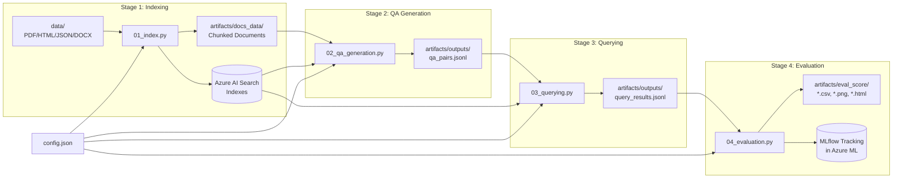
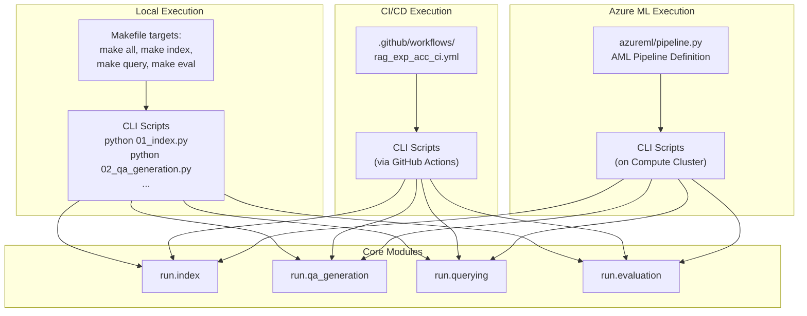
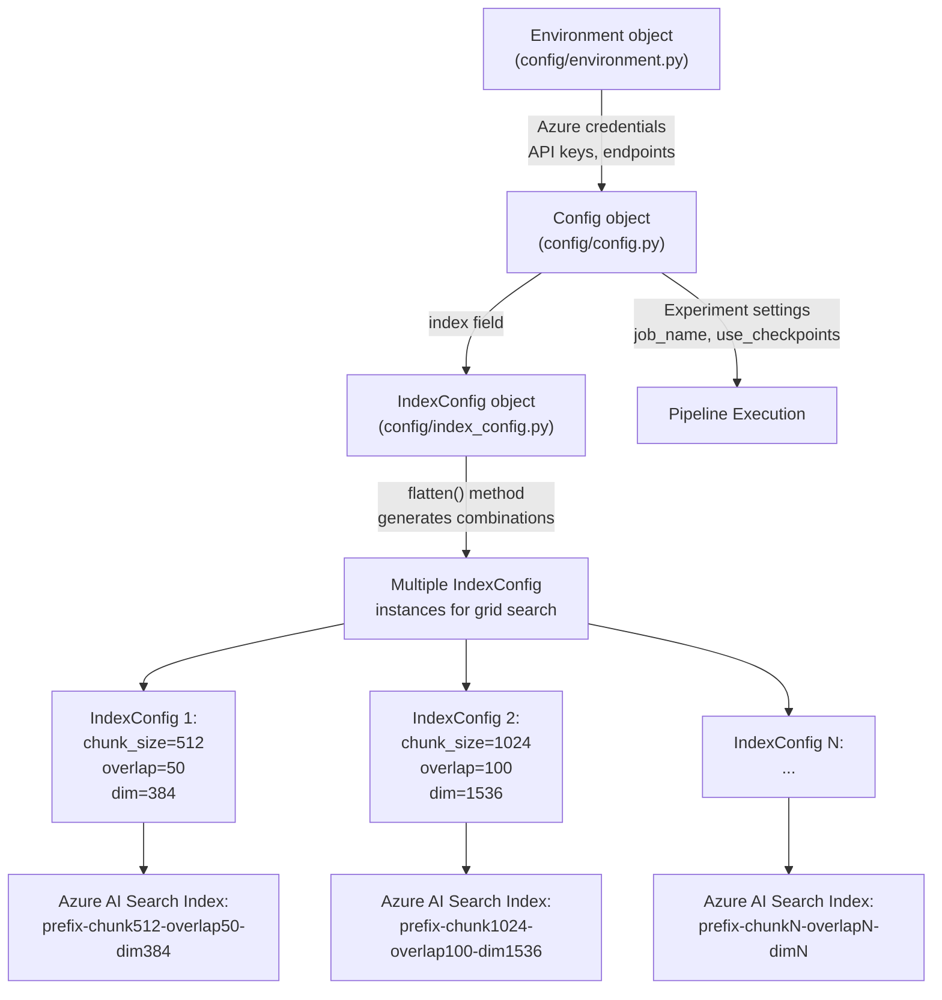
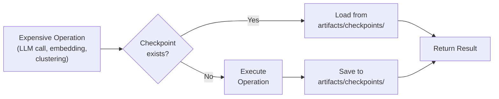
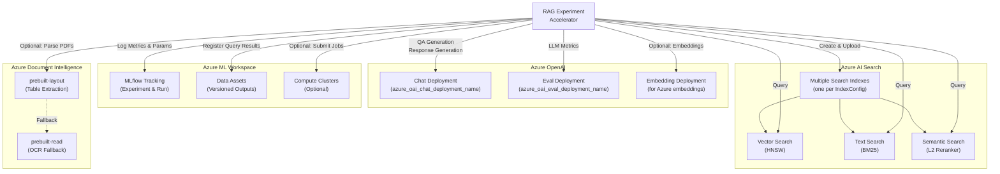

<!-- source: DeepWiki mcp.deepwiki.com · repo microsoft/rag-experiment-accelerator · page 1 Overview · fetched 2026-10-26 -->

# Overview

Relevant source files

The following files were used as context for generating this wiki page:

- [.github/workflows/config.json](.github/workflows/config.json)
- [02_qa_generation.py](02_qa_generation.py)
- [03_querying.py](03_querying.py)
- [04_evaluation.py](04_evaluation.py)
- [README.md](README.md)
- [config.sample.json](config.sample.json)
- [config.schema.json](config.schema.json)
- [docs/evaluation-metrics.md](docs/evaluation-metrics.md)
- [promptflow/rag-experiment-accelerator/README.md](promptflow/rag-experiment-accelerator/README.md)
- [rag_experiment_accelerator/config/eval_config.py](rag_experiment_accelerator/config/eval_config.py)
- [rag_experiment_accelerator/evaluation/plain_metrics.py](rag_experiment_accelerator/evaluation/plain_metrics.py)
- [rag_experiment_accelerator/evaluation/tests/test_plain_metrics.py](rag_experiment_accelerator/evaluation/tests/test_plain_metrics.py)

## Purpose and Scope

This document provides a high-level introduction to the **RAG Experiment Accelerator**, a configuration-driven system for systematic experimentation and evaluation of Retrieval-Augmented Generation (RAG) pipelines. It covers the system's purpose, 4-stage architecture, execution models, and core capabilities.

For installation instructions and environment setup, see [Installation and Dependencies](#2.1). For detailed configuration parameters, see [Configuration Guide](#2.2). For in-depth documentation of each pipeline stage, see [Pipeline Architecture](#3).

Sources: [README.md:1-27]()

## System Purpose

The RAG Experiment Accelerator enables data scientists and researchers to systematically evaluate RAG system performance by:

- **Testing hyperparameter combinations**: Experiment with different chunk sizes, embedding models, search strategies, and reranking approaches
- **Comparing search strategies**: Evaluate 8 different search types including text, vector, hybrid, and semantic search
- **Measuring retrieval quality**: Calculate end-to-end metrics (algorithm-based, BERT-based, LLM-based) and retrieval-specific metrics (MAP@k)
- **Tracking experiments**: Log all parameters and metrics to MLflow for comparison across runs
- **Generating reports**: Automatically produce visualizations and comparison charts

The system is **configuration-driven**, meaning all experimental parameters are specified in `config.json`, enabling reproducible experiments and systematic grid searches across parameter spaces.

Sources: [README.md:8-16](), [README.md:27-50]()

## Four-Stage Pipeline Architecture

The accelerator implements a sequential pipeline where each stage produces artifacts consumed by the next stage. All stages can be run via CLI scripts numbered `01` through `04`.

**Stage 1: Document Indexing** ([01_index.py:1-52]())
- Loads documents from the `data/` directory using format-specific loaders
- Chunks documents according to `config.index.chunking` parameters
- Optionally samples data via K-means clustering
- Generates embeddings using sentence-transformers or Azure OpenAI models
- Creates multiple Azure AI Search indexes based on `config.index.flatten()` combinations
- Outputs to `artifacts/docs_data/` and `artifacts/index_data/`

**Stage 2: QA Generation** ([02_qa_generation.py:1-23]())
- Reads chunked documents from Stage 1
- Uses LLM (via Azure OpenAI) to generate question-answer pairs for each chunk
- Produces ground truth dataset in `artifacts/outputs/qa_pairs.jsonl`
- Each line contains: `user_prompt` (question), `output_prompt` (answer), `context` (source chunk)

**Stage 3: Querying and Retrieval** ([03_querying.py:1-52]())
- Loads QA pairs from Stage 2
- For each question and search type combination:
  - Optionally expands queries or generates hypothetical documents (HyDE)
  - Searches Azure AI Search using configured search strategies
  - Optionally reranks results using LLM or cross-encoder models
  - Generates LLM responses with retrieved context
- Outputs results to `artifacts/outputs/query_results.jsonl`
- Registers output as Azure ML data asset

**Stage 4: Evaluation and Reporting** ([04_evaluation.py:1-43]())
- Loads query results from Stage 3
- Calculates configured metrics: algorithm-based (levenshtein, jaccard), BERT-based (semantic similarity), LLM-based (answer relevance, context precision/recall)
- Generates visualizations (comparison charts, scatter plots, metric tables)
- Logs all metrics and parameters to MLflow
- Outputs to `artifacts/eval_score/` directory

Sources: [README.md:197-223](), [01_index.py:1-52](), [02_qa_generation.py:1-23](), [03_querying.py:1-52](), [04_evaluation.py:1-43]()

## Execution Models

The system supports three execution modes that converge on the same CLI scripts but differ in orchestration:

**Local Execution**: Developer runs scripts directly via `python 01_index.py` or using Makefile targets. Suitable for rapid iteration and debugging.

**CI/CD Execution**: GitHub Actions workflow (`.github/workflows/rag_exp_acc_ci.yml`) executes the pipeline on each commit using smaller test dataset (`data-ci/`). Validates code changes automatically.

**Azure ML Execution**: Pipeline submitted to Azure ML compute cluster for distributed execution. Enables processing large datasets and running multiple experiments in parallel. See [Azure ML and MLflow](#9.3) for details.

All three modes use the same configuration system (`Config` object from `config.json` and `Environment` object from `.env`).

Sources: [README.md:64-68](), [README.md:224](), [promptflow/rag-experiment-accelerator/README.md:52-93]()

## Configuration System

The system is driven by a hierarchical configuration loaded from `config.json`:

**Environment Object** ([config/environment.py]()): Loads Azure credentials from `.env` file or Azure Key Vault. Contains:
- `azure_search_service_endpoint`, `azure_search_admin_key`
- `azure_openai_endpoint`, `azure_openai_api_key`
- `azure_ml_workspace_name`, `azure_ml_subscription_id`
- `azure_document_intelligence_endpoint`, `azure_document_intelligence_key`

**Config Object** ([config/config.py]()): Loaded from `config.json`. Contains:
- `experiment_name`: Groups runs in MLflow
- `job_name`: Identifies specific run
- `use_checkpoints`: Enable/disable caching
- `index`: IndexConfig or list of IndexConfig parameters
- `search`: Search configuration (types, num_documents, threshold)
- `rerank`: Reranking configuration (enabled, type, threshold)
- `query_expansion`: HyDE and query expansion settings
- `openai`: Azure OpenAI deployment names and temperature
- `eval`: Metric types to calculate

**IndexConfig Object** ([config/index_config.py]()): Defines index creation parameters:
- `index_name_prefix`: Base name for indexes
- `chunking`: `chunk_size`, `overlap_size`, `chunking_strategy`
- `embedding_model`: Model type and configuration
- `ef_construction`, `ef_search`: HNSW algorithm parameters
- `sampling`: Data sampling configuration

**Configuration Flattening**: When config parameters contain lists (e.g., `chunk_size: [500, 1000, 2000]`), calling `config.index.flatten()` generates all combinations, enabling grid search experiments. Each combination creates a separate Azure AI Search index.

Sources: [README.md:283-357](), [config.sample.json:1-88](), [config.schema.json:1-605]()

## Key Capabilities

### Multi-Strategy Search

The system supports 8 search strategies configurable via `config.search.search_type`:

| Search Type | Description | Uses Text Search | Uses Vector Search | Uses Semantic Ranking |
|-------------|-------------|------------------|--------------------|-----------------------|
| `search_for_match_text` | BM25 text search only | ✓ | | |
| `search_for_match_pure_vector` | Single vector field search | | ✓ | |
| `search_for_match_pure_vector_multi` | Multi-field vector search (content, title, summary) | | ✓ | |
| `search_for_match_pure_vector_cross` | Cross-field vector search | | ✓ | |
| `search_for_manual_hybrid` | Manual RRF hybrid | ✓ | ✓ | |
| `search_for_match_Hybrid_multi` | Hybrid with multi-vector | ✓ | ✓ | |
| `search_for_match_Hybrid_cross` | Hybrid with cross-vector | ✓ | ✓ | |
| `search_for_match_semantic` | Semantic search with L2 reranking | ✓ | | ✓ |

Each search type is implemented in [search_type/acs_search_methods.py]().

Sources: [README.md:42](), [config.schema.json:460-471]()

### Reranking Strategies

After initial retrieval, results can be reranked using:

**LLM Reranking** (`config.rerank.type = "llm"`):
- Uses Azure OpenAI to score chunk relevance
- Selects top-k chunks above `llm_rerank_threshold` (1-10 scale)
- Implemented in [llm/llm_rerank.py]()

**Cross-Encoder Reranking** (`config.rerank.type = "cross_encoder"`):
- Uses sentence-transformers cross-encoder model (`cross-encoder/stsb-roberta-base`)
- Selects top-k chunks based on `cross_encoder_at_k`
- Implemented in [llm/cross_encoder_rerank.py]()

Sources: [README.md:46](), [config.sample.json:50-56]()

### Query Expansion

Enhance retrieval quality through query manipulation:

**HyDE (Hypothetical Document Embeddings)** ([config.query_expansion.hyde]()):
- `"generated_hypothetical_answer"`: Generate hypothetical answer, embed and search
- `"generated_hypothetical_document_to_answer"`: Generate hypothetical document containing answer
- Based on [arXiv:2212.10496](https://arxiv.org/abs/2212.10496)

**Multi-Question Expansion** ([config.query_expansion.query_expansion]()):
- Generate 5 related questions using LLM
- Filter questions with similarity score > `min_query_expansion_related_question_similarity_score`
- Search with all questions, deduplicate results
- Improves recall for complex queries

Sources: [README.md:44](), [README.md:411-445]()

### Comprehensive Evaluation Metrics

The system supports three tiers of metrics:

**Algorithm-Based Metrics** (fast, deterministic):
- String distance: `levenshtein`, `hamming`, `jaro_winkler`
- Set similarity: `jaccard`, `cosine_ochiai`
- Token-based: `fuzzy_score`, ROUGE scores (`rouge1_precision`, `rouge2_recall`, `rougeL_fmeasure`)

**BERT-Based Metrics** (semantic similarity via embeddings):
- `bert_all_MiniLM_L6_v2` (384-dim, fast)
- `bert_base_nli_mean_tokens` (768-dim, NLI-trained)
- `bert_large_nli_stsb_mean_tokens` (1024-dim, STS-B optimized)
- `bert_distilbert_base_nli_stsb_mean_tokens` (768-dim, efficient)
- `bert_paraphrase_multilingual_MiniLM_L12_v2` (384-dim, multilingual)

**LLM-Based Metrics** (contextual understanding):
- `llm_answer_relevance`: Measures completeness and redundancy
- `llm_context_precision`: Evaluates retrieval quality (relevant chunks retrieved)
- `llm_context_recall`: Measures coverage (ground truth covered by retrieved chunks)

Metrics are calculated in [evaluation/eval.py]() using implementations from [evaluation/plain_metrics.py](), [evaluation/evaluator.py](), and [evaluation/llm_evaluators.py]().

Sources: [README.md:48](), [docs/evaluation-metrics.md:1-191](), [rag_experiment_accelerator/config/eval_config.py:1-17](), [rag_experiment_accelerator/evaluation/plain_metrics.py:1-213]()

## Fault Tolerance and Caching

The system implements a checkpoint mechanism for expensive operations:

**Checkpoint Decorator** ([checkpoint/cache_with_checkpoint.py]()): 
- Applied to functions via `@cache_with_checkpoint` decorator
- Computes hash of function inputs (deterministic)
- Checks if cached result exists in `artifacts/checkpoints/`
- Returns cached result if available, otherwise executes function and caches result
- Enabled/disabled via `config.use_checkpoints`

**Checkpointed Operations**:
- Document chunking and embedding generation
- QA pair generation via LLM
- Query expansion and HyDE generation
- Data sampling and clustering
- Search result retrieval

This prevents redundant expensive operations when re-running experiments with modified configurations.

Sources: [README.md:8](), [README.md:291]()

## Azure Service Integration

The accelerator integrates with multiple Azure services:

**Azure AI Search**: Stores document chunks with embeddings in multiple indexes. Configuration includes `ef_construction` and `ef_search` for HNSW algorithm tuning.

**Azure OpenAI**: 
- **Separate deployments** for chat and evaluation prevent quota conflicts
- Chat deployment used for QA generation and response generation
- Eval deployment used for LLM-based metrics
- Optional embedding deployment for Azure OpenAI embeddings (vs. sentence-transformers)

**Azure ML Workspace**:
- MLflow tracks experiments, runs, metrics, and parameters
- Data assets store versioned query results
- Optional compute clusters for distributed execution

**Azure Document Intelligence**: 
- Optional PDF parsing with table extraction
- `prebuilt-layout` model provides advanced table formatting
- Automatic fallback to `prebuilt-read` for simpler OCR

Sources: [README.md:56-61](), [README.md:349-352]()

## Data Sampling

For large datasets, the system supports representative sampling via K-means clustering:

**Sampling Process**:
1. Embed all documents using configured embedding model
2. Apply K-means clustering to group similar documents
3. Sample specified percentage from each cluster
4. Generate visualizations: cluster scatter plot, elbow graph (if `optimum_k = "auto"`)
5. Output sampled files to `artifacts/sampling/config.[job_name]/`

**Configuration** ([config.index.sampling]()):
- `sample_data`: Enable sampling
- `percentage`: Percentage to sample (e.g., 10 for 10%)
- `optimum_k`: "auto" or specific cluster count
- `min_cluster`, `max_cluster`: Range for automatic K selection
- `only_sample`: Only run sampling, skip indexing

**Outputs**:
- Sampled document files in dedicated directory
- `all_cluster_predictions_cluster_number_K.csv`: Full dataset with cluster labels
- `sampled_cluster_predictions_cluster_number_K.csv`: Sampled data with labels
- 2D scatter plot visualization
- Elbow graph (if auto-selecting K)

Sampling enables rapid experimentation on representative subsets before running full experiments.

Sources: [README.md:18-23](), [README.md:54](), [README.md:226-282]()

## Artifact Organization

All pipeline outputs are organized under the `artifacts/` directory:

| Directory | Contents | Producer Stage |
|-----------|----------|----------------|
| `artifacts/docs_data/` | Chunked documents with metadata | Stage 1 (Indexing) |
| `artifacts/index_data/` | Index creation metadata, embeddings | Stage 1 (Indexing) |
| `artifacts/sampling/` | Sampled datasets, cluster visualizations | Stage 1 (Indexing, optional) |
| `artifacts/outputs/` | `qa_pairs.jsonl`, `query_results.jsonl` | Stages 2 & 3 |
| `artifacts/eval_score/` | Metric CSVs, HTML reports, PNG charts | Stage 4 (Evaluation) |
| `artifacts/checkpoints/` | Cached expensive operations | All stages (if enabled) |

The `QueryOutputHandler` class ([artifact/handlers/query_output_handler.py]()) manages query result file paths and provides methods to load/save results in JSONL format.

Sources: [03_querying.py:11-13]()

---

This overview establishes the foundational concepts of the RAG Experiment Accelerator. For detailed information on specific components:

- Setup and first experiment: [Getting Started](#2)
- Configuration parameters: [Configuration System](#4)
- Pipeline stages: [Pipeline Architecture](#3)
- Search strategies: [Search and Retrieval](#7)
- Evaluation metrics: [Evaluation Metrics](#8)
- Azure services: [Azure Service Integration](#9)

---

