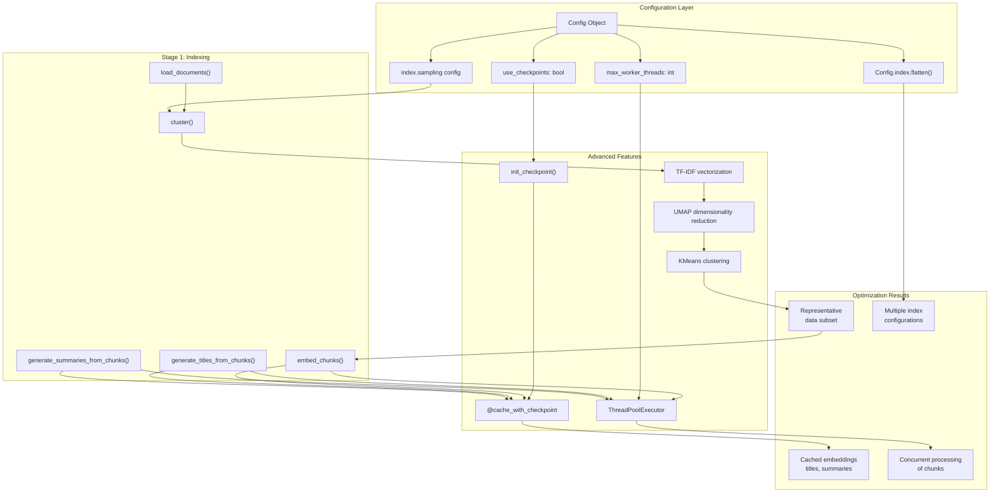
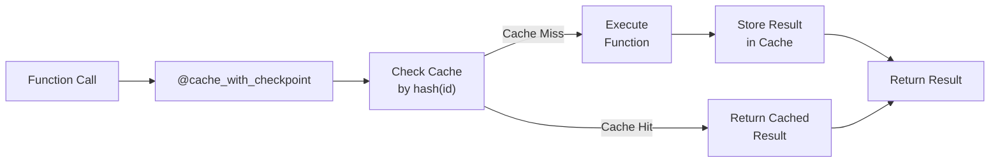
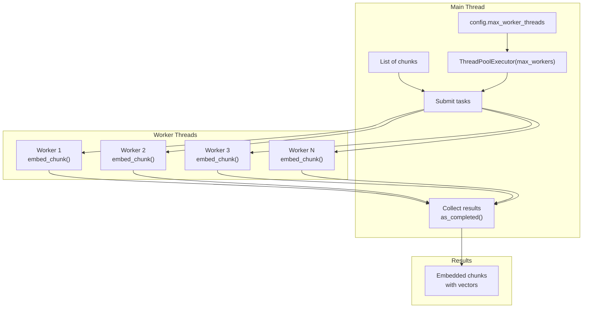
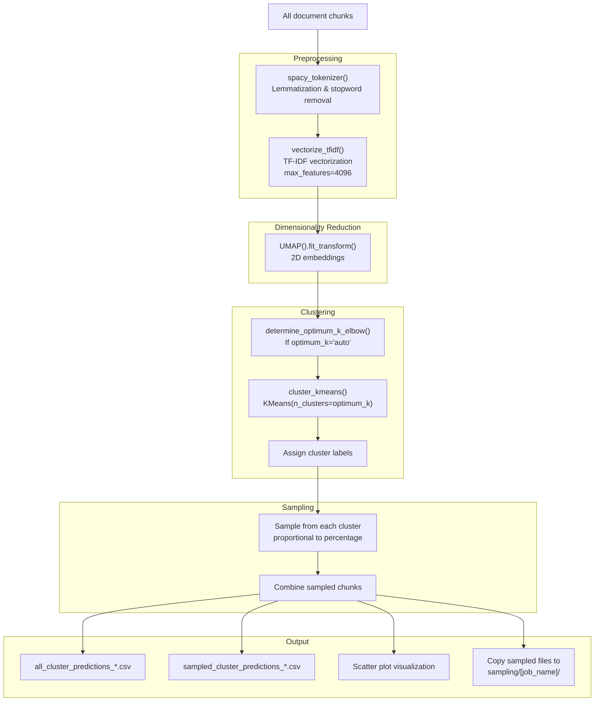
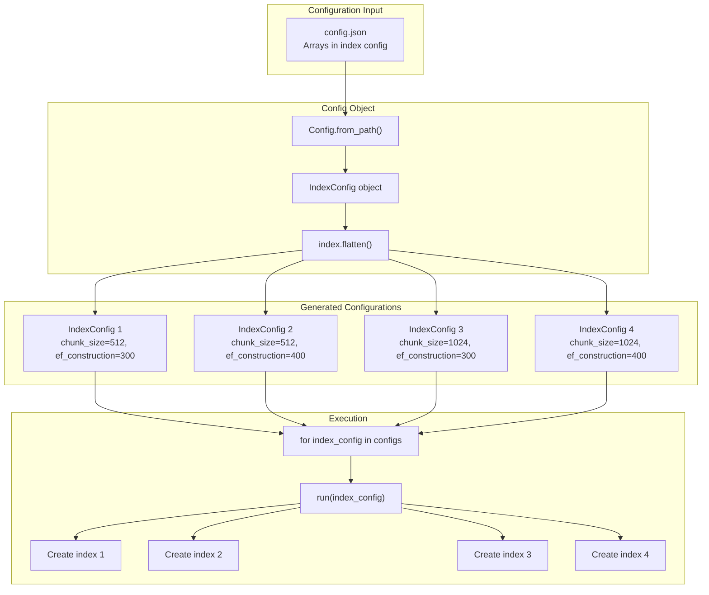
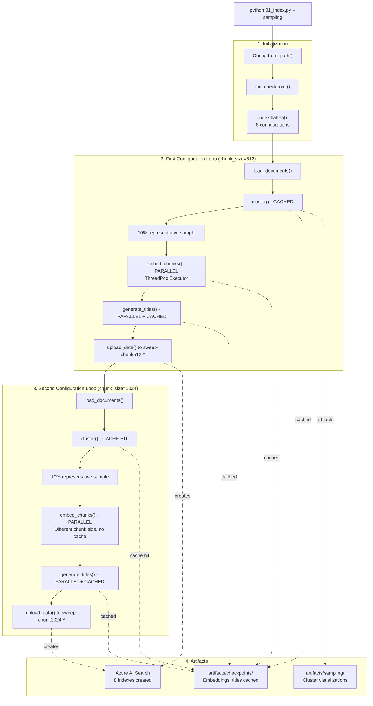

<!-- source: DeepWiki mcp.deepwiki.com · repo microsoft/rag-experiment-accelerator · page 10 Advanced Features · fetched 2026-10-26 -->

# Advanced Features

<details>
<summary>Relevant source files</summary>

The following files were used as context for generating this wiki page:

- [01_index.py](01_index.py)
- [README.md](README.md)
- [config.sample.json](config.sample.json)
- [images/all_cluster_predictions_cluster_number_5.jpg](images/all_cluster_predictions_cluster_number_5.jpg)
- [images/elbow_5.png](images/elbow_5.png)
- [rag_experiment_accelerator/config/tests/data/config.json](rag_experiment_accelerator/config/tests/data/config.json)
- [rag_experiment_accelerator/run/index.py](rag_experiment_accelerator/run/index.py)
- [rag_experiment_accelerator/sampling/clustering.py](rag_experiment_accelerator/sampling/clustering.py)
- [rag_experiment_accelerator/sampling/tests/data/test1.txt](rag_experiment_accelerator/sampling/tests/data/test1.txt)
- [rag_experiment_accelerator/sampling/tests/test_clustering.py](rag_experiment_accelerator/sampling/tests/test_clustering.py)

</details>


## Purpose and Scope

This page covers advanced capabilities and optimization techniques in the RAG Experiment Accelerator that enhance performance, efficiency, and experimentation flexibility. These features enable cost-effective experimentation through intelligent caching, parallel processing, representative data sampling, and multi-configuration grid search.

For basic configuration and setup, see [Configuration Guide](#2.2). For details on individual pipeline stages, see [Pipeline Architecture](#3).

## Overview

The RAG Experiment Accelerator provides several advanced features designed to optimize experimentation workflows:

1. **Checkpointing System** - Intelligent caching mechanism that avoids redundant expensive operations (LLM calls, embeddings, clustering)
2. **Parallel Processing and Concurrency** - Multi-threaded execution using `ThreadPoolExecutor` for embedding generation and chunk enrichment
3. **Data Sampling via Clustering** - K-means clustering-based representative sampling to reduce dataset size while maintaining diversity
4. **Multi-Configuration Grid Search** - Automatic generation of configuration combinations via `Config.index.flatten()`

These features work together to enable rapid, cost-effective experimentation across multiple hyperparameter combinations.

**Sources:** [README.md:1-571](), [config.sample.json:1-88]()

## Feature Integration Architecture

The following diagram illustrates how advanced features integrate into the pipeline stages:



**Sources:** [rag_experiment_accelerator/run/index.py:1-413](), [rag_experiment_accelerator/sampling/clustering.py:1-360]()

## Checkpointing System

### Overview

The checkpointing system provides transparent caching of expensive operations to avoid redundant computation across experiment runs. When enabled via `use_checkpoints: true` in configuration, results from LLM calls, embedding generation, and clustering are cached to disk and reused in subsequent runs with matching inputs.

### Decorator Pattern

The system uses the `@cache_with_checkpoint` decorator which wraps functions and caches results based on a unique identifier:



### Applied Functions

The decorator is applied to computationally expensive operations throughout the codebase:

| Function | Cache ID | Purpose | File Location |
|----------|----------|---------|---------------|
| `embed_chunk` | `chunk['content']+embedding_model.name` | Cache embedding generation | [rag_experiment_accelerator/run/index.py:187-209]() |
| `process_title` | `chunk['content']+str(config.index.chunking.generate_title)` | Cache LLM-generated titles | [rag_experiment_accelerator/run/index.py:292-328]() |
| `process_summary` | `chunk['content']+str(config.index.chunking.generate_summary)` | Cache LLM-generated summaries | [rag_experiment_accelerator/run/index.py:330-371]() |
| `cluster` | `index_name` | Cache clustering results | [rag_experiment_accelerator/sampling/clustering.py:248-359]() |

### Configuration

Enable checkpointing in `config.json`:

```json
{
  "use_checkpoints": true
}
```

Checkpoints are stored in `artifacts/checkpoints/` directory and keyed by content hashes to ensure consistency.

**Sources:** [rag_experiment_accelerator/run/index.py:7,187-371](), [rag_experiment_accelerator/sampling/clustering.py:13,248](), [config.sample.json:8](), [README.md:186]()

For detailed implementation, see [Checkpointing System](#10.1).

## Parallel Processing and Concurrency

### ThreadPoolExecutor Usage

The system uses Python's `ThreadPoolExecutor` for concurrent processing of document chunks during embedding generation and LLM-based enrichment:



### Implementation Locations

The `ThreadPoolExecutor` is used in three key functions within [rag_experiment_accelerator/run/index.py]():

1. **Embedding Generation** - [rag_experiment_accelerator/run/index.py:146-184]()
   - Processes all document chunks in parallel
   - Each worker calls `embed_chunk()` with a different chunk
   
2. **Title Generation** - [rag_experiment_accelerator/run/index.py:212-251]()
   - Uses `ThreadPoolExecutor(config.max_worker_threads)`
   - Generates titles for chunks via LLM calls in parallel
   
3. **Summary Generation** - [rag_experiment_accelerator/run/index.py:253-290]()
   - Uses `ThreadPoolExecutor(config.max_worker_threads)`
   - Generates summaries for chunks via LLM calls in parallel

### Configuration

Control concurrency level via `max_worker_threads` in configuration (not directly exposed in config.json but accessible via `Config` object properties).

### Error Handling

Each future is wrapped in try-except blocks to handle exceptions gracefully:

```python
for future in as_completed(futures):
    try:
        chunk_dict = future.result()
    except Exception as exc:
        logger.error(f"generated an exception: {exc} for doc {doc}")
```

**Sources:** [rag_experiment_accelerator/run/index.py:1-2,146-290]()

For detailed implementation, see [Parallel Processing and Concurrency](#10.2).

## Data Sampling via Clustering

### Overview

The sampling feature uses K-means clustering combined with UMAP dimensionality reduction to select a representative subset of documents. This enables rapid experimentation on large datasets while maintaining content diversity.

### Sampling Pipeline



### Configuration Parameters

Configure sampling in the `index.sampling` section:

| Parameter | Type | Description | Example |
|-----------|------|-------------|---------|
| `sample_data` | boolean | Enable/disable sampling | `true` |
| `percentage` | integer | Percentage of data to sample (1-100) | `5` |
| `optimum_k` | string/integer | Number of clusters (`"auto"` or specific value) | `"auto"` or `15` |
| `min_cluster` | integer | Minimum clusters for auto-detection | `2` |
| `max_cluster` | integer | Maximum clusters for auto-detection | `30` |
| `only_sample` | boolean | Stop after sampling (no indexing) | `false` |

### Automatic Cluster Detection

When `optimum_k: "auto"`, the system uses the elbow method to determine the optimal number of clusters:

1. Tests K-means with cluster counts from `min_cluster` to `max_cluster`
2. Calculates distortion for each K value
3. Identifies the elbow point (maximum rate of change)
4. Generates elbow plot in `artifacts/sampling/elbow_*.png`

### Output Artifacts

The sampling process generates several artifacts in `artifacts/sampling/`:

1. **Cluster Predictions CSV** - All chunks with cluster assignments
2. **Sampled Predictions CSV** - Only sampled chunks with assignments
3. **Scatter Plot** - 2D visualization of clustered documents (e.g., `all_cluster_predictions_cluster_number_5.jpg`)
4. **Elbow Plot** - If using `optimum_k: "auto"` (e.g., `elbow_5.png`)
5. **Sampled Files Directory** - `sampling/[job_name]/` containing copies of sampled files

### Usage Patterns

**Pattern 1: Local Sampling + Local Processing**
```json
{
  "index": {
    "sampling": {
      "sample_data": true,
      "only_sample": false,
      "percentage": 10,
      "optimum_k": "auto"
    }
  }
}
```
Run: `python 01_index.py --sampling` to sample and index locally.

**Pattern 2: Local Sampling + Azure ML Processing**
```json
{
  "index": {
    "sampling": {
      "sample_data": true,
      "only_sample": true,
      "percentage": 5,
      "optimum_k": 15
    }
  }
}
```
Run: `python 01_index.py --sampling` to generate sampled dataset, then use `artifacts/sampling/[job_name]/` as `--data_dir` for Azure ML pipeline.

### Implementation Details

The main clustering function is cached via `@cache_with_checkpoint`:

- **Function**: `cluster()` in [rag_experiment_accelerator/sampling/clustering.py:248-359]()
- **Cache Key**: `index_name` (ensures sampling is cached per index configuration)
- **Dependencies**: spaCy (`en_core_web_lg`), scikit-learn (KMeans), UMAP

The function performs:
1. Chunk to DataFrame conversion
2. Text preprocessing with spaCy tokenizer
3. TF-IDF vectorization (max 4096 features)
4. UMAP reduction to 2D
5. K-means clustering
6. Proportional sampling from each cluster
7. File copying and artifact generation

**Sources:** [rag_experiment_accelerator/sampling/clustering.py:1-360](), [rag_experiment_accelerator/run/index.py:70-75](), [config.sample.json:30-37](), [README.md:18-282]()

For detailed usage and configuration, see [Data Sampling and Clustering](#5.4).

## Multi-Configuration Grid Search

### Config Flattening Mechanism

The `Config.index.flatten()` method generates all combinations of index configurations from arrays in the configuration file. This enables systematic grid search across hyperparameters without writing explicit loops.

### Flattening Process



### Example Configuration

Given the following configuration with arrays:

```json
{
  "index": {
    "index_name_prefix": "exp",
    "ef_construction": [300, 400],
    "ef_search": [400],
    "chunking": {
      "chunk_size": [512, 1024],
      "overlap_size": [100]
    },
    "embedding_model": [
      {"type": "sentence-transformer", "model_name": "all-MiniLM-L6-v2"},
      {"type": "azure", "model_name": "text-embedding-ada-002"}
    ]
  }
}
```

The `flatten()` method generates **8 configurations** (2 × 2 × 2):

| Config | ef_construction | chunk_size | embedding_model |
|--------|-----------------|------------|-----------------|
| 1 | 300 | 512 | all-MiniLM-L6-v2 |
| 2 | 300 | 512 | text-embedding-ada-002 |
| 3 | 300 | 1024 | all-MiniLM-L6-v2 |
| 4 | 300 | 1024 | text-embedding-ada-002 |
| 5 | 400 | 512 | all-MiniLM-L6-v2 |
| 6 | 400 | 512 | text-embedding-ada-002 |
| 7 | 400 | 1024 | all-MiniLM-L6-v2 |
| 8 | 400 | 1024 | text-embedding-ada-002 |

### Index Naming Convention

Each generated configuration creates a unique index name by combining:
- `index_name_prefix`
- Chunk size
- Overlap size
- Embedding model dimension

Example: `exp-chunk512-overlap100-dim384`

### Usage in Pipeline

The flattening is used in the indexing stage:

```python
# From 01_index.py
for index_config in config.index.flatten():
    with mlflow.start_run(run_name=mlflow_run_name(f"index_job_{config.job_name}")):
        index_name = run(environment, config, index_config, file_paths, mlflow_client, do_sample)
        index_dict["indexes"].append(index_name)
```

Each `index_config` yields:
- A unique Azure AI Search index
- Separate MLflow run for tracking
- Independent checkpoint cache entries

### Cartesian Product Expansion

The following configuration parameters support arrays for grid search:

**Index-level:**
- `ef_construction` - HNSW construction parameter
- `ef_search` - HNSW search parameter
- `embedding_model` - List of embedding model configurations

**Chunking-level:**
- `chunk_size` - Document chunk sizes
- `overlap_size` - Overlap between chunks

**Search-level:**
- `search_type` - Array of search strategies (used in querying stage)

**Evaluation-level:**
- `metric_types` - Array of evaluation metrics (used in evaluation stage)

### Performance Considerations

Grid search across many configurations can be expensive:

| Configurations | With Checkpointing | Without Checkpointing |
|----------------|--------------------|-----------------------|
| 8 configs | Embedding generation once per unique (chunk_size, overlap_size, embedding_model) | Full recomputation for each config |
| Memory usage | Cached results stored in `artifacts/checkpoints/` | No additional disk usage |
| Time savings | 60-90% reduction on subsequent runs | N/A |

**Best Practices:**
1. Enable `use_checkpoints: true` for grid search experiments
2. Start with 2-3 values per parameter to validate the approach
3. Use sampling for initial grid search, then run full dataset on promising configurations
4. Use Azure ML parallel compute for truly independent configuration runs

**Sources:** [01_index.py:38-43](), [rag_experiment_accelerator/config/tests/data/config.json:9-52](), [config.sample.json:10-38](), [README.md:285-357]()

For detailed configuration syntax, see [IndexConfig and Multi-Configuration Experiments](#4.2).

## Integration Example

The following example demonstrates how advanced features work together in a complete experiment:

### Configuration

```json
{
  "experiment_name": "hyperparameter-sweep",
  "job_name": "baseline-comparison",
  "use_checkpoints": true,
  "index": {
    "index_name_prefix": "sweep",
    "ef_construction": [300, 400],
    "ef_search": [400, 500],
    "chunking": {
      "chunk_size": [512, 1024],
      "overlap_size": [100, 200],
      "generate_title": true,
      "generate_summary": false
    },
    "embedding_model": [
      {
        "type": "sentence-transformer",
        "model_name": "all-MiniLM-L6-v2"
      }
    ],
    "sampling": {
      "sample_data": true,
      "percentage": 10,
      "optimum_k": "auto",
      "min_cluster": 2,
      "max_cluster": 20
    }
  }
}
```

### Execution Flow



### Performance Impact

For this configuration:

| Metric | Without Advanced Features | With Advanced Features | Improvement |
|--------|---------------------------|------------------------|-------------|
| **Documents processed** | 10,000 × 8 = 80,000 | 1,000 × 8 = 8,000 (sampled) | 90% reduction |
| **Embedding generations** | 80,000 unique | 8,000 unique | 90% reduction |
| **Title generations** | 80,000 LLM calls | 8,000 LLM calls (cached across configs) | 90% reduction + cache reuse |
| **Execution time** | ~4 hours | ~30 minutes (first run), ~10 minutes (subsequent) | 75-87% reduction |
| **Azure OpenAI cost** | $40 | $4 (first run), $0.50 (subsequent) | 90-98% reduction |

### Key Takeaways

1. **Sampling** reduces dataset size for rapid iteration
2. **Checkpointing** eliminates redundant LLM calls across configuration variants
3. **Parallel processing** maximizes throughput for I/O-bound operations
4. **Grid search** via `flatten()` enables systematic exploration without manual loops

**Sources:** [01_index.py:1-48](), [rag_experiment_accelerator/run/index.py:30-100](), [config.sample.json:1-88]()

## Related Pages

For more detailed information on specific advanced features:

- [Checkpointing System](#10.1) - Deep dive into caching implementation
- [Parallel Processing and Concurrency](#10.2) - Thread pool configuration and error handling
- [Prompt Flow Integration](#10.3) - Low-code/no-code workflow integration
- [Data Sampling and Clustering](#5.4) - Sampling algorithms and validation
- [IndexConfig and Multi-Configuration Experiments](#4.2) - Configuration flattening mechanics

---

