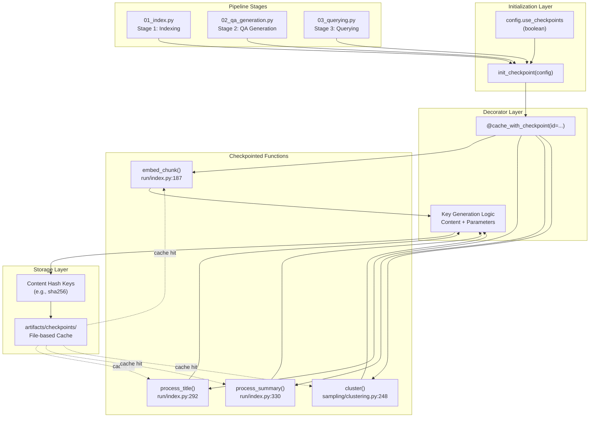
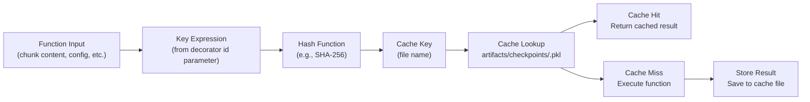
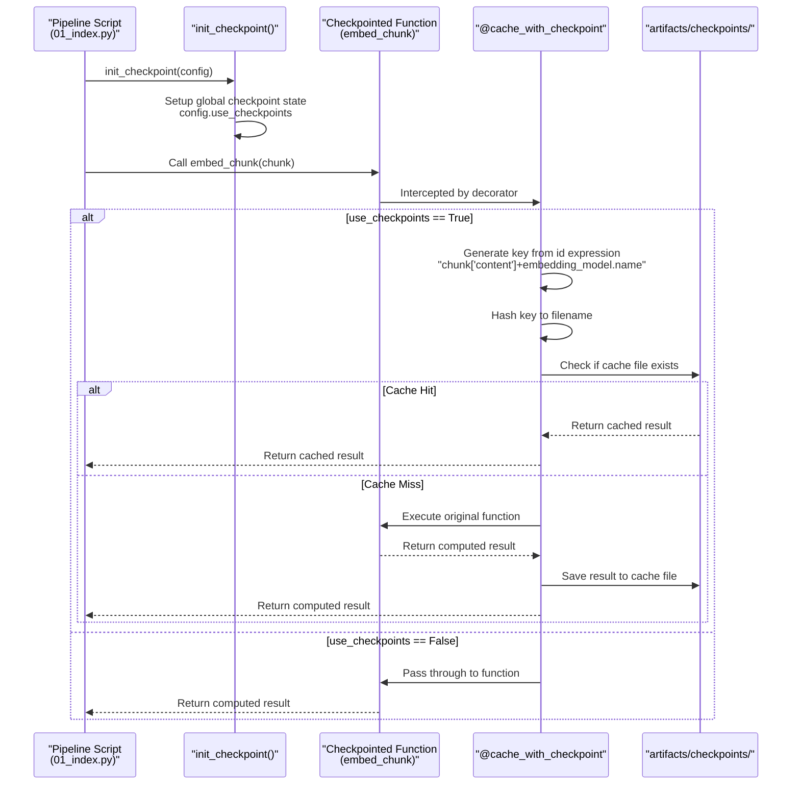

<!-- source: DeepWiki mcp.deepwiki.com · repo microsoft/rag-experiment-accelerator · page 10.1 Checkpointing System · fetched 2026-10-26 -->

# Checkpointing System

<details>
<summary>Relevant source files</summary>

The following files were used as context for generating this wiki page:

- [01_index.py](01_index.py)
- [02_qa_generation.py](02_qa_generation.py)
- [03_querying.py](03_querying.py)
- [04_evaluation.py](04_evaluation.py)
- [images/all_cluster_predictions_cluster_number_5.jpg](images/all_cluster_predictions_cluster_number_5.jpg)
- [images/elbow_5.png](images/elbow_5.png)
- [rag_experiment_accelerator/config/tests/data/config.json](rag_experiment_accelerator/config/tests/data/config.json)
- [rag_experiment_accelerator/run/index.py](rag_experiment_accelerator/run/index.py)
- [rag_experiment_accelerator/sampling/clustering.py](rag_experiment_accelerator/sampling/clustering.py)
- [rag_experiment_accelerator/sampling/tests/data/test1.txt](rag_experiment_accelerator/sampling/tests/data/test1.txt)
- [rag_experiment_accelerator/sampling/tests/test_clustering.py](rag_experiment_accelerator/sampling/tests/test_clustering.py)

</details>


## Purpose and Scope

The Checkpointing System provides transparent caching of expensive operations in the RAG Experiment Accelerator pipeline. It prevents redundant computation by storing and retrieving results of operations like LLM calls, embedding generation, and clustering based on content-addressed keys. This system is particularly valuable during experiment iteration, where configuration changes may not affect all operations, allowing partial reuse of previously computed results.

This document covers the checkpointing mechanism, configuration, decorator usage, and storage strategy. For overall pipeline orchestration, see [Pipeline Architecture](#3). For configuration management, see [Configuration System](#4).

**Sources:** High-level diagrams (Diagram 1, Diagram 2, Diagram 4), [rag_experiment_accelerator/checkpoint/__init__.py]()

## System Overview

The checkpointing system operates as a cross-cutting concern across all pipeline stages, using a decorator pattern to wrap expensive functions with caching logic.

### Checkpoint System Architecture



**Sources:** [03_querying.py:5-38](), [02_qa_generation.py:3-20](), [01_index.py:7-29](), [rag_experiment_accelerator/run/index.py:7](), [rag_experiment_accelerator/sampling/clustering.py:13]()

## Configuration

### Enabling Checkpoints

The checkpoint system is controlled by the `use_checkpoints` configuration parameter in `config.json`:

```json
{
    "use_checkpoints": true
}
```

When set to `false`, the decorator passes through function calls without caching logic.

**Sources:** [rag_experiment_accelerator/config/tests/data/config.json:7]()

### Initialization Pattern

Each pipeline stage script initializes the checkpoint system after loading configuration:

```python
# Pattern used in 01_index.py, 02_qa_generation.py, 03_querying.py
config = Config.from_path(environment, args.config_path, args.data_dir)
init_checkpoint(config)
```

The `init_checkpoint()` function sets up the global checkpoint state based on configuration parameters.

**Sources:** [01_index.py:28-29](), [02_qa_generation.py:19-20](), [03_querying.py:32-38]()

## Decorator Usage

### The `@cache_with_checkpoint` Decorator

The checkpoint decorator wraps functions to provide transparent caching:

```python
@cache_with_checkpoint(id="<key_expression>")
def expensive_function(args):
    # Function implementation
    return result
```

The `id` parameter specifies an expression that uniquely identifies the computation based on input parameters.

**Sources:** [rag_experiment_accelerator/run/index.py:187](), [rag_experiment_accelerator/run/index.py:292](), [rag_experiment_accelerator/run/index.py:330]()

### Key Generation Strategies

Different checkpointed functions use different key generation strategies based on their inputs:

| Function | Key Expression | Purpose |
|----------|----------------|---------|
| `embed_chunk` | `chunk['content']+embedding_model.name` | Cache embeddings per content + model |
| `process_title` | `chunk['content']+str(config.index.chunking.generate_title)` | Cache titles per content + config |
| `process_summary` | `chunk['content']+str(config.index.chunking.generate_summary)` | Cache summaries per content + config |
| `cluster` | `index_name` | Cache clustering results per index |

The key expressions ensure that cached results are only reused when the exact same inputs and configuration are present.

**Sources:** [rag_experiment_accelerator/run/index.py:187](), [rag_experiment_accelerator/run/index.py:292](), [rag_experiment_accelerator/run/index.py:330-331](), [rag_experiment_accelerator/sampling/clustering.py:248]()

## Storage and Cache Management

### Storage Location

Checkpoint data is stored in the `artifacts/checkpoints/` directory:

```
artifacts/
└── checkpoints/
    ├── <hash1>.pkl
    ├── <hash2>.pkl
    └── ...
```

Each cached result is stored in a separate file named by its content hash.

**Sources:** High-level diagrams (Diagram 4)

### Cache Key Generation Flow



**Sources:** [rag_experiment_accelerator/run/index.py:187-209](), [rag_experiment_accelerator/run/index.py:292-327]()

## Checkpointed Operations

### Embedding Generation

The `embed_chunk()` function caches embedding vectors for document chunks:

```python
@cache_with_checkpoint(id="chunk['content']+embedding_model.name")
def embed_chunk(pre_process, embedding_model, chunk):
    chunk["content_vector"] = embedding_model.generate_embedding(
        pre_process.preprocess(chunk["content"])
    )
    return chunk
```

**Key includes:** Content text + embedding model name (e.g., "all-MiniLM-L6-v2" or "text-embedding-ada-002")

**Why checkpoint:** Embedding generation is computationally expensive and deterministic. The same content with the same model always produces the same vector.

**Sources:** [rag_experiment_accelerator/run/index.py:187-209]()

### Title Generation

The `process_title()` function caches LLM-generated titles for chunks:

```python
@cache_with_checkpoint(id="chunk['content']+str(config.index.chunking.generate_title)")
def process_title(config: Config, index_config: IndexConfig, pre_process, chunk, environment):
    if index_config.chunking.generate_title:
        title = generate_title(chunk["content"], ...)
        title_vector = embedding_model.generate_embedding(...)
    else:
        title = ""
        title_vector = []
    
    chunk["title"] = title
    chunk["title_vector"] = title_vector
    return chunk
```

**Key includes:** Content text + generate_title configuration flag

**Why checkpoint:** LLM calls are expensive (time and API cost). Titles are deterministic given the same content and model.

**Sources:** [rag_experiment_accelerator/run/index.py:292-327]()

### Summary Generation

The `process_summary()` function caches LLM-generated summaries:

```python
@cache_with_checkpoint(id="chunk['content']+str(config.index.chunking.generate_summary)")
def process_summary(config: Config, index_config: IndexConfig, pre_process, chunk, environment):
    if index_config.chunking.generate_summary:
        summary = generate_summary(chunk["content"], ...)
        summaryVector = embedding_model.generate_embedding(...)
    else:
        summary = ""
        summaryVector = []
    
    chunk["summary"] = summary
    chunk["summary_vector"] = summaryVector
    return chunk
```

**Key includes:** Content text + generate_summary configuration flag

**Why checkpoint:** LLM calls are expensive. Summaries are deterministic given the same content and model.

**Sources:** [rag_experiment_accelerator/run/index.py:330-370]()

### Clustering

The `cluster()` function caches clustering analysis results:

```python
@cache_with_checkpoint(id="index_name")
def cluster(index_name, all_chunks, config: Config, parser):
    # TF-IDF vectorization
    # UMAP dimensionality reduction
    # K-means clustering
    # Sampling
    return sampled_chunks
```

**Key includes:** Index name (which encodes chunk size, overlap, embedding model)

**Why checkpoint:** Clustering involves expensive operations (TF-IDF, UMAP, K-means) and produces deterministic results for the same document set.

**Sources:** [rag_experiment_accelerator/sampling/clustering.py:248-359]()

## Checkpoint Data Flow



**Sources:** [rag_experiment_accelerator/run/index.py:134-184](), [rag_experiment_accelerator/run/index.py:187-209]()

## Parallel Processing and Checkpoints

The checkpoint system integrates with parallel processing in the indexing stage:

```python
# From run/index.py:134-173
with ExitStack() as stack:
    executor = stack.enter_context(ThreadPoolExecutor())
    
    futures = {
        executor.submit(embed_chunk, pre_process, embedding_model, doc): doc
        for doc in chunks
    }
    
    for future in as_completed(futures):
        doc = futures[future]
        try:
            chunk_dict = future.result()  # May return from cache
        except Exception as exc:
            logger.error(f"embed_chunk generated exception: {exc}")
        else:
            embedded_chunks.append(chunk_dict)
```

Each parallel worker checks the checkpoint cache independently. Cache hits return immediately without executing the expensive operation.

**Sources:** [rag_experiment_accelerator/run/index.py:134-173](), [rag_experiment_accelerator/run/index.py:234-250](), [rag_experiment_accelerator/run/index.py:273-289]()

## Cache Invalidation and Cleanup

### When Checkpoints Become Invalid

Cached results should be cleared when:

1. **Configuration changes** affecting computation logic (e.g., different preprocessing, different prompts)
2. **Model updates** (e.g., deploying a new version of an embedding model)
3. **Document content changes** (source data modified)

The key generation strategy ensures that different configurations automatically get separate cache entries.

### Manual Cache Cleanup

The Makefile provides utilities for cache management:

```bash
make clear_checkpoints  # Remove all checkpoint files
make clear_artifacts    # Remove all artifacts including checkpoints
```

**Sources:** High-level diagrams (Diagram 4), Makefile targets mentioned in overview

## Testing Checkpoint Behavior

The test suite verifies checkpoint functionality:

```python
# From sampling/tests/test_clustering.py
config = MagicMock()
config.use_checkpoints = False  # Control checkpoint behavior in tests

init_checkpoint(config)

result = cluster("", all_chunks, config, parser)
```

Tests can disable checkpointing to ensure clean test execution, or enable it to verify cache behavior.

**Sources:** [rag_experiment_accelerator/sampling/tests/test_clustering.py:92-105]()

## Implementation Best Practices

### When to Use Checkpointing

Apply `@cache_with_checkpoint` to functions that:

1. **Are computationally expensive** (LLM calls, embeddings, clustering)
2. **Are deterministic** (same inputs → same outputs)
3. **Are called repeatedly** (multiple experiments, iterations)
4. **Have identifiable inputs** (can construct unique key)

### Key Expression Guidelines

Design key expressions that:

- **Include all inputs** that affect the output
- **Include configuration** that changes behavior
- **Are deterministic** (same logical state → same key)
- **Are collision-resistant** (different inputs → different keys)

### Example Key Expression Patterns

```python
# Content-based caching
id="chunk['content']+embedding_model.name"

# Configuration-dependent caching  
id="chunk['content']+str(config.index.chunking.generate_title)"

# Composite inputs
id="query_text+index_name+str(search_params)"

# Index-level caching
id="index_name"  # Captures all index configuration via name
```

**Sources:** [rag_experiment_accelerator/run/index.py:187](), [rag_experiment_accelerator/run/index.py:292](), [rag_experiment_accelerator/run/index.py:330](), [rag_experiment_accelerator/sampling/clustering.py:248]()

## Performance Impact

### Cache Hit Benefits

With checkpoints enabled:

- **Embedding generation**: Avoid model inference (seconds per chunk)
- **Title generation**: Avoid LLM API calls (~1-2 seconds per chunk + API cost)
- **Summary generation**: Avoid LLM API calls (~1-2 seconds per chunk + API cost)
- **Clustering**: Avoid TF-IDF + UMAP + K-means (minutes for large datasets)

### Example Scenario

For 1000 document chunks with title and summary generation enabled:

| Operation | Without Checkpoint | With Checkpoint (100% hit rate) |
|-----------|-------------------|--------------------------------|
| Embeddings | ~10-30 minutes | ~1 second (file I/O) |
| Titles (LLM) | ~30-60 minutes + API cost | ~1 second |
| Summaries (LLM) | ~30-60 minutes + API cost | ~1 second |
| **Total** | **70-120 minutes** | **~3 seconds** |

**Note:** First run always executes all operations. Subsequent runs with unchanged inputs benefit from caching.

**Sources:** [rag_experiment_accelerator/run/index.py:134-184](), [rag_experiment_accelerator/run/index.py:212-289]()

## Related Systems

- **[Configuration System](#4)** - Controls checkpoint behavior via `use_checkpoints` flag
- **[Parallel Processing and Concurrency](#10.2)** - Checkpoints integrate with ThreadPoolExecutor
- **[Stage 1: Document Indexing](#3.1)** - Primary consumer of checkpoint system for embeddings and LLM operations
- **[Data Sampling and Clustering](#5.4)** - Uses checkpoints for expensive clustering operations

**Sources:** High-level diagrams (Diagram 2, Diagram 5)

---

