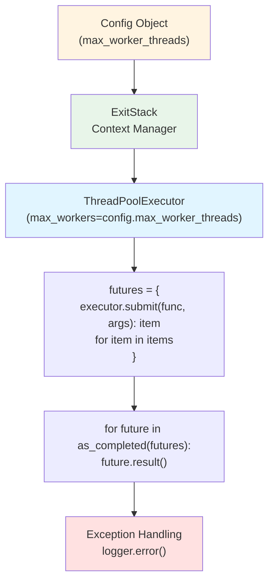
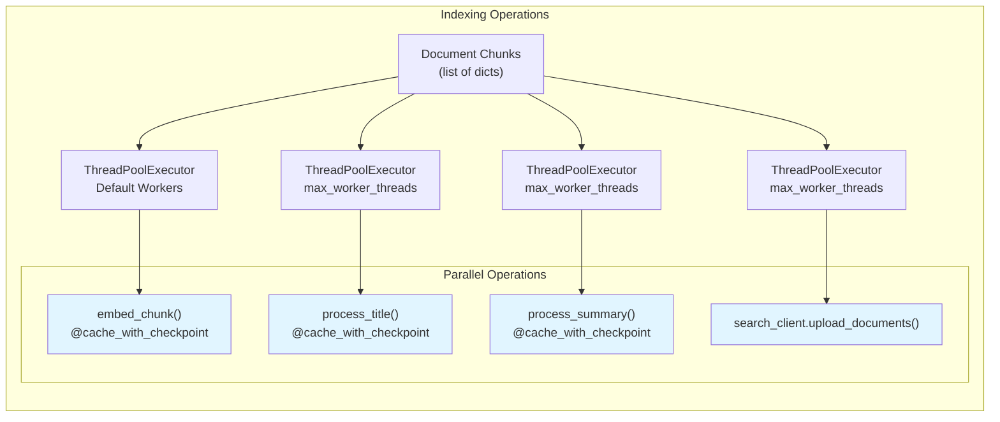
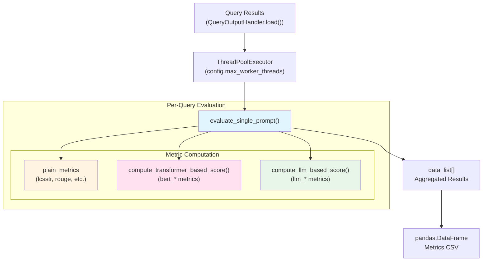
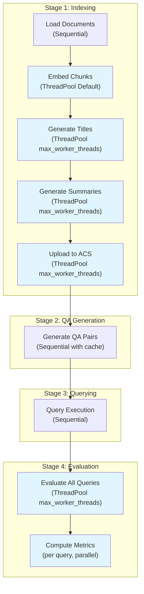
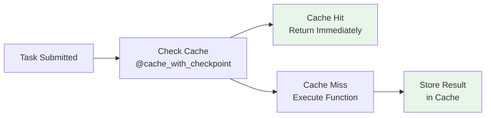

<!-- source: DeepWiki mcp.deepwiki.com · repo microsoft/rag-experiment-accelerator · page 10.2 Parallel Processing and Concurrency · fetched 2026-10-26 -->

# Parallel Processing and Concurrency

<details>
<summary>Relevant source files</summary>

The following files were used as context for generating this wiki page:

- [rag_experiment_accelerator/config/tests/data/config.json](rag_experiment_accelerator/config/tests/data/config.json)
- [rag_experiment_accelerator/doc_loader/pdfLoader.py](rag_experiment_accelerator/doc_loader/pdfLoader.py)
- [rag_experiment_accelerator/evaluation/LICENSE.txt](rag_experiment_accelerator/evaluation/LICENSE.txt)
- [rag_experiment_accelerator/evaluation/eval.py](rag_experiment_accelerator/evaluation/eval.py)
- [rag_experiment_accelerator/ingest_data/acs_ingest.py](rag_experiment_accelerator/ingest_data/acs_ingest.py)
- [rag_experiment_accelerator/ingest_data/tests/test_acs_ingest.py](rag_experiment_accelerator/ingest_data/tests/test_acs_ingest.py)
- [rag_experiment_accelerator/run/index.py](rag_experiment_accelerator/run/index.py)

</details>


## Purpose and Scope

This document describes the parallel processing and concurrency mechanisms used throughout the RAG Experiment Accelerator to improve performance and throughput. The system leverages Python's `concurrent.futures.ThreadPoolExecutor` to parallelize expensive operations such as embedding generation, document uploading, LLM API calls, and metric computation.

This page covers:
- Configuration of concurrency levels via `max_worker_threads`
- Parallel processing patterns used across pipeline stages
- Resource management and error handling strategies
- Thread pool usage in specific contexts

For information about caching expensive operations to avoid redundant work, see [Checkpointing System](#10.1). For information about the overall pipeline architecture, see [Pipeline Architecture](#3).

---

## Concurrency Configuration

The system provides a single configuration parameter to control the degree of parallelism across all pipeline stages:

| Parameter | Type | Default | Description |
|-----------|------|---------|-------------|
| `max_worker_threads` | `int` or `None` | `None` | Maximum number of worker threads in ThreadPoolExecutor. When `None`, the executor uses its default (typically CPU count × 5) |

**Configuration Location**: Root level of `config.json`

```json
{
  "experiment_name": "my_experiment",
  "max_worker_threads": 10,
  ...
}
```

**Access Pattern**: Throughout the codebase, this parameter is accessed as `config.max_worker_threads` and passed directly to `ThreadPoolExecutor(max_workers=config.max_worker_threads)`.

**Sources**: [rag_experiment_accelerator/config/tests/data/config.json:1-96](), [rag_experiment_accelerator/ingest_data/acs_ingest.py:72](), [rag_experiment_accelerator/run/index.py:234](), [rag_experiment_accelerator/evaluation/eval.py:220]()

---

## Parallel Processing Pattern

The codebase follows a consistent pattern for parallel execution across all stages:



### Standard Implementation Pattern

All parallel operations follow this template:

1. **Context Management**: Use `ExitStack` to ensure proper executor shutdown
2. **Future Submission**: Submit all tasks upfront, storing futures in a dictionary
3. **Result Collection**: Iterate through completed futures with `as_completed()`
4. **Error Handling**: Catch exceptions per-future and log errors without stopping the entire batch

**Sources**: [rag_experiment_accelerator/evaluation/eval.py:219-240](), [rag_experiment_accelerator/ingest_data/acs_ingest.py:69-86](), [rag_experiment_accelerator/run/index.py:150-173]()

---

## ThreadPoolExecutor Usage by Stage

### Stage 1: Document Indexing



#### Embedding Generation

**Function**: `embed_chunks()` in [rag_experiment_accelerator/run/index.py:134-184]()

**What Gets Parallelized**: Generation of content embeddings for each document chunk

**Thread Pool Configuration**: Uses default workers (no explicit `max_workers` parameter)

**Key Code Pattern**:
```python
with ExitStack() as stack:
    executor = stack.enter_context(ThreadPoolExecutor())
    futures = {
        executor.submit(embed_chunk, pre_process, embedding_model, doc): doc
        for doc in chunks
    }
    for future in as_completed(futures):
        try:
            chunk_dict = future.result()
            embedded_chunks.append(chunk_dict)
        except Exception as exc:
            logger.error(f"embed_chunk generated an exception: {exc}")
```

**Checkpointing**: The `embed_chunk()` function is decorated with `@cache_with_checkpoint(id="chunk['content']+embedding_model.name")`, which means repeated calls with the same content and model are served from cache.

**Sources**: [rag_experiment_accelerator/run/index.py:134-184](), [rag_experiment_accelerator/run/index.py:187-209]()

---

#### Title Generation

**Function**: `generate_titles_from_chunks()` in [rag_experiment_accelerator/run/index.py:212-251]()

**What Gets Parallelized**: LLM-based title generation for each document chunk

**Thread Pool Configuration**: Uses `config.max_worker_threads`

**Key Code Pattern**:
```python
with ExitStack() as stack:
    executor = stack.enter_context(ThreadPoolExecutor(config.max_worker_threads))
    futures = {
        executor.submit(process_title, config, index_config, pre_process, chunk, environment): chunk
        for chunk in chunks
    }
    for future in as_completed(futures):
        try:
            chunk = future.result()
        except Exception as exc:
            logger.error(f"process_title generated an exception: {exc}")
```

**Checkpointing**: The `process_title()` function uses `@cache_with_checkpoint(id="chunk['content']+str(config.index.chunking.generate_title)")` to avoid regenerating titles.

**Sources**: [rag_experiment_accelerator/run/index.py:212-251](), [rag_experiment_accelerator/run/index.py:292-328]()

---

#### Summary Generation

**Function**: `generate_summaries_from_chunks()` in [rag_experiment_accelerator/run/index.py:253-290]()

**What Gets Parallelized**: LLM-based summary generation for each document chunk

**Thread Pool Configuration**: Uses `config.max_worker_threads`

**Key Code Pattern**: Identical to title generation but calls `process_summary()` instead

**Checkpointing**: The `process_summary()` function uses `@cache_with_checkpoint(id="chunk['content']+str(config.index.chunking.generate_summary)")` to cache generated summaries.

**Sources**: [rag_experiment_accelerator/run/index.py:253-290](), [rag_experiment_accelerator/run/index.py:330-371]()

---

#### Document Upload

**Function**: `upload_data()` in [rag_experiment_accelerator/ingest_data/acs_ingest.py:36-90]()

**What Gets Parallelized**: Uploading individual documents to Azure AI Search

**Thread Pool Configuration**: Uses `config.max_worker_threads`

**Key Code Pattern**:
```python
with ExitStack() as stack:
    executor = stack.enter_context(ThreadPoolExecutor(config.max_worker_threads))
    futures = {
        executor.submit(search_client.upload_documents, [document]): document
        for document in documents
    }
    for future in as_completed(futures):
        document = futures[future]
        try:
            future.result()
        except Exception as ex:
            logger.error(f"Failed to upload document {document}, error: {ex}")
```

**Note**: Each document is uploaded individually in its own thread to maximize throughput to Azure AI Search.

**Sources**: [rag_experiment_accelerator/ingest_data/acs_ingest.py:36-90](), [rag_experiment_accelerator/ingest_data/acs_ingest.py:69-86]()

---

### Stage 4: Evaluation



**Function**: `evaluate_prompts()` in [rag_experiment_accelerator/evaluation/eval.py:178-327]()

**What Gets Parallelized**: Evaluation of each question-answer pair across all configured metrics

**Thread Pool Configuration**: Uses `config.max_worker_threads`

**Key Code Pattern**:
```python
with ExitStack() as stack:
    executor = stack.enter_context(ThreadPoolExecutor(config.max_worker_threads))
    futures = {
        executor.submit(
            evaluate_single_prompt,
            data,
            response_generator,
            metric_types,
            data_list,
            total_precision_scores_by_search_type,
            map_scores_by_search_type,
            average_precision_for_search_type,
        ): data
        for data in query_data_load
    }
    
    for future in as_completed(futures):
        try:
            future.result()
        except Exception as exc:
            logger.error(f"Evaluate query line generated an exception: {exc}")
```

**Shared State**: The `data_list` and score dictionaries are shared across threads. Python's GIL ensures thread-safe appends to lists and dictionary operations.

**Sources**: [rag_experiment_accelerator/evaluation/eval.py:178-327](), [rag_experiment_accelerator/evaluation/eval.py:219-240]()

---

## Resource Management and Error Handling

### ExitStack Pattern

The codebase consistently uses `contextlib.ExitStack` to ensure proper cleanup of thread pool resources:


**Benefits**:
- Guarantees `executor.shutdown()` is called even if exceptions occur
- Allows multiple context managers to be composed
- Provides clean resource cleanup without explicit try-finally blocks

**Sources**: [rag_experiment_accelerator/evaluation/eval.py:219](), [rag_experiment_accelerator/ingest_data/acs_ingest.py:69](), [rag_experiment_accelerator/run/index.py:150]()

---

### Exception Handling Strategy

All parallel operations follow a **fail-soft** approach:

| Aspect | Implementation |
|--------|----------------|
| **Error Scope** | Per-item/per-future exceptions are caught individually |
| **Logging** | Errors are logged with context (e.g., document content preview, chunk ID) |
| **Continuation** | Processing continues for remaining items even after failures |
| **No Propagation** | Exceptions are not re-raised after logging |

**Example from Embedding Generation**:
```python
for future in as_completed(futures):
    doc = futures[future]
    try:
        chunk_dict = future.result()
    except Exception as exc:
        logger.error(f"embed_chunk generated an exception: {exc} for doc {doc}")
    else:
        embedded_chunks.append(chunk_dict)
```

**Rationale**: In large-scale data processing, isolated failures (e.g., one corrupted document, one API timeout) should not halt the entire batch.

**Sources**: [rag_experiment_accelerator/run/index.py:163-172](), [rag_experiment_accelerator/evaluation/eval.py:235-239](), [rag_experiment_accelerator/ingest_data/acs_ingest.py:80-85]()

---

## Parallel Processing Execution Flow



**Key Observations**:

1. **Stage 1 (Indexing)** uses parallel processing most extensively:
   - Embedding generation (default workers)
   - Title generation (configurable)
   - Summary generation (configurable)
   - Azure AI Search upload (configurable)

2. **Stage 2 (QA Generation)** primarily relies on checkpointing rather than parallelism:
   - The `generate_qna_for_chunk()` function is decorated with `@cache_with_checkpoint`
   - No explicit ThreadPoolExecutor usage in the provided files

3. **Stage 3 (Querying)** executes sequentially:
   - Query expansion and search operations happen one at a time
   - No parallel processing observed in the provided files

4. **Stage 4 (Evaluation)** parallelizes across all queries:
   - Each query result is evaluated independently
   - All configured metrics are computed within each thread

**Sources**: [rag_experiment_accelerator/run/index.py:30-100](), [rag_experiment_accelerator/evaluation/eval.py:178-327](), [rag_experiment_accelerator/ingest_data/acs_ingest.py:92-136]()

---

## Performance Considerations

### Threading vs. Processing

**Why Threads Instead of Processes?**

The system uses `ThreadPoolExecutor` (threads) rather than `ProcessPoolExecutor` (processes) because:

1. **I/O-Bound Operations**: Most parallelized operations involve network calls (Azure OpenAI, Azure AI Search, embedding APIs)
2. **Python GIL**: For I/O-bound tasks, threads are sufficient as they release the GIL during I/O operations
3. **Memory Efficiency**: Threads share memory space, avoiding serialization overhead of multiprocessing
4. **Shared State**: Some operations (e.g., evaluation) use shared data structures (lists, dicts) which work naturally with threads

**Sources**: [rag_experiment_accelerator/evaluation/eval.py:1](), [rag_experiment_accelerator/ingest_data/acs_ingest.py:1](), [rag_experiment_accelerator/run/index.py:1]()

---

### Interaction with Checkpointing

Parallel processing and checkpointing work together to optimize performance:



**Key Functions with Checkpointing**:

| Function | Checkpoint ID | Location |
|----------|---------------|----------|
| `embed_chunk()` | `chunk['content']+embedding_model.name` | [rag_experiment_accelerator/run/index.py:187]() |
| `process_title()` | `chunk['content']+str(config.index.chunking.generate_title)` | [rag_experiment_accelerator/run/index.py:292]() |
| `process_summary()` | `chunk['content']+str(config.index.chunking.generate_summary)` | [rag_experiment_accelerator/run/index.py:330]() |
| `generate_qna_for_chunk()` | `chunk['content']` | [rag_experiment_accelerator/ingest_data/acs_ingest.py:138]() |

**Benefit**: When re-running experiments with `use_checkpoints: true`, cached results are returned instantly without executing expensive LLM/embedding calls, even when processed in parallel.

**Sources**: [rag_experiment_accelerator/run/index.py:187-209](), [rag_experiment_accelerator/run/index.py:292-328](), [rag_experiment_accelerator/ingest_data/acs_ingest.py:138-155]()

---

## Tuning max_worker_threads

### Recommended Values

| Workload Type | Recommended Setting | Rationale |
|---------------|---------------------|-----------|
| **Development/Testing** | `4-8` | Limits API quota consumption, easier debugging |
| **Production (Azure OpenAI)** | `10-20` | Balances throughput with rate limits (typically 100-300 RPM) |
| **Production (Local Embeddings)** | `None` (default) | CPU-bound, benefits from higher concurrency |
| **Large Documents** | `5-10` | Prevents memory exhaustion from large chunks in memory |

### Factors to Consider

1. **API Rate Limits**: Azure OpenAI deployments have tokens-per-minute (TPM) and requests-per-minute (RPM) limits
2. **Memory Usage**: Each thread may hold document chunks or embeddings in memory
3. **Network Bandwidth**: Too many concurrent uploads may saturate network
4. **Checkpoint Hit Rate**: With high cache hit rates, parallelism has less impact

**Sources**: [rag_experiment_accelerator/config/tests/data/config.json:1-96]()

---

## Testing Parallel Execution

The test suite validates parallel execution behavior:

**Test**: `test_upload_data()` in [rag_experiment_accelerator/ingest_data/tests/test_acs_ingest.py:105-147]()

**Verification**:
- Mocks `ThreadPoolExecutor` and `SearchClient`
- Verifies `executor.submit()` is called for each document
- Confirms `upload_documents()` is invoked the expected number of times
- Validates proper configuration passing (`max_worker_threads`)

**Mock Pattern**:
```python
mock_config = Mock()
mock_config.max_worker_threads = None  # Uses default
```

**Sources**: [rag_experiment_accelerator/ingest_data/tests/test_acs_ingest.py:105-147]()

---

## Summary Table: Parallel Operations

| Stage | Operation | Function | Thread Pool | Configurable Workers |
|-------|-----------|----------|-------------|---------------------|
| **Stage 1** | Embedding Generation | `embed_chunks()` | `ThreadPoolExecutor()` | ❌ (uses default) |
| **Stage 1** | Title Generation | `generate_titles_from_chunks()` | `ThreadPoolExecutor(config.max_worker_threads)` | ✅ |
| **Stage 1** | Summary Generation | `generate_summaries_from_chunks()` | `ThreadPoolExecutor(config.max_worker_threads)` | ✅ |
| **Stage 1** | Azure AI Search Upload | `upload_data()` | `ThreadPoolExecutor(config.max_worker_threads)` | ✅ |
| **Stage 2** | QA Generation | `generate_qna_for_chunk()` | ❌ (sequential with caching) | N/A |
| **Stage 3** | Query Execution | Various | ❌ (sequential) | N/A |
| **Stage 4** | Metric Computation | `evaluate_prompts()` | `ThreadPoolExecutor(config.max_worker_threads)` | ✅ |

**Sources**: [rag_experiment_accelerator/run/index.py:1-413](), [rag_experiment_accelerator/ingest_data/acs_ingest.py:1-231](), [rag_experiment_accelerator/evaluation/eval.py:1-327]()

---

