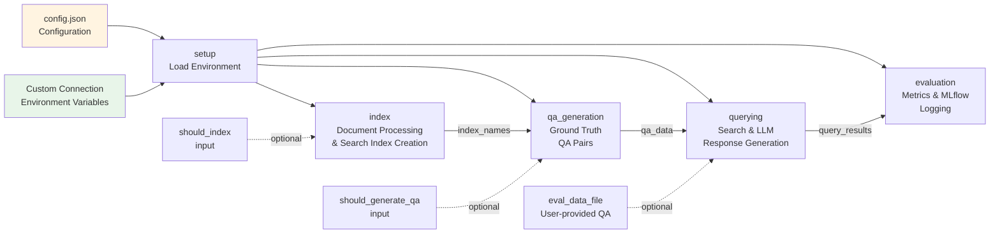
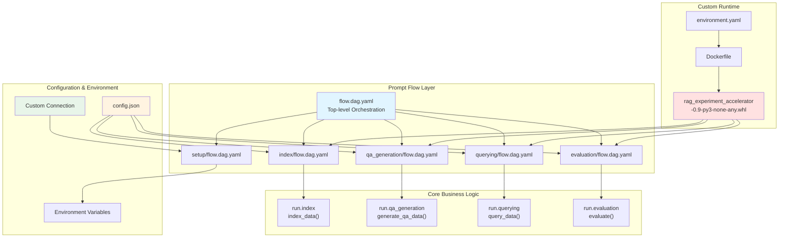
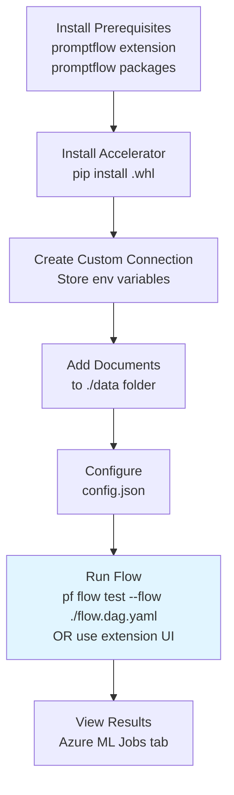
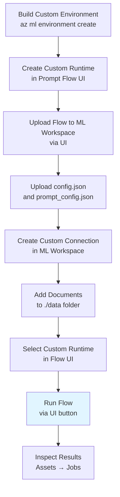

<!-- source: DeepWiki mcp.deepwiki.com · repo microsoft/rag-experiment-accelerator · page 10.3 Prompt Flow Integration · fetched 2026-10-26 -->

# Prompt Flow Integration

<details>
<summary>Relevant source files</summary>

The following files were used as context for generating this wiki page:

- [.github/workflows/config.json](.github/workflows/config.json)
- [README.md](README.md)
- [config.sample.json](config.sample.json)
- [config.schema.json](config.schema.json)
- [docs/evaluation-metrics.md](docs/evaluation-metrics.md)
- [promptflow/rag-experiment-accelerator/README.md](promptflow/rag-experiment-accelerator/README.md)
- [rag_experiment_accelerator/config/eval_config.py](rag_experiment_accelerator/config/eval_config.py)
- [rag_experiment_accelerator/evaluation/plain_metrics.py](rag_experiment_accelerator/evaluation/plain_metrics.py)
- [rag_experiment_accelerator/evaluation/tests/test_plain_metrics.py](rag_experiment_accelerator/evaluation/tests/test_plain_metrics.py)

</details>


## Purpose and Scope

This document describes the Prompt Flow variant of the RAG Experiment Accelerator, which provides a low-code/no-code approach to running the 4-stage RAG experimentation pipeline using Azure Machine Learning's Prompt Flow interface. The Prompt Flow integration wraps the core functionality described in pages [3](#3) through [3.4](#3.4) in a visual flow format, enabling users to design, test, and deploy RAG experiments through a graphical interface.

For information about the standard CLI-based pipeline execution, see [Pipeline Architecture](#3). For Azure ML pipeline execution without Prompt Flow, see [Azure ML and MLflow](#9.3).

## Overview

The Prompt Flow integration provides an alternative execution model for the RAG Experiment Accelerator that:

- **Enables visual flow design**: Users can view and modify the pipeline structure through a directed acyclic graph (DAG) in the Prompt Flow UI
- **Supports iterative development**: Individual nodes can be tested independently without running the entire pipeline
- **Maintains core functionality**: Uses the same underlying modules ([run.index](), [run.querying](), [run.evaluation]()) as the standard pipeline
- **Offers flexible execution**: Can be run locally in VSCode or deployed to Azure ML compute clusters
- **Allows stage skipping**: Users can optionally skip indexing or QA generation stages if artifacts already exist

The Prompt Flow variant is particularly useful for:
- Rapid prototyping and experimentation in a visual environment
- Teams preferring graphical interfaces over command-line tools
- Interactive debugging of individual pipeline stages
- Demonstrations and presentations of RAG pipeline workflows

Sources: [promptflow/rag-experiment-accelerator/README.md:1-10](), [README.md:224]()

## Architecture

### End-to-End Flow Structure



**Diagram: Prompt Flow DAG structure showing node dependencies and optional inputs**

The top-level `flow.dag.yaml` orchestrates the entire pipeline as a series of connected nodes. Each node corresponds to one of the four pipeline stages plus an initial setup node. The flow supports conditional execution through boolean inputs (`should_index`, `should_generate_qa`) and alternative data sources (`eval_data_file` for user-provided QA pairs).

Sources: [promptflow/rag-experiment-accelerator/README.md:6-43]()

### Integration with Core Modules



**Diagram: Prompt Flow integration with core RAG Experiment Accelerator modules**

The Prompt Flow nodes wrap the same business logic modules used by the standard CLI pipeline ([01_index.py](), [02_qa_generation.py](), [03_querying.py](), [04_evaluation.py]()). This architectural pattern ensures consistency between execution modes while providing a visual interface layer.

Sources: [promptflow/rag-experiment-accelerator/README.md:130-145]()

## Flow Node Descriptions

### Setup Node

The `setup` node executes first and loads required environment variables from a Prompt Flow custom connection. This node has no inputs and outputs the environment configuration needed by downstream nodes.

**Responsibilities:**
- Load Azure service endpoints (Search, OpenAI, ML Workspace)
- Set authentication credentials
- Initialize logging configuration

**Outputs:**
- Environment variables dictionary passed to subsequent nodes

Sources: [promptflow/rag-experiment-accelerator/README.md:11]()

### Index Node

The `index` node performs document ingestion and search index creation as described in [Stage 1: Document Indexing](#3.1).

**Inputs:**
- `should_index` (boolean): Set to `False` to skip if indexes already exist
- Configuration from `config.json`

**Operations:**
- Creates indexes with names in format: `{index_name_prefix}-{chunk_size}-{overlap_size}-{dimension}-{ef_construction}-{ef_search}`
- Chunks documents according to [chunking parameters](#5.3)
- Generates optional summaries and titles via LLM
- Creates embeddings for content, titles, and summaries
- Uploads to Azure AI Search

**Outputs:**
- `index_names`: List of created index names for downstream nodes

Sources: [promptflow/rag-experiment-accelerator/README.md:13-21]()

### QA Generation Node

The `qa_generation` node creates ground truth question-answer pairs as described in [Stage 2: QA Generation](#3.2).

**Inputs:**
- `should_generate_qa` (boolean): Set to `False` to use existing QA data
- `index_names`: List of indexes from index node
- Configuration from `config.json`

**Operations:**
- Chunks documents and generates QA pairs for each chunk
- Uses Azure OpenAI to generate contextually relevant questions and answers

**Outputs:**
- `qa_data`: JSONL file with fields:
  - `user_prompt`: Generated question
  - `output_prompt`: Generated answer
  - `context`: Document sections used for generation

**Alternative Input:**
Users can skip this node and provide their own QA pairs in JSONL format at the path specified by `eval_data_file` in `config.json` (default: `./artifacts/eval_data.jsonl`).

Sources: [promptflow/rag-experiment-accelerator/README.md:23-30]()

### Querying Node

The `querying` node executes search and retrieval operations as described in [Stage 3: Querying and Retrieval](#3.3).

**Inputs:**
- `user_prompt` fields from QA data
- `index_names`: Indexes to query
- Configuration from `config.json`

**Operations:**
- Expands complex queries into sub-queries if needed
- Searches Azure AI Search using configured `search_type` values
- Optionally reranks results based on `rerank` configuration
- Calculates search result metrics
- Adds retrieved context to prompts and calls LLM
- Uploads responses as Azure ML data asset

**Outputs:**
- `query_results`: JSONL file with search results, context, and LLM responses
- Data asset registration in Azure ML

Sources: [promptflow/rag-experiment-accelerator/README.md:32-40]()

### Evaluation Node

The `evaluation` node computes metrics and logs to MLflow as described in [Stage 4: Evaluation and Metrics](#3.4).

**Inputs:**
- `query_results`: Output from querying node
- Metric types from `config.json`

**Operations:**
- Calculates metrics specified in `config.eval.metric_types`
- Generates visualizations (charts, HTML reports)
- Logs metrics and parameters to MLflow
- Registers artifacts in Azure ML

**Outputs:**
- Metrics logged to MLflow experiment
- Visualization artifacts (CSV, PNG, HTML)

**Viewing Results:**
Navigate to Azure ML Workspace → Assets → Jobs → Latest experiment run to view metrics and compare with previous runs.

Sources: [promptflow/rag-experiment-accelerator/README.md:42-44](), [promptflow/rag-experiment-accelerator/README.md:62]()

## Custom Environment Setup

### Purpose

Prompt Flow requires a custom environment because the RAG Experiment Accelerator has dependencies not included in the default Prompt Flow runtime. The custom environment packages the accelerator and its dependencies into a container image.

### Building the Environment

**Components:**
- `custom_environment/Dockerfile`: Container definition
- `custom_environment/environment.yaml`: Azure ML environment specification
- `custom_environment/rag_experiment_accelerator-0.9-py3-none-any.whl`: Packaged accelerator

**Build and Register (Azure CLI):**
```bash
az login
az account set --subscription <subscription_id>
az extension add --name ml
az configure --defaults workspace=$MLWorkSpaceName group=$ResourceGroupName

cd ./custom_environment
az ml environment create --file ./environment.yaml -w $MLWorkSpaceName
```

This process takes several minutes as it builds the Docker image and uploads it to the workspace container registry.

**Create Custom Runtime:**
After environment creation, navigate to Azure ML Studio → Prompt Flow → Runtimes → Create. Select the newly created environment.

Sources: [promptflow/rag-experiment-accelerator/README.md:69-82]()

### Local Development

For local VSCode execution:
```bash
pip install ./custom_environment/rag_experiment_accelerator-0.9-py3-none-any.whl
```

Ensure the Prompt Flow VSCode extension is installed and Prompt Flow packages are available:
```bash
pip install promptflow promptflow-tools
```

Sources: [promptflow/rag-experiment-accelerator/README.md:55-57]()

## Configuration and Connections

### Config.json Structure

The Prompt Flow variant uses the same `config.json` structure as the standard pipeline (see [Configuration Guide](#2.2)). Key fields relevant to Prompt Flow:

| Field | Purpose | Example |
|-------|---------|---------|
| `experiment_name` | MLflow experiment grouping | `"exp-name"` |
| `index.index_name_prefix` | Prefix for search indexes | `"idx"` |
| `search.search_type` | Search strategies to evaluate | `["search_for_manual_hybrid"]` |
| `eval.metric_types` | Evaluation metrics to compute | `["fuzzy_score", "bert_all_MiniLM_L6_v2"]` |
| `path.eval_data_file` | Optional user-provided QA file | `"./artifacts/eval_data.jsonl"` |

**Simplified Config for Prompt Flow:**
The Prompt Flow README shows a reduced configuration schema focusing on frequently modified parameters. The full schema from [config.schema.json]() is still valid.

Sources: [promptflow/rag-experiment-accelerator/README.md:95-128](), [config.sample.json]()

### Custom Connection

Prompt Flow uses a custom connection to securely store environment variables rather than `.env` files.

**Required Variables:**
- `AZURE_SEARCH_SERVICE_ENDPOINT`: Azure AI Search service URL
- `AZURE_OPENAI_ENDPOINT`: Azure OpenAI service URL
- `AZURE_OPENAI_API_KEY`: Authentication key
- `AZURE_ML_WORKSPACE_NAME`: ML workspace name
- `AZURE_SUBSCRIPTION_ID`: Azure subscription ID
- Additional variables documented in [Environment Variables guide](#9.1)

**Creating a Custom Connection:**
See `promptflow/rag-experiment-accelerator/env_setup.md` for detailed instructions on creating connections in both VSCode and Azure ML Studio.

Sources: [promptflow/rag-experiment-accelerator/README.md:58](), [promptflow/rag-experiment-accelerator/README.md:85]()

## Execution Models

### VSCode Local Execution



**Diagram: VSCode execution workflow**

**Steps:**
1. Install Prompt Flow extension in VSCode
2. Install Prompt Flow packages: `pip install promptflow promptflow-tools`
3. Install accelerator wheel: `pip install ./custom_environment/rag_experiment_accelerator-0.9-py3-none-any.whl`
4. Create custom connection with environment variables
5. Add documents to `./data` folder
6. Configure `config.json` with experiment parameters
7. Run via CLI: `pf flow test --flow ./flow.dag.yaml` or via extension UI
8. View results in Azure ML workspace under Assets → Jobs

**Benefits:**
- Fast iteration cycles
- Local debugging capabilities
- No cloud compute costs during development
- Immediate feedback on configuration changes

Sources: [promptflow/rag-experiment-accelerator/README.md:54-62]()

### Azure ML Workspace Execution



**Diagram: Azure ML workspace execution workflow**

**Steps:**
1. Build and register custom environment (see [Custom Environment Setup](#custom-environment-setup))
2. Create custom runtime using the new environment
3. Upload flow to ML workspace using Prompt Flow UI
4. Upload `config.json` and optionally `prompt_config.json`
5. Create custom connection with environment variables in ML workspace
6. Add documents to `./data` folder
7. Select the custom runtime in Prompt Flow
8. Click Run in the UI
9. Inspect results under Assets → Jobs → Latest experiment run

**Benefits:**
- Distributed compute for large-scale experiments
- Team collaboration through shared workspace
- Integration with Azure ML features (data assets, model registry)
- Reproducible runs with versioned environments and datasets

Sources: [promptflow/rag-experiment-accelerator/README.md:65-92]()

## Comparison with Standard Pipeline

| Aspect | Standard Pipeline (CLI) | Prompt Flow Variant |
|--------|------------------------|---------------------|
| **Execution** | CLI scripts: `python 01_index.py`, etc. | Flow DAG via UI or `pf flow test` |
| **Orchestration** | [Makefile]() or [GitHub Actions](#11.3) or [Azure ML Pipeline](#9.3) | `flow.dag.yaml` with node dependencies |
| **Configuration** | `config.json` + `.env` file | `config.json` + Custom Connection |
| **Environment** | Local Python env or dev container | Custom runtime with packaged .whl |
| **Development Mode** | Script-level debugging | Node-level interactive testing |
| **Visualization** | MLflow metrics and charts | Same + visual flow graph |
| **Stage Skipping** | CLI arguments or commenting code | Input boolean parameters |
| **Learning Curve** | Familiar to Python developers | Requires Prompt Flow concepts |
| **Best For** | Automated CI/CD, scripted workflows | Interactive development, demos |

Sources: [README.md:182-223](), [promptflow/rag-experiment-accelerator/README.md:54-92]()

## Folder Structure

```
promptflow/rag-experiment-accelerator/
├── flow.dag.yaml                    # Top-level orchestration
├── config.json                      # Experiment configuration
├── README.md                        # Prompt Flow documentation
├── env_setup.md                     # Custom connection setup guide
│
├── data/                            # Document corpus
│   └── [sample PDFs, HTML, etc.]
│
├── custom_environment/
│   ├── Dockerfile                   # Container definition
│   ├── environment.yaml             # Azure ML environment spec
│   └── rag_experiment_accelerator-0.9-py3-none-any.whl
│
├── setup/
│   └── flow.dag.yaml               # Environment variable loading
│
├── index/
│   └── flow.dag.yaml               # Indexing flow
│
├── qa_generation/
│   └── flow.dag.yaml               # QA generation flow
│
├── querying/
│   └── flow.dag.yaml               # Search & retrieval flow
│
├── evaluation/
│   └── flow.dag.yaml               # Evaluation flow
│
└── images/
    └── [diagrams for documentation]
```

**Key Paths:**
- Top-level `flow.dag.yaml`: Entry point that references sub-flows
- Each sub-directory contains a `flow.dag.yaml` defining that stage's logic
- `custom_environment/`: Required files for building the runtime
- `data/`: Default location for documents (configurable in `config.json`)
- `artifacts/`: Generated during execution (same as standard pipeline)

Sources: [promptflow/rag-experiment-accelerator/README.md:130-145]()

## Configuration Reference

The Prompt Flow variant supports the same configuration elements as the standard pipeline. Key differences in usage:

### Reduced Schema

The Prompt Flow `config.json` description focuses on commonly adjusted parameters:

| Parameter | Description | Values |
|-----------|-------------|--------|
| `index_name_prefix` | Index name prefix for tracking | String |
| `chunking.chunk_size` | Chunk sizes to test | Array of integers, e.g., `[500, 1000, 2000]` |
| `chunking.overlap_size` | Overlap sizes to test | Array of integers, e.g., `[100, 200, 300]` |
| `embedding_dimension` | Embedding dimensions | `[384, 768, 1024]` |
| `ef_construction` | Azure AI Search vector config | Integer (100-1000) |
| `ef_search` | Azure AI Search vector config | Integer (100-1000) |
| `experiment_name` | Experiment grouping name | String |
| `rerank` | Enable reranking | `true`/`false` |
| `rerank_type` | Reranking method | `"llm"` or `"cross_encoder"` |
| `search_types` | Search strategies | Array of search type strings |
| `retrieve_num_of_documents` | Chunks to retrieve | Integer |
| `metric_types` | Evaluation metrics | Array of metric names |
| `azure_oai_chat_deployment_name` | Chat model deployment | String |
| `azure_oai_eval_deployment_name` | Eval model deployment | String |
| `temperature` | LLM temperature | Float (0-1) |
| `eval_data_file` | Optional QA file path | String, default `"./artifacts/eval_data.jsonl"` |

**Full Configuration:**
The complete configuration schema is identical to the standard pipeline. See [Configuration Guide](#2.2) and [Config Object Reference](#4.1) for comprehensive documentation.

Sources: [promptflow/rag-experiment-accelerator/README.md:95-128]()

## Limitations and Considerations

### Sampling Support

The sampling feature ([Data Sampling and Clustering](#5.4)) is **not supported** in the Prompt Flow variant running on Azure ML compute clusters. To use sampling:

1. Run sampling locally using the standard pipeline: `python 01_index.py` with `sampling.sample_data: true` and `sampling.only_sample: true`
2. This generates a sampled dataset in `artifacts/sampling/config.[job_name]/`
3. Upload the sampled dataset to the ML workspace
4. Run the Prompt Flow variant pointing to the sampled data directory

Sources: [README.md:230]()

### QA Generation in Prompt Flow

The QA generation node in Prompt Flow matches the standard pipeline's [Stage 2: QA Generation](#3.2) functionality. However, users should be aware of:

- JSON output formatting errors from Azure OpenAI (see [Pitfalls](#12) for troubleshooting)
- Content filtering that may affect question generation
- Token and rate limits that impact throughput

Sources: [README.md:505-513](), [promptflow/rag-experiment-accelerator/README.md:23-30]()

### Custom Environment Management

The custom runtime environment must be rebuilt when:
- Updating the RAG Experiment Accelerator version
- Changing dependencies
- Modifying the Dockerfile

Stale environments may cause import errors or version mismatches.

Sources: [promptflow/rag-experiment-accelerator/README.md:69-82]()

## Best Practices

1. **Start with VSCode**: Develop and test flows locally before deploying to Azure ML
2. **Version control flow files**: Commit `flow.dag.yaml` files to track pipeline changes
3. **Use descriptive experiment names**: Set `experiment_name` in `config.json` to organize related runs
4. **Skip stages selectively**: Use `should_index: false` when testing downstream stages with existing indexes
5. **Monitor compute costs**: Shut down custom runtimes when not in use to avoid idle charges
6. **Validate custom connection**: Test environment variable access in the setup node before running full flows
7. **Document flow modifications**: Add comments in `flow.dag.yaml` to explain non-standard configurations

Sources: [promptflow/rag-experiment-accelerator/README.md:54-92]()

---

