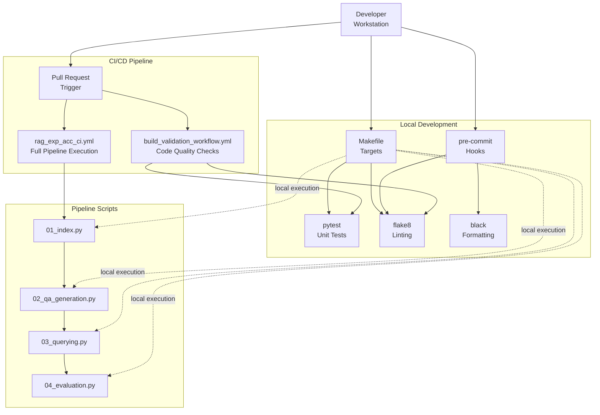
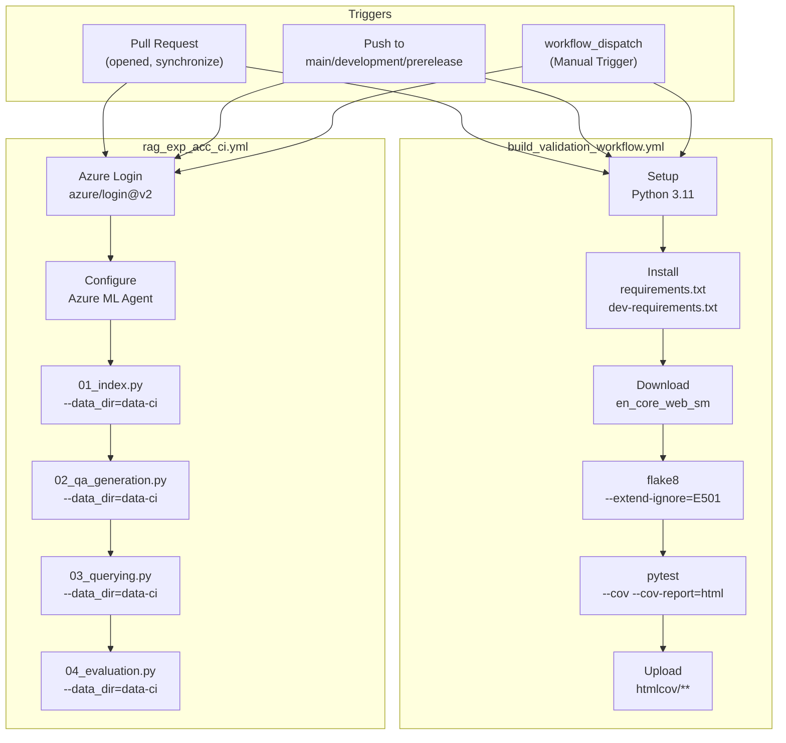
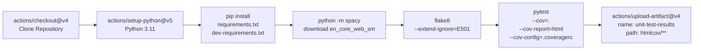
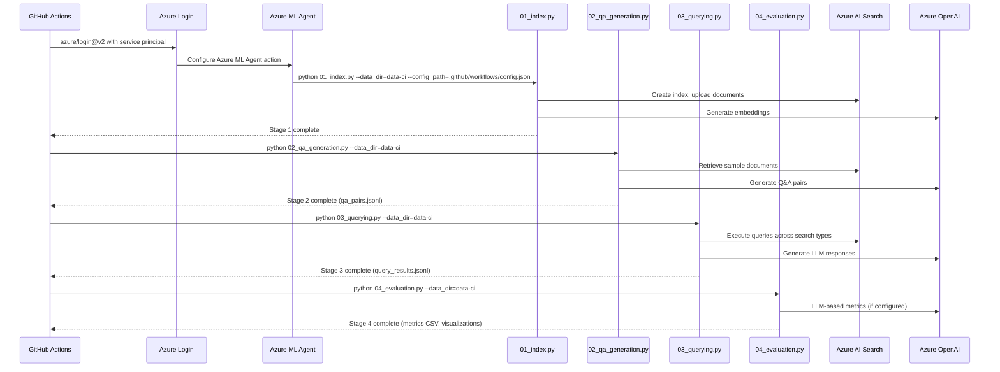
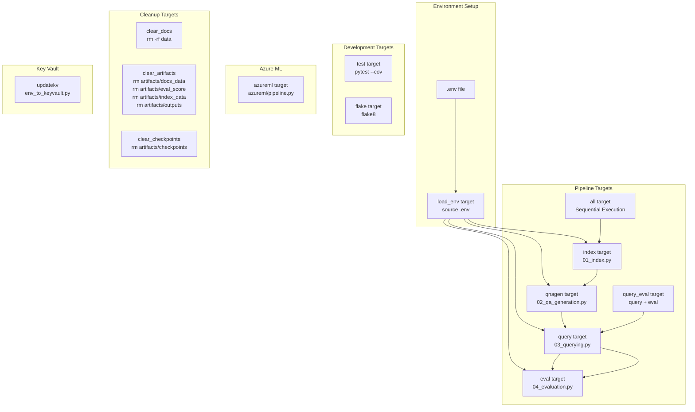
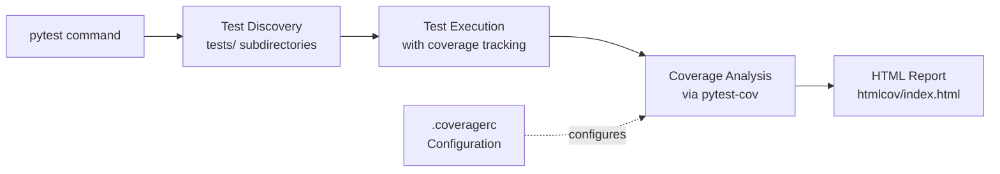
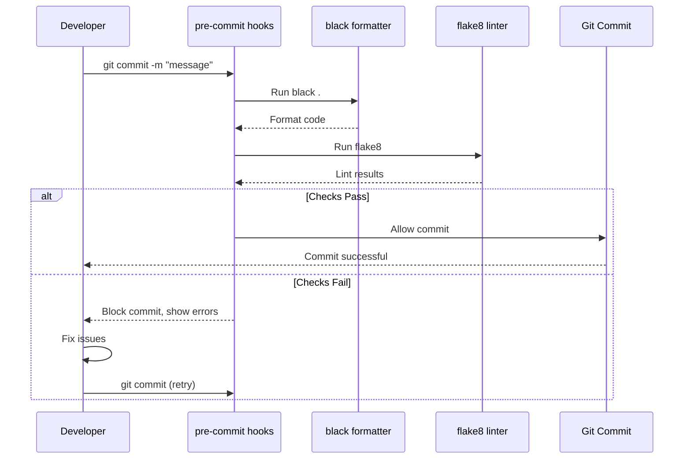

<!-- source: DeepWiki mcp.deepwiki.com · repo microsoft/rag-experiment-accelerator · page 11 Development and CI/CD · fetched 2026-10-26 -->

# Development and CI/CD

<details>
<summary>Relevant source files</summary>

The following files were used as context for generating this wiki page:

- [.env.template](.env.template)
- [.github/workflows/build_validation_workflow.yml](.github/workflows/build_validation_workflow.yml)
- [.github/workflows/rag_exp_acc_ci.yml](.github/workflows/rag_exp_acc_ci.yml)
- [Makefile](Makefile)
- [dev-requirements.txt](dev-requirements.txt)
- [docs/environment-variables.md](docs/environment-variables.md)
- [rag_experiment_accelerator/embedding/st_embedding_model.py](rag_experiment_accelerator/embedding/st_embedding_model.py)
- [rag_experiment_accelerator/embedding/tests/test_st_embedding_model.py](rag_experiment_accelerator/embedding/tests/test_st_embedding_model.py)
- [requirements.txt](requirements.txt)

</details>


This page provides guidance for developers contributing to the RAG Experiment Accelerator, covering the development environment setup, testing infrastructure, code quality tools, and CI/CD pipelines that ensure code reliability and maintain system quality. For information about running the pipeline in production environments, see [Azure ML and MLflow](#9.3). For details on the core pipeline stages themselves, see [Pipeline Architecture](#3).

---

## Development Workflow Overview

The RAG Experiment Accelerator supports three primary development and execution modes, each with distinct purposes and tooling:

| Mode | Primary Use Case | Entry Point | Key Tools |
|------|-----------------|-------------|-----------|
| **Local Development** | Rapid iteration, debugging, feature development | `Makefile` targets | pytest, flake8, black, pre-commit |
| **Build Validation** | Code quality checks, unit testing | `.github/workflows/build_validation_workflow.yml` | flake8, pytest, coverage reporting |
| **Integration Testing** | Full pipeline validation with Azure services | `.github/workflows/rag_exp_acc_ci.yml` | 4-stage pipeline execution, data-ci fixtures |



**Sources:** [Makefile:1-76](), [.github/workflows/build_validation_workflow.yml:1-59](), [.github/workflows/rag_exp_acc_ci.yml:1-67]()

---

## Development Dependencies

The project maintains separate dependency files for production and development use cases:

### Production Dependencies

Production dependencies in [requirements.txt:1-41]() include Azure SDK packages, machine learning frameworks, and document processing libraries:

| Category | Key Packages | Purpose |
|----------|--------------|---------|
| **Azure Services** | `azure-ai-ml`, `azure-search-documents`, `azure.ai.documentintelligence`, `azureml-mlflow` | Azure service integration |
| **ML/NLP** | `sentence-transformers`, `spacy`, `scikit-learn`, `datasets` | Embedding generation, text processing, clustering |
| **LLM Integration** | `openai`, `langchain`, `langchain-community` | LLM orchestration and response generation |
| **Evaluation** | `rouge-score`, `evaluate`, `levenshtein`, `textdistance` | Metric computation |
| **Document Processing** | `pypdf`, `PyMuPDF`, `beautifulsoup4`, `unstructured`, `docx2txt` | Multi-format document loading |
| **Visualization** | `plotly`, `matplotlib`, `kaleido` | Evaluation result visualization |
| **MLOps** | `mlflow` | Experiment tracking and model registry |

### Development Dependencies

Development dependencies in [dev-requirements.txt:1-8]() focus on code quality, testing, and prompt engineering:

| Package | Version | Purpose |
|---------|---------|---------|
| `pytest` | 8.3.3 | Unit testing framework |
| `pytest-cov` | 5.0.0 | Code coverage reporting |
| `flake8` | 7.1.1 | Python linting (PEP 8 compliance) |
| `black` | 24.8.0 | Code formatting |
| `pre-commit` | 3.8.0 | Git hook management |
| `promptflow` | 1.15.0 | Prompt Flow integration (low-code variant) |
| `promptflow-tools` | 1.4.0 | Prompt Flow tooling support |

**Sources:** [requirements.txt:1-41](), [dev-requirements.txt:1-8]()

---

## CI/CD Pipeline Architecture

The project employs two GitHub Actions workflows that execute on different triggers and validate different aspects of the codebase:



**Sources:** [.github/workflows/build_validation_workflow.yml:1-59](), [.github/workflows/rag_exp_acc_ci.yml:1-67]()

### Workflow Triggers

Both workflows share common triggers defined in [.github/workflows/build_validation_workflow.yml:3-16]() and [.github/workflows/rag_exp_acc_ci.yml:3-17]():

- **Pull Requests:** Triggered on `opened`, `synchronize` for branches `main`, `development`, `prerelease`
- **Push Events:** Triggered on direct pushes to protected branches
- **Manual Dispatch:** Enabled via `workflow_dispatch` for ad-hoc testing
- **Merge Groups:** Triggered during merge queue processing

### Concurrency Control

Both workflows implement concurrency control in [.github/workflows/build_validation_workflow.yml:19-20]() and [.github/workflows/rag_exp_acc_ci.yml:19-21]():

```yaml
concurrency:
  group: ${{ github.workflow }}-${{ github.ref }}
  cancel-in-progress: <conditional based on branch>
```

This ensures:
- Only one workflow run per branch at a time
- In-progress runs are canceled for feature branches (not `main`/`development`/`prerelease`)
- Protected branches complete all runs to maintain history

**Sources:** [.github/workflows/build_validation_workflow.yml:1-59](), [.github/workflows/rag_exp_acc_ci.yml:1-67]()

---

## Build Validation Workflow

The `build_validation_workflow.yml` performs static analysis and unit testing without requiring Azure service connectivity.

### Build Validation Steps



**Key Implementation Details:**

1. **Linting Configuration** [.github/workflows/build_validation_workflow.yml:44-47]():
   - Uses `flake8` with `--extend-ignore=E501` to allow longer lines
   - Enforces PEP 8 compliance across the codebase

2. **Coverage Reporting** [.github/workflows/build_validation_workflow.yml:49-52]():
   - Generates HTML coverage reports via `pytest-cov`
   - Configuration driven by `.coveragerc` (not shown in provided files)
   - Reports uploaded as GitHub Actions artifacts

3. **SpaCy Model Requirement** [.github/workflows/build_validation_workflow.yml:39-42]():
   - Downloads `en_core_web_sm` model required by NLP preprocessing components
   - Critical for text processing in document loaders and sampling modules

**Sources:** [.github/workflows/build_validation_workflow.yml:23-59]()

---

## Integration Testing Workflow

The `rag_exp_acc_ci.yml` workflow executes the complete 4-stage pipeline against Azure services using a minimal test dataset (`data-ci`).

### Environment Configuration

The workflow requires extensive Azure service credentials configured as GitHub Secrets [.github/workflows/rag_exp_acc_ci.yml:25-39]():

| Secret | Environment Variable | Purpose |
|--------|---------------------|---------|
| `AZURE_SEARCH_ADMIN_KEY` | `AZURE_SEARCH_ADMIN_KEY` | Azure AI Search API key |
| `AZURE_SEARCH_SERVICE_ENDPOINT` | `AZURE_SEARCH_SERVICE_ENDPOINT` | Search service URL |
| `AZURE_LANGUAGE_SERVICE_KEY` | `AZURE_LANGUAGE_SERVICE_KEY` | Language service API key (optional) |
| `AZURE_LANGUAGE_SERVICE_ENDPOINT` | `AZURE_LANGUAGE_SERVICE_ENDPOINT` | Language service URL (optional) |
| `OPENAI_API_KEY` | `OPENAI_API_KEY` | Azure OpenAI API key |
| `OPENAI_ENDPOINT` | `OPENAI_ENDPOINT` | Azure OpenAI endpoint |
| `OPENAI_API_VERSION` | `OPENAI_API_VERSION` | API version for Azure OpenAI |
| `SUBSCRIPTION_ID` | `AML_SUBSCRIPTION_ID` | Azure ML subscription |
| `WORKSPACE_NAME` | `AML_WORKSPACE_NAME` | Azure ML workspace name |
| `RESOURCE_GROUP_NAME` | `AML_RESOURCE_GROUP_NAME` | Azure ML resource group |
| `azure_credentials` | N/A | Service principal credentials for `azure/login@v2` |

**Note:** Document Intelligence variables are intentionally set to empty strings [.github/workflows/rag_exp_acc_ci.yml:38-39](), indicating optional usage during CI.

### Pipeline Execution Sequence



### CI-Specific Configuration

The workflow uses a dedicated configuration file at `.github/workflows/config.json` (not shown in provided files) that:
- Uses `data-ci` directory with minimal test documents
- Configures smaller chunk sizes for faster processing
- May disable expensive operations (e.g., extensive reranking, all metric types)
- Typically runs fewer index configurations to reduce execution time

**Pipeline Execution Steps** [.github/workflows/rag_exp_acc_ci.yml:51-66]():

```bash
# Stage 1: Indexing
python 01_index.py --data_dir='data-ci' --config_path=.github/workflows/config.json

# Stage 2: QA Generation  
python 02_qa_generation.py --data_dir='data-ci' --config_path=.github/workflows/config.json

# Stage 3: Querying
python 03_querying.py --data_dir='data-ci' --config_path=.github/workflows/config.json

# Stage 4: Evaluation
python 04_evaluation.py --data_dir='data-ci' --config_path=.github/workflows/config.json
```

**Sources:** [.github/workflows/rag_exp_acc_ci.yml:23-67]()

---

## Local Development with Makefile

The [Makefile:1-76]() provides convenient targets for local development, mirroring the CI/CD pipeline structure.

### Makefile Architecture



### Core Pipeline Targets

Each pipeline target accepts optional parameters for data directory (`dd`) and config path (`cp`):

| Target | Command | Default Arguments | Description |
|--------|---------|------------------|-------------|
| `index` | `make index` | `--data_dir ./data` | Execute document indexing stage [Makefile:28-30]() |
| `qnagen` | `make qnagen` | `--data_dir ./data` | Execute QA generation stage [Makefile:32-34]() |
| `query` | `make query` | `--data_dir ./data` | Execute querying stage [Makefile:36-38]() |
| `eval` | `make eval` | `--data_dir ./data` | Execute evaluation stage [Makefile:40-42]() |
| `all` | `make all` | Inherits from individual targets | Execute all stages sequentially [Makefile:21]() |
| `query_eval` | `make query_eval` | Inherits from query and eval | Execute query and evaluation only [Makefile:22]() |

**Example Usage with Custom Parameters:**

```bash
# Use custom data directory
make index dd=./my_data

# Use custom config file
make query cp=./experiments/config_v2.json

# Combine both
make all dd=./experiment_data cp=./configs/experiment_config.json
```

### Development and Testing Targets

| Target | Command | Description | Implementation |
|--------|---------|-------------|----------------|
| `test` | `make test` | Run pytest with coverage | [Makefile:65-67]() |
| `flake` | `make flake` | Run flake8 linting | [Makefile:69-71]() |

**Test Execution:**
```bash
pytest . --cov=. --cov-report=html --cov-config=.coveragerc
```

This command:
- Discovers all tests in the current directory recursively
- Generates coverage metrics for all modules
- Produces an HTML report in `htmlcov/` directory
- Uses `.coveragerc` configuration for coverage settings

**Linting Execution:**
```bash
flake8 --extend-ignore=E501
```

Ignores E501 (line too long) while enforcing all other PEP 8 rules.

### Cleanup Targets

| Target | Command | Purpose | Files Removed |
|--------|---------|---------|---------------|
| `clear_docs` | `make clear_docs` | Remove downloaded documents | `data/` directory [Makefile:50-52]() |
| `clear_artifacts` | `make clear_artifacts` | Remove processing artifacts | `artifacts/docs_data/`, `artifacts/eval_score/`, `artifacts/index_data/`, `artifacts/outputs/` [Makefile:54-59]() |
| `clear_checkpoints` | `make clear_checkpoints` | Remove checkpoint cache | `artifacts/checkpoints/` [Makefile:61-63]() |

### Azure ML Target

The `azureml` target [Makefile:45-47]() submits the pipeline to Azure ML compute:

```bash
python3 azureml/pipeline.py --data_dir ./data --config_path ./config.json
```

This triggers distributed execution in the cloud, as documented in [Azure ML and MLflow](#9.3).

### Environment Variable Loading

The Makefile automatically loads `.env` file if present [Makefile:4-13]():

```makefile
ENV_FILE := .env
ifeq ($(filter $(MAKECMDGOALS),config clean),)
    ifneq ($(strip $(wildcard $(ENV_FILE))),)
        ifneq ($(MAKECMDGOALS),config)
            include $(ENV_FILE)
            export
        endif
    endif
endif
```

This ensures all Azure service credentials are available to Python scripts. For environment variable documentation, see [docs/environment-variables.md:1-36]().

**Sources:** [Makefile:1-76](), [docs/environment-variables.md:1-36]()

---

## Testing Infrastructure

The project uses `pytest` as its testing framework with coverage reporting through `pytest-cov`.

### Test Organization

Tests are co-located with source code using a `tests/` subdirectory pattern:

```
rag_experiment_accelerator/
├── embedding/
│   ├── st_embedding_model.py
│   └── tests/
│       └── test_st_embedding_model.py
├── config/
│   └── tests/
│       └── test_config.py
└── [other modules]/
    └── tests/
        └── test_*.py
```

### Example Test Implementation

The [rag_experiment_accelerator/embedding/tests/test_st_embedding_model.py:1-35]() demonstrates common testing patterns:

```python
from unittest.mock import patch
import pytest
import numpy as np
from rag_experiment_accelerator.embedding.st_embedding_model import STEmbeddingModel

@patch("rag_experiment_accelerator.embedding.st_embedding_model.SentenceTransformer")
def test_generate_embedding(mock_sentence_transformer):
    """Test embedding generation with mocked SentenceTransformer"""
    expected_embeddings = [0.1, 0.2, 0.3]
    mock_embeddings = np.array([expected_embeddings])
    mock_sentence_transformer.return_value.encode.return_value = mock_embeddings

    model = STEmbeddingModel("all-mpnet-base-v2")
    embeddings = model.generate_embedding("Hello world")

    assert expected_embeddings == embeddings
```

**Testing Patterns Demonstrated:**

1. **Mocking External Dependencies** [rag_experiment_accelerator/embedding/tests/test_st_embedding_model.py:7-8]():
   - Uses `@patch` decorator to mock `SentenceTransformer`
   - Avoids actual model downloads during testing
   - Isolates unit under test

2. **Exception Testing** [rag_experiment_accelerator/embedding/tests/test_st_embedding_model.py:19-26]():
   - Validates error handling for invalid model names
   - Uses `pytest.raises` context manager
   - Tests both `OSError` and `ValueError` scenarios

3. **Success Path Testing** [rag_experiment_accelerator/embedding/tests/test_st_embedding_model.py:29-34]():
   - Ensures valid initialization succeeds
   - Uses try-except with `assert False` for clarity

### Test Execution and Coverage



**Coverage Command** (from [Makefile:67]() and [.github/workflows/build_validation_workflow.yml:52]()):

```bash
pytest . --cov=. --cov-report=html --cov-config=.coveragerc
```

**Parameters:**
- `.`: Run tests from current directory recursively
- `--cov=.`: Measure coverage for all modules in current directory
- `--cov-report=html`: Generate HTML coverage report
- `--cov-config=.coveragerc`: Use custom coverage configuration

**Coverage Output:**
- Console summary during test execution
- Detailed HTML report in `htmlcov/index.html`
- Coverage metrics tracked in CI/CD (uploaded as artifacts)

**Sources:** [rag_experiment_accelerator/embedding/tests/test_st_embedding_model.py:1-35](), [Makefile:65-67](), [.github/workflows/build_validation_workflow.yml:49-58]()

---

## Code Quality Tools

The project enforces code quality through multiple tools that can be run locally or in CI/CD.

### Linting with flake8

**Configuration:** [Makefile:71](), [.github/workflows/build_validation_workflow.yml:47]()

```bash
flake8 --extend-ignore=E501
```

**Purpose:**
- Enforces PEP 8 style guidelines
- Ignores E501 (line too long) due to complex Azure SDK calls and long URLs
- Catches common Python errors and anti-patterns

**Common Checks:**
- Unused imports (F401)
- Undefined variables (F821)
- Syntax errors (E999)
- Indentation issues (E101, E111, etc.)
- Whitespace errors (W291, W293, etc.)

### Code Formatting with black

**Dependency:** [dev-requirements.txt:7]()

```bash
black==24.8.0
```

While not explicitly shown in Makefile or CI workflows, `black` is included in dev dependencies for consistent code formatting. Typically integrated with:
- Pre-commit hooks for automatic formatting
- IDE integrations (VS Code, PyCharm)
- Manual runs: `black .`

### Pre-commit Hooks

**Dependency:** [dev-requirements.txt:6]()

```bash
pre-commit==3.8.0
```

Pre-commit enables automated checks before commits. Typical configuration (`.pre-commit-config.yaml`, not shown) would include:
- `black` for code formatting
- `flake8` for linting
- `trailing-whitespace` removal
- `end-of-file-fixer`

**Setup:**
```bash
pre-commit install
```

**Sources:** [dev-requirements.txt:1-8](), [Makefile:69-71](), [.github/workflows/build_validation_workflow.yml:44-47]()

---

## Environment Configuration

Development and CI/CD both rely on environment variables for Azure service connectivity.

### Environment Variable Template

The [.env.template:1-49]() provides a template for local development:

```mermaid
graph TB
    subgraph "Required Variables"
        SEARCH_EP["AZURE_SEARCH_SERVICE_ENDPOINT"]
        SEARCH_KEY["AZURE_SEARCH_ADMIN_KEY"]
        SEARCH_SEM["AZURE_SEARCH_USE_SEMANTIC_SEARCH"]
        OPENAI_KEY["OPENAI_API_KEY"]
        OPENAI_TYPE["OPENAI_API_TYPE<br/>(azure or open_ai)"]
        OPENAI_EP["OPENAI_ENDPOINT"]
        OPENAI_VER["OPENAI_API_VERSION"]
        AML_SUB["AML_SUBSCRIPTION_ID"]
        AML_WS["AML_WORKSPACE_NAME"]
        AML_RG["AML_RESOURCE_GROUP_NAME"]
    end
    
    subgraph "Optional Variables"
        DOC_INT_EP["AZURE_DOCUMENT_INTELLIGENCE_ENDPOINT"]
        DOC_INT_KEY["AZURE_DOCUMENT_INTELLIGENCE_ADMIN_KEY"]
        LANG_EP["AZURE_LANGUAGE_SERVICE_ENDPOINT"]
        LANG_KEY["AZURE_LANGUAGE_SERVICE_KEY"]
        MAX_WORKERS["MAX_WORKER_THREADS"]
        LOG_LEVEL["LOGGING_LEVEL"]
        AML_COMPUTE["AML_COMPUTE_NAME"]
        AML_INSTANCES["AML_COMPUTE_INSTANCES_NUMBER"]
        KV_EP["AZURE_KEY_VAULT_ENDPOINT"]
    end
    
    ENV_FILE[".env file"]
    MAKEFILE["Makefile<br/>Auto-loads .env"]
    SCRIPTS["Pipeline Scripts<br/>01-04_*.py"]
    
    SEARCH_EP --> ENV_FILE
    SEARCH_KEY --> ENV_FILE
    SEARCH_SEM --> ENV_FILE
    OPENAI_KEY --> ENV_FILE
    OPENAI_TYPE --> ENV_FILE
    OPENAI_EP --> ENV_FILE
    OPENAI_VER --> ENV_FILE
    AML_SUB --> ENV_FILE
    AML_WS --> ENV_FILE
    AML_RG --> ENV_FILE
    
    DOC_INT_EP --> ENV_FILE
    DOC_INT_KEY --> ENV_FILE
    LANG_EP --> ENV_FILE
    LANG_KEY --> ENV_FILE
    MAX_WORKERS --> ENV_FILE
    LOG_LEVEL --> ENV_FILE
    AML_COMPUTE --> ENV_FILE
    AML_INSTANCES --> ENV_FILE
    KV_EP --> ENV_FILE
    
    ENV_FILE --> MAKEFILE
    MAKEFILE --> SCRIPTS
```



### Required Environment Variables

Documented in [docs/environment-variables.md:17-30]():

| Variable | Purpose | Example Value |
|----------|---------|---------------|
| `AZURE_SEARCH_SERVICE_ENDPOINT` | Azure AI Search API endpoint | `https://<service-name>.search.windows.net` |
| `AZURE_SEARCH_ADMIN_KEY` | Azure AI Search admin key | API key from Azure portal |
| `AZURE_SEARCH_USE_SEMANTIC_SEARCH` | Enable semantic search | `True` or `False` |
| `OPENAI_API_KEY` | OpenAI API key | API key from Azure OpenAI |
| `OPENAI_API_TYPE` | OpenAI provider type | `azure` or `open_ai` |
| `OPENAI_ENDPOINT` | Azure OpenAI endpoint | `https://<resource-name>.openai.azure.com/` |
| `OPENAI_API_VERSION` | Azure OpenAI API version | `2023-03-15-preview` |
| `AML_SUBSCRIPTION_ID` | Azure subscription ID | GUID |
| `AML_WORKSPACE_NAME` | Azure ML workspace name | Workspace identifier |
| `AML_RESOURCE_GROUP_NAME` | Azure resource group | Resource group name |

### Optional Environment Variables

Documented in [docs/environment-variables.md:32-36]() and [.env.template:26-48]():

| Variable | Purpose | Default |
|----------|---------|---------|
| `AZURE_DOCUMENT_INTELLIGENCE_ENDPOINT` | Document Intelligence service URL | Not used |
| `AZURE_DOCUMENT_INTELLIGENCE_ADMIN_KEY` | Document Intelligence API key | Not used |
| `AZURE_LANGUAGE_SERVICE_ENDPOINT` | Language service for skillsets | Not used |
| `AZURE_LANGUAGE_SERVICE_KEY` | Language service API key | Not used |
| `MAX_WORKER_THREADS` | ThreadPoolExecutor max workers | CPU count optimized |
| `LOGGING_LEVEL` | Python logging level | `INFO` |
| `AML_COMPUTE_NAME` | Azure ML compute cluster name | Not used (local execution) |
| `AML_COMPUTE_INSTANCES_NUMBER` | Compute cluster max instances | Not used |
| `AZURE_KEY_VAULT_ENDPOINT` | Key Vault for secret management | Not used |

### CI/CD Secret Management

In GitHub Actions, these variables are configured as GitHub Secrets and mapped to environment variables in workflow files [.github/workflows/rag_exp_acc_ci.yml:25-39](). See the [Integration Testing Workflow](#integration-testing-workflow) section for details.

**Sources:** [.env.template:1-49](), [docs/environment-variables.md:1-36](), [Makefile:4-13](), [.github/workflows/rag_exp_acc_ci.yml:25-39]()

---

## Development Best Practices

### Pre-Commit Workflow



### Local Testing Workflow

Recommended testing sequence before pushing code:

1. **Unit Tests:** `make test`
   - Validates individual components
   - Generates coverage report
   - Fast feedback loop (~seconds to minutes)

2. **Linting:** `make flake`
   - Ensures code style compliance
   - Catches common errors
   - Very fast (~seconds)

3. **Local Pipeline Execution:** `make all dd=data-ci`
   - Tests integration with Azure services
   - Uses minimal dataset for speed
   - Validates full pipeline flow (~minutes)

4. **Coverage Review:**
   - Open `htmlcov/index.html` in browser
   - Identify untested code paths
   - Add tests for critical paths

### Checkpoint Management During Development

When iterating on a specific pipeline stage, leverage checkpoints to avoid reprocessing:

```bash
# Initial run - generates checkpoints
make index

# Modify indexing code
# Second run - reuses checkpoints where possible
make index

# Clear checkpoints to force fresh execution
make clear_checkpoints
make index
```

**Checkpoint Benefits:**
- Speeds up development iteration
- Saves Azure OpenAI API costs (embeddings cached)
- Preserves intermediate results

**When to Clear Checkpoints:**
- Changing chunk sizes or embedding models
- Modifying preprocessing logic
- Testing end-to-end with fresh data

See [Checkpointing System](#10.1) for implementation details.

---

## CI/CD Pipeline Optimization

### Parallel Workflow Execution

Both workflows can run concurrently:
- `build_validation_workflow.yml`: Fast code quality checks
- `rag_exp_acc_ci.yml`: Slower integration tests

This allows:
- Quick feedback on style/test failures
- Comprehensive validation without blocking on integration tests

### Branch Protection Strategy

Recommended GitHub branch protection rules:
- **Require status checks:** Both workflows must pass
- **Require up-to-date branches:** Ensure latest changes tested
- **Require pull request reviews:** Code review before merge
- **Restrict force pushes:** Maintain commit history on protected branches

### Cost Optimization in CI

The `data-ci` directory and CI-specific config reduce costs:
- Minimal document corpus (likely 1-5 documents vs. hundreds)
- Smaller index configurations (fewer dimension/chunk combinations)
- Reduced metric sets (skip expensive LLM-based metrics)
- Single search type testing (instead of all 8)

**Estimated Cost Reduction:** 90-95% compared to full production experiment

---

## Extending the CI/CD Pipeline

### Adding New Test Suites

To add tests for a new module:

1. Create `tests/` subdirectory:
   ```
   rag_experiment_accelerator/new_module/
   ├── __init__.py
   ├── my_component.py
   └── tests/
       ├── __init__.py
       └── test_my_component.py
   ```

2. Write tests following existing patterns:
   - Use `pytest` fixtures for setup
   - Mock external dependencies (Azure SDKs, models)
   - Test error conditions with `pytest.raises`

3. Tests are automatically discovered by `pytest .`

### Adding Code Quality Checks

To add new quality checks (e.g., type checking with mypy):

1. Add dependency to [dev-requirements.txt:1-8]():
   ```
   mypy==1.0.0
   ```

2. Add Makefile target:
   ```makefile
   mypy: ## 🔍 Run type checking
       $(call target_title, "running mypy")
       mypy rag_experiment_accelerator
   ```

3. Add to `build_validation_workflow.yml`:
   ```yaml
   - name: Run mypy
     shell: bash
     run: |
       mypy rag_experiment_accelerator
   ```

### Customizing CI Configuration

To test with different Azure services or configurations:

1. Create custom config file: `.github/workflows/config_custom.json`
2. Update workflow to reference new config:
   ```yaml
   - name: execute index creation step
     shell: bash
     run: |
       python 01_index.py --data_dir='data-ci' --config_path=.github/workflows/config_custom.json
   ```

**Sources:** [.github/workflows/build_validation_workflow.yml:1-59](), [.github/workflows/rag_exp_acc_ci.yml:1-67](), [Makefile:1-76]()

---

## Troubleshooting Common Issues

### Authentication Failures in CI

**Symptom:** `azure/login@v2` fails with authentication error

**Causes:**
- Expired service principal credentials in `azure_credentials` secret
- Insufficient permissions on service principal
- Incorrect secret format

**Solution:**
1. Verify service principal has Contributor role on resource group
2. Regenerate service principal credentials if expired
3. Ensure secret format matches Azure CLI output:
   ```json
   {
     "clientId": "...",
     "clientSecret": "...",
     "subscriptionId": "...",
     "tenantId": "..."
   }
   ```

### Test Failures Due to Missing Models

**Symptom:** Tests fail with "Model not found" errors

**Causes:**
- SpaCy model `en_core_web_sm` not downloaded
- Sentence Transformer model download blocked

**Solution:**
1. Ensure SpaCy model downloaded in workflow [.github/workflows/build_validation_workflow.yml:39-42]():
   ```bash
   python -m spacy download en_core_web_sm
   ```

2. Mock Sentence Transformer in tests [rag_experiment_accelerator/embedding/tests/test_st_embedding_model.py:7]()

### Flake8 Failures

**Symptom:** `flake8` reports E501 (line too long) errors

**Cause:** New code exceeds 79 character line limit

**Solution:**
- Refactor long lines using Python's implicit line continuation
- If unavoidable (e.g., long URLs), add inline ignore comment:
  ```python
  url = "https://very-long-azure-url.com/..."  # noqa: E501
  ```

### Coverage Drops Below Threshold

**Symptom:** New code added without corresponding tests

**Solution:**
1. Run `make test` locally
2. Open `htmlcov/index.html`
3. Identify untested lines (highlighted in red)
4. Add tests for new code paths
5. Target >80% coverage for new modules

**Sources:** [.github/workflows/build_validation_workflow.yml:1-59](), [.github/workflows/rag_exp_acc_ci.yml:1-67](), [rag_experiment_accelerator/embedding/tests/test_st_embedding_model.py:1-35]()

---

