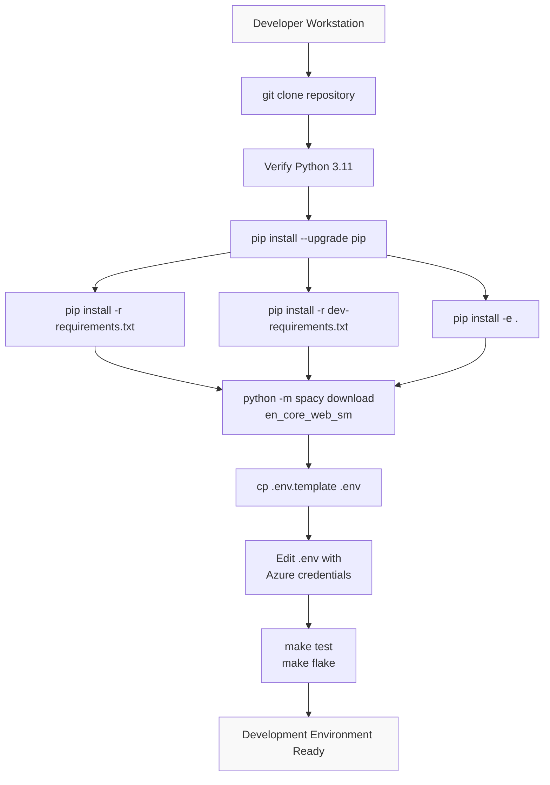
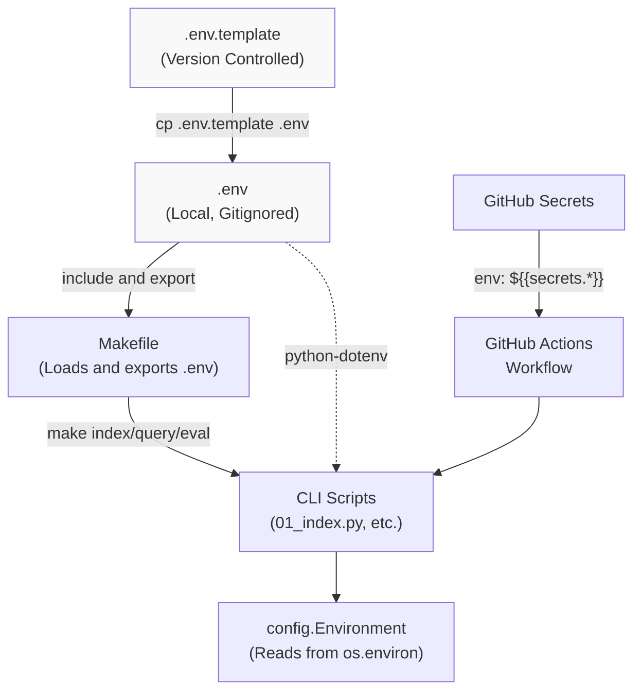
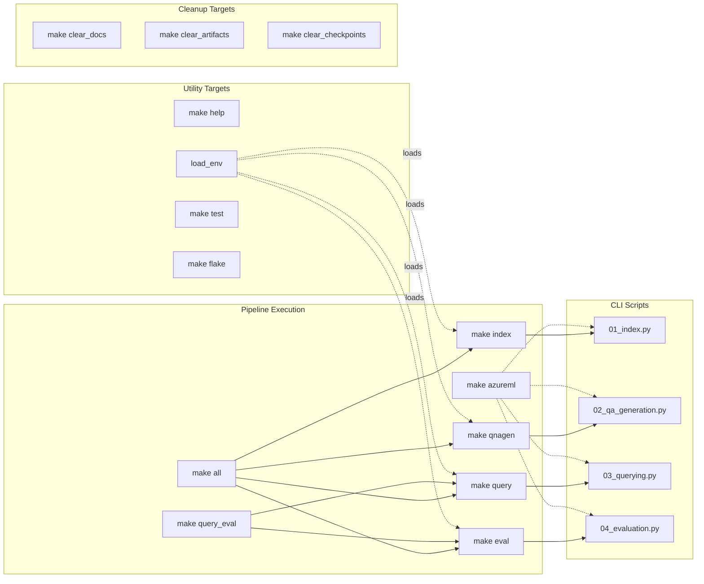
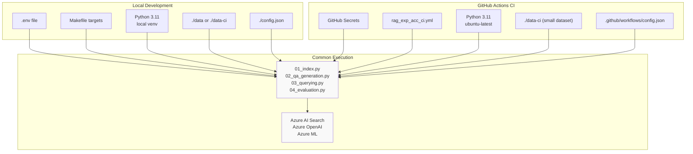
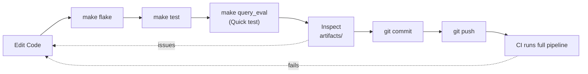

<!-- source: DeepWiki mcp.deepwiki.com · repo microsoft/rag-experiment-accelerator · page 11.1 Development Environment Setup · fetched 2026-10-26 -->

# Development Environment Setup

<details>
<summary>Relevant source files</summary>

The following files were used as context for generating this wiki page:

- [.env.template](.env.template)
- [.github/workflows/build_validation_workflow.yml](.github/workflows/build_validation_workflow.yml)
- [.github/workflows/rag_exp_acc_ci.yml](.github/workflows/rag_exp_acc_ci.yml)
- [Makefile](Makefile)
- [dev-requirements.txt](dev-requirements.txt)
- [docs/environment-variables.md](docs/environment-variables.md)
- [rag_experiment_accelerator/embedding/st_embedding_model.py](rag_experiment_accelerator/embedding/st_embedding_model.py)
- [rag_experiment_accelerator/embedding/tests/test_st_embedding_model.py](rag_experiment_accelerator/embedding/tests/test_st_embedding_model.py)
- [requirements.txt](requirements.txt)

</details>


This page guides developers through setting up a local development environment for contributing to the RAG Experiment Accelerator project. It covers dependency installation, environment configuration, development tools, and the Makefile-based workflow for local development and testing.

For information about running the pipeline in production or CI/CD environments, see [CI/CD Workflows](#11.3). For guidance on testing strategy and writing tests, see [Testing Strategy](#11.2).

---

## Purpose and Scope

This document provides a comprehensive guide for:
- Installing Python dependencies and required models
- Configuring environment variables and Azure service connections
- Setting up development tools (linters, formatters, test runners)
- Using the Makefile for local pipeline execution
- Verifying the development environment is correctly configured

The development environment supports both local pipeline execution and running tests/validation tools. It mirrors the CI/CD environment to ensure consistency between local development and automated builds.

---

## Prerequisites

### System Requirements

- **Python 3.11**: Required for compatibility with all dependencies
- **pip**: Python package installer
- **make**: GNU Make utility for running Makefile targets
- **Git**: Version control system

### Azure Service Access

The following Azure services must be provisioned and accessible:
- **Azure AI Search Service**: For index creation and querying
- **Azure OpenAI Service**: For embeddings and LLM interactions
- **Azure ML Workspace**: For experiment tracking and optional cloud execution
- **Azure Document Intelligence** (optional): For advanced document parsing
- **Azure AI Language Service** (optional): For cognitive skillsets

See [Azure Service Integration](#9) for detailed service configuration requirements.

Sources: [.github/workflows/build_validation_workflow.yml:29-31](), [docs/environment-variables.md:4-11]()

---

## Installation Flow



**Diagram: Development Environment Installation Steps**

Sources: [.github/workflows/build_validation_workflow.yml:32-42](), [requirements.txt:1-41](), [dev-requirements.txt:1-8]()

---

## Step-by-Step Installation

### 1. Clone the Repository

```bash
git clone https://github.com/microsoft/rag-experiment-accelerator.git
cd rag-experiment-accelerator
```

### 2. Verify Python Version

The project requires Python 3.11:

```bash
python --version  # Should output Python 3.11.x
```

Sources: [.github/workflows/build_validation_workflow.yml:30-31]()

### 3. Upgrade pip

```bash
python -m pip install --upgrade pip
```

Sources: [.github/workflows/build_validation_workflow.yml:36]()

### 4. Install Dependencies

Install all required dependencies in a single command:

```bash
pip install -e . -r requirements.txt -r dev-requirements.txt
```

This installs three dependency sets:
- **Editable install (`-e .`)**: Makes the package importable in development mode
- **Runtime dependencies (`requirements.txt`)**: Core libraries for pipeline execution
- **Development dependencies (`dev-requirements.txt`)**: Testing, linting, and formatting tools

Sources: [.github/workflows/build_validation_workflow.yml:37](), [requirements.txt:1-41](), [dev-requirements.txt:1-8]()

### 5. Download spaCy Language Model

The NLP preprocessing pipeline requires the English language model:

```bash
python -m spacy download en_core_web_sm
```

This model is used by the [nlp.Preprocess]() class for text preprocessing during document chunking and sampling.

Sources: [.github/workflows/build_validation_workflow.yml:40-42]()

---

## Runtime Dependencies

The `requirements.txt` file specifies 40+ production dependencies organized by functionality:

| Category | Key Dependencies | Purpose |
|----------|-----------------|---------|
| **Azure SDKs** | `azure-ai-ml`, `azure-search-documents`, `azure.ai.documentintelligence` | Cloud service integration |
| **OpenAI** | `openai` | LLM interactions and embeddings |
| **ML/NLP** | `sentence-transformers`, `spacy`, `langchain` | Embedding generation and text processing |
| **Document Processing** | `pypdf`, `PyMuPDF`, `beautifulsoup4`, `docx2txt` | Multi-format document loading |
| **Evaluation** | `evaluate`, `rouge-score`, `textdistance`, `levenshtein` | Metric computation |
| **Clustering** | `scikit-learn`, `umap-learn`, `hnswlib` | Document sampling |
| **Experiment Tracking** | `mlflow`, `azureml-mlflow` | Metric logging and visualization |
| **Visualization** | `matplotlib`, `plotly`, `kaleido` | Chart generation |

**Notable Version Constraints:**
- `azure-search-documents==11.4.b11`: Beta version required for latest vector search features
- `azure.ai.documentintelligence==1.0.0b4`: Beta API for table extraction
- `langchain==0.3.0`: Pinned for stable document loading APIs

Sources: [requirements.txt:1-41]()

---

## Development Dependencies

The `dev-requirements.txt` file includes tools for code quality and testing:

| Tool | Version | Purpose |
|------|---------|---------|
| `pytest` | 8.3.3 | Unit test framework |
| `pytest-cov` | 5.0.0 | Test coverage reporting |
| `flake8` | 7.1.1 | Python linting (PEP 8 compliance) |
| `black` | 24.8.0 | Code formatting (automatic) |
| `pre-commit` | 3.8.0 | Git hooks for automated checks |
| `promptflow` | 1.15.0 | Prompt Flow integration testing |
| `promptflow-tools` | 1.4.0 | Prompt Flow runtime utilities |

Sources: [dev-requirements.txt:1-8]()

---

## Environment Configuration

### Environment Variable Hierarchy



**Diagram: Environment Configuration Loading Paths**

The Makefile automatically loads and exports `.env` variables before executing pipeline stages.

Sources: [Makefile:4-13](), [.env.template:1-49]()

### Creating the .env File

1. **Copy the template**:
   ```bash
   cp .env.template .env
   ```

2. **Edit with your Azure credentials**:
   ```bash
   # Use your preferred editor
   nano .env  # or vim, code, etc.
   ```

Sources: [.env.template:1-49]()

### Required Environment Variables

The following variables **must** be configured:

```bash
# Azure AI Search
AZURE_SEARCH_SERVICE_ENDPOINT=https://your-search-service.search.windows.net
AZURE_SEARCH_ADMIN_KEY=your-search-admin-key
AZURE_SEARCH_USE_SEMANTIC_SEARCH=True

# Azure OpenAI
OPENAI_API_KEY=your-openai-key
OPENAI_API_TYPE=azure  # Must be 'azure' or 'open_ai'
OPENAI_ENDPOINT=https://your-openai.openai.azure.com/
OPENAI_API_VERSION=2023-03-15-preview

# Azure Machine Learning
AML_SUBSCRIPTION_ID=your-subscription-id
AML_WORKSPACE_NAME=your-workspace-name
AML_RESOURCE_GROUP_NAME=your-resource-group
```

Sources: [.env.template:3-29](), [docs/environment-variables.md:15-30]()

### Optional Environment Variables

```bash
# Azure Document Intelligence (for advanced PDF parsing)
AZURE_DOCUMENT_INTELLIGENCE_ENDPOINT=
AZURE_DOCUMENT_INTELLIGENCE_ADMIN_KEY=

# Azure Language Service (for cognitive skillsets)
AZURE_LANGUAGE_SERVICE_ENDPOINT=
AZURE_LANGUAGE_SERVICE_KEY=

# Performance tuning
MAX_WORKER_THREADS=1  # Control parallel processing

# Logging
LOGGING_LEVEL=INFO  # Options: NOTSET, DEBUG, INFO, WARN, ERROR, CRITICAL

# Azure ML compute (for cloud execution)
AML_COMPUTE_NAME=your-compute-cluster
AML_COMPUTE_INSTANCES_NUMBER=4
```

Sources: [.env.template:23-48](), [docs/environment-variables.md:32-36]()

---

## Makefile Development Workflow

### Makefile Target Architecture



**Diagram: Makefile Target Dependencies and CLI Script Invocation**

Sources: [Makefile:1-76]()

### Common Makefile Targets

| Target | Command | Description |
|--------|---------|-------------|
| `help` | `make help` | Display all available targets with descriptions |
| `all` | `make all` | Run complete pipeline: index → qnagen → query → eval |
| `index` | `make index` | Execute Stage 1: Document indexing |
| `qnagen` | `make qnagen` | Execute Stage 2: Q&A generation |
| `query` | `make query` | Execute Stage 3: Query execution |
| `eval` | `make eval` | Execute Stage 4: Evaluation |
| `query_eval` | `make query_eval` | Quick iteration: query → eval only |
| `test` | `make test` | Run pytest with coverage |
| `flake` | `make flake` | Run flake8 linting |
| `azureml` | `make azureml` | Submit pipeline to Azure ML |

Sources: [Makefile:18-76]()

### Makefile Target Parameters

All pipeline targets accept optional parameters:

```bash
# Custom data directory
make index dd=./my-data

# Custom config path
make query cp=./experiments/config-exp1.json

# Combined parameters
make all dd=./data-custom cp=./config-custom.json
```

**Parameter mapping:**
- `dd` → `--data_dir` argument to CLI scripts
- `cp` → `--config_path` argument to CLI scripts

Sources: [Makefile:28-47]()

### Cleanup Targets

```bash
# Remove downloaded documents
make clear_docs

# Remove all generated artifacts (chunks, outputs, scores)
make clear_artifacts

# Remove cached checkpoints
make clear_checkpoints
```

These targets clean specific directories without affecting source code or configuration:

| Target | Removes | Impact |
|--------|---------|--------|
| `clear_docs` | `data/` directory | Forces re-download of documents |
| `clear_artifacts` | `artifacts/docs_data/`, `artifacts/eval_score/`, `artifacts/index_data/`, `artifacts/outputs/` | Forces re-generation of all artifacts |
| `clear_checkpoints` | `artifacts/checkpoints/` | Invalidates caches, forces expensive operations |

Sources: [Makefile:50-63]()

---

## Development Tools Configuration

### pytest Configuration

The project uses pytest with coverage reporting. Configuration is defined in `.coveragerc` (referenced but not provided in files).

**Running tests:**
```bash
# Run all tests with coverage
make test

# Or directly with pytest
pytest . --cov=. --cov-report=html --cov-config=.coveragerc
```

**Coverage output:**
- Console summary
- HTML report in `htmlcov/` directory

Sources: [Makefile:65-67](), [.github/workflows/build_validation_workflow.yml:50-52]()

### flake8 Configuration

Linting enforces PEP 8 compliance with extended ignore rules:

```bash
# Run linting
make flake

# Or directly
flake8 --extend-ignore=E501
```

**Ignored rules:**
- `E501`: Line length (allows flexibility for readability)

Sources: [Makefile:69-71](), [.github/workflows/build_validation_workflow.yml:44-47]()

### black Configuration

Black provides automatic code formatting (configuration in `pyproject.toml`, not provided):

```bash
# Format all code
black .

# Check formatting without changes
black --check .
```

Sources: [dev-requirements.txt:7]()

### pre-commit Hooks

Pre-commit hooks automate validation before Git commits:

```bash
# Install hooks
pre-commit install

# Run manually
pre-commit run --all-files
```

Hooks typically run:
- `black` for formatting
- `flake8` for linting
- `pytest` for unit tests

Sources: [dev-requirements.txt:6]()

---

## CI/CD Environment Comparison

### Local vs. CI Environment



**Diagram: Local and CI Environments Converge on Same CLI Scripts**

### Key Differences

| Aspect | Local Development | GitHub Actions CI |
|--------|------------------|-------------------|
| **Environment Variables** | `.env` file | GitHub Secrets → workflow `env:` |
| **Data Directory** | `./data` (configurable) | `./data-ci` (smaller test dataset) |
| **Config File** | `./config.json` | `.github/workflows/config.json` |
| **Python Environment** | Local virtualenv | Ubuntu runner with fresh install |
| **Execution** | `make` targets | Direct `python` commands |
| **Duration** | Variable | Optimized for fast feedback (~5-10 min) |

Sources: [.github/workflows/rag_exp_acc_ci.yml:24-66](), [Makefile:28-47]()

### CI Environment Setup Steps

The CI workflow mirrors local setup:

1. **Checkout repository** ([.github/workflows/rag_exp_acc_ci.yml:43-44]())
2. **Azure login** using service principal ([.github/workflows/rag_exp_acc_ci.yml:45-48]())
3. **Configure Azure ML agent** ([.github/workflows/rag_exp_acc_ci.yml:49-50]())
4. **Execute pipeline stages** with `data-ci` directory ([.github/workflows/rag_exp_acc_ci.yml:51-66]())

Environment variables are injected at the workflow level:
```yaml
env:
  AZURE_SEARCH_ADMIN_KEY: ${{ secrets.AZURE_SEARCH_ADMIN_KEY }}
  AZURE_SEARCH_SERVICE_ENDPOINT: ${{ secrets.AZURE_SEARCH_SERVICE_ENDPOINT }}
  OPENAI_API_KEY: ${{ secrets.OPENAI_API_KEY }}
  # ... etc
```

Sources: [.github/workflows/rag_exp_acc_ci.yml:25-39]()

---

## Verifying Your Setup

### 1. Verify Dependencies

Test that all dependencies are correctly installed:

```bash
# Test sentence-transformers installation
python -c "from sentence_transformers import SentenceTransformer; print('OK')"

# Test spaCy model download
python -c "import spacy; nlp = spacy.load('en_core_web_sm'); print('OK')"

# Test Azure SDK imports
python -c "from azure.search.documents import SearchClient; print('OK')"
```

### 2. Run Unit Tests

Validate the codebase with existing unit tests:

```bash
make test
```

Expected output:
- All tests pass
- Coverage report generated in `htmlcov/`

Sources: [Makefile:65-67]()

### 3. Run Linting

Check code quality:

```bash
make flake
```

Expected: No linting errors (warnings may exist for line length).

Sources: [Makefile:69-71]()

### 4. Test Pipeline Stage (Optional)

If Azure services are configured, test a single stage:

```bash
# Create a minimal test with data-ci directory
make index dd=./data-ci
```

This validates:
- Environment variables are correctly set
- Azure service connections work
- Document processing pipeline functions

Sources: [Makefile:28-30]()

---

## Troubleshooting Common Setup Issues

### Issue: spaCy Model Not Found

**Symptom:**
```
OSError: [E050] Can't find model 'en_core_web_sm'
```

**Solution:**
```bash
python -m spacy download en_core_web_sm
```

Sources: [.github/workflows/build_validation_workflow.yml:39-42]()

### Issue: Azure Service Connection Failures

**Symptom:**
```
AuthenticationError: Failed to authenticate with Azure
```

**Solution:**
1. Verify `.env` file exists and contains correct credentials
2. Check `OPENAI_API_TYPE` is set to `"azure"`
3. Verify endpoints don't have trailing slashes
4. Test credentials in Azure Portal

Sources: [.env.template:3-29]()

### Issue: Import Errors for Sentence Transformers

**Symptom:**
```
ModuleNotFoundError: No module named 'sentence_transformers'
```

**Solution:**
```bash
pip install -r requirements.txt
```

The `STEmbeddingModel` class requires `sentence-transformers==3.1.1`.

Sources: [requirements.txt:34](), [rag_experiment_accelerator/embedding/st_embedding_model.py:1]()

### Issue: pytest Not Found

**Symptom:**
```
bash: pytest: command not found
```

**Solution:**
```bash
pip install -r dev-requirements.txt
```

Sources: [dev-requirements.txt:3]()

---

## Development Workflow Best Practices

### Iterative Development Cycle



**Diagram: Recommended Development Cycle**

### Quick Iteration Workflow

For rapid experimentation after initial indexing:

```bash
# 1. Index once (slow)
make index dd=./data-ci

# 2. Generate Q&A once (slow)
make qnagen dd=./data-ci

# 3. Iterate on querying and evaluation (fast)
make query_eval dd=./data-ci
```

The `query_eval` target skips expensive indexing and Q&A generation steps.

Sources: [Makefile:22]()

### Working with Custom Configurations

```bash
# Experiment 1: Small chunks
make all cp=./experiments/small-chunks.json

# Experiment 2: Large chunks
make all cp=./experiments/large-chunks.json

# Compare results in artifacts/eval_score/
```

Sources: [Makefile:30-42]()

### Checkpoint Management

During development, checkpoints speed up iteration:

```bash
# First run: generates and caches embeddings
make index

# Second run: uses cached embeddings (fast)
make index

# Clear cache to force regeneration
make clear_checkpoints
make index
```

For more on checkpoint behavior, see [Checkpointing System](#10.1).

Sources: [Makefile:61-63]()

---

## Next Steps

After setting up your development environment:

1. **Run Your First Experiment**: Follow [Running Your First Experiment](#2.3) to execute a complete pipeline
2. **Understand Testing**: Read [Testing Strategy](#11.2) to learn about test patterns and coverage requirements
3. **Learn CI/CD**: See [CI/CD Workflows](#11.3) for automated build and validation processes
4. **Configure Experiments**: Explore [Configuration Guide](#2.2) for advanced configuration options

---

**Sources for this entire page:**
- [requirements.txt:1-41]()
- [dev-requirements.txt:1-8]()
- [.github/workflows/rag_exp_acc_ci.yml:1-67]()
- [.github/workflows/build_validation_workflow.yml:1-59]()
- [Makefile:1-76]()
- [.env.template:1-49]()
- [docs/environment-variables.md:1-36]()
- [rag_experiment_accelerator/embedding/st_embedding_model.py:1-78]()
- [rag_experiment_accelerator/embedding/tests/test_st_embedding_model.py:1-35]()

---

