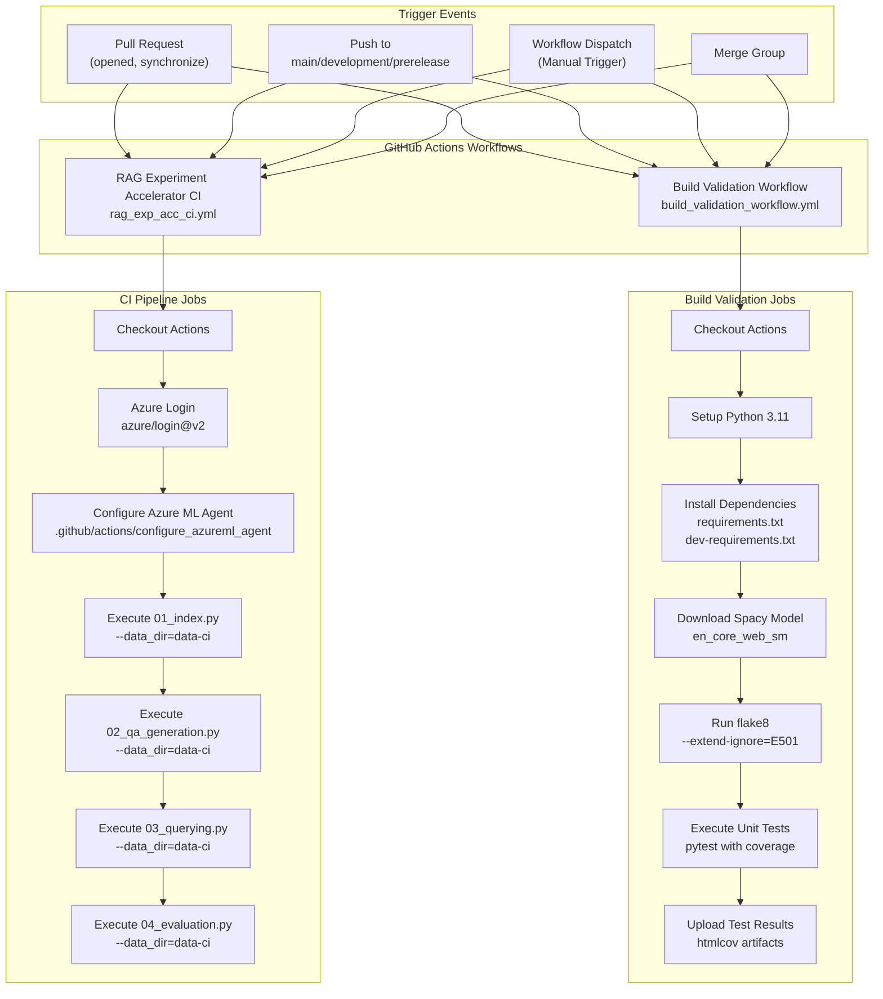
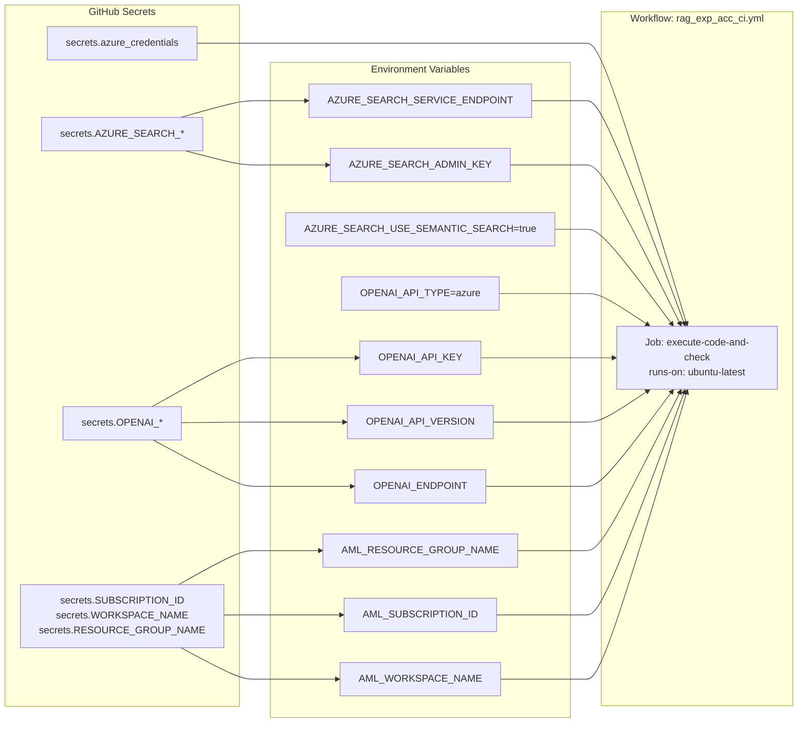
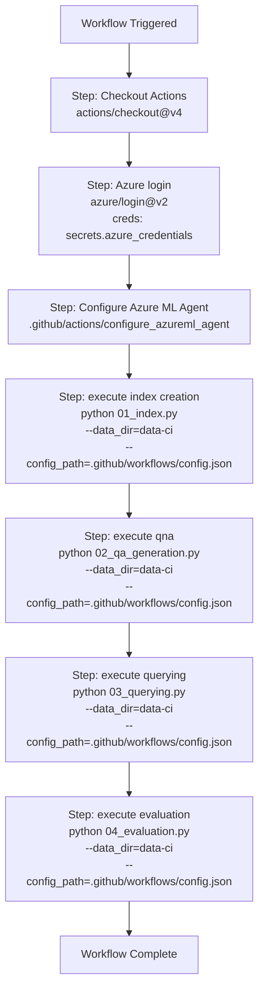
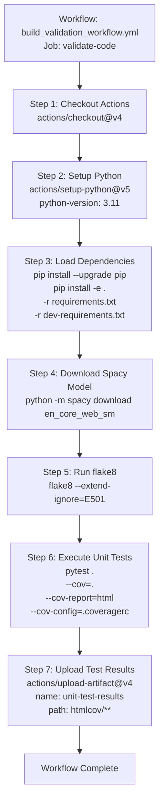
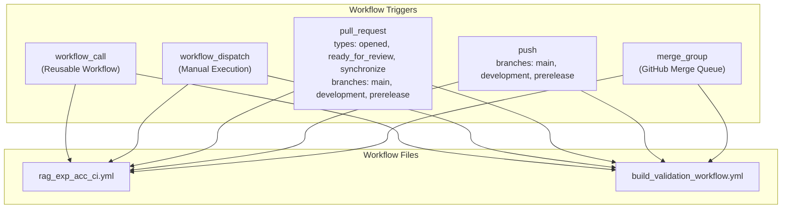
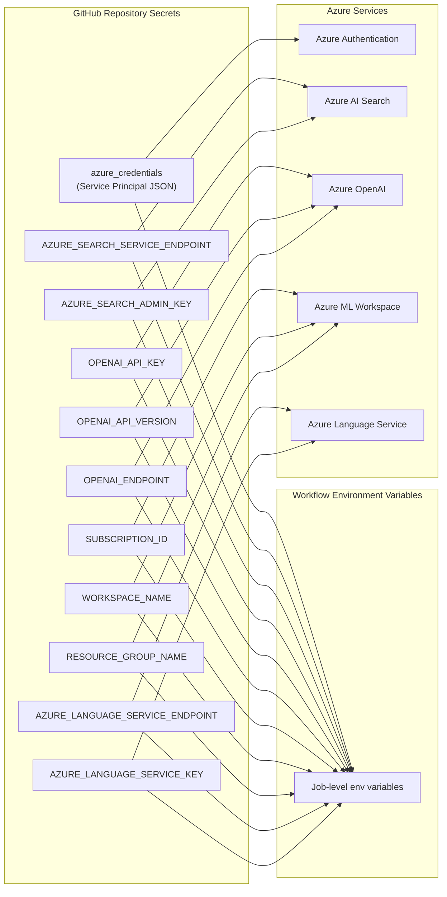
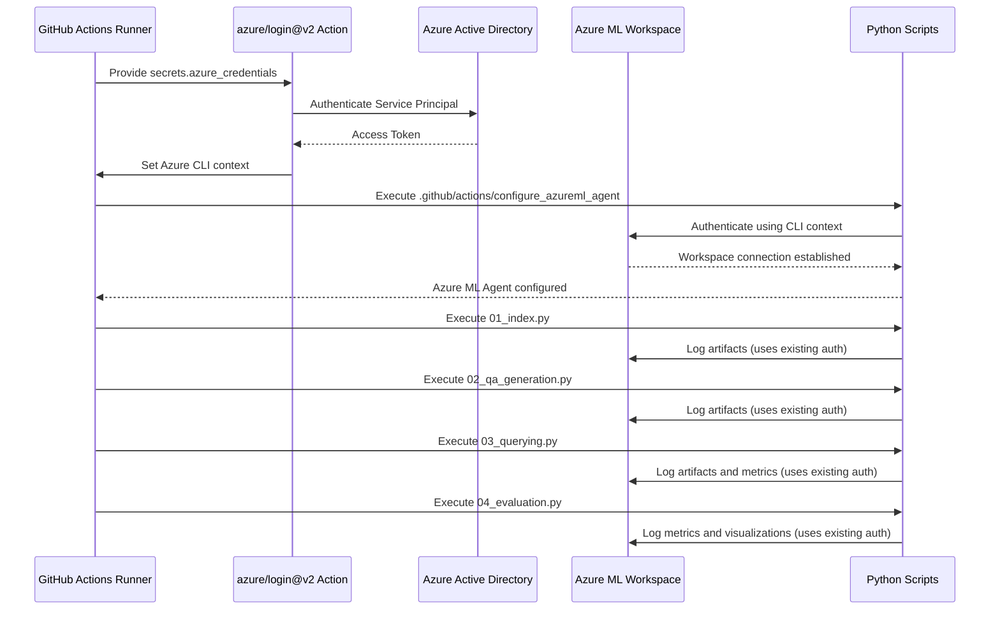
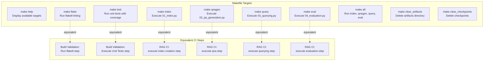
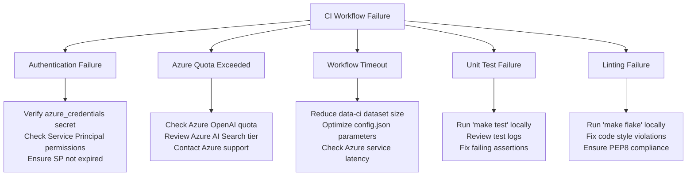

<!-- source: DeepWiki mcp.deepwiki.com · repo microsoft/rag-experiment-accelerator · page 11.3 CI/CD Workflows · fetched 2026-10-26 -->

# CI/CD Workflows

<details>
<summary>Relevant source files</summary>

The following files were used as context for generating this wiki page:

- [.env.template](.env.template)
- [.github/workflows/build_validation_workflow.yml](.github/workflows/build_validation_workflow.yml)
- [.github/workflows/rag_exp_acc_ci.yml](.github/workflows/rag_exp_acc_ci.yml)
- [Makefile](Makefile)
- [README.md](README.md)
- [config.sample.json](config.sample.json)
- [docs/environment-variables.md](docs/environment-variables.md)

</details>


## Purpose and Scope

This page documents the Continuous Integration and Continuous Deployment (CI/CD) workflows implemented using GitHub Actions for the RAG Experiment Accelerator. These workflows provide automated validation, testing, and execution of the 4-stage RAG pipeline on every code change.

For information about local development and testing setup, see [Development Environment Setup](#11.1). For details about the testing strategy and test structure, see [Testing Strategy](#11.2).

---

## Workflow Architecture

The RAG Experiment Accelerator implements two primary GitHub Actions workflows:

| Workflow | File | Purpose | Execution Time |
|----------|------|---------|----------------|
| **RAG Experiment Accelerator CI** | `.github/workflows/rag_exp_acc_ci.yml` | End-to-end pipeline execution with Azure services | ~10-20 minutes |
| **Build Validation** | `.github/workflows/build_validation_workflow.yml` | Code quality checks and unit tests | ~3-5 minutes |

Both workflows run on pull requests, pushes to main/development/prerelease branches, and support manual dispatch via GitHub UI.



**Sources:** [.github/workflows/rag_exp_acc_ci.yml:1-67](), [.github/workflows/build_validation_workflow.yml:1-59]()

---

## RAG Experiment Accelerator CI Workflow

The primary CI workflow executes the complete 4-stage RAG pipeline against a test dataset located in the `data-ci` directory. This workflow validates that all pipeline stages function correctly with live Azure services.

### Workflow Configuration



**Sources:** [.github/workflows/rag_exp_acc_ci.yml:24-40]()

### Pipeline Execution Steps

The workflow executes all four stages sequentially using the test configuration file at `.github/workflows/config.json`:

1. **Index Creation** (`01_index.py`)
   - Creates Azure AI Search indexes
   - Loads documents from `data-ci` directory
   - Generates embeddings and uploads chunks

2. **QA Generation** (`02_qa_generation.py`)
   - Generates question-answer pairs from indexed documents
   - Uses Azure OpenAI to create ground truth dataset

3. **Querying** (`03_querying.py`)
   - Executes search queries against indexes
   - Generates LLM responses with retrieved context
   - Applies reranking if configured

4. **Evaluation** (`04_evaluation.py`)
   - Calculates metrics comparing actual vs expected answers
   - Generates reports and visualizations
   - Logs results to MLflow



**Sources:** [.github/workflows/rag_exp_acc_ci.yml:42-67]()

### CI Configuration File

The workflow uses a dedicated configuration file at `.github/workflows/config.json` optimized for fast CI execution:
- Reduced dataset size in `data-ci` directory
- Minimal search types to reduce execution time
- Basic embedding models (sentence-transformer)
- Limited metric types for faster evaluation
- Small chunk sizes and retrieve counts

**Sources:** [.github/workflows/rag_exp_acc_ci.yml:54-66](), [README.md:361-362]()

---

## Build Validation Workflow

The build validation workflow focuses on code quality, linting, and unit test execution without requiring Azure service credentials. This workflow runs faster and validates code correctness independently of external services.

### Validation Steps



**Sources:** [.github/workflows/build_validation_workflow.yml:22-59]()

### Code Quality Checks

The workflow enforces code quality through:

| Check | Tool | Configuration | Purpose |
|-------|------|---------------|---------|
| **Linting** | `flake8` | `--extend-ignore=E501` | Enforces PEP8 style except line length |
| **Unit Tests** | `pytest` | `--cov=. --cov-report=html` | Validates component behavior |
| **Coverage** | `pytest-cov` | `.coveragerc` | Tracks test coverage metrics |

The E501 rule (line length) is ignored to allow flexibility in long configuration or documentation strings.

**Sources:** [.github/workflows/build_validation_workflow.yml:44-52](), [Makefile:69-71]()

### Test Artifacts

Test results and coverage reports are uploaded as GitHub Actions artifacts:
- **Artifact Name:** `unit-test-results`
- **Content:** HTML coverage report from `htmlcov/` directory
- **Retention:** Per GitHub Actions artifact retention policy

These artifacts can be downloaded from the Actions tab in the GitHub UI after workflow completion.

**Sources:** [.github/workflows/build_validation_workflow.yml:54-59]()

---

## Trigger Configuration

Both workflows use identical trigger configurations to ensure consistent validation across all code changes:



### Trigger Types

| Trigger | Description | Use Case |
|---------|-------------|----------|
| `workflow_call` | Allows workflow to be called by other workflows | Enables reusable workflow patterns |
| `workflow_dispatch` | Manual trigger from GitHub Actions UI | On-demand testing and debugging |
| `pull_request` | Triggered on PR events | Pre-merge validation |
| `push` | Triggered on direct pushes | Post-merge verification |
| `merge_group` | GitHub merge queue integration | Ensures merge safety |

**Sources:** [.github/workflows/rag_exp_acc_ci.yml:3-17](), [.github/workflows/build_validation_workflow.yml:3-16]()

### Pull Request Trigger Types

The workflows trigger on specific PR events:
- `opened`: When a new PR is created
- `ready_for_review`: When a draft PR is marked ready
- `synchronize`: When new commits are pushed to the PR branch

This ensures validation runs on initial submission and every subsequent update.

**Sources:** [.github/workflows/rag_exp_acc_ci.yml:6-11]()

---

## Concurrency Control

Both workflows implement concurrency control to prevent redundant runs and optimize GitHub Actions usage:

```yaml
concurrency:
  group: ${{ github.workflow }}-${{ github.ref }}
  cancel-in-progress: ${{ github.ref != 'refs/heads/development' && github.ref != 'refs/heads/main' && github.ref != 'refs/heads/prerelease'}}
```

### Concurrency Behavior

| Branch Type | Behavior | Rationale |
|-------------|----------|-----------|
| **Feature Branches** | Cancel in-progress runs | Latest code takes precedence; saves resources |
| **Main Branches** (main, development, prerelease) | Complete all runs | Preserve audit trail for protected branches |

**Concurrency Group Key:** `${{ github.workflow }}-${{ github.ref }}`
- Groups runs by workflow name and git reference (branch/PR)
- Prevents parallel runs of the same workflow on the same ref
- Allows different workflows to run concurrently

**Sources:** [.github/workflows/rag_exp_acc_ci.yml:19-21](), [.github/workflows/build_validation_workflow.yml:18-20]()

---

## Secrets Management

The RAG Experiment Accelerator CI workflow requires GitHub repository secrets for Azure service authentication:



### Required Secrets

| Secret Name | Purpose | Required By |
|-------------|---------|-------------|
| `azure_credentials` | Service Principal JSON for Azure login | Azure authentication step |
| `AZURE_SEARCH_SERVICE_ENDPOINT` | Azure AI Search endpoint URL | Search operations |
| `AZURE_SEARCH_ADMIN_KEY` | Azure AI Search admin key | Index creation and querying |
| `OPENAI_API_KEY` | Azure OpenAI API key | LLM operations |
| `OPENAI_API_VERSION` | Azure OpenAI API version | API compatibility |
| `OPENAI_ENDPOINT` | Azure OpenAI endpoint URL | LLM requests |
| `SUBSCRIPTION_ID` | Azure subscription ID | Azure ML tracking |
| `WORKSPACE_NAME` | Azure ML workspace name | MLflow logging |
| `RESOURCE_GROUP_NAME` | Azure resource group name | Azure ML operations |

### Optional Secrets

| Secret Name | Purpose | Used When |
|-------------|---------|-----------|
| `AZURE_LANGUAGE_SERVICE_ENDPOINT` | Azure Language Service endpoint | Language detection enabled |
| `AZURE_LANGUAGE_SERVICE_KEY` | Azure Language Service key | Language detection enabled |

**Sources:** [.github/workflows/rag_exp_acc_ci.yml:24-40](), [.env.template:1-49]()

### Service Principal Configuration

The `azure_credentials` secret must contain a Service Principal JSON with the following structure:

```json
{
  "clientId": "<client-id>",
  "clientSecret": "<client-secret>",
  "subscriptionId": "<subscription-id>",
  "tenantId": "<tenant-id>"
}
```

This Service Principal requires the following permissions:
- **Contributor** role on the Azure ML Workspace
- **Search Index Data Contributor** role on Azure AI Search
- **Cognitive Services OpenAI User** role on Azure OpenAI

**Sources:** [.github/workflows/rag_exp_acc_ci.yml:45-48]()

---

## Azure Authentication Flow

The CI workflow uses the `azure/login@v2` action to authenticate with Azure using a Service Principal:



### Authentication Steps

1. **Azure Login**
   - Action: `azure/login@v2`
   - Credentials: `secrets.azure_credentials` (Service Principal JSON)
   - Effect: Configures Azure CLI with authenticated context

2. **Azure ML Agent Configuration**
   - Action: Custom action at `.github/actions/configure_azureml_agent`
   - Purpose: Establishes Azure ML workspace connection
   - Output: Authenticated MLflow client for experiment tracking

3. **Script Execution**
   - Scripts inherit Azure CLI authentication context
   - No additional authentication required in Python code
   - Uses `DefaultAzureCredential` internally

**Sources:** [.github/workflows/rag_exp_acc_ci.yml:45-50]()

---

## Local Testing with Makefile

The repository provides a `Makefile` that mirrors CI/CD workflow steps for local development and testing:



### Test Targets

| Makefile Target | Command | Purpose | CI Equivalent |
|----------------|---------|---------|---------------|
| `make test` | `pytest . --cov=. --cov-report=html --cov-config=.coveragerc` | Run unit tests with coverage | Build validation step 6 |
| `make flake` | `flake8 --extend-ignore=E501` | Run linting | Build validation step 5 |

### Pipeline Targets

| Makefile Target | Command | Purpose | CI Equivalent |
|----------------|---------|---------|---------------|
| `make index` | `python3 01_index.py` | Index documents | RAG CI step 4 |
| `make qnagen` | `python3 02_qa_generation.py` | Generate QA pairs | RAG CI step 5 |
| `make query` | `python3 03_querying.py` | Execute queries | RAG CI step 6 |
| `make eval` | `python3 04_evaluation.py` | Evaluate results | RAG CI step 7 |
| `make all` | Sequential execution | Run complete pipeline | Full RAG CI workflow |

### Configuration Parameters

Makefile targets support optional parameters:

- **`dd=<path>`**: Specify data directory (default: `./data`)
  - Example: `make index dd=./data-ci`
  - CI equivalent: `--data_dir='data-ci'`

- **`cp=<path>`**: Specify config file path (default: `./config.json`)
  - Example: `make query cp=./custom_config.json`
  - CI equivalent: `--config_path=.github/workflows/config.json`

**Sources:** [Makefile:1-76](), [.github/workflows/rag_exp_acc_ci.yml:51-66](), [.github/workflows/build_validation_workflow.yml:44-52]()

### Environment Variable Loading

The Makefile automatically loads environment variables from `.env` file:

```makefile
ENV_FILE := .env
ifeq ($(filter $(MAKECMDGOALS),config clean),)
	ifneq ($(strip $(wildcard $(ENV_FILE))),)
		ifneq ($(MAKECMDGOALS),config)
			include $(ENV_FILE)
			export
		endif
	endif
endif
```

This ensures local execution has access to the same environment variables structure as CI/CD (though with different values for local vs. cloud resources).

**Sources:** [Makefile:4-13]()

---

## Pre-commit Hooks

The repository uses `pre-commit` hooks to enforce code quality before commits:

```bash
pip install -e .
pre-commit install
```

These hooks run automatically on `git commit` and validate:
- Code formatting
- Linting rules (flake8)
- File structure consistency

This provides an additional validation layer before code reaches CI/CD pipelines.

**Sources:** [README.md:534-538]()

---

## CI/CD Data Directory

The CI workflow uses a dedicated `data-ci` directory containing a minimal test dataset:

### Purpose

| Aspect | CI Data (`data-ci`) | Production Data (`data`) |
|--------|---------------------|--------------------------|
| **Size** | Small (few documents) | Full corpus |
| **Purpose** | Fast validation | Complete experimentation |
| **Execution Time** | 10-20 minutes | Hours to days |
| **Cost** | Minimal Azure consumption | Full operational cost |

### Configuration Differences

The CI configuration at `.github/workflows/config.json` is optimized for:
- Minimal `chunk_size` values
- Single `search_type` instead of array
- Reduced `retrieve_num_of_documents`
- Limited `metric_types` for evaluation
- Basic embedding models (sentence-transformer)

**Sources:** [.github/workflows/rag_exp_acc_ci.yml:54-66](), [README.md:361-362]()

---

## Workflow Status Monitoring

GitHub Actions provides several mechanisms to monitor workflow execution:

### Status Badges

Add status badges to documentation:

```markdown


```

### Actions Tab

The GitHub repository's Actions tab provides:
- Workflow run history
- Real-time execution logs
- Artifact downloads (test coverage reports)
- Re-run capabilities for failed workflows

### Pull Request Checks

Both workflows appear as required checks on pull requests:
- Blocks merge until both workflows pass
- Provides inline status in PR conversation
- Links directly to workflow run details

**Sources:** [.github/workflows/rag_exp_acc_ci.yml:1-67](), [.github/workflows/build_validation_workflow.yml:1-59]()

---

## Troubleshooting CI Failures

### Common Failure Scenarios



### Authentication Issues

**Symptoms:**
- Azure login step fails
- Error: "Service principal authentication failed"

**Solutions:**
1. Verify `azure_credentials` secret contains valid Service Principal JSON
2. Check Service Principal has not expired
3. Confirm Service Principal has required RBAC roles on Azure resources
4. Ensure subscription is active

**Sources:** [README.md:485-489]()

### Resource Quota Issues

**Symptoms:**
- Pipeline steps timeout
- Error: "Rate limit exceeded"
- Error: "Insufficient quota"

**Solutions:**
1. Check Azure OpenAI token per minute (TPM) limits
2. Verify Azure AI Search requests per second (RPS) limits
3. Consider separating `azure_oai_chat_deployment_name` and `azure_oai_eval_deployment_name` in config
4. Request quota increase through Azure Portal

**Sources:** [README.md:492-500](), [config.sample.json:72-75]()

### Configuration Validation

**Symptoms:**
- Script execution fails with configuration errors
- JSON parsing errors

**Solutions:**
1. Validate `.github/workflows/config.json` against schema
2. Ensure all required fields are present
3. Verify array parameters are properly formatted
4. Check that embedding model dimensions match deployed models

**Sources:** [README.md:492-500](), [config.sample.json:1-88]()

---

## Relationship to Azure ML Pipeline

The CI/CD workflows execute pipelines locally on GitHub Actions runners. The repository also supports Azure ML pipeline execution for distributed compute:

| Execution Mode | Entry Point | Compute | Use Case |
|----------------|-------------|---------|----------|
| **CI/CD** | GitHub Actions workflows | GitHub runners | Automated validation on code changes |
| **Local** | Makefile targets | Local machine | Development and debugging |
| **Azure ML** | `azureml/pipeline.py` | Azure ML compute clusters | Large-scale experimentation |

The CI/CD workflows validate that the code works correctly, while Azure ML execution is used for production-scale experimentation. See the Azure ML pipeline documentation for details on distributed execution.

**Sources:** [README.md:224](), [Makefile:45-47]()

---

