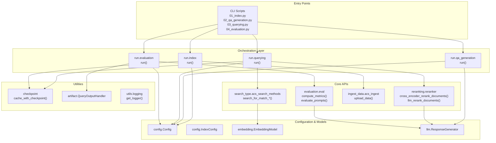
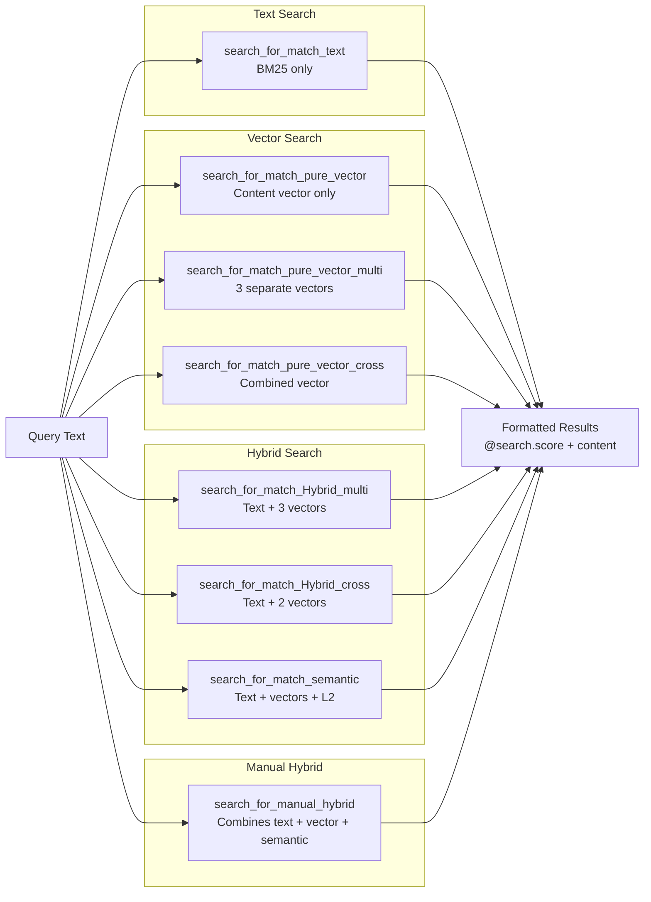
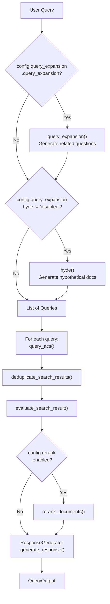
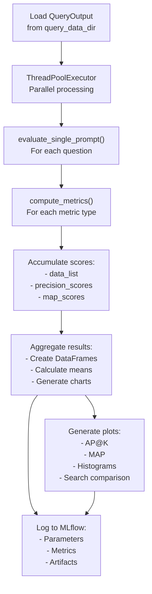

<!-- source: DeepWiki mcp.deepwiki.com · repo microsoft/rag-experiment-accelerator · page 13 API Reference · fetched 2026-10-26 -->

# API Reference

<details>
<summary>Relevant source files</summary>

The following files were used as context for generating this wiki page:

- [rag_experiment_accelerator/config/config.py](rag_experiment_accelerator/config/config.py)
- [rag_experiment_accelerator/config/tests/test_config.py](rag_experiment_accelerator/config/tests/test_config.py)
- [rag_experiment_accelerator/evaluation/LICENSE.txt](rag_experiment_accelerator/evaluation/LICENSE.txt)
- [rag_experiment_accelerator/evaluation/eval.py](rag_experiment_accelerator/evaluation/eval.py)
- [rag_experiment_accelerator/run/querying.py](rag_experiment_accelerator/run/querying.py)
- [rag_experiment_accelerator/run/tests/test_querying.py](rag_experiment_accelerator/run/tests/test_querying.py)
- [rag_experiment_accelerator/search_type/acs_search_methods.py](rag_experiment_accelerator/search_type/acs_search_methods.py)
- [rag_experiment_accelerator/search_type/tests/test_acs_search_methods.py](rag_experiment_accelerator/search_type/tests/test_acs_search_methods.py)

</details>


This page provides comprehensive API documentation for the RAG Experiment Accelerator codebase. It covers the core modules, classes, and functions that developers interact with when using or extending the system.

**Scope**: This page documents the primary programmatic interfaces including search methods, evaluation utilities, and core system functions. For detailed information on specific subsystems, refer to:
- Configuration classes and settings: [Configuration Classes](#13.1)
- Pipeline orchestration modules: [Run Module API](#13.2)  
- Embedding models and LLM interfaces: [Embedding and LLM APIs](#13.3)

## Module Organization

The codebase is organized into functional modules that correspond to the 4-stage pipeline architecture:



**Sources**: [rag_experiment_accelerator/config/config.py:1-118](), [rag_experiment_accelerator/run/querying.py:1-632](), [rag_experiment_accelerator/evaluation/eval.py:1-327]()

## Search Methods API

The `search_type.acs_search_methods` module provides functions for querying Azure AI Search with different search strategies.

### create_client

Creates an Azure AI Search client.

**Function Signature**:
```python
def create_client(service_endpoint: str, index_name: str, key: str) -> SearchClient
```

**Parameters**:
- `service_endpoint` (str): Azure AI Search service endpoint URL
- `index_name` (str): Name of the search index
- `key` (str): API key for authentication

**Returns**: `SearchClient` instance

**Sources**: [rag_experiment_accelerator/search_type/acs_search_methods.py:18-35]()

### format_results

Formats raw search results into a standardized structure.

**Function Signature**:
```python
def format_results(results: list) -> list[dict]
```

**Parameters**:
- `results` (list): Raw search results from Azure AI Search

**Returns**: List of dictionaries with keys `@search.score` and `content`

**Sources**: [rag_experiment_accelerator/search_type/acs_search_methods.py:38-55]()

### Search Strategy Functions

The module provides eight search strategies, each implementing different approaches to retrieval:

| Function | Description | Search Type |
|----------|-------------|-------------|
| `search_for_match_semantic` | Semantic search with L2 reranking | Hybrid (text + vector + semantic) |
| `search_for_match_Hybrid_multi` | Hybrid search across content, title, summary vectors | Hybrid (text + 3 vectors) |
| `search_for_match_Hybrid_cross` | Hybrid search with combined title/summary vector | Hybrid (text + 2 vectors) |
| `search_for_match_text` | BM25 full-text search only | Text-only |
| `search_for_match_pure_vector` | Vector search on content only | Pure vector |
| `search_for_match_pure_vector_multi` | Vector search across content, title, summary | Pure vector (3 vectors) |
| `search_for_match_pure_vector_cross` | Vector search across all fields combined | Pure vector (1 combined) |
| `search_for_manual_hybrid` | Manual combination of text, vector, and semantic | Manual hybrid |

**Common Parameters**:
- `client` (SearchClient): Azure AI Search client
- `embedding_model` (EmbeddingModel): Embedding model for vector generation (not required for text-only)
- `query` (str): Search query string
- `retrieve_num_of_documents` (int): Maximum number of documents to retrieve
- `preprocess` (bool, optional): Whether to preprocess query text. Defaults to False

**Common Return**: List of formatted search results with `@search.score` and `content` fields

**Example Usage**:
```python
from rag_experiment_accelerator.search_type.acs_search_methods import (
    create_client, 
    search_for_match_semantic
)

client = create_client(endpoint, index_name, key)
results = search_for_match_semantic(
    client=client,
    embedding_model=embedding_model,
    query="What is RAG?",
    retrieve_num_of_documents=10
)
```

**Sources**: [rag_experiment_accelerator/search_type/acs_search_methods.py:58-419]()

### Search Method Comparison



**Sources**: [rag_experiment_accelerator/search_type/acs_search_methods.py:58-419]()

## Query Processing API

The `run.querying` module provides high-level query processing functions that combine search, evaluation, and response generation.

### query_acs

Low-level function to execute a search query using a specified search strategy.

**Function Signature**:
```python
def query_acs(
    search_client: SearchClient,
    embedding_model: EmbeddingModel,
    user_prompt: str,
    s_v: str,
    retrieve_num_of_documents: str,
    preprocess: bool = False
) -> list[dict]
```

**Parameters**:
- `search_client` (SearchClient): Azure AI Search client
- `embedding_model` (EmbeddingModel): Embedding model instance
- `user_prompt` (str): User's search query
- `s_v` (str): Search strategy name (e.g., "search_for_match_semantic")
- `retrieve_num_of_documents` (str): Number of documents to retrieve
- `preprocess` (bool, optional): Enable text preprocessing

**Returns**: List of search result dictionaries

**Sources**: [rag_experiment_accelerator/run/querying.py:73-103]()

### query_and_eval_acs

Performs search query with evaluation of retrieved documents.

**Function Signature**:
```python
def query_and_eval_acs(
    search_client: SearchClient,
    embedding_model: EmbeddingModel,
    query: str,
    search_type: str,
    evaluation_content: str,
    retrieve_num_of_documents: int,
    evaluator: SpacyEvaluator,
    config: Config,
    response_generator: ResponseGenerator,
    preprocess: bool = False
) -> QueryAndEvalACSResult
```

**Parameters**:
- `search_client` (SearchClient): Azure AI Search client
- `embedding_model` (EmbeddingModel): Embedding model for vector generation
- `query` (str): Search query
- `search_type` (str): Search strategy identifier
- `evaluation_content` (str): Content to evaluate results against
- `retrieve_num_of_documents` (int): Maximum documents to retrieve
- `evaluator` (SpacyEvaluator): Evaluator instance for scoring results
- `config` (Config): Configuration object
- `response_generator` (ResponseGenerator): LLM response generator
- `preprocess` (bool, optional): Enable preprocessing

**Returns**: `QueryAndEvalACSResult` object with `documents` and `evaluations` attributes

**Sources**: [rag_experiment_accelerator/run/querying.py:223-284]()

### query_and_eval_acs_multi

Handles multi-question query scenarios with evaluation.

**Function Signature**:
```python
def query_and_eval_acs_multi(
    search_client: SearchClient,
    embedding_model: EmbeddingModel,
    questions: list[str],
    original_prompt: str,
    output_prompt: str,
    search_type: str,
    evaluation_content: str,
    config: Config,
    evaluator: SpacyEvaluator,
    response_generator: ResponseGenerator,
    preprocess: bool = False
) -> QueryAndEvalACSResult
```

**Parameters**:
- `questions` (list[str]): List of questions to query
- `original_prompt` (str): Original user prompt
- `output_prompt` (str): Expected output for evaluation
- Other parameters same as `query_and_eval_acs`

**Returns**: `QueryAndEvalACSResult` with aggregated results from all questions

**Sources**: [rag_experiment_accelerator/run/querying.py:316-396]()

### rerank_documents

Reranks retrieved documents using LLM or cross-encoder.

**Function Signature**:
```python
def rerank_documents(
    docs: list[str],
    user_prompt: str,
    output_prompt: str,
    config: Config,
    response_generator: ResponseGenerator
) -> list[str]
```

**Parameters**:
- `docs` (list[str]): List of documents to rerank
- `user_prompt` (str): User query for relevance scoring
- `output_prompt` (str): Expected output prompt
- `config` (Config): Configuration with reranking settings
- `response_generator` (ResponseGenerator): LLM generator for reranking

**Returns**: List of reranked document strings

**Reranking Types** (configured via `config.rerank.type`):
- `"llm"`: Uses LLM-based relevance scoring
- `"cross_encoder"`: Uses cross-encoder model scoring

**Sources**: [rag_experiment_accelerator/run/querying.py:106-143]()

### Query Expansion Functions

#### hyde

Applies Hypothetical Document Embeddings (HyDE) to queries.

**Function Signature**:
```python
def hyde(
    config: Config,
    response_generator: ResponseGenerator,
    queries: list[str]
) -> list[str]
```

**Parameters**:
- `config` (Config): Configuration with `query_expansion.hyde` setting
- `response_generator` (ResponseGenerator): LLM for generating hypothetical documents
- `queries` (list[str]): Input queries

**Returns**: List of transformed queries (or original if HyDE disabled)

**HyDE Modes** (configured via `config.query_expansion.hyde`):
- `"disabled"`: No transformation
- `"generated_hypothetical_answer"`: Generate hypothetical answer
- `"generated_hypothetical_document_to_answer"`: Generate hypothetical document

**Sources**: [rag_experiment_accelerator/run/querying.py:145-170]()

#### query_expansion

Expands a single query into multiple related questions.

**Function Signature**:
```python
def query_expansion(
    config: Config,
    response_generator: ResponseGenerator,
    embedding_model: EmbeddingModel,
    query: str
) -> list[str]
```

**Parameters**:
- `config` (Config): Configuration with similarity threshold
- `response_generator` (ResponseGenerator): LLM for question generation
- `embedding_model` (EmbeddingModel): Model for similarity scoring
- `query` (str): Original query

**Returns**: List of related questions (including original)

**Sources**: [rag_experiment_accelerator/run/querying.py:172-197]()

### Query Processing Flow



**Sources**: [rag_experiment_accelerator/run/querying.py:223-558]()

## Evaluation API

The `evaluation.eval` module provides metric computation and evaluation orchestration.

### compute_metrics

Computes similarity score between actual and expected outputs using a specified metric.

**Function Signature**:
```python
def compute_metrics(
    metric_type: str,
    question: str,
    actual: str,
    expected: str,
    response_generator: ResponseGenerator,
    retrieved_contexts: list[str]
) -> float
```

**Parameters**:
- `metric_type` (str): Metric identifier (see Supported Metrics below)
- `question` (str): Question text
- `actual` (str): Actual generated response
- `expected` (str): Expected/ground truth response
- `response_generator` (ResponseGenerator): LLM for evaluation
- `retrieved_contexts` (list[str]): Retrieved document contexts

**Returns**: Similarity score (float)

**Supported Metrics**:

| Category | Metric Type | Description |
|----------|-------------|-------------|
| **String Distance** | `lcsstr` | Longest common substring |
| | `jaro_winkler` | Jaro-Winkler distance |
| | `hamming` | Hamming distance |
| | `levenshtein` | Levenshtein distance |
| **Set Similarity** | `jaccard` | Jaccard similarity |
| | `cosine_ochiai` | Cosine similarity (Ochiai) |
| **Token Metrics** | `fuzzy_score` | RapidFuzz token_set_ratio |
| **ROUGE** | `rouge1_precision` | ROUGE-1 precision |
| | `rouge1_recall` | ROUGE-1 recall |
| | `rouge1_fmeasure` | ROUGE-1 F1 |
| | `rouge2_precision` | ROUGE-2 precision |
| | `rouge2_recall` | ROUGE-2 recall |
| | `rouge2_fmeasure` | ROUGE-2 F1 |
| | `rougeL_precision` | ROUGE-L precision |
| | `rougeL_recall` | ROUGE-L recall |
| | `rougeL_fmeasure` | ROUGE-L F1 |
| **BERT-based** | `bert_all_MiniLM_L6_v2` | MiniLM L6 v2 similarity |
| | `bert_base_nli_mean_tokens` | Base NLI model |
| | `bert_large_nli_mean_tokens` | Large NLI model |
| | `bert_large_nli_stsb_mean_tokens` | Large STS-B model |
| | `bert_distilbert_base_nli_stsb_mean_tokens` | DistilBERT STS-B |
| | `bert_paraphrase_multilingual_MiniLM_L12_v2` | Multilingual model |
| **LLM-based** | `llm_context_precision` | Context usefulness score |
| | `llm_answer_relevance` | Answer relevance score |
| | `llm_context_recall` | Context coverage score |

**Sources**: [rag_experiment_accelerator/evaluation/eval.py:44-127]()

### evaluate_single_prompt

Evaluates a single prompt across all configured metrics.

**Function Signature**:
```python
def evaluate_single_prompt(
    data,
    response_generator: ResponseGenerator,
    metric_types: list[str],
    data_list: list,
    total_precision_scores_by_search_type: dict,
    map_scores_by_search_type: dict,
    average_precision_for_search_type: dict
)
```

**Parameters**:
- `data`: Query output data object with `actual`, `expected`, `question`, `search_type`, `retrieved_contexts`, `search_evals` attributes
- `response_generator` (ResponseGenerator): LLM for evaluation metrics
- `metric_types` (list[str]): List of metric type identifiers to compute
- `data_list` (list): Accumulator for metric results (modified in-place)
- `total_precision_scores_by_search_type` (dict): Precision scores accumulator
- `map_scores_by_search_type` (dict): MAP scores accumulator
- `average_precision_for_search_type` (dict): Average precision accumulator

**Returns**: None (modifies accumulators in-place)

**Sources**: [rag_experiment_accelerator/evaluation/eval.py:129-176]()

### evaluate_prompts

Orchestrates complete evaluation across all questions and metrics.

**Function Signature**:
```python
def evaluate_prompts(
    environment: Environment,
    config: Config,
    index_config: IndexConfig,
    mlflow_client: mlflow.MlflowClient,
    name_suffix: str
) -> None
```

**Parameters**:
- `environment` (Environment): Environment configuration with credentials
- `config` (Config): Experiment configuration
- `index_config` (IndexConfig): Index-specific configuration
- `mlflow_client` (mlflow.MlflowClient): MLflow client for logging
- `name_suffix` (str): Suffix for output file names

**Side Effects**:
- Writes CSV files to `config.path.eval_data_dir`
- Logs metrics and artifacts to MLflow
- Generates visualization plots

**Output Files**:
- `{name_suffix}.csv`: All evaluation scores
- `sum_{name_suffix}.csv`: Aggregated scores
- `{name_suffix}_ap_scores_at_k_test.csv`: Average precision at K
- `{name_suffix}_map_scores_test.csv`: Mean average precision scores

**Sources**: [rag_experiment_accelerator/evaluation/eval.py:178-327]()

### Evaluation Pipeline



**Sources**: [rag_experiment_accelerator/evaluation/eval.py:178-327]()

## Checkpoint System API

The `checkpoint` module provides caching for expensive operations.

### cache_with_checkpoint

Decorator that caches function results based on input parameters.

**Usage Pattern**:
```python
@cache_with_checkpoint(id="param1+param2+param3.method()")
def expensive_function(param1, param2, param3, ...):
    # Expensive operation
    return result
```

**Parameters**:
- `id` (str): Expression defining cache key from function parameters. Use `+` to concatenate values, and `.method()` to call methods on objects.

**Behavior**:
- On first call: Executes function, caches result, returns result
- On subsequent calls with same parameters: Returns cached result
- Respects `config.use_checkpoints` setting
- Cache stored in `artifacts/checkpoints/` directory

**Cache Key Generation**:
The `id` expression is evaluated to generate a unique cache key. For example:
- `"user_prompt+search_type"` → concatenates these parameter values
- `"index_config.index_name()"` → calls `index_name()` method on parameter

**Sources**: [rag_experiment_accelerator/run/querying.py:466-468]()

## Artifact Handler API

The `artifact.QueryOutputHandler` class manages query result persistence.

### QueryOutputHandler

**Class**: `artifact.handlers.query_output_handler.QueryOutputHandler`

**Constructor**:
```python
def __init__(self, base_path: str)
```

**Methods**:

#### save
```python
def save(
    self,
    index_name: str,
    data: QueryOutput,
    experiment_name: str,
    job_name: str
) -> None
```

Saves a query output to JSONL file.

#### load
```python
def load(
    self,
    index_name: str,
    experiment_name: str,
    job_name: str
) -> list[QueryOutput]
```

Loads query outputs from JSONL file.

#### handle_archive_by_index
```python
def handle_archive_by_index(
    self,
    index_name: str,
    experiment_name: str,
    job_name: str
) -> None
```

Archives existing query results before starting new queries.

**Sources**: [rag_experiment_accelerator/run/querying.py:208-214](), [rag_experiment_accelerator/run/querying.py:453-458](), [rag_experiment_accelerator/run/querying.py:592-594]()

## Utility Functions

### get_logger

Creates a configured logger instance.

**Function Signature**:
```python
def get_logger(name: str) -> logging.Logger
```

**Parameters**:
- `name` (str): Logger name (typically `__name__`)

**Returns**: Configured `logging.Logger` instance

**Usage**:
```python
from rag_experiment_accelerator.utils.logging import get_logger

logger = get_logger(__name__)
logger.info("Processing started")
logger.error("Error occurred", exc_info=True)
```

**Sources**: [rag_experiment_accelerator/evaluation/eval.py:38](), [rag_experiment_accelerator/run/querying.py:59](), [rag_experiment_accelerator/search_type/acs_search_methods.py:15]()

## Data Models

### QueryOutput

**Class**: `artifact.models.query_output.QueryOutput`

**Attributes**:
- `rerank` (bool): Whether reranking was enabled
- `rerank_type` (str): Type of reranking used
- `cross_encoder_model` (str): Cross-encoder model name
- `llm_rerank_threshold` (float): LLM reranking threshold
- `retrieve_num_of_documents` (int): Number of documents retrieved
- `cross_encoder_at_k` (int): Cross-encoder reranking depth
- `question_count` (int): Total question count
- `actual` (str): Generated response
- `expected` (str): Expected response
- `search_type` (str): Search strategy used
- `search_evals` (list[dict]): Search evaluation results
- `context` (str): Original context
- `retrieved_contexts` (list[str]): Retrieved document contexts
- `question` (str): Question text

**Sources**: [rag_experiment_accelerator/run/querying.py:540-556]()

### QueryAndEvalACSResult

**Class**: `run.querying.QueryAndEvalACSResult`

**Attributes**:
- `documents` (list[str]): Retrieved or generated documents
- `evaluations` (dict[str, any]): Evaluation results dictionary

**Sources**: [rag_experiment_accelerator/run/querying.py:217-221]()

## Search Mapping Dictionary

The `search_mapping` dictionary maps search type strings to their implementation functions:

```python
search_mapping = {
    "search_for_match_semantic": search_for_match_semantic,
    "search_for_match_Hybrid_multi": search_for_match_Hybrid_multi,
    "search_for_match_Hybrid_cross": search_for_match_Hybrid_cross,
    "search_for_match_text": search_for_match_text,
    "search_for_match_pure_vector": search_for_match_pure_vector,
    "search_for_match_pure_vector_multi": search_for_match_pure_vector_multi,
    "search_for_match_pure_vector_cross": search_for_match_pure_vector_cross,
    "search_for_manual_hybrid": search_for_manual_hybrid,
}
```

This dictionary enables dynamic search strategy selection via configuration.

**Sources**: [rag_experiment_accelerator/run/querying.py:61-70]()

## Integration Points

### MLflow Integration

The evaluation system logs results to MLflow:

**Logged Parameters**:
- `question_count`: Total questions evaluated
- `retrieve_num_of_documents`: Documents retrieved per query
- `cross_encoder_at_k`: Reranking depth
- `chunk_overlap`: Chunk overlap size
- `embedding_dimension`: Embedding vector dimension
- `embedding_model_name`: Model name
- `ef_construction`: HNSW construction parameter
- `ef_search`: HNSW search parameter

**Logged Metrics**:
- Individual metric scores from `compute_metrics()`
- Aggregated scores per metric type

**Logged Artifacts**:
- Evaluation CSV files
- Visualization plots (PNG/JPG)
- HTML reports

**Sources**: [rag_experiment_accelerator/evaluation/eval.py:307-326]()

### Azure AI Search Integration

All search functions interact with Azure AI Search via the `SearchClient`:

**Key Methods Used**:
- `client.search()`: Execute search queries with parameters:
  - `search_text`: Text query (None for pure vector)
  - `vector_queries`: List of `RawVectorQuery` objects
  - `top`: Maximum results
  - `select`: Fields to return
  - `query_type`: Search type (e.g., `QueryType.SEMANTIC`)
  - `query_language`: Language for semantic search
  - `semantic_configuration_name`: Semantic config name
  - `query_caption`: Caption type
  - `query_answer`: Answer type

**Sources**: [rag_experiment_accelerator/search_type/acs_search_methods.py:93-103](), [rag_experiment_accelerator/search_type/acs_search_methods.py:159-164]()

---

