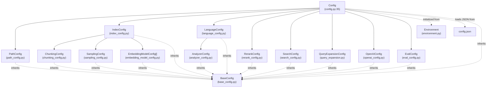
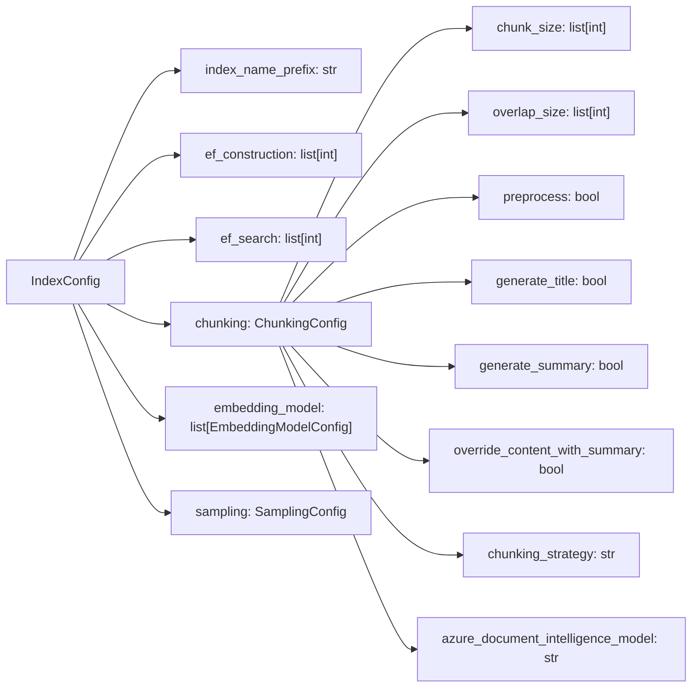
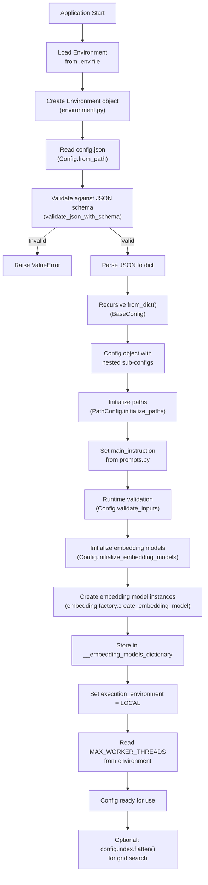
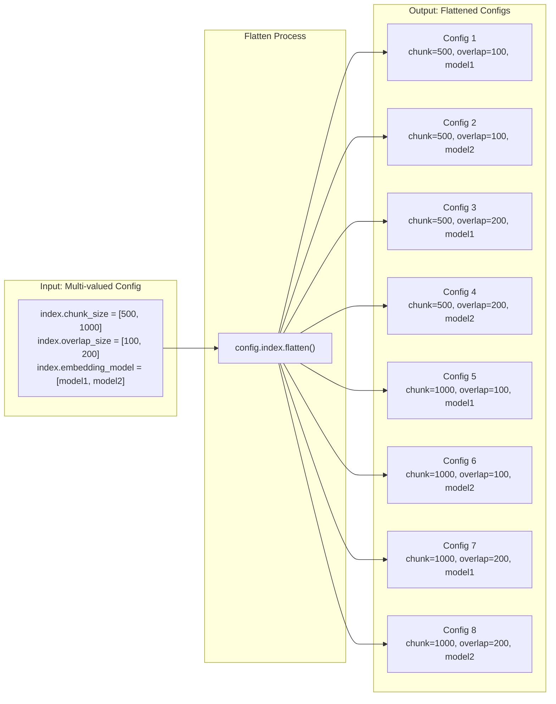

<!-- source: DeepWiki mcp.deepwiki.com · repo microsoft/rag-experiment-accelerator · page 13.1 Configuration Classes · fetched 2026-10-26 -->

# Configuration Classes

<details>
<summary>Relevant source files</summary>

The following files were used as context for generating this wiki page:

- [README.md](README.md)
- [config.sample.json](config.sample.json)
- [rag_experiment_accelerator/config/config.py](rag_experiment_accelerator/config/config.py)
- [rag_experiment_accelerator/config/tests/test_config.py](rag_experiment_accelerator/config/tests/test_config.py)

</details>


## Purpose and Scope

This page provides comprehensive API documentation for all configuration classes in the RAG Experiment Accelerator. These classes define the structured configuration system that controls experiment behavior across all pipeline stages. Configuration classes are organized hierarchically with `Config` as the root, containing nested configuration objects for indexing, search, evaluation, and other subsystems.

For information about how to create and modify configuration files, see [Configuration Guide](#2.2). For details about multi-configuration experiments and the flattening mechanism, see [IndexConfig and Multi-Configuration Experiments](#4.2).

---

## Configuration System Architecture

The following diagram shows the hierarchical structure of configuration classes and their relationships:



**Sources:** [rag_experiment_accelerator/config/config.py:1-118]()

---

## Core Configuration Classes

### Config

The root configuration class that aggregates all experiment settings and provides the primary interface for configuration management.

**Location:** [rag_experiment_accelerator/config/config.py:35-118]()

#### Class Definition

```python
@dataclass
class Config(BaseConfig):
    execution_environment: ExecutionEnvironment = ExecutionEnvironment.LOCAL
    experiment_name: str = ""
    job_name: str = ""
    job_description: str = ""
    data_formats: list[str] = field(default_factory=lambda: ["*"])
    main_instruction: Prompt = field(init=False)
    max_worker_threads: int = None
    use_checkpoints: bool = True
    path: PathConfig = field(default_factory=PathConfig)
    index: IndexConfig = field(default_factory=IndexConfig)
    language: LanguageConfig = field(default_factory=LanguageConfig)
    rerank: RerankConfig = field(default_factory=RerankConfig)
    search: SearchConfig = field(default_factory=SearchConfig)
    query_expansion: QueryExpansionConfig = field(default_factory=QueryExpansionConfig)
    openai: OpenAIConfig = field(default_factory=OpenAIConfig)
    eval: EvalConfig = field(default_factory=EvalConfig)
```

#### Properties

| Property | Type | Default | Description |
|----------|------|---------|-------------|
| `execution_environment` | `ExecutionEnvironment` | `LOCAL` | Execution context: `LOCAL` or `AZURE_ML` |
| `experiment_name` | `str` | `""` | MLflow experiment name; defaults to `index_name_prefix` if empty |
| `job_name` | `str` | `""` | Job run name in Azure ML; timestamped if empty |
| `job_description` | `str` | `""` | Human-readable description of experiment purpose |
| `data_formats` | `list[str]` | `["*"]` | Supported document formats (e.g., `["pdf", "html"]`); `["*"]` means all |
| `main_instruction` | `Prompt` | (initialized) | Main instruction prompt for LLM interactions |
| `max_worker_threads` | `int` | `None` | ThreadPoolExecutor worker count; `None` uses default |
| `use_checkpoints` | `bool` | `True` | Enable caching of expensive operations |
| `path` | `PathConfig` | (initialized) | Directory and file path configuration |
| `index` | `IndexConfig` | (initialized) | Document indexing and embedding configuration |
| `language` | `LanguageConfig` | (initialized) | Language analyzer and query language settings |
| `rerank` | `RerankConfig` | (initialized) | Reranking strategy and threshold configuration |
| `search` | `SearchConfig` | (initialized) | Search type and retrieval settings |
| `query_expansion` | `QueryExpansionConfig` | (initialized) | HyDE and query expansion settings |
| `openai` | `OpenAIConfig` | (initialized) | Azure OpenAI deployment and model settings |
| `eval` | `EvalConfig` | (initialized) | Evaluation metric selection |

#### Key Methods

##### `Config.from_path()`

**Signature:** [rag_experiment_accelerator/config/config.py:53-92]()

```python
@classmethod
def from_path(cls, environment: Environment, config_path: str = None, 
              data_dir: str = None) -> "Config"
```

**Parameters:**
- `environment`: `Environment` object containing Azure service credentials
- `config_path`: Path to `config.json` file; defaults to `./config.json`
- `data_dir`: Path to data directory; overrides `config.json` if provided

**Returns:** Fully initialized `Config` instance

**Behavior:**
1. Loads and parses JSON configuration file
2. Validates JSON against schema using `validate_json_with_schema()`
3. Initializes `PathConfig` with resolved paths
4. Sets `main_instruction` from prompt library
5. Calls `validate_inputs()` to check configuration consistency
6. Initializes embedding models via `initialize_embedding_models()`
7. Sets `execution_environment` to `LOCAL`
8. Reads `MAX_WORKER_THREADS` from environment variables

**Raises:** `ValueError` if schema validation fails

##### `validate_inputs()`

**Signature:** [rag_experiment_accelerator/config/config.py:94-106]()

```python
def validate_inputs(self, use_semantic_search: bool = False)
```

**Validation Rules:**
- `overlap_size` must be less than `chunk_size` for all values
- `search_for_match_semantic` and `search_for_manual_hybrid` require semantic search to be enabled

##### `initialize_embedding_models()`

**Signature:** [rag_experiment_accelerator/config/config.py:108-114]()

Creates embedding model instances from configuration using the factory pattern and stores them in an internal dictionary.

##### `get_embedding_model()`

**Signature:** [rag_experiment_accelerator/config/config.py:116-117]()

```python
def get_embedding_model(self, model_name) -> EmbeddingModel
```

Retrieves initialized embedding model by name. Used during indexing and query processing.

**Sources:** [rag_experiment_accelerator/config/config.py:35-118](), [rag_experiment_accelerator/config/tests/test_config.py:25-177]()

---

### IndexConfig

Configuration for document indexing, chunking, embedding models, and data sampling.

**Location:** [rag_experiment_accelerator/config/index_config.py]()

#### Structure



#### Properties

| Property | Type | Description |
|----------|------|-------------|
| `index_name_prefix` | `str` | Prefix for Azure AI Search index names; combined with config hash to form unique index name |
| `ef_construction` | `list[int]` | HNSW algorithm `efConstruction` values for index creation; higher = better recall, slower indexing |
| `ef_search` | `list[int]` | HNSW algorithm `efSearch` values for query execution; higher = better recall, slower queries |
| `chunking` | `ChunkingConfig` | Document chunking and preprocessing settings |
| `embedding_model` | `list[EmbeddingModelConfig]` | List of embedding model configurations to experiment with |
| `sampling` | `SamplingConfig` | Data sampling configuration for large datasets |

#### Key Method: flatten()

The `flatten()` method generates all combinations of configuration parameters for grid search experiments. For example, if `chunk_size = [500, 1000]` and `embedding_model` has 2 entries, `flatten()` produces 4 `IndexConfig` instances.

**Implementation:** Inherited from `BaseConfig`, which recursively flattens nested list-valued properties.

**Sources:** [rag_experiment_accelerator/config/index_config.py](), [README.md:296-318]()

---

### Environment

Container for Azure service credentials and endpoints loaded from environment variables or `.env` file.

**Location:** [rag_experiment_accelerator/config/environment.py]()

#### Key Properties

| Property | Environment Variable | Description |
|----------|---------------------|-------------|
| `azure_openai_endpoint` | `AZURE_OPENAI_ENDPOINT` | Azure OpenAI service endpoint URL |
| `azure_openai_api_version` | `AZURE_OPENAI_API_VERSION` | API version (e.g., `2024-02-15-preview`) |
| `azure_search_service_endpoint` | `AZURE_SEARCH_SERVICE_ENDPOINT` | Azure AI Search service endpoint |
| `azure_search_use_semantic_search` | `AZURE_SEARCH_USE_SEMANTIC_SEARCH` | `"true"` or `"false"` to enable semantic search |
| `azure_ml_workspace_name` | `AZURE_ML_WORKSPACE_NAME` | Azure ML workspace name for experiment tracking |
| `azure_ml_subscription_id` | `AZURE_ML_SUBSCRIPTION_ID` | Azure subscription ID |
| `azure_ml_resource_group` | `AZURE_ML_RESOURCE_GROUP` | Azure resource group containing ML workspace |
| `azure_document_intelligence_endpoint` | `AZURE_DOCUMENT_INTELLIGENCE_ENDPOINT` | Document Intelligence service endpoint |
| `sentence_transformer_model_dir` | `SENTENCE_TRANSFORMER_MODEL_DIR` | Local directory for cached HuggingFace models |

#### Usage Pattern

```python
from rag_experiment_accelerator.config.environment import Environment

# Load from environment variables or .env file
environment = Environment()

# Pass to Config initialization
config = Config.from_path(environment, config_path="config.json")
```

**Authentication:** The `Environment` class uses Azure DefaultAzureCredential for authentication. Users must be logged in via `az login` or have appropriate managed identity/service principal credentials.

**Sources:** [rag_experiment_accelerator/config/environment.py](), [rag_experiment_accelerator/config/config.py:54-56]()

---

### PathConfig

Manages file and directory paths for artifacts, data, and outputs.

**Location:** [rag_experiment_accelerator/config/path_config.py]()

#### Properties

| Property | Type | Default | Description |
|----------|------|---------|-------------|
| `working_directory` | `str` | (runtime) | Base directory for all operations |
| `data_dir` | `str` | `data/` | Directory containing input documents |
| `artifacts_dir` | `str` | `artifacts/` | Root directory for all generated artifacts |
| `docs_data_dir` | `str` | `artifacts/docs_data/` | Chunked document storage |
| `index_data_dir` | `str` | `artifacts/index_data/` | Index metadata storage |
| `outputs_dir` | `str` | `artifacts/outputs/` | QA pairs and query results |
| `checkpoints_dir` | `str` | `artifacts/checkpoints/` | Checkpoint cache storage |
| `eval_data_dir` | `str` | `artifacts/eval_score/` | Evaluation metrics and visualizations |
| `sampling_dir` | `str` | `artifacts/sampling/` | Sampling artifacts (clusters, plots) |
| `eval_data_file` | `str` | `artifacts/outputs/eval_data.jsonl` | Final evaluation dataset path |

#### Key Method: initialize_paths()

**Signature:** [rag_experiment_accelerator/config/path_config.py]()

```python
def initialize_paths(self, config_path: str, data_dir: str = None)
```

Resolves all paths relative to `config.json` location and creates necessary directories. If `data_dir` is provided, it overrides the default data directory path.

**Sources:** [rag_experiment_accelerator/config/path_config.py](), [rag_experiment_accelerator/config/config.py:69]()

---

## Specialized Configuration Classes

### LanguageConfig and AnalyzerConfig

Controls language-specific processing including analyzers for Azure AI Search indexes.

**Location:** [rag_experiment_accelerator/config/language_config.py](), [rag_experiment_accelerator/config/analyzer_config.py]()

#### LanguageConfig Properties

| Property | Type | Description |
|----------|------|-------------|
| `analyzer` | `AnalyzerConfig` | Custom analyzer configuration for search index fields |
| `query_language` | `str` | Query language code (e.g., `"en-us"`, `"fr-fr"`) for semantic search |

#### AnalyzerConfig Properties

| Property | Type | Description |
|----------|------|-------------|
| `analyzer_name` | `str` | Analyzer name for both indexing and search (e.g., `"en.microsoft"`) |
| `index_analyzer_name` | `str` | Analyzer used only during indexing; requires `search_analyzer_name` |
| `search_analyzer_name` | `str` | Analyzer used only during search; requires `index_analyzer_name` |
| `char_filters` | `list` | Character filters to apply before tokenization |
| `tokenizers` | `list` | Tokenizer configuration |
| `token_filters` | `list` | Token filters to apply after tokenization |

**Mutual Exclusivity:** Either set `analyzer_name` alone, or set both `index_analyzer_name` and `search_analyzer_name`.

**Sources:** [README.md:319-329](), [config.sample.json:39-49]()

---

### RerankConfig

Configuration for reranking retrieved search results to improve precision.

**Location:** [rag_experiment_accelerator/config/rerank_config.py]()

#### Properties

| Property | Type | Description |
|----------|------|-------------|
| `enabled` | `bool` | Enable/disable reranking |
| `type` | `str` | Reranking method: `"llm"` or `"cross_encoder"` |
| `llm_rerank_threshold` | `int` | For LLM reranking: top N chunks to keep (1-10 scale) |
| `cross_encoder_at_k` | `int` | For cross-encoder reranking: number of chunks to rerank |
| `cross_encoder_model` | `str` | HuggingFace cross-encoder model name (e.g., `"cross-encoder/stsb-roberta-base"`) |

#### Reranking Types

**LLM Reranking:** Uses Azure OpenAI to score chunk relevance on a 1-10 scale. Chunks with score >= `llm_rerank_threshold` are retained.

**Cross-Encoder Reranking:** Uses a HuggingFace sentence-transformers cross-encoder model to compute query-chunk similarity scores. Top `cross_encoder_at_k` chunks are retained.

**Sources:** [README.md:330-336](), [config.sample.json:50-56]()

---

### SearchConfig

Configuration for Azure AI Search query execution.

**Location:** [rag_experiment_accelerator/config/search_config.py]()

#### Properties

| Property | Type | Description |
|----------|------|-------------|
| `retrieve_num_of_documents` | `int` | Number of chunks to retrieve from search index before reranking |
| `search_type` | `list[str]` | List of search strategies to experiment with |
| `search_relevancy_threshold` | `float` | Similarity threshold (0.0-1.0) for determining chunk relevance in retrieval metrics |

#### Supported Search Types

| Search Type | Description |
|-------------|-------------|
| `search_for_match_text` | Pure text search using BM25 |
| `search_for_match_pure_vector` | Pure vector search using single embedding |
| `search_for_match_pure_vector_multi` | Vector search with title and summary embeddings |
| `search_for_match_pure_vector_cross` | Vector search with embedding generated from hypothetical answer |
| `search_for_match_Hybrid_cross` | Hybrid text + vector search with hypothetical answer embedding |
| `search_for_match_Hybrid_multi` | Hybrid text + vector search with multiple embeddings |
| `search_for_match_semantic` | Semantic search using Azure AI Search semantic reranking |
| `search_for_manual_hybrid` | Manual hybrid combining text and vector scores |

**Sources:** [README.md:337-341](), [config.sample.json:57-65]()

---

### QueryExpansionConfig

Configuration for query expansion techniques to improve retrieval.

**Location:** [rag_experiment_accelerator/config/query_expansion.py]()

#### Properties

| Property | Type | Description |
|----------|------|-------------|
| `query_expansion` | `bool` | Generate multiple related questions from the original query |
| `hyde` | `str` | HyDE mode: `"disabled"`, `"generated_hypothetical_answer"`, or `"generated_hypothetical_document_to_answer"` |
| `min_query_expansion_related_question_similarity_score` | `int` | Minimum cosine similarity % (0-100) for filtering generated related questions |
| `expand_to_multiple_questions` | `bool` | Enable expansion to multiple question variants |

#### HyDE (Hypothetical Document Embeddings)

Based on the paper "Precise Zero-Shot Dense Retrieval without Relevance Labels" ([arXiv:2212.10496](https://arxiv.org/abs/2212.10496)).

- **`generated_hypothetical_answer`**: LLM generates a hypothetical answer, which is embedded and used for vector search
- **`generated_hypothetical_document_to_answer`**: LLM generates a hypothetical document containing an answer, which is embedded and used for search

**Sources:** [README.md:342-347](), [README.md:411-445](), [config.sample.json:66-71]()

---

### OpenAIConfig

Configuration for Azure OpenAI deployments and model parameters.

**Location:** [rag_experiment_accelerator/config/openai_config.py]()

#### Properties

| Property | Type | Description |
|----------|------|-------------|
| `azure_oai_chat_deployment_name` | `str` | Azure OpenAI deployment name for QA generation and response generation |
| `azure_oai_eval_deployment_name` | `str` | Separate deployment for LLM-based evaluation metrics to avoid quota conflicts |
| `temperature` | `float` | Sampling temperature (0.0-1.0) for LLM responses; 0 = deterministic |

**Deployment Separation:** Using separate deployments for chat and evaluation prevents quota exhaustion during evaluation and allows different model selection (e.g., GPT-4 for responses, GPT-3.5 for evaluation).

**Sources:** [README.md:348-352](), [config.sample.json:72-76]()

---

### EvalConfig

Configuration for evaluation metrics.

**Location:** [rag_experiment_accelerator/config/eval_config.py]()

#### Properties

| Property | Type | Description |
|----------|------|-------------|
| `metric_types` | `list[str]` | List of metric names to compute during evaluation |

#### Supported Metrics

**Algorithm-Based Metrics:** `lcsstr`, `lcsseq`, `levenshtein`, `hamming`, `jaro_winkler`, `jaccard`, `fuzzy_score`, `cosine_ochiai`, `rouge1_precision`, `rouge1_recall`, `rouge1_fmeasure`, `rouge2_precision`, `rouge2_recall`, `rouge2_fmeasure`, `rougeL_precision`, `rougeL_recall`, `rougeL_fmeasure`

**BERT-Based Metrics:** `bert_all_MiniLM_L6_v2`, `bert_base_nli_mean_tokens`, `bert_large_nli_mean_tokens`, `bert_large_nli_stsb_mean_tokens`, `bert_distilbert_base_nli_stsb_mean_tokens`, `bert_paraphrase_multilingual_MiniLM_L12_v2`

**LLM-Based Metrics:** `llm_answer_relevance`, `llm_context_precision`, `llm_context_recall`

**Retrieval Metrics:** Automatically computed: Mean Average Precision (MAP@k)

**Sources:** [README.md:353-356](), [config.sample.json:77-86]()

---

## Nested Configuration Components

### ChunkingConfig

Configuration for document chunking strategies and preprocessing.

**Location:** Nested within `IndexConfig` ([rag_experiment_accelerator/config/chunking_config.py]())

#### Properties

| Property | Type | Description |
|----------|------|-------------|
| `preprocess` | `bool` | Enable document preprocessing, chunking, and enrichment |
| `chunk_size` | `list[int]` | Chunk size in characters (e.g., `[500, 1000, 2000]`) |
| `overlap_size` | `list[int]` | Overlap between chunks in characters (e.g., `[100, 200]`) |
| `generate_title` | `bool` | Use LLM to generate titles for chunks and create title embeddings |
| `generate_summary` | `bool` | Use LLM to generate summaries for chunks and create summary embeddings |
| `override_content_with_summary` | `bool` | Replace chunk content with generated summary |
| `chunking_strategy` | `str` | Strategy: `"basic"` (LangChain splitters) or `"azure-document-intelligence"` |
| `azure_document_intelligence_model` | `str` | Model: `"prebuilt-read"` or `"prebuilt-layout"` (advanced table handling) |

**Multi-Field Indexing:** When `generate_title` or `generate_summary` is enabled, the system creates separate vector fields (`contentVector`, `titleVector`, `summaryVector`) in the Azure AI Search index, enabling multi-vector search strategies.

**Sources:** [README.md:300-309](), [config.sample.json:14-23]()

---

### SamplingConfig

Configuration for representative data sampling using K-means clustering.

**Location:** Nested within `IndexConfig` ([rag_experiment_accelerator/config/sampling_config.py]())

#### Properties

| Property | Type | Description |
|----------|------|-------------|
| `sample_data` | `bool` | Enable data sampling |
| `percentage` | `int` | Percentage of corpus to sample (1-100) |
| `optimum_k` | `str` or `int` | Number of clusters: `"auto"` for automatic elbow detection, or integer |
| `min_cluster` | `int` | Minimum clusters for auto-detection (e.g., `2`) |
| `max_cluster` | `int` | Maximum clusters for auto-detection (e.g., `30`) |
| `only_sample` | `bool` | If `true`, only run sampling without indexing or subsequent stages |

#### Sampling Process

1. **Embed Documents:** Generate embeddings for all documents using configured embedding model
2. **Cluster:** Apply K-means clustering on embeddings
3. **Sample:** Select representative samples from each cluster proportional to cluster size
4. **Output Artifacts:**
   - Sampled document subset in `artifacts/sampling/config.[job_name]/`
   - Cluster visualization scatter plot
   - CSV files with cluster predictions

**Use Case:** Sampling enables rapid experimentation on large datasets (>10,000 documents) by creating a representative subset (~5-10%) that produces results within ~10% margin of full dataset.

**Sources:** [README.md:226-256](), [README.md:311-317](), [config.sample.json:30-37]()

---

### EmbeddingModelConfig

Configuration for individual embedding models.

**Location:** List within `IndexConfig` ([rag_experiment_accelerator/config/embedding_model_config.py]())

#### Properties

| Property | Type | Required | Description |
|----------|------|----------|-------------|
| `type` | `str` | Yes | Model type: `"azure"` or `"sentence-transformer"` |
| `model_name` | `str` | Yes | Model identifier (Azure deployment name or HuggingFace model name) |
| `dimension` | `int` | Conditional | Embedding dimension; required for Azure models except `text-embedding-ada-002` |
| `shorten_dimensions` | `bool` | No | For text-embedding-3-* models: enable dimension shortening |

#### Examples

**Sentence Transformer:**
```json
{
    "type": "sentence-transformer",
    "model_name": "all-MiniLM-L6-v2"
}
```

**Azure OpenAI (Standard):**
```json
{
    "type": "azure",
    "model_name": "text-embedding-3-large",
    "dimension": 3072
}
```

**Azure OpenAI (Shortened Dimensions):**
```json
{
    "type": "azure",
    "model_name": "text-embedding-3-large",
    "dimension": 256,
    "shorten_dimensions": true
}
```

**Sources:** [README.md:364-409](), [config.sample.json:24-29]()

---

## BaseConfig and Configuration Utilities

### BaseConfig

Abstract base class providing common functionality for all configuration classes.

**Location:** [rag_experiment_accelerator/config/base_config.py]()

#### Key Methods

##### `from_dict()`

**Signature:**
```python
@classmethod
def from_dict(cls, data: dict) -> "BaseConfig"
```

Recursively constructs configuration objects from dictionary (parsed JSON). Handles nested dataclasses and type conversions.

##### `to_dict()`

**Signature:**
```python
def to_dict(self) -> dict
```

Converts configuration object hierarchy to dictionary for serialization or logging.

##### `flatten()`

**Signature:**
```python
def flatten(self) -> list["BaseConfig"]
```

Generates all combinations of list-valued properties. For example:
```python
config.index.chunk_size = [500, 1000]
config.index.embedding_model = [model1, model2]
flattened = config.index.flatten()  # Returns 4 IndexConfig instances
```

##### `sample()`

**Signature:**
```python
def sample(self) -> "BaseConfig"
```

Returns a single random combination of configuration parameters. Useful for quick testing.

**Implementation Details:** The flattening mechanism uses itertools.product to compute Cartesian products of list-valued fields, recursively flattening nested configuration objects.

**Sources:** [rag_experiment_accelerator/config/base_config.py](), [README.md:285-286]()

---

### Configuration Validation

The configuration system includes JSON schema validation and runtime validation.

#### Schema Validation

**File:** [config.schema.json]()

**Function:** [rag_experiment_accelerator/config/config_validator.py]()

```python
def validate_json_with_schema(config_json: dict, config_path: str) -> tuple[bool, str]
```

Validates configuration JSON against the schema before instantiating configuration objects. Returns `(is_valid, error_message)`.

**Schema Reference:** The JSON schema is available at the URL in `config.sample.json`:
```json
{
    "$schema": "https://raw.githubusercontent.com/microsoft/rag-experiment-accelerator/development/config.schema.json"
}
```

#### Runtime Validation

**Method:** `Config.validate_inputs()` [rag_experiment_accelerator/config/config.py:94-106]()

**Checks:**
1. **Chunk Size Constraint:** Ensures `max(overlap_size) < min(chunk_size)`
2. **Semantic Search Requirement:** Validates that semantic search is enabled when required search types are used

**Sources:** [rag_experiment_accelerator/config/config.py:61-65](), [rag_experiment_accelerator/config/config.py:94-106]()

---

## Configuration Loading Flow

The following diagram illustrates the complete configuration initialization process:



**Initialization Order:**

1. Load environment variables into `Environment` object
2. Read and parse `config.json`
3. Validate JSON against schema
4. Recursively construct configuration object hierarchy using `from_dict()`
5. Initialize file system paths
6. Set main instruction prompt
7. Validate configuration consistency
8. Initialize embedding models using factory pattern
9. Set execution environment and worker threads
10. Optionally flatten configurations for grid search

**Sources:** [rag_experiment_accelerator/config/config.py:53-92]()

---

## Grid Search Configuration Flattening

The configuration system supports multi-parameter grid search experiments by allowing list-valued properties. The `flatten()` method generates all combinations.

### Flattening Mechanism



### Usage Example

```python
from rag_experiment_accelerator.config.config import Config
from rag_experiment_accelerator.config.environment import Environment

# Load configuration with multiple values
environment = Environment()
config = Config.from_path(environment, "config.json")

# Flatten to get all combinations
flattened_configs = config.index.flatten()

# Each flattened config represents one experiment configuration
for idx, index_config in enumerate(flattened_configs):
    print(f"Config {idx+1}:")
    print(f"  Chunk Size: {index_config.chunking.chunk_size[0]}")
    print(f"  Overlap Size: {index_config.chunking.overlap_size[0]}")
    print(f"  Embedding Model: {index_config.embedding_model[0].model_name}")
```

### Index Naming Convention

Each flattened configuration generates a unique index name:
```
{index_name_prefix}-{configuration_hash}
```

The configuration hash is computed from the index configuration parameters (chunk size, overlap, embedding dimension, etc.), ensuring deterministic index names for reproducibility.

**Sources:** [README.md:285-286](), [README.md:296-318]()

---

## Configuration File Examples

### Minimal Configuration

```json
{
    "experiment_name": "my-experiment",
    "job_name": "baseline",
    "use_checkpoints": true,
    "index": {
        "index_name_prefix": "idx",
        "chunking": {
            "chunk_size": [1000],
            "overlap_size": [200]
        },
        "embedding_model": [{
            "type": "sentence-transformer",
            "model_name": "all-MiniLM-L6-v2"
        }]
    },
    "search": {
        "retrieve_num_of_documents": 5,
        "search_type": ["search_for_match_Hybrid_multi"]
    },
    "openai": {
        "azure_oai_chat_deployment_name": "gpt-35-turbo",
        "temperature": 0
    },
    "eval": {
        "metric_types": ["fuzzy_score", "bert_all_MiniLM_L6_v2"]
    }
}
```

### Grid Search Configuration

```json
{
    "index": {
        "chunk_size": [500, 1000, 2000],
        "overlap_size": [100, 200],
        "embedding_model": [
            {
                "type": "sentence-transformer",
                "model_name": "all-MiniLM-L6-v2"
            },
            {
                "type": "azure",
                "model_name": "text-embedding-ada-002",
                "dimension": 1536
            }
        ]
    },
    "search": {
        "search_type": [
            "search_for_match_pure_vector",
            "search_for_match_Hybrid_multi",
            "search_for_match_semantic"
        ]
    }
}
```

This configuration produces `3 × 2 × 2 = 12` index configurations, each tested with 3 search types, resulting in 36 total experiment runs.

**Sources:** [config.sample.json:1-88](), [README.md:283-357]()

---

## Configuration Access Patterns

### Reading Configuration in Pipeline Stages

All pipeline stages receive the `Config` object as a parameter:

```python
from rag_experiment_accelerator.config.config import Config
from rag_experiment_accelerator.config.environment import Environment

# Stage 1: Indexing
from rag_experiment_accelerator.run.index import run_index

environment = Environment()
config = Config.from_path(environment, "config.json")

for index_config in config.index.flatten():
    run_index(config, environment, index_config)
```

### Accessing Nested Configuration

```python
# Access chunking configuration
chunk_size = config.index.chunking.chunk_size[0]
overlap_size = config.index.chunking.overlap_size[0]

# Access search configuration
num_docs = config.search.retrieve_num_of_documents
search_types = config.search.search_type

# Access OpenAI configuration
chat_deployment = config.openai.azure_oai_chat_deployment_name
temperature = config.openai.temperature

# Access evaluation metrics
metrics = config.eval.metric_types
```

### Getting Embedding Models

```python
# Get initialized embedding model
model_name = config.index.embedding_model[0].model_name
embedding_model = config.get_embedding_model(model_name)

# Use embedding model
texts = ["document chunk 1", "document chunk 2"]
embeddings = embedding_model.embed_documents(texts)
```

**Sources:** [rag_experiment_accelerator/config/config.py:116-117](), [rag_experiment_accelerator/config/tests/test_config.py:110-116]()

---

