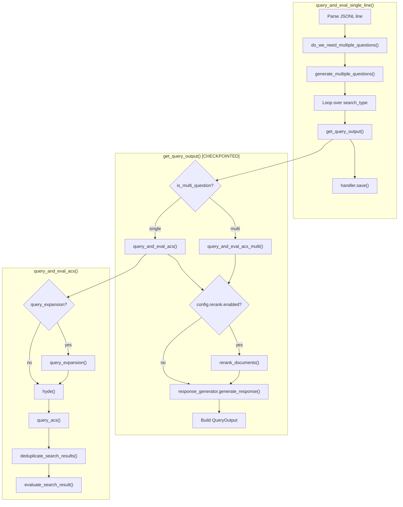

<!-- source: DeepWiki mcp.deepwiki.com · repo microsoft/rag-experiment-accelerator · page 13.2 Run Module API · fetched 2026-10-26 -->

# Run Module API

<details>
<summary>Relevant source files</summary>

The following files were used as context for generating this wiki page:

- [02_qa_generation.py](02_qa_generation.py)
- [03_querying.py](03_querying.py)
- [04_evaluation.py](04_evaluation.py)
- [rag_experiment_accelerator/config/tests/data/config.json](rag_experiment_accelerator/config/tests/data/config.json)
- [rag_experiment_accelerator/run/index.py](rag_experiment_accelerator/run/index.py)
- [rag_experiment_accelerator/run/querying.py](rag_experiment_accelerator/run/querying.py)
- [rag_experiment_accelerator/run/tests/test_querying.py](rag_experiment_accelerator/run/tests/test_querying.py)
- [rag_experiment_accelerator/search_type/acs_search_methods.py](rag_experiment_accelerator/search_type/acs_search_methods.py)
- [rag_experiment_accelerator/search_type/tests/test_acs_search_methods.py](rag_experiment_accelerator/search_type/tests/test_acs_search_methods.py)

</details>


This document provides API reference documentation for the four core orchestration modules that execute the RAG Experiment Accelerator pipeline stages. For configuration classes used by these modules, see [Configuration Classes](#13.1). For embedding and LLM APIs, see [Embedding and LLM APIs](#13.3).

The run modules are located in the `rag_experiment_accelerator/run/` directory and implement the business logic for:
- `run.index` - Document chunking, embedding, and index creation (Stage 1)
- `run.qa_generation` - Question-answer pair generation (Stage 2)
- `run.querying` - Search execution and response generation (Stage 3)
- `run.evaluation` - Metric computation and visualization (Stage 4)

Each module is invoked by its corresponding CLI script (`01_index.py`, `02_qa_generation.py`, `03_querying.py`, `04_evaluation.py`) and orchestrates multiple sub-operations with checkpoint support, parallel processing, and MLflow tracking.

---

## Module Invocation Architecture

```mermaid
graph TB
    subgraph "CLI Scripts (Entry Points)"
        CLI1["01_index.py"]
        CLI2["02_qa_generation.py"]
        CLI3["03_querying.py"]
        CLI4["04_evaluation.py"]
    end
    
    subgraph "Run Modules (Orchestration)"
        RUN_INDEX["run.index.run()"]
        RUN_QA["run.qa_generation.run()"]
        RUN_QUERY["run.querying.run()"]
        RUN_EVAL["run.evaluation.run()"]
    end
    
    subgraph "Core Operations"
        LOAD_DOCS["load_documents()"]
        CLUSTER["cluster()"]
        EMBED["embed_chunks()"]
        UPLOAD["upload_data()"]
        
        GEN_QA["generate_qa_pairs()"]
        
        SEARCH["query_acs()"]
        RERANK["rerank_documents()"]
        LLM_GEN["ResponseGenerator"]
        
        COMPUTE_METRICS["compute_metrics()"]
        VIZ["generate_visualizations()"]
    end
    
    subgraph "Cross-Cutting"
        CHECKPOINT["@cache_with_checkpoint"]
        MLFLOW["mlflow.log_metric()"]
        THREADS["ThreadPoolExecutor"]
    end
    
    CLI1 --> RUN_INDEX
    CLI2 --> RUN_QA
    CLI3 --> RUN_QUERY
    CLI4 --> RUN_EVAL
    
    RUN_INDEX --> LOAD_DOCS
    RUN_INDEX --> CLUSTER
    RUN_INDEX --> EMBED
    RUN_INDEX --> UPLOAD
    
    RUN_QA --> GEN_QA
    
    RUN_QUERY --> SEARCH
    RUN_QUERY --> RERANK
    RUN_QUERY --> LLM_GEN
    
    RUN_EVAL --> COMPUTE_METRICS
    RUN_EVAL --> VIZ
    
    CHECKPOINT -.decorates.-> EMBED
    CHECKPOINT -.decorates.-> SEARCH
    CHECKPOINT -.decorates.-> GEN_QA
    
    MLFLOW -.tracks.-> RUN_INDEX
    MLFLOW -.tracks.-> RUN_QUERY
    MLFLOW -.tracks.-> RUN_EVAL
    
    THREADS -.parallelizes.-> EMBED
    THREADS -.parallelizes.-> RUN_QUERY
```



**Sources:** [03_querying.py:1-52](), [rag_experiment_accelerator/run/index.py:1-413](), [rag_experiment_accelerator/run/querying.py:1-632](), [02_qa_generation.py:1-23](), [04_evaluation.py:1-43]()

---

## run.index Module

The `run.index` module orchestrates Stage 1 (Document Indexing), handling document loading, chunking, embedding generation, and Azure AI Search index population.

### Primary Entry Point

#### `run(environment, config, index_config, file_paths, mlflow_client, is_local=False) -> str`

Executes the complete indexing pipeline for a single index configuration.

**Parameters:**

| Parameter | Type | Description |
|-----------|------|-------------|
| `environment` | `Environment` | Azure service credentials and endpoints |
| `config` | `Config` | Global experiment configuration |
| `index_config` | `IndexConfig` | Index-specific settings (chunk size, embedding model, etc.) |
| `file_paths` | `list[str]` | List of document file paths to process |
| `mlflow_client` | `mlflow.MlflowClient` | MLflow client for experiment tracking |
| `is_local` | `bool` | If `True`, enables sampling functionality (default: `False`) |

**Returns:** `str` - The created index name

**Workflow:**
1. Creates Azure AI Search index via `create_acs_index()`
2. Loads and chunks documents via `load_documents()`
3. Optionally samples documents via `cluster()` if `is_local=True` and `index_config.sampling.sample_data=True`
4. Converts documents to vector DB records
5. Generates embeddings for chunks in parallel
6. Optionally generates titles and summaries
7. Uploads data to Azure AI Search index

**Sources:** [rag_experiment_accelerator/run/index.py:30-101]()

---

### Document Processing Functions

#### `convert_docs_to_vector_db_records(docs) -> list[dict]`

Transforms document objects into dictionaries with Azure AI Search schema.

**Input Format:** List of documents where each document is `{doc_id: {content: str, metadata: dict}}`

**Output Fields:**
- `id` - Unique document identifier
- `content` - Document text content
- `filename` - Extracted from metadata source
- `source_display_name` - Formatted as `filename#page=N` for PDFs

**Sources:** [rag_experiment_accelerator/run/index.py:103-132]()

---

### Embedding Generation

#### `embed_chunks(config, index_config, pre_process, chunks) -> list[dict]`

Generates embeddings for all chunks in parallel using ThreadPoolExecutor.

**Key Behaviors:**
- Uses `ThreadPoolExecutor` without explicit max_workers (defaults to CPU count)
- Calls `embed_chunk()` for each chunk (decorated with `@cache_with_checkpoint`)
- If `index_config.chunking.override_content_with_summary=True`, replaces content with summary after embedding

**Sources:** [rag_experiment_accelerator/run/index.py:134-185]()

#### `embed_chunk(pre_process, embedding_model, chunk) -> dict`

Generates embedding for a single chunk. **Decorated with `@cache_with_checkpoint(id="chunk['content']+embedding_model.name")`**

**Checkpointing:** Results are cached based on content + embedding model name hash.

**Modifies chunk dict in-place:** Adds `content_vector` field containing embedding array.

**Sources:** [rag_experiment_accelerator/run/index.py:187-210]()

---

### Title and Summary Generation

#### `generate_titles_from_chunks(config, index_config, pre_process, chunks, environment)`

Generates titles for chunks in parallel using LLM. Uses `config.max_worker_threads` workers.

**Process:** Submits `process_title()` tasks to ThreadPoolExecutor for each chunk.

**Sources:** [rag_experiment_accelerator/run/index.py:212-251]()

#### `process_title(config, index_config, pre_process, chunk, environment) -> dict`

Generates title and title embedding for a chunk. **Decorated with `@cache_with_checkpoint(id="chunk['content']+str(config.index.chunking.generate_title)")`**

**Behavior:**
- If `index_config.chunking.generate_title=True`: Calls `generate_title()` → generates embedding
- If `False`: Sets `title=""` and `title_vector=[]`

**Modifies chunk dict:** Adds `title` and `title_vector` fields.

**Sources:** [rag_experiment_accelerator/run/index.py:292-328]()

#### `generate_summaries_from_chunks(config, index_config, pre_process, chunks, environment)`

Generates summaries for chunks in parallel using LLM. Uses `config.max_worker_threads` workers.

**Sources:** [rag_experiment_accelerator/run/index.py:253-290]()

#### `process_summary(config, index_config, pre_process, chunk, environment) -> dict`

Generates summary and summary embedding for a chunk. **Decorated with `@cache_with_checkpoint(id="chunk['content']+str(config.index.chunking.generate_summary)")`**

**Behavior:**
- If `index_config.chunking.generate_summary=True`: Calls `generate_summary()` → generates embedding
- If `False`: Sets `summary=""` and `summary_vector=[]`

**Modifies chunk dict:** Adds `summary` and `summary_vector` fields.

**Sources:** [rag_experiment_accelerator/run/index.py:330-371]()

#### `generate_title(chunk, azure_oai_deployment_name, environment, config) -> str`

Uses `ResponseGenerator` with `prompt_instruction_title` to generate title from chunk content.

**Sources:** [rag_experiment_accelerator/run/index.py:373-391]()

#### `generate_summary(chunk, azure_oai_deployment_name, environment, config) -> str`

Uses `ResponseGenerator` with `prompt_instruction_summary` to generate summary from chunk content.

**Sources:** [rag_experiment_accelerator/run/index.py:393-413]()

---

## run.querying Module

The `run.querying` module orchestrates Stage 3 (Querying and Retrieval), executing search strategies, optional reranking, and LLM response generation for each question in the evaluation dataset.

### Primary Entry Point

#### `run(environment, config, index_config, mlflow_client)`

Executes queries against Azure AI Search indexes and generates LLM responses.

**Parameters:**

| Parameter | Type | Description |
|-----------|------|-------------|
| `environment` | `Environment` | Azure service credentials |
| `config` | `Config` | Experiment configuration |
| `index_config` | `IndexConfig` | Index configuration to query |
| `mlflow_client` | `mlflow.MlflowClient` | MLflow client for tracking |

**Workflow:**
1. Counts questions in `config.path.eval_data_file` and logs to MLflow
2. Creates `SpacyEvaluator` with `config.search.search_relevancy_threshold`
3. Initializes `ResponseGenerator` for LLM calls
4. For each index in `config.index.flatten()`:
   - Archives existing output via `QueryOutputHandler.handle_archive_by_index()`
   - Creates `SearchClient` for the index
   - Processes questions in parallel using `ThreadPoolExecutor(config.max_worker_threads)`
   - Each question processed via `query_and_eval_single_line()`
5. Closes search client

**Parallelization:** Uses `ThreadPoolExecutor` with `as_completed()` to process multiple questions concurrently.

**Sources:** [rag_experiment_accelerator/run/querying.py:560-632]()

---

### Question Processing Pipeline



**Sources:** [rag_experiment_accelerator/run/querying.py:398-558]()

---

### Core Query Functions

#### `query_and_eval_single_line(line, line_number, handler, environment, config, index_config, response_generator, search_client, evaluator, question_count)`

Processes a single question from the evaluation dataset.

**Key Steps:**
1. Parses JSONL line to extract `user_prompt`, `output_prompt`, `context`
2. Checks if multiple questions needed via `do_we_need_multiple_questions()`
3. If yes, generates multiple questions via `generate_multiple_questions()`
4. For each search type in `config.search.search_type`:
   - Calls `get_query_output()` (checkpointed)
   - Saves result via `QueryOutputHandler.save()`

**Error Handling:** Catches `BadRequestError` and logs/skips the question.

**Sources:** [rag_experiment_accelerator/run/querying.py:398-464]()

---

#### `get_query_output(...) -> QueryOutput`

**Decorated with `@cache_with_checkpoint(id="user_prompt+output_prompt+qna_context+index_config.index_name()")`**

Executes search and generates LLM response for a single question-search_type pair.

**Checkpointing:** Results cached based on question + context + index name hash.

**Process:**
1. Recreates `ResponseGenerator` and `EmbeddingModel` (not serializable in checkpoint)
2. Branches on `is_multi_question`:
   - Single: Calls `query_and_eval_acs()`
   - Multi: Calls `query_and_eval_acs_multi()`
3. If `config.rerank.enabled`, calls `rerank_documents()`
4. Generates final response via `response_generator.generate_response(main_instruction)`
5. Builds `QueryOutput` object with all parameters and results

**Returns:** `QueryOutput` containing:
- Reranking configuration
- Retrieved document count
- Actual LLM response
- Expected response
- Search type
- Search evaluations
- Context
- Retrieved contexts
- Question

**Sources:** [rag_experiment_accelerator/run/querying.py:466-558]()

---

#### `query_and_eval_acs(search_client, embedding_model, query, search_type, evaluation_content, retrieve_num_of_documents, evaluator, config, response_generator, preprocess=False) -> QueryAndEvalACSResult`

Executes search for a single query with optional query expansion and HyDE.

**Query Enhancement Pipeline:**
1. If `config.query_expansion.query_expansion=True`: Generate augmented questions via `query_expansion()`
2. Apply HyDE via `hyde()` (generates hypothetical documents/answers)
3. Execute search for each generated query via `query_acs()`
4. Deduplicate results via `deduplicate_search_results()`
5. Limit to top `config.search.retrieve_num_of_documents`
6. Evaluate via `evaluate_search_result()`

**Returns:** `QueryAndEvalACSResult` with `documents` (list of content strings) and `evaluations` (dict).

**Sources:** [rag_experiment_accelerator/run/querying.py:223-284]()

---

#### `query_and_eval_acs_multi(search_client, embedding_model, questions, original_prompt, output_prompt, search_type, evaluation_content, config, evaluator, response_generator, preprocess=False) -> QueryAndEvalACSResult`

Executes search for multiple related questions and generates separate LLM responses for each.

**Process:**
1. For each question:
   - Calls `query_and_eval_acs()`
   - If no documents found, logs warning and skips
   - If `config.rerank.enabled`, reranks documents
   - Limits to `config.search.retrieve_num_of_documents`
   - Generates response via `ResponseGenerator` with `main_instruction`
   - Appends response to context list
2. Returns all responses as documents

**Use Case:** Handles questions that decompose into multiple sub-questions (e.g., "Compare X and Y" → "What is X?", "What is Y?")

**Returns:** `QueryAndEvalACSResult` with `documents` (list of LLM responses) and `evaluations` (list of dicts).

**Sources:** [rag_experiment_accelerator/run/querying.py:316-396]()

---

### Search and Retrieval Functions

#### `query_acs(search_client, embedding_model, user_prompt, s_v, retrieve_num_of_documents, preprocess=False) -> list[dict]`

Dispatches search request to appropriate Azure AI Search method.

**Search Type Mapping:**
- `search_for_match_semantic` → Semantic search with vectors
- `search_for_match_Hybrid_multi` → Hybrid with 3 vector fields
- `search_for_match_Hybrid_cross` → Hybrid with 2 combined vector fields
- `search_for_match_text` → BM25 text search only
- `search_for_match_pure_vector` → Vector search on content only
- `search_for_match_pure_vector_multi` → Vector search on 3 fields
- `search_for_match_pure_vector_cross` → Vector search on combined fields
- `search_for_manual_hybrid` → Combines text + vector + semantic results

**Implementation:** Uses `search_mapping` dict to lookup function by `s_v` parameter.

**Returns:** List of dicts with `@search.score` and `content` fields.

**Sources:** [rag_experiment_accelerator/run/querying.py:61-104]()

---

#### `deduplicate_search_results(search_results) -> list[dict]`

Removes duplicate documents from search results and sorts by score.

**Algorithm:**
1. Use set to deduplicate by `content` field
2. Preserve highest `@search.score` for each unique content
3. Sort results by score descending

**Sources:** [rag_experiment_accelerator/run/querying.py:199-215]()

---

### Query Enhancement Functions

#### `query_expansion(config, response_generator, embedding_model, query) -> list[str]`

Generates multiple related questions using LLM and filters by similarity.

**Process:**
1. Generates augmented questions via `response_generator.generate_response(prompt_generate_hypothetical_questions)`
2. Filters via `filter_non_related_questions()` using embedding similarity
3. Returns list of related questions (including original)

**Threshold:** `config.query_expansion.min_query_expansion_related_question_similarity_score` (default: 90)

**Sources:** [rag_experiment_accelerator/run/querying.py:172-197]()

---

#### `hyde(config, response_generator, queries) -> list[str]`

Applies Hypothetical Document Embeddings (HyDE) to transform queries.

**HyDE Types:**
- `disabled` - Pass through original queries
- `generated_hypothetical_answer` - Generate hypothetical answer to query
- `generated_hypothetical_document_to_answer` - Generate hypothetical document

**Implementation:** Maps config value to prompt template, generates via LLM.

**Sources:** [rag_experiment_accelerator/run/querying.py:145-170]()

---

#### `filter_non_related_questions(query, generated_questions, embedding_model, min_query_expansion_related_question_similarity_score) -> list[str]`

Filters generated questions by cosine similarity to original query.

**Algorithm:**
1. Generate embedding for original query
2. For each generated question:
   - Generate embedding
   - Calculate cosine similarity with original
   - If similarity >= threshold, include question
3. Return filtered list (always includes original)

**Sources:** [rag_experiment_accelerator/run/querying.py:286-314]()

---

### Reranking Functions

#### `rerank_documents(docs, user_prompt, output_prompt, config, response_generator) -> list[str]`

Reranks documents based on configuration.

**Reranking Types:**
- `llm` - Uses `llm_rerank_documents()` with `config.rerank.llm_rerank_threshold`
- `cross_encoder` - Uses `cross_encoder_rerank_documents()` with `config.rerank.cross_encoder_model` and `config.rerank.cross_encoder_at_k`
- Other - Returns empty list

**Sources:** [rag_experiment_accelerator/run/querying.py:106-143]()

---

### Data Models

#### `QueryAndEvalACSResult`

Simple data class returned by query functions.

**Fields:**
- `documents: list[str]` - Retrieved document contents or LLM responses
- `evaluations: dict[str, any]` - Search evaluation metrics

**Sources:** [rag_experiment_accelerator/run/querying.py:217-221]()

---

## run.qa_generation Module

The `run.qa_generation` module orchestrates Stage 2 (QA Generation), creating question-answer pairs from indexed documents for evaluation.

### Primary Entry Point

#### `run(environment, config, file_paths)`

Generates QA pairs from documents and saves to JSONL file.

**Inferred Parameters:**
- `environment: Environment` - Azure credentials
- `config: Config` - Experiment configuration
- `file_paths: list[str]` - Document paths to generate QA from

**Workflow:** (Inferred from CLI invocation)
1. Loads documents
2. For each document/chunk, generates QA pairs using LLM
3. Optionally retrieves similar documents from Azure AI Search
4. Writes QA pairs to `config.path.eval_data_file` (JSONL format)

**Checkpointing:** Uses `init_checkpoint(config)` for caching expensive LLM calls.

**Sources:** [02_qa_generation.py:1-23]()

---

## run.evaluation Module

The `run.evaluation` module orchestrates Stage 4 (Evaluation), computing metrics and generating visualizations.

### Primary Entry Point

#### `run(environment, config, index_config, mlflow_client, name_suffix)`

Computes evaluation metrics and logs to MLflow.

**Parameters:**

| Parameter | Type | Description |
|-----------|------|-------------|
| `environment` | `Environment` | Azure credentials |
| `config` | `Config` | Experiment configuration |
| `index_config` | `IndexConfig` | Index configuration being evaluated |
| `mlflow_client` | `mlflow.MlflowClient` | MLflow tracking client |
| `name_suffix` | `str` | Timestamp suffix for outputs |

**Workflow:** (Inferred from CLI invocation)
1. Loads query results from `QueryOutputHandler`
2. For each metric in `config.eval.metric_types`:
   - Computes metric comparing actual vs expected responses
   - Generates visualizations (plots, HTML reports)
3. Logs metrics and artifacts to MLflow
4. Saves results to `artifacts/eval_score/`

**Metric Types:** Algorithm-based, BERT-based, LLM-based (see [Evaluation Metrics](#8))

**Sources:** [04_evaluation.py:1-43]()

---

## Parallel Processing Patterns

All run modules use `concurrent.futures.ThreadPoolExecutor` for parallel processing:

### Pattern 1: Fixed Thread Count (Index Module)

```python
with ThreadPoolExecutor(config.max_worker_threads) as executor:
    futures = {executor.submit(process_fn, item): item for item in items}
    for future in as_completed(futures):
        result = future.result()
```

**Used in:** `generate_titles_from_chunks()`, `generate_summaries_from_chunks()`

**Sources:** [rag_experiment_accelerator/run/index.py:233-250]()

---

### Pattern 2: Default Thread Count (Index Embedding)

```python
with ExitStack() as stack:
    executor = stack.enter_context(ThreadPoolExecutor())
    futures = {executor.submit(embed_chunk, item): item for item in items}
    for future in as_completed(futures):
        result = future.result()
```

**Used in:** `embed_chunks()` - Defaults to CPU core count

**Sources:** [rag_experiment_accelerator/run/index.py:150-173]()

---

### Pattern 3: Per-Index Parallelization (Querying Module)

```python
for index_config in config.index.flatten():
    with ThreadPoolExecutor(config.max_worker_threads) as executor:
        futures = {executor.submit(query_fn, line): line for line in file}
        for future in as_completed(futures):
            try:
                future.result()
            except Exception as exc:
                logger.error(f"Error: {exc}")
```

**Used in:** `run()` in querying module - Processes questions in parallel per index

**Sources:** [rag_experiment_accelerator/run/querying.py:602-630]()

---

## Checkpoint Integration

Run modules use `@cache_with_checkpoint` decorator to cache expensive operations:

### Checkpointed Operations

| Function | Checkpoint ID | Purpose |
|----------|---------------|---------|
| `embed_chunk()` | `chunk['content']+embedding_model.name` | Cache embeddings |
| `process_title()` | `chunk['content']+str(config.index.chunking.generate_title)` | Cache title generation |
| `process_summary()` | `chunk['content']+str(config.index.chunking.generate_summary)` | Cache summary generation |
| `get_query_output()` | `user_prompt+output_prompt+qna_context+index_config.index_name()` | Cache query results |

**Checkpoint Behavior:**
- Results stored in `artifacts/checkpoints/`
- Hash-based lookup using checkpoint ID
- Automatic cache invalidation if dependencies change
- Controlled by `config.use_checkpoints` flag

**Sources:** [rag_experiment_accelerator/run/index.py:187-210](), [rag_experiment_accelerator/run/querying.py:466-468]()

---

## MLflow Integration

Run modules log metrics and parameters to MLflow at specific points:

### Stage 1 (Index)
```python
mlflow.log_metric("Number of documents", len(docs))
mlflow.log_metric("Number of document chunks", len(docs_ready_to_index))
```

**Sources:** [rag_experiment_accelerator/run/index.py:77-79]()

### Stage 3 (Querying)
```python
mlflow.log_metric("question_count", question_count)
```

**Sources:** [rag_experiment_accelerator/run/querying.py:581]()

### Stage 4 (Evaluation)
- Logs all computed metrics
- Logs hyperparameters from config
- Registers visualizations as artifacts

**MLflow Run Context:** Each CLI script creates MLflow run via `mlflow.start_run()` before calling run module.

**Sources:** [03_querying.py:41-42](), [04_evaluation.py:35-42]()

---

## Error Handling Patterns

### Pattern 1: Try-Except with Logging (Search Operations)

```python
try:
    results = client.search(...)
    formatted_search_results = format_results(results)
except Exception as e:
    logger.error(str(e))
    return []
```

**Used in:** All `acs_search_methods.py` functions

**Sources:** [rag_experiment_accelerator/search_type/acs_search_methods.py:92-109]()

---

### Pattern 2: Future Exception Handling (Parallel Operations)

```python
for future in as_completed(futures):
    try:
        result = future.result()
    except Exception as exc:
        logger.error(f"Function generated exception: {exc} for item {item}")
```

**Used in:** All parallel processing in run modules

**Sources:** [rag_experiment_accelerator/run/index.py:163-172]()

---

### Pattern 3: Request-Specific Exceptions (Querying)

```python
try:
    output = get_query_output(...)
except BadRequestError as e:
    logger.error("Invalid request. Skipping question: {user_prompt}", exc_info=e)
```

**Used in:** Query processing to skip invalid questions without stopping pipeline

**Sources:** [rag_experiment_accelerator/run/querying.py:459-463]()

---

