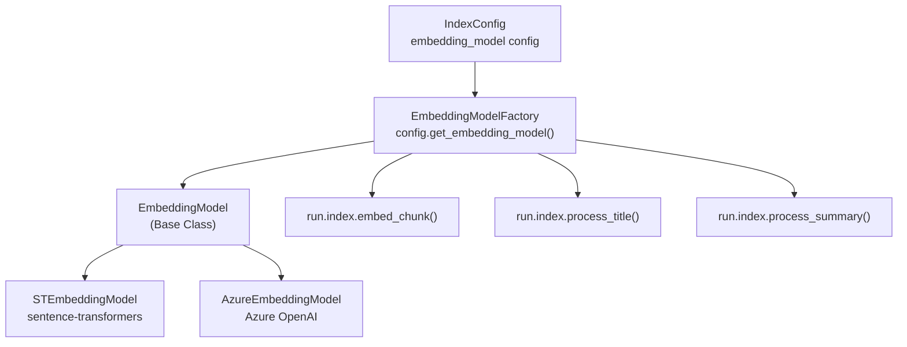
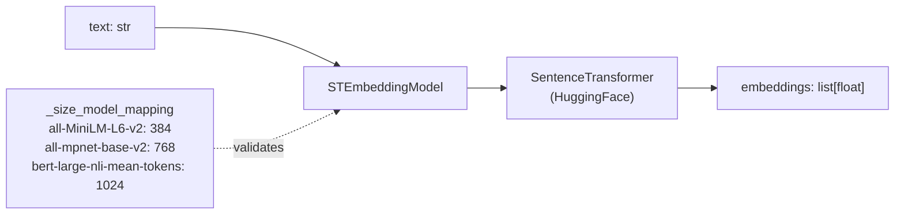
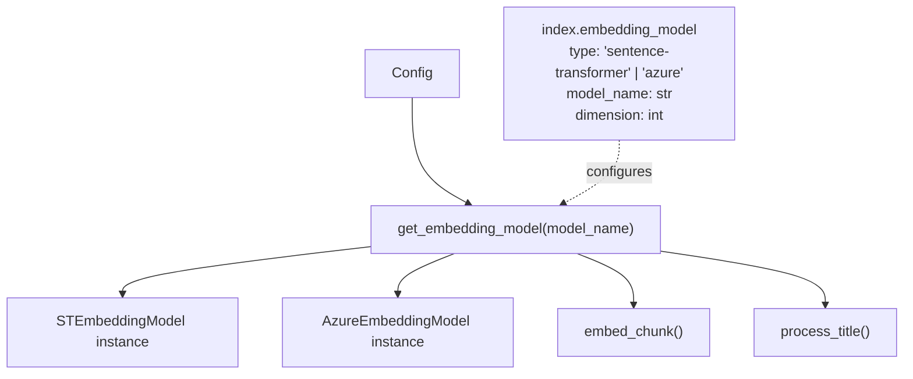
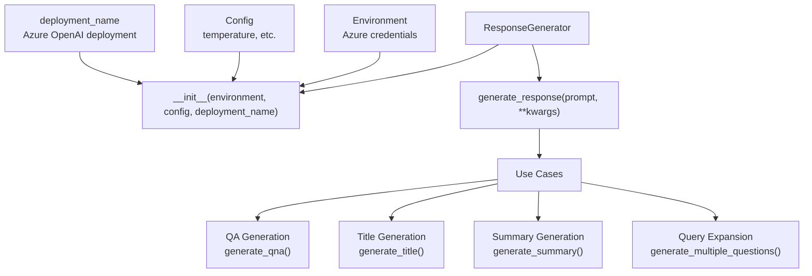
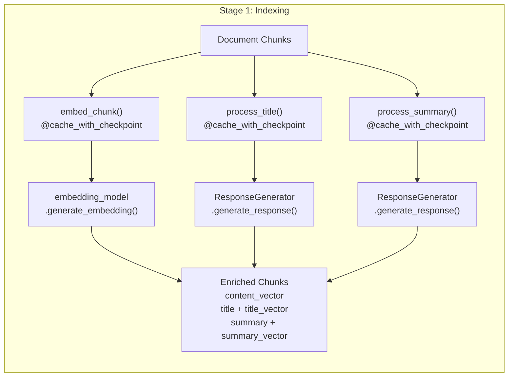
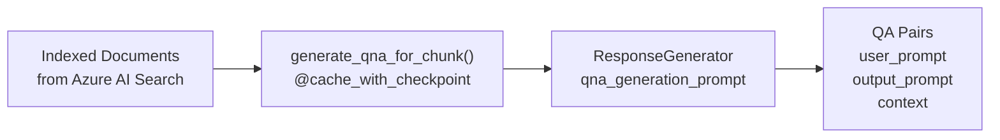
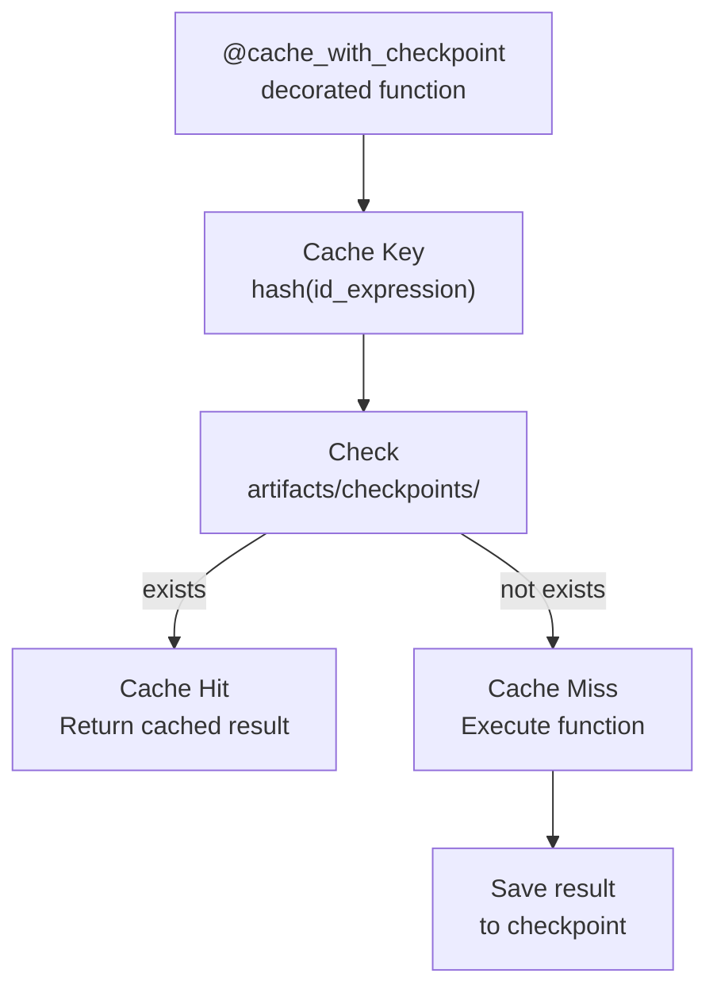
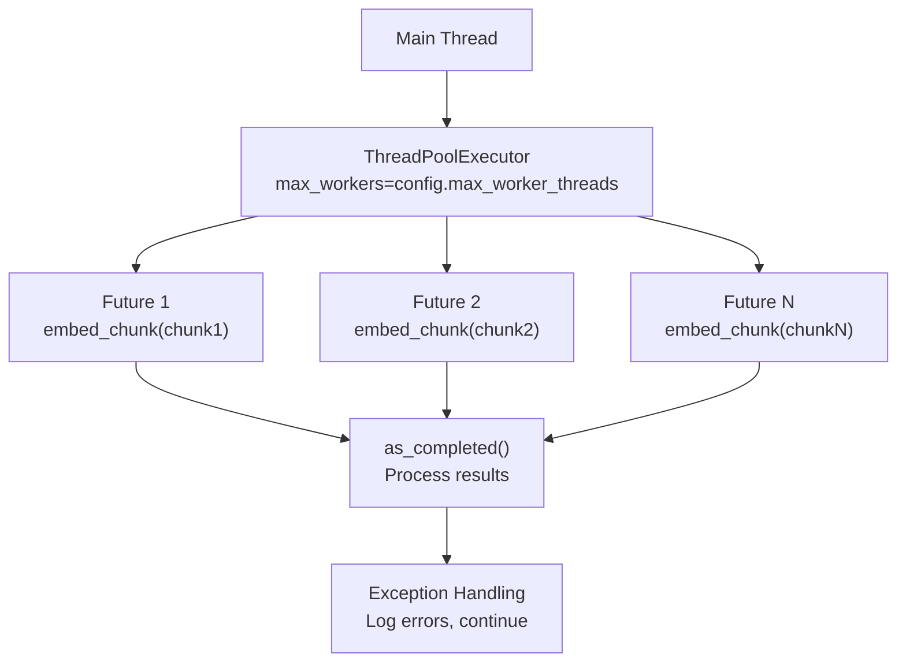
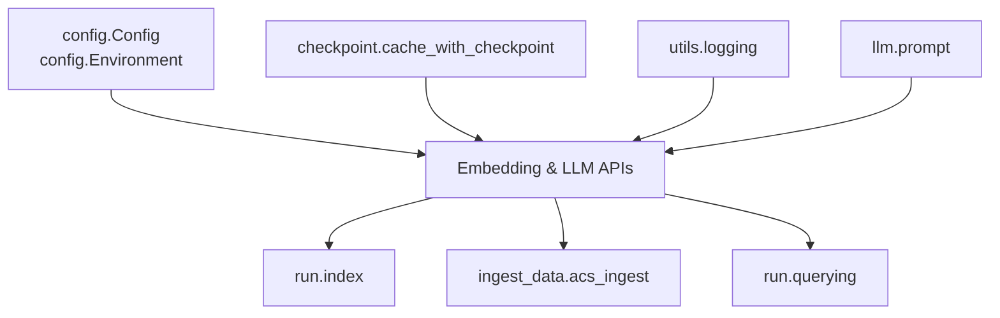

<!-- source: DeepWiki mcp.deepwiki.com · repo microsoft/rag-experiment-accelerator · page 13.3 Embedding and LLM APIs · fetched 2026-10-26 -->

# Embedding and LLM APIs

<details>
<summary>Relevant source files</summary>

The following files were used as context for generating this wiki page:

- [dev-requirements.txt](dev-requirements.txt)
- [rag_experiment_accelerator/config/tests/data/config.json](rag_experiment_accelerator/config/tests/data/config.json)
- [rag_experiment_accelerator/doc_loader/pdfLoader.py](rag_experiment_accelerator/doc_loader/pdfLoader.py)
- [rag_experiment_accelerator/embedding/st_embedding_model.py](rag_experiment_accelerator/embedding/st_embedding_model.py)
- [rag_experiment_accelerator/embedding/tests/test_st_embedding_model.py](rag_experiment_accelerator/embedding/tests/test_st_embedding_model.py)
- [rag_experiment_accelerator/ingest_data/acs_ingest.py](rag_experiment_accelerator/ingest_data/acs_ingest.py)
- [rag_experiment_accelerator/ingest_data/tests/test_acs_ingest.py](rag_experiment_accelerator/ingest_data/tests/test_acs_ingest.py)
- [rag_experiment_accelerator/run/index.py](rag_experiment_accelerator/run/index.py)
- [requirements.txt](requirements.txt)

</details>


This document provides API reference documentation for the embedding model and LLM (Large Language Model) interaction classes used throughout the RAG Experiment Accelerator. These components are responsible for generating vector embeddings of text and interacting with language models for various tasks including title/summary generation, question-answer pair generation, and response synthesis.

For information about how embeddings are configured in experiments, see [Embedding Models](#6). For details on search and retrieval using embeddings, see [Search and Retrieval](#7). For prompt engineering and evaluation with LLMs, see [LLM-Based Evaluation](#8.3).

## Embedding Model Architecture

The system implements a polymorphic embedding model architecture with two concrete implementations: sentence transformers (via HuggingFace) and Azure OpenAI embeddings.

### Class Hierarchy



**Sources:** [rag_experiment_accelerator/embedding/st_embedding_model.py:1-78](), [rag_experiment_accelerator/run/index.py:134-209](), [rag_experiment_accelerator/config/tests/data/config.json:23-43]()

### EmbeddingModel Base Class

The `EmbeddingModel` abstract base class defines the interface that all embedding implementations must follow. While the implementation is not shown in the provided files, its usage reveals the contract:

| Property/Method | Type | Description |
|----------------|------|-------------|
| `name` | `str` | The model identifier |
| `dimension` | `int` | The dimensionality of the output embeddings |
| `generate_embedding(chunk: str)` | `list[float]` | Core method that generates an embedding vector for the input text |

**Sources:** [rag_experiment_accelerator/embedding/st_embedding_model.py:2]()

### STEmbeddingModel Class

The `STEmbeddingModel` class wraps sentence-transformers models from HuggingFace for local embedding generation.



**Sources:** [rag_experiment_accelerator/embedding/st_embedding_model.py:10-78]()

#### Constructor

```python
STEmbeddingModel(model_name: str, dimension: Optional[int] = None, **kwargs)
```

**Parameters:**
- `model_name` (str): Name of the HuggingFace sentence-transformers model (e.g., "all-MiniLM-L6-v2")
- `dimension` (int, optional): Embedding dimensionality. If not provided, looked up from `_size_model_mapping`
- `**kwargs`: Additional arguments passed to base class

**Raises:**
- `ValueError`: If dimension not provided and model_name not in `_size_model_mapping`
- `OSError`: If model cannot be downloaded/loaded (network issues, invalid model name)

**Supported Models:**

| Model Name | Dimension | Characteristics |
|-----------|-----------|-----------------|
| `all-MiniLM-L6-v2` | 384 | Fast, lightweight, general-purpose |
| `all-mpnet-base-v2` | 768 | Balanced speed/quality |
| `bert-large-nli-mean-tokens` | 1024 | High quality, slower |

**Sources:** [rag_experiment_accelerator/embedding/st_embedding_model.py:30-64]()

#### generate_embedding() Method

```python
def generate_embedding(self, chunk: str) -> list[float]
```

Generates an embedding vector for the input text using the loaded sentence-transformer model.

**Parameters:**
- `chunk` (str): Text to embed

**Returns:**
- `list[float]`: Embedding vector with length equal to `self.dimension`

**Implementation Details:**
- Internally calls `SentenceTransformer.encode([str(chunk)])` 
- Converts numpy array result to Python list via `.tolist()[0]`
- Always processes a single string, even though encode accepts batches

**Sources:** [rag_experiment_accelerator/embedding/st_embedding_model.py:66-77]()

#### Example Usage

```python
# Initialization
model = STEmbeddingModel("all-MiniLM-L6-v2")
# dimension automatically set to 384

# Generate embedding
text = "This is a sample document chunk."
embedding = model.generate_embedding(text)
# Returns list[float] with 384 dimensions
```

**Sources:** [rag_experiment_accelerator/embedding/tests/test_st_embedding_model.py:7-16]()

### Azure OpenAI Embeddings

Azure OpenAI embeddings are configured via the `IndexConfig.embedding_model` configuration but the implementation details are not shown in the provided files. Based on configuration examples, the system supports:

| Model Name | Base Dimension | Dimension Shortening |
|-----------|----------------|---------------------|
| `text-embedding-ada-002` | 1536 | Not supported |
| `text-embedding-3-large` | 3072 | Optional |
| `text-embedding-3-small` | 1536 | Supported, min 256 |

**Configuration Example:**
```json
{
  "type": "azure",
  "model_name": "text-embedding-3-small",
  "dimension": 256,
  "shorten_dimensions": true
}
```

**Sources:** [rag_experiment_accelerator/config/tests/data/config.json:28-42]()

### Embedding Model Factory

Embedding models are instantiated through the `Config.get_embedding_model()` factory method, which returns the appropriate `EmbeddingModel` instance based on configuration.



**Sources:** [rag_experiment_accelerator/run/index.py:52-54](), [rag_experiment_accelerator/run/index.py:157](), [rag_experiment_accelerator/run/index.py:317-319]()

**Usage Pattern:**
```python
# Factory retrieval pattern used throughout the codebase
embedding_model = config.get_embedding_model(index_config.embedding_model.model_name)
vector = embedding_model.generate_embedding(preprocessed_text)
```

**Sources:** [rag_experiment_accelerator/run/index.py:157-158](), [rag_experiment_accelerator/run/index.py:317-319]()

## ResponseGenerator Class

The `ResponseGenerator` class provides a unified interface for interacting with Azure OpenAI chat models for various text generation tasks.



**Sources:** [rag_experiment_accelerator/ingest_data/acs_ingest.py:106-108](), [rag_experiment_accelerator/run/index.py:385-390]()

### Constructor

```python
ResponseGenerator(environment: Environment, config: Config, deployment_name: str)
```

**Parameters:**
- `environment` (Environment): Environment configuration containing Azure OpenAI credentials and endpoints
- `config` (Config): Global configuration object with temperature and other LLM settings
- `deployment_name` (str): Name of the Azure OpenAI deployment to use (e.g., `config.openai.azure_oai_chat_deployment_name`)

**Sources:** [rag_experiment_accelerator/ingest_data/acs_ingest.py:106-108]()

### generate_response() Method

```python
def generate_response(self, prompt: str, **kwargs) -> Any
```

Generates a response from the LLM using the provided prompt template and keyword arguments.

**Parameters:**
- `prompt` (str): Prompt template string
- `**kwargs`: Variables to be interpolated into the prompt template

**Returns:**
- Return type varies based on prompt structure and response parsing (can be `str`, `dict`, `list[dict]`, or `None`)

**Common Return Types:**
- `str`: For simple text generation (titles, summaries, single answers)
- `dict`: For structured responses (e.g., `{"question": "...", "answer": "..."}`)
- `list[dict]`: For multiple QA pairs or questions
- `None`: If generation fails or produces no valid output

**Sources:** [rag_experiment_accelerator/ingest_data/acs_ingest.py:113-116](), [rag_experiment_accelerator/ingest_data/acs_ingest.py:142-145]()

### Usage Patterns

#### QA Generation

```python
response_generator = ResponseGenerator(environment, config, azure_oai_deployment_name)

# Generate single QA pair
response = response_generator.generate_response(
    qna_generation_prompt,
    context=chunk["content"]
)
# Returns: dict or list[dict] with "question" and "answer" keys
```

**Sources:** [rag_experiment_accelerator/ingest_data/acs_ingest.py:106-108](), [rag_experiment_accelerator/ingest_data/acs_ingest.py:113-116]()

#### Title Generation

```python
response_generator = ResponseGenerator(
    environment=environment,
    config=config,
    deployment_name=config.openai.azure_oai_chat_deployment_name
)

title = response_generator.generate_response(
    prompt_instruction_title,
    text=chunk_content
)
# Returns: str
```

**Sources:** [rag_experiment_accelerator/run/index.py:385-390]()

#### Summary Generation

```python
response_generator = ResponseGenerator(
    environment=environment,
    config=config,
    deployment_name=config.openai.azure_oai_chat_deployment_name
)

summary = response_generator.generate_response(
    prompt_instruction_summary,
    text=chunk_content
)
# Returns: str
```

**Sources:** [rag_experiment_accelerator/run/index.py:407-412]()

#### Query Expansion

```python
# Generate multiple sub-questions
response = response_generator.generate_response(
    multiple_prompt_instruction,
    text=question
)
# Returns: list of sub-questions

# Determine if query needs expansion
response = response_generator.generate_response(
    do_need_multiple_prompt_instruction,
    text=question
)
# Returns: str ("complex" or other)
```

**Sources:** [rag_experiment_accelerator/ingest_data/acs_ingest.py:169-173](), [rag_experiment_accelerator/ingest_data/acs_ingest.py:189-192]()

## Integration with Pipeline Stages

### Stage 1: Document Indexing

Embeddings and LLMs are used extensively during the indexing stage to enrich document chunks.



**Sources:** [rag_experiment_accelerator/run/index.py:134-184](), [rag_experiment_accelerator/run/index.py:187-210](), [rag_experiment_accelerator/run/index.py:292-328](), [rag_experiment_accelerator/run/index.py:330-371]()

**Key Functions:**

| Function | Purpose | Checkpointed | Embedding Used | LLM Used |
|----------|---------|--------------|----------------|----------|
| `embed_chunk()` | Generate content embeddings | Yes | Yes | No |
| `process_title()` | Generate and embed titles | Yes | Yes | Yes |
| `process_summary()` | Generate and embed summaries | Yes | Yes | Yes |

**Sources:** [rag_experiment_accelerator/run/index.py:187-210](), [rag_experiment_accelerator/run/index.py:292-328](), [rag_experiment_accelerator/run/index.py:330-371]()

### Stage 2: QA Generation

The `ResponseGenerator` creates question-answer pairs from indexed content for evaluation ground truth.



**Sources:** [rag_experiment_accelerator/ingest_data/acs_ingest.py:92-135](), [rag_experiment_accelerator/ingest_data/acs_ingest.py:138-155]()

### Stage 3: Query Processing

Embeddings are used for query vectorization, and LLMs are used for query expansion and response generation (though response generation details are not shown in provided files).

**Query Flow:**
1. Query text → Embedding model → Query vector
2. Query vector → Azure AI Search → Retrieved contexts
3. Query + contexts → ResponseGenerator → Final answer

**Sources:** Inferred from architecture, specific implementation in modules not provided

## Caching and Performance

Both embedding generation and LLM calls are expensive operations. The system uses the `@cache_with_checkpoint` decorator to cache results and avoid redundant computations.



**Checkpointed Functions:**

| Function | Checkpoint ID | Purpose |
|----------|---------------|---------|
| `embed_chunk()` | `chunk['content'] + embedding_model.name` | Avoid re-embedding same content with same model |
| `process_title()` | `chunk['content'] + str(config.index.chunking.generate_title)` | Avoid regenerating titles |
| `process_summary()` | `chunk['content'] + str(config.index.chunking.generate_summary)` | Avoid regenerating summaries |
| `generate_qna_for_chunk()` | `chunk['content']` | Avoid regenerating QA pairs |

**Sources:** [rag_experiment_accelerator/run/index.py:187](), [rag_experiment_accelerator/run/index.py:292](), [rag_experiment_accelerator/run/index.py:330-331](), [rag_experiment_accelerator/ingest_data/acs_ingest.py:138]()

## Concurrency and Parallelization

Both embedding and LLM operations are parallelized using `ThreadPoolExecutor` to maximize throughput.



**Parallel Operations:**
- `embed_chunks()`: Embeds all document chunks in parallel
- `generate_titles_from_chunks()`: Generates titles for all chunks in parallel
- `generate_summaries_from_chunks()`: Generates summaries for all chunks in parallel

**Configuration:**
The `config.max_worker_threads` parameter controls the parallelism level. If not set or `None`, defaults to system default (typically number of CPUs).

**Sources:** [rag_experiment_accelerator/run/index.py:134-184](), [rag_experiment_accelerator/run/index.py:212-251](), [rag_experiment_accelerator/run/index.py:253-290]()

## Error Handling

### Embedding Model Errors

| Error Type | Cause | Handling |
|-----------|-------|----------|
| `ValueError` | Invalid model name without dimension | Raised during initialization |
| `OSError` | Network issues or invalid HuggingFace model | Logged and re-raised with guidance |

**Example Error Message:**
```
Error retrieving model: {model_name}. Please check that the model name is correct and that you have an internet connection.
```

**Sources:** [rag_experiment_accelerator/embedding/st_embedding_model.py:60-64]()

### LLM Response Errors

When `ResponseGenerator.generate_response()` fails:
- Returns `None` for recoverable failures
- Caller must check for `None` and handle gracefully
- Commonly logged and skipped (e.g., QA generation for short chunks)

**Example Error Handling:**
```python
response = response_generator.generate_response(prompt, context=content)
if response is None:
    logger.warning("Failed to generate response, skipping")
    continue
```

**Sources:** [rag_experiment_accelerator/ingest_data/acs_ingest.py:117-118]()

## Dependencies

### External Libraries

| Library | Purpose | Used By |
|---------|---------|---------|
| `sentence-transformers` | HuggingFace embedding models | `STEmbeddingModel` |
| `openai` | Azure OpenAI SDK | `ResponseGenerator` (implied) |
| `azure-core` | Azure authentication | Both |
| `tiktoken` | Token counting for embeddings | Azure embeddings (implied) |

**Sources:** [requirements.txt:24](), [requirements.txt:34](), [requirements.txt:3](), [requirements.txt:37]()

### Internal Dependencies



**Sources:** [rag_experiment_accelerator/embedding/st_embedding_model.py:1-7](), [rag_experiment_accelerator/ingest_data/acs_ingest.py:1-19](), [rag_experiment_accelerator/run/index.py:1-26]()