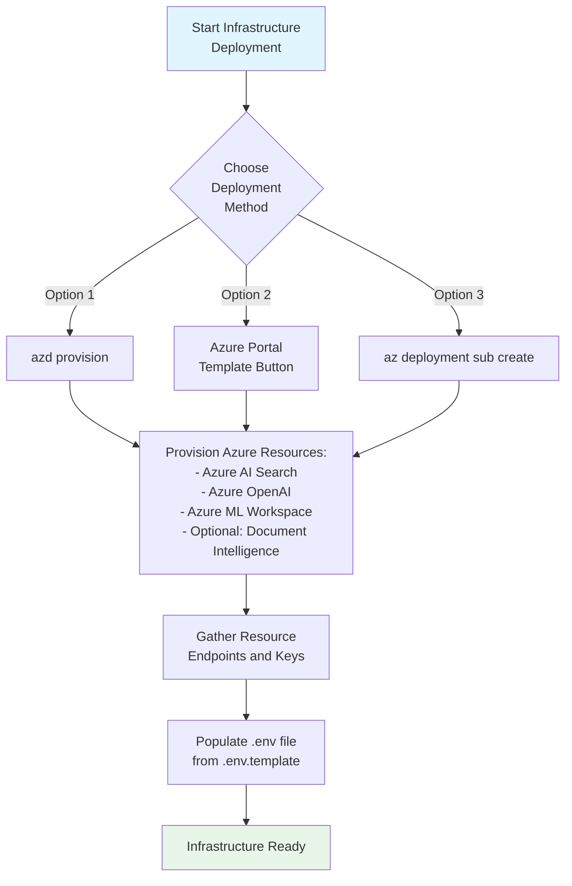
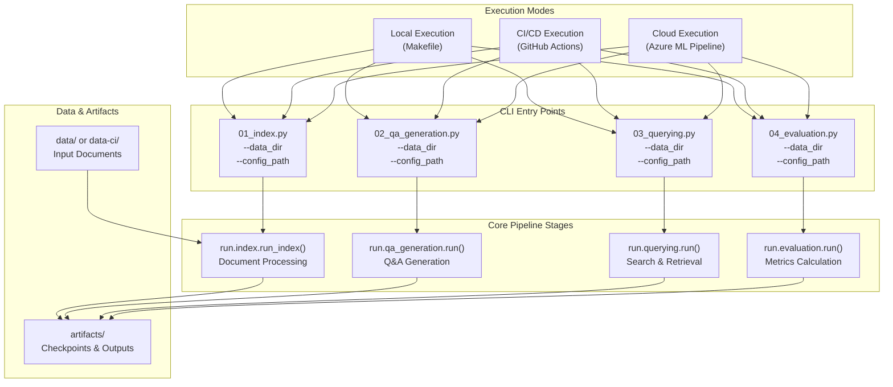
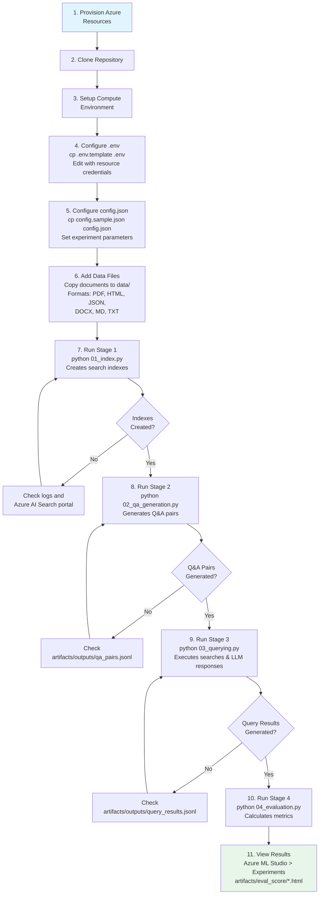

<!-- source: DeepWiki mcp.deepwiki.com · repo microsoft/rag-experiment-accelerator · page 2 Getting Started · fetched 2026-10-26 -->

# Getting Started

<details>
<summary>Relevant source files</summary>

The following files were used as context for generating this wiki page:

- [.env.template](.env.template)
- [.github/workflows/build_validation_workflow.yml](.github/workflows/build_validation_workflow.yml)
- [.github/workflows/rag_exp_acc_ci.yml](.github/workflows/rag_exp_acc_ci.yml)
- [Makefile](Makefile)
- [README.md](README.md)
- [config.sample.json](config.sample.json)
- [dev-requirements.txt](dev-requirements.txt)
- [docs/environment-variables.md](docs/environment-variables.md)
- [rag_experiment_accelerator/embedding/st_embedding_model.py](rag_experiment_accelerator/embedding/st_embedding_model.py)
- [rag_experiment_accelerator/embedding/tests/test_st_embedding_model.py](rag_experiment_accelerator/embedding/tests/test_st_embedding_model.py)
- [requirements.txt](requirements.txt)

</details>


This page provides a quick-start guide for setting up and running the RAG Experiment Accelerator for the first time. It covers the prerequisite resources, initial configuration, and execution of your first experiment. For detailed information about installation procedures, see [Installation and Dependencies](#2.1). For comprehensive configuration parameter documentation, see [Configuration Guide](#2.2). For a step-by-step tutorial, see [Running Your First Experiment](#2.3).

## Prerequisites

Before using the RAG Experiment Accelerator, you must provision the required Azure resources and set up your compute environment.

### Required Azure Resources

The accelerator requires the following Azure services:

| Service | Purpose | Configuration Notes |
|---------|---------|---------------------|
| Azure AI Search | Stores document indexes and performs retrieval operations | Semantic Ranking is optional but recommended |
| Azure OpenAI | Provides embedding models, chat models for Q&A generation and response generation, and evaluation models | Requires deployments for chat (e.g., `gpt-35-turbo`) and embeddings (e.g., `text-embedding-ada-002`) |
| Azure ML Workspace | Tracks experiments via MLflow and provides optional distributed compute | Required for Stages 3-4 experiment tracking |
| Azure Document Intelligence | Optional: Advanced document parsing with table extraction | Uses `prebuilt-layout` or `prebuilt-read` models |
| Azure AI Language Service | Optional: Language detection for multi-lingual support | Used for custom analyzers in search indexes |

**Infrastructure Deployment Workflow**



The repository provides three infrastructure deployment options:

1. **Azure Developer CLI (azd)**: Run `azd provision` from the repository root [README.md:131-139]()
2. **Azure Portal UI**: Click the "Deploy to Azure" button [README.md:146-147]()
3. **Azure CLI**: Execute `az deployment sub create` with template file [README.md:154-179]()

Sources: [README.md:125-180](), [.env.template:1-49](), [docs/environment-variables.md:1-36]()

### Compute Environment Setup

The accelerator supports two compute environment options:

**Option 1: Development Container (Recommended)**

Uses a pre-configured container with all dependencies installed. Requires WSL on Windows.

- Prerequisites: Ubuntu 22.04 LTS (Windows Store), Docker Desktop, VS Code, Remote-Containers extension
- Clone repository and open in VS Code, which prompts to reopen in dev container
- All dependencies automatically available

**Option 2: Local Installation**

Install dependencies directly on your host machine (Windows/Mac/Linux).

```bash
# Clone repository
git clone https://github.com/microsoft/rag-experiment-accelerator.git
cd rag-experiment-accelerator

# Create conda environment
conda create -n rag-experiment python=3.11
conda activate rag-experiment

# Install dependencies
pip install .

# Install and configure Azure CLI
az login
az account set --subscription="<your_subscription_guid>"
```

The `pip install .` command installs all dependencies defined in [requirements.txt:1-41](), including:
- Azure SDKs: `azure-ai-ml`, `azure-search-documents`, `azure.ai.documentintelligence`
- LLM libraries: `openai`, `langchain`, `langchain-community`
- Embedding models: `sentence-transformers`
- Evaluation: `evaluate`, `rouge-score`, `textdistance`, `levenshtein`
- ML tracking: `mlflow`, `azureml-mlflow`

Sources: [README.md:69-124](), [requirements.txt:1-41]()

## Configuration Overview

The accelerator is **configuration-driven**, requiring two primary configuration files:

### Environment Variables (.env)

Create `.env` from `.env.template` and populate with Azure resource credentials:

```bash
cp .env.template .env
```

**Required Environment Variables**

| Variable | Description | Example |
|----------|-------------|---------|
| `AZURE_SEARCH_SERVICE_ENDPOINT` | Azure AI Search service endpoint | `https://<name>.search.windows.net` |
| `AZURE_SEARCH_ADMIN_KEY` | Azure AI Search admin key | `<32-character-key>` |
| `AZURE_SEARCH_USE_SEMANTIC_SEARCH` | Enable semantic ranking (if available) | `True` |
| `OPENAI_API_KEY` | Azure OpenAI API key | `<api-key>` |
| `OPENAI_API_TYPE` | Must be `azure` or `open_ai` | `azure` |
| `OPENAI_ENDPOINT` | Azure OpenAI service endpoint | `https://<name>.openai.azure.com/` |
| `OPENAI_API_VERSION` | Azure OpenAI API version | `2023-03-15-preview` |
| `AML_SUBSCRIPTION_ID` | Azure subscription GUID | `<guid>` |
| `AML_WORKSPACE_NAME` | Azure ML workspace name | `<workspace-name>` |
| `AML_RESOURCE_GROUP_NAME` | Azure resource group name | `<rg-name>` |

**Optional Variables**: `AZURE_DOCUMENT_INTELLIGENCE_ENDPOINT`, `AZURE_DOCUMENT_INTELLIGENCE_ADMIN_KEY`, `AZURE_LANGUAGE_SERVICE_ENDPOINT`, `AZURE_LANGUAGE_SERVICE_KEY`, `MAX_WORKER_THREADS`, `LOGGING_LEVEL`

Sources: [.env.template:1-49](), [docs/environment-variables.md:15-36]()

### Experiment Configuration (config.json)

Create `config.json` from `config.sample.json` and customize experiment hyperparameters:

```bash
cp config.sample.json config.json
```

The configuration file defines all experiment parameters using a hierarchical structure. The `Config` object supports **multi-configuration experiments** via array notation - any parameter can be a list to test multiple values:

```json
{
    "experiment_name": "my-first-experiment",
    "job_name": "baseline-run",
    "use_checkpoints": true,
    "index": {
        "index_name_prefix": "idx",
        "chunking": {
            "chunk_size": [500, 1000],
            "overlap_size": [100, 200]
        },
        "embedding_model": [
            {
                "type": "sentence-transformer",
                "model_name": "all-mpnet-base-v2"
            }
        ]
    },
    "search": {
        "search_type": ["search_for_manual_hybrid", "search_for_match_semantic"],
        "retrieve_num_of_documents": 5
    }
}
```

The `Config.index.flatten()` method generates all combinations of configurations (e.g., 2 chunk sizes × 2 overlaps × 2 search types = 8 index configurations) for systematic experimentation. See [Configuration Guide](#2.2) for complete parameter reference.

Sources: [config.sample.json:1-88](), [README.md:283-357]()

## Execution Modes

The accelerator supports three execution modes that all invoke the same four pipeline stages via CLI scripts `01_index.py`, `02_qa_generation.py`, `03_querying.py`, `04_evaluation.py`.

**Pipeline Execution Modes**



### Local Execution with Makefile

The [Makefile:1-76]() provides convenient targets for local execution:

```bash
# Run all stages sequentially
make all

# Run individual stages
make index      # Stage 1: Indexing
make qnagen     # Stage 2: Q&A Generation
make query      # Stage 3: Querying
make eval       # Stage 4: Evaluation

# Run query and evaluation only (skip indexing and Q&A)
make query_eval

# Cleanup operations
make clear_docs         # Remove data/ directory
make clear_artifacts    # Remove artifacts/ outputs
make clear_checkpoints  # Remove checkpoint cache
```

Makefile targets accept optional arguments:
- `dd`: Data directory path (default: `./data`)
- `cp`: Config file path (default: `./config.json`)

Example: `make index dd=./my-data cp=./my-config.json`

Sources: [Makefile:1-76](), [README.md:182-223]()

### CI/CD Execution with GitHub Actions

The [.github/workflows/rag_exp_acc_ci.yml:1-67]() workflow runs the complete pipeline on every pull request and push to main branches:

```yaml
- name: execute index creation step
  run: python 01_index.py --data_dir='data-ci' --config_path=${{ github.workspace }}/.github/workflows/config.json

- name: execute qna step
  run: python 02_qa_generation.py --data_dir='data-ci' --config_path=${{ github.workspace }}/.github/workflows/config.json

- name: execute querying step
  run: python 03_querying.py --data_dir='data-ci' --config_path=${{ github.workspace }}/.github/workflows/config.json

- name: execute evaluation step
  run: python 04_evaluation.py --data_dir='data-ci' --config_path=${{ github.workspace }}/.github/workflows/config.json
```

Uses smaller test dataset in `data-ci/` directory for faster validation.

Sources: [.github/workflows/rag_exp_acc_ci.yml:51-66]()

### Azure ML Pipeline Execution

For distributed compute with experiment tracking:

```bash
make azureml
# or
python azureml/pipeline.py --data_dir ./data --config_path ./config.json
```

Requires `AML_COMPUTE_NAME` and `AML_COMPUTE_INSTANCES_NUMBER` in `.env`. See Azure ML Pipeline documentation for details.

Sources: [Makefile:45-47](), [README.md:224]()

## Quick Start Workflow

**End-to-End Setup and Execution**



### Step-by-Step Instructions

1. **Provision Azure Resources**: Use `azd provision`, Azure Portal template, or Azure CLI deployment
2. **Clone Repository**: `git clone https://github.com/microsoft/rag-experiment-accelerator.git`
3. **Setup Environment**: Choose dev container or local installation with `pip install .`
4. **Configure .env**: Copy template and add Azure resource endpoints/keys
5. **Configure config.json**: Copy sample and customize experiment parameters
6. **Add Data**: Place documents in `data/` directory (PDF, HTML, MD, JSON, DOCX, TXT)
7. **Run Stage 1 - Indexing**: `python 01_index.py` or `make index`
   - Creates Azure AI Search indexes
   - Chunks documents according to `config.index.chunking` parameters
   - Generates embeddings using `config.index.embedding_model`
   - Outputs: `artifacts/docs_data/`, `artifacts/index_data/`, Azure AI Search indexes
8. **Run Stage 2 - Q&A Generation**: `python 02_qa_generation.py` or `make qnagen`
   - Generates question-answer pairs using Azure OpenAI
   - Outputs: `artifacts/outputs/qa_pairs.jsonl`
9. **Run Stage 3 - Querying**: `python 03_querying.py` or `make query`
   - Executes searches against indexes for each Q&A pair
   - Applies optional reranking
   - Generates LLM responses
   - Outputs: `artifacts/outputs/query_results.jsonl`, Azure ML data assets
10. **Run Stage 4 - Evaluation**: `python 04_evaluation.py` or `make eval`
    - Calculates configured metrics (algorithm/BERT/LLM-based)
    - Generates visualizations
    - Logs to MLflow/Azure ML
    - Outputs: `artifacts/eval_score/*.csv`, `*.html`, `*.png`
11. **View Results**: Access Azure ML Studio > Experiments to compare runs and view reports

Sources: [README.md:182-223](), [01_index.py:1-100]() (inferred), [02_qa_generation.py:1-100]() (inferred), [03_querying.py:1-100]() (inferred), [04_evaluation.py:1-100]() (inferred)

## Data Directory Structure

The accelerator expects input documents in a configurable data directory:

```
data/                          # Default input directory
├── document1.pdf
├── document2.html
├── document3.json
└── document4.docx

data-ci/                       # CI test data (smaller subset)
├── test_doc1.pdf
└── test_doc2.json

artifacts/                     # Generated outputs
├── checkpoints/               # Cached results for expensive operations
├── docs_data/                 # Chunked documents from Stage 1
├── index_data/                # Index metadata from Stage 1
├── sampling/                  # Sampling visualizations (if enabled)
└── outputs/
    ├── qa_pairs.jsonl         # Stage 2 output
    └── query_results.jsonl    # Stage 3 output
```

The data directory can be specified via:
- CLI argument: `--data_dir ./my-data`
- Makefile parameter: `make index dd=./my-data`
- Default: `./data`

Supported formats specified in `config.data_formats`: `["*"]` (all) or specific list like `["pdf", "json", "html"]`

Sources: [README.md:195-223](), [config.sample.json:6]()

## Checkpoint System

The accelerator includes an optional **checkpoint system** to cache expensive operations (LLM calls, embeddings, clustering) and enable resumption from failures:

**Enabling Checkpoints**

Set `"use_checkpoints": true` in `config.json` [config.sample.json:8]()

**Checkpoint Behavior**

- Caches results keyed by content hash in `artifacts/checkpoints/`
- Automatically skips re-computation of identical inputs
- Survives across runs and different configurations
- Can be cleared with `make clear_checkpoints`

**When to Use Checkpoints**

✅ Use checkpoints when:
- Iterating on configuration with same data
- Recovering from mid-pipeline failures
- Testing evaluation metrics without re-running queries

❌ Disable checkpoints when:
- Data or code logic has changed
- Starting completely fresh experiment
- Troubleshooting unexpected results

Sources: [config.sample.json:8](), [README.md:283-357](), [Makefile:61-63]()

## Common Issues and Troubleshooting

### Authentication Errors

**Symptom**: "Authentication failed" or "Forbidden" errors when accessing Azure resources

**Solution**: 
1. Run `az login` to authenticate
2. Set subscription: `az account set --subscription="<guid>"`
3. Verify user has Contributor access to Azure resources
4. For persistent issues, start fresh terminal and re-authenticate

### Configuration Errors

**Symptom**: "Index out of range" or unexpected errors during reranking

**Root Causes**:
- `retrieve_num_of_documents` too high/low for reranking thresholds
- `cross_encoder_at_k` > number of retrieved documents
- `llm_rerank_threshold` creates oversized LLM context

**Solution**: Ensure configuration parameter relationships are valid:
- `llm_rerank_threshold` ≤ `retrieve_num_of_documents`
- `cross_encoder_at_k` ≤ `retrieve_num_of_documents`

### Azure OpenAI Errors

**Symptom**: JSON parsing errors during Q&A generation or rate limit errors

**Root Causes**:
- Content filtering blocking inappropriate content
- Token/rate limits exceeded
- Invalid deployment name configuration

**Solution**:
1. Verify `azure_oai_chat_deployment_name` matches Azure OpenAI deployment
2. Check separate `azure_oai_eval_deployment_name` for evaluation to avoid quota conflicts
3. Review content filtering settings in Azure OpenAI Studio
4. Consider using separate deployments for chat vs evaluation

Sources: [README.md:481-522]()

## Next Steps

- **[Installation and Dependencies](#2.1)**: Detailed dependency information and advanced installation scenarios
- **[Configuration Guide](#2.2)**: Complete reference for all configuration parameters, including embedding models, search types, evaluation metrics, and query expansion options
- **[Running Your First Experiment](#2.3)**: Step-by-step tutorial with detailed explanations of each stage and how to interpret results
- **[Pipeline Architecture](#3)**: Understanding the 4-stage pipeline architecture and data flow
- **[Document Processing](#5)**: Deep dive into document loaders, chunking strategies, and sampling
- **[Evaluation Metrics](#8)**: Comprehensive guide to algorithm-based, BERT-based, and LLM-based evaluation metrics

Sources: [README.md:1-571](), Table of Contents structure

---

